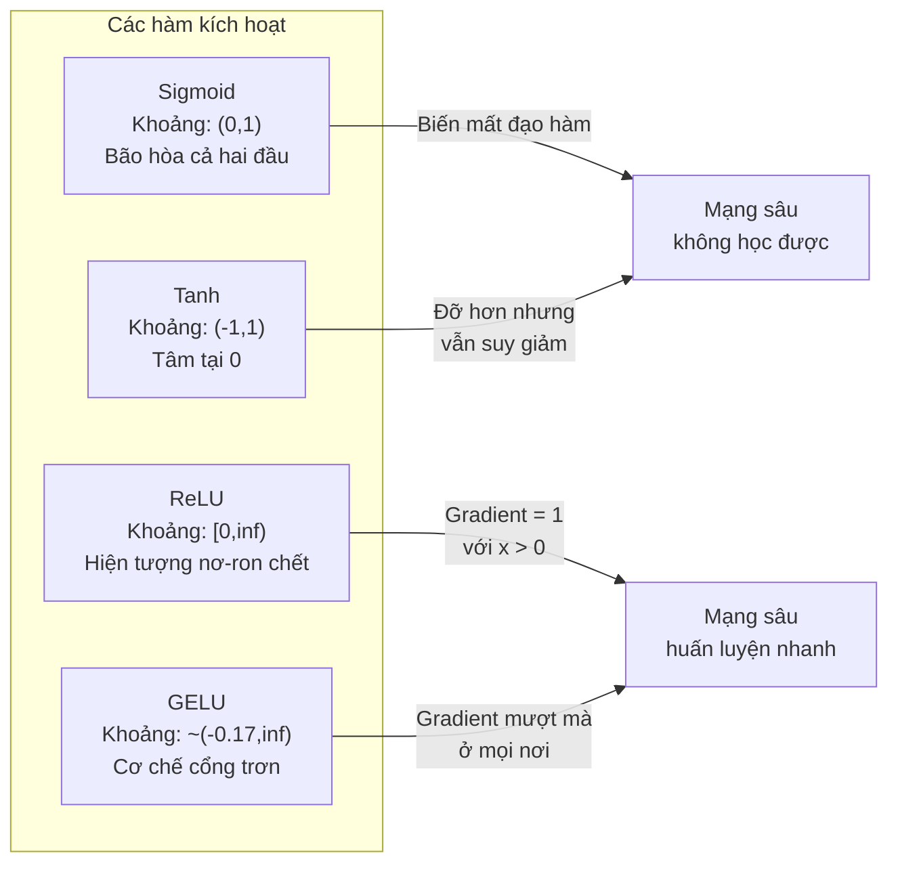
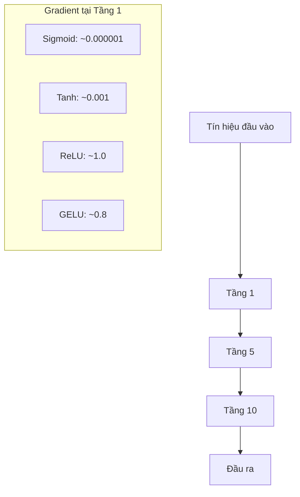
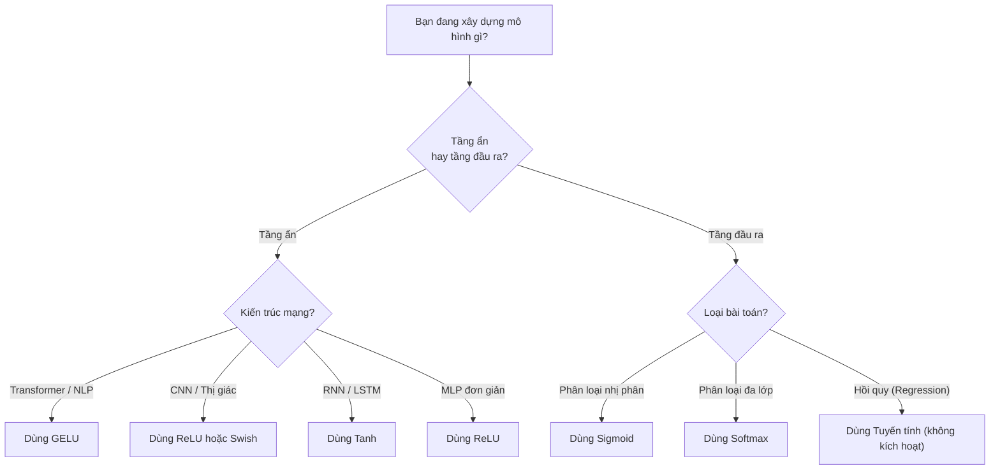

# Các hàm kích hoạt (Activation Functions)

> Không có tính phi tuyến, mạng 100 tầng của bạn chẳng khác nào một phép nhân ma trận cồng kềnh. Các hàm kích hoạt chính là những cánh cổng cho phép mạng nơ-ron tư duy theo các đường cong.

**Type:** Build
**Languages:** Python
**Prerequisites:** Bài học 03.03 (Lan truyền ngược)
**Time:** ~75 phút

## Mục tiêu học tập

- Tự tay triển khai từ con số 0 các hàm sigmoid, tanh, ReLU, Leaky ReLU, GELU, Swish, và softmax kèm theo đạo hàm của chúng
- Chẩn đoán vấn đề biến mất đạo hàm (vanishing gradient) bằng cách đo biên độ kích hoạt qua hơn 10 tầng với các hàm kích hoạt khác nhau
- Phát hiện các nơ-ron chết (dead neurons) trong mạng ReLU và giải thích lý do GELU tránh được dạng lỗi này
- Lựa chọn chính xác hàm kích hoạt phù hợp cho từng kiến trúc (transformer, CNN, RNN, tầng đầu ra)

## Vấn đề thực tế

Hãy xếp chồng hai phép biến đổi tuyến tính: $y = W_2(W_1 x + b_1) + b_2$. Khai triển ra: $y = W_2 W_1 x + W_2 b_1 + b_2$. Biểu thức đó chỉ đơn giản là $y = Ax + c$ -- một phép biến đổi tuyến tính duy nhất. Bất kể bạn xếp chồng bao nhiêu tầng tuyến tính đi chăng nữa, kết quả cuối cùng đều co cụm lại thành một phép nhân ma trận duy nhất. Mạng 100 tầng của bạn có năng lực biểu diễn không hơn gì một tầng đơn lẻ!

Đây không phải là một điều kỳ lạ trên lý thuyết. Nó có nghĩa là một mạng tuyến tính sâu về mặt toán học hoàn toàn không thể học được cổng XOR, không thể phân loại tập dữ liệu hình xoắn ốc, và không thể nhận diện khuôn mặt. Nếu thiếu các hàm kích hoạt, độ sâu chỉ là ảo ảnh.

Các hàm kích hoạt phá vỡ tính tuyến tính đó. Chúng bẻ cong đầu ra của mỗi tầng qua một hàm số phi tuyến, ban tặng cho mạng nơ-ron khả năng uốn lượn các ranh giới quyết định, xấp xỉ các hàm số bất kỳ và thực sự học hỏi. Nhưng nếu chọn sai hàm kích hoạt, đạo hàm của bạn sẽ suy giảm về 0 (như sigmoid trong mạng sâu), bùng nổ tới vô cực (các hàm không bị chặn nếu không khởi tạo cẩn thận), hoặc các nơ-ron của bạn sẽ chết vĩnh viễn (như ReLU với hệ số chệch âm lớn). Việc lựa chọn hàm kích hoạt quyết định trực tiếp việc mạng của bạn có thể học được hay không.

## Khái niệm

### Vì sao tính phi tuyến là bắt buộc

Nhân ma trận có tính kết hợp. Nhân một vector với ma trận $A$ rồi nhân tiếp với ma trận $B$ hoàn toàn tương đương với việc nhân nó với ma trận tích $AB$. Điều này có nghĩa việc xếp chồng 10 tầng tuyến tính hoàn toàn tương đương về mặt toán học với một tầng tuyến tính duy nhất có ma trận lớn. Tất cả tham số đó, tất cả độ sâu đó -- đều bị lãng phí. Bạn cần một thứ gì đó ngắt đứt chuỗi liên kết tuyến tính này. Đó chính là nhiệm vụ của hàm kích hoạt.

Dưới đây là chứng minh toán học. Một tầng tuyến tính tính $f(x) = Wx + b$. Xếp chồng hai tầng:

```math
\begin{aligned}
\text{Tầng 1:} \quad h &= W_1 x + b_1 \\
\text{Tầng 2:} \quad y &= W_2 h + b_2
\end{aligned}
```

Thay thế:

```math
\begin{aligned}
y &= W_2 (W_1 x + b_1) + b_2 \\
y &= (W_2 W_1) x + (W_2 b_1 + b_2) \\
y &= A x + c
\end{aligned}
```

Vẫn chỉ là một tầng. Bây giờ hãy chèn một hàm kích hoạt phi tuyến $g()$ vào giữa hai tầng:

```math
\begin{aligned}
h &= g(W_1 x + b_1) \\
y &= W_2 h + b_2
\end{aligned}
```

Lúc này phép thế không thể rút gọn được nữa. Biểu thức $W_2 g(W_1 x + b_1) + b_2$ không thể thu gọn về một phép biến đổi tuyến tính đơn lẻ. Mạng nơ-ron đã có thể biểu diễn các hàm phi tuyến. Mỗi tầng bổ sung có kèm hàm kích hoạt sẽ thực sự gia tăng dung lượng biểu diễn của mô hình.

### Sigmoid

Hàm kích hoạt nguyên bản của mạng nơ-ron:

```math
\text{sigmoid}(x) = \frac{1}{1 + e^{-x}}
```

Khoảng giá trị đầu ra: (0, 1). Trơn, khả vi, ánh xạ bất kỳ số thực nào thành một giá trị tương tự như xác suất.

Đạo hàm:

```math
\text{sigmoid}'(x) = \text{sigmoid}(x) \cdot (1 - \text{sigmoid}(x))
```

Giá trị tối đa của đạo hàm này là 0.25, đạt được tại $x = 0$. Trong lan truyền ngược, các gradient nhân dồn qua từng tầng. Mười tầng sigmoid đồng nghĩa với việc gradient bị nhân tối đa với 0.25 tới mười lần:

```math
0.25^{10} = 0.000000953674
```

Nhỏ hơn một phần triệu tín hiệu ban đầu! Đây chính là vấn đề biến mất đạo hàm (vanishing gradient). Gradient ở các tầng đầu tiên trở nên quá nhỏ khiến trọng số hầu như không thể cập nhật. Mạng có vẻ như đang học -- hàm mất mát ở các tầng sau có giảm -- nhưng các tầng đầu tiên thì bị đóng băng hoàn toàn. Mạng sigmoid sâu đơn giản là không thể huấn luyện được.

Một vấn đề khác: đầu ra của sigmoid luôn dương (từ 0 đến 1), nghĩa là gradient đối với các trọng số luôn có cùng dấu. Điều này gây ra hiện tượng dao động hình zích-zắc (zig-zagging) trong quá trình hạ độ dốc.

### Tanh

Phiên bản dịch tâm về 0 của sigmoid:

```math
\tanh(x) = \frac{e^x - e^{-x}}{e^x + e^{-x}}
```

Khoảng giá trị đầu ra: (-1, 1). Có tâm tại 0 (zero-centered), giúp loại bỏ hiện tượng dao động zích-zắc.

Đạo hàm:

```math
\tanh'(x) = 1 - \tanh(x)^2
```

Đạo hàm cực đại là 1.0 tại $x = 0$ -- tốt hơn gấp bốn lần so với sigmoid. Tuy nhiên vấn đề biến mất đạo hàm vẫn tồn tại: với các đầu vào có độ lớn dương hoặc âm lớn, đạo hàm nhanh chóng tiệm cận về 0. Mười tầng tanh vẫn bóp nghẹt gradient, dù không khốc liệt bằng sigmoid.

### ReLU: Bước đột phá mang tính lịch sử

Đơn vị tuyến tính chỉnh lưu (Rectified Linear Unit). Được phổ biến rộng rãi trong học sâu bởi Nair và Hinton vào năm 2010 (dù hàm số này đã xuất hiện từ công trình năm 1969 của Fukushima), nó đã thay đổi mọi thứ:

```math
\text{relu}(x) = \max(0, x)
```

Khoảng giá trị đầu ra: $[0, \infty)$. Đạo hàm cực kỳ đơn giản:

```math
\text{relu}'(x) = \begin{cases} 1 & \text{nếu } x > 0 \\ 0 & \text{nếu } x \le 0 \end{cases}
```

Không còn biến mất đạo hàm ở phần giá trị dương. Gradient bằng chính xác 1, truyền thẳng xuyên qua các tầng. Đó là lý do vì sao các mạng nơ-ron sâu bỗng nhiên có thể huấn luyện được -- ReLU bảo toàn biên độ gradient xuyên suốt các tầng mạng.

Tuy nhiên, nó có một dạng lỗi: vấn đề nơ-ron chết (dead neuron problem). Nếu đầu vào có trọng số của một nơ-ron luôn bị âm (do hệ số chệch âm quá lớn hoặc do khởi tạo trọng số không may mắn), đầu ra của nó luôn bằng 0, gradient của nó luôn bằng 0, và nó không bao giờ cập nhật nữa. Nó chết vĩnh viễn. Trong thực tế, có từ 10% đến 40% số nơ-ron trong mạng ReLU có thể bị chết trong quá trình huấn luyện.

### Leaky ReLU

Giải pháp sửa lỗi đơn giản nhất cho nơ-ron chết:

```math
\text{leaky\_relu}(x) = \begin{cases} x & \text{nếu } x > 0 \\ \alpha x & \text{nếu } x \le 0 \end{cases}
```

Trong đó $\alpha$ là một hằng số nhỏ, thường là 0.01. Nhánh âm có một độ dốc nhỏ thay vì bằng 0, nhờ vậy các nơ-ron chết vẫn nhận được tín hiệu gradient để có cơ hội phục hồi.

### GELU: Chuẩn mực hiện đại

Đơn vị tuyến tính sai số Gauss (Gaussian Error Linear Unit). Được Hendrycks và Gimpel đề xuất vào năm 2016. Đây là hàm kích hoạt mặc định trong BERT, GPT, và hầu hết các mô hình Transformer hiện đại.

```math
\text{gelu}(x) = x \cdot \Phi(x)
```

Trong đó $\Phi(x)$ là hàm phân phối tích lũy của phân phối chuẩn tắc. Công thức xấp xỉ dùng trong thực tế:

```math
\text{gelu}(x) \approx 0.5 \cdot x \cdot \left(1 + \tanh\left(\sqrt{2/\pi} \cdot (x + 0.044715 \cdot x^3)\right)\right)
```

GELU trơn ở mọi điểm, cho phép các giá trị âm nhỏ đi qua (khác với ReLU cắt thẳng về 0), và có cách diễn giải theo xác suất: nó đánh trọng số cho mỗi đầu vào theo xác suất đầu vào đó mang giá trị dương dưới phân phối Gauss. Cơ chế cổng trơn này vượt trội hơn ReLU trong kiến trúc Transformer vì nó cung cấp dòng chảy gradient tốt hơn và loại bỏ hoàn toàn vấn đề nơ-ron chết.

### Swish / SiLU

Hàm kích hoạt tự cổng (self-gated activation) được Ramachandran và cộng sự khám phá năm 2017 thông qua tìm kiếm tự động:

```math
\text{swish}(x) = x \cdot \text{sigmoid}(x)
```

Swish được định nghĩa là $x \cdot \text{sigmoid}(x)$. Google đã tìm ra nó thông qua tìm kiếm tự động trên không gian hàm kích hoạt -- một mạng nơ-ron thiết kế nên các thành phần của mạng nơ-ron.

Giống như GELU, Swish trơn, không đơn điệu (non-monotonic), và cho phép các giá trị âm nhỏ. Khác biệt rất tinh tế: Swish dùng sigmoid để tạo cổng trong khi GELU dùng hàm tích lũy Gauss. Trong thực tế, hiệu năng của chúng gần như tương đương. Swish được dùng nhiều trong EfficientNet và một số mô hình thị giác máy tính. GELU thống trị trong các mô hình ngôn ngữ lớn.

### Softmax: Hàm kích hoạt ở tầng đầu ra

Không dùng cho các tầng ẩn. Softmax biến đổi một vector các điểm số thô (logits) thành một phân phối xác suất:

```math
\text{softmax}(x_i) = \frac{e^{x_i}}{\sum_j e^{x_j}}
```

Mỗi đầu ra nằm trong khoảng từ 0 đến 1. Tổng tất cả các đầu ra bằng đúng 1. Điều này biến nó thành hàm kích hoạt tiêu chuẩn cho bài toán phân loại đa lớp. Logit lớn nhất nhận xác suất cao nhất, nhưng khác với hàm `argmax`, softmax khả vi và bảo tồn thông tin về độ tin cậy tương đối giữa các lớp.

### So sánh hình dạng các hàm



### So sánh dòng chảy Gradient



### Chọn hàm kích hoạt nào và khi nào



```figure
softmax-temperature
```

## Xây dựng thực hành (Build It)

### Bước 1: Triển khai tất cả các hàm kích hoạt kèm đạo hàm

Mỗi hàm nhận một số thực float và trả về một số thực float. Mỗi hàm đạo hàm nhận cùng đầu vào đó và trả về gradient tương ứng:

```python
import math

def sigmoid(x):
    x = max(-500, min(500, x))
    return 1.0 / (1.0 + math.exp(-x))

def sigmoid_derivative(x):
    s = sigmoid(x)
    return s * (1 - s)

def tanh_act(x):
    return math.tanh(x)

def tanh_derivative(x):
    t = math.tanh(x)
    return 1 - t * t

def relu(x):
    return max(0.0, x)

def relu_derivative(x):
    return 1.0 if x > 0 else 0.0

def leaky_relu(x, alpha=0.01):
    return x if x > 0 else alpha * x

def leaky_relu_derivative(x, alpha=0.01):
    return 1.0 if x > 0 else alpha

def gelu(x):
    return 0.5 * x * (1 + math.tanh(math.sqrt(2 / math.pi) * (x + 0.044715 * x ** 3)))

def gelu_derivative(x):
    phi = 0.5 * (1 + math.erf(x / math.sqrt(2)))
    pdf = math.exp(-0.5 * x * x) / math.sqrt(2 * math.pi)
    return phi + x * pdf

def swish(x):
    return x * sigmoid(x)

def swish_derivative(x):
    s = sigmoid(x)
    return s + x * s * (1 - s)

def softmax(xs):
    max_x = max(xs)
    exps = [math.exp(x - max_x) for x in xs]
    total = sum(exps)
    return [e / total for e in exps]
```

### Bước 2: Trực quan hóa vùng gradient bị triệt tiêu

Tính toán gradient tại 100 điểm cách đều từ -5 đến 5. In biểu đồ histogram dạng văn bản hiển thị tỷ lệ vùng gradient gần như bằng 0 của từng hàm:

```python
def gradient_scan(name, derivative_fn, start=-5, end=5, n=100):
    step = (end - start) / n
    near_zero = 0
    healthy = 0
    for i in range(n):
        x = start + i * step
        g = derivative_fn(x)
        if abs(g) < 0.01:
            near_zero += 1
        else:
            healthy += 1
    pct_dead = near_zero / n * 100
    print(f"{name:15s}: {healthy:3d} khỏe mạnh, {near_zero:3d} xấp xỉ 0 ({pct_dead:.0f}% vùng chết)")

gradient_scan("Sigmoid", sigmoid_derivative)
gradient_scan("Tanh", tanh_derivative)
gradient_scan("ReLU", relu_derivative)
gradient_scan("Leaky ReLU", leaky_relu_derivative)
gradient_scan("GELU", gelu_derivative)
gradient_scan("Swish", swish_derivative)
```

### Bước 3: Thí nghiệm biến mất đạo hàm qua nhiều tầng

Lan truyền tín hiệu qua $N$ tầng sử dụng sigmoid so với ReLU. Đo lường biên độ kích hoạt thay đổi ra sao:

```python
import random

def vanishing_gradient_experiment(activation_fn, name, n_layers=10, n_inputs=5):
    random.seed(42)
    values = [random.gauss(0, 1) for _ in range(n_inputs)]

    print(f"\n{name} qua {n_layers} tầng:")
    for layer in range(n_layers):
        weights = [random.gauss(0, 1) for _ in range(n_inputs)]
        z = sum(w * v for w, v in zip(weights, values))
        activated = activation_fn(z)
        magnitude = abs(activated)
        bar = "#" * int(magnitude * 20)
        print(f"  Tầng {layer+1:2d}: biên độ = {magnitude:.6f} {bar}")
        values = [activated] * n_inputs

vanishing_gradient_experiment(sigmoid, "Sigmoid")
vanishing_gradient_experiment(relu, "ReLU")
vanishing_gradient_experiment(gelu, "GELU")
```

### Bước 4: Bộ phát hiện nơ-ron chết (Dead Neuron Detector)

Tạo một mạng ReLU, truyền các đầu vào ngẫu nhiên qua nó, đếm xem có bao nhiêu nơ-ron không bao giờ kích hoạt:

```python
def dead_neuron_detector(n_inputs=5, hidden_size=20, n_samples=1000):
    random.seed(0)
    weights = [[random.gauss(0, 1) for _ in range(n_inputs)] for _ in range(hidden_size)]
    biases = [random.gauss(0, 1) for _ in range(hidden_size)]

    fire_counts = [0] * hidden_size

    for _ in range(n_samples):
        inputs = [random.gauss(0, 1) for _ in range(n_inputs)]
        for neuron_idx in range(hidden_size):
            z = sum(w * x for w, x in zip(weights[neuron_idx], inputs)) + biases[neuron_idx]
            if relu(z) > 0:
                fire_counts[neuron_idx] += 1

    dead = sum(1 for c in fire_counts if c == 0)
    rarely_fire = sum(1 for c in fire_counts if 0 < c < n_samples * 0.05)
    healthy = hidden_size - dead - rarely_fire

    print(f"\nBáo cáo nơ-ron chết ({hidden_size} nơ-ron, {n_samples} mẫu):")
    print(f"  Chết (không bao giờ kích hoạt): {dead}")
    print(f"  Gần chết (<5% số lần):          {rarely_fire}")
    print(f"  Khỏe mạnh:                      {healthy}")
    print(f"  Tỷ lệ nơ-ron chết:              {dead/hidden_size*100:.1f}%")

    for i, c in enumerate(fire_counts):
        status = "DEAD" if c == 0 else "WEAK" if c < n_samples * 0.05 else "OK"
        bar = "#" * (c * 40 // n_samples)
        print(f"  Nơ-ron {i:2d}: {c:4d}/{n_samples} lần kích hoạt [{status:4s}] {bar}")

dead_neuron_detector()
```

### Bước 5: So sánh hiệu quả huấn luyện -- Sigmoid vs ReLU vs GELU

Huấn luyện cùng một mạng hai tầng trên tập dữ liệu hình tròn (điểm trong hình tròn = lớp 1, ngoài = lớp 0) với ba hàm kích hoạt khác nhau. So sánh tốc độ hội tụ:

```python
def make_circle_data(n=200, seed=42):
    random.seed(seed)
    data = []
    for _ in range(n):
        x = random.uniform(-2, 2)
        y = random.uniform(-2, 2)
        label = 1.0 if x * x + y * y < 1.5 else 0.0
        data.append(([x, y], label))
    return data


class ActivationNetwork:
    def __init__(self, activation_fn, activation_deriv, hidden_size=8, lr=0.1):
        random.seed(0)
        self.act = activation_fn
        self.act_d = activation_deriv
        self.lr = lr
        self.hidden_size = hidden_size

        self.w1 = [[random.gauss(0, 0.5) for _ in range(2)] for _ in range(hidden_size)]
        self.b1 = [0.0] * hidden_size
        self.w2 = [random.gauss(0, 0.5) for _ in range(hidden_size)]
        self.b2 = 0.0

    def forward(self, x):
        self.x = x
        self.z1 = []
        self.h = []
        for i in range(self.hidden_size):
            z = self.w1[i][0] * x[0] + self.w1[i][1] * x[1] + self.b1[i]
            self.z1.append(z)
            self.h.append(self.act(z))

        self.z2 = sum(self.w2[i] * self.h[i] for i in range(self.hidden_size)) + self.b2
        self.out = sigmoid(self.z2)
        return self.out

    def backward(self, target):
        error = self.out - target
        d_out = error * self.out * (1 - self.out)

        for i in range(self.hidden_size):
            d_h = d_out * self.w2[i] * self.act_d(self.z1[i])
            self.w2[i] -= self.lr * d_out * self.h[i]
            for j in range(2):
                self.w1[i][j] -= self.lr * d_h * self.x[j]
            self.b1[i] -= self.lr * d_h
        self.b2 -= self.lr * d_out

    def train(self, data, epochs=200):
        losses = []
        for epoch in range(epochs):
            total_loss = 0
            correct = 0
            for x, y in data:
                pred = self.forward(x)
                self.backward(y)
                total_loss += (pred - y) ** 2
                if (pred >= 0.5) == (y >= 0.5):
                    correct += 1
            avg_loss = total_loss / len(data)
            accuracy = correct / len(data) * 100
            losses.append(avg_loss)
            if epoch % 50 == 0 or epoch == epochs - 1:
                print(f"    Epoch {epoch:3d}: loss={avg_loss:.4f}, độ chính xác={accuracy:.1f}%")
        return losses


data = make_circle_data()

configs = [
    ("Sigmoid", sigmoid, sigmoid_derivative),
    ("ReLU", relu, relu_derivative),
    ("GELU", gelu, gelu_derivative),
]

results = {}
for name, act_fn, act_d_fn in configs:
    print(f"\n=== Huấn luyện với {name} ===")
    net = ActivationNetwork(act_fn, act_d_fn, hidden_size=8, lr=0.1)
    losses = net.train(data, epochs=200)
    results[name] = losses

print("\n=== So sánh hàm mất mát cuối cùng ===")
for name, losses in results.items():
    print(f"  {name:10s}: ban đầu={losses[0]:.4f} -> kết thúc={losses[-1]:.4f} (cải thiện: {(1 - losses[-1]/losses[0])*100:.1f}%)")
```

## Ứng dụng thực tế (Use It)

PyTorch cung cấp tất cả các hàm này ở cả dạng hàm (functional) và dạng module:

```python
import torch
import torch.nn as nn
import torch.nn.functional as F

x = torch.randn(4, 10)

relu_out = F.relu(x)
gelu_out = F.gelu(x)
sigmoid_out = torch.sigmoid(x)
swish_out = F.silu(x)

logits = torch.randn(4, 5)
probs = F.softmax(logits, dim=1)

model = nn.Sequential(
    nn.Linear(10, 64),
    nn.GELU(),
    nn.Linear(64, 32),
    nn.GELU(),
    nn.Linear(32, 5),
)
```

Tầng ẩn trong Transformer: dùng GELU. Tầng ẩn trong CNN: dùng ReLU. Tầng đầu ra cho phân loại đa lớp: dùng softmax. Tầng đầu ra cho hồi quy: không dùng (tuyến tính). Tầng đầu ra cho xác suất nhị phân: dùng sigmoid. Chỉ có vậy. Hãy bắt đầu với các thiết lập mặc định này, và chỉ thay đổi khi bạn có bằng chứng thực nghiệm rõ ràng.

RNN và LSTM sử dụng tanh cho trạng thái ẩn và sigmoid cho các cổng, nhưng nếu bạn đang xây dựng mô hình hiện đại hôm nay, khả năng cao bạn không dùng RNN. Nếu nơ-ron bị chết trong mạng ReLU, hãy chuyển sang GELU. Đừng vội tìm đến Leaky ReLU trừ khi bạn có lý do cụ thể -- GELU giải quyết triệt để vấn đề nơ-ron chết và mang lại dòng chảy gradient vượt trội.

## Đóng gói ứng dụng (Ship It)

Bài học này tạo ra:
- `outputs/prompt-activation-selector.md` -- mẫu câu lệnh tái sử dụng giúp bạn lựa chọn chính xác hàm kích hoạt cho bất kỳ kiến trúc mô hình nào

## Bài tập rèn luyện (Exercises)

1. Triển khai Parametric ReLU (PReLU) trong đó độ dốc nhánh âm $\alpha$ là một tham số có thể học được qua huấn luyện. Huấn luyện nó trên tập dữ liệu hình tròn và so sánh với Leaky ReLU có $\alpha$ cố định.
2. Chạy thí nghiệm biến mất đạo hàm với 50 tầng thay vì 10 tầng. Vẽ đồ thị biên độ tại mỗi tầng cho sigmoid, tanh, ReLU, và GELU. Tín hiệu của từng hàm kích hoạt chạm về mức 0 tại tầng thứ mấy?
3. Triển khai hàm ELU (Exponential Linear Unit): $\text{elu}(x) = x$ nếu $x > 0$, $\alpha (e^x - 1)$ nếu $x \le 0$. So sánh tỷ lệ nơ-ron chết của nó với ReLU trên cùng một mạng.
4. Xây dựng một "trình giám sát sức khỏe gradient" chạy trong suốt quá trình huấn luyện: tại mỗi epoch, tính toán biên độ gradient trung bình tại mỗi tầng. In cảnh báo khi gradient của bất kỳ tầng nào giảm xuống dưới 0.001 hoặc vượt quá 100.
5. Sửa đổi thí nghiệm so sánh huấn luyện để sử dụng tập dữ liệu XOR từ Bài học 01 thay vì tập hình tròn. Hàm kích hoạt nào hội tụ nhanh nhất trên XOR? Vì sao kết quả này lại khác biệt so với bài toán hình tròn?

## Thuật ngữ then chốt (Key Terms)

| Thuật ngữ | Cách gọi thông thường | Ý nghĩa kỹ thuật |
|------|----------------|----------------------|
| Activation function (Hàm kích hoạt) | "Phần phi tuyến" | Hàm toán học áp dụng lên đầu ra của từng nơ-ron giúp phá vỡ tính tuyến tính, cho phép mạng học các ánh xạ phức tạp |
| Vanishing gradient (Biến mất đạo hàm) | "Gradient mất hút trong mạng sâu" | Gradient suy giảm theo hàm mũ qua các tầng khi đạo hàm của hàm kích hoạt nhỏ hơn 1, khiến các tầng đầu không thể học |
| Exploding gradient (Bùng nổ đạo hàm) | "Gradient nổ tung" | Gradient tăng theo cấp số nhân qua các tầng khi hệ số nhân vượt quá 1, gây mất ổn định trong huấn luyện |
| Dead neuron (Nơ-ron chết) | "Nơ-ron ngừng học" | Một nơ-ron ReLU có đầu vào luôn âm, dẫn tới đầu ra luôn bằng 0 và gradient luôn bằng 0 vĩnh viễn |
| Sigmoid | "Nén giá trị về 0-1" | Hàm logistic $1/(1+e^{-x})$, quan trọng về mặt lịch sử nhưng gây ra biến mất đạo hàm trong các mạng sâu |
| ReLU | "Cắt phần âm về 0" | $\max(0, x)$ -- hàm kích hoạt giúp học sâu trở nên khả thi trong thực tế nhờ bảo toàn biên độ gradient |
| GELU | "Hàm kích hoạt của Transformer" | Đơn vị tuyến tính sai số Gauss, hàm kích hoạt trơn đánh trọng số đầu vào theo xác suất mang giá trị dương |
| Swish/SiLU | "ReLU tự cổng" | $x \cdot \text{sigmoid}(x)$, được tìm ra qua tìm kiếm tự động, được ứng dụng rộng rãi trong EfficientNet |
| Softmax | "Chuyển điểm số thành xác suất" | Chuẩn hóa một vector logits thành phân phối xác suất trong khoảng (0,1) với tổng bằng đúng 1 |
| Leaky ReLU | "ReLU không bị chết" | $\max(\alpha x, x)$ với $\alpha$ nhỏ (0.01), ngăn ngừa nơ-ron chết nhờ cho phép một gradient âm nhỏ đi qua |
| Saturation (Bão hòa) | "Đoạn nằm ngang của sigmoid" | Các vùng mà đạo hàm của hàm kích hoạt tiệm cận về 0, chặn đứng dòng chảy gradient |
| Logit | "Điểm thô trước softmax" | Đầu ra chưa chuẩn hóa của tầng cuối cùng trước khi áp dụng hàm softmax hoặc sigmoid |

## Tài liệu đọc thêm (Further Reading)

- Nair & Hinton, "Rectified Linear Units Improve Restricted Boltzmann Machines" (2010) -- bài báo giới thiệu ReLU và mở đường cho việc huấn luyện các mạng nơ-ron sâu
- Hendrycks & Gimpel, "Gaussian Error Linear Units (GELUs)" (2016) -- giới thiệu hàm kích hoạt trở thành chuẩn mực mặc định cho các mô hình Transformer
- Ramachandran et al., "Searching for Activation Functions" (2017) -- sử dụng tìm kiếm tự động để khám phá hàm Swish, chứng minh thiết kế hàm kích hoạt có thể tự động hóa
- Glorot & Bengio, "Understanding the difficulty of training deep feedforward neural networks" (2010) -- bài báo chẩn đoán vấn đề biến mất/bùng nổ gradient và đề xuất phương pháp khởi tạo Xavier
- Goodfellow, Bengio, Courville, "Deep Learning" Chương 6.3 (https://www.deeplearningbook.org/) -- khảo sát chuyên sâu và chặt chẽ về các đơn vị ẩn và hàm kích hoạt

