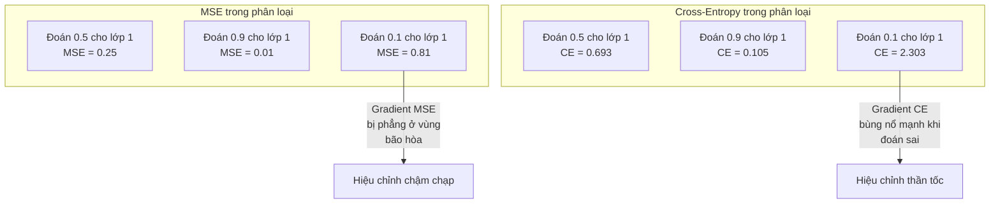
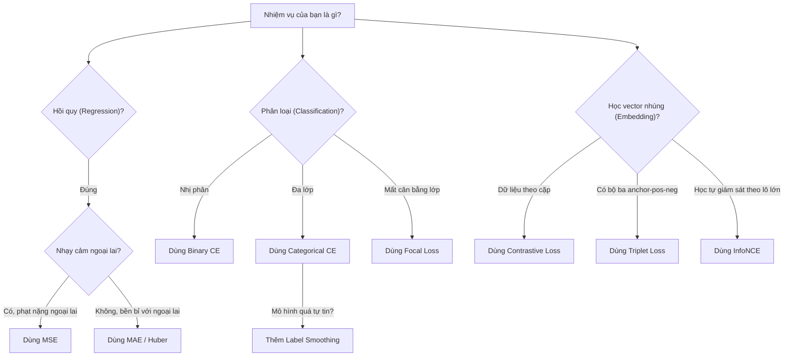
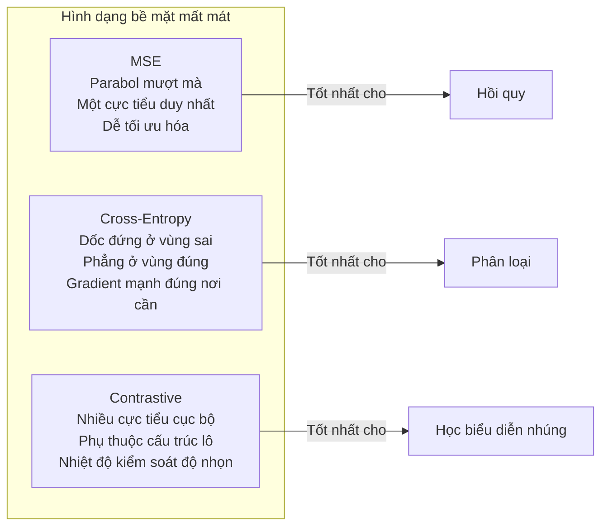

# Các hàm mất mát (Loss Functions)

> Mạng nơ-ron của bạn đưa ra dự đoán. Thực tế khách quan lại cho kết quả khác. Mô hình dự đoán sai lệch bao nhiêu? Con số đó chính là hàm mất mát (loss). Chọn sai hàm mất mát, mô hình của bạn sẽ tối ưu hóa cho một mục tiêu hoàn toàn sai lệch.

**Type:** Build
**Languages:** Python
**Prerequisites:** Bài học 03.04 (Các hàm kích hoạt)
**Time:** ~75 phút

## Mục tiêu học tập

- Tự tay triển khai từ con số 0 các hàm MSE, mất mát entropy chéo nhị phân (BCE), entropy chéo phân loại (CCE), và mất mát tương phản (contrastive loss / InfoNCE) cùng đạo hàm tương ứng
- Giải thích lý do MSE thất bại trong các bài toán phân loại thông qua việc chỉ ra cơ chế lỗi "dự đoán 0.5 cho mọi trường hợp"
- Áp dụng kỹ thuật làm mượt nhãn (label smoothing) vào entropy chéo và mô tả cách nó ngăn chặn các dự đoán quá tự tin (overconfident)
- Lựa chọn chính xác hàm mất mát phù hợp cho các bài toán hồi quy, phân loại nhị phân, phân loại đa lớp, và học biểu diễn nhúng (embedding learning)

## Vấn đề thực tế

Một mô hình tối thiểu hóa MSE trên bài toán phân loại sẽ tự tin dự đoán 0.5 cho tất cả mọi mẫu. Nó đang tối thiểu hóa mất mát. Nhưng nó hoàn toàn vô dụng.

Hàm mất mát là thứ duy nhất mà mô hình của bạn thực sự tối ưu hóa. Không phải độ chính xác (accuracy). Không phải điểm F1. Càng không phải bất kỳ chỉ số báo cáo nào mà bạn trình bày với cấp trên. Bộ tối ưu hóa (optimizer) lấy đạo hàm của hàm mất mát và điều chỉnh trọng số để làm con số đó nhỏ lại. Nếu hàm mất mát không phản ánh chính xác điều bạn quan tâm, mô hình sẽ tìm ra con đường rẻ nhất về mặt toán học để thỏa mãn nó, và con đường đó hầu như không bao giờ là thứ bạn mong muốn.

Một ví dụ cụ thể: Bạn có một bài toán phân loại nhị phân. Hai lớp, tỷ lệ cân bằng 50/50. Bạn dùng MSE làm hàm mất mát. Mô hình dự đoán 0.5 cho từng đầu vào đơn lẻ. Điểm MSE trung bình là 0.25 -- giá trị nhỏ nhất có thể đạt được mà không cần học bất kỳ thứ gì! Mô hình không có khả năng phân biệt dữ liệu nhưng về mặt kỹ thuật nó đã tối thiểu hóa hàm mất mát của bạn. Hãy chuyển sang hàm entropy chéo (cross-entropy), và chính mô hình đó sẽ bị ép phải đẩy các dự đoán về sát 0 hoặc 1, bởi vì $-\log(0.5) = 0.693$ là mức mất mát rất tệ, trong khi $-\log(0.99) = 0.01$ trao thưởng hậu hĩnh cho các dự đoán chính xác và tự tin. Việc lựa chọn hàm mất mát là lằn ranh giữa một mô hình thực sự học hỏi và một mô hình chỉ biết "lách luật" điểm số.

Tình huống còn phức tạp hơn trong học tự giám sát (self-supervised learning), nơi bạn thậm chí không có nhãn dữ liệu. Mất mát tương phản (contrastive loss) định nghĩa toàn bộ tín hiệu học tập: thế nào là tương đồng, thế nào là khác biệt, và mô hình cần đẩy chúng ra xa nhau mạnh đến mức nào. Nếu thiết lập sai mất mát tương phản, các vector nhúng sẽ sụp đổ về một điểm duy nhất -- mọi đầu vào đều ánh xạ về cùng một vector. Mất mát về mặt kỹ thuật bằng 0, nhưng giá trị ứng dụng hoàn toàn bằng 0.

## Khái niệm

### Sai số toàn phương trung bình (Mean Squared Error - MSE)

Lựa chọn mặc định cho các bài toán hồi quy. Tính bình phương độ lệch giữa dự đoán và giá trị thực tế, rồi lấy trung bình trên tất cả các mẫu:

```math
\text{MSE} = \frac{1}{n} \sum (y_{\text{pred}} - y_{\text{true}})^2
```

Vì sao phép bình phương lại quan trọng: nó phạt các sai số lớn theo cấp số nhân bậc hai. Sai số bằng 2 tốn chi phí gấp 4 lần sai số bằng 1. Sai số bằng 10 tốn gấp 100 lần. Điều này khiến MSE cực kỳ nhạy cảm với các điểm ngoại lai (outliers) -- chỉ một dự đoán sai lệch dữ dội cũng đủ chi phối toàn bộ giá trị mất mát.

Số liệu thực tế: nếu mô hình dự đoán giá nhà bị lệch 10.000 USD trên hầu hết các căn nhà nhưng lệch tới 200.000 USD trên một tòa biệt thự lớn, MSE sẽ dồn lực tối ưu quyết liệt để sửa lỗi cho căn biệt thự đó, từ đó có thể làm hỏng độ chính xác trên 99 căn nhà còn lại.

Đạo hàm của MSE theo giá trị dự đoán là:

```math
\frac{\partial \text{MSE}}{\partial y_{\text{pred}}} = \frac{2}{n} (y_{\text{pred}} - y_{\text{true}})
```

Tuyến tính theo sai số. Sai số càng lớn nhận gradient càng lớn. Đây là một ưu điểm cho hồi quy (sai số lớn cần hiệu chỉnh mạnh) nhưng lại là nhược điểm cho phân loại (bạn muốn phạt theo hàm mũ đối với những câu trả lời sai lệch nhưng quá tự tin, chứ không phải tuyến tính).

### Hàm mất mát Entropy chéo (Cross-Entropy Loss)

Hàm mất mát chuẩn mực cho các bài toán phân loại. Bắt nguồn từ lý thuyết thông tin -- nó đo lường sự phân kỳ giữa phân phối xác suất dự đoán và phân phối thực tế.

**Entropy chéo nhị phân (Binary Cross-Entropy - BCE):**

```math
\text{BCE} = -\left(y \log(p) + (1 - y) \log(1 - p)\right)
```

Trong đó $y$ là nhãn thực tế (0 hoặc 1) và $p$ là xác suất dự đoán.

Vì sao $-\log(p)$ lại hiệu quả: khi nhãn thực tế là 1 và bạn dự đoán $p = 0.99$, mất mát chỉ là $-\log(0.99) = 0.01$. Nhưng khi bạn dự đoán $p = 0.01$, mất mát vọt lên $-\log(0.01) = 4.6$. Sự chênh lệch tới 460 lần này chính là lý do vì sao entropy chéo hoạt động xuất sắc: nó trừng phạt thẳng tay các dự đoán sai một cách tự tin, trong khi gần như không phạt các dự đoán đúng và tự tin.

Đạo hàm cũng thể hiện rõ điều đó:

```math
\frac{\partial \text{BCE}}{\partial p} = -\frac{y}{p} + \frac{1-y}{1-p}
```

Khi $y = 1$ và $p$ tiệm cận 0, gradient là $-1/p$ tiến tới âm vô cực. Mô hình nhận một tín hiệu khổng lồ buộc phải sửa chữa sai lầm. Khi $p$ tiệm cận 1, gradient xấp xỉ 0 -- đã đoán đúng, không cần hiệu chỉnh gì thêm.

**Entropy chéo phân loại (Categorical Cross-Entropy - CCE):**

Dành cho phân loại đa lớp với nhãn mã hóa dạng one-hot:

```math
\text{CCE} = -\sum_i y_i \log(p_i)
```

Chỉ lớp thực tế đóng góp vào giá trị mất mát (vì mọi $y_i$ khác đều bằng 0). Nếu có 10 lớp và lớp đúng chỉ nhận xác suất 0.1 (đoán mò), mất mát là $-\log(0.1) = 2.3$. Nếu lớp đúng nhận xác suất 0.9, mất mát giảm còn $-\log(0.9) = 0.105$. Mô hình học cách dồn khối lượng xác suất vào câu trả lời chính xác.

### Vì sao MSE thất bại trước bài toán phân loại



Gradient của MSE bị phẳng lại khi các dự đoán tiến gần 0 hoặc 1 (do vùng bão hòa của hàm sigmoid). Gradient của entropy chéo bù trừ hoàn hảo cho điều này -- phép tính $-\log$ triệt tiêu vùng nằm ngang của sigmoid, mang lại gradient cực mạnh đúng tại nơi cần thiết nhất.

### Làm mượt nhãn (Label Smoothing)

Các nhãn one-hot tiêu chuẩn tuyên bố "mẫu này 100% thuộc lớp 3 và 0% thuộc về các lớp khác". Đó là một khẳng định quá cứng nhắc. Làm mượt nhãn sẽ làm dịu xác suất mục tiêu:

```math
\text{smooth\_label} = (1 - \alpha) \cdot \text{one\_hot} + \frac{\alpha}{\text{num\_classes}}
```

Với $\alpha = 0.1$ và 10 lớp: thay vì `[0, 0, 1, 0, ...]`, nhãn mục tiêu trở thành `[0.01, 0.01, 0.91, 0.01, ...]`. Mô hình nhắm tới mức 0.91 thay vì cố đạt bằng được 1.0.

Lý do hiệu quả: một mô hình muốn xuất ra chính xác xác suất 1.0 qua hàm softmax buộc phải đẩy các giá trị logits lên vô cực. Điều này dẫn tới hiện tượng quá tự tin (overconfidence), làm tổn hại khả năng khái quát hóa và khiến mô hình dễ gãy trước sự trôi dạt phân phối (distribution shift). Làm mượt nhãn giới hạn mục tiêu ở mức 0.9 (với $\alpha = 0.1$), giữ cho các logits nằm trong khoảng hợp lý. GPT và hầu hết các mô hình ngôn ngữ hiện đại đều sử dụng làm mượt nhãn hoặc cơ chế tương đương.

### Mất mát tương phản (Contrastive Loss)

Không cần nhãn. Không cần lớp. Chỉ có các cặp đầu vào cùng câu hỏi: chúng tương đồng hay khác biệt?

**Mất mát tương phản kiểu SimCLR (NT-Xent / InfoNCE):**

Lấy một bức ảnh. Tạo ra hai phiên bản tăng cường (crop, xoay, biến đổi màu). Đây là "cặp tích cực" (positive pair) -- chúng phải có vector nhúng tương đồng. Mọi bức ảnh khác trong lô tạo thành các "cặp tiêu cực" (negative pairs) -- chúng phải có vector nhúng khác biệt.

```math
L = -\log \frac{\exp(\text{sim}(z_i, z_j) / \tau)}{\sum_k \exp(\text{sim}(z_i, z_k) / \tau)}
```

Trong đó $\text{sim}()$ là độ tương đồng cosine, $z_i$ và $z_j$ là cặp tích cực, tổng ở mẫu số duyệt qua tất cả các cặp tiêu cực, và $\tau$ (nhiệt độ - temperature) kiểm soát độ sắc nhọn của phân phối. Nhiệt độ càng thấp = các mẫu tiêu cực càng khó phân biệt = lực đẩy phân tách càng quyết liệt.

Số liệu thực tế: kích thước lô 256 nghĩa là có 255 mẫu tiêu cực cho mỗi cặp tích cực. Nhiệt độ $\tau = 0.07$ (mặc định của SimCLR). Hàm mất mát trông giống như một hàm softmax trên các điểm số tương đồng -- nó muốn độ tương đồng của cặp tích cực là cao nhất trong toàn bộ 256 lựa chọn.

**Mất mát bộ ba (Triplet Loss):**

Nhận ba đầu vào: mẫu neo (anchor), mẫu tích cực (positive - cùng lớp), và mẫu tiêu cực (negative - khác lớp).

```math
L = \max\left(0, d(\text{anchor}, \text{positive}) - d(\text{anchor}, \text{negative}) + \text{margin}\right)
```

Khoảng đệm margin (thường là 0.2 - 1.0) ép buộc một khoảng cách tối thiểu giữa khoảng cách tích cực và tiêu cực. Nếu mẫu tiêu cực đã đủ xa, mất mát bằng 0 -- không có gradient, không cập nhật trọng số. Điều này giúp huấn luyện hiệu quả nhưng đòi hỏi kỹ thuật khai thác bộ ba cẩn thận (chọn các mẫu tiêu cực khó nằm gần mẫu neo).

### Focal Loss

Dành cho các tập dữ liệu mất cân bằng nghiêm trọng. Entropy chéo tiêu chuẩn đối xử bình đẳng với mọi mẫu được phân loại đúng. Focal loss sẽ giảm mạnh trọng số của các mẫu dễ phân loại:

```math
\text{FL} = -\alpha (1 - p_t)^\gamma \log(p_t)
```

Trong đó $p_t$ là xác suất dự đoán của lớp thực tế và $\gamma$ điều khiển mức độ tập trung. Khi $\gamma = 0$, đây là entropy chéo thông thường. Khi $\gamma = 2$ (mặc định):

- Mẫu dễ ($p_t = 0.9$): trọng số $= (0.1)^2 = 0.01$ (gần như bị bỏ qua).
- Mẫu khó ($p_t = 0.1$): trọng số $= (0.9)^2 = 0.81$ (nhận tín hiệu gradient đầy đủ).

Focal loss được Lin và cộng sự giới thiệu cho bài toán phát hiện vật thể, nơi 99% các vùng ứng viên là nền ảnh (mẫu tiêu cực dễ). Nếu không có focal loss, mô hình bị nhấn chìm trong hàng triệu mẫu nền dễ phân loại và không bao giờ học được cách nhận diện vật thể. Nhờ có nó, mô hình tập trung toàn bộ năng lực vào các trường hợp khó và nhập nhằng.

### Cây quyết định lựa chọn hàm mất mát



### Bề mặt hàm mất mát (Loss Landscape)



```figure
cross-entropy-loss
```

## Xây dựng thực hành (Build It)

### Bước 1: MSE và Gradient của nó

```python
def mse(predictions, targets):
    n = len(predictions)
    total = 0.0
    for p, t in zip(predictions, targets):
        total += (p - t) ** 2
    return total / n

def mse_gradient(predictions, targets):
    n = len(predictions)
    grads = []
    for p, t in zip(predictions, targets):
        grads.append(2.0 * (p - t) / n)
    return grads
```

### Bước 2: Entropy chéo nhị phân (Binary Cross-Entropy)

Sự cố $\log(0)$ là có thật: Nếu mô hình dự đoán chính xác bằng 0 cho một mẫu nhãn 1, $\log(0) = -\infty$. Cắt giới hạn (clipping) sẽ ngăn chặn điều này:

```python
import math

def binary_cross_entropy(predictions, targets, eps=1e-15):
    n = len(predictions)
    total = 0.0
    for p, t in zip(predictions, targets):
        p_clipped = max(eps, min(1 - eps, p))
        total += -(t * math.log(p_clipped) + (1 - t) * math.log(1 - p_clipped))
    return total / n

def bce_gradient(predictions, targets, eps=1e-15):
    grads = []
    for p, t in zip(predictions, targets):
        p_clipped = max(eps, min(1 - eps, p))
        grads.append(-(t / p_clipped) + (1 - t) / (1 - p_clipped))
    return grads
```

### Bước 3: Entropy chéo phân loại kèm Softmax

Softmax chuyển đổi các logit thô thành xác suất. Sau đó chúng ta tính entropy chéo so với các nhãn one-hot:

```python
def softmax(logits):
    max_val = max(logits)
    exps = [math.exp(x - max_val) for x in logits]
    total = sum(exps)
    return [e / total for e in exps]

def categorical_cross_entropy(logits, target_index, eps=1e-15):
    probs = softmax(logits)
    p = max(eps, probs[target_index])
    return -math.log(p)

def cce_gradient(logits, target_index):
    probs = softmax(logits)
    grads = list(probs)
    grads[target_index] -= 1.0
    return grads
```

Gradient của sự kết hợp giữa softmax và entropy chéo được rút gọn một cách đẹp mắt: nó chỉ đơn giản là `(xác suất dự đoán - 1)` cho lớp thực tế, và `(xác suất dự đoán)` cho tất cả các lớp còn lại. Sự đơn giản hóa thanh lịch này không phải là ngẫu nhiên -- đó chính là lý do vì sao softmax và cross-entropy luôn song hành cùng nhau.

### Bước 4: Làm mượt nhãn (Label Smoothing)

```python
def label_smoothed_cce(logits, target_index, num_classes, alpha=0.1, eps=1e-15):
    probs = softmax(logits)
    loss = 0.0
    for i in range(num_classes):
        if i == target_index:
            smooth_target = 1.0 - alpha + alpha / num_classes
        else:
            smooth_target = alpha / num_classes
        p = max(eps, probs[i])
        loss += -smooth_target * math.log(p)
    return loss
```

### Bước 5: Mất mát tương phản (InfoNCE đơn giản hóa)

```python
def cosine_similarity(a, b):
    dot = sum(x * y for x, y in zip(a, b))
    norm_a = math.sqrt(sum(x * x for x in a))
    norm_b = math.sqrt(sum(x * x for x in b))
    if norm_a < 1e-10 or norm_b < 1e-10:
        return 0.0
    return dot / (norm_a * norm_b)

def contrastive_loss(anchor, positive, negatives, temperature=0.07):
    sim_pos = cosine_similarity(anchor, positive) / temperature
    sim_negs = [cosine_similarity(anchor, neg) / temperature for neg in negatives]

    max_sim = max(sim_pos, max(sim_negs)) if sim_negs else sim_pos
    exp_pos = math.exp(sim_pos - max_sim)
    exp_negs = [math.exp(s - max_sim) for s in sim_negs]
    total_exp = exp_pos + sum(exp_negs)

    return -math.log(max(1e-15, exp_pos / total_exp))
```

### Bước 6: So sánh MSE vs Entropy chéo trong bài toán phân loại

Huấn luyện cùng một mạng từ Bài học 04 (tập dữ liệu hình tròn) với cả hai hàm mất mát. Hãy quan sát entropy chéo hội tụ nhanh hơn vượt trội:

```python
import random

def sigmoid(x):
    x = max(-500, min(500, x))
    return 1.0 / (1.0 + math.exp(-x))

def make_circle_data(n=200, seed=42):
    random.seed(seed)
    data = []
    for _ in range(n):
        x = random.uniform(-2, 2)
        y = random.uniform(-2, 2)
        label = 1.0 if x * x + y * y < 1.5 else 0.0
        data.append(([x, y], label))
    return data


class LossComparisonNetwork:
    def __init__(self, loss_type="bce", hidden_size=8, lr=0.1):
        random.seed(0)
        self.loss_type = loss_type
        self.lr = lr
        self.hidden_size = hidden_size

        self.w1 = [[random.gauss(0, 0.5) for _ in range(2)] for _ in range(hidden_size)]
        self.b1 = [0.0] * hidden_size
        self.w2 = [random.gauss(0, 0.5) for _ in range(hidden_size)]
        self.b2 = 0.0

    def forward(self, x):
        self.x = x
        self.z1 = []
        self.h = []
        for i in range(self.hidden_size):
            z = self.w1[i][0] * x[0] + self.w1[i][1] * x[1] + self.b1[i]
            self.z1.append(z)
            self.h.append(max(0.0, z))

        self.z2 = sum(self.w2[i] * self.h[i] for i in range(self.hidden_size)) + self.b2
        self.out = sigmoid(self.z2)
        return self.out

    def backward(self, target):
        if self.loss_type == "mse":
            d_loss = 2.0 * (self.out - target)
        else:
            eps = 1e-15
            p = max(eps, min(1 - eps, self.out))
            d_loss = -(target / p) + (1 - target) / (1 - p)

        d_sigmoid = self.out * (1 - self.out)
        d_out = d_loss * d_sigmoid

        for i in range(self.hidden_size):
            d_relu = 1.0 if self.z1[i] > 0 else 0.0
            d_h = d_out * self.w2[i] * d_relu
            self.w2[i] -= self.lr * d_out * self.h[i]
            for j in range(2):
                self.w1[i][j] -= self.lr * d_h * self.x[j]
            self.b1[i] -= self.lr * d_h
        self.b2 -= self.lr * d_out

    def compute_loss(self, pred, target):
        if self.loss_type == "mse":
            return (pred - target) ** 2
        else:
            eps = 1e-15
            p = max(eps, min(1 - eps, pred))
            return -(target * math.log(p) + (1 - target) * math.log(1 - p))

    def train(self, data, epochs=200):
        losses = []
        for epoch in range(epochs):
            total_loss = 0.0
            correct = 0
            for x, y in data:
                pred = self.forward(x)
                self.backward(y)
                total_loss += self.compute_loss(pred, y)
                if (pred >= 0.5) == (y >= 0.5):
                    correct += 1
            avg_loss = total_loss / len(data)
            accuracy = correct / len(data) * 100
            losses.append((avg_loss, accuracy))
            if epoch % 50 == 0 or epoch == epochs - 1:
                print(f"    Epoch {epoch:3d}: loss={avg_loss:.4f}, độ chính xác={accuracy:.1f}%")
        return losses
```

## Ứng dụng thực tế (Use It)

PyTorch cung cấp tất cả các hàm mất mát tiêu chuẩn kèm theo tính ổn định số học tối đa được xây dựng sẵn:

```python
import torch
import torch.nn as nn
import torch.nn.functional as F

predictions = torch.tensor([0.9, 0.1, 0.7], requires_grad=True)
targets = torch.tensor([1.0, 0.0, 1.0])

mse_loss = F.mse_loss(predictions, targets)
bce_loss = F.binary_cross_entropy(predictions, targets)

logits = torch.randn(4, 10)
labels = torch.tensor([3, 7, 1, 9])
ce_loss = F.cross_entropy(logits, labels)
ce_smooth = F.cross_entropy(logits, labels, label_smoothing=0.1)
```

Hãy sử dụng `F.cross_entropy` (chứ không phải `F.nll_loss` kết hợp với gọi `softmax` thủ công). Nó kết hợp log-softmax và negative log-likelihood trong một phép toán đơn lẻ ổn định số học. Việc gọi softmax riêng rẽ rồi mới lấy log sẽ kém ổn định hơn nhiều -- bạn sẽ bị mất độ chính xác dấu phẩy động khi trừ các số mũ lớn.

Đối với học tương phản, hầu hết các nhóm kỹ sư sử dụng triển khai tùy chỉnh hoặc các thư viện chuyên dụng như `lightly` hay `pytorch-metric-learning`. Vòng lặp cốt lõi luôn giống nhau: tính độ tương đồng từng cặp, dựng hàm softmax trên các cặp tích cực và tiêu cực, rồi lan truyền ngược.

## Đóng gói ứng dụng (Ship It)

Bài học này tạo ra:
- `outputs/prompt-loss-function-selector.md` -- mẫu câu lệnh tái sử dụng giúp chọn chính xác hàm mất mát phù hợp
- `outputs/prompt-loss-debugger.md` -- mẫu câu lệnh chẩn đoán sự cố khi đường cong suy giảm mất mát có biểu hiện bất thường

## Bài tập rèn luyện (Exercises)

1. Triển khai Huber loss (smooth L1 loss) -- hoạt động như MSE đối với sai số nhỏ và như MAE đối với sai số lớn. Huấn luyện mạng hồi quy dự đoán $y = \sin(x)$ so sánh MSE với Huber khi 5% nhãn huấn luyện bị nhiễu ngoại lai ngẫu nhiên. So sánh sai số kiểm thử cuối cùng.
2. Thêm focal loss vào vòng lặp huấn luyện phân loại nhị phân. Tạo tập dữ liệu mất cân bằng (90% lớp 0, 10% lớp 1). So sánh BCE tiêu chuẩn với focal loss ($\gamma = 2$) trên độ thu hồi (recall) của lớp thiểu số sau 200 epochs.
3. Triển khai triplet loss với kỹ thuật khai thác mẫu tiêu cực bán khó (semi-hard negative mining). Sinh dữ liệu nhúng 2D cho 5 lớp. Với mỗi mẫu neo, tìm mẫu tiêu cực khó nhất nhưng vẫn xa hơn mẫu tích cực. So sánh tốc độ hội tụ với việc chọn bộ ba ngẫu nhiên.
4. Chạy phép so sánh MSE vs entropy chéo nhưng theo dõi biên độ gradient tại mỗi tầng trong quá trình huấn luyện. Vẽ đồ thị chuẩn gradient trung bình theo từng epoch. Xác minh entropy chéo tạo ra gradient lớn hơn ở các epoch đầu khi mô hình còn phân vân nhất.
5. Triển khai hàm mất mát phân kỳ KL (KL divergence loss) và xác minh việc tối thiểu hóa $\mathrm{KL}(\text{true} \Vert \text{predicted})$ cho cùng gradient như entropy chéo khi phân phối thực tế là dạng one-hot. Sau đó thử nghiệm với các nhãn mềm (như trong chưng cất tri thức / knowledge distillation) nơi phân phối "thực tế" đến từ đầu ra softmax của mô hình giáo viên (teacher model).

## Thuật ngữ then chốt (Key Terms)

| Thuật ngữ | Cách gọi thông thường | Ý nghĩa kỹ thuật |
|------|----------------|----------------------|
| Loss function (Hàm mất mát) | "Mô hình đoán sai bao nhiêu" | Hàm số khả vi ánh xạ các dự đoán và nhãn mục tiêu thành một giá trị vô hướng mà bộ tối ưu hóa cần giảm thiểu |
| MSE | "Sai số bình phương trung bình" | Trung bình bình phương hiệu số giữa dự đoán và thực tế; phạt các lỗi lớn theo cấp số nhân bậc hai |
| Cross-entropy (Entropy chéo) | "Mất mát phân loại" | Đo lường sự phân kỳ giữa phân phối xác suất dự đoán và phân phối thực tế bằng $-\log(p)$ |
| Binary cross-entropy (BCE) | "Entropy chéo nhị phân" | Entropy chéo cho bài toán 2 lớp: $-(y \log(p) + (1-y) \log(1-p))$ |
| Label smoothing (Làm mượt nhãn) | "Làm mềm nhãn mục tiêu" | Thay thế nhãn cứng 0/1 bằng các giá trị mềm (vd: 0.1/0.9) nhằm tránh việc mô hình quá tự tin và cải thiện khả năng tổng quát |
| Contrastive loss (Mất mát tương phản) | "Kéo gần mẫu giống, đẩy xa mẫu khác" | Hàm mất mát học biểu diễn bằng cách thu hẹp khoảng cách các cặp tương đồng và kéo giãn các cặp khác biệt trong không gian nhúng |
| InfoNCE | "Mất mát của CLIP/SimCLR" | Entropy chéo có thang nhiệt độ chuẩn hóa trên điểm tương đồng; xử lý bài toán học tương phản như một phép phân loại |
| Focal loss | "Mẹo trị dữ liệu mất cân bằng" | Entropy chéo có trọng số $(1-p_t)^\gamma$ nhằm giảm ảnh hưởng của mẫu dễ và tập trung vào các mẫu khó |
| Triplet loss (Mất mát bộ ba) | "Neo - Tích cực - Tiêu cực" | Đẩy mẫu neo gần mẫu tích cực hơn mẫu tiêu cực ít nhất một khoảng cách margin trong không gian nhúng |
| Temperature (Nhiệt độ) | "Núm chỉnh độ nhọn" | Hệ số chia vô hướng áp dụng lên logits/độ tương đồng điều khiển độ nhọn của phân phối; nhiệt độ càng thấp phân phối càng tập trung |

## Tài liệu đọc thêm (Further Reading)

- Lin et al., "Focal Loss for Dense Object Detection" (2017) -- bài báo giới thiệu focal loss giải quyết bài toán mất cân bằng lớp cực đoan trong phát hiện vật thể (RetinaNet)
- Chen et al., "A Simple Framework for Contrastive Learning of Visual Representations" (SimCLR, 2020) -- thiết lập quy trình học tương phản hiện đại với hàm mất mát NT-Xent
- Szegedy et al., "Rethinking the Inception Architecture" (2016) -- giới thiệu kỹ thuật làm mượt nhãn như một phương pháp điều chuẩn, nay là tiêu chuẩn trong hầu hết các mô hình lớn
- Hinton et al., "Distilling the Knowledge in a Neural Network" (2015) -- chưng cất tri thức sử dụng nhãn mềm và phân kỳ KL, nền tảng cho việc nén mô hình học sâu

