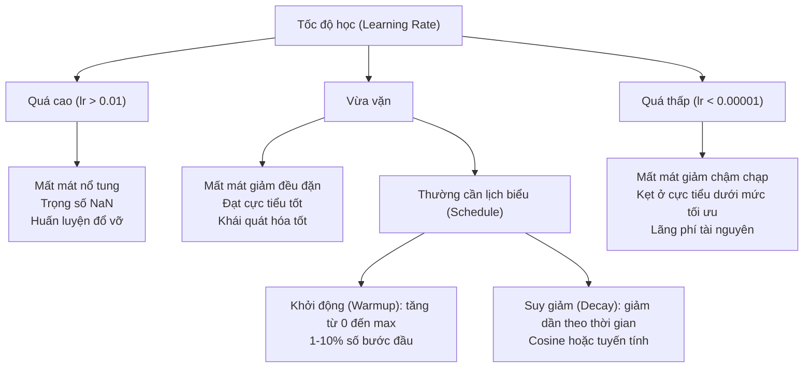
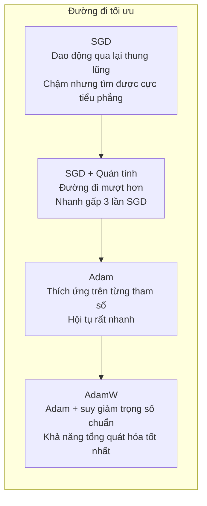
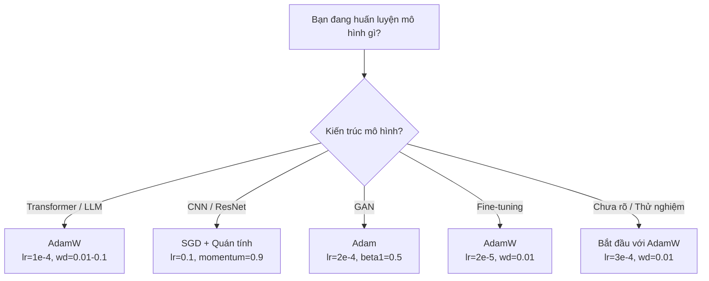

# Các bộ tối ưu hóa (Optimizers)

> Hạ độ dốc cho bạn biết cần di chuyển theo hướng nào. Nhưng nó không nói gì về việc bạn nên đi bao xa hay đi nhanh như thế nào. SGD giống như một chiếc la bàn. Còn Adam là một hệ thống định vị GPS kèm dữ liệu giao thông theo thời gian thực.

**Type:** Build
**Languages:** Python
**Prerequisites:** Bài học 03.05 (Các hàm mất mát)
**Time:** ~75 phút

## Mục tiêu học tập

- Tự tay triển khai từ con số 0 các bộ tối ưu hóa SGD, SGD có quán tính (momentum), Adam, và AdamW bằng Python
- Giải thích cách cơ chế hiệu chỉnh độ chệch (bias correction) của Adam bù trừ cho các ước lượng mô-men ban đầu được khởi tạo bằng 0 ở các bước huấn luyện đầu tiên
- Chứng minh lý do vì sao AdamW mang lại khả năng tổng quát hóa tốt hơn Adam kết hợp điều chuẩn L2 trên cùng một tác vụ
- Lựa chọn bộ tối ưu hóa thích hợp và các siêu tham số mặc định cho Transformer, CNN, GAN, và tinh chỉnh mô hình (fine-tuning)

## Vấn đề thực tế

Bạn đã tính toán xong các gradient. Bạn biết rằng trọng số thứ 4.721 cần phải giảm đi 0.003 để giảm giá trị mất mát. Nhưng 0.003 theo đơn vị nào? Được nhân theo tỷ lệ nào? Và liệu bạn có nên di chuyển cùng một khoảng cách ở bước thứ 1 giống hệt như ở bước thứ 1.000 hay không?

Thuật toán hạ độ dốc cơ bản (vanilla gradient descent) áp dụng cùng một tốc độ học cho mọi tham số ở mọi bước cập nhật: $w = w - \text{lr} \cdot \text{gradient}$. Điều này tạo ra ba vấn đề khiến việc huấn luyện mạng nơ-ron trong thực tế trở nên vô cùng gian nan.

Thứ nhất là hiện tượng dao động (oscillation). Bề mặt mất mát hiếm khi có dạng một cái bát tròn mượt mà. Nó giống như một thung lũng dài và hẹp. Gradient có xu hướng trỏ ngang qua hai sườn thung lũng (hướng dốc đứng) thay vì trỏ dọc theo đáy thung lũng (hướng thoai thoải hữu ích). Hạ độ dốc liên tục nảy qua nảy lại giữa hai sườn hẹp trong khi chỉ nhích được từng bước rất nhỏ theo hướng tiến triển thực sự. Bạn hẳn đã từng thấy điều này: hàm mất mát giảm rất nhanh lúc đầu rồi chững lại, không phải vì mô hình đã hội tụ mà vì nó đang bị kẹt trong dao động lắc lư.

Thứ hai, dùng chung một tốc độ học cho tất cả tham số là sai lầm. Một số trọng số cần những bước cập nhật lớn (chúng đang ở giai đoạn đầu, chưa khớp dữ liệu). Một số trọng số khác chỉ cần những bước nhích cực nhỏ (chúng đã ở rất gần giá trị tối ưu). Một tốc độ học phù hợp cho nhóm này sẽ phá hỏng nhóm kia, và ngược lại.

Thứ ba là các điểm yên ngựa (saddle points). Trong không gian nhiều chiều, bề mặt mất mát có những vùng bằng phẳng rộng lớn nơi gradient gần như bằng 0. Thuật toán SGD thông thường bò qua những vùng này với tốc độ của gradient, tức là xấp xỉ bằng không. Mô hình trông như thể bị kẹt cứng. Thực tế nó không kẹt -- nó chỉ đang ở một bình nguyên phẳng với một con dốc hữu ích ở phía bên kia. Nhưng SGD không có cơ chế nào để tích lũy đà lao qua đó.

Adam giải quyết cả ba vấn đề trên. Nó duy trì hai giá trị trung bình trượt cho mỗi tham số -- giá trị trung bình của gradient (quán tính / momentum, xử lý dao động) và giá trị trung bình của bình phương gradient (tốc độ học thích ứng, xử lý chênh lệch quy mô). Kết hợp với cơ chế hiệu chỉnh độ chệch cho các bước đầu tiên, nó mang đến cho bạn một bộ tối ưu hóa hoạt động hiệu quả trên 80% bài toán chỉ với các siêu tham số mặc định. Bài học này sẽ xây dựng nó từ con số 0 để bạn hiểu tường tận khi nào và vì sao nó có thể thất bại ở 20% còn lại.

## Khái niệm

### Hạ độ dốc ngẫu nhiên (Stochastic Gradient Descent - SGD)

Bộ tối ưu hóa đơn giản nhất: Tính gradient trên một lô nhỏ (mini-batch) và bước một bước ngược hướng với gradient đó:

```math
w = w - \text{lr} \cdot \text{gradient}
```

Từ "ngẫu nhiên" (stochastic) ở đây có nghĩa là bạn sử dụng một tập con ngẫu nhiên của dữ liệu để ước lượng gradient, thay vì dùng toàn bộ tập dữ liệu. Yếu tố ngẫu nhiên này trên thực tế rất có ích -- nó giúp mô hình thoát khỏi các cực tiểu cục bộ sắc nhọn. Nhưng nhiễu ngẫu nhiên này cũng gây ra dao động.

Tốc độ học (learning rate) là núm điều chỉnh duy nhất. Quá cao: hàm mất mát sẽ phân kỳ (diverge). Quá thấp: quá trình huấn luyện kéo dài vô tận. Giá trị tối ưu phụ thuộc vào kiến trúc, dữ liệu, kích thước lô, và giai đoạn huấn luyện hiện tại. Với SGD trên các mạng hiện đại, giá trị điển hình thường từ 0.01 đến 0.1. Nhưng ngay cả trong một lượt huấn luyện, tốc độ học lý tưởng cũng liên tục thay đổi.

### Quán tính (Momentum)

Hình ảnh quả bóng lăn xuống dốc tuy được dùng nhiều nhưng rất chính xác: Thay vì chỉ bước theo gradient của bước hiện tại, bạn duy trì một vận tốc tích lũy từ các gradient trong quá khứ:

```math
\begin{aligned}
m_t &= \beta \, m_{t-1} + \text{gradient} \\
w &= w - \text{lr} \cdot m_t
\end{aligned}
```

Hệ số Beta (thường là 0.9) kiểm soát mức độ lưu giữ lịch sử. Với $\beta = 0.9$, quán tính xấp xỉ giá trị trung bình của 10 gradient gần nhất ($1 / (1 - 0.9) = 10$).

Vì sao cơ chế này dập tắt dao động: Các gradient cùng trỏ về một hướng sẽ cộng dồn lại với nhau. Các gradient liên tục đảo chiều qua lại sẽ triệt tiêu lẫn nhau. Trong thung lũng hẹp, thành phần "ngang dốc" đổi dấu liên tục sau mỗi bước nên bị dập tắt, trong khi thành phần "dọc dốc" giữ nguyên hướng nên được khuếch đại. Kết quả là quả bóng tăng tốc mượt mà theo hướng hữu ích.

Số liệu thực tế: SGD đơn thuần trên một bề mặt mất mát hiểm trở có thể cần 10.000 bước. SGD có quán tính ($\beta = 0.9$) thường chỉ mất 3.000 - 5.000 bước cho cùng một bài toán. Mức tăng tốc này không hề nhỏ.

### RMSProp

Phương pháp đầu tiên thành công trong việc điều chỉnh tốc độ học thích ứng trên từng tham số riêng biệt. Được Geoffrey Hinton đề xuất trong một bài giảng trên Coursera (chưa từng được công bố chính thức qua bài báo học thuật):

```math
\begin{aligned}
s_t &= \beta \, s_{t-1} + (1 - \beta) \cdot \text{gradient}^2 \\
w &= w - \text{lr} \cdot \frac{\text{gradient}}{\sqrt{s_t} + \epsilon}
\end{aligned}
```

$s_t$ theo dõi giá trị trung bình trượt của bình phương gradient. Những tham số liên tục có gradient lớn sẽ bị chia cho một con số lớn (tốc độ học hiệu dụng nhỏ đi). Những tham số có gradient nhỏ sẽ được chia cho một con số nhỏ (tốc độ học hiệu dụng tăng lên).

Cơ chế này giải quyết triệt để bài toán "dùng chung một tốc độ học cho mọi tham số". Một trọng số liên tục nhận các bản cập nhật lớn nhiều khả năng đã ở gần mục tiêu -- hãy làm nó chậm lại. Một trọng số chỉ nhận những cập nhật li ti có thể đang chưa được học đầy đủ -- hãy tăng tốc cho nó.

Epsilon ($\epsilon$, thường là $10^{-8}$) ngăn chặn lỗi chia cho 0 khi tham số chưa từng được cập nhật.

### Adam: Kết hợp Quán tính (Momentum) và RMSProp

Adam kết hợp cả hai ý tưởng xuất sắc trên. Nó duy trì hai đường trung bình động hàm mũ cho mỗi tham số:

```math
\begin{aligned}
m_t &= \beta_1 m_{t-1} + (1 - \beta_1) \cdot \text{gradient} && \text{(mô-men bậc một: giá trị trung bình)} \\
v_t &= \beta_2 v_{t-1} + (1 - \beta_2) \cdot \text{gradient}^2 && \text{(mô-men bậc hai: phương sai)}
\end{aligned}
```

**Hiệu chỉnh độ chệch (Bias correction)** là chi tiết mấu chốt mà hầu hết các bài giải thích thường bỏ qua. Tại bước 1, $m_1 = (1 - \beta_1) \cdot \text{gradient}$. Với $\beta_1 = 0.9$, con số đó là $0.1 \cdot \text{gradient}$ -- nhỏ hơn gấp 10 lần so với thực tế! Trung bình trượt lúc này chưa kịp "làm nóng". Hiệu chỉnh độ chệch bù trừ cho sự thiếu hụt này:

```math
\begin{aligned}
\hat{m} &= \frac{m_t}{1 - \beta_1^t} \\
\hat{v} &= \frac{v_t}{1 - \beta_2^t}
\end{aligned}
```

Tại bước 1 với $\beta_1 = 0.9$: $\hat{m} = m_1 / (1 - 0.9) = m_1 / 0.1 =$ chính bằng gradient thực tế. Tại bước 100: $(1 - 0.9^{100})$ xấp xỉ bằng 1.0, do đó hệ số hiệu chỉnh tự động biến mất. Hiệu chỉnh độ chệch đặc biệt quan trọng trong khoảng 10 bước đầu tiên và trở nên không còn đáng kể sau khoảng 50 bước.

Công thức cập nhật:

```math
w = w - \text{lr} \cdot \frac{\hat{m}}{\sqrt{\hat{v}} + \epsilon}
```

Các tham số mặc định của Adam: $\text{lr} = 0.001$, $\beta_1 = 0.9$, $\beta_2 = 0.999$, $\epsilon = 10^{-8}$. Những giá trị này hoạt động tốt cho 80% các bài toán. Khi gặp trục trặc, hãy chỉnh `lr` trước tiên, sau đó đến $\beta_2$. Hầu như không bao giờ cần thay đổi $\beta_1$ hay $\epsilon$.

### AdamW: Suy giảm trọng số (Weight Decay) đúng chuẩn

Điều chuẩn L2 thêm số hạng $\lambda w^2$ vào hàm mất mát. Trong SGD thông thường, điều này hoàn toàn tương đương với suy giảm trọng số (trừ đi một lượng $\lambda w$ khỏi trọng số tại mỗi bước). Nhưng trong Adam, sự tương đương này bị phá vỡ hoàn toàn!

Phát hiện sâu sắc của Loshchilov & Hutter: Khi bạn thêm L2 vào hàm mất mát rồi để Adam xử lý gradient, tốc độ học thích ứng sẽ vô tình co giãn cả số hạng điều chuẩn này. Những tham số có phương sai gradient lớn sẽ bị điều chuẩn ít hơn, trong khi tham số có phương sai nhỏ lại bị điều chuẩn nhiều hơn. Đây không phải là điều bạn mong muốn -- bạn muốn sự điều chuẩn đồng đều cho mọi tham số bất kể đặc tính thống kê gradient của chúng ra sao.

AdamW giải quyết điều này bằng cách áp dụng suy giảm trọng số trực tiếp lên trọng số, sau bước cập nhật của Adam:

```math
w = w - \text{lr} \cdot \frac{\hat{m}}{\sqrt{\hat{v}} + \epsilon} - \text{lr} \cdot \lambda w
```

Số hạng suy giảm trọng số ($\text{lr} \cdot \lambda w$) không bị co giãn bởi hệ số thích ứng của Adam. Mọi tham số đều nhận mức độ thu nhỏ tỷ lệ như nhau.

Điều này thoạt nhìn như một chi tiết vụn vặt. Nhưng không hề: AdamW hội tụ đến các nghiệm có chất lượng tốt hơn đáng kể so với Adam + điều chuẩn L2 trên hầu như mọi bài toán. Nó là bộ tối ưu hóa mặc định trong PyTorch khi huấn luyện các mô hình Transformer, mô hình khuếch tán (diffusion), và phần lớn các kiến trúc hiện đại. BERT, GPT, LLaMA, Stable Diffusion -- tất cả đều được huấn luyện bằng AdamW.

### Tốc độ học: Siêu tham số quan trọng nhất



Nếu bạn chỉ có thời gian tinh chỉnh một siêu tham số duy nhất, hãy chỉnh tốc độ học. Sự thay đổi gấp 10 lần của tốc độ học mang tính quyết định hơn bất kỳ quyết định kiến trúc nào bạn đưa ra. Các giá trị mặc định phổ biến:

- SGD: lr = 0.01 đến 0.1
- Adam/AdamW: lr = 1e-4 đến 3e-4
- Tinh chỉnh mô hình tiền huấn luyện (Fine-tuning): lr = 1e-5 đến 5e-5
- Khởi động tốc độ học (Warmup): tăng tuyến tính trong 1-10% số bước đầu tiên

### So sánh các bộ tối ưu hóa



### Bộ tối ưu hóa nào phù hợp cho mô hình nào



```figure
optimizer-trajectory
```

## Xây dựng thực hành (Build It)

### Bước 1: SGD cơ bản

```python
class SGD:
    def __init__(self, lr=0.01):
        self.lr = lr

    def step(self, params, grads):
        for i in range(len(params)):
            params[i] -= self.lr * grads[i]
```

### Bước 2: SGD có quán tính (Momentum)

```python
class SGDMomentum:
    def __init__(self, lr=0.01, beta=0.9):
        self.lr = lr
        self.beta = beta
        self.velocities = None

    def step(self, params, grads):
        if self.velocities is None:
            self.velocities = [0.0] * len(params)
        for i in range(len(params)):
            self.velocities[i] = self.beta * self.velocities[i] + grads[i]
            params[i] -= self.lr * self.velocities[i]
```

### Bước 3: Adam

```python
import math

class Adam:
    def __init__(self, lr=0.001, beta1=0.9, beta2=0.999, epsilon=1e-8):
        self.lr = lr
        self.beta1 = beta1
        self.beta2 = beta2
        self.epsilon = epsilon
        self.m = None
        self.v = None
        self.t = 0

    def step(self, params, grads):
        if self.m is None:
            self.m = [0.0] * len(params)
            self.v = [0.0] * len(params)

        self.t += 1

        for i in range(len(params)):
            self.m[i] = self.beta1 * self.m[i] + (1 - self.beta1) * grads[i]
            self.v[i] = self.beta2 * self.v[i] + (1 - self.beta2) * grads[i] ** 2

            m_hat = self.m[i] / (1 - self.beta1 ** self.t)
            v_hat = self.v[i] / (1 - self.beta2 ** self.t)

            params[i] -= self.lr * m_hat / (math.sqrt(v_hat) + self.epsilon)
```

### Bước 4: AdamW

```python
class AdamW:
    def __init__(self, lr=0.001, beta1=0.9, beta2=0.999, epsilon=1e-8, weight_decay=0.01):
        self.lr = lr
        self.beta1 = beta1
        self.beta2 = beta2
        self.epsilon = epsilon
        self.weight_decay = weight_decay
        self.m = None
        self.v = None
        self.t = 0

    def step(self, params, grads):
        if self.m is None:
            self.m = [0.0] * len(params)
            self.v = [0.0] * len(params)

        self.t += 1

        for i in range(len(params)):
            self.m[i] = self.beta1 * self.m[i] + (1 - self.beta1) * grads[i]
            self.v[i] = self.beta2 * self.v[i] + (1 - self.beta2) * grads[i] ** 2

            m_hat = self.m[i] / (1 - self.beta1 ** self.t)
            v_hat = self.v[i] / (1 - self.beta2 ** self.t)

            params[i] -= self.lr * m_hat / (math.sqrt(v_hat) + self.epsilon)
            params[i] -= self.lr * self.weight_decay * params[i]
```

### Bước 5: So sánh hiệu quả huấn luyện giữa 4 bộ tối ưu hóa

Huấn luyện cùng một mạng hai tầng trên tập dữ liệu hình tròn từ Bài học 05 với cả bốn bộ tối ưu hóa. So sánh tốc độ hội tụ:

```python
import random

def sigmoid(x):
    x = max(-500, min(500, x))
    return 1.0 / (1.0 + math.exp(-x))

def make_circle_data(n=200, seed=42):
    random.seed(seed)
    data = []
    for _ in range(n):
        x = random.uniform(-2, 2)
        y = random.uniform(-2, 2)
        label = 1.0 if x * x + y * y < 1.5 else 0.0
        data.append(([x, y], label))
    return data


class OptimizerTestNetwork:
    def __init__(self, optimizer, hidden_size=8):
        random.seed(0)
        self.hidden_size = hidden_size
        self.optimizer = optimizer

        self.w1 = [[random.gauss(0, 0.5) for _ in range(2)] for _ in range(hidden_size)]
        self.b1 = [0.0] * hidden_size
        self.w2 = [random.gauss(0, 0.5) for _ in range(hidden_size)]
        self.b2 = 0.0

    def get_params(self):
        params = []
        for row in self.w1:
            params.extend(row)
        params.extend(self.b1)
        params.extend(self.w2)
        params.append(self.b2)
        return params

    def set_params(self, params):
        idx = 0
        for i in range(self.hidden_size):
            for j in range(2):
                self.w1[i][j] = params[idx]
                idx += 1
        for i in range(self.hidden_size):
            self.b1[i] = params[idx]
            idx += 1
        for i in range(self.hidden_size):
            self.w2[i] = params[idx]
            idx += 1
        self.b2 = params[idx]

    def forward(self, x):
        self.x = x
        self.z1 = []
        self.h = []
        for i in range(self.hidden_size):
            z = self.w1[i][0] * x[0] + self.w1[i][1] * x[1] + self.b1[i]
            self.z1.append(z)
            self.h.append(max(0.0, z))

        self.z2 = sum(self.w2[i] * self.h[i] for i in range(self.hidden_size)) + self.b2
        self.out = sigmoid(self.z2)
        return self.out

    def compute_grads(self, target):
        eps = 1e-15
        p = max(eps, min(1 - eps, self.out))
        d_loss = -(target / p) + (1 - target) / (1 - p)
        d_sigmoid = self.out * (1 - self.out)
        d_out = d_loss * d_sigmoid

        grads = [0.0] * (self.hidden_size * 2 + self.hidden_size + self.hidden_size + 1)
        idx = 0
        for i in range(self.hidden_size):
            d_relu = 1.0 if self.z1[i] > 0 else 0.0
            d_h = d_out * self.w2[i] * d_relu
            grads[idx] = d_h * self.x[0]
            grads[idx + 1] = d_h * self.x[1]
            idx += 2

        for i in range(self.hidden_size):
            d_relu = 1.0 if self.z1[i] > 0 else 0.0
            grads[idx] = d_out * self.w2[i] * d_relu
            idx += 1

        for i in range(self.hidden_size):
            grads[idx] = d_out * self.h[i]
            idx += 1

        grads[idx] = d_out
        return grads

    def train(self, data, epochs=300):
        losses = []
        for epoch in range(epochs):
            total_loss = 0.0
            correct = 0
            for x, y in data:
                pred = self.forward(x)
                grads = self.compute_grads(y)
                params = self.get_params()
                self.optimizer.step(params, grads)
                self.set_params(params)

                eps = 1e-15
                p = max(eps, min(1 - eps, pred))
                total_loss += -(y * math.log(p) + (1 - y) * math.log(1 - p))
                if (pred >= 0.5) == (y >= 0.5):
                    correct += 1
            avg_loss = total_loss / len(data)
            accuracy = correct / len(data) * 100
            losses.append((avg_loss, accuracy))
            if epoch % 75 == 0 or epoch == epochs - 1:
                print(f"    Epoch {epoch:3d}: loss={avg_loss:.4f}, độ chính xác={accuracy:.1f}%")
        return losses
```

## Ứng dụng thực tế (Use It)

Các bộ tối ưu hóa của PyTorch xử lý các nhóm tham số (parameter groups), cắt ngắn gradient (gradient clipping), và lịch biểu tốc độ học (learning rate scheduling):

```python
import torch
import torch.optim as optim

model = torch.nn.Sequential(
    torch.nn.Linear(784, 256),
    torch.nn.ReLU(),
    torch.nn.Linear(256, 10),
)

optimizer = optim.AdamW(model.parameters(), lr=3e-4, weight_decay=0.01)

scheduler = optim.lr_scheduler.CosineAnnealingLR(optimizer, T_max=100)

for epoch in range(100):
    optimizer.zero_grad()
    output = model(torch.randn(32, 784))
    loss = torch.nn.functional.cross_entropy(output, torch.randint(0, 10, (32,)))
    loss.backward()
    torch.nn.utils.clip_grad_norm_(model.parameters(), max_norm=1.0)
    optimizer.step()
    scheduler.step()
```

Trình tự chuẩn luôn là: `zero_grad`, `forward`, `loss`, `backward`, (cắt gradient nếu có), `step`, (cập nhật `scheduler`). Hãy ghi nhớ thứ tự này. Làm sai thứ tự (chẳng hạn như gọi `scheduler.step()` trước `optimizer.step()`) là nguồn gốc phổ biến của các lỗi tinh vi khó tìm.

Đối với CNN, nhiều chuyên gia vẫn ưu tiên dùng SGD + momentum (`lr=0.1`, `momentum=0.9`, `weight_decay=1e-4`) kết hợp lịch biểu bước nhảy hoặc cosine. SGD tìm kiếm các cực tiểu phẳng hơn, thường mang lại khả năng tổng quát hóa tốt hơn. Với Transformer và LLM, AdamW kết hợp khởi động (warmup) + suy giảm cosine là chuẩn mực toàn cầu. Đừng đi ngược lại sự đồng thuận này trừ khi bạn có bằng chứng thực nghiệm rõ ràng.

## Đóng gói ứng dụng (Ship It)

Bài học này tạo ra:
- `outputs/prompt-optimizer-selector.md` -- mẫu câu lệnh ra quyết định lựa chọn chính xác bộ tối ưu hóa và tốc độ học phù hợp cho bất kỳ kiến trúc mô hình nào

## Bài tập rèn luyện (Exercises)

1. Triển khai quán tính Nesterov (Nesterov momentum), nơi bạn tính toán gradient tại vị trí "dự đoán trước" ($w - \text{lr} \cdot \beta v$) thay vì vị trí hiện tại. So sánh tốc độ hội tụ với quán tính tiêu chuẩn trên tập dữ liệu hình tròn.
2. Triển khai lịch biểu khởi động tốc độ học: tăng tuyến tính từ 0 đến `max_lr` trong 10% số bước đầu tiên, sau đó suy giảm theo hàm cosine về 0. Huấn luyện với Adam có khởi động so với Adam không khởi động. Đo xem cần bao nhiêu epoch để đạt độ chính xác 90% trên tập hình tròn.
3. Theo dõi tốc độ học hiệu dụng cho từng tham số trong suốt quá trình huấn luyện bằng Adam. Tốc độ hiệu dụng là $\text{lr} \cdot \hat{m} / (\sqrt{\hat{v}} + \epsilon)$. Vẽ biểu đồ phân phối tốc độ hiệu dụng sau 10, 50, và 200 bước. Có phải tất cả các tham số đều đang được cập nhật với tốc độ như nhau không?
4. Triển khai cắt ngắn gradient theo chuẩn toàn cục (clip by global norm). Đặt ngưỡng chuẩn gradient tối đa là 1.0. Huấn luyện có và không có cắt ngắn khi dùng tốc độ học lớn (`lr=0.01` cho Adam). Đếm xem có bao nhiêu lần chạy bị phân kỳ (mất mát trở thành NaN) qua 10 hạt giống ngẫu nhiên khác nhau.
5. So sánh Adam vs AdamW trên một mạng có các trọng số ban đầu lớn. Khởi tạo tất cả trọng số với các giá trị ngẫu nhiên trong khoảng `[-5, 5]` (lớn hơn nhiều so với bình thường). Huấn luyện trong 200 epochs với `weight_decay=0.1`. Vẽ đồ thị chuẩn L2 của các trọng số trong suốt quá trình huấn luyện cho cả hai bộ tối ưu hóa. AdamW sẽ cho thấy tốc độ co nhỏ trọng số nhanh hơn rõ rệt.

## Thuật ngữ then chốt (Key Terms)

| Thuật ngữ | Cách gọi thông thường | Ý nghĩa kỹ thuật |
|------|----------------|----------------------|
| Learning rate (Tốc độ học) | "Độ dài bước nhảy" | Hệ số nhân vô hướng trên gradient; siêu tham số có ảnh hưởng lớn nhất trong huấn luyện |
| SGD | "Hạ độ dốc cơ bản" | Hạ độ dốc ngẫu nhiên: cập nhật trọng số bằng cách trừ đi $\text{lr} \cdot \text{gradient}$, được tính trên một lô nhỏ |
| Momentum (Quán tính) | "Quả bóng lăn xuống dốc" | Trung bình động hàm mũ của các gradient trong quá khứ; dập tắt dao động và gia tốc theo hướng ổn định |
| RMSProp | "Tốc độ học thích ứng" | Chia gradient của từng tham số cho giá trị RMS trung bình trượt của các gradient gần đây; cân bằng tốc độ học |
| Adam | "Bộ tối ưu hóa mặc định" | Kết hợp quán tính (mô-men bậc một) và RMSProp (mô-men bậc hai) kèm hiệu chỉnh độ chệch cho các bước đầu |
| AdamW | "Adam chuẩn chỉ" | Adam tách biệt suy giảm trọng số; áp dụng điều chuẩn trực tiếp lên trọng số thay vì thông qua gradient |
| Bias correction (Hiệu chỉnh độ chệch) | "Làm nóng trung bình trượt" | Chia cho $(1 - \beta^t)$ để bù đắp cho việc các ước lượng mô-men của Adam bị khởi tạo bằng 0 ở các bước đầu |
| Weight decay (Suy giảm trọng số) | "Thu nhỏ trọng số" | Trừ đi một phần tỷ lệ của giá trị trọng số tại mỗi bước; cơ chế điều chuẩn phạt các trọng số có độ lớn lớn |
| Learning rate schedule (Lịch biểu tốc độ học) | "Thay đổi lr theo thời gian" | Hàm điều chỉnh tốc độ học trong quá trình huấn luyện; khởi động + suy giảm cosine là chuẩn mực hiện đại |
| Gradient clipping (Cắt ngắn gradient) | "Khống chế trần gradient" | Thu nhỏ vector gradient khi chuẩn của nó vượt quá ngưỡng quy định; ngăn ngừa các bản cập nhật bùng nổ |

## Tài liệu đọc thêm (Further Reading)

- Kingma & Ba, "Adam: A Method for Stochastic Optimization" (2014) -- bài báo gốc về Adam kèm phân tích hội tụ và dẫn xuất chi tiết hiệu chỉnh độ chệch
- Loshchilov & Hutter, "Decoupled Weight Decay Regularization" (2017) -- chứng minh điều chuẩn L2 và suy giảm trọng số không tương đương trong Adam, đề xuất AdamW
- Smith, "Cyclical Learning Rates for Training Neural Networks" (2017) -- giới thiệu bài kiểm tra dải tốc độ học và các lịch biểu chu kỳ giúp loại bỏ nhu cầu chỉnh tay tốc độ học cố định
- Ruder, "An Overview of Gradient Descent Optimization Algorithms" (2016) -- bản khảo sát xuất sắc nhất về tất cả các biến thể bộ tối ưu hóa, kèm so sánh trực quan rõ ràng

