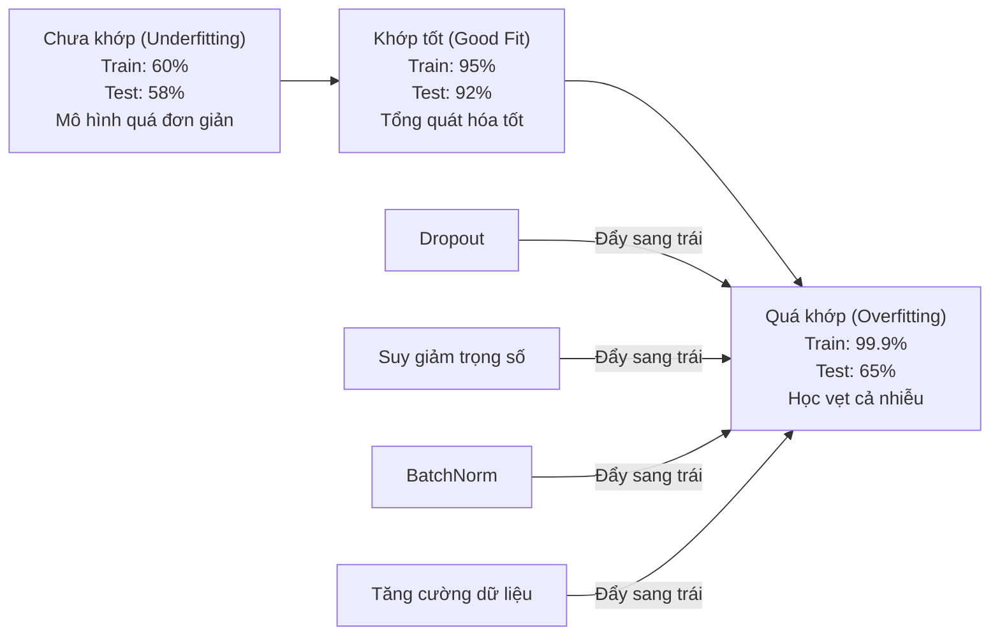
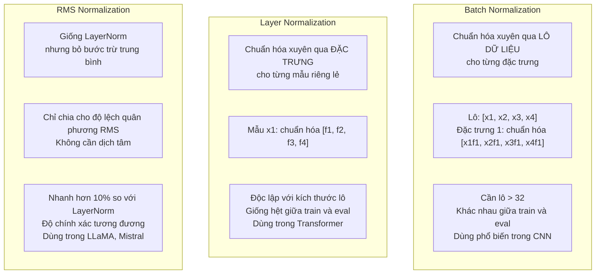
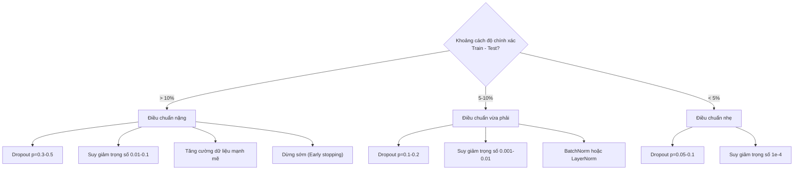

# Điều chuẩn (Regularization)

> Mô hình của bạn đạt 99% trên tập huấn luyện nhưng chỉ đạt 60% trên tập kiểm thử. Nó đã học vẹt thay vì thực sự học hỏi. Điều chuẩn chính là mức thuế bạn áp đặt lên sự phức tạp để ép buộc mô hình phải tổng quát hóa.

**Type:** Build
**Languages:** Python
**Prerequisites:** Bài học 03.06 (Các bộ tối ưu hóa)
**Time:** ~75 phút

## Mục tiêu học tập

- Tự tay triển khai dropout với tỷ lệ co giãn đảo ngược (inverted scaling), suy giảm trọng số L2, chuẩn hóa theo lô (BatchNorm), chuẩn hóa theo tầng (LayerNorm), và RMSNorm từ con số 0
- Đo lường khoảng cách độ chính xác giữa tập huấn luyện và kiểm thử (train-test gap) để chẩn đoán hiện tượng quá khớp (overfitting)
- Giải thích lý do Transformer sử dụng LayerNorm thay vì BatchNorm và vì sao các LLM hiện đại lại ưu tiên dùng RMSNorm
- Áp dụng sự kết hợp chuẩn xác các kỹ thuật điều chuẩn dựa trên mức độ nghiêm trọng của hiện tượng quá khớp

## Vấn đề thực tế

Một mạng nơ-ron có đủ số lượng tham số có thể ghi nhớ vẹt bất kỳ tập dữ liệu nào. Đây không phải là một giả thuyết -- Zhang và cộng sự (2017) đã chứng minh điều này bằng cách huấn luyện các mạng nơ-ron tiêu chuẩn trên ImageNet với các nhãn được gán ngẫu nhiên hoàn toàn. Mạng vẫn đạt mức mất mát huấn luyện gần như bằng 0 trên các nhãn ngẫu nhiên đó. Chúng đã ghi nhớ một triệu cặp đầu vào - đầu ra ngẫu nhiên mà không hề có bất kỳ quy luật nào để học. Mất mát trên tập huấn luyện hoàn hảo, nhưng độ chính xác trên tập kiểm thử bằng 0 tròn trĩnh.

Đây chính là vấn đề quá khớp (overfitting), và nó càng trở nên trầm trọng hơn khi mô hình ngày càng lớn. GPT-3 có 175 tỷ tham số. Tập huấn luyện có khoảng 500 tỷ token. Với số lượng tham số khổng lồ đó, mô hình thừa dung lượng để học vẹt nguyên văn những đoạn dữ liệu huấn luyện lớn. Nếu không có điều chuẩn, nó sẽ chỉ đơn thuần nhại lại các ví dụ huấn luyện thay vì học được các quy luật mang tính tổng quát.

Khoảng cách giữa hiệu năng trên tập huấn luyện và tập kiểm thử được gọi là khoảng cách quá khớp (overfitting gap). Mọi kỹ thuật trong bài học này đều tấn công vào khoảng cách đó từ những góc độ khác nhau: Dropout ép mạng không được phụ thuộc vào bất kỳ nơ-ron đơn lẻ nào. Suy giảm trọng số ngăn không cho bất kỳ trọng số nào phát triển quá lớn. Chuẩn hóa theo lô làm mượt bề mặt mất mát để bộ tối ưu hóa tìm được các cực tiểu phẳng hơn, dễ tổng quát hóa hơn. Chuẩn hóa theo tầng làm điều tương tự nhưng hoạt động được ngay cả ở nơi BatchNorm thất bại (kích thước lô nhỏ, chuỗi có độ dài thay đổi). RMSNorm làm điều đó nhanh hơn 10% bằng cách bỏ qua bước tính giá trị trung bình. Mỗi kỹ thuật đều đơn giản, nhưng khi kết hợp lại, chúng tạo nên sự khác biệt giữa một mô hình học vẹt và một mô hình biết tư duy tổng quát.

## Khái niệm

### Phổ quá khớp (The Overfitting Spectrum)

Mọi mô hình đều nằm ở đâu đó trên một phổ liên tục từ chưa khớp (underfitting - mô hình quá đơn giản để nắm bắt quy luật) đến quá khớp (overfitting - mô hình quá phức tạp đến mức nắm bắt cả nhiễu). Điểm lý tưởng nằm ở giữa, và điều chuẩn có nhiệm vụ đẩy mô hình từ phía quá khớp về lại vùng lý tưởng này.



### Dropout

Kỹ thuật điều chuẩn đơn giản nhất với cách diễn giải thanh lịch nhất: Trong quá trình huấn luyện, ngẫu nhiên đặt đầu ra của từng nơ-ron về 0 với xác suất $p$.

```math
\text{output} = \text{activation}(z) \cdot \text{mask} \quad \text{với }\text{mask}[i] \sim \text{Bernoulli}(1 - p)
```

Với $p = 0.5$, một nửa số nơ-ron bị triệt tiêu về 0 ở mỗi lượt lan truyền tiến. Mạng buộc phải học các biểu diễn dư thừa (redundant representations) vì nó không thể đoán trước được nơ-ron nào sẽ khả dụng. Điều này ngăn chặn hiện tượng đồng thích nghi (co-adaptation) -- các nơ-ron ỷ lại và phụ thuộc vào sự hiện diện của những nơ-ron cụ thể khác.

Góc nhìn kết hợp (ensemble): Một mạng có $N$ nơ-ron áp dụng dropout sẽ tạo ra $2^N$ mạng con tiềm năng (mỗi tổ hợp nơ-ron bật hoặc tắt). Việc huấn luyện với dropout tương đương với việc huấn luyện xấp xỉ toàn bộ $2^N$ mạng con này cùng một lúc trên các lô dữ liệu khác nhau. Tại thời điểm kiểm thử, bạn kích hoạt tất cả nơ-ron (không dropout) và co giãn đầu ra theo hệ số $(1 - p)$ để khớp với kỳ vọng trong huấn luyện. Điều này tương đương với việc lấy trung bình dự đoán của $2^N$ mạng con -- một mô hình kết hợp khổng lồ chỉ từ một mạng duy nhất!

Trong thực tế, phép co giãn này được thực hiện ngay trong quá trình huấn luyện (inverted dropout):

```math
\begin{aligned}
\text{Khi huấn luyện:} \quad & \text{output} = \text{activation}(z) \cdot \text{mask} / (1 - p) \\
\text{Khi kiểm thử:} \quad & \text{output} = \text{activation}(z) \quad \text{(không cần thay đổi gì)}
\end{aligned}
```

Cách này gọn gàng hơn vì mã kiểm thử hoàn toàn không cần bận tâm đến sự tồn tại của dropout.

Tỷ lệ mặc định: $p = 0.1$ cho Transformer, $p = 0.5$ cho MLP, $p = 0.2 - 0.3$ cho CNN. Tỷ lệ dropout càng cao = điều chuẩn càng mạnh = nguy cơ chưa khớp (underfitting) càng lớn.

### Suy giảm trọng số (Weight Decay / Điều chuẩn L2)

Cộng thêm tổng bình phương độ lớn của tất cả các trọng số vào hàm mất mát:

```math
\text{total\_loss} = \text{task\_loss} + \frac{\lambda}{2} \sum_i w_i^2
```

Gradient của số hạng điều chuẩn này là $\lambda w$. Điều này đồng nghĩa với việc tại mỗi bước cập nhật, từng trọng số đều bị thu nhỏ về phía 0 theo một tỷ lệ thuận với độ lớn của chính nó. Trọng số lớn bị phạt nặng hơn. Mô hình bị thúc đẩy tìm kiếm các nghiệm mà không có bất kỳ trọng số đơn lẻ nào chiếm ưu thế tuyệt đối.

Vì sao điều này giúp tổng quát hóa: Các mô hình quá khớp có xu hướng sở hữu các trọng số rất lớn nhằm khuếch đại các chi tiết nhiễu trong dữ liệu huấn luyện. Suy giảm trọng số giữ cho các trọng số luôn ở mức nhỏ, từ đó giới hạn dung lượng hiệu dụng của mô hình và ép nó phải dựa vào các đặc trưng vững chắc, có tính tổng quát thay vì các đặc điểm dị biệt học vẹt.

Siêu tham số $\lambda$ điều khiển độ mạnh của điều chuẩn. Các giá trị điển hình:

- 0.01 cho AdamW trên Transformer
- 1e-4 cho SGD trên CNN
- 0.1 cho các mô hình bị quá khớp rất nặng

Như đã phân tích ở Bài học 06: suy giảm trọng số và điều chuẩn L2 tương đương nhau trong SGD nhưng không tương đương trong Adam. Hãy luôn sử dụng AdamW (suy giảm trọng số tách biệt) khi huấn luyện với Adam.

### Chuẩn hóa theo lô (Batch Normalization - BatchNorm)

Chuẩn hóa đầu ra của từng tầng trên toàn bộ lô nhỏ (mini-batch) trước khi đưa nó sang tầng tiếp theo.

Đối với một lô nhỏ các giá trị kích hoạt tại một tầng:

```math
\begin{aligned}
\mu &= \frac{1}{B} \sum_i x_i && \text{(trung bình lô)} \\
\sigma^2 &= \frac{1}{B} \sum_i (x_i - \mu)^2 && \text{(phương sai lô)} \\
\hat{x} &= \frac{x_i - \mu}{\sqrt{\sigma^2 + \epsilon}} && \text{(chuẩn hóa)} \\
y &= \gamma \hat{x} + \beta && \text{(co giãn và dịch chuyển)}
\end{aligned}
```

Gamma ($\gamma$) và beta ($\beta$) là các tham số có thể học được, cho phép mạng nơ-ron tự đảo ngược lại phép chuẩn hóa nếu việc đó mang lại kết quả tối ưu hơn. Nếu không có chúng, bạn đang ép mọi đầu ra của tầng phải có kỳ vọng bằng 0 và phương sai bằng 1 -- điều chưa chắc đã là tối ưu cho mạng.

**Phân tách giữa huấn luyện và suy luận:** Trong quá trình huấn luyện, $\mu$ và $\sigma$ được tính trực tiếp từ lô hiện tại. Trong quá trình suy luận, bạn dùng các giá trị trung bình trượt tích lũy trong suốt quá trình huấn luyện (trung bình động hàm mũ với momentum = 0.1, tức 90% giá trị cũ + 10% giá trị mới).

Lý do vì sao BatchNorm hiệu quả vẫn còn là đề tài tranh luận. Bài báo gốc cho rằng nó giảm "dịch chuyển hiệp biến nội bộ" (internal covariate shift). Tuy nhiên, Santurkar và cộng sự (2018) đã chứng minh lý do đó không chính xác. Nguyên nhân thực sự: BatchNorm làm cho bề mặt hàm mất mát trở nên mượt mà hơn rất nhiều. Các gradient có tính dự đoán cao hơn, hằng số Lipschitz nhỏ hơn, giúp bộ tối ưu hóa có thể tự tin bước những bước lớn hơn mà vẫn an toàn. Đây là lý do BatchNorm cho phép sử dụng tốc độ học cao hơn và hội tụ nhanh hơn.

BatchNorm có một hạn chế căn bản: nó phụ thuộc hoàn toàn vào thống kê của lô. Với kích thước lô bằng 1, trung bình và phương sai trở nên vô nghĩa. Với các lô nhỏ (< 32), số liệu thống kê bị nhiễu nặng và làm giảm hiệu năng. Điều này ảnh hưởng lớn đến các bài toán như phát hiện vật thể (nơi bộ nhớ GPU giới hạn kích thước lô) và mô hình ngôn ngữ (nơi độ dài chuỗi liên tục biến đổi).

### Chuẩn hóa theo tầng (Layer Normalization - LayerNorm)

Chuẩn hóa xuyên qua các đặc trưng (features) thay vì xuyên qua lô dữ liệu. Đối với một mẫu đơn lẻ:

```math
\begin{aligned}
\mu &= \frac{1}{D} \sum_j x_j && \text{(trung bình đặc trưng)} \\
\sigma^2 &= \frac{1}{D} \sum_j (x_j - \mu)^2 && \text{(phương sai đặc trưng)} \\
\hat{x} &= \frac{x_j - \mu}{\sqrt{\sigma^2 + \epsilon}} \\
y &= \gamma \hat{x} + \beta
\end{aligned}
```

$D$ là số chiều đặc trưng. Mỗi mẫu được chuẩn hóa hoàn toàn độc lập -- không hề phụ thuộc vào kích thước lô. Đây chính là lý do các mô hình Transformer dùng LayerNorm thay vì BatchNorm: các chuỗi văn bản có độ dài khác nhau, kích thước lô thường nhỏ (hoặc bằng 1 khi sinh văn bản), và phép tính toán hoàn toàn đồng nhất giữa lúc huấn luyện và khi suy luận.

Trong Transformer, LayerNorm được đặt sau mỗi khối self-attention và feed-forward (Post-LN), hoặc đặt ngay phía trước chúng (Pre-LN, giúp huấn luyện ổn định hơn nhiều).

### RMSNorm

LayerNorm nhưng bỏ qua bước trừ đi giá trị trung bình. Được đề xuất bởi Zhang & Sennrich (2019):

```math
\begin{aligned}
\text{rms} &= \sqrt{\frac{1}{D} \sum_j x_j^2} \\
y &= \gamma \cdot \frac{x}{\text{rms}}
\end{aligned}
```

Chỉ có vậy. Không tính trung bình, không có tham số beta. Phát hiện cốt lõi: việc định tâm lại (trừ giá trị trung bình) trong LayerNorm đóng góp rất ít vào hiệu năng của mô hình, nhưng lại tốn tài nguyên tính toán. Bỏ nó đi vẫn giữ nguyên độ chính xác nhưng giảm được khoảng 10% chi phí tính toán.

LLaMA, LLaMA 2, LLaMA 3, Mistral, và hầu hết các LLM hiện đại đều dùng RMSNorm thay vì LayerNorm. Ở quy mô hàng tỷ tham số và hàng nghìn tỷ token, mức tiết kiệm 10% này mang lại giá trị kinh tế khổng lồ.

### So sánh các kỹ thuật chuẩn hóa



### Tăng cường dữ liệu (Data Augmentation) dưới vai trò điều chuẩn

Không phải là thay đổi kiến trúc mô hình mà là làm giàu dữ liệu đầu vào. Biến đổi dữ liệu huấn luyện nhưng vẫn giữ nguyên nhãn:

- Hình ảnh: cắt ngẫu nhiên, lật, xoay, biến đổi màu sắc, cutout
- Văn bản: thay thế từ đồng nghĩa, dịch ngược (back-translation), xóa từ ngẫu nhiên
- Âm thanh: kéo giãn thời gian, dịch chuyển cao độ, thêm tiếng ồn

Tác dụng của nó hoàn toàn tương đương với điều chuẩn: nó làm tăng kích thước hiệu dụng của tập huấn luyện, khiến mô hình khó lòng học vẹt từng ví dụ cụ thể. Một mô hình chỉ nhìn thấy mỗi bức ảnh đúng một lần có thể ghi nhớ nó; nhưng một mô hình nhìn thấy 50 phiên bản biến thể khác nhau của bức ảnh đó sẽ bị ép phải học các cấu trúc bất biến cốt lõi.

### Dừng sớm (Early Stopping)

Kỹ thuật điều chuẩn đơn giản nhất: dừng huấn luyện ngay khi hàm mất mát trên tập kiểm định (validation loss) bắt đầu có dấu hiệu tăng lên. Tại thời điểm đó, mô hình chưa bị quá khớp. Trong thực tế, bạn theo dõi validation loss sau mỗi epoch, lưu lại mô hình tốt nhất, và tiếp tục chạy thêm một khoảng thời gian kiên nhẫn (patience window, thường là 5 - 20 epochs). Nếu sau khoảng đó mất mát không cải thiện, bạn dừng lại và tải lại mô hình tốt nhất đã lưu.

### Khi nào nên áp dụng kỹ thuật nào



```figure
l2-regularization
```

## Xây dựng thực hành (Build It)

### Bước 1: Dropout (Chế độ Huấn luyện và Đánh giá)

```python
import random
import math


class Dropout:
    def __init__(self, p=0.5):
        self.p = p
        self.training = True
        self.mask = None

    def forward(self, x):
        if not self.training:
            return list(x)
        self.mask = []
        output = []
        for val in x:
            if random.random() < self.p:
                self.mask.append(0)
                output.append(0.0)
            else:
                self.mask.append(1)
                output.append(val / (1 - self.p))
        return output

    def backward(self, grad_output):
        grads = []
        for g, m in zip(grad_output, self.mask):
            if m == 0:
                grads.append(0.0)
            else:
                grads.append(g / (1 - self.p))
        return grads
```

### Bước 2: Suy giảm trọng số L2

```python
def l2_regularization(weights, lambda_reg):
    penalty = 0.0
    for w in weights:
        penalty += w * w
    return lambda_reg * 0.5 * penalty

def l2_gradient(weights, lambda_reg):
    return [lambda_reg * w for w in weights]
```

### Bước 3: Chuẩn hóa theo lô (Batch Normalization)

```python
class BatchNorm:
    def __init__(self, num_features, momentum=0.1, eps=1e-5):
        self.gamma = [1.0] * num_features
        self.beta = [0.0] * num_features
        self.eps = eps
        self.momentum = momentum
        self.running_mean = [0.0] * num_features
        self.running_var = [1.0] * num_features
        self.training = True
        self.num_features = num_features

    def forward(self, batch):
        batch_size = len(batch)
        if self.training:
            mean = [0.0] * self.num_features
            for sample in batch:
                for j in range(self.num_features):
                    mean[j] += sample[j]
            mean = [m / batch_size for m in mean]

            var = [0.0] * self.num_features
            for sample in batch:
                for j in range(self.num_features):
                    var[j] += (sample[j] - mean[j]) ** 2
            var = [v / batch_size for v in var]

            for j in range(self.num_features):
                self.running_mean[j] = (1 - self.momentum) * self.running_mean[j] + self.momentum * mean[j]
                self.running_var[j] = (1 - self.momentum) * self.running_var[j] + self.momentum * var[j]
        else:
            mean = list(self.running_mean)
            var = list(self.running_var)

        self.x_hat = []
        output = []
        for sample in batch:
            normalized = []
            out_sample = []
            for j in range(self.num_features):
                x_h = (sample[j] - mean[j]) / math.sqrt(var[j] + self.eps)
                normalized.append(x_h)
                out_sample.append(self.gamma[j] * x_h + self.beta[j])
            self.x_hat.append(normalized)
            output.append(out_sample)
        return output
```

### Bước 4: Chuẩn hóa theo tầng (Layer Normalization)

```python
class LayerNorm:
    def __init__(self, num_features, eps=1e-5):
        self.gamma = [1.0] * num_features
        self.beta = [0.0] * num_features
        self.eps = eps
        self.num_features = num_features

    def forward(self, x):
        mean = sum(x) / len(x)
        var = sum((xi - mean) ** 2 for xi in x) / len(x)

        self.x_hat = []
        output = []
        for j in range(self.num_features):
            x_h = (x[j] - mean) / math.sqrt(var + self.eps)
            self.x_hat.append(x_h)
            output.append(self.gamma[j] * x_h + self.beta[j])
        return output
```

### Bước 5: RMSNorm

```python
class RMSNorm:
    def __init__(self, num_features, eps=1e-6):
        self.gamma = [1.0] * num_features
        self.eps = eps
        self.num_features = num_features

    def forward(self, x):
        rms = math.sqrt(sum(xi * xi for xi in x) / len(x) + self.eps)
        output = []
        for j in range(self.num_features):
            output.append(self.gamma[j] * x[j] / rms)
        return output
```

### Bước 6: Huấn luyện có và không có điều chuẩn

```python
def sigmoid(x):
    x = max(-500, min(500, x))
    return 1.0 / (1.0 + math.exp(-x))


def make_circle_data(n=200, seed=42):
    random.seed(seed)
    data = []
    for _ in range(n):
        x = random.uniform(-2, 2)
        y = random.uniform(-2, 2)
        label = 1.0 if x * x + y * y < 1.5 else 0.0
        data.append(([x, y], label))
    return data


class RegularizedNetwork:
    def __init__(self, hidden_size=16, lr=0.05, dropout_p=0.0, weight_decay=0.0):
        random.seed(0)
        self.hidden_size = hidden_size
        self.lr = lr
        self.dropout_p = dropout_p
        self.weight_decay = weight_decay
        self.dropout = Dropout(p=dropout_p) if dropout_p > 0 else None

        self.w1 = [[random.gauss(0, 0.5) for _ in range(2)] for _ in range(hidden_size)]
        self.b1 = [0.0] * hidden_size
        self.w2 = [random.gauss(0, 0.5) for _ in range(hidden_size)]
        self.b2 = 0.0

    def forward(self, x, training=True):
        self.x = x
        self.z1 = []
        self.h = []
        for i in range(self.hidden_size):
            z = self.w1[i][0] * x[0] + self.w1[i][1] * x[1] + self.b1[i]
            self.z1.append(z)
            self.h.append(max(0.0, z))

        if self.dropout and training:
            self.dropout.training = True
            self.h = self.dropout.forward(self.h)
        elif self.dropout:
            self.dropout.training = False
            self.h = self.dropout.forward(self.h)

        self.z2 = sum(self.w2[i] * self.h[i] for i in range(self.hidden_size)) + self.b2
        self.out = sigmoid(self.z2)
        return self.out

    def backward(self, target):
        eps = 1e-15
        p = max(eps, min(1 - eps, self.out))
        d_loss = -(target / p) + (1 - target) / (1 - p)
        d_sigmoid = self.out * (1 - self.out)
        d_out = d_loss * d_sigmoid

        for i in range(self.hidden_size):
            d_relu = 1.0 if self.z1[i] > 0 else 0.0
            d_h = d_out * self.w2[i] * d_relu
            self.w2[i] -= self.lr * (d_out * self.h[i] + self.weight_decay * self.w2[i])
            for j in range(2):
                self.w1[i][j] -= self.lr * (d_h * self.x[j] + self.weight_decay * self.w1[i][j])
            self.b1[i] -= self.lr * d_h
        self.b2 -= self.lr * d_out

    def evaluate(self, data):
        correct = 0
        total_loss = 0.0
        for x, y in data:
            pred = self.forward(x, training=False)
            eps = 1e-15
            p = max(eps, min(1 - eps, pred))
            total_loss += -(y * math.log(p) + (1 - y) * math.log(1 - p))
            if (pred >= 0.5) == (y >= 0.5):
                correct += 1
        return total_loss / len(data), correct / len(data) * 100

    def train_model(self, train_data, test_data, epochs=300):
        history = []
        for epoch in range(epochs):
            total_loss = 0.0
            correct = 0
            for x, y in train_data:
                pred = self.forward(x, training=True)
                self.backward(y)
                eps = 1e-15
                p = max(eps, min(1 - eps, pred))
                total_loss += -(y * math.log(p) + (1 - y) * math.log(1 - p))
                if (pred >= 0.5) == (y >= 0.5):
                    correct += 1
            train_loss = total_loss / len(train_data)
            train_acc = correct / len(train_data) * 100
            test_loss, test_acc = self.evaluate(test_data)
            history.append((train_loss, train_acc, test_loss, test_acc))
            if epoch % 75 == 0 or epoch == epochs - 1:
                gap = train_acc - test_acc
                print(f"    Epoch {epoch:3d}: train_acc={train_acc:.1f}%, test_acc={test_acc:.1f}%, gap={gap:.1f}%")
        return history
```

## Ứng dụng thực tế (Use It)

PyTorch cung cấp tất cả các module chuẩn hóa và điều chuẩn này:

```python
import torch
import torch.nn as nn

model = nn.Sequential(
    nn.Linear(784, 256),
    nn.BatchNorm1d(256),
    nn.ReLU(),
    nn.Dropout(0.3),
    nn.Linear(256, 128),
    nn.BatchNorm1d(128),
    nn.ReLU(),
    nn.Dropout(0.3),
    nn.Linear(128, 10),
)

model.train()
out_train = model(torch.randn(32, 784))

model.eval()
out_test = model(torch.randn(1, 784))
```

Công tắc chuyển đổi `model.train()` / `model.eval()` là tối quan trọng: Nó bật/tắt dropout và hướng dẫn BatchNorm sử dụng thống kê lô hay thống kê trượt tích lũy. Việc quên chuyển sang `model.eval()` trước khi chạy kiểm thử là một trong những lỗi kinh điển phổ biến nhất trong học sâu: độ chính xác kiểm thử sẽ nhảy múa ngẫu nhiên vì dropout vẫn đang kích hoạt và BatchNorm vẫn tính toán trên lô nhỏ.

Đối với Transformer, cấu trúc khối sẽ có sự khác biệt:

```python
class TransformerBlock(nn.Module):
    def __init__(self, d_model=512, nhead=8, dropout=0.1):
        super().__init__()
        self.attention = nn.MultiheadAttention(d_model, nhead, dropout=dropout)
        self.norm1 = nn.LayerNorm(d_model)
        self.ff = nn.Sequential(
            nn.Linear(d_model, d_model * 4),
            nn.GELU(),
            nn.Linear(d_model * 4, d_model),
            nn.Dropout(dropout),
        )
        self.norm2 = nn.LayerNorm(d_model)
        self.dropout = nn.Dropout(dropout)

    def forward(self, x):
        attended, _ = self.attention(x, x, x)
        x = self.norm1(x + self.dropout(attended))
        x = self.norm2(x + self.ff(x))
        return x
```

Dùng LayerNorm chứ không dùng BatchNorm. Dropout đặt $p = 0.1$ chứ không phải 0.5. Đó là các thiết lập chuẩn mực của Transformer.

## Đóng gói ứng dụng (Ship It)

Bài học này tạo ra:
- `outputs/prompt-regularization-advisor.md` -- mẫu câu lệnh chẩn đoán hiện tượng quá khớp và tư vấn chiến lược điều chuẩn chính xác

## Bài tập rèn luyện (Exercises)

1. Triển khai dropout không gian (spatial dropout) cho dữ liệu 2D: thay vì triệt tiêu từng nơ-ron riêng lẻ, hãy triệt tiêu toàn bộ kênh đặc trưng (feature channels). Mô phỏng điều này bằng cách nhóm các đặc trưng liên tiếp thành kênh và triệt tiêu cả nhóm. So sánh khoảng cách train-test với dropout thông thường trên tập hình tròn với `hidden_size=32`.
2. Kết hợp làm mượt nhãn (label smoothing) từ Bài học 05 với dropout từ bài học này. Huấn luyện với bốn cấu hình: không dùng gì, chỉ dùng dropout, chỉ dùng làm mượt nhãn, và dùng cả hai. Đo khoảng cách độ chính xác train-test cuối cùng của từng cấu hình. Tổ hợp nào mang lại khoảng cách nhỏ nhất?
3. Thêm một tầng BatchNorm vào giữa tầng ẩn và hàm kích hoạt trong mạng phân loại tập hình tròn. Huấn luyện có và không có BatchNorm tại các tốc độ học 0.01, 0.05, và 0.1. BatchNorm giúp việc huấn luyện ổn định ở tốc độ học cao ra sao khi mạng cơ bản bị phân kỳ?
4. Triển khai dừng sớm (early stopping): theo dõi test loss ở mỗi epoch, lưu lại trọng số tốt nhất, và dừng nếu test loss không cải thiện trong 20 epoch liên tiếp. Chạy mạng đã điều chuẩn trong 1000 epochs. Báo cáo xem epoch nào đạt độ chính xác kiểm thử cao nhất và bạn đã tiết kiệm được bao nhiêu epoch tính toán.
5. So sánh LayerNorm vs RMSNorm trên một mạng 4 tầng. Khởi tạo cả hai với cùng một bộ trọng số. Huấn luyện trong 200 epochs và so sánh độ chính xác cuối cùng, tốc độ huấn luyện (thời gian mỗi epoch), và biên độ gradient ở tầng đầu tiên. Xác minh RMSNorm nhanh hơn nhưng vẫn giữ nguyên độ chính xác.

## Thuật ngữ then chốt (Key Terms)

| Thuật ngữ | Cách gọi thông thường | Ý nghĩa kỹ thuật |
|------|----------------|----------------------|
| Overfitting (Quá khớp) | "Mô hình học vẹt dữ liệu" | Khi hiệu năng trên tập huấn luyện vượt trội đáng kể so với tập kiểm thử, báo hiệu mô hình đã học cả nhiễu thay vì quy luật |
| Regularization (Điều chuẩn) | "Ngăn ngừa quá khớp" | Bất kỳ kỹ thuật nào ràng buộc độ phức tạp của mô hình để cải thiện khả năng tổng quát: dropout, suy giảm trọng số, chuẩn hóa, tăng cường dữ liệu |
| Dropout | "Xóa nơ-ron ngẫu nhiên" | Đặt ngẫu nhiên các nơ-ron về 0 trong huấn luyện với xác suất $p$, ép tạo ra các biểu diễn dư thừa; tương đương huấn luyện mô hình kết hợp |
| Weight decay (Suy giảm trọng số) | "Hình phạt L2" | Thu nhỏ tất cả trọng số về 0 bằng cách trừ $\lambda w$ ở mỗi bước; phạt độ phức tạp thông qua độ lớn trọng số |
| Batch normalization (BatchNorm) | "Chuẩn hóa theo lô" | Chuẩn hóa đầu ra của tầng trên toàn bộ kích thước lô bằng thống kê lô trong huấn luyện và thống kê trượt khi suy luận |
| Layer normalization (LayerNorm) | "Chuẩn hóa theo mẫu" | Chuẩn hóa xuyên qua các đặc trưng trong từng mẫu đơn lẻ; độc lập với kích thước lô, dùng phổ biến trong Transformer |
| RMSNorm | "LayerNorm không trừ trung bình" | Chuẩn hóa theo độ lệch quân phương; bỏ qua phép trừ trung bình của LayerNorm giúp tăng tốc 10% với độ chính xác tương đương |
| Early stopping (Dừng sớm) | "Dừng trước khi quá khớp" | Ngừng huấn luyện khi mất mát trên tập kiểm định ngừng cải thiện; kỹ thuật điều chuẩn đơn giản và hiệu quả nhất |
| Data augmentation (Tăng cường dữ liệu) | "Tạo thêm dữ liệu từ cái có sẵn" | Biến đổi đầu vào huấn luyện (lật, cắt, thêm nhiễu) nhằm tăng kích thước dữ liệu hiệu dụng và ép mô hình học tính bất biến |
| Generalization gap (Khoảng cách tổng quát) | "Độ lệch Train - Test" | Sự chênh lệch giữa hiệu năng huấn luyện và kiểm thử; mục tiêu của điều chuẩn là thu hẹp khoảng cách này |

## Tài liệu đọc thêm (Further Reading)

- Srivastava et al., "Dropout: A Simple Way to Prevent Neural Networks from Overfitting" (2014) -- bài báo gốc về dropout với góc nhìn mô hình kết hợp và các thực nghiệm diện rộng
- Ioffe & Szegedy, "Batch Normalization: Accelerating Deep Network Training by Reducing Internal Covariate Shift" (2015) -- giới thiệu BatchNorm và quy trình huấn luyện, một trong những bài báo được trích dẫn nhiều nhất lịch sử AI
- Zhang & Sennrich, "Root Mean Square Layer Normalization" (2019) -- chứng minh RMSNorm đạt độ chính xác tương đương LayerNorm với chi phí tính toán thấp hơn; được LLaMA và Mistral áp dụng
- Zhang et al., "Understanding Deep Learning Requires Rethinking Generalization" (2017) -- bài báo mang tính cột mốc chỉ ra mạng nơ-ron có thể ghi nhớ cả nhãn ngẫu nhiên, thách thức góc nhìn truyền thống về khả năng tổng quát hóa

