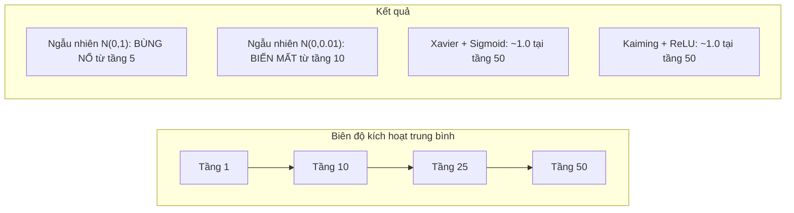
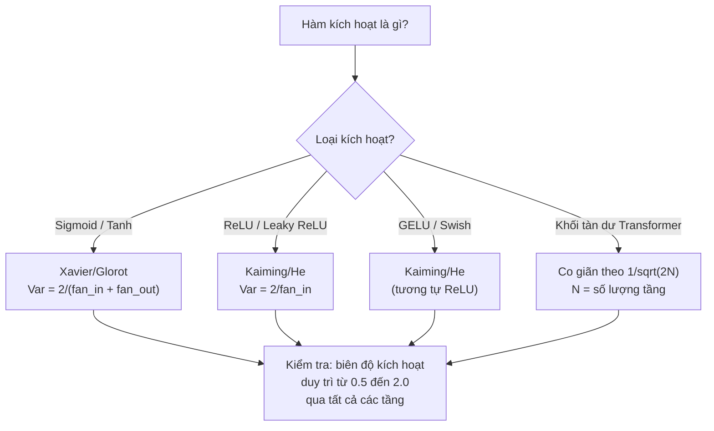

# Khởi tạo trọng số và Độ ổn định huấn luyện (Weight Initialization and Training Stability)

> Khởi tạo sai, quá trình huấn luyện thậm chí không thể bắt đầu. Khởi tạo đúng, mạng 50 tầng sẽ huấn luyện mượt mà hệt như mạng 3 tầng.

**Type:** Build
**Languages:** Python
**Prerequisites:** Bài học 03.04 (Các hàm kích hoạt), Bài học 03.07 (Điều chuẩn)
**Time:** ~90 phút

## Mục tiêu học tập

- Tự tay triển khai các chiến lược khởi tạo bằng 0 (zero), ngẫu nhiên (random), Xavier/Glorot, và Kaiming/He, đồng thời đo lường tác động của chúng lên biên độ kích hoạt qua 50 tầng mạng
- Dẫn xuất chứng minh lý do Xavier init dùng công thức $\mathrm{Var}(w) = 2/(\text{fan}_{\text{in}} + \text{fan}_{\text{out}})$ và Kaiming dùng $\mathrm{Var}(w) = 2/\text{fan}_{\text{in}}$
- Minh họa vấn đề đối xứng (symmetry problem) khi khởi tạo bằng 0 và giải thích lý do vì sao chỉ điều chỉnh thang đo ngẫu nhiên đơn thuần là chưa đủ
- Ghép nối chuẩn xác chiến lược khởi tạo với hàm kích hoạt tương ứng: Xavier cho sigmoid/tanh, Kaiming cho ReLU/GELU

## Vấn đề thực tế

Khởi tạo tất cả trọng số bằng 0. Không có thứ gì học được cả. Mọi nơ-ron đều tính toán cùng một hàm số, nhận cùng một gradient, và cập nhật những giá trị giống hệt nhau. Sau 10.000 epoch, tầng ẩn 512 nơ-ron của bạn vẫn chỉ là 512 bản sao của một nơ-ron duy nhất! Bạn trả giá tài nguyên cho 512 tham số nhưng chỉ nhận lại đúng 1 tham số hữu ích.

Khởi tạo chúng quá lớn. Các giá trị kích hoạt sẽ bùng nổ theo cấp số nhân xuyên suốt mạng lưới. Đến tầng thứ 10, giá trị chạm ngưỡng 1e15. Đến tầng thứ 20, chúng tràn số thành vô cực (infinity). Các gradient cũng đi theo quỹ đạo thảm họa tương tự theo chiều ngược lại.

Khởi tạo ngẫu nhiên từ phân phối chuẩn tắc tiêu chuẩn $N(0, 1)$. Hoạt động ổn với 3 tầng. Nhưng ở mạng 50 tầng, tín hiệu hoặc sụp đổ về 0, hoặc nổ tung thành vô cực tùy thuộc vào việc quy mô ngẫu nhiên hơi nhỏ hay hơi lớn một chút. Ranh giới giữa "chạy được" và "đổ vỡ" mỏng manh như một sợi tóc.

Khởi tạo trọng số là quyết định bị đánh giá thấp nhất trong học sâu. Các kiến trúc mới được viết thành các bài báo chấn động. Các bộ tối ưu hóa mới được phân tích trên các bài blog. Còn khởi tạo chỉ nhận được một dòng chú thích nhỏ ở cuối trang. Nhưng nếu bạn làm sai bước này, mọi thứ khác đều vô nghĩa -- mạng nơ-ron của bạn đã chết lâm sàng trước cả khi quá trình huấn luyện bắt đầu.

## Khái niệm

### Vấn đề đối xứng (The Symmetry Problem)

Mọi nơ-ron trong cùng một tầng đều có chung cấu trúc: nhân đầu vào với trọng số, cộng hệ số chệch, và áp dụng hàm kích hoạt. Nếu tất cả trọng số đều bắt đầu ở cùng một giá trị (bằng 0 là trường hợp cực đoan nhất), mọi nơ-ron sẽ cho ra đầu ra giống hệt nhau. Trong quá trình lan truyền ngược, mọi nơ-ron nhận cùng một giá trị gradient. Trong bước cập nhật, mọi nơ-ron thay đổi một lượng hoàn toàn như nhau.

Bạn bị mắc kẹt. Mạng có hàng trăm tham số, nhưng tất cả di chuyển đồng bộ như một khối duy nhất. Hiện tượng này gọi là tính đối xứng (symmetry), và khởi tạo ngẫu nhiên là phương pháp phá vỡ tính đối xứng một cách trực diện. Mỗi nơ-ron bắt đầu ở một tọa độ khác nhau trong không gian trọng số, nhờ đó mỗi nơ-ron sẽ học một đặc trưng khác nhau.

Tuy nhiên, "ngẫu nhiên" thôi là chưa đủ. *Thang đo* (scale / độ lệch chuẩn) của sự ngẫu nhiên đó mới là yếu tố quyết định liệu mạng có huấn luyện được hay không.

### Sự lan truyền phương sai qua các tầng mạng

Xem xét một tầng đơn lẻ có $\text{fan}_{\text{in}}$ đầu vào:

```math
z = w_1 x_1 + w_2 x_2 + \cdots + w_n x_n
```

Nếu mỗi trọng số $w_i$ được lấy mẫu từ một phân phối có phương sai $\mathrm{Var}(w)$ và mỗi đầu vào $x_i$ có phương sai $\mathrm{Var}(x)$, thì phương sai của đầu ra sẽ là:

```math
\mathrm{Var}(z) = \text{fan}_{\text{in}} \cdot \mathrm{Var}(w) \cdot \mathrm{Var}(x)
```

Nếu $\mathrm{Var}(w) = 1$ và $\text{fan}_{\text{in}} = 512$, phương sai đầu ra sẽ lớn gấp 512 lần phương sai đầu vào! Sau 10 tầng: $512^{10} = 1.2 \times 10^{27}$. Tín hiệu của bạn đã bùng nổ dữ dội.

Nếu $\mathrm{Var}(w) = 0.001$, phương sai đầu ra suy giảm theo tỷ lệ $0.001 \cdot 512 = 0.512$ ở mỗi tầng. Sau 10 tầng: $0.512^{10} = 0.00013$. Tín hiệu của bạn đã hoàn toàn biến mất.

Mục tiêu cốt lõi: Chọn $\mathrm{Var}(w)$ sao cho $\mathrm{Var}(z) = \mathrm{Var}(x)$. Biên độ của tín hiệu phải được giữ ổn định và không đổi xuyên suốt các tầng mạng.

### Khởi tạo Xavier / Glorot

Glorot và Bengio (2010) đã dẫn xuất giải pháp toán học cho các hàm kích hoạt sigmoid và tanh. Để duy trì phương sai ổn định trong cả lượt lan truyền tiến lẫn lan truyền ngược:

```math
\mathrm{Var}(w) = \frac{2}{\text{fan}_{\text{in}} + \text{fan}_{\text{out}}}
```

Trong thực tế, các trọng số được lấy mẫu từ phân phối đều (uniform):

```math
w \sim \text{Uniform}(-\text{limit}, \text{limit}) \quad \text{với } \text{limit} = \sqrt{\frac{6}{\text{fan}_{\text{in}} + \text{fan}_{\text{out}}}}
```

hoặc từ phân phối chuẩn (normal):

```math
w \sim \text{Normal}\left(0, \sqrt{\frac{2}{\text{fan}_{\text{in}} + \text{fan}_{\text{out}}}}\right)
```

Công thức này hoạt động hiệu quả vì sigmoid và tanh xấp xỉ tuyến tính ở vùng lân cận điểm 0 -- nơi mà các giá trị kích hoạt được khởi tạo đúng chuẩn cư ngụ. Phương sai duy trì trạng thái ổn định qua hàng chục tầng mạng.

### Khởi tạo Kaiming / He

Hàm ReLU triệt tiêu một nửa số đầu ra (mọi giá trị âm đều trở thành 0). Số lượng đầu vào hiệu dụng $\text{fan}_{\text{in}}$ bị giảm đi một nửa vì trung bình một nửa đầu vào bị đưa về 0. Khởi tạo Xavier không tính đến điều này -- nó đánh giá thấp lượng phương sai cần thiết.

He và cộng sự (2015) đã điều chỉnh lại công thức:

```math
\mathrm{Var}(w) = \frac{2}{\text{fan}_{\text{in}}}
```

Các trọng số được lấy mẫu từ:

```math
w \sim \text{Normal}\left(0, \sqrt{\frac{2}{\text{fan}_{\text{in}}}}\right)
```

Hệ số 2 xuất hiện chính là để bù đắp cho việc ReLU triệt tiêu một nửa số lượng kích hoạt. Nếu thiếu hệ số 2 này, tín hiệu sẽ suy giảm khoảng 0.5 lần sau mỗi tầng. Qua 50 tầng: $0.5^{50} = 8.8 \times 10^{-16}$. Khởi tạo Kaiming ngăn ngừa hoàn toàn hiện tượng này.

### Khởi tạo trong mô hình Transformer

Mô hình GPT-2 đã giới thiệu một kỹ thuật khác biệt. Các kết nối tàn dư (residual connections) cộng trực tiếp đầu ra của từng khối con vào đầu vào của nó:

```math
x = x + \text{sublayer}(x)
```

Mỗi phép cộng này làm gia tăng phương sai. Với $N$ tầng tàn dư, phương sai sẽ tăng tỷ lệ thuận với $N$. GPT-2 khắc phục điều này bằng cách co giãn trọng số của các tầng tàn dư theo hệ số $1/\sqrt{2N}$, trong đó $N$ là tổng số tầng. Kỹ thuật này giữ cho biên độ tín hiệu tích lũy luôn ổn định.

Mô hình Llama 3 (405 tỷ tham số, 126 tầng) cũng sử dụng một cơ chế tương tự. Nếu thiếu cơ chế co giãn này, dòng tín hiệu tàn dư (residual stream) sẽ bùng nổ mất kiểm soát khi đi qua 126 tầng của các khối attention và feed-forward.

```mermaid
flowchart TD
    subgraph "Khởi tạo bằng 0 (Zero Init)"
        Z1["Tầng 1<br/>Tất cả trọng số = 0"] --> Z2["Tầng 2<br/>Mọi nơ-ron giống hệt nhau"]
        Z2 --> Z3["Tầng 3<br/>Vẫn giống hệt nhau"]
        Z3 --> ZR["Kết quả: 1 nơ-ron hiệu dụng<br/>bất kể độ rộng"]
    end

    subgraph "Khởi tạo Xavier"
        X1["Tầng 1<br/>Var = 2/(fan_in+fan_out)"] --> X2["Tầng 2<br/>Tín hiệu ổn định"]
        X2 --> X3["Tầng 50<br/>Tín hiệu ổn định"]
        X3 --> XR["Kết quả: Huấn luyện tốt với<br/>sigmoid/tanh"]
    end

    subgraph "Khởi tạo Kaiming"
        K1["Tầng 1<br/>Var = 2/fan_in"] --> K2["Tầng 2<br/>Tín hiệu ổn định"]
        K2 --> K3["Tầng 50<br/>Tín hiệu ổn định"]
        K3 --> KR["Kết quả: Huấn luyện tốt với<br/>ReLU/GELU"]
    end
```



### Biên độ kích hoạt qua 50 tầng mạng



### Lựa chọn chiến lược khởi tạo chuẩn xác



```figure
weight-init-variance
```

## Xây dựng thực hành (Build It)

### Bước 1: Các chiến lược khởi tạo

Bốn phương pháp khởi tạo một ma trận trọng số. Mỗi hàm trả về một ma trận 2D với `fan_in` cột và `fan_out` hàng:

```python
import math
import random


def zero_init(fan_in, fan_out):
    return [[0.0 for _ in range(fan_in)] for _ in range(fan_out)]


def random_init(fan_in, fan_out, scale=1.0):
    return [[random.gauss(0, scale) for _ in range(fan_in)] for _ in range(fan_out)]


def xavier_init(fan_in, fan_out):
    std = math.sqrt(2.0 / (fan_in + fan_out))
    return [[random.gauss(0, std) for _ in range(fan_in)] for _ in range(fan_out)]


def kaiming_init(fan_in, fan_out):
    std = math.sqrt(2.0 / fan_in)
    return [[random.gauss(0, std) for _ in range(fan_in)] for _ in range(fan_out)]
```

### Bước 2: Các hàm kích hoạt

Chúng ta cần sigmoid, tanh, và ReLU để kiểm thử từng chiến lược khởi tạo với đúng hàm kích hoạt mục tiêu của nó:

```python
def sigmoid(x):
    x = max(-500, min(500, x))
    return 1.0 / (1.0 + math.exp(-x))


def tanh_act(x):
    return math.tanh(x)


def relu(x):
    return max(0.0, x)
```

### Bước 3: Lan truyền tiến qua 50 tầng mạng

Truyền dữ liệu ngẫu nhiên qua mạng sâu 50 tầng và đo lường biên độ kích hoạt trung bình tại mỗi tầng:

```python
def forward_deep(init_fn, activation_fn, n_layers=50, width=64, n_samples=100):
    random.seed(42)
    layer_magnitudes = []

    inputs = [[random.gauss(0, 1) for _ in range(width)] for _ in range(n_samples)]

    for layer_idx in range(n_layers):
        weights = init_fn(width, width)
        biases = [0.0] * width

        new_inputs = []
        for sample in inputs:
            output = []
            for neuron_idx in range(width):
                z = sum(weights[neuron_idx][j] * sample[j] for j in range(width)) + biases[neuron_idx]
                output.append(activation_fn(z))
            new_inputs.append(output)
        inputs = new_inputs

        magnitudes = []
        for sample in inputs:
            magnitudes.append(sum(abs(v) for v in sample) / width)
        mean_mag = sum(magnitudes) / len(magnitudes)
        layer_magnitudes.append(mean_mag)

    return layer_magnitudes
```

### Bước 4: Chạy thực nghiệm

Chạy thử nghiệm tất cả các tổ hợp: khởi tạo bằng 0, ngẫu nhiên $N(0, 1)$, ngẫu nhiên $N(0, 0.01)$, Xavier với sigmoid, Xavier với tanh, và Kaiming với ReLU. In biên độ tại các tầng quan trọng:

```python
def run_experiment():
    configs = [
        ("Khởi tạo bằng 0 + Sigmoid", lambda fi, fo: zero_init(fi, fo), sigmoid),
        ("Ngẫu nhiên N(0,1) + ReLU", lambda fi, fo: random_init(fi, fo, 1.0), relu),
        ("Ngẫu nhiên N(0,0.01) + ReLU", lambda fi, fo: random_init(fi, fo, 0.01), relu),
        ("Xavier + Sigmoid", xavier_init, sigmoid),
        ("Xavier + Tanh", xavier_init, tanh_act),
        ("Kaiming + ReLU", kaiming_init, relu),
    ]

    print(f"{'Chiến lược':<30} {'Tầng 1':>10} {'Tầng 5':>10} {'Tầng 10':>10} {'Tầng 25':>10} {'Tầng 50':>10}")
    print("-" * 80)

    for name, init_fn, act_fn in configs:
        mags = forward_deep(init_fn, act_fn)
        row = f"{name:<30}"
        for idx in [0, 4, 9, 24, 49]:
            val = mags[idx]
            if val > 1e6:
                row += f" {'BÙNG NỔ':>10}"
            elif val < 1e-6:
                row += f" {'TRIỆT TIÊU':>10}"
            else:
                row += f" {val:>10.4f}"
        print(row)
```

### Bước 5: Minh họa sự phá vỡ tính đối xứng

Chứng minh rằng khởi tạo bằng 0 tạo ra các nơ-ron y hệt nhau:

```python
def symmetry_demo():
    random.seed(42)
    weights = zero_init(2, 4)
    biases = [0.0] * 4

    inputs = [0.5, -0.3]
    outputs = []
    for neuron_idx in range(4):
        z = sum(weights[neuron_idx][j] * inputs[j] for j in range(2)) + biases[neuron_idx]
        outputs.append(sigmoid(z))

    print("\nMinh họa đối xứng (4 nơ-ron, khởi tạo bằng 0):")
    for i, out in enumerate(outputs):
        print(f"  Nơ-ron {i}: đầu ra = {out:.6f}")
    all_same = all(abs(outputs[i] - outputs[0]) < 1e-10 for i in range(len(outputs)))
    print(f"  Tất cả giống hệt nhau: {all_same}")
    print(f"  Số tham số hiệu dụng: 1 (thay vì {len(weights) * len(weights[0])})")
```

### Bước 6: Báo cáo biên độ qua từng tầng

In biểu đồ thanh trực quan hóa biên độ kích hoạt qua 50 tầng mạng:

```python
def magnitude_report(name, magnitudes):
    print(f"\n{name}:")
    for i, mag in enumerate(magnitudes):
        if i % 5 == 0 or i == len(magnitudes) - 1:
            if mag > 1e6:
                bar = "X" * 50 + " BÙNG NỔ"
            elif mag < 1e-6:
                bar = "." + " TRIỆT TIÊU"
            else:
                bar_len = min(50, max(1, int(mag * 10)))
                bar = "#" * bar_len
            print(f"  Tầng {i+1:3d}: {bar} ({mag:.6f})")
```

## Ứng dụng thực tế (Use It)

PyTorch cung cấp tất cả các phương pháp này dưới dạng các hàm tích hợp sẵn:

```python
import torch
import torch.nn as nn

layer = nn.Linear(512, 256)

nn.init.xavier_uniform_(layer.weight)
nn.init.xavier_normal_(layer.weight)

nn.init.kaiming_uniform_(layer.weight, nonlinearity='relu')
nn.init.kaiming_normal_(layer.weight, nonlinearity='relu')

nn.init.zeros_(layer.bias)
```

Khi bạn gọi `nn.Linear(512, 256)`, PyTorch mặc định sử dụng khởi tạo Kaiming uniform. Đó là lý do vì sao hầu hết các mạng cơ bản "tự nhiên chạy ngon lành" -- PyTorch đã ngầm đưa ra lựa chọn tối ưu giúp bạn. Nhưng khi bạn xây dựng các kiến trúc tùy biến hoặc đi sâu hơn 20 tầng, bạn cần nắm rõ cơ chế này để có thể ghi đè khi cần thiết.

Đối với Transformer, các mô hình HuggingFace thường xử lý khởi tạo trong phương thức `_init_weights`. Triển khai của GPT-2 co giãn các phép chiếu tàn dư theo hệ số $1/\sqrt{2N}$. Nếu bạn xây dựng một Transformer từ đầu, bạn bắt buộc phải tự thêm cơ chế này vào mã nguồn của mình.

## Đóng gói ứng dụng (Ship It)

Bài học này tạo ra:
- `outputs/prompt-init-strategy.md` -- mẫu câu lệnh chẩn đoán các sự cố khởi tạo trọng số và đề xuất chiến lược tối ưu

## Bài tập rèn luyện (Exercises)

1. Thêm phương pháp khởi tạo LeCun ($\mathrm{Var} = 1/\text{fan}_{\text{in}}$, được thiết kế riêng cho hàm kích hoạt SELU). Chạy thực nghiệm 50 tầng với khởi tạo LeCun + tanh và so sánh với Xavier + tanh.
2. Triển khai cơ chế co giãn tàn dư của GPT-2: nhân đầu ra của mỗi tầng với $1/\sqrt{2N}$ trước khi cộng vào dòng tàn dư. Chạy 50 tầng có và không có co giãn, đo lường tốc độ tăng trưởng biên độ tín hiệu tàn dư.
3. Tạo một hàm "kiểm tra sức khỏe khởi tạo" nhận kích thước các tầng và loại hàm kích hoạt, sau đó khuyến nghị phương pháp khởi tạo chuẩn xác và cảnh báo nếu cách khởi tạo hiện tại có nguy cơ gây lỗi.
4. Chạy thực nghiệm với $\text{fan}_{\text{in}} = 16$ so với $\text{fan}_{\text{in}} = 1024$. Xavier và Kaiming tự động thích ứng theo `fan_in`, nhưng khởi tạo ngẫu nhiên cố định thì không. Hãy chỉ ra khoảng cách giữa "chạy được" và "đổ vỡ" ngày càng dãn rộng ra sao khi các tầng mạng lớn hơn.
5. Triển khai khởi tạo trực giao (orthogonal initialization - sinh ma trận ngẫu nhiên, tính phân rã SVD, dùng ma trận trực giao $U$). So sánh với Kaiming trên mạng ReLU 50 tầng.

## Thuật ngữ then chốt (Key Terms)

| Thuật ngữ | Cách gọi thông thường | Ý nghĩa kỹ thuật |
|------|----------------|----------------------|
| Weight initialization (Khởi tạo trọng số) | "Gán trọng số ban đầu ngẫu nhiên" | Chiến lược chọn giá trị trọng số ban đầu quyết định liệu mạng có thể học được hay không |
| Symmetry breaking (Phá vỡ đối xứng) | "Làm cho các nơ-ron khác nhau" | Dùng khởi tạo ngẫu nhiên để đảm bảo các nơ-ron học các đặc trưng khác nhau thay vì tính toán y hệt nhau |
| Fan-in | "Số đầu vào của nơ-ron" | Số lượng liên kết đi vào, quyết định mức độ phương sai đầu vào tích lũy trong tổng có trọng số |
| Fan-out | "Số đầu ra của nơ-ron" | Số lượng liên kết đi ra, liên quan trực tiếp đến việc duy trì phương sai gradient trong lan truyền ngược |
| Xavier/Glorot init | "Khởi tạo cho sigmoid" | $\mathrm{Var}(w) = 2/(\text{fan}_{\text{in}} + \text{fan}_{\text{out}})$, duy trì phương sai qua các hàm sigmoid và tanh |
| Kaiming/He init | "Khởi tạo cho ReLU" | $\mathrm{Var}(w) = 2/\text{fan}_{\text{in}}$, bù đắp cho việc ReLU triệt tiêu một nửa số lượng kích hoạt |
| Variance propagation (Lan truyền phương sai) | "Độ lớn tín hiệu qua các tầng" | Phân tích toán học về sự thay đổi phương sai kích hoạt qua từng tầng dựa trên quy mô trọng số |
| Residual scaling (Co giãn tàn dư) | "Mẹo khởi tạo của GPT-2" | Co giãn trọng số kết nối tàn dư theo $1/\sqrt{2N}$ để ngăn phương sai bùng nổ qua $N$ tầng Transformer |
| Dead network (Mạng chết) | "Không học được gì" | Mạng nơ-ron bị khởi tạo sai khiến tất cả gradient bằng 0 hoặc tất cả kích hoạt rơi vào vùng bão hòa |
| Exploding activations (Kích hoạt bùng nổ) | "Giá trị vọt lên vô cực" | Khi phương sai trọng số quá lớn, làm biên độ kích hoạt tăng theo cấp số nhân qua các tầng |

## Tài liệu đọc thêm (Further Reading)

- Glorot & Bengio, "Understanding the difficulty of training deep feedforward neural networks" (2010) -- bài báo gốc về khởi tạo Xavier kèm phân tích phương sai toán học
- He et al., "Delving Deep into Rectifiers" (2015) -- giới thiệu phương pháp khởi tạo Kaiming cho mạng ReLU
- Radford et al., "Language Models are Unsupervised Multitask Learners" (2019) -- bài báo GPT-2 giới thiệu kỹ thuật khởi tạo co giãn kết nối tàn dư
- Mishkin & Matas, "All You Need is a Good Init" (2016) -- phương pháp khởi tạo LSUV (layer-sequential unit-variance), giải pháp thực nghiệm thay thế cho các công thức giải tích

