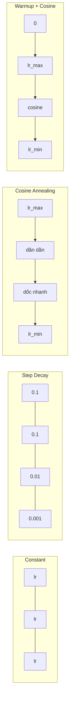
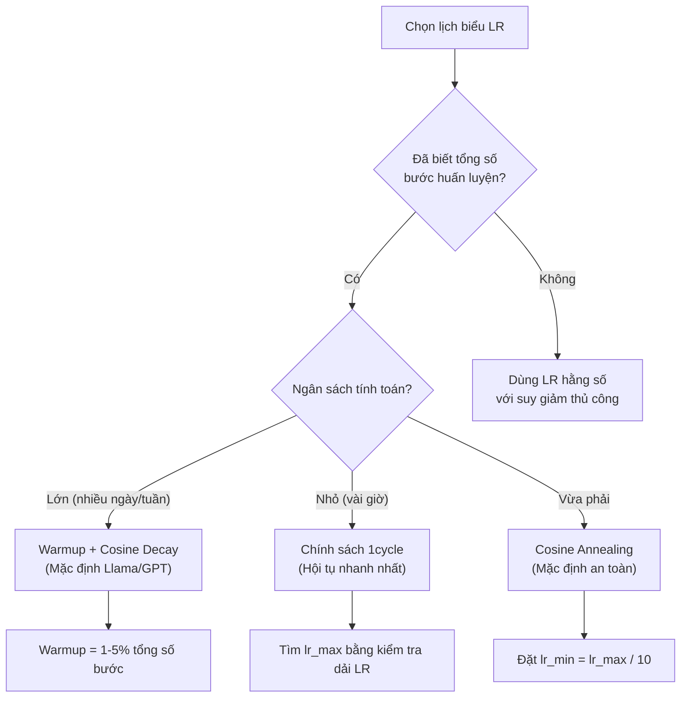
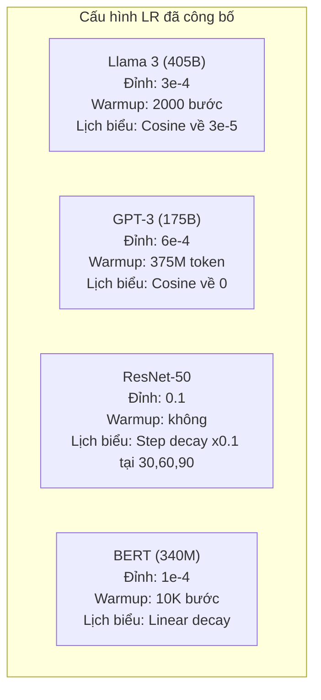

# Lịch biểu Tốc độ học và Warmup (Learning Rate Schedules and Warmup)

> Tốc độ học là siêu tham số đơn lẻ quan trọng nhất. Không phải kiến trúc mạng. Không phải kích thước tập dữ liệu. Không phải hàm kích hoạt. Mà chính là tốc độ học. Nếu bạn không tinh chỉnh bất kỳ điều gì khác, hãy tinh chỉnh tham số này.

**Type:** Build
**Languages:** Python
**Prerequisites:** Lesson 03.06 (Optimizers), Lesson 03.08 (Weight Initialization)
**Time:** ~90 phút

## Learning Objectives

- Tự tay cài đặt từ đầu các lịch biểu tốc độ học: hằng số (constant), suy giảm theo bước (step decay), suy giảm cosine (cosine annealing), warmup kết hợp cosine, và chính sách 1cycle
- Minh họa ba chế độ thất bại khi chọn tốc độ học: phân kỳ (quá cao), đình trệ (quá thấp), và dao động (không suy giảm)
- Giải thích lý do tại sao warmup là thiết yếu cho các bộ tối ưu hóa họ Adam và cách nó ổn định giai đoạn huấn luyện ban đầu
- So sánh tốc độ hội tụ giữa cả 5 lịch biểu trên cùng một bài toán và lựa chọn lịch biểu phù hợp cho một ngân sách huấn luyện nhất định

## Vấn đề thực tế (The Problem)

Đặt tốc độ học bằng 0.1. Quá trình huấn luyện phân kỳ -- hàm mất mát nhảy vọt lên vô cực chỉ sau 3 bước. Đặt bằng 0.0001. Quá trình huấn luyện bò lê lết -- sau 100 epoch, mô hình hầu như không nhúc nhích khỏi trạng thái ngẫu nhiên. Đặt bằng 0.01. Quá trình huấn luyện diễn ra ổn trong 50 epoch, sau đó hàm mất mát dao động quanh một điểm cực tiểu mà nó không bao giờ chạm tới được vì các bước nhảy quá lớn.

Tốc độ học tối ưu không phải là một hằng số. Nó biến đổi trong suốt quá trình huấn luyện. Ở giai đoạn đầu, bạn cần các bước nhảy lớn để bao quát không gian nhanh chóng. Về cuối quá trình huấn luyện, bạn muốn các bước nhảy cực nhỏ để lắng sâu vào vùng cực tiểu sắc nét. Sự khác biệt giữa một mô hình đạt độ chính xác 90% và 95% thường chỉ nằm ở lịch biểu tốc độ học.

Mọi mô hình lớn được công bố trong ba năm qua đều sử dụng một lịch biểu tốc độ học. Llama 3 sử dụng tốc độ học đỉnh $\text{lr}=3\times 10^{-4}$ với 2000 bước warmup và suy giảm cosine về $3\times 10^{-5}$. GPT-3 sử dụng $\text{lr}=6\times 10^{-4}$ cùng warmup trải dài trên 375 triệu token. Đây không phải là những lựa chọn tùy tiện. Chúng là kết quả của các đợt quét siêu tham số sâu rộng tiêu tốn hàng triệu dollar.

Bạn cần hiểu các lịch biểu vì giá trị mặc định sẽ không hoạt động tốt cho bài toán cụ thể của bạn. Khi bạn tinh chỉnh (fine-tune) một mô hình đã huấn luyện trước, lịch biểu phù hợp sẽ khác biệt so với khi huấn luyện từ đầu. Khi bạn tăng kích thước batch (batch size), chu kỳ warmup cũng cần thay đổi. Khi quá trình huấn luyện bị đổ vỡ ở bước thứ 10,000, bạn cần biết liệu đó là lỗi do lịch biểu hay do nguyên nhân khác.

## Khái niệm (The Concept)

### Tốc độ học hằng số (Constant Learning Rate)

Cách tiếp cận đơn giản nhất. Chọn một con số và dùng nó cho mọi bước bước đi.

```math
\text{lr}(t) = \text{lr}_0
```

Hiếm khi đạt tối ưu. Nó hoặc là quá cao cho giai đoạn cuối huấn luyện (gây dao động quanh cực tiểu) hoặc quá thấp cho giai đoạn bắt đầu (lãng phí năng lực tính toán vào các bước nhảy tí hon). Hoạt động ổn cho các mô hình nhỏ và lúc gỡ lỗi (debug). Nhưng là một lựa chọn tồi tệ cho bất kỳ mô hình nào cần huấn luyện lâu hơn một giờ.

### Suy giảm theo bước (Step Decay)

Cách tiếp cận truyền thống từ kỷ nguyên ResNet. Cắt giảm tốc độ học theo một hệ số (thường là giảm 10 lần) tại các mốc epoch cố định.

```math
\text{lr}(t) = \text{lr}_0 \cdot \gamma^{\lfloor \text{epoch} / \text{step\_size} \rfloor}
```

Trong đó $\gamma = 0.1$ và `step_size = 30` có nghĩa là: lr giảm 10 lần sau mỗi 30 epoch. ResNet-50 đã dùng kỹ thuật này -- lr = 0.1, giảm 10 lần ở các epoch 30, 60, và 90.

Vấn đề: các mốc suy giảm tối ưu phụ thuộc chặt chẽ vào tập dữ liệu và kiến trúc mạng. Chuyển sang một bài toán khác, bạn lại phải tinh chỉnh lại thời điểm giảm tốc độ. Sự chuyển tiếp rất đột ngột -- mất mát có thể tăng vọt (spike) khi tốc độ đột ngột thay đổi.

### Suy giảm Cosine (Cosine Annealing)

Suy giảm mượt mà từ tốc độ học cực đại về cực tiểu theo đường cong hàm cosine:

```math
\text{lr}(t) = \text{lr}_{\min} + 0.5 \cdot (\text{lr}_{\max} - \text{lr}_{\min}) \cdot \left(1 + \cos\left(\frac{\pi t}{T}\right)\right)
```

Trong đó $t$ là bước hiện tại và $T$ là tổng số bước.

Tại $t = 0$, số hạng cosine bằng 1, do đó $\text{lr} = \text{lr}_{\max}$. Tại $t = T$, số hạng cosine bằng -1, do đó $\text{lr} = \text{lr}_{\min}$. Tốc độ suy giảm ban đầu nhẹ nhàng, tăng tốc ở đoạn giữa, và lại trở nên nhẹ nhàng êm ái ở gần cuối.

Đây là lựa chọn mặc định cho hầu hết các đợt huấn luyện hiện đại. Không cần tinh chỉnh siêu tham số nào ngoài $\text{lr}_{\max}$ và $\text{lr}_{\min}$. Hình dạng cosine khớp với quan sát thực nghiệm rằng phần lớn quá trình học diễn ra ở đoạn giữa huấn luyện -- bạn cần kích thước bước đi hợp lý trong giai đoạn then chốt đó.

### Khởi động (Warmup): Tại sao phải bắt đầu từ giá trị nhỏ

Adam và các bộ tối ưu hóa thích nghi duy trì các ước lượng trượt về kỳ vọng (mean) và phương sai (variance) của gradient. Tại bước 0, các ước lượng này được khởi tạo bằng 0. Vài lượt cập nhật gradient đầu tiên dựa trên các số liệu thống kê chưa đáng tin cậy. Nếu tốc độ học của bạn lớn trong giai đoạn này, mô hình sẽ thực hiện các bước nhảy khổng lồ và sai hướng.

Warmup khắc phục điều này. Bắt đầu với tốc độ học rất nhỏ (thường là $\text{lr}_{\max} / \text{warmup\_steps}$ hoặc thậm chí bằng 0) và tăng dần tuyến tính lên $\text{lr}_{\max}$ qua $N$ bước đầu tiên. Đến thời điểm bạn đạt tốc độ học đầy đủ, các giá trị thống kê của Adam đã ổn định.

```math
\text{lr}(t) = \text{lr}_{\max} \cdot \frac{t}{\text{warmup\_steps}} \quad \text{cho } t < \text{warmup\_steps}
```

Warmup điển hình: chiếm 1-5% tổng số bước huấn luyện. Llama 3 huấn luyện trên khoảng 1.8 nghìn tỷ token và khởi động trong 2000 bước. GPT-3 thực hiện khởi động qua 375 triệu token.

### Tuyến tính Warmup kết hợp suy giảm Cosine (Linear Warmup + Cosine Decay)

Tiêu chuẩn mặc định hiện đại. Tăng tuyến tính lúc đầu, sau đó suy giảm dần theo đường cosine:

```text
if t < warmup_steps:
    lr(t) = lr_max * (t / warmup_steps)
else:
    progress = (t - warmup_steps) / (total_steps - warmup_steps)
    lr(t) = lr_min + 0.5 * (lr_max - lr_min) * (1 + cos(pi * progress))
```

Đây là cách Llama, GPT, PaLM và hầu hết các mô hình Transformer hiện đại áp dụng. Khởi động warmup ngăn chặn sự bất ổn định ban đầu. Suy giảm cosine giúp mô hình lắng êm vào một cực tiểu tốt.

### Chính sách 1cycle (1cycle Policy)

Phát hiện của Leslie Smith (2018): tăng tốc độ học từ giá trị thấp lên giá trị cao trong nửa đầu quá trình huấn luyện, sau đó hạ dần trở lại trong nửa sau. Nghe có vẻ ngược trực giác -- tại sao bạn lại muốn *tăng* tốc độ học ở giữa chặng đường?

Lý thuyết giải thích: tốc độ học cao đóng vai trò như một bộ điều chuẩn (regularization) bằng cách thêm nhiễu vào quỹ đạo tối ưu hóa. Mô hình khám phá nhiều hơn bề mặt hàm mất mát (loss landscape) trong giai đoạn tăng tốc, tìm ra các lưu vực (basins) tốt hơn. Giai đoạn giảm tốc sau đó sẽ tinh chỉnh sâu bên trong lưu vực tốt nhất tìm được.

```text
Phase 1 (0 đến T/2):    lr tăng dần từ lr_max/25 lên lr_max
Phase 2 (T/2 đến T):    lr giảm dần từ lr_max về lr_max/10000
```

1cycle thường huấn luyện nhanh hơn so với suy giảm cosine với cùng một ngân sách tính toán cố định. Điểm đánh đổi: bạn bắt buộc phải biết trước tổng số bước huấn luyện.

### Hình dạng các lịch biểu (Schedule Shapes)



### Lưu đồ quyết định (Decision Flowchart)



### Các con số thực tế từ những mô hình đã công bố



```figure
lr-schedule
```

## Tự tay xây dựng (Build It)

### Bước 1: Các hàm lịch biểu

Mỗi hàm nhận bước hiện tại và trả về tốc độ học tương ứng tại bước đó.

```python
import math


def constant_schedule(step, lr=0.01, **kwargs):
    return lr


def step_decay_schedule(step, lr=0.1, step_size=100, gamma=0.1, **kwargs):
    return lr * (gamma ** (step // step_size))


def cosine_schedule(step, lr=0.01, total_steps=1000, lr_min=1e-5, **kwargs):
    if step >= total_steps:
        return lr_min
    return lr_min + 0.5 * (lr - lr_min) * (1 + math.cos(math.pi * step / total_steps))


def warmup_cosine_schedule(step, lr=0.01, total_steps=1000, warmup_steps=100, lr_min=1e-5, **kwargs):
    if total_steps <= warmup_steps:
        return lr * (step / max(warmup_steps, 1))
    if step < warmup_steps:
        return lr * step / warmup_steps
    progress = (step - warmup_steps) / (total_steps - warmup_steps)
    return lr_min + 0.5 * (lr - lr_min) * (1 + math.cos(math.pi * progress))


def one_cycle_schedule(step, lr=0.01, total_steps=1000, **kwargs):
    mid = max(total_steps // 2, 1)
    if step < mid:
        return (lr / 25) + (lr - lr / 25) * step / mid
    else:
        progress = (step - mid) / max(total_steps - mid, 1)
        return lr * (1 - progress) + (lr / 10000) * progress
```

### Bước 2: Trực quan hóa tất cả các lịch biểu

In biểu đồ dạng văn bản hiển thị sự biến đổi của từng lịch biểu trong quá trình huấn luyện.

```python
def visualize_schedule(name, schedule_fn, total_steps=500, **kwargs):
    steps = list(range(0, total_steps, total_steps // 20))
    if total_steps - 1 not in steps:
        steps.append(total_steps - 1)

    lrs = [schedule_fn(s, total_steps=total_steps, **kwargs) for s in steps]
    max_lr = max(lrs) if max(lrs) > 0 else 1.0

    print(f"\n{name}:")
    for s, lr_val in zip(steps, lrs):
        bar_len = int(lr_val / max_lr * 40)
        bar = "#" * bar_len
        print(f"  Step {s:4d}: lr={lr_val:.6f} {bar}")
```

### Bước 3: Mạng huấn luyện

Một mạng nơ-ron hai lớp đơn giản trên tập dữ liệu hình tròn (circle dataset), tương tự như các bài học trước, nhưng giờ đây chúng ta thay đổi lịch biểu tốc độ học.

```python
import random


def sigmoid(x):
    x = max(-500, min(500, x))
    return 1.0 / (1.0 + math.exp(-x))


def relu(x):
    return max(0.0, x)


def relu_deriv(x):
    return 1.0 if x > 0 else 0.0


def make_circle_data(n=200, seed=42):
    random.seed(seed)
    data = []
    for _ in range(n):
        x = random.uniform(-2, 2)
        y = random.uniform(-2, 2)
        label = 1.0 if x * x + y * y < 1.5 else 0.0
        data.append(([x, y], label))
    return data


def train_with_schedule(schedule_fn, schedule_name, data, epochs=300, base_lr=0.05, **kwargs):
    random.seed(0)
    hidden_size = 8
    total_steps = epochs * len(data)

    std = math.sqrt(2.0 / 2)
    w1 = [[random.gauss(0, std) for _ in range(2)] for _ in range(hidden_size)]
    b1 = [0.0] * hidden_size
    w2 = [random.gauss(0, std) for _ in range(hidden_size)]
    b2 = 0.0

    step = 0
    epoch_losses = []

    for epoch in range(epochs):
        total_loss = 0
        correct = 0

        for x, target in data:
            lr = schedule_fn(step, lr=base_lr, total_steps=total_steps, **kwargs)

            z1 = []
            h = []
            for i in range(hidden_size):
                z = w1[i][0] * x[0] + w1[i][1] * x[1] + b1[i]
                z1.append(z)
                h.append(relu(z))

            z2 = sum(w2[i] * h[i] for i in range(hidden_size)) + b2
            out = sigmoid(z2)

            error = out - target
            d_out = error * out * (1 - out)

            for i in range(hidden_size):
                d_h = d_out * w2[i] * relu_deriv(z1[i])
                w2[i] -= lr * d_out * h[i]
                for j in range(2):
                    w1[i][j] -= lr * d_h * x[j]
                b1[i] -= lr * d_h
            b2 -= lr * d_out

            total_loss += (out - target) ** 2
            if (out >= 0.5) == (target >= 0.5):
                correct += 1
            step += 1

        avg_loss = total_loss / len(data)
        accuracy = correct / len(data) * 100
        epoch_losses.append(avg_loss)

    return epoch_losses
```

### Bước 4: So sánh tất cả các lịch biểu

Huấn luyện cùng một mạng với từng lịch biểu và so sánh hàm mất mát cuối cùng cùng hành vi hội tụ.

```python
def compare_schedules(data):
    configs = [
        ("Constant", constant_schedule, {}),
        ("Step Decay", step_decay_schedule, {"step_size": 15000, "gamma": 0.1}),
        ("Cosine", cosine_schedule, {"lr_min": 1e-5}),
        ("Warmup+Cosine", warmup_cosine_schedule, {"warmup_steps": 3000, "lr_min": 1e-5}),
        ("1cycle", one_cycle_schedule, {}),
    ]

    print(f"\n{'Schedule':<20} {'Start Loss':>12} {'Mid Loss':>12} {'End Loss':>12} {'Best Loss':>12}")
    print("-" * 70)

    for name, schedule_fn, extra_kwargs in configs:
        losses = train_with_schedule(schedule_fn, name, data, epochs=300, base_lr=0.05, **extra_kwargs)
        mid_idx = len(losses) // 2
        best = min(losses)
        print(f"{name:<20} {losses[0]:>12.6f} {losses[mid_idx]:>12.6f} {losses[-1]:>12.6f} {best:>12.6f}")
```

### Bước 5: LR quá cao so với quá thấp

Minh họa ba chế độ thất bại: quá cao (phân kỳ), quá thấp (bò lê lết), và vừa chuẩn.

```python
def lr_sensitivity(data):
    learning_rates = [1.0, 0.1, 0.01, 0.001, 0.0001]

    print("\nLR Sensitivity (constant schedule, 100 epochs):")
    print(f"  {'LR':>10} {'Start Loss':>12} {'End Loss':>12} {'Status':>15}")
    print("  " + "-" * 52)

    for lr in learning_rates:
        losses = train_with_schedule(constant_schedule, f"lr={lr}", data, epochs=100, base_lr=lr)
        start = losses[0]
        end = losses[-1]

        if end > start or math.isnan(end) or end > 1.0:
            status = "DIVERGED"
        elif end > start * 0.9:
            status = "BARELY MOVED"
        elif end < 0.15:
            status = "CONVERGED"
        else:
            status = "LEARNING"

        end_str = f"{end:.6f}" if not math.isnan(end) else "NaN"
        print(f"  {lr:>10.4f} {start:>12.6f} {end_str:>12} {status:>15}")
```

## Sử dụng trong thực tế (Use It)

PyTorch cung cấp sẵn các bộ điều phối lịch biểu trong `torch.optim.lr_scheduler`:

```python
import torch
import torch.optim as optim
from torch.optim.lr_scheduler import CosineAnnealingLR, OneCycleLR, StepLR

model = nn.Sequential(nn.Linear(10, 64), nn.ReLU(), nn.Linear(64, 1))
optimizer = optim.Adam(model.parameters(), lr=3e-4)

scheduler = CosineAnnealingLR(optimizer, T_max=1000, eta_min=1e-5)

for step in range(1000):
    loss = train_step(model, optimizer)
    scheduler.step()
```

Đối với warmup kết hợp cosine, bạn có thể dùng lambda scheduler hoặc hàm `get_cosine_schedule_with_warmup` từ HuggingFace:

```python
from transformers import get_cosine_schedule_with_warmup

scheduler = get_cosine_schedule_with_warmup(
    optimizer,
    num_warmup_steps=2000,
    num_training_steps=100000,
)
```

Hàm của HuggingFace là những gì mà phần lớn các kịch bản tinh chỉnh Llama và GPT đang dùng. Khi phân vân, hãy chọn warmup + cosine với chu kỳ warmup = 3-5% tổng số bước. Nó hoạt động tốt cho hầu như mọi tác vụ.

## Sản phẩm bàn giao (Ship It)

Bài học này tạo ra:
- `outputs/prompt-lr-schedule-advisor.md` -- một prompt gợi ý lịch biểu tốc độ học và siêu tham số phù hợp nhất cho thiết lập huấn luyện của bạn

## Bài tập rèn luyện (Exercises)

1. Cài đặt suy giảm hàm mũ (exponential decay): $\text{lr}(t) = \text{lr}_0 \cdot \gamma^t$ với $\gamma = 0.999$. So sánh với suy giảm cosine trên tập dữ liệu hình tròn.
2. Cài đặt kiểm tra dải tốc độ học (LR range test của Leslie Smith): huấn luyện trong vài trăm bước đồng thời tăng hàm mũ LR từ 1e-7 lên 1. Vẽ đồ thị hàm mất mát theo LR. Tốc độ học cực đại tối ưu nằm ngay trước điểm mất mát bắt đầu tăng vọt.
3. Huấn luyện với warmup + cosine nhưng thay đổi độ dài warmup: 0%, 1%, 5%, 10%, 20% tổng số bước. Tìm điểm cân bằng tối ưu giúp quá trình huấn luyện ổn định nhất.
4. Cài đặt suy giảm cosine với các lần tái khởi động ấm (cosine annealing with warm restarts - SGDR): thiết lập lại tốc độ học về $\text{lr}_{\max}$ sau mỗi $T$ bước và suy giảm trở lại. So sánh với cosine tiêu chuẩn trên một chu kỳ huấn luyện dài hơn.
5. Xây dựng một "bác sĩ phẫu thuật lịch biểu" (schedule surgeon) theo dõi mất mát huấn luyện và tự động chuyển từ warmup sang cosine khi mất mát ổn định, đồng thời giảm lr nếu mất mát chững lại quá lâu.

## Thuật ngữ then chốt (Key Terms)

| Thuật ngữ | Người ta thường nói | Bản chất thực sự |
|-----------|--------------------|-------------------|
| Learning rate (Tốc độ học) | "Mô hình học nhanh đến mức nào" | Đại lượng vô hướng nhân với gradient để xác định độ lớn của bước cập nhật tham số |
| Schedule (Lịch biểu) | "Thay đổi LR theo thời gian" | Hàm ánh xạ bước huấn luyện thành tốc độ học, được thiết kế để tối ưu hóa sự hội tụ |
| Warmup (Khởi động ấm) | "Bắt đầu với LR nhỏ" | Tăng dần tuyến tính LR từ gần 0 lên giá trị mục tiêu qua $N$ bước đầu tiên để ổn định thống kê bộ tối ưu |
| Cosine annealing (Suy giảm cosine) | "Suy giảm LR mượt mà" | Giảm LR theo đường cong hàm cosine từ $\text{lr}_{\max}$ về $\text{lr}_{\min}$ qua các bước huấn luyện |
| Step decay (Suy giảm theo bước) | "Hạ LR tại các cột mốc" | Nhân LR với một hệ số (thường là 0.1) tại các khoảng epoch cố định |
| 1cycle policy (Chính sách 1cycle) | "Tăng rồi giảm" | Phương pháp của Leslie Smith tăng LR rồi giảm trong một chu kỳ duy nhất giúp hội tụ nhanh hơn |
| LR range test (Kiểm tra dải LR) | "Tìm tốc độ học tốt nhất" | Huấn luyện ngắn trong khi tăng dần LR để tìm giá trị mà tại đó mất mát bắt đầu phân kỳ |
| Cosine with warm restarts | "Thiết lập lại và lặp lại" | Định kỳ đặt lại LR về $\text{lr}_{\max}$ và suy giảm trở lại (SGDR) |
| Eta min | "Sàn giới hạn cho LR" | Tốc độ học tối thiểu mà lịch biểu suy giảm về |
| Peak learning rate (Tốc độ học đỉnh) | "LR cực đại" | LR cao nhất đạt được trong quá trình huấn luyện, điển hình là sau giai đoạn warmup |

## Tài liệu đọc thêm (Further Reading)

- Loshchilov & Hutter, "SGDR: Stochastic Gradient Descent with Warm Restarts" (2017) -- giới thiệu cosine annealing và warm restarts
- Smith, "Super-Convergence: Very Fast Training of Neural Networks Using Large Learning Rates" (2018) -- bài báo về chính sách 1cycle
- Touvron et al., "Llama 2: Open Foundation and Fine-Tuned Chat Models" (2023) -- tài liệu hóa lịch biểu warmup + cosine được dùng ở quy mô lớn
- Goyal et al., "Accurate, Large Minibatch SGD: Training ImageNet in 1 Hour" (2017) -- quy tắc tỷ lệ tuyến tính và warmup cho huấn luyện batch lớn

