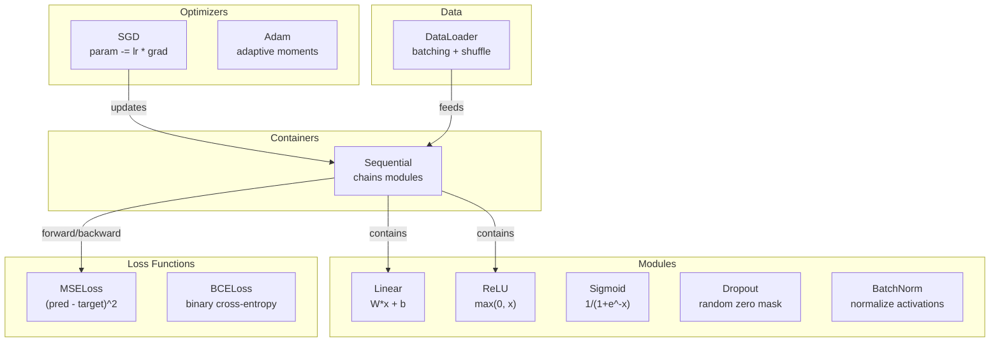
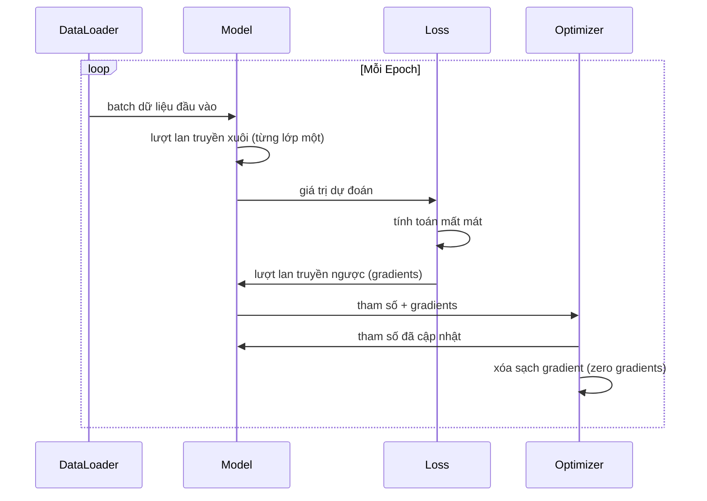
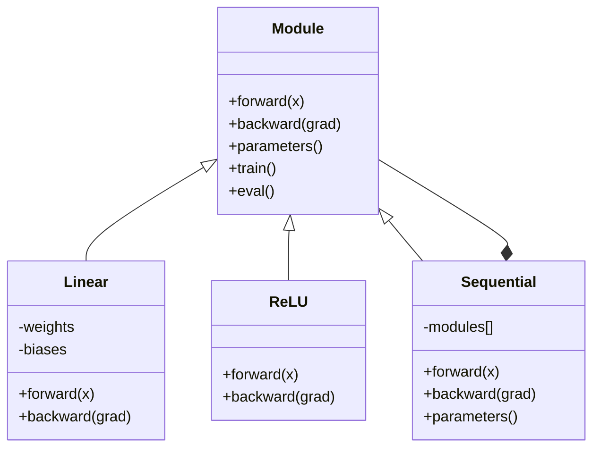

# Tự Xây dựng Mini Framework cho Riêng Bạn (Build Your Own Mini Framework)

> Bạn đã tự tay dựng neuron, các lớp (layers), mạng nơ-ron, lan truyền ngược (backpropagation), các hàm kích hoạt, hàm mất mát, bộ tối ưu hóa, điều chuẩn, khởi tạo trọng số, và lịch biểu tốc độ học. Tất cả đều là các mảnh ghép rời rạc. Giờ là lúc kết nối chúng lại thành một framework hoàn chỉnh. Không phải PyTorch. Không phải TensorFlow. Mà là của chính bạn.

**Type:** Build
**Languages:** Python
**Prerequisites:** Toàn bộ Phase 03 (Bài học 01-09)
**Time:** ~120 phút

## Learning Objectives

- Xây dựng một framework deep learning hoàn chỉnh (~500 dòng code) với Module, Linear, ReLU, Sigmoid, Dropout, BatchNorm, Sequential, các hàm mất mát, bộ tối ưu hóa, và DataLoader
- Giải thích tính trừu tượng của Module (forward, backward, parameters) và lý do tại sao việc chuyển đổi chế độ train/eval là bắt buộc
- Kết nối tất cả các thành phần vào một vòng lặp huấn luyện hoạt động thực tế để huấn luyện một mạng 4 lớp phân loại tập dữ liệu hình tròn
- Ánh xạ từng thành phần trong framework tự tạo của bạn sang thành phần tương đương trong PyTorch (nn.Module, nn.Sequential, optim.Adam, DataLoader)

## Vấn đề thực tế (The Problem)

Bạn đang có mười bài học với các khối xây dựng nằm rải rác trong nhiều tệp tin riêng biệt. Một lớp `Value` ở đây, một vòng lặp huấn luyện ở kia, khởi tạo trọng số ở một tệp khác, và lịch biểu tốc độ học ở một nơi khác nữa. Để huấn luyện một mạng nơ-ron, bạn phải sao chép - dán mã nguồn từ năm bài học khác nhau rồi nối thủ công bằng tay.

Đó chính là vấn đề mà các framework giải quyết. PyTorch cung cấp cho bạn `nn.Module`, `nn.Sequential`, `optim.Adam`, `DataLoader`, cùng một cấu trúc vòng lặp huấn luyện chuẩn mực để gắn kết chúng lại với nhau. TensorFlow cung cấp `keras.Layer`, `keras.Sequential`, `keras.optimizers.Adam`. Những thứ này không có gì là phép màu ma thuật. Chúng là các mẫu kiến trúc tổ chức (organizational patterns) giúp bạn có thể định nghĩa, huấn luyện và đánh giá mạng nơ-ron mà không cần phải phát minh lại hệ thống ống nối (plumbing) mỗi lần làm việc.

Bạn sẽ xây dựng chính xác hệ thống tương tự trong khoảng 500 dòng Python thuần túy. Không dùng numpy. Không có bất kỳ thư viện phụ thuộc bên ngoài nào. Một framework có thể định nghĩa bất kỳ mạng truyền thẳng (feedforward network) nào, huấn luyện nó với SGD hoặc Adam, chia dữ liệu thành từng batch, áp dụng dropout và chuẩn hóa theo batch (batch normalization), sử dụng bất kỳ hàm kích hoạt nào, và điều phối lịch biểu tốc độ học.

Khi hoàn thành, bạn sẽ hiểu chính xác điều gì xảy ra bên dưới khi bạn viết `model = nn.Sequential(...)` trong PyTorch. Bạn sẽ hiểu tại sao `model.train()` và `model.eval()` lại tồn tại. Bạn sẽ hiểu tại sao `optimizer.zero_grad()` lại là một lời gọi lệnh riêng biệt. Bạn sẽ hiểu toàn bộ mọi ngóc ngách, bởi vì bạn đã tự tay xây dựng tất cả.

## Khái niệm (The Concept)

### Trừu tượng hóa Module (The Module Abstraction)

Mọi lớp trong PyTorch đều kế thừa từ `nn.Module`. Một Module gánh vác ba trách nhiệm:

1. **forward()** -- tính toán đầu ra khi nhận dữ liệu đầu vào
2. **parameters()** -- trả về tất cả các trọng số có thể huấn luyện
3. **backward()** -- tính toán các gradient (được xử lý bởi autograd trong PyTorch, còn trong framework của chúng ta thì được viết tường minh)

Lớp tuyến tính Linear là một Module. Hàm kích hoạt ReLU là một Module. Lớp Dropout là một Module. Lớp chuẩn hóa BatchNorm là một Module. Tất cả chúng đều dùng chung một giao diện (interface).

### Bộ chứa tuần tự (Sequential Container)

`nn.Sequential` liên kết chuỗi các Module lại với nhau. Lượt lan truyền xuôi (Forward pass): truyền dữ liệu qua Module 1, rồi tới Module 2, rồi tới Module 3. Lượt lan truyền ngược (Backward pass): đảo ngược chuỗi để truyền ngược gradient. Bản thân bộ chứa này cũng là một Module -- nó sở hữu forward(), parameters(), và backward(). Đây là mẫu thiết kế kết hợp (composite pattern): một chuỗi các Module bản thân nó cũng chính là một Module.

### Chế độ huấn luyện và Chế độ đánh giá (Training vs Evaluation Mode)

Dropout triệt tiêu ngẫu nhiên các neuron về 0 trong quá trình huấn luyện nhưng cho mọi giá trị đi qua nguyên vẹn trong quá trình đánh giá. Chuẩn hóa theo batch (Batch normalization) sử dụng các số liệu thống kê của batch trong lúc huấn luyện nhưng lại sử dụng các giá trị trung bình trượt tích lũy (running averages) trong lúc đánh giá. Các phương thức `train()` và `eval()` thực hiện việc chuyển đổi hành vi này. Mỗi Module đều có một cờ đánh dấu `training`.

### Bộ tối ưu hóa (Optimizer)

Bộ tối ưu hóa cập nhật các tham số dựa trên gradient của chúng. Với SGD: `param -= lr * grad`. Với Adam: duy trì các ước lượng quán tính (momentum) và phương sai (variance), sau đó mới cập nhật. Bộ tối ưu hóa không hề biết về kiến trúc mạng -- nó chỉ nhìn thấy một danh sách phẳng các tham số và gradient của chúng.

### Bộ nạp dữ liệu (DataLoader)

Chia dữ liệu theo batch (Batching) đóng vai trò quan trọng vì hai lý do. Thứ nhất, bạn không thể nhét toàn bộ tập dữ liệu khổng lồ vào bộ nhớ RAM cho các bài toán lớn. Thứ hai, hạ gradient theo mini-batch mang lại độ nhiễu ngẫu nhiên giúp mô hình thoát khỏi các điểm cực tiểu cục bộ không mong muốn. DataLoader chia dữ liệu thành các batch nhỏ và tùy chọn xáo trộn (shuffle) dữ liệu giữa các epoch.

### Kiến trúc Framework (Framework Architecture)



### Vòng lặp huấn luyện (Training Loop)



### Cấu trúc phân cấp Module (Module Hierarchy)



```figure
gradient-clipping
```

## Tự tay xây dựng (Build It)

### Bước 1: Lớp cơ sở Module (Module Base Class)

Giao diện trừu tượng mà mọi lớp nơ-ron đều phải triển khai.

```python
class Module:
    def __init__(self):
        self.training = True

    def forward(self, x):
        raise NotImplementedError

    def backward(self, grad):
        raise NotImplementedError

    def parameters(self):
        return []

    def train(self):
        self.training = True

    def eval(self):
        self.training = False
```

### Bước 2: Lớp tuyến tính (Linear Layer)

Khối xây dựng nền tảng. Lưu trữ trọng số (weights) và độ chệch (biases), tính toán $Wx + b$ khi lan truyền xuôi, và tính gradient của trọng số/đầu vào khi lan truyền ngược.

```python
import math
import random


class Linear(Module):
    def __init__(self, fan_in, fan_out):
        super().__init__()
        std = math.sqrt(2.0 / fan_in)
        self.weights = [[random.gauss(0, std) for _ in range(fan_in)] for _ in range(fan_out)]
        self.biases = [0.0] * fan_out
        self.weight_grads = [[0.0] * fan_in for _ in range(fan_out)]
        self.bias_grads = [0.0] * fan_out
        self.fan_in = fan_in
        self.fan_out = fan_out
        self.input = None

    def forward(self, x):
        self.input = x
        output = []
        for i in range(self.fan_out):
            val = self.biases[i]
            for j in range(self.fan_in):
                val += self.weights[i][j] * x[j]
            output.append(val)
        return output

    def backward(self, grad):
        input_grad = [0.0] * self.fan_in
        for i in range(self.fan_out):
            self.bias_grads[i] += grad[i]
            for j in range(self.fan_in):
                self.weight_grads[i][j] += grad[i] * self.input[j]
                input_grad[j] += grad[i] * self.weights[i][j]
        return input_grad

    def parameters(self):
        params = []
        for i in range(self.fan_out):
            for j in range(self.fan_in):
                params.append((self.weights, i, j, self.weight_grads))
            params.append((self.biases, i, None, self.bias_grads))
        return params
```

### Bước 3: Các Module kích hoạt (Activation Modules)

ReLU, Sigmoid, và Tanh dưới dạng các Module. Mỗi module sẽ lưu vào bộ nhớ đệm (cache) những giá trị cần thiết cho lượt truyền ngược.

```python
class ReLU(Module):
    def __init__(self):
        super().__init__()
        self.mask = None

    def forward(self, x):
        self.mask = [1.0 if v > 0 else 0.0 for v in x]
        return [max(0.0, v) for v in x]

    def backward(self, grad):
        return [g * m for g, m in zip(grad, self.mask)]


class Sigmoid(Module):
    def __init__(self):
        super().__init__()
        self.output = None

    def forward(self, x):
        self.output = []
        for v in x:
            v = max(-500, min(500, v))
            self.output.append(1.0 / (1.0 + math.exp(-v)))
        return self.output

    def backward(self, grad):
        return [g * o * (1 - o) for g, o in zip(grad, self.output)]


class Tanh(Module):
    def __init__(self):
        super().__init__()
        self.output = None

    def forward(self, x):
        self.output = [math.tanh(v) for v in x]
        return self.output

    def backward(self, grad):
        return [g * (1 - o * o) for g, o in zip(grad, self.output)]
```

### Bước 4: Module Dropout

Ngẫu nhiên triệt tiêu các phần tử về 0 trong quá trình huấn luyện. Tỷ lệ hóa (scale) các phần tử còn lại với hệ số $1/(1-p)$ để kỳ vọng toán học giữ nguyên không đổi. Không thực hiện thao tác này trong chế độ đánh giá (eval).

```python
class Dropout(Module):
    def __init__(self, p=0.5):
        super().__init__()
        self.p = p
        self.mask = None

    def forward(self, x):
        if not self.training:
            return x
        self.mask = [0.0 if random.random() < self.p else 1.0 / (1 - self.p) for _ in x]
        return [v * m for v, m in zip(x, self.mask)]

    def backward(self, grad):
        if self.mask is None:
            return grad
        return [g * m for g, m in zip(grad, self.mask)]
```

### Bước 5: Module BatchNorm

Chuẩn hóa các giá trị kích hoạt về trung bình bằng 0 và phương sai bằng 1 cho từng đặc trưng trên toàn batch. Duy trì các giá trị thống kê tích lũy để phục vụ chế độ eval.

```python
class BatchNorm(Module):
    def __init__(self, size, momentum=0.1, eps=1e-5):
        super().__init__()
        self.size = size
        self.gamma = [1.0] * size
        self.beta = [0.0] * size
        self.gamma_grads = [0.0] * size
        self.beta_grads = [0.0] * size
        self.running_mean = [0.0] * size
        self.running_var = [1.0] * size
        self.momentum = momentum
        self.eps = eps
        self.x_norm = None
        self.std_inv = None
        self.batch_input = None

    def forward_batch(self, batch):
        batch_size = len(batch)
        output_batch = []

        if self.training:
            mean = [0.0] * self.size
            for sample in batch:
                for j in range(self.size):
                    mean[j] += sample[j]
            mean = [m / batch_size for m in mean]

            var = [0.0] * self.size
            for sample in batch:
                for j in range(self.size):
                    var[j] += (sample[j] - mean[j]) ** 2
            var = [v / batch_size for v in var]

            self.std_inv = [1.0 / math.sqrt(v + self.eps) for v in var]

            self.x_norm = []
            self.batch_input = batch
            for sample in batch:
                normed = [(sample[j] - mean[j]) * self.std_inv[j] for j in range(self.size)]
                self.x_norm.append(normed)
                output = [self.gamma[j] * normed[j] + self.beta[j] for j in range(self.size)]
                output_batch.append(output)

            for j in range(self.size):
                self.running_mean[j] = (1 - self.momentum) * self.running_mean[j] + self.momentum * mean[j]
                self.running_var[j] = (1 - self.momentum) * self.running_var[j] + self.momentum * var[j]
        else:
            std_inv = [1.0 / math.sqrt(v + self.eps) for v in self.running_var]
            for sample in batch:
                normed = [(sample[j] - self.running_mean[j]) * std_inv[j] for j in range(self.size)]
                output = [self.gamma[j] * normed[j] + self.beta[j] for j in range(self.size)]
                output_batch.append(output)

        return output_batch

    def forward(self, x):
        result = self.forward_batch([x])
        return result[0]

    def backward(self, grad):
        if self.x_norm is None:
            return grad
        for j in range(self.size):
            self.gamma_grads[j] += self.x_norm[0][j] * grad[j]
            self.beta_grads[j] += grad[j]
        return [grad[j] * self.gamma[j] * self.std_inv[j] for j in range(self.size)]

    def parameters(self):
        params = []
        for j in range(self.size):
            params.append((self.gamma, j, None, self.gamma_grads))
            params.append((self.beta, j, None, self.beta_grads))
        return params
```

### Bước 6: Bộ chứa tuần tự Sequential (Sequential Container)

Kết nối các module thành chuỗi. Lan truyền xuôi đi từ trái sang phải, lan truyền ngược đi từ phải sang trái.

```python
class Sequential(Module):
    def __init__(self, *modules):
        super().__init__()
        self.modules = list(modules)

    def forward(self, x):
        for module in self.modules:
            x = module.forward(x)
        return x

    def backward(self, grad):
        for module in reversed(self.modules):
            grad = module.backward(grad)
        return grad

    def parameters(self):
        params = []
        for module in self.modules:
            params.extend(module.parameters())
        return params

    def train(self):
        self.training = True
        for module in self.modules:
            module.train()

    def eval(self):
        self.training = False
        for module in self.modules:
            module.eval()
```

### Bước 7: Các hàm mất mát (Loss Functions)

MSE (sai số bình phương trung bình) và Binary Cross-Entropy (mất mát entropy chéo nhị phân). Mỗi lớp trả về giá trị mất mát và cung cấp phương thức backward() trả về gradient tương ứng.

```python
class MSELoss:
    def __call__(self, predicted, target):
        self.predicted = predicted
        self.target = target
        n = len(predicted)
        self.loss = sum((p - t) ** 2 for p, t in zip(predicted, target)) / n
        return self.loss

    def backward(self):
        n = len(self.predicted)
        return [2 * (p - t) / n for p, t in zip(self.predicted, self.target)]


class BCELoss:
    def __call__(self, predicted, target):
        self.predicted = predicted
        self.target = target
        eps = 1e-7
        n = len(predicted)
        self.loss = 0
        for p, t in zip(predicted, target):
            p = max(eps, min(1 - eps, p))
            self.loss += -(t * math.log(p) + (1 - t) * math.log(1 - p))
        self.loss /= n
        return self.loss

    def backward(self):
        eps = 1e-7
        n = len(self.predicted)
        grads = []
        for p, t in zip(self.predicted, self.target):
            p = max(eps, min(1 - eps, p))
            grads.append((-t / p + (1 - t) / (1 - p)) / n)
        return grads
```

### Bước 8: Các bộ tối ưu hóa SGD và Adam

Cả hai đều nhận một danh sách tham số và cập nhật trọng số dựa trên các gradient tương ứng.

```python
class SGD:
    def __init__(self, parameters, lr=0.01):
        self.params = parameters
        self.lr = lr

    def step(self):
        for container, i, j, grad_container in self.params:
            if j is not None:
                container[i][j] -= self.lr * grad_container[i][j]
            else:
                container[i] -= self.lr * grad_container[i]

    def zero_grad(self):
        for container, i, j, grad_container in self.params:
            if j is not None:
                grad_container[i][j] = 0.0
            else:
                grad_container[i] = 0.0


class Adam:
    def __init__(self, parameters, lr=0.001, beta1=0.9, beta2=0.999, eps=1e-8):
        self.params = parameters
        self.lr = lr
        self.beta1 = beta1
        self.beta2 = beta2
        self.eps = eps
        self.t = 0
        self.m = [0.0] * len(parameters)
        self.v = [0.0] * len(parameters)

    def step(self):
        self.t += 1
        for idx, (container, i, j, grad_container) in enumerate(self.params):
            if j is not None:
                g = grad_container[i][j]
            else:
                g = grad_container[i]

            self.m[idx] = self.beta1 * self.m[idx] + (1 - self.beta1) * g
            self.v[idx] = self.beta2 * self.v[idx] + (1 - self.beta2) * g * g

            m_hat = self.m[idx] / (1 - self.beta1 ** self.t)
            v_hat = self.v[idx] / (1 - self.beta2 ** self.t)

            update = self.lr * m_hat / (math.sqrt(v_hat) + self.eps)

            if j is not None:
                container[i][j] -= update
            else:
                container[i] -= update

    def zero_grad(self):
        for container, i, j, grad_container in self.params:
            if j is not None:
                grad_container[i][j] = 0.0
            else:
                grad_container[i] = 0.0
```

### Bước 9: Bộ nạp dữ liệu DataLoader

Chia nhỏ dữ liệu thành các batch, hỗ trợ xáo trộn ngẫu nhiên sau mỗi epoch.

```python
class DataLoader:
    def __init__(self, data, batch_size=32, shuffle=True):
        self.data = data
        self.batch_size = batch_size
        self.shuffle = shuffle

    def __iter__(self):
        indices = list(range(len(self.data)))
        if self.shuffle:
            random.shuffle(indices)
        for start in range(0, len(indices), self.batch_size):
            batch_indices = indices[start:start + self.batch_size]
            batch = [self.data[i] for i in batch_indices]
            inputs = [item[0] for item in batch]
            targets = [item[1] for item in batch]
            yield inputs, targets

    def __len__(self):
        return (len(self.data) + self.batch_size - 1) // self.batch_size
```

### Bước 10: Huấn luyện mạng 4 lớp phân loại tập dữ liệu hình tròn

Gắn kết toàn bộ thành phần. Định nghĩa mô hình, chọn hàm mất mát, chọn bộ tối ưu hóa, và chạy vòng lặp huấn luyện.

```python
def make_circle_data(n=500, seed=42):
    random.seed(seed)
    data = []
    for _ in range(n):
        x = random.uniform(-2, 2)
        y = random.uniform(-2, 2)
        label = 1.0 if x * x + y * y < 1.5 else 0.0
        data.append(([x, y], [label]))
    return data


def train():
    random.seed(42)

    model = Sequential(
        Linear(2, 16),
        ReLU(),
        Linear(16, 16),
        ReLU(),
        Linear(16, 8),
        ReLU(),
        Linear(8, 1),
        Sigmoid(),
    )

    criterion = BCELoss()
    optimizer = Adam(model.parameters(), lr=0.01)

    data = make_circle_data(500)
    split = int(len(data) * 0.8)
    train_data = data[:split]
    test_data = data[split:]

    loader = DataLoader(train_data, batch_size=16, shuffle=True)

    model.train()

    for epoch in range(100):
        total_loss = 0
        total_correct = 0
        total_samples = 0

        for batch_inputs, batch_targets in loader:
            batch_loss = 0
            for x, t in zip(batch_inputs, batch_targets):
                pred = model.forward(x)
                loss = criterion(pred, t)
                batch_loss += loss

                optimizer.zero_grad()
                grad = criterion.backward()
                model.backward(grad)
                optimizer.step()

                predicted_class = 1.0 if pred[0] >= 0.5 else 0.0
                if predicted_class == t[0]:
                    total_correct += 1
                total_samples += 1

            total_loss += batch_loss

        avg_loss = total_loss / total_samples
        accuracy = total_correct / total_samples * 100

        if epoch % 10 == 0 or epoch == 99:
            print(f"Epoch {epoch:3d} | Loss: {avg_loss:.6f} | Train Accuracy: {accuracy:.1f}%")

    model.eval()
    correct = 0
    for x, t in test_data:
        pred = model.forward(x)
        predicted_class = 1.0 if pred[0] >= 0.5 else 0.0
        if predicted_class == t[0]:
            correct += 1
    test_accuracy = correct / len(test_data) * 100
    print(f"\nTest Accuracy: {test_accuracy:.1f}% ({correct}/{len(test_data)})")

    return model, test_accuracy
```

## Sử dụng trong thực tế (Use It)

Dưới đây là đoạn mã tương đương trong PyTorch cho những gì bạn vừa xây dựng:

```python
import torch
import torch.nn as nn
from torch.utils.data import DataLoader, TensorDataset

model = nn.Sequential(
    nn.Linear(2, 16),
    nn.ReLU(),
    nn.Linear(16, 16),
    nn.ReLU(),
    nn.Linear(16, 8),
    nn.ReLU(),
    nn.Linear(8, 1),
    nn.Sigmoid(),
)

criterion = nn.BCELoss()
optimizer = torch.optim.Adam(model.parameters(), lr=0.01)

for epoch in range(100):
    model.train()
    for inputs, targets in dataloader:
        optimizer.zero_grad()
        predictions = model(inputs)
        loss = criterion(predictions, targets)
        loss.backward()
        optimizer.step()

    model.eval()
    with torch.no_grad():
        test_predictions = model(test_inputs)
```

Cấu trúc là hoàn toàn tương đồng: `Sequential`, `Linear`, `ReLU`, `Sigmoid`, `BCELoss`, `Adam`, `zero_grad`, `backward`, `step`, `train`, `eval`. Mọi khái niệm đều ánh xạ 1-1. Sự khác biệt duy nhất là PyTorch tự động xử lý autograd (không cần bạn phải tự cài đặt backward() trong từng module), chạy trên GPU, và đã được tối ưu hóa hiệu năng qua nhiều năm. Nhưng bộ khung xương bản chất là hoàn toàn như nhau.

Giờ đây khi nhìn vào bất kỳ đoạn mã PyTorch nào, bạn sẽ hiểu chính xác điều gì đang xảy ra trong từng dòng lệnh. Sự thấu suốt bản chất đó chính là mục tiêu cao nhất của bài học này.

## Sản phẩm bàn giao (Ship It)

Bài học này tạo ra:
- `outputs/prompt-framework-architect.md` -- một prompt thiết kế kiến trúc mạng nơ-ron sử dụng các trừu tượng hóa chuẩn của framework

## Bài tập rèn luyện (Exercises)

1. Thêm một lớp `SoftmaxCrossEntropyLoss` cho bài toán phân loại nhiều lớp (multi-class). Tính softmax cho các dự đoán, tính mất mát cross-entropy, và xử lý lượt lan truyền ngược kết hợp. Thử nghiệm trên tập dữ liệu xoắn ốc 3 lớp (spiral dataset).
2. Tích hợp lịch biểu tốc độ học vào optimizer: thêm phương thức `set_lr()` và ghép nối lịch biểu cosine từ Bài học 09. Huấn luyện bộ phân loại hình tròn với warmup + cosine và so sánh với LR hằng số.
3. Thêm phương thức `save()` và `load()` vào Sequential để tuần tự hóa (serialize) toàn bộ trọng số ra tệp JSON và nạp lại. Xác minh rằng mô hình sau khi nạp cho ra các dự đoán hoàn toàn trùng khớp với ban đầu.
4. Triển khai suy giảm trọng số (weight decay / điều chuẩn L2) trong bộ tối ưu Adam. Thêm tham số `weight_decay` giúp co trọng số dần về 0 sau mỗi bước. So sánh quá trình huấn luyện giữa decay=0 và decay=0.01.
5. Thay thế vòng lặp huấn luyện từng mẫu (per-sample) bằng tích lũy gradient mini-batch thực sự: tích lũy gradient trên tất cả các mẫu trong một batch, sau đó chia cho kích thước batch rồi mới thực hiện một bước optimizer. Đo lường xem điều này có làm thay đổi tốc độ hội tụ hay không.

## Thuật ngữ then chốt (Key Terms)

| Thuật ngữ | Người ta thường nói | Bản chất thực sự |
|-----------|--------------------|-------------------|
| Module | "Một lớp mạng" | Khối trừu tượng cơ sở trong framework -- bất kỳ thứ gì có forward(), backward(), và parameters() |
| Sequential | "Xếp chồng các lớp theo thứ tự" | Bộ chứa liên kết các module thành chuỗi, áp dụng lần lượt theo thứ tự xuôi cho forward và đảo ngược cho backward |
| Forward pass (Lượt lan truyền xuôi) | "Chạy mạng" | Tính toán đầu ra bằng cách đưa đầu vào lần lượt qua từng module |
| Backward pass (Lượt lan truyền ngược) | "Tính đạo hàm / gradient" | Lan truyền gradient của mất mát ngược qua từng module để tính đạo hàm theo tham số |
| Parameters (Tham số) | "Các trọng số huấn luyện được" | Toàn bộ các giá trị trong mạng mà optimizer có thể cập nhật -- bao gồm weights và biases |
| Optimizer (Bộ tối ưu hóa) | "Thứ cập nhật trọng số" | Thuật toán sử dụng gradient để cập nhật các tham số, như SGD, Adam hoặc các quy tắc khác |
| DataLoader (Bộ nạp dữ liệu) | "Thứ cấp dữ liệu" | Bộ lặp chia tách tập dữ liệu thành các batch, có thể xáo trộn ngẫu nhiên giữa các epoch |
| Training mode (Chế độ huấn luyện) | "model.train()" | Một cờ bật các hành vi ngẫu nhiên như dropout và chuẩn hóa batch với số liệu thống kê của batch |
| Evaluation mode (Chế độ đánh giá) | "model.eval()" | Một cờ tắt dropout và sử dụng các giá trị thống kê tích lũy cho chuẩn hóa batch |
| Zero grad (Xóa gradient) | "Xóa sạch các gradient" | Đặt lại toàn bộ gradient của tham số về 0 trước khi tính toán gradient cho batch tiếp theo |

## Tài liệu đọc thêm (Further Reading)

- Paszke et al., "PyTorch: An Imperative Style, High-Performance Deep Learning Library" (2019) -- bài báo mô tả các quyết định thiết kế kiến trúc của PyTorch
- Chollet, "Deep Learning with Python, Second Edition" (2021) -- Chương 3 đi sâu vào nội bộ của Keras với cùng các trừu tượng hóa module/layer
- Johnson, "Tiny-DNN" (https://github.com/tiny-dnn/tiny-dnn) -- một deep learning framework C++ dạng header-only giúp hiểu rõ cấu trúc nội bộ của framework

