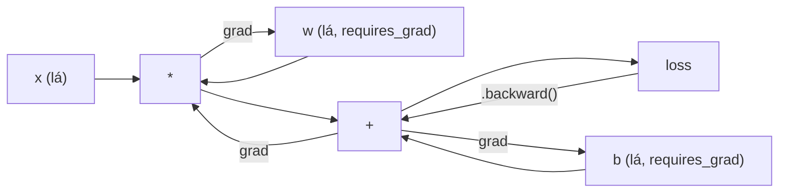
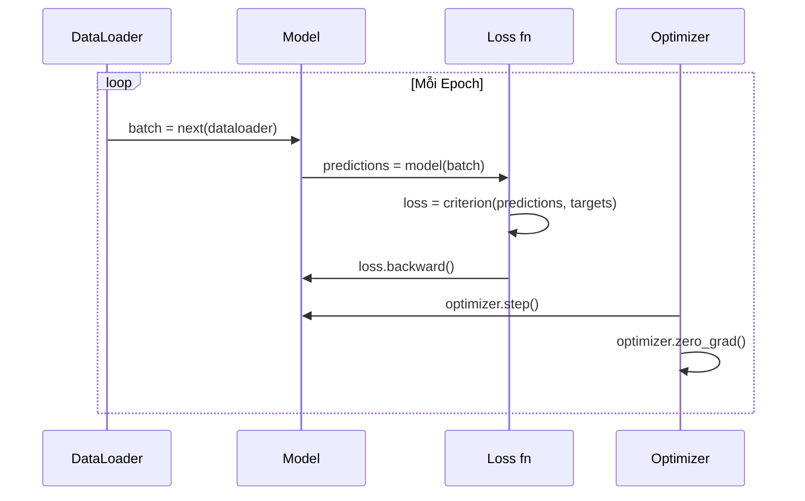

# Giới thiệu về PyTorch (Introduction to PyTorch)

> Bạn đã tự tay chế tạo động cơ từ từng piston và trục khuỷu. Giờ là lúc làm chủ cỗ xe mà cả thế giới đang thực sự cầm lái.

**Type:** Build
**Languages:** Python
**Prerequisites:** Lesson 03.10 (Build Your Own Mini Framework)
**Time:** ~75 phút

## Learning Objectives

- Xây dựng và huấn luyện các mạng nơ-ron sử dụng `nn.Module`, `nn.Sequential`, và cơ chế `autograd` của PyTorch
- Sử dụng các PyTorch tensor, tăng tốc phần cứng với GPU, và tuân thủ vòng lặp huấn luyện tiêu chuẩn (zero_grad, forward, loss, backward, step)
- Chuyển đổi các thành phần trong mini framework tự viết từ đầu sang các thành phần tương đương trong PyTorch
- Đo kiểm hiệu năng (profiling) và so sánh tốc độ huấn luyện giữa framework Python thuần với PyTorch trên cùng một bài toán

## Vấn đề thực tế (The Problem)

Bạn đang có một mini framework hoạt động hoàn chỉnh: các lớp tuyến tính Linear, ReLU, dropout, batch norm, Adam, DataLoader, và một vòng lặp huấn luyện. Nó có thể huấn luyện mạng 4 lớp giải bài toán phân loại hình tròn bằng Python thuần.

Tuy nhiên, nó chậm hơn PyTorch tới **500 lần** trên cùng bài toán đó.

Mini framework của bạn xử lý từng mẫu một thông qua các vòng lặp Python lồng nhau. PyTorch điều phối các phép toán tương tự tới các kernel C++/CUDA đã được tối ưu hóa cực đỉnh chạy song song trên GPU. Trên một GPU NVIDIA A100 đơn lẻ, PyTorch có thể huấn luyện ResNet-50 (25.6 triệu tham số) trên tập ImageNet (1.28 triệu ảnh) trong khoảng 6 giờ. Framework tự viết của bạn sẽ mất khoảng 3.000 giờ cho cùng tác vụ đó -- nếu như nó không bị tràn bộ nhớ RAM trước.

Tốc độ không phải là rào cản duy nhất. Framework tự viết không có hỗ trợ GPU. Không có vi phân tự động (automatic differentiation) -- bạn phải tự tay viết hàm `backward()` cho từng module. Không có khả năng tuần tự hóa lưu trữ mô hình (serialization). Không huấn luyện phân tán (distributed training). Không có độ chính xác hỗn hợp (mixed precision). Không có cách nào gỡ lỗi luồng gradient ngoài các câu lệnh `print`.

PyTorch giải quyết triệt để từng điểm thiếu sót đó. Và điều tuyệt vời nhất: nó giữ nguyên mô hình tư duy (mental model) mà bạn đã dày công xây dựng: Module, forward(), parameters(), backward(), optimizer.step(). Các khái niệm chuyển đổi 1-1 hoàn hảo. Cú pháp gần như tương đồng tuyệt đối. Sự khác biệt chỉ là PyTorch gói gọn một thập kỷ kỹ thuật hệ thống đỉnh cao đằng sau giao diện mà bạn vừa tự tay thiết kế từ con số không.

## Khái niệm (The Concept)

### Tại sao PyTorch chiến thắng

Năm 2015, TensorFlow yêu cầu bạn phải định nghĩa một đồ thị tính toán tĩnh (static computation graph) trước khi chạy bất kỳ thứ gì. Bạn dựng đồ thị, biên dịch nó, rồi mới đẩy dữ liệu qua. Gỡ lỗi đồng nghĩa với việc nhìn chằm chằm vào các sơ đồ trực quan hóa đồ thị. Thay đổi kiến trúc mạng đồng nghĩa với việc phải tái tạo lại toàn bộ đồ thị từ đầu.

PyTorch ra mắt vào năm 2017 với một triết lý hoàn toàn khác: thực thi trực tiếp (eager execution). Bạn viết mã Python. Nó thực thi ngay lập tức. `y = model(x)` thực sự tính toán giá trị `y` ngay tại thời điểm đó, chứ không phải "thêm một node vào đồ thị để tính `y` sau này". Điều này đồng nghĩa với việc toàn bộ công cụ gỡ lỗi Python tiêu chuẩn đều hoạt động bình thường: `print()` hoạt động, `pdb` hoạt động, và các câu lệnh điều kiện `if/else` ngay trong lượt lan truyền xuôi forward pass đều chạy trơn tru.

Đến năm 2020, thị trường đã đưa ra câu trả lời rõ ràng. Thị phần của PyTorch trong các bài báo nghiên cứu ML nhảy vọt từ 7% (2017) lên hơn 75% (2022). Meta, Google DeepMind, OpenAI, Anthropic, và Hugging Face đều sử dụng PyTorch làm framework chính. TensorFlow 2.x sau đó cũng phải áp dụng cơ chế eager execution -- một sự thừa nhận ngầm rằng thiết kế của PyTorch là hoàn toàn chuẩn xác.

Bài học rút ra: trải nghiệm của lập trình viên (developer experience) tạo ra giá trị lũy kế khổng lồ. Một framework chậm hơn 10% về mặt lý thuyết nhưng giúp gỡ lỗi nhanh hơn 50% sẽ luôn là kẻ chiến thắng.

### Tensor

Tensor là một mảng đa chiều với ba thuộc tính then chốt: hình dạng (shape), kiểu dữ liệu (dtype), và thiết bị phần cứng (device).

```python
import torch

x = torch.zeros(3, 4)           # shape: (3, 4), dtype: float32, device: cpu
x = torch.randn(2, 3, 224, 224) # batch gồm 2 ảnh RGB, kích thước 224x224
x = torch.tensor([1, 2, 3])     # tạo từ một Python list
```

**Shape (Hình dạng)** đại diện cho các chiều dữ liệu. Một số vô hướng (scalar) có shape `()`, một vector có shape `(n,)`, một ma trận có shape `(m, n)`, và một batch hình ảnh có shape `(batch, channels, height, width)`.

**Dtype (Kiểu dữ liệu)** kiểm soát độ chính xác và dung lượng bộ nhớ.

| dtype | Số bit | Dải giá trị | Trường hợp sử dụng |
|-------|--------|-------------|---------------------|
| float32 | 32 | ~7 chữ số thập phân | Mặc định cho huấn luyện |
| float16 | 16 | ~3.3 chữ số thập phân | Huấn luyện độ chính xác hỗn hợp (mixed precision) |
| bfloat16 | 16 | Cùng dải số mũ như float32, ít độ chính xác phần thập phân hơn | Huấn luyện mô hình ngôn ngữ lớn (LLM) |
| int8 | 8 | -128 đến 127 | Suy luận lượng tử hóa (quantized inference) |

**Device (Thiết bị)** xác định nơi diễn ra các phép tính toán.

```python
device = torch.device("cuda" if torch.cuda.is_available() else "cpu")
x = torch.randn(3, 4, device=device)
x = x.to("cuda")
x = x.cpu()
```

Mọi phép toán đều yêu cầu tất cả các tensor tham gia phải nằm trên **cùng một thiết bị**. Đây là lỗi PyTorch số 1 mà người mới học thường gặp: `RuntimeError: Expected all tensors to be on the same device`. Cách khắc phục: chuyển tất cả dữ liệu và tham số lên cùng một thiết bị trước khi tính toán.

**Đổi hình dạng (Reshaping)** có độ phức tạp thời gian hằng số $O(1)$ -- nó chỉ thay đổi metadata (stride và shape) chứ không sao chép lại mảng dữ liệu gốc bên dưới.

```python
x = torch.randn(2, 3, 4)
x.view(2, 12)      # đổi hình dạng thành (2, 12) -- mảng bộ nhớ phải liền kề (contiguous)
x.reshape(6, 4)    # đổi hình dạng thành (6, 4) -- hoạt động trong mọi trường hợp
x.permute(2, 0, 1) # hoán vị thứ tự các chiều
x.unsqueeze(0)     # chèn thêm một chiều: (1, 2, 3, 4)
x.squeeze()        # loại bỏ các chiều có kích thước bằng 1
```

### Autograd (Tự động vi phân)

Mini framework yêu cầu bạn phải tự cài đặt hàm `backward()` cho từng module. PyTorch thì không cần. Nó ghi lại mọi phép toán thực hiện trên tensor vào một đồ thị có hướng không chu trình (đồ thị tính toán - computational graph) và sau đó tự động duyệt ngược đồ thị này để tính gradient.



Điểm khác biệt cốt lõi: PyTorch sử dụng cơ chế tự động vi phân dựa trên băng ghi (tape-based autodiff). Mọi thao tác đều được nối vào một "băng ghi" trong suốt lượt lan truyền xuôi. Lời gọi `.backward()` sẽ phát lại băng ghi đó theo chiều ngược lại.

```python
x = torch.randn(3, requires_grad=True)
y = x ** 2 + 3 * x
z = y.sum()
z.backward()
print(x.grad)  # dz/dx = 2x + 3
```

Ba quy tắc then chốt của autograd:

1. Chỉ các tensor lá (leaf tensors) có `requires_grad=True` mới tích lũy gradient
2. Gradient mặc định được tích lũy cộng dồn -- hãy luôn gọi `optimizer.zero_grad()` trước mỗi lượt tính backward
3. `torch.no_grad()` tạm thời vô hiệu hóa việc ghi nhận gradient (dùng trong bước đánh giá để tiết kiệm bộ nhớ)

### nn.Module

`nn.Module` là lớp cơ sở cho mọi thành phần mạng nơ-ron trong PyTorch. Bạn đã xây dựng trừu tượng hóa này trong Bài học 10. Phiên bản của PyTorch bổ sung thêm cơ chế tự động đăng ký tham số, tìm kiếm module đệ quy, quản lý thiết bị tính toán, và tuần tự hóa lưu trữ state_dict.

```python
import torch.nn as nn

class MLP(nn.Module):
    def __init__(self, input_dim, hidden_dim, output_dim):
        super().__init__()
        self.layer1 = nn.Linear(input_dim, hidden_dim)
        self.relu = nn.ReLU()
        self.layer2 = nn.Linear(hidden_dim, output_dim)

    def forward(self, x):
        x = self.layer1(x)
        x = self.relu(x)
        x = self.layer2(x)
        return x
```

Khi bạn gán một `nn.Module` hoặc `nn.Parameter` làm thuộc tính trong `__init__`, PyTorch sẽ tự động đăng ký nó. `model.parameters()` sẽ đệ quy thu thập toàn bộ các tham số đã đăng ký. Đó là lý do tại sao bạn không bao giờ phải tự gom trọng số thủ công như trong mini framework.

Các khối xây dựng chủ lực:

| Module | Chức năng | Số tham số |
|--------|-----------|------------|
| nn.Linear(in, out) | $Wx + b$ | in*out + out |
| nn.Conv2d(in_ch, out_ch, k) | Phép tích chập 2D | in_ch*out_ch*k*k + out_ch |
| nn.BatchNorm1d(features) | Chuẩn hóa các giá trị kích hoạt | 2 * features |
| nn.Dropout(p) | Triệt tiêu ngẫu nhiên về 0 | 0 |
| nn.ReLU() | $\max(0, x)$ | 0 |
| nn.GELU() | Hàm Gaussian Error Linear | 0 |
| nn.Embedding(vocab, dim) | Bảng tra cứu embedding | vocab * dim |
| nn.LayerNorm(dim) | Chuẩn hóa theo từng mẫu | 2 * dim |

### Các hàm mất mát và Bộ tối ưu hóa

PyTorch đi kèm các phiên bản sẵn sàng cho môi trường sản xuất (production) của mọi thành phần bạn từng xây dựng.

**Các hàm mất mát** (từ `torch.nn`):

| Hàm mất mát | Bài toán | Đầu vào |
|-------------|----------|---------|
| nn.MSELoss() | Hồi quy | Bất kỳ shape nào |
| nn.CrossEntropyLoss() | Phân loại đa lớp | Logits (không áp dụng softmax trước) |
| nn.BCEWithLogitsLoss() | Phân loại nhị phân | Logits (không áp dụng sigmoid trước) |
| nn.L1Loss() | Hồi quy (chống nhiễu tốt) | Bất kỳ shape nào |
| nn.CTCLoss() | Gióng hàng chuỗi | Xác suất dạng log (Log probabilities) |

Lưu ý quan trọng: `CrossEntropyLoss` tích hợp sẵn `LogSoftmax` + `NLLLoss` bên trong. Hãy truyền vào logits thô, chứ không phải đầu ra đã qua softmax. Đây là một lỗi sai phổ biến khiến gradient bị sai lệch trong âm thầm.

**Các bộ tối ưu hóa** (từ `torch.optim`):

| Bộ tối ưu | Khi nào nên dùng | LR điển hình |
|-----------|------------------|--------------|
| SGD(params, lr, momentum) | Mạng CNN, quy trình tinh chỉnh kỹ lưỡng | 0.01--0.1 |
| Adam(params, lr) | Điểm khởi đầu mặc định | 1e-3 |
| AdamW(params, lr, weight_decay) | Kiến trúc Transformer, fine-tuning | 1e-4--1e-3 |
| LBFGS(params) | Bài toán quy mô nhỏ, tối ưu bậc hai | 1.0 |

### Vòng lặp huấn luyện (The Training Loop)

Mọi vòng lặp huấn luyện trong PyTorch đều tuân theo cùng một mô hình 5 bước. Bạn đã quá quen thuộc với điều này từ Bài học 10.



Khuôn mẫu chuẩn mực:

```python
for epoch in range(num_epochs):
    model.train()
    for inputs, targets in train_loader:
        inputs, targets = inputs.to(device), targets.to(device)
        optimizer.zero_grad()
        outputs = model(inputs)
        loss = criterion(outputs, targets)
        loss.backward()
        optimizer.step()
```

Năm dòng lệnh bên trong vòng lặp batch. Năm dòng lệnh đã huấn luyện nên GPT-4, Stable Diffusion, và LLaMA. Kiến trúc mạng có thể đổi khác. Dữ liệu có thể biến chuyển. Nhưng năm dòng lệnh này không bao giờ thay đổi.

### Dataset và DataLoader

Lớp `Dataset` của PyTorch là một lớp trừu tượng với hai phương thức: `__len__` và `__getitem__`. `DataLoader` bao bọc nó để cung cấp khả năng gom batch, xáo trộn, và nạp dữ liệu song song đa tiến trình.

```python
from torch.utils.data import Dataset, DataLoader

class MNISTDataset(Dataset):
    def __init__(self, images, labels):
        self.images = images
        self.labels = labels

    def __len__(self):
        return len(self.labels)

    def __getitem__(self, idx):
        return self.images[idx], self.labels[idx]

loader = DataLoader(dataset, batch_size=64, shuffle=True, num_workers=4)
```

`num_workers=4` tạo ra 4 tiến trình để nạp dữ liệu song song trong khi GPU đang bận rộn tính toán trên batch hiện tại. Đối với các tác vụ nghẽn I/O ổ đĩa (ảnh lớn, âm thanh), chỉ riêng tham số này đã có thể tăng gấp đôi tốc độ huấn luyện.

### Huấn luyện trên GPU

Chuyển mô hình lên GPU:

```python
device = torch.device("cuda" if torch.cuda.is_available() else "cpu")
model = model.to(device)
```

Lệnh này sẽ đệ quy di chuyển mọi tham số và bộ đệm (buffers) lên GPU. Sau đó di chuyển từng batch trong quá trình huấn luyện:

```python
inputs, targets = inputs.to(device), targets.to(device)
```

**Độ chính xác hỗn hợp (Mixed precision)** giảm một nửa dung lượng bộ nhớ và nhân đôi thông lượng trên các GPU hiện đại (A100, H100, RTX 4090) bằng cách chạy forward/backward ở kiểu float16 trong khi vẫn giữ trọng số tham chiếu gốc ở float32:

```python
from torch.amp import autocast, GradScaler

scaler = GradScaler()
for inputs, targets in loader:
    with autocast(device_type="cuda"):
        outputs = model(inputs)
        loss = criterion(outputs, targets)
    scaler.scale(loss).backward()
    scaler.step(optimizer)
    scaler.update()
    optimizer.zero_grad()
```

### So sánh: Mini Framework vs PyTorch vs JAX

| Tính năng | Mini Framework (Bài 10) | PyTorch | JAX |
|-----------|-------------------------|---------|-----|
| Autodiff | Thủ công qua backward() | Autograd dựa trên băng ghi (tape) | Biến đổi hàm thuần túy (functional) |
| Thực thi | Trực tiếp (vòng lặp Python) | Trực tiếp (C++ kernels) | Dấu vết (Traced) + JIT compiled |
| Hỗ trợ GPU | Không | Có (CUDA, ROCm, MPS) | Có (CUDA, TPU) |
| Tốc độ (MNIST MLP) | ~300 giây/epoch | ~0.5 giây/epoch | ~0.3 giây/epoch |
| Hệ thống Module | Lớp Module tự định nghĩa | nn.Module | Hàm không trạng thái (Flax/Equinox) |
| Gỡ lỗi | print() | print(), pdb, breakpoint() | Khó hơn (JIT tracing làm hỏng print) |
| Hệ sinh thái | Không có | Hugging Face, Lightning, timm | Flax, Optax, Orbax |
| Độ dốc học tập | Tự viết nên hiểu rõ | Vừa phải | Dốc (mô hình lập trình hàm) |
| Dùng trong sản xuất | Bài toán đồ chơi | Meta, OpenAI, Anthropic, HF | Google DeepMind, Midjourney |

```figure
dropout-mask
```

## Tự tay xây dựng (Build It)

Một mạng MLP 3 lớp được huấn luyện trên tập MNIST chỉ sử dụng các khối nguyên thủy của PyTorch. Không dùng các lớp bao bọc cấp cao. Không dùng `torchvision.datasets`. Chúng ta sẽ tự tải và phân tích dữ liệu nhị phân thô.

### Bước 1: Nạp MNIST từ các tệp thô

MNIST được phân phối dưới dạng 4 tệp nén gzip: ảnh huấn luyện (60.000 x 28 x 28), nhãn huấn luyện, ảnh kiểm thử (10.000 x 28 x 28), và nhãn kiểm thử. Chúng ta tải về và giải mã định dạng nhị phân.

```python
import torch
import torch.nn as nn
import struct
import gzip
import urllib.request
import os

def download_mnist(path="./mnist_data"):
    base_url = "https://storage.googleapis.com/cvdf-datasets/mnist/"
    files = [
        "train-images-idx3-ubyte.gz",
        "train-labels-idx1-ubyte.gz",
        "t10k-images-idx3-ubyte.gz",
        "t10k-labels-idx1-ubyte.gz",
    ]
    os.makedirs(path, exist_ok=True)
    for f in files:
        filepath = os.path.join(path, f)
        if not os.path.exists(filepath):
            urllib.request.urlretrieve(base_url + f, filepath)

def load_images(filepath):
    with gzip.open(filepath, "rb") as f:
        magic, num, rows, cols = struct.unpack(">IIII", f.read(16))
        data = f.read()
        images = torch.frombuffer(bytearray(data), dtype=torch.uint8)
        images = images.reshape(num, rows * cols).float() / 255.0
    return images

def load_labels(filepath):
    with gzip.open(filepath, "rb") as f:
        magic, num = struct.unpack(">II", f.read(8))
        data = f.read()
        labels = torch.frombuffer(bytearray(data), dtype=torch.uint8).long()
    return labels
```

### Bước 2: Định nghĩa mô hình

Mạng MLP 3 lớp: 784 -> 256 -> 128 -> 10. Hàm kích hoạt ReLU. Dropout để điều chuẩn. Không dùng batch norm để giữ cấu trúc tối giản.

```python
class MNISTModel(nn.Module):
    def __init__(self):
        super().__init__()
        self.net = nn.Sequential(
            nn.Linear(784, 256),
            nn.ReLU(),
            nn.Dropout(0.2),
            nn.Linear(256, 128),
            nn.ReLU(),
            nn.Dropout(0.2),
            nn.Linear(128, 10),
        )

    def forward(self, x):
        return self.net(x)
```

Lớp đầu ra tạo ra 10 logits thô (mỗi logit cho một chữ số). Không dùng softmax -- `CrossEntropyLoss` sẽ tự xử lý việc đó ở tầng bên trong.

Số lượng tham số: $784 \cdot 256 + 256 + 256 \cdot 128 + 128 + 128 \cdot 10 + 10 = 235{,}146$. Rất nhỏ so với các tiêu chuẩn hiện đại (GPT-2 bản nhỏ có 124M tham số). Mạng này huấn luyện chỉ mất vài giây.

### Bước 3: Vòng lặp huấn luyện

Khuôn mẫu chuẩn mực: forward - loss - backward - step.

```python
def train_one_epoch(model, loader, criterion, optimizer, device):
    model.train()
    total_loss = 0
    correct = 0
    total = 0
    for images, labels in loader:
        images, labels = images.to(device), labels.to(device)
        optimizer.zero_grad()
        outputs = model(images)
        loss = criterion(outputs, labels)
        loss.backward()
        optimizer.step()
        total_loss += loss.item() * images.size(0)
        _, predicted = outputs.max(1)
        correct += predicted.eq(labels).sum().item()
        total += labels.size(0)
    return total_loss / total, correct / total


def evaluate(model, loader, criterion, device):
    model.eval()
    total_loss = 0
    correct = 0
    total = 0
    with torch.no_grad():
        for images, labels in loader:
            images, labels = images.to(device), labels.to(device)
            outputs = model(images)
            loss = criterion(outputs, labels)
            total_loss += loss.item() * images.size(0)
            _, predicted = outputs.max(1)
            correct += predicted.eq(labels).sum().item()
            total += labels.size(0)
    return total_loss / total, correct / total
```

Lưu ý khối `torch.no_grad()` trong hàm đánh giá. Nó tắt cơ chế ghi nhận autograd, giúp giảm đáng kể lượng bộ nhớ sử dụng và tăng tốc độ suy luận. Nếu không có nó, PyTorch sẽ lãng phí tài nguyên xây dựng đồ thị tính toán mà bạn không bao giờ dùng tới.

### Bước 4: Kết nối toàn bộ hệ thống

```python
def main():
    device = torch.device("cuda" if torch.cuda.is_available() else "cpu")

    download_mnist()
    train_images = load_images("./mnist_data/train-images-idx3-ubyte.gz")
    train_labels = load_labels("./mnist_data/train-labels-idx1-ubyte.gz")
    test_images = load_images("./mnist_data/t10k-images-idx3-ubyte.gz")
    test_labels = load_labels("./mnist_data/t10k-labels-idx1-ubyte.gz")

    train_dataset = torch.utils.data.TensorDataset(train_images, train_labels)
    test_dataset = torch.utils.data.TensorDataset(test_images, test_labels)
    train_loader = torch.utils.data.DataLoader(
        train_dataset, batch_size=64, shuffle=True
    )
    test_loader = torch.utils.data.DataLoader(
        test_dataset, batch_size=256, shuffle=False
    )

    model = MNISTModel().to(device)
    criterion = nn.CrossEntropyLoss()
    optimizer = torch.optim.Adam(model.parameters(), lr=1e-3)

    num_params = sum(p.numel() for p in model.parameters())
    print(f"Device: {device}")
    print(f"Parameters: {num_params:,}")
    print(f"Train samples: {len(train_dataset):,}")
    print(f"Test samples: {len(test_dataset):,}")
    print()

    for epoch in range(10):
        train_loss, train_acc = train_one_epoch(
            model, train_loader, criterion, optimizer, device
        )
        test_loss, test_acc = evaluate(
            model, test_loader, criterion, device
        )
        print(
            f"Epoch {epoch+1:2d} | "
            f"Train Loss: {train_loss:.4f} | Train Acc: {train_acc:.4f} | "
            f"Test Loss: {test_loss:.4f} | Test Acc: {test_acc:.4f}"
        )

    torch.save(model.state_dict(), "mnist_mlp.pt")
    print(f"\nModel saved to mnist_mlp.pt")
    print(f"Final test accuracy: {test_acc:.4f}")
```

Kết quả mong đợi sau 10 epoch: độ chính xác kiểm thử ~97.8%. Thời gian huấn luyện trên CPU: ~30 giây. Trên GPU: ~5 giây. Trên mini framework tự viết với kiến trúc tương đương: ~45 phút.

## Sử dụng trong thực tế (Use It)

### So sánh nhanh: Mini Framework vs PyTorch

| Mini Framework (Bài học 10) | PyTorch |
|-----------------------------|---------|
| `model = Sequential(Linear(784, 256), ReLU(), ...)` | `model = nn.Sequential(nn.Linear(784, 256), nn.ReLU(), ...)` |
| `pred = model.forward(x)` | `pred = model(x)` |
| `optimizer.zero_grad()` | `optimizer.zero_grad()` |
| `grad = criterion.backward()` rồi `model.backward(grad)` | `loss.backward()` |
| `optimizer.step()` | `optimizer.step()` |
| Không hỗ trợ GPU | `model.to("cuda")` |
| Tự viết backward cho từng module | Autograd tự động xử lý mọi thứ |

Giao diện là gần như tương đồng. Sự khác biệt nằm ở sức mạnh tối ưu hóa bên dưới nắp ca-pô.

### Lưu và nạp mô hình

```python
torch.save(model.state_dict(), "model.pt")

model = MNISTModel()
model.load_state_dict(torch.load("model.pt", weights_only=True))
model.eval()
```

Hãy luôn lưu `state_dict()` (từ điển chứa các tensor trọng số), chứ không nên lưu cả đối tượng mô hình Python. Việc lưu đối tượng mô hình sử dụng `pickle`, rất dễ bị gãy vỡ khi bạn tái cấu trúc mã nguồn. Trái lại, `state_dict` có tính di động và tương thích cao.

### Điều phối lịch biểu tốc độ học (Learning Rate Scheduling)

```python
scheduler = torch.optim.lr_scheduler.CosineAnnealingLR(
    optimizer, T_max=10
)
for epoch in range(10):
    train_one_epoch(model, train_loader, criterion, optimizer, device)
    scheduler.step()
```

PyTorch cung cấp hơn 15 bộ điều phối: StepLR, ExponentialLR, CosineAnnealingLR, OneCycleLR, ReduceLROnPlateau. Tất cả đều cắm vừa vặn vào cùng một giao diện bộ tối ưu hóa optimizer.

## Sản phẩm bàn giao (Ship It)

Bài học này tạo ra hai artifact:

- `outputs/prompt-pytorch-debugger.md` -- prompt chẩn đoán các lỗi huấn luyện phổ biến trong PyTorch
- `outputs/skill-pytorch-patterns.md` -- tài liệu tham khảo kỹ năng cho các mẫu huấn luyện PyTorch chuẩn mực

## Bài tập rèn luyện (Exercises)

1. **Thêm chuẩn hóa theo batch (Batch Normalization):** Chèn `nn.BatchNorm1d` sau mỗi lớp tuyến tính (trước hàm kích hoạt). So sánh độ chính xác kiểm thử và tốc độ huấn luyện với phiên bản chỉ dùng dropout. Batch norm sẽ giúp đạt độ chính xác >98% với số epoch ít hơn.
2. **Cài đặt công cụ tìm kiếm tốc độ học (LR Finder):** Huấn luyện trong một epoch với tốc độ học tăng dần theo hàm mũ (từ 1e-7 lên 1.0). Vẽ đồ thị hàm mất mát theo LR. Tốc độ học tối ưu nằm ngay trước điểm mất mát bắt đầu tăng vọt. Dùng kết quả này để chọn LR tốt hơn cho mô hình MNIST.
3. **Chuyển đổi sang GPU với độ chính xác hỗn hợp:** Bổ sung `torch.amp.autocast` và `GradScaler` vào vòng lặp huấn luyện. Đo lường thông lượng (số mẫu/giây) khi có và không có độ chính xác hỗn hợp trên GPU. Trên A100, kỳ vọng tốc độ tăng ~2x.
4. **Xây dựng Dataset tùy chỉnh:** Tải tập Fashion-MNIST (cùng định dạng MNIST nhưng là hình ảnh các mặt hàng thời trang). Triển khai lớp `FashionMNISTDataset(Dataset)` với `__getitem__` và `__len__`. Huấn luyện cùng mạng MLP và so sánh độ chính xác. Fashion-MNIST khó hơn nhiều -- dự kiến đạt ~88% so với ~98% của MNIST.
5. **Thay thế Adam bằng SGD + momentum:** Huấn luyện với `SGD(params, lr=0.01, momentum=0.9)`. So sánh đường cong hội tụ. Sau đó thêm bộ điều phối `CosineAnnealingLR` và xem liệu SGD có bắt kịp Adam ở epoch thứ 10 hay không.

## Thuật ngữ then chốt (Key Terms)

| Thuật ngữ | Người ta thường nói | Bản chất thực sự |
|-----------|--------------------|-------------------|
| Tensor | "Một mảng nhiều chiều" | Mảng có kiểu dữ liệu, nhận biết thiết bị tính toán và tích hợp sẵn hỗ trợ vi phân tự động trong từng phép toán |
| Autograd | "Tự động lan truyền ngược" | Hệ thống dựa trên băng ghi (tape-based) lưu lại các thao tác ở lượt xuôi, sau đó phát ngược lại để tính toán gradient chính xác |
| nn.Module | "Một lớp mạng" | Lớp cơ sở cho mọi khối tính toán khả vi -- tự động đăng ký tham số, hỗ trợ lồng nhau, xử lý các chế độ train/eval |
| state_dict | "Trọng số mô hình" | Một `OrderedDict` ánh xạ tên tham số tới tensor tương ứng -- biểu diễn tuần tự hóa di động của một mô hình đã huấn luyện |
| .backward() | "Tính đạo hàm" | Duyệt ngược đồ thị tính toán, tính và tích lũy gradient cho mọi tensor lá có `requires_grad=True` |
| .to(device) | "Chuyển lên GPU" | Đệ quy chuyển toàn bộ tham số và bộ đệm sang thiết bị chỉ định (CPU, CUDA, MPS) |
| DataLoader | "Đường ống nạp dữ liệu" | Bộ lặp gom batch, xáo trộn và hỗ trợ nạp dữ liệu song song đa tiến trình từ một `Dataset` |
| Mixed precision (Độ chính xác hỗn hợp) | "Dùng float16" | Huấn luyện với float16 cho lượt xuôi/ngược để tăng tốc trong khi vẫn giữ trọng số tham chiếu gốc ở float32 nhằm bảo đảm ổn định số học |
| Eager execution (Thực thi trực tiếp) | "Chạy ngay lập tức" | Các phép toán thực thi ngay khi được gọi, không bị trì hoãn tới bước biên dịch sau -- lựa chọn thiết kế cốt lõi giúp PyTorch vượt trội hơn TF 1.x |
| zero_grad | "Đặt lại gradient" | Đặt toàn bộ gradient của tham số về 0 trước lượt backward tiếp theo, vì PyTorch mặc định cộng dồn gradient |

## Tài liệu đọc thêm (Further Reading)

- Paszke et al., "PyTorch: An Imperative Style, High-Performance Deep Learning Library" (2019) -- bài báo gốc giải thích các đánh đổi trong thiết kế của PyTorch
- PyTorch Tutorials: "Learning PyTorch with Examples" (https://pytorch.org/tutorials/beginner/pytorch_with_examples.html) -- lộ trình chính thức từ tensor tới nn.Module
- PyTorch Performance Tuning Guide (https://pytorch.org/tutorials/recipes/recipes/tuning_guide.html) -- độ chính xác hỗn hợp, DataLoader workers, pinned memory, và các tối ưu hóa sản xuất khác
- Horace He, "Making Deep Learning Go Brrrr" (https://horace.io/brrr_intro.html) -- bản chất tại sao huấn luyện trên GPU lại nhanh, cùng các chiến lược tối ưu chuyên biệt cho PyTorch

