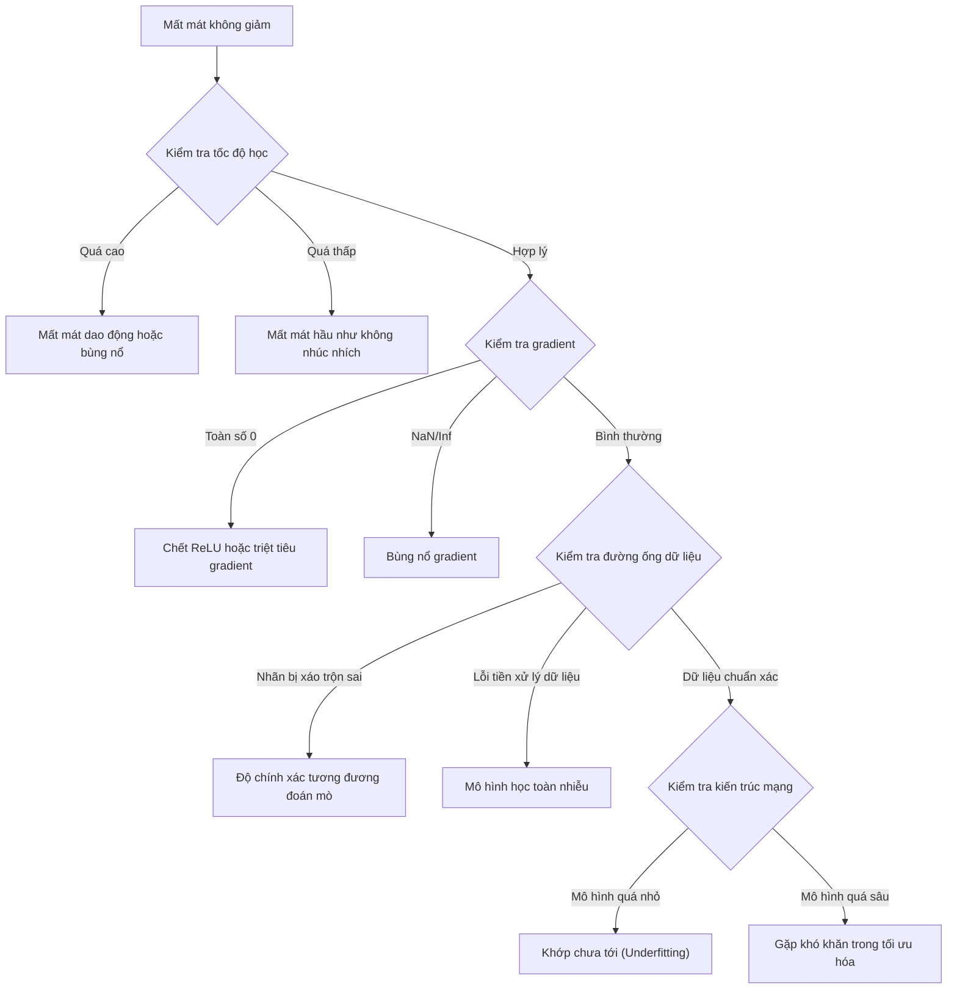
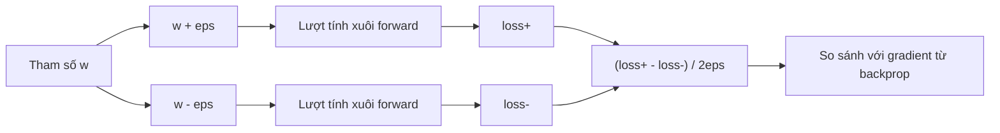
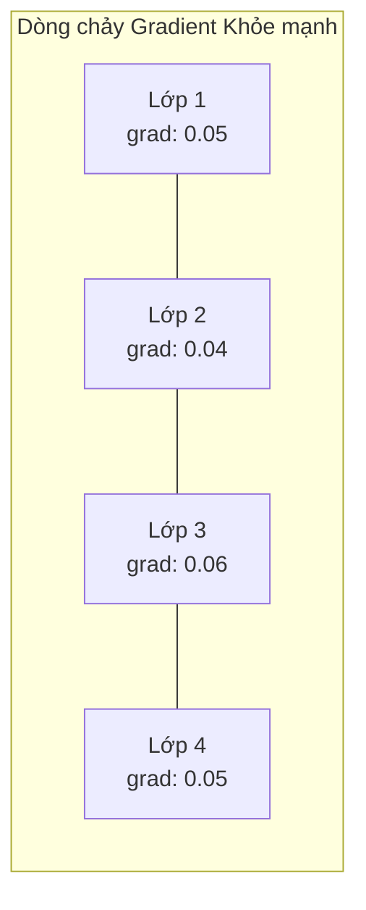
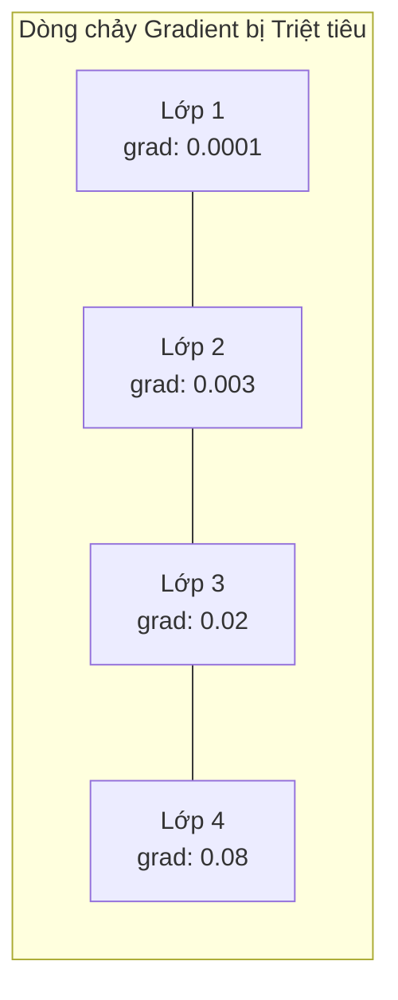
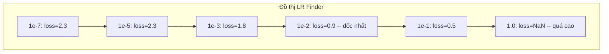

# Gỡ lỗi Mạng Nơ-ron (Debugging Neural Networks)

> Mạng nơ-ron của bạn đã biên dịch thành công. Nó đã chạy. Nó đã sinh ra một con số. Nhưng con số đó sai hoàn toàn và chương trình không hề báo lỗi hay sập nguồn. Chào mừng bạn đến với kiểu gỡ lỗi gian nan nhất -- kiểu gỡ lỗi mà không có bất kỳ thông báo lỗi nào xuất hiện.

**Type:** Build
**Languages:** Python, PyTorch
**Prerequisites:** Phase 03 Bài học 01-10 (đặc biệt là lan truyền ngược, hàm mất mát, bộ tối ưu hóa)
**Time:** ~90 phút

## Learning Objectives

- Chẩn đoán các sự cố thường gặp trong mạng nơ-ron (mất mát NaN, đường cong mất mát đi ngang, khớp quá mức, dao động mạnh) bằng các chiến lược gỡ lỗi có hệ thống
- Áp dụng kỹ thuật "overfit một batch" để kiểm chứng tính đúng đắn của kiến trúc mô hình và vòng lặp huấn luyện
- Kiểm tra độ lớn của gradient, phân phối giá trị kích hoạt và chuẩn trọng số để phát hiện vấn đề triệt tiêu hoặc bùng nổ gradient
- Xây dựng bảng kiểm tra (checklist) gỡ lỗi bao quát đường ống dữ liệu, kiến trúc mô hình, hàm mất mát, bộ tối ưu hóa và tốc độ học

## Vấn đề thực tế (The Problem)

Phần mềm truyền thống sẽ sập (crash) ngay khi gặp lỗi. Con trỏ null ném ra ngoại lệ. Sai kiểu dữ liệu bị chặn ở khâu biên dịch. Lỗi lệch 1 đơn vị (off-by-one) sinh ra kết quả sai lệch thấy rõ ngay lập tức.

Nhưng mạng nơ-ron không cho bạn sự xa xỉ đó.

Một mạng nơ-ron bị lỗi vẫn chạy trơn tru đến bước cuối cùng, in ra một giá trị mất mát, và đưa ra các dự đoán. Mất mát thậm chí có thể giảm dần. Các dự đoán trông có vẻ hợp lý. Nhưng mô hình đang âm thầm bị sai -- học các đường tắt vô nghĩa (shortcuts), ghi nhớ nhiễu, hoặc hội tụ về một điểm cực tiểu cục bộ vô dụng. Các nhà nghiên cứu tại Google ước tính rằng 60-70% thời gian gỡ lỗi trong Machine Learning bị tiêu tốn vào các "lỗi âm thầm" (silent bugs) -- những lỗi không gây crash nhưng làm suy thoái nghiêm trọng chất lượng mô hình.

Ranh giới giữa một mô hình hoạt động hoàn hảo và một mô hình bị hỏng thường chỉ nằm ở duy nhất một dòng mã đặt sai chỗ: thiếu lệnh `zero_grad()`, chuyển vị nhầm trục của một chiều tensor, hoặc tốc độ học bị lệch 10 lần. Bài viết kinh điển "A Recipe for Training Neural Networks" (2019) của Andrej Karpathy đã mở đầu bằng lời cảnh báo: "Những sai lầm phổ biến nhất trong mạng nơ-ron là những lỗi không làm chương trình bị sập."

Bài học này sẽ trang bị cho bạn phương pháp luận để truy lùng và tiêu diệt những lỗi âm thầm đó.

## Khái niệm (The Concept)

### Tư duy gỡ lỗi (The Debugging Mindset)

Hãy từ bỏ thói quen chèn lệnh `print` cầu may. Gỡ lỗi mạng nơ-ron đòi hỏi một quy trình tiếp cận có phương pháp và hệ thống, bởi vì vòng phản hồi rất chậm (mỗi lần huấn luyện mất từ vài phút đến hàng giờ) và các triệu chứng thì vô cùng mơ hồ (hàm mất mát không giảm có thể bắt nguồn từ 20 nguyên nhân hoàn toàn khác nhau).

Nguyên tắc vàng: **Bắt đầu thật đơn giản, thêm độ phức tạp từng thành phần một, và kiểm chứng độc lập từng thành phần đó.**



### Triệu chứng 1: Hàm mất mát không giảm

Đây là triệu chứng phổ biến nhất. Vòng lặp huấn luyện vẫn chạy, các epoch cứ trôi qua, nhưng mất mát hoặc đi ngang bất động hoặc dao động dữ dội.

**Tốc độ học sai:** Quá cao: mất mát dao động hoặc nhảy vọt thành NaN. Quá thấp: mất mát giảm cực kỳ chậm khiến ta có cảm giác nó đi ngang. Đối với Adam, hãy bắt đầu ở mức 1e-3. Đối với SGD, hãy bắt đầu ở mức 1e-1 hoặc 1e-2. Hãy luôn thử nghiệm 3 mức tốc độ học cách nhau 10 lần (ví dụ: 1e-2, 1e-3, 1e-4) trước khi kết luận lỗi do nguyên nhân khác.

**Chết neuron ReLU (Dead ReLUs):** Nếu một neuron ReLU nhận đầu vào âm lớn, nó sẽ xuất ra 0 và gradient của nó bằng 0. Nó sẽ không bao giờ được kích hoạt trở lại nữa. Nếu số lượng neuron chết đủ nhiều, mạng sẽ mất khả năng học. Cách kiểm tra: in tỷ lệ các kích hoạt có giá trị chính xác bằng 0 sau mỗi lớp ReLU. Nếu >50% bị chết, hãy chuyển sang LeakyReLU hoặc giảm tốc độ học.

**Triệt tiêu gradient (Vanishing gradients):** Trong các mạng sâu sử dụng hàm kích hoạt sigmoid hoặc tanh, gradient suy giảm theo hàm mũ khi lan truyền ngược về các lớp trước. Khi tới lớp đầu tiên, gradient xấp xỉ bằng 0. Các lớp đầu tiên ngừng học hoàn toàn. Cách khắc phục: chuyển sang dùng ReLU/GELU, thêm các kết nối tắt (residual connections), hoặc sử dụng chuẩn hóa theo batch (batch normalization).

**Bùng nổ gradient (Exploding gradients):** Vấn đề ngược lại -- gradient tăng trưởng theo hàm mũ. Thường gặp trong mạng hồi quy RNN và các mạng rất sâu. Mất mát nhảy vọt lên NaN. Cách khắc phục: cắt gradient (`torch.nn.utils.clip_grad_norm_`), giảm tốc độ học, hoặc bổ sung các lớp chuẩn hóa.

### Triệu chứng 2: Mất mát giảm nhưng mô hình hoạt động tồi

Mất mát giảm đều đặn. Độ chính xác huấn luyện đạt tới 99%. Nhưng độ chính xác kiểm thử trên tập test chỉ lẹt đẹt ở mức 55%. Hoặc mô hình sinh ra kết quả ngớ ngẩn trên dữ liệu thực tế.

**Khớp quá mức (Overfitting):** Mô hình học vẹt dữ liệu huấn luyện thay vì học quy luật tổng quát. Khoảng cách giữa mất mát huấn luyện (train loss) và mất mát kiểm định (validation loss) ngày càng rộng ra. Cách khắc phục: bổ sung dữ liệu, dropout, suy giảm trọng số (weight decay), dừng sớm (early stopping), tăng cường dữ liệu (data augmentation).

**Rò rỉ dữ liệu (Data leakage):** Dữ liệu kiểm thử bị lọt vào tập huấn luyện. Độ chính xác cao một cách đáng ngờ. Nguyên nhân phổ biến: xáo trộn dữ liệu trước khi chia tập, tiền xử lý dữ liệu bằng số liệu thống kê tính trên toàn bộ tập dữ liệu, hoặc các mẫu trùng lặp xuất hiện ở cả hai tập. Cách khắc phục: chia tập trước, tiền xử lý sau, và kiểm tra kỹ các mẫu trùng lặp.

**Lỗi gán nhãn (Label errors):** 5-10% nhãn trong hầu hết các bộ dữ liệu thực tế bị sai sót (Northcutt et al., 2021 -- "Pervasive Label Errors in Test Sets"). Mô hình sẽ học cả những nhiễu loạn sai trái đó. Cách khắc phục: dùng confident learning để tìm và sửa các mẫu gán nhãn sai, hoặc cắt tỉa mất mát (loss truncation) để bỏ qua các mẫu có mất mát quá bất thường.

### Triệu chứng 3: NaN hoặc Inf xuất hiện trong hàm mất mát

Giá trị mất mát trở thành `nan` hoặc `inf`. Quá trình huấn luyện bị tê liệt hoàn toàn.

**Tốc độ học quá cao:** Các bước cập nhật gradient nhảy vọt quá xa làm trọng số bùng nổ vượt giới hạn số học. Cách khắc phục: giảm tốc độ học 10 lần.

**log(0) hoặc log(số âm):** Hàm mất mát cross-entropy tính toán `log(p)`. Nếu mô hình xuất ra xác suất chính xác bằng 0 hoặc số âm, phép tính log sẽ bùng nổ vô cực. Cách khắc phục: kẹp (clamp) các giá trị dự đoán trong khoảng $[eps, 1-eps]$ với $eps = 10^{-7}$.

**Chia cho số 0:** Batch normalization thực hiện phép chia cho độ lệch chuẩn. Một batch có các giá trị hoàn toàn giống nhau sẽ có std = 0. Cách khắc phục: cộng thêm một hằng số epsilon cực nhỏ vào mẫu số (PyTorch đã tích hợp sẵn, nhưng các cài đặt tự viết có thể quên).

**Tràn số học (Numerical overflow):** Các giá trị kích hoạt quá lớn khi đưa vào hàm `exp()` sẽ sinh ra Inf. Softmax là hàm cực kỳ dễ bị lỗi này. Cách khắc phục: trừ đi giá trị lớn nhất trước khi tính mũ (thủ thuật log-sum-exp).

### Kỹ thuật 1: Kiểm tra Gradient số học (Gradient Checking)

So sánh gradient giải tích (tính từ lan truyền ngược backprop) với gradient số học (tính từ sai phân hữu hạn finite differences). Nếu chúng không khớp nhau, phần lan truyền ngược của bạn chắc chắn có lỗi mã nguồn.

Gradient số học cho tham số $w$:

```math
\text{grad\_numerical} = \frac{\text{loss}(w + \text{eps}) - \text{loss}(w - \text{eps})}{2 \cdot \text{eps}}
```

Chỉ số đánh giá độ sai lệch tương đối (relative difference):

```math
\text{rel\_diff} = \frac{\lvert \text{grad\_analytical} - \text{grad\_numerical} \rvert}{\max(\lvert \text{grad\_analytical} \rvert, \lvert \text{grad\_numerical} \rvert, 10^{-8})}
```

Nếu `rel_diff < 1e-5`: hoàn toàn chính xác. Nếu `rel_diff > 1e-3`: gần như chắc chắn có lỗi logic trong mã tính đạo hàm.



### Kỹ thuật 2: Thống kê giá trị kích hoạt (Activation Statistics)

Theo dõi giá trị trung bình (mean) và độ lệch chuẩn (std) của các kích hoạt sau mỗi lớp trong quá trình huấn luyện. Một mạng khỏe mạnh sẽ duy trì giá trị kích hoạt có trung bình gần 0 và độ lệch chuẩn gần 1 (sau chuẩn hóa) hoặc ít nhất là luôn bị chặn trong dải giá trị hợp lý.

| Chỉ số sức khỏe | Mean | Std | Chẩn đoán |
|-----------------|------|-----|-----------|
| Khỏe mạnh | ~0 | ~1 | Mạng đang học tập bình thường |
| Bão hòa (Saturated) | >>0 hoặc <<0 | ~0 | Kích hoạt bị kẹt ở các giá trị cực trị |
| Bị chết (Dead) | 0 | 0 | Các neuron đã chết hoàn toàn (toàn số 0) |
| Bùng nổ (Exploding) | >>10 | >>10 | Kích hoạt tăng trưởng không kiểm soát |

### Kỹ thuật 3: Trực quan hóa dòng chảy Gradient (Gradient Flow)

Vẽ đồ thị độ lớn trung bình của gradient cho từng lớp. Trong một mạng nơ-ron hoạt động bình thường, độ lớn gradient giữa các lớp phải tương đương nhau. Nếu các lớp đầu tiên có gradient nhỏ hơn 1.000 lần so với các lớp sau, mạng của bạn đang bị triệt tiêu gradient nghiêm trọng.





### Kỹ thuật 4: Kiểm tra Khớp quá mức một Batch (Overfit-One-Batch Test)

Kỹ thuật gỡ lỗi đơn lẻ quan trọng nhất trong toàn bộ lĩnh vực Deep Learning.

Lấy ra đúng một batch dữ liệu nhỏ (từ 8 đến 32 mẫu). Huấn luyện mạng trên duy nhất batch đó trong hơn 100 vòng lặp. Hàm mất mát bắt buộc phải tiệm cận về gần 0 và độ chính xác huấn luyện phải đạt 100%. Nếu không đạt được điều này, mô hình hoặc vòng lặp huấn luyện của bạn đang có lỗi logic nền tảng nghiêm trọng -- tuyệt đối không được tiếp tục huấn luyện trên toàn bộ tập dữ liệu.

Bài kiểm tra này phát hiện ngay lập tức:
- Hàm mất mát cài đặt sai
- Quá trình lan truyền ngược bị hỏng
- Kiến trúc mạng quá nhỏ, không đủ năng lực ghi nhớ dữ liệu
- Bộ tối ưu optimizer không được liên kết đúng với các tham số mô hình
- Dữ liệu đầu vào và nhãn bị lệch vị trí, không khớp nhau

Bài kiểm tra này chỉ mất 30 giây để thực thi nhưng có thể cứu bạn khỏi hàng chục giờ gỡ lỗi vô vọng trên các đợt huấn luyện lớn.

### Kỹ thuật 5: Bộ dò tìm tốc độ học (Learning Rate Finder)

Leslie Smith (2017) đã đề xuất phương pháp quét tốc độ học từ giá trị cực nhỏ (1e-7) lên giá trị cực lớn (10) trong suốt một epoch duy nhất đồng thời ghi nhận lại hàm mất mát. Vẽ đồ thị mất mát theo tốc độ học. Tốc độ học tối ưu thường nhỏ hơn khoảng 10 lần so với giá trị mà tại đó mất mát bắt đầu giảm dốc nhanh nhất.



Giá trị LR tốt nhất trong ví dụ này: ~1e-3 (thấp hơn một bậc độ lớn trước điểm dốc nhất).

### Các lỗi PyTorch phổ biến nhất

Dưới đây là những lỗi gây lãng phí nhiều thời gian nhất trong cộng đồng lập trình viên PyTorch:

| Lỗi | Triệu chứng | Cách khắc phục |
|-----|-------------|----------------|
| Quên gọi `optimizer.zero_grad()` | Gradient bị tích lũy cộng dồn qua các batch, mất mát dao động | Gọi `optimizer.zero_grad()` trước `loss.backward()` |
| Quên chuyển `model.eval()` lúc đánh giá | Dropout và BatchNorm vẫn hoạt động ngẫu nhiên, kết quả test không nhất quán | Gọi `model.eval()` và dùng khối `torch.no_grad()` |
| Sai kích thước hình dạng (shape) | Cơ chế broadcasting tự động âm thầm tạo kết quả sai mà không báo lỗi | In shape sau từng phép toán trong quá trình gỡ lỗi |
| Lệch thiết bị CPU/GPU | `RuntimeError: expected CUDA tensor` | Gọi `.to(device)` đồng thời trên cả mô hình VÀ dữ liệu |
| Quên tách biệt tensor (detach) | Đồ thị tính toán phình to vô tận, gây tràn bộ nhớ OOM | Dùng `.detach()` hoặc đặt trong `with torch.no_grad():` |
| Phép toán tại chỗ (in-place) làm hỏng autograd | `RuntimeError: modified by in-place operation` | Thay thế cú pháp `x += 1` bằng `x = x + 1` |
| Dữ liệu chưa được chuẩn hóa | Mất mát mắc kẹt ở mức xác suất ngẫu nhiên (đoán mò) | Chuẩn hóa đầu vào về mean=0, std=1 |
| Nhãn sai kiểu dữ liệu | Cross-entropy yêu cầu nhãn kiểu `Long`, nhưng nhận vào `Float` | Ép kiểu nhãn về số nguyên dài: `labels.long()` |

### Bảng tra cứu chẩn đoán tổng thể (Master Debugging Table)

| Triệu chứng | Nguyên nhân khả dĩ | Điều đầu tiên cần thử |
|-------------|-------------------|------------------------|
| Mất mát kẹt cứng ở $-\log(1/\text{num\_classes})$ | Mô hình đang dự đoán phân phối đều (đoán mò) | Kiểm tra pipeline dữ liệu, xác minh nhãn khớp với đầu vào |
| Mất mát thành NaN sau vài bước | Tốc độ học quá cao | Giảm LR đi 10 lần |
| Mất mát thành NaN ngay lập tức | Phép toán log(0) hoặc chia cho 0 | Cộng thêm hằng số epsilon vào phép log/phép chia |
| Mất mát dao động dữ dội | LR quá cao hoặc kích thước batch quá nhỏ | Giảm LR, tăng batch size |
| Mất mát giảm rồi đi ngang sớm | LR quá lớn cho giai đoạn tinh chỉnh | Thêm lịch biểu LR (cosine hoặc step decay) |
| Độ chính xác train cao, test thấp | Khớp quá mức (Overfitting) | Thêm dropout, weight decay, thu thập thêm dữ liệu |
| Cả train và test đều bằng mức ngẫu nhiên | Mô hình không học được bất kỳ thứ gì | Chạy ngay kiểm tra overfit-one-batch |
| Cả train và test đều thấp như nhau | Khớp chưa tới (Underfitting) | Tăng dung lượng mô hình, thêm lớp, tăng số chiều đặc trưng |
| Gradient toàn bằng 0 | Chết ReLU hoặc đồ thị tính toán bị ngắt kết nối | Đổi sang LeakyReLU, kiểm tra cờ `.requires_grad` |
| Hết bộ nhớ (OOM) trong lúc huấn luyện | Batch quá lớn hoặc đồ thị không được giải phóng | Giảm batch size, dùng `torch.no_grad()` khi đánh giá |

```figure
learning-curves
```

## Tự tay xây dựng (Build It)

Bộ công cụ chẩn đoán giúp giám sát các giá trị kích hoạt, gradient, và đường cong mất mát. Bạn sẽ chủ động tạo ra các mạng bị lỗi và dùng bộ công cụ này để bắt đúng bệnh cho từng trường hợp.

### Bước 1: Lớp NetworkDebugger

Được gắn hook trực tiếp vào mô hình PyTorch để ghi lại các số liệu thống kê kích hoạt và gradient cho từng lớp.

```python
import torch
import torch.nn as nn
import math


class NetworkDebugger:
    def __init__(self, model):
        self.model = model
        self.activation_stats = {}
        self.gradient_stats = {}
        self.loss_history = []
        self.lr_losses = []
        self.hooks = []
        self._register_hooks()

    def _register_hooks(self):
        for name, module in self.model.named_modules():
            if isinstance(module, (nn.Linear, nn.Conv2d, nn.ReLU, nn.LeakyReLU)):
                hook = module.register_forward_hook(self._make_activation_hook(name))
                self.hooks.append(hook)
                hook = module.register_full_backward_hook(self._make_gradient_hook(name))
                self.hooks.append(hook)

    def _make_activation_hook(self, name):
        def hook(module, input, output):
            with torch.no_grad():
                out = output.detach().float()
                self.activation_stats[name] = {
                    "mean": out.mean().item(),
                    "std": out.std().item(),
                    "fraction_zero": (out == 0).float().mean().item(),
                    "min": out.min().item(),
                    "max": out.max().item(),
                }
        return hook

    def _make_gradient_hook(self, name):
        def hook(module, grad_input, grad_output):
            if grad_output[0] is not None:
                with torch.no_grad():
                    grad = grad_output[0].detach().float()
                    self.gradient_stats[name] = {
                        "mean": grad.mean().item(),
                        "std": grad.std().item(),
                        "abs_mean": grad.abs().mean().item(),
                        "max": grad.abs().max().item(),
                    }
        return hook

    def record_loss(self, loss_value):
        self.loss_history.append(loss_value)

    def check_loss_health(self):
        if len(self.loss_history) < 2:
            return "NOT_ENOUGH_DATA"
        recent = self.loss_history[-10:]
        if any(math.isnan(v) or math.isinf(v) for v in recent):
            return "NAN_OR_INF"
        if len(self.loss_history) >= 20:
            first_half = sum(self.loss_history[:10]) / 10
            second_half = sum(self.loss_history[-10:]) / 10
            if second_half >= first_half * 0.99:
                return "NOT_DECREASING"
        if len(recent) >= 5:
            diffs = [recent[i+1] - recent[i] for i in range(len(recent)-1)]
            if max(diffs) - min(diffs) > 2 * abs(sum(diffs) / len(diffs)):
                return "OSCILLATING"
        return "HEALTHY"

    def check_activations(self):
        issues = []
        for name, stats in self.activation_stats.items():
            if stats["fraction_zero"] > 0.5:
                issues.append(f"DEAD_NEURONS: {name} có {stats['fraction_zero']:.0%} kích hoạt bằng 0")
            if abs(stats["mean"]) > 10:
                issues.append(f"EXPLODING_ACTIVATIONS: {name} mean={stats['mean']:.2f}")
            if stats["std"] < 1e-6:
                issues.append(f"COLLAPSED_ACTIVATIONS: {name} std={stats['std']:.2e}")
        return issues if issues else ["HEALTHY"]

    def check_gradients(self):
        issues = []
        grad_magnitudes = []
        for name, stats in self.gradient_stats.items():
            grad_magnitudes.append((name, stats["abs_mean"]))
            if stats["abs_mean"] < 1e-7:
                issues.append(f"VANISHING_GRADIENT: {name} abs_mean={stats['abs_mean']:.2e}")
            if stats["abs_mean"] > 100:
                issues.append(f"EXPLODING_GRADIENT: {name} abs_mean={stats['abs_mean']:.2e}")
        if len(grad_magnitudes) >= 2:
            first_mag = grad_magnitudes[0][1]
            last_mag = grad_magnitudes[-1][1]
            if last_mag > 0 and first_mag / last_mag > 100:
                issues.append(f"GRADIENT_RATIO: first/last = {first_mag/last_mag:.0f}x (triệt tiêu gradient)")
        return issues if issues else ["HEALTHY"]

    def print_report(self):
        print("\n=== BÁO CÁO GỠ LỖI MẠNG NƠ-RON ===")
        print(f"\nTình trạng hàm mất mát: {self.check_loss_health()}")
        if self.loss_history:
            print(f"  5 giá trị mất mát gần nhất: {[f'{v:.4f}' for v in self.loss_history[-5:]]}")
        print("\nChẩn đoán hàm kích hoạt:")
        for item in self.check_activations():
            print(f"  {item}")
        print("\nChẩn đoán gradient:")
        for item in self.check_gradients():
            print(f"  {item}")
        print("\nThống kê kích hoạt theo từng lớp:")
        for name, stats in self.activation_stats.items():
            print(f"  {name}: mean={stats['mean']:.4f} std={stats['std']:.4f} zero={stats['fraction_zero']:.1%}")
        print("\nThống kê gradient theo từng lớp:")
        for name, stats in self.gradient_stats.items():
            print(f"  {name}: abs_mean={stats['abs_mean']:.2e} max={stats['max']:.2e}")

    def remove_hooks(self):
        for hook in self.hooks:
            hook.remove()
        self.hooks.clear()
```

### Bước 2: Kỹ thuật kiểm tra Overfit-One-Batch

```python
def overfit_one_batch(model, x_batch, y_batch, criterion, lr=0.01, steps=200):
    optimizer = torch.optim.Adam(model.parameters(), lr=lr)
    model.train()
    print("\n=== KIỂM TRA OVERFIT MỘT BATCH ===")
    print(f"Kích thước batch: {x_batch.shape[0]}, Số bước: {steps}")

    for step in range(steps):
        optimizer.zero_grad()
        output = model(x_batch)
        loss = criterion(output, y_batch)
        loss.backward()
        optimizer.step()

        if step % 50 == 0 or step == steps - 1:
            with torch.no_grad():
                preds = (output > 0).float() if output.shape[-1] == 1 else output.argmax(dim=1)
                targets = y_batch if y_batch.dim() == 1 else y_batch.squeeze()
                acc = (preds.squeeze() == targets).float().mean().item()
            print(f"  Bước {step:3d} | Mất mát: {loss.item():.6f} | Độ chính xác: {acc:.1%}")

    final_loss = loss.item()
    if final_loss > 0.1:
        print(f"\n  THẤT BẠI: Mất mát không hội tụ ({final_loss:.4f}). Mô hình hoặc vòng lặp huấn luyện bị lỗi.")
        return False
    print(f"\n  THÀNH CÔNG: Mất mát đã hội tụ về {final_loss:.6f}")
    return True
```

### Bước 3: Bộ dò tìm tốc độ học (Learning Rate Finder)

```python
def find_learning_rate(model, x_data, y_data, criterion, start_lr=1e-7, end_lr=10, steps=100):
    import copy
    original_state = copy.deepcopy(model.state_dict())
    optimizer = torch.optim.SGD(model.parameters(), lr=start_lr)
    lr_mult = (end_lr / start_lr) ** (1 / steps)

    model.train()
    results = []
    best_loss = float("inf")
    current_lr = start_lr

    print("\n=== BỘ DÒ TÌM TỐC ĐỘ HỌC ===")

    for step in range(steps):
        optimizer.zero_grad()
        output = model(x_data)
        loss = criterion(output, y_data)

        if math.isnan(loss.item()) or loss.item() > best_loss * 10:
            break

        best_loss = min(best_loss, loss.item())
        results.append((current_lr, loss.item()))

        loss.backward()
        optimizer.step()

        current_lr *= lr_mult
        for param_group in optimizer.param_groups:
            param_group["lr"] = current_lr

    model.load_state_dict(original_state)

    if len(results) < 10:
        print("  Không thể hoàn thành đợt quét LR -- mất mát phân kỳ quá nhanh")
        return results

    min_loss_idx = min(range(len(results)), key=lambda i: results[i][1])
    suggested_lr = results[max(0, min_loss_idx - 10)][0]

    print(f"  Đã quét {len(results)} bước từ {start_lr:.0e} tới {results[-1][0]:.0e}")
    print(f"  Mất mát nhỏ nhất {results[min_loss_idx][1]:.4f} tại lr={results[min_loss_idx][0]:.2e}")
    print(f"  Gợi ý tốc độ học khuyến nghị: {suggested_lr:.2e}")

    return results
```

### Bước 4: Bộ kiểm tra đạo hàm Gradient Checker

```python
def _flat_to_multi_index(flat_idx, shape):
    multi_idx = []
    remaining = flat_idx
    for dim in reversed(shape):
        multi_idx.insert(0, remaining % dim)
        remaining //= dim
    return tuple(multi_idx)


def gradient_check(model, x, y, criterion, eps=1e-4):
    model.train()
    x_double = x.double()
    y_double = y.double()
    model_double = model.double()

    print("\n=== KIỂM TRA ĐẠO HÀM GRADIENT ===")
    overall_max_diff = 0
    checked = 0

    for name, param in model_double.named_parameters():
        if not param.requires_grad:
            continue

        layer_max_diff = 0

        model_double.zero_grad()
        output = model_double(x_double)
        loss = criterion(output, y_double)
        loss.backward()
        analytical_grad = param.grad.clone()

        num_checks = min(5, param.numel())
        for i in range(num_checks):
            idx = _flat_to_multi_index(i, param.shape)
            original = param.data[idx].item()

            param.data[idx] = original + eps
            with torch.no_grad():
                loss_plus = criterion(model_double(x_double), y_double).item()

            param.data[idx] = original - eps
            with torch.no_grad():
                loss_minus = criterion(model_double(x_double), y_double).item()

            param.data[idx] = original

            numerical = (loss_plus - loss_minus) / (2 * eps)
            analytical = analytical_grad[idx].item()

            denom = max(abs(numerical), abs(analytical), 1e-8)
            rel_diff = abs(numerical - analytical) / denom

            layer_max_diff = max(layer_max_diff, rel_diff)
            checked += 1

        overall_max_diff = max(overall_max_diff, layer_max_diff)
        status = "OK" if layer_max_diff < 1e-5 else "KHÔNG KHỚP"
        print(f"  {name}: max_rel_diff={layer_max_diff:.2e} [{status}]")

    model.float()

    print(f"\n  Đã kiểm tra {checked} tham số")
    if overall_max_diff < 1e-5:
        print("  THÀNH CÔNG: Gradient hoàn toàn khớp (rel_diff < 1e-5)")
    elif overall_max_diff < 1e-3:
        print("  CẢNH BÁO: Có sai lệch nhỏ (1e-5 < rel_diff < 1e-3)")
    else:
        print("  THẤT BẠI: Phát hiện sai lệch gradient nghiêm trọng (rel_diff > 1e-3)")
    return overall_max_diff
```

### Bước 5: Thử nghiệm với các mạng cố tình tạo lỗi

Áp dụng bộ công cụ chẩn đoán lên các mạng bị hỏng để bắt bệnh thực tế.

```python
def demo_broken_networks():
    torch.manual_seed(42)
    x = torch.randn(64, 10)
    y = (x[:, 0] > 0).long()

    print("\n" + "=" * 60)
    print("LỖI 1: Tốc độ học quá cao (lr=10)")
    print("=" * 60)
    model1 = nn.Sequential(nn.Linear(10, 32), nn.ReLU(), nn.Linear(32, 2))
    debugger1 = NetworkDebugger(model1)
    optimizer1 = torch.optim.SGD(model1.parameters(), lr=10.0)
    criterion = nn.CrossEntropyLoss()
    for step in range(20):
        optimizer1.zero_grad()
        out = model1(x)
        loss = criterion(out, y)
        debugger1.record_loss(loss.item())
        loss.backward()
        optimizer1.step()
    debugger1.print_report()
    debugger1.remove_hooks()

    print("\n" + "=" * 60)
    print("LỖI 2: Chết ReLU do khởi tạo trọng số tồi")
    print("=" * 60)
    model2 = nn.Sequential(nn.Linear(10, 32), nn.ReLU(), nn.Linear(32, 32), nn.ReLU(), nn.Linear(32, 2))
    with torch.no_grad():
        for m in model2.modules():
            if isinstance(m, nn.Linear):
                m.weight.fill_(-1.0)
                m.bias.fill_(-5.0)
    debugger2 = NetworkDebugger(model2)
    optimizer2 = torch.optim.Adam(model2.parameters(), lr=1e-3)
    for step in range(50):
        optimizer2.zero_grad()
        out = model2(x)
        loss = criterion(out, y)
        debugger2.record_loss(loss.item())
        loss.backward()
        optimizer2.step()
    debugger2.print_report()
    debugger2.remove_hooks()

    print("\n" + "=" * 60)
    print("LỖI 3: Quên zero_grad (gradient bị cộng dồn liên tục)")
    print("=" * 60)
    model3 = nn.Sequential(nn.Linear(10, 32), nn.ReLU(), nn.Linear(32, 2))
    debugger3 = NetworkDebugger(model3)
    optimizer3 = torch.optim.SGD(model3.parameters(), lr=0.01)
    for step in range(50):
        out = model3(x)
        loss = criterion(out, y)
        debugger3.record_loss(loss.item())
        loss.backward()
        optimizer3.step()
    debugger3.print_report()
    debugger3.remove_hooks()

    print("\n" + "=" * 60)
    print("MẠNG KHỎE MẠNH: Thiết lập chuẩn mực để đối chiếu")
    print("=" * 60)
    model_good = nn.Sequential(nn.Linear(10, 32), nn.ReLU(), nn.Linear(32, 2))
    debugger_good = NetworkDebugger(model_good)
    optimizer_good = torch.optim.Adam(model_good.parameters(), lr=1e-3)
    for step in range(50):
        optimizer_good.zero_grad()
        out = model_good(x)
        loss = criterion(out, y)
        debugger_good.record_loss(loss.item())
        loss.backward()
        optimizer_good.step()
    debugger_good.print_report()
    debugger_good.remove_hooks()

    print("\n" + "=" * 60)
    print("KIỂM TRA OVERFIT-ONE-BATCH (Mô hình chuẩn)")
    print("=" * 60)
    model_test = nn.Sequential(nn.Linear(10, 32), nn.ReLU(), nn.Linear(32, 2))
    overfit_one_batch(model_test, x[:8], y[:8], criterion)

    print("\n" + "=" * 60)
    print("BỘ DÒ TÌM TỐC ĐỘ HỌC")
    print("=" * 60)
    model_lr = nn.Sequential(nn.Linear(10, 32), nn.ReLU(), nn.Linear(32, 2))
    find_learning_rate(model_lr, x, y, criterion)

    print("\n" + "=" * 60)
    print("KIỂM TRA GRADIENT")
    print("=" * 60)
    model_grad = nn.Sequential(nn.Linear(10, 8), nn.ReLU(), nn.Linear(8, 2))
    gradient_check(model_grad, x[:4], y[:4], criterion)
```

## Sử dụng trong thực tế (Use It)

### Các công cụ tích hợp sẵn trong PyTorch

```python
import torch
import torch.nn as nn

model = nn.Sequential(
    nn.Linear(768, 256),
    nn.ReLU(),
    nn.Linear(256, 10),
)

with torch.autograd.detect_anomaly():
    output = model(input_tensor)
    loss = criterion(output, target)
    loss.backward()

for name, param in model.named_parameters():
    if param.grad is not None:
        print(f"{name}: grad_mean={param.grad.abs().mean():.2e}")
```

### Tích hợp với Weights & Biases (W&B)

```python
import wandb

wandb.init(project="debug-training")

for epoch in range(100):
    loss = train_one_epoch()
    wandb.log({
        "loss": loss,
        "lr": optimizer.param_groups[0]["lr"],
        "grad_norm": torch.nn.utils.clip_grad_norm_(model.parameters(), float("inf")),
    })

    for name, param in model.named_parameters():
        if param.grad is not None:
            wandb.log({f"grad/{name}": wandb.Histogram(param.grad.cpu().numpy())})
```

### Sử dụng TensorBoard

```python
from torch.utils.tensorboard import SummaryWriter

writer = SummaryWriter("runs/debug_experiment")

for epoch in range(100):
    loss = train_one_epoch()
    writer.add_scalar("Loss/train", loss, epoch)

    for name, param in model.named_parameters():
        writer.add_histogram(f"weights/{name}", param, epoch)
        if param.grad is not None:
            writer.add_histogram(f"gradients/{name}", param.grad, epoch)
```

### Danh sách kiểm tra gỡ lỗi (Trước khi chạy đợt huấn luyện đầy đủ)

1. **Chạy bài kiểm tra overfit-one-batch:** Nếu thất bại, lập tức dừng lại sửa code.
2. **In bảng tóm tắt mô hình:** Xác minh số lượng tham số có hợp lý hay không.
3. **Chạy một lượt lan truyền xuôi đơn lẻ với dữ liệu ngẫu nhiên:** Kiểm tra hình dạng tensor đầu ra.
4. **Huấn luyện thử trong 5 epoch:** Đảm bảo hàm mất mát có xu hướng giảm dần.
5. **Kiểm tra thống kê các kích hoạt:** Không có lớp nào bị chết, không có lớp nào bị bùng nổ.
6. **Kiểm tra dòng chảy gradient:** Không bị triệt tiêu về 0, không bị bùng nổ vô hạn.
7. **Kiểm tra pipeline dữ liệu:** In ngẫu nhiên 5 mẫu dữ liệu kèm nhãn để xác minh bằng mắt thường.

## Sản phẩm bàn giao (Ship It)

Bài học này tạo ra:
- `outputs/prompt-nn-debugger.md` -- prompt chẩn đoán các lỗi huấn luyện mạng nơ-ron
- `outputs/skill-debug-checklist.md` -- bảng kiểm tra cây quyết định gỡ lỗi các vấn đề huấn luyện

Các mẫu triển khai then chốt khi gỡ lỗi trên môi trường sản xuất:
- Thêm các monitoring hook vào kịch bản huấn luyện chính thức
- Ghi log thống kê kích hoạt và gradient lên W&B hoặc TensorBoard sau mỗi $N$ bước
- Cài đặt cảnh báo tự động khi phát hiện mất mát NaN, neuron chết (>80% kích hoạt bằng 0), hoặc bùng nổ gradient
- Luôn luôn chạy bài kiểm tra overfit-one-batch mỗi khi thay đổi kiến trúc mô hình hoặc đường ống dữ liệu

## Bài tập rèn luyện (Exercises)

1. **Bổ sung bộ phát hiện bùng nổ gradient:** Nâng cấp `NetworkDebugger` để tự động phát hiện khi gradient vượt quá một ngưỡng cho trước và gợi ý giá trị cắt gradient (gradient clipping) phù hợp. Thử nghiệm trên mạng 20 lớp không sử dụng chuẩn hóa.
2. **Xây dựng bộ "hồi sinh" neuron chết:** Viết một hàm xác định các neuron ReLU đã chết (luôn xuất ra 0) và khởi tạo lại các trọng số kết nối vào của chúng bằng phương pháp Kaiming initialization. Chứng minh rằng giải pháp này giúp khôi phục mạng có hơn 70% neuron bị chết.
3. **Cài đặt bộ dò tìm tốc độ học có biểu đồ trực quan:** Mở rộng hàm `find_learning_rate` để xuất kết quả ra file CSV và viết một script riêng đọc CSV vẽ biểu đồ LR vs Loss bằng matplotlib. Xác định LR tối ưu cho ResNet-18 trên CIFAR-10.
4. **Tạo bộ xác thực đường ống dữ liệu (Data Pipeline Validator):** Viết hàm kiểm tra: các mẫu trùng lặp giữa tập train/test, mất cân bằng phân phối nhãn (tỷ lệ lệch >10:1), chuẩn hóa đầu vào (mean gần 0, std gần 1), và các giá trị NaN/Inf trong dữ liệu. Chạy thử nghiệm trên một tập dữ liệu cố tình bị phá hoại.
5. **Gỡ lỗi một sự cố thực tế:** Lấy mini-framework từ Bài học 10, cố tình đưa vào một lỗi tinh vi (ví dụ: chuyển vị nhầm ma trận trọng số trong hàm backward), và dùng kỹ thuật gradient check để chỉ ra chính xác tham số nào có gradient bị sai lệch. Ghi chép lại toàn bộ nhật ký gỡ lỗi.

## Thuật ngữ then chốt (Key Terms)

| Thuật ngữ | Người ta thường nói | Bản chất thực sự |
|-----------|--------------------|-------------------|
| Silent bug (Lỗi âm thầm) | "Nó vẫn chạy nhưng ra kết quả tồi" | Lỗi không làm chương trình bị sập nhưng làm suy thoái chất lượng mô hình -- dạng lỗi chiếm ưu thế trong ML |
| Dead ReLU (Chết ReLU) | "Neuron bị chết" | Neuron ReLU có đầu vào luôn âm, do đó luôn xuất ra 0 và nhận gradient bằng 0 vĩnh viễn |
| Vanishing gradients (Triệt tiêu gradient) | "Các lớp đầu ngừng học" | Gradient suy giảm theo hàm mũ qua các tầng, khiến trọng số ở các lớp đầu tiên gần như bị đóng băng |
| Exploding gradients (Bùng nổ gradient) | "Mất mát nhảy vọt lên NaN" | Gradient tăng trưởng theo hàm mũ qua các tầng, gây ra các bước cập nhật trọng số khổng lồ làm tràn số |
| Gradient checking (Kiểm tra gradient) | "Xác minh backprop chuẩn xác" | So sánh gradient giải tích từ backprop với gradient số học từ sai phân hữu hạn |
| Overfit-one-batch | "Bài kiểm tra gỡ lỗi quan trọng nhất" | Huấn luyện trên một batch nhỏ duy nhất để chứng minh mô hình CÓ THỂ học được -- nếu không học nổi, hệ thống chắc chắn có lỗi |
| LR finder (Bộ dò tìm LR) | "Quét tìm tốc độ học chuẩn" | Tăng dần tốc độ học theo hàm mũ trong một epoch và chọn giá trị ngay trước điểm mất mát phân kỳ |
| Data leakage (Rò rỉ dữ liệu) | "Dữ liệu kiểm thử bị lọt vào train" | Thông tin từ tập test làm ô nhiễm tập train, tạo ra độ chính xác cao giả tạo |
| Activation statistics | "Giám sát sức khỏe các lớp" | Theo dõi mean, std, và tỷ lệ bằng 0 của đầu ra từng lớp để phát hiện neuron bị chết, bão hòa, hoặc bùng nổ |
| Gradient clipping (Cắt gradient) | "Giới hạn trần độ lớn gradient" | Tỷ lệ hóa gradient giảm xuống khi chuẩn của chúng vượt ngưỡng cho phép, ngăn chặn các bước cập nhật bùng nổ |

## Tài liệu đọc thêm (Further Reading)

- Smith, "Cyclical Learning Rates for Training Neural Networks" (2017) -- bài báo giới thiệu kiểm tra dải tốc độ học (LR finder)
- Northcutt et al., "Pervasive Label Errors in Test Sets Destabilize Machine Learning Benchmarks" (2021) -- chứng minh 3-6% nhãn trong ImageNet, CIFAR-10, và các benchmark lớn bị sai sót
- Zhang et al., "Understanding Deep Learning Requires Rethinking Generalization" (2017) -- bài báo chứng minh mạng nơ-ron có thể ghi nhớ cả các nhãn ngẫu nhiên, giải thích tại sao bài kiểm tra overfit-one-batch luôn hiệu nghiệm
- PyTorch documentation về `torch.autograd.detect_anomaly` và `torch.autograd.set_detect_anomaly` để tự động phát hiện NaN/Inf

