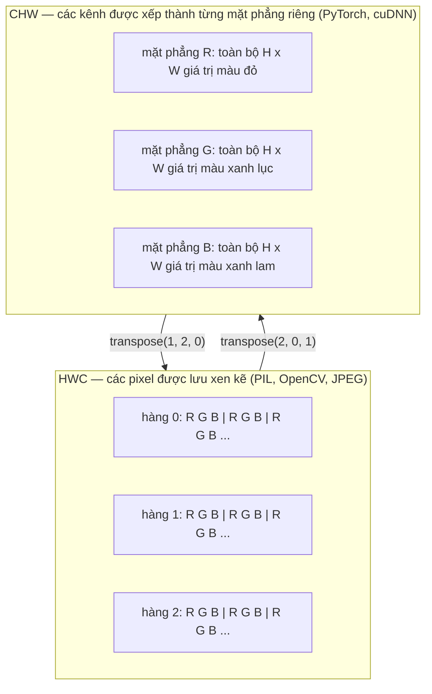

# Cơ sở Xử lý Ảnh — Điểm ảnh, Kênh màu, Không gian màu (Image Fundamentals — Pixels, Channels, Color Spaces)

> Một hình ảnh bản chất là một tensor chứa các mẫu ánh sáng. Mọi mô hình thị giác máy tính mà bạn từng tiếp cận đều khởi đầu từ chính sự thật duy nhất này.

**Type:** Build
**Languages:** Python
**Prerequisites:** Phase 1 Bài học 12 (Tensor Operations), Phase 3 Bài học 11 (Intro to PyTorch)
**Time:** ~45 phút

## Learning Objectives

- Giải thích cách một khung cảnh liên tục trong thế giới thực được rời rạc hóa thành các điểm ảnh (pixels) và tại sao các quyết định lấy mẫu/lượng tử hóa lại đặt ra giới hạn trần cho mọi mô hình xử lý phía sau
- Đọc, cắt lát (slice) và kiểm tra hình ảnh dưới dạng các mảng NumPy, chuyển đổi thuần thục giữa hai định dạng bố cục HWC và CHW
- Chuyển đổi qua lại giữa các không gian màu RGB, Grayscale, HSV, YCbCr và hiểu rõ lý do tồn tại của từng không gian màu
- Áp dụng quy trình tiền xử lý cấp độ điểm ảnh (chuẩn hóa tỷ lệ, chuẩn hóa thống kê, đổi kích thước, chuyển kênh màu lên trước) chính xác theo tiêu chuẩn mà các mô hình thị giác huấn luyện trước của PyTorch kỳ vọng

## Vấn đề thực tế (The Problem)

Mọi bài báo nghiên cứu bạn đọc, mọi bộ trọng số tiền huấn luyện bạn tải về, và mọi API thị giác bạn gọi tới đều mặc định kỳ vọng một định dạng mã hóa đầu vào cụ thể. Truyền vào một hình ảnh kiểu `uint8` trong khi mô hình mong đợi `float32`, chương trình vẫn sẽ chạy -- nhưng âm thầm tạo ra kết quả vô nghĩa. Đưa ảnh theo thứ tự BGR vào một mạng nơ-ron được huấn luyện trên RGB, độ chính xác sẽ sụt giảm thê thảm hàng chục điểm phần trăm. Đưa vào định dạng channels-last (kênh màu ở cuối) trong khi mô hình chờ đợi channels-first (kênh màu ở đầu), lớp tích chập conv đầu tiên sẽ đối xử với chiều cao (height) như thể nó là một kênh đặc trưng. Không có bất kỳ lỗi nào được ném ra. Nó chỉ âm thầm phá hủy toàn bộ các chỉ số của bạn, và bạn sẽ phải mất cả tuần trời săn lùng một lỗi bắt nguồn từ chính khâu nạp tệp ảnh ban đầu.

Phép tích chập (convolution) không hề phức tạp một khi bạn nắm rõ nó đang trượt trên cái gì. Phần khó khăn nằm ở chỗ "một hình ảnh" mang ý nghĩa hoàn toàn khác nhau đối với máy ảnh, bộ giải mã JPEG, thư viện PIL, OpenCV, torchvision, và một kernel CUDA. Mỗi thư viện lại có quy ước riêng về thứ tự trục, dải giá trị byte, và kênh màu. Một kỹ sư thị giác máy tính không nắm vững những nền tảng này sẽ chỉ tạo ra các pipeline lỗi.

Bài học này xây dựng nền móng vững chắc cho toàn bộ Phase 04. Đến cuối bài, bạn sẽ hiểu rõ bản chất của một pixel, tại sao mỗi pixel lại gồm 3 con số thay vì 1, thao tác "chuẩn hóa với số liệu thống kê ImageNet" thực sự làm điều gì bên dưới, và cách chuyển đổi linh hoạt giữa các định dạng bố cục tensor.

## Khái niệm (The Concept)

### Toàn cảnh quy trình tiền xử lý hoàn chỉnh

Mọi hệ thống thị giác máy tính trong môi trường sản xuất (production) đều là một chuỗi các phép biến đổi khả nghịch. Chỉ cần sai một bước duy nhất, mô hình sẽ nhìn thấy một đầu vào hoàn toàn khác biệt so với những gì nó được huấn luyện.

```mermaid
flowchart LR
    A["Tệp hình ảnh<br/>(JPEG/PNG)"] --> B["Giải mã<br/>uint8 HWC"]
    B --> C["Chuyển đổi<br/>không gian màu<br/>(RGB/BGR/YCbCr)"]
    C --> D["Đổi kích thước<br/>cạnh ngắn hơn"]
    D --> E["Cắt tại tâm<br/>kích thước mô hình"]
    E --> F["Chia cho 255<br/>float32 [0,1]"]
    F --> G["Trừ mean<br/>Chia cho std"]
    G --> H["Chuyển vị<br/>HWC → CHW"]
    H --> I["Gom batch<br/>CHW → NCHW"]
    I --> J["Mô hình"]

    style A fill:#fef3c7,stroke:#d97706
    style J fill:#ddd6fe,stroke:#7c3aed
    style G fill:#fecaca,stroke:#dc2626
    style H fill:#bfdbfe,stroke:#2563eb
```



Hai chiếc hộp màu đỏ và xanh dương chính là nơi ẩn náu của 80% các lỗi âm thầm: thiếu bước chuẩn hóa thống kê z-score và sai thứ tự trục bố cục.

### Một pixel là một mẫu đo, không phải một hình vuông

Cảm biến máy ảnh đếm các photon ánh sáng chạm vào một lưới gồm các cảm biến cực nhỏ. Mỗi cảm biến tích lũy ánh sáng trong một phần nhỏ của giây và phát ra một điện áp tỷ lệ thuận với số lượng photon chạm vào. Cảm biến sau đó rời rạc hóa điện áp đó thành một số nguyên. Một cảm biến trở thành một pixel.

```text
Khung cảnh liên tục                Lưới cảm biến                   Ảnh kỹ thuật số
(chi tiết vô hạn)                  (H x W cảm biến)                (H x W số nguyên)

    ~~~~~                          +--+--+--+--+--+                 210 198 180 155 120
   ~   ~   ~                       |  |  |  |  |  |                 205 195 178 152 118
  ~ light ~        ---->           +--+--+--+--+--+     ---->       200 190 175 150 115
   ~~~~~                           |  |  |  |  |  |                 195 185 170 148 112
                                   +--+--+--+--+--+                 188 180 165 145 108
```

Có hai lựa chọn diễn ra tại bước này và chúng quyết định giới hạn trần cho mọi tác vụ phía sau:

- **Lấy mẫu không gian (Spatial sampling):** Quyết định có bao nhiêu cảm biến trên mỗi góc độ của khung cảnh. Quá ít cảm biến, các cạnh sẽ bị răng cưa (aliasing). Quá nhiều cảm biến, dung lượng lưu trữ và chi phí tính toán sẽ bùng nổ.
- **Lượng tử hóa cường độ (Intensity quantization):** Quyết định điện áp được chia mịn thành bao nhiêu mức. 8-bit cung cấp 256 mức sáng và là tiêu chuẩn hiển thị. 10, 12, 16-bit mang lại sự chuyển tiếp màu mượt mà hơn và tối quan trọng trong chẩn đoán hình ảnh y tế, chuẩn HDR và xử lý ảnh RAW.

Một điểm ảnh (pixel) không phải là một ô vuông màu có diện tích. Nó là một điểm đo ánh sáng đơn lẻ. Khi bạn đổi kích thước hoặc xoay ảnh, bạn đang thực hiện tái lấy mẫu (resampling) trên lưới đo lường đó.

### Tại sao lại có ba kênh màu?

Một cảm biến đếm photon trên toàn bộ phổ ánh sáng nhìn thấy -- đó là ảnh thang độ xám (grayscale). Để ghi lại màu sắc, cảm biến phủ lên bề mặt lưới một màng lọc gồm các bộ lọc màu đỏ, xanh lục, và xanh lam (bộ lọc Bayer). Sau quá trình giải khảm (demosaicing), mỗi vị trí không gian có ba số nguyên: phản hồi của cảm biến lọc đỏ, lọc lục và lọc lam ở lân cận. Ba số nguyên đó tạo thành bộ ba RGB của một pixel.

```text
Một pixel trong bộ nhớ:

    (R, G, B) = (210, 140, 30)   <- màu cam ánh đỏ

Một bức ảnh RGB kích thước H x W:

    shape (H, W, 3)     được lưu dưới dạng H hàng gồm W pixel, mỗi pixel có 3 giá trị
                        mỗi giá trị trong khoảng [0, 255] cho kiểu uint8
```

Con số 3 không phải là quy luật bất biến. Máy ảnh đo chiều sâu bổ sung thêm kênh Z. Ảnh vệ tinh có thêm các dải sóng hồng ngoại và tử ngoại. Ảnh chụp y tế thường chỉ có 1 kênh (X-quang, CT) hoặc hàng trăm kênh (ảnh siêu phổ - hyperspectral). Số lượng kênh màu là trục cuối cùng của ma trận; các lớp tích chập sẽ học cách kết hợp thông tin trên trục này.

### Hai quy ước bố cục: HWC và CHW

Cùng một tensor, nhưng có hai cách sắp xếp thứ tự trục. Mỗi thư viện sẽ lựa chọn một kiểu:

```text
HWC (height, width, channels)           CHW (channels, height, width)

   W ->                                    H ->
  +-----+-----+-----+                     +-----+-----+
H |R G B|R G B|R G B|                   C |R R R R R R|
| +-----+-----+-----+                   | +-----+-----+
v |R G B|R G B|R G B|                   v |G G G G G G|
  +-----+-----+-----+                     +-----+-----+
                                          |B B B B B B|
                                          +-----+-----+

   PIL, OpenCV, matplotlib,              PyTorch, hầu hết các deep learning
   hầu hết các tệp ảnh trên đĩa          frameworks, các cuDNN kernels
```

Định dạng CHW tồn tại vì các kernel tích chập trượt trên các chiều H và W. Đưa trục kênh màu lên đầu giúp mỗi kernel nhìn thấy một mặt phẳng 2D liền kề cho từng kênh, cho phép vector hóa các phép tính một cách tối ưu. Ngược lại, các định dạng lưu trên đĩa giữ kiểu HWC vì nó khớp với cách mà cảm biến quét tuần tự từng dòng quét (scanlines).

Thao tác chuyển đổi một dòng mà bạn sẽ viết hàng nghìn lần:

```python
img_chw = img_hwc.transpose(2, 0, 1)      # NumPy
img_chw = img_hwc.permute(2, 0, 1)        # PyTorch tensor
```

Trực quan hóa cách bố trí bộ nhớ:



### Dải giá trị Byte và Kiểu dữ liệu (dtype)

Có ba quy ước chủ đạo:

| Quy ước | dtype | Dải giá trị | Nơi thường gặp |
|---------|-------|-------------|----------------|
| Nguyên thô (Raw) | `uint8` | [0, 255] | Tệp ảnh trên đĩa, đầu ra PIL, OpenCV |
| Chuẩn hóa tỷ lệ (Normalized) | `float32` | [0.0, 1.0] | Sau phép tính `img.astype('float32') / 255` |
| Chuẩn hóa z-score (Standardized) | `float32` | xấp xỉ [-2, +2] | Sau khi trừ mean và chia cho std |

Các mạng nơ-ron tích chập đều được huấn luyện trên đầu vào đã được chuẩn hóa thống kê z-score. Bộ chỉ số ImageNet: `mean=[0.485, 0.456, 0.406]`, `std=[0.229, 0.224, 0.225]` là giá trị trung bình số học và độ lệch chuẩn của ba kênh màu tính trên toàn bộ tập huấn luyện ImageNet với các pixel đã chuẩn hóa về [0, 1]. Đưa ảnh `uint8` thô vào một mô hình đang chờ đợi số thực float đã chuẩn hóa là lỗi âm thầm phổ biến nhất trong thị giác máy tính ứng dụng.

### Các không gian màu và lý do chúng tồn tại

RGB là định dạng lúc chụp nhưng không phải lúc nào cũng là biểu diễn tối ưu nhất cho mô hình:

```text
 RGB               HSV                       YCbCr / YUV

 R red (đỏ)        H hue (sắc độ: 0-360)     Y luminance (độ sáng)
 G green (lục)     S saturation (độ bão hòa) Cb chroma xanh lam - vàng
 B blue (lam)      V value (độ sáng: 0-1)    Cr chroma đỏ - xanh lục

 Tuyến tính với    Tách biệt màu sắc khỏi    Tách biệt độ sáng khỏi màu sắc.
 đầu ra cảm biến   độ sáng. Hữu ích cho      JPEG và hầu hết codec video
                   lọc ngưỡng màu, thanh     nén mạnh các kênh sắc độ (chroma)
                   trượt UI, bộ lọc cổ điển  vì mắt người kém nhạy với chi
                                             tiết màu sắc hơn chi tiết độ sáng Y.
```

Với hầu hết các mạng CNN hiện đại, bạn đưa vào định dạng RGB. Bạn sẽ bắt gặp các không gian khác khi:

- **HSV** — xử lý ảnh cổ điển, phân đoạn đối tượng dựa trên màu, cân bằng trắng.
- **YCbCr** — làm việc với cấu trúc bên trong của JPEG, xử lý video, các mô hình siêu phân giải (super-resolution) chỉ thao tác trên kênh Y.
- **Grayscale (Thang độ xám)** — nhận dạng chữ OCR, tài liệu văn bản, những bài toán mà màu sắc chỉ là yếu tố gây nhiễu chứ không mang thông tin phân loại.

Chuyển đổi RGB sang Grayscale là một tổng có trọng số chứ không phải trung bình cộng, bởi vì mắt người nhạy cảm với ánh sáng xanh lục hơn nhiều so với đỏ hay lam:

```math
Y = 0.299 R + 0.587 G + 0.114 B \qquad \text{(Tiêu chuẩn ITU-R BT.601 kinh điển)}
```

### Tỷ lệ khung hình, đổi kích thước và các phép nội suy

Mỗi mô hình đều có một kích thước đầu vào cố định (224x224 cho hầu hết bộ phân loại ImageNet, 384x384 hoặc 512x512 cho các bộ phát hiện đối tượng hiện đại). Hình ảnh thực tế của bạn hiếm khi trùng khớp. Ba lựa chọn đổi kích thước (resize) quan trọng:

- **Đổi kích thước cạnh ngắn hơn, rồi cắt tại tâm (Resize shorter side, center crop):** Công thức chuẩn của ImageNet. Bảo toàn tỷ lệ khung hình, loại bỏ một dải viền rìa ảnh.
- **Đổi kích thước và đệm viền (Resize and pad):** Bảo toàn tỷ lệ khung hình và giữ nguyên mọi pixel, thêm viền đen (letterboxing). Thường dùng cho bài toán phát hiện đối tượng và OCR.
- **Đổi kích thước trực tiếp về mục tiêu:** Kéo giãn hình ảnh. Chi phí thấp, làm méo mó hình học, nhưng chấp nhận được cho nhiều tác vụ phân loại cơ bản.

Phương pháp nội suy (interpolation) quyết định cách các điểm ảnh trung gian được tính toán khi lưới tọa độ mới không khớp với lưới tọa độ cũ:

```text
Nearest neighbour (Láng giềng gần nhất): nhanh nhất, dạng khối, bắt buộc dùng cho mặt nạ phân đoạn/nhãn lớp
Bilinear (Song tuyến tính):           nhanh, mượt mà, mặc định cho hầu hết việc đổi cỡ ảnh
Bicubic (Song lập phương):            chậm hơn, sắc nét hơn khi phóng to ảnh
Lanczos:                              chậm nhất, chất lượng cao nhất, dùng cho hiển thị hình ảnh thành phẩm
```

Quy tắc ngón tay cái: bilinear cho huấn luyện mô hình, bicubic hoặc lanczos cho ảnh hiển thị cho mắt người nhìn, nearest cho bất kỳ dữ liệu nào chứa nhãn lớp số nguyên.

```figure
conv-output-size
```

## Tự tay xây dựng (Build It)

### Bước 1: Tạo một tensor ảnh và kiểm tra hình dạng

Bắt đầu bằng một ảnh nhân tạo mang tính tất định (deterministic) để bài thực hành chạy hoàn toàn ngoại tuyến chỉ với NumPy thuần túy.

```python
import numpy as np

def synthetic_rgb(h=128, w=192, seed=0):
    rng = np.random.default_rng(seed)
    yy, xx = np.meshgrid(np.linspace(0, 1, h), np.linspace(0, 1, w), indexing="ij")
    r = (np.sin(xx * 6) * 0.5 + 0.5) * 255
    g = yy * 255
    b = (1 - yy) * xx * 255
    rgb = np.stack([r, g, b], axis=-1) + rng.normal(0, 6, (h, w, 3))
    return np.clip(rgb, 0, 255).astype(np.uint8)

arr = synthetic_rgb()

print(f"type:   {type(arr).__name__}")
print(f"dtype:  {arr.dtype}")
print(f"shape:  {arr.shape}     # (H, W, C)")
print(f"min:    {arr.min()}")
print(f"max:    {arr.max()}")
print(f"pixel at (0, 0): {arr[0, 0]}")
```

Kết quả mong đợi: `shape: (H, W, 3)`, `dtype: uint8`, dải giá trị `[0, 255]`. Đó là biểu diễn giải mã chuẩn tắc cho dù byte dữ liệu đến từ camera, bộ giải mã ảnh, hay hàm sinh nhân tạo này.

### Bước 2: Tách kênh màu và thay đổi thứ tự trục bố cục

Tách riêng R, G, B, sau đó chuyển từ định dạng HWC sang CHW cho PyTorch.

```python
R = arr[:, :, 0]
G = arr[:, :, 1]
B = arr[:, :, 2]
print(f"R shape: {R.shape}, mean: {R.mean():.1f}")
print(f"G shape: {G.shape}, mean: {G.mean():.1f}")
print(f"B shape: {B.shape}, mean: {B.mean():.1f}")

arr_chw = arr.transpose(2, 0, 1)
print(f"\nHWC shape: {arr.shape}")
print(f"CHW shape: {arr_chw.shape}")
```

Ba mặt phẳng đơn sắc, mỗi mặt phẳng cho một kênh màu. CHW chỉ đơn thuần sắp xếp lại các trục; không nhất thiết phải sao chép lại bộ nhớ nếu bố cục cho phép.

### Bước 3: Chuyển đổi sang Grayscale và HSV

Chuyển đổi sang ảnh xám bằng tổng có trọng số, sau đó chuyển thủ công RGB sang HSV.

```python
def rgb_to_grayscale(rgb):
    weights = np.array([0.299, 0.587, 0.114], dtype=np.float32)
    return (rgb.astype(np.float32) @ weights).astype(np.uint8)

def rgb_to_hsv(rgb):
    rgb_f = rgb.astype(np.float32) / 255.0
    r, g, b = rgb_f[..., 0], rgb_f[..., 1], rgb_f[..., 2]
    cmax = np.max(rgb_f, axis=-1)
    cmin = np.min(rgb_f, axis=-1)
    delta = cmax - cmin

    h = np.zeros_like(cmax)
    mask = delta > 0
    argmax = np.argmax(rgb_f, axis=-1)
    rmax = mask & (argmax == 0)
    gmax = mask & (argmax == 1)
    bmax = mask & (argmax == 2)
    h[rmax] = ((g[rmax] - b[rmax]) / delta[rmax]) % 6
    h[gmax] = ((b[gmax] - r[gmax]) / delta[gmax]) + 2
    h[bmax] = ((r[bmax] - g[bmax]) / delta[bmax]) + 4
    h = h * 60.0

    s = np.divide(delta, cmax, out=np.zeros_like(delta), where=cmax > 0)
    v = cmax
    return np.stack([h, s, v], axis=-1)

gray = rgb_to_grayscale(arr)
hsv = rgb_to_hsv(arr)
print(f"gray shape: {gray.shape}, range: [{gray.min()}, {gray.max()}]")
print(f"hsv   shape: {hsv.shape}")
print(f"hue range: [{hsv[..., 0].min():.1f}, {hsv[..., 0].max():.1f}] degrees")
print(f"sat range: [{hsv[..., 1].min():.2f}, {hsv[..., 1].max():.2f}]")
print(f"val range: [{hsv[..., 2].min():.2f}, {hsv[..., 2].max():.2f}]")
```

Góc Hue được tính bằng độ (0-360), Saturation và Value nằm trong đoạn [0, 1]. Khớp chính xác với chuẩn `hsv_full` của OpenCV.

### Bước 4: Chuẩn hóa, chuẩn hóa thống kê z-score và phục hồi

Chuyển đổi từ byte thô sang đúng tensor mà mô hình ImageNet tiền huấn luyện mong đợi, rồi thực hiện ngược lại.

```python
mean = np.array([0.485, 0.456, 0.406], dtype=np.float32)
std = np.array([0.229, 0.224, 0.225], dtype=np.float32)

def preprocess_imagenet(rgb_uint8):
    x = rgb_uint8.astype(np.float32) / 255.0
    x = (x - mean) / std
    x = x.transpose(2, 0, 1)
    return x

def deprocess_imagenet(chw_float32):
    x = chw_float32.transpose(1, 2, 0)
    x = x * std + mean
    x = np.clip(x * 255.0, 0, 255).astype(np.uint8)
    return x

x = preprocess_imagenet(arr)
print(f"preprocessed shape: {x.shape}     # (C, H, W)")
print(f"preprocessed dtype: {x.dtype}")
print(f"preprocessed mean per channel:  {x.mean(axis=(1, 2)).round(3)}")
print(f"preprocessed std  per channel:  {x.std(axis=(1, 2)).round(3)}")

roundtrip = deprocess_imagenet(x)
max_diff = np.abs(roundtrip.astype(int) - arr.astype(int)).max()
print(f"roundtrip max pixel diff: {max_diff}    # nên là 0 hoặc 1")
```

Mean của từng kênh sẽ xấp xỉ bằng 0, std xấp xỉ bằng 1. Cặp hàm preprocess/deprocess này phản ánh chính xác những gì lệnh `transforms.Normalize` của torchvision thực hiện bên dưới.

### Bước 5: Cài đặt thuật toán đổi kích thước từ đầu

Nearest neighbor làm tròn từng tọa độ đích về một pixel gốc tương ứng. Bilinear tìm 4 pixel lân cận xung quanh và pha trộn chúng dựa theo khoảng cách trọng số.

```python
def resize_coordinates(source_length, target_length):
    if target_length == 1:
        return np.zeros(1, dtype=np.float32)
    return np.linspace(0, source_length - 1, target_length, dtype=np.float32)

def nearest_resize(image, target_height, target_width):
    y = np.rint(resize_coordinates(image.shape[0], target_height)).astype(int)
    x = np.rint(resize_coordinates(image.shape[1], target_width)).astype(int)
    return image[y[:, None], x[None, :]]

def bilinear_resize(image, target_height, target_width):
    y = resize_coordinates(image.shape[0], target_height)
    x = resize_coordinates(image.shape[1], target_width)
    y0 = np.floor(y).astype(int)
    x0 = np.floor(x).astype(int)
    y1 = np.minimum(y0 + 1, image.shape[0] - 1)
    x1 = np.minimum(x0 + 1, image.shape[1] - 1)
    wy = (y - y0)[:, None, None]
    wx = (x - x0)[None, :, None]

    source = image.astype(np.float32)
    top = source[y0[:, None], x0[None, :]] * (1 - wx)
    top += source[y0[:, None], x1[None, :]] * wx
    bottom = source[y1[:, None], x0[None, :]] * (1 - wx)
    bottom += source[y1[:, None], x1[None, :]] * wx
    result = top * (1 - wy) + bottom * wy
    return np.clip(np.rint(result), 0, 255).astype(image.dtype)

target_height = arr.shape[0] * 3
target_width = arr.shape[1] * 3
nearest = nearest_resize(arr, target_height, target_width)
bilinear = bilinear_resize(arr, target_height, target_width)

def local_roughness(x):
    gy = np.diff(x.astype(float), axis=0)
    gx = np.diff(x.astype(float), axis=1)
    return float(np.abs(gy).mean() + np.abs(gx).mean())

for name, out in [("nearest", nearest), ("bilinear", bilinear)]:
    print(f"{name:>8}  shape={out.shape}  roughness={local_roughness(out):6.2f}")
```

Nearest có độ gồ ghề (roughness) cao nhất vì giữ các cạnh sắc nhọn gắt gỏng. Bilinear mượt mà hơn nhiều vì mỗi pixel mới là sự hòa trộn của hai vị trí trên từng trục.

## Sử dụng trong thực tế (Use It)

PyTorch thực hiện các phép toán tương tự trên các tensor có nhận biết thiết bị và xử lý theo batch. Đoạn mã dưới đây đổi kích thước cạnh ngắn, cắt tại tâm, chuẩn hóa thống kê từng kênh và tạo ra tensor dạng NCHW chuẩn mực:

```python
import torch
import torch.nn.functional as F

image_hwc = torch.from_numpy(synthetic_rgb(256, 320))
batch = image_hwc.permute(2, 0, 1).unsqueeze(0).float() / 255.0

height, width = batch.shape[-2:]
scale = 256 / min(height, width)
resized_height = round(height * scale)
resized_width = round(width * scale)
batch = F.interpolate(
    batch,
    size=(resized_height, resized_width),
    mode="bilinear",
    align_corners=False,
    antialias=True,
)

top = (resized_height - 224) // 2
left = (resized_width - 224) // 2
batch = batch[:, :, top:top + 224, left:left + 224]

mean = torch.tensor([0.485, 0.456, 0.406]).view(1, 3, 1, 1)
std = torch.tensor([0.229, 0.224, 0.225]).view(1, 3, 1, 1)
batch = (batch - mean) / std

print(f"tensor dtype: {batch.dtype}")
print(f"batched shape: {tuple(batch.shape)}")
print(f"per-channel mean: {batch.mean(dim=(0, 2, 3)).tolist()}")
print(f"per-channel std:  {batch.std(dim=(0, 2, 3)).tolist()}")
```

Bốn bước theo đúng thứ tự nghiêm ngặt: chuyển byte sang float và tráo đổi HWC sang NCHW, đổi cạnh ngắn về 256, cắt lấy vùng 224x224 ở tâm, sau đó trừ mean và chia cho std của ImageNet. Đảo lộn thứ tự này sẽ âm thầm làm biến đổi dữ liệu thực tế truyền vào mô hình.

## Sản phẩm bàn giao (Ship It)

Bài học này tạo ra:

- `outputs/prompt-vision-preprocessing-audit.md` — một prompt giúp biến bất kỳ model card hoặc dataset card nào thành bảng kiểm tra các bất biến tiền xử lý bắt buộc mà nhóm kỹ sư phải tuân thủ.
- `outputs/skill-image-tensor-inspector.md` — một kỹ năng giúp kiểm tra bất kỳ tensor hoặc mảng ảnh nào: báo cáo dtype, bố cục trục, dải giá trị, và xác định xem nó đang ở dạng nguyên thô, chuẩn hóa tỷ lệ hay chuẩn hóa z-score.

## Bài tập rèn luyện (Exercises)

1. **(Dễ)** Tạo một mảng `uint8` kích thước 2x2 RGB với 4 màu khác biệt. Chuyển đổi từ HWC sang CHW rồi chuyển ngược lại, in kích thước cả hai và chứng minh chu trình khứ hồi này bảo toàn nguyên vẹn giá trị từng pixel.
2. **(Trung bình)** Viết hàm `standardize(img, mean, std)` và hàm nghịch đảo của nó sao cho sai lệch tối đa `roundtrip_max_diff <= 1` trên mọi ảnh uint8. Các hàm của bạn phải hoạt động đồng thời trên ảnh đơn dạng HWC và trên batch dạng NCHW trong cùng một lời gọi lệnh.
3. **(Khó)** Lấy một tensor 3 kênh đã chuẩn hóa theo ImageNet và đưa qua một lớp conv 1x1 học cách phối hợp các kênh RGB thành một kênh thang độ xám duy nhất. Khởi tạo trọng số bằng `[0.299, 0.587, 0.114]`, đóng băng chúng, và kiểm chứng xem đầu ra có khớp với hàm `rgb_to_grayscale` thủ công của bạn hay không. Còn những phép chuyển đổi không gian màu kinh điển nào khác có thể viết dưới dạng tích chập 1x1?

## Thuật ngữ then chốt (Key Terms)

| Thuật ngữ | Người ta thường nói | Bản chất thực sự |
|-----------|--------------------|-------------------|
| Pixel (Điểm ảnh) | "Một ô vuông có màu" | Một mẫu đo cường độ ánh sáng tại một vị trí lưới -- gồm 3 số cho ảnh màu, 1 số cho ảnh xám |
| Channel (Kênh màu) | "Màu sắc" | Một trong các lưới không gian song song được xếp chồng vào tensor ảnh; trục cuối trong HWC, trục đầu trong CHW |
| HWC / CHW | "Kích thước hình dạng" | Thứ tự sắp xếp các trục của tensor ảnh; tệp trên đĩa và PIL dùng HWC, PyTorch và cuDNN dùng CHW |
| Normalize (Chuẩn hóa tỷ lệ) | "Thu nhỏ ảnh về [0, 1]" | Chia cho 255 để pixel nằm trong đoạn [0, 1] -- điều kiện cần nhưng chưa đủ |
| Standardize (Chuẩn hóa z-score) | "Căn chỉnh về tâm 0" | Trừ mean và chia cho std theo từng kênh để phân phối đầu vào khớp với phân phối dữ liệu lúc huấn luyện mô hình |
| Grayscale conversion | "Lấy trung bình các kênh" | Tổng có trọng số với các hệ số 0.299 / 0.587 / 0.114 khớp với độ nhạy thị giác của mắt người |
| Interpolation (Nội suy) | "Cách đổi cỡ ảnh chọn pixel" | Quy tắc quyết định giá trị đầu ra khi lưới tọa độ mới không khớp với lưới cũ -- nearest cho nhãn, bilinear cho huấn luyện, bicubic cho hiển thị |
| Aspect ratio (Tỷ lệ khung hình) | "Chiều rộng trên chiều cao" | Tỷ lệ giúp phân biệt giữa "đổi kích thước kèm đệm viền" và "đổi kích thước kéo giãn méo ảnh" |

## Tài liệu đọc thêm (Further Reading)

- [Charles Poynton — A Guided Tour of Color Space](https://web.archive.org/web/20251220000525/https://poynton.ca/PDFs/Guided_tour.pdf) — tài liệu giải thích xuất sắc lý do tại sao có nhiều không gian màu đến vậy và trường hợp sử dụng của từng loại
- [PyTorch Vision Transforms Docs](https://pytorch.org/vision/stable/transforms.html) — tài liệu đường ống các phép biến đổi ảnh mà bạn sẽ kết hợp trong môi trường thực tế
- [How JPEG Works (Colt McAnlis)](https://www.youtube.com/watch?v=F1kYBnY6mwg) — video trực quan về chroma subsampling, DCT và lý do JPEG mã hóa theo YCbCr thay vì RGB
- [ImageNet Preprocessing Conventions (torchvision models)](https://pytorch.org/vision/stable/models.html) — tài liệu chuẩn về nguồn gốc của `mean=[0.485, 0.456, 0.406]` và lý do mọi mô hình thị giác đều kỳ vọng bộ số này

