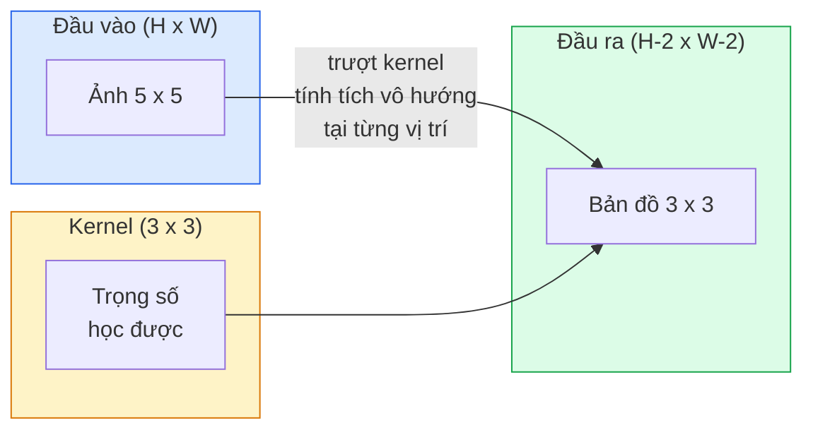
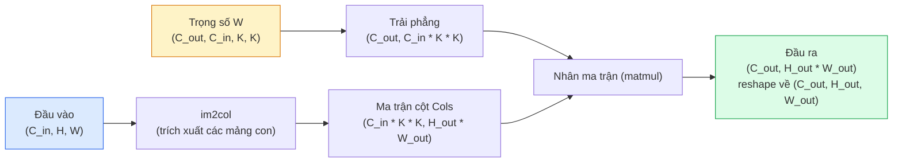

# Tự Cài đặt Phép Tích chập từ Đầu (Convolutions from Scratch)

> Phép tích chập bản chất là một lớp kết nối dày đặc (dense layer) tí hon mà bạn trượt dọc trên khắp bức ảnh, dùng chung một bộ trọng số tại mọi vị trí không gian.

**Type:** Build
**Languages:** Python
**Prerequisites:** Phase 3 (Deep Learning Core), Phase 4 Bài học 01 (Image Fundamentals)
**Time:** ~75 phút

## Learning Objectives

- Tự tay cài đặt phép tích chập 2D từ đầu chỉ sử dụng NumPy, bao gồm cả phiên bản vòng lặp lồng nhau (nested loops) và phiên bản vector hóa thông qua thuật toán `im2col`
- Tính toán kích thước không gian đầu ra cho bất kỳ sự kết hợp nào giữa kích thước ảnh đầu vào, kích thước kernel, độ đệm viền (padding), và bước trượt (stride), đồng thời chứng minh công thức `(H - K + 2P) / S + 1`
- Tự tay thiết kế các kernel thủ công (phát hiện cạnh, làm mờ, làm nét, Sobel) và giải thích tại sao mỗi kernel lại tạo ra mẫu kích hoạt tương ứng
- Xếp chồng các lớp tích chập thành một bộ trích xuất đặc trưng (feature extractor) và liên kết độ sâu của mạng với độ lớn của vùng tiếp nhận (receptive field)

## Vấn đề thực tế (The Problem)

Một lớp kết nối đầy đủ (fully connected layer) nhận đầu vào là ảnh RGB kích thước 224x224 sẽ cần $224 \times 224 \times 3 = 150{,}528$ trọng số kết nối cho mỗi neuron duy nhất. Chỉ một lớp ẩn đơn lẻ với 1.000 neuron đã ngốn tới 150 triệu tham số -- trước cả khi mạng kịp học được bất kỳ đặc trưng hữu ích nào. Tệ hơn nữa, lớp dense hoàn toàn mù tịt về mặt cấu trúc không gian: nó không hề biết rằng một chú chó ở góc trên bên trái và một chú chó ở góc dưới bên phải đại diện cho cùng một đối tượng trực quan. Nó đối xử với mỗi vị trí pixel hoàn toàn độc lập, điều này đi ngược lại bản chất của hình ảnh: việc dịch chuyển một chú mèo đi 3 pixel không thể và không nên bắt mạng nơ-ron phải học lại khái niệm "con mèo" từ đầu.

Hai đặc tính sống còn mà một mô hình thị giác bắt buộc phải có là **tính đồng biến với phép tịnh tiến (translation equivariance)** (khi đầu vào dịch chuyển thì đầu ra cũng dịch chuyển tương ứng) và **chia sẻ tham số (parameter sharing)** (cùng một bộ phát hiện đặc trưng chạy trên khắp mọi tọa độ). Lớp dense không mang lại đặc tính nào trong số này. Phép tích chập (convolution) mang lại cả hai hoàn toàn miễn phí.

Phép tích chập không hề được phát minh riêng cho deep learning. Nó chính là phép toán nền tảng vận hành chuẩn nén JPEG, hiệu ứng làm mờ Gaussian blur trong Photoshop, thuật toán dò biên cạnh trong thị giác công nghiệp, và mọi bộ lọc âm thanh từng được tạo ra. Lý do các mạng CNN thống trị tuyệt đối ImageNet từ năm 2012 đến 2020 là vì tích chập chính là tiên nghiệm quy nạp (inductive prior) chuẩn xác nhất cho dạng dữ liệu mà các giá trị lân cận có mối liên hệ mật thiết và cùng một mẫu hình có thể xuất hiện tại bất kỳ vị trí nào.

## Khái niệm (The Concept)

### Một kernel trượt qua từng vị trí

Phép tích chập 2D lấy một ma trận trọng số nhỏ gọi là kernel (hoặc filter / bộ lọc), trượt nó qua ma trận đầu vào, và tại mỗi vị trí sẽ tính tổng các tích của từng cặp phần tử tương ứng (tích vô hướng cục bộ). Giá trị tổng đó trở thành một pixel của bản đồ đặc trưng đầu ra.



Một ví dụ cụ thể với kernel 3x3 trên đầu vào 5x5 (không đệm viền padding=0, bước trượt stride=1):

```text
Đầu vào X (5 x 5):              Kernel W (3 x 3):

  1  2  0  1  2                   1  0 -1
  0  1  3  1  0                   2  0 -2
  2  1  0  2  1                   1  0 -1
  1  0  2  1  3
  2  1  1  0  1

Kernel trượt qua từng cửa sổ 3 x 3 hợp lệ. Đầu ra Y có kích thước 3 x 3:

 Y[0,0] = sum( W * X[0:3, 0:3] )
 Y[0,1] = sum( W * X[0:3, 1:4] )
 Y[0,2] = sum( W * X[0:3, 2:5] )
 Y[1,0] = sum( W * X[1:4, 0:3] )
 ... và cứ thế tiếp tục
```

Công thức cốt lõi duy nhất: **chia sẻ trọng số, tính cục bộ, cửa sổ trượt**. Mọi chi tiết kỹ thuật khác chỉ là bước quản lý sổ sách toán học.

### Công thức kích thước đầu ra

Với kích thước không gian đầu vào $H$, kích thước kernel $K$, độ đệm viền $P$, và bước trượt $S$:

```math
H_{\text{out}} = \left\lfloor \frac{H - K + 2P}{S} \right\rfloor + 1
```

Hãy ghi nhớ nằm lòng công thức này. Bạn sẽ phải tính toán nó hàng chục lần cho mỗi kiến trúc mạng thiết kế.

| Kịch bản | H | K | P | S | H_out |
|----------|---|---|---|---|-------|
| Tích chập Valid (không đệm viền) | 32 | 3 | 0 | 1 | 30 |
| Tích chập Same (giữ nguyên kích thước) | 32 | 3 | 1 | 1 | 32 |
| Giảm kích thước mẫu (Downsample) 2 lần | 32 | 3 | 1 | 2 | 16 |
| Lớp gộp Max-Pool 2x2 | 32 | 2 | 0 | 2 | 16 |
| Vùng tiếp nhận lớn (Large receptive field) | 32 | 7 | 3 | 2 | 16 |

"Same padding" nghĩa là chọn $P$ sao cho $H_{\text{out}} = H$ khi $S = 1$. Với $K$ là số lẻ, ta có $P = (K - 1) / 2$. Đó là lý do tại sao các kernel 3x3 chiếm ưu thế áp đảo -- chúng là kernel số lẻ nhỏ nhất vẫn có một điểm tâm duy nhất.

### Đệm viền (Padding)

Nếu không có padding, mỗi lớp tích chập sẽ làm teo nhỏ kích thước của bản đồ đặc trưng. Xếp chồng 20 lớp liên tiếp, hình ảnh 224x224 sẽ bị teo lại chỉ còn 184x184, gây lãng phí tính toán ở các pixel sát mép biên và gây cản trở cho các kết nối tắt (residual connections) vốn đòi hỏi kích thước hai nhánh phải hoàn toàn khớp nhau.

```text
Đệm viền bằng 0 (Zero padding với P = 1) trên đầu vào 5 x 5:

  0  0  0  0  0  0  0
  0  1  2  0  1  2  0
  0  0  1  3  1  0  0
  0  2  1  0  2  1  0       Bây giờ kernel có thể đặt tâm ngay tại
  0  1  0  2  1  3  0       pixel (0, 0) mà vẫn có đủ 3 hàng và
  0  2  1  1  0  1  0       3 cột giá trị để thực hiện phép nhân.
  0  0  0  0  0  0  0
```

Các chế độ padding thường gặp trong thực tế: `zero` (phổ biến nhất), `reflect` (phản xạ đối xứng qua cạnh biên, tránh biên cứng trong các mô hình sinh ảnh), `replicate` (sao chép giá trị mép ngoài cùng), `circular` (cuộn tròn hình xuyến).

### Bước trượt (Stride)

Stride là độ dài bước nhảy của kernel khi trượt. `stride=1` là giá trị mặc định. `stride=2` sẽ giảm một nửa các chiều không gian (H và W) và là kỹ thuật kinh điển để giảm mẫu (downsample) bên trong CNN mà không cần dùng đến một lớp pooling riêng biệt -- mọi kiến trúc hiện đại (ResNet, ConvNeXt, MobileNet) đều sử dụng strided convolution thay thế cho max-pooling ở các tầng chuyển tiếp.

```text
Bước trượt Stride 1 trên đầu vào 5 x 5, kernel 3 x 3:

  tọa độ bắt đầu: (0,0) (0,1) (0,2)        -> hàng đầu ra 0
                  (1,0) (1,1) (1,2)        -> hàng đầu ra 1
                  (2,0) (2,1) (2,2)        -> hàng đầu ra 2

  Kích thước đầu ra: 3 x 3

Bước trượt Stride 2 trên cùng đầu vào:

  tọa độ bắt đầu: (0,0) (0,2)              -> hàng đầu ra 0
                  (2,0) (2,2)              -> hàng đầu ra 1

  Kích thước đầu ra: 2 x 2
```

### Nhiều kênh đầu vào (Multiple input channels)

Hình ảnh thực tế luôn có nhiều kênh màu (ví dụ 3 kênh RGB). Một phép tích chập 3x3 trên đầu vào RGB thực chất là một khối thể tích 3D kích thước $3 \times 3 \times 3$: mỗi kênh đầu vào có một lát cắt 3x3 riêng. Tại mỗi vị trí không gian, bạn nhân và cộng gộp trên cả 3 lát cắt đó, sau đó cộng thêm một số hạng độ chệch (bias).

```text
Đầu vào:  (C_in,  H,  W)        ví dụ 3 x 5 x 5
Kernel:   (C_in,  K,  K)        ví dụ 3 x 3 x 3 (một kernel đơn lẻ)
Đầu ra:   (1,     H', W')       bản đồ đặc trưng 2D

Để một lớp tạo ra C_out kênh đầu ra, bạn xếp chồng C_out kernel:

Trọng số: (C_out, C_in, K, K)   ví dụ 64 x 3 x 3 x 3
Đầu ra:   (C_out, H', W')       ví dụ 64 x 3 x 3

Số lượng tham số: C_out * C_in * K * K + C_out   (trong đó + C_out là biases)
```

Dòng cuối cùng là công thức bạn sẽ dùng khi lên kế hoạch thiết kế mô hình. Một lớp conv 3x3 với 64 kênh đầu ra trên đầu vào 3 kênh sẽ có: $64 \times 3 \times 3 \times 3 + 64 = 1{,}792$ tham số. Vô cùng gọn nhẹ.

### Thủ thuật im2col (The im2col trick)

Các vòng lặp lồng nhau rất dễ đọc hiểu nhưng chạy cực kỳ chậm trên CPU và GPU. GPU chỉ thực sự phát huy tối đa sức mạnh với các phép nhân ma trận lớn (GEMM). Bí quyết ở đây: trải phẳng (flatten) từng cửa sổ vùng tiếp nhận của ảnh đầu vào thành một cột của một ma trận lớn, trải phẳng kernel thành một hàng, và toàn bộ phép tích chập trở thành một phép nhân ma trận đơn lẻ!



Mọi triển khai tích chập trong môi trường sản xuất đều là một biến thể của kỹ thuật này kết hợp với các kỹ thuật quản lý bộ nhớ đệm cache (direct conv, Winograd, hoặc FFT conv cho kernel lớn). Nắm vững im2col là bạn đã nắm trọn bản chất của phép tính tăng tốc.

### Vùng tiếp nhận (Receptive field)

Một lớp conv 3x3 đơn lẻ quan sát 9 pixel đầu vào ($3 \times 3$). Khi xếp chồng hai lớp conv 3x3 liên tiếp, một neuron ở lớp thứ hai sẽ quan sát một vùng $5 \times 5$ pixel của ảnh đầu vào ban đầu. Ba lớp 3x3 sẽ mở rộng vùng nhìn thành $7 \times 7$. Tổng quát:

```text
Vùng tiếp nhận RF sau L lớp tích chập K x K xếp chồng (stride 1) = 1 + L * (K - 1)

Khi có bước trượt (strides): RF tăng trưởng theo cấp số nhân với bước trượt dọc theo các lớp.
```

Toàn bộ lý do mà kiến trúc "toàn bộ là 3x3" thành công rực rỡ (VGG, ResNet, ConvNeXt) là vì: hai lớp 3x3 quan sát cùng một diện tích không gian như một lớp 5x5, nhưng sử dụng ít tham số hơn nhiều ($2 \times 3^2 = 18$ so với $5^2 = 25$) và có thêm một hàm kích hoạt phi tuyến tính xen giữa giúp mô hình biểu diễn tốt hơn.

```figure
convolution-kernel
```

## Tự tay xây dựng (Build It)

### Bước 1: Đệm viền ma trận (Pad2d)

Bắt đầu bằng khối nguyên thủy nhỏ nhất: hàm chèn thêm các số 0 xung quanh mảng 2 chiều H x W.

```python
import numpy as np

def pad2d(x, p):
    if p == 0:
        return x
    h, w = x.shape[-2:]
    out = np.zeros(x.shape[:-2] + (h + 2 * p, w + 2 * p), dtype=x.dtype)
    out[..., p:p + h, p:p + w] = x
    return out

x = np.arange(9).reshape(3, 3)
print(x)
print()
print(pad2d(x, 1))
```

Kỹ thuật cắt lát `x.shape[:-2]` giúp hàm hoạt động trơn tru cho cả tensor `(H, W)`, `(C, H, W)`, lẫn `(N, C, H, W)` mà không cần sửa đổi mã nguồn.

### Bước 2: Tích chập 2D bằng vòng lặp lồng nhau (Naive Conv2D)

Triển khai tham chiếu -- chậm, nhưng hoàn toàn minh bạch và chuẩn mực logic. Đây chính là những gì `torch.nn.functional.conv2d` thực hiện về mặt lý thuyết:

```python
def conv2d_naive(x, w, b=None, stride=1, padding=0):
    c_in, h, w_in = x.shape
    c_out, c_in_w, kh, kw = w.shape
    assert c_in == c_in_w

    x_pad = pad2d(x, padding)
    h_out = (h + 2 * padding - kh) // stride + 1
    w_out = (w_in + 2 * padding - kw) // stride + 1

    out = np.zeros((c_out, h_out, w_out), dtype=np.float32)
    for oc in range(c_out):
        for i in range(h_out):
            for j in range(w_out):
                hs = i * stride
                ws = j * stride
                patch = x_pad[:, hs:hs + kh, ws:ws + kw]
                out[oc, i, j] = np.sum(patch * w[oc])
        if b is not None:
            out[oc] += b[oc]
    return out
```

Bốn vòng lặp lồng nhau (kênh đầu ra, hàng, cột, cộng thêm tổng ngầm định qua C_in, kh, kw). Đây là chuẩn đối chiếu tin cậy mà bạn sẽ dùng để kiểm tra tính đúng đắn của các phiên bản tối ưu tốc độ.

### Bước 3: Kiểm chứng với kernel tự thiết kế

Tạo một kernel Sobel lọc cạnh thẳng đứng, áp dụng lên ảnh bậc thang nhân tạo, và quan sát đường viền đứng sáng rực lên:

```python
def synthetic_step_image():
    img = np.zeros((1, 16, 16), dtype=np.float32)
    img[:, :, 8:] = 1.0
    return img

sobel_x = np.array([
    [[-1, 0, 1],
     [-2, 0, 2],
     [-1, 0, 1]]
], dtype=np.float32)[None]

x = synthetic_step_image()
y = conv2d_naive(x, sobel_x, padding=1)
print(y[0].round(1))
```

Kỳ vọng: các giá trị dương lớn xuất hiện ở cột thứ 7 (nơi độ sáng tăng vọt từ trái qua phải) và bằng 0 ở mọi vị trí đồng nhất khác.

### Bước 4: Cài đặt hàm im2col

Biến đổi mỗi cửa sổ kích thước kernel trên ảnh đầu vào thành một cột của ma trận. Với `C_in=3, K=3`, mỗi cột sẽ gồm 27 phần tử số thực.

```python
def im2col(x, kh, kw, stride=1, padding=0):
    c_in, h, w = x.shape
    x_pad = pad2d(x, padding)
    h_out = (h + 2 * padding - kh) // stride + 1
    w_out = (w + 2 * padding - kw) // stride + 1

    cols = np.zeros((c_in * kh * kw, h_out * w_out), dtype=x.dtype)
    col = 0
    for i in range(h_out):
        for j in range(w_out):
            hs = i * stride
            ws = j * stride
            patch = x_pad[:, hs:hs + kh, ws:ws + kw]
            cols[:, col] = patch.reshape(-1)
            col += 1
    return cols, h_out, w_out
```

Dù vẫn dùng vòng lặp Python để trích xuất mảng, nhưng toàn bộ gánh nặng tính toán sau đó sẽ được chuyển thành một phép nhân ma trận đơn lẻ.

### Bước 5: Tích chập tốc độ cao qua im2col + matmul

Thay thế 4 vòng lặp bằng một phép nhân ma trận `@`:

```python
def conv2d_im2col(x, w, b=None, stride=1, padding=0):
    c_out, c_in, kh, kw = w.shape
    cols, h_out, w_out = im2col(x, kh, kw, stride, padding)
    w_flat = w.reshape(c_out, -1)
    out = w_flat @ cols
    if b is not None:
        out += b[:, None]
    return out.reshape(c_out, h_out, w_out)
```

Kiểm tra tính chuẩn xác: chạy cả hai hàm trên cùng dữ liệu ngẫu nhiên và so sánh kết quả:

```python
rng = np.random.default_rng(0)
x = rng.normal(0, 1, (3, 16, 16)).astype(np.float32)
w = rng.normal(0, 1, (8, 3, 3, 3)).astype(np.float32)
b = rng.normal(0, 1, (8,)).astype(np.float32)

y_naive = conv2d_naive(x, w, b, padding=1)
y_im2col = conv2d_im2col(x, w, b, padding=1)

print(f"max abs diff: {np.max(np.abs(y_naive - y_im2col)):.2e}")
```

`max abs diff` sẽ rơi vào khoảng `1e-5` -- sai lệch cực nhỏ này là do thứ tự cộng dồn dấu phẩy động chứ hoàn toàn không phải lỗi thuật toán.

### Bước 6: Bộ sưu tập các kernel cổ điển

Năm bộ lọc minh họa những gì mà một lớp conv đơn lẻ có thể biểu diễn ngay cả trước khi được huấn luyện:

```python
KERNELS = {
    "identity": np.array([[0, 0, 0], [0, 1, 0], [0, 0, 0]], dtype=np.float32),
    "blur_3x3": np.ones((3, 3), dtype=np.float32) / 9.0,
    "sharpen": np.array([[0, -1, 0], [-1, 5, -1], [0, -1, 0]], dtype=np.float32),
    "sobel_x": np.array([[-1, 0, 1], [-2, 0, 2], [-1, 0, 1]], dtype=np.float32),
    "sobel_y": np.array([[-1, -2, -1], [0, 0, 0], [1, 2, 1]], dtype=np.float32),
}

def apply_kernel(img2d, kernel):
    x = img2d[None].astype(np.float32)
    w = kernel[None, None]
    return conv2d_im2col(x, w, padding=1)[0]
```

Áp dụng lên bất kỳ ảnh xám nào: blur làm mịn ảnh, sharpen làm sắc nét góc cạnh, Sobel-x làm nổi bật biên dọc, Sobel-y làm nổi bật biên ngang. Đây chính xác là những mẫu hình mà lớp conv *đầu tiên* trong AlexNet và VGG tự động học được sau quá trình huấn luyện -- bởi vì một mô hình thị giác tốt luôn cần phát hiện các cạnh biên và đốm màu cơ bản trước khi nhận diện các đối tượng phức tạp hơn.

## Sử dụng trong thực tế (Use It)

Lớp `nn.Conv2d` của PyTorch bao bọc toàn bộ thao tác này với khả năng tự động vi phân autograd, CUDA kernel và tối ưu hóa cuDNN:

```python
import torch
import torch.nn as nn

conv = nn.Conv2d(in_channels=3, out_channels=64, kernel_size=3, stride=1, padding=1)
print(conv)
print(f"weight shape: {tuple(conv.weight.shape)}   # (C_out, C_in, K, K)")
print(f"bias shape:   {tuple(conv.bias.shape)}")
print(f"param count:  {sum(p.numel() for p in conv.parameters())}")

x = torch.randn(8, 3, 224, 224)
y = conv(x)
print(f"\ninput  shape: {tuple(x.shape)}")
print(f"output shape: {tuple(y.shape)}")
```

Thay đổi `padding=1` thành `padding=0`, kích thước đầu ra giảm xuống 222x222. Đổi `stride=1` thành `stride=2`, kích thước giảm một nửa còn 112x112. Hoàn toàn khớp với công thức bạn đã học.

## Sản phẩm bàn giao (Ship It)

Bài học này tạo ra:

- `outputs/prompt-cnn-architect.md` — prompt hỗ trợ thiết kế chuỗi các lớp `Conv2d` với tỷ lệ K/S/P chuẩn xác dựa trên kích thước đầu vào, ngân sách tham số và vùng tiếp nhận mong muốn.
- `outputs/skill-conv-shape-calculator.md` — kỹ năng tính toán kích thước đầu ra, vùng tiếp nhận (receptive field) và số lượng tham số cho từng khối trong mạng.

## Bài tập rèn luyện (Exercises)

1. **(Dễ)** Cho đầu vào ảnh xám 128x128 và chuỗi các lớp `[Conv3x3(s=1,p=1), Conv3x3(s=2,p=1), Conv3x3(s=1,p=1), Conv3x3(s=2,p=1)]`. Hãy tính bằng tay kích thước không gian đầu ra và vùng tiếp nhận (RF) tại mỗi lớp. Kiểm chứng lại bằng `nn.Sequential` trong PyTorch với dữ liệu giả lập.
2. **(Trung bình)** Mở rộng `conv2d_naive` và `conv2d_im2col` để nhận thêm tham số `groups`. Chứng minh rằng khi đặt `groups = C_in = C_out`, phép tính trở thành tích chập từng kênh riêng biệt (depthwise convolution) và số tham số chỉ là $C \times K \times K$ thay vì $C \times C \times K \times K$.
3. **(Khó)** Tự tay cài đặt lượt lan truyền ngược (backward pass) cho `conv2d_im2col`: nhận gradient của đầu ra, tính toán gradient của $x$ và trọng số $w$. Kiểm chứng lại với `torch.autograd.grad` trên cùng bộ dữ liệu. Gợi ý: gradient của phép `im2col` chính là hàm `col2im`, và nó phải tích lũy các giá trị tại những vùng cửa sổ trượt gối đè lên nhau.

## Thuật ngữ then chốt (Key Terms)

| Thuật ngữ | Người ta thường nói | Bản chất thực sự |
|-----------|--------------------|-------------------|
| Convolution (Tích chập) | "Trượt một bộ lọc" | Tích vô hướng khả vi áp dụng tại mọi vị trí không gian với trọng số dùng chung; về mặt toán học là tương quan chéo (cross-correlation) nhưng cộng đồng quen gọi là convolution |
| Kernel / filter (Bộ lọc) | "Bộ phát hiện đặc trưng" | Tensor trọng số nhỏ kích thước (C_in, K, K) mà tích vô hướng của nó với một vùng ảnh tạo ra một điểm ảnh đặc trưng ở đầu ra |
| Stride (Bước trượt) | "Bước nhảy xa bao nhiêu" | Khoảng cách dịch chuyển giữa hai lần đặt kernel liên tiếp; stride 2 giảm một nửa kích thước không gian |
| Padding (Đệm viền) | "Thêm số 0 vào mép" | Các giá trị bổ sung quanh mép ảnh để kernel có thể đặt tâm lên các pixel biên; `same` padding giữ nguyên kích thước không gian |
| Receptive field (Vùng tiếp nhận) | "Neuron nhìn thấy bao nhiêu" | Vùng trên ảnh gốc mà một giá trị kích hoạt đầu ra phụ thuộc vào; mở rộng dần theo độ sâu và bước trượt |
| im2col | "Thủ thuật GEMM" | Sắp xếp lại các cửa sổ trượt thành các cột ma trận để biến phép tích chập thành phép nhân ma trận hiệu năng cao |
| Depthwise conv (Tích chập theo chiều sâu) | "Mỗi kênh một kernel" | Phép tích chập có `groups == C_in`, tính toán từng kênh đầu ra chỉ từ đúng kênh đầu vào tương ứng; xương sống của MobileNet và ConvNeXt |
| Translation equivariance | "Dịch đầu vào thì dịch đầu ra" | Đặc tính: dịch chuyển ảnh đầu vào đi $k$ pixel sẽ làm bản đồ đặc trưng đầu ra dịch chuyển đi $k$ pixel; có được tự nhiên nhờ chia sẻ trọng số |

## Tài liệu đọc thêm (Further Reading)

- [A guide to convolution arithmetic for deep learning (Dumoulin & Visin, 2016)](https://arxiv.org/abs/1603.07285) — tài liệu trực quan chuẩn mực về padding, stride và dilation
- [CS231n: Convolutional Neural Networks for Visual Recognition](https://cs231n.github.io/convolutional-networks/) — bài giảng kinh điển của Stanford, bao gồm phần giải thích gốc về im2col
- [The Annotated ConvNet (fast.ai)](https://nbviewer.org/github/fastai/fastbook/blob/master/13_convolutions.ipynb) — notebook hướng dẫn từ tích chập thủ công tới mô hình phân loại chữ số viết tay
- [Receptive Field Arithmetic for CNNs (Dang Ha The Hien)](https://distill.pub/2019/computing-receptive-fields/) — bài viết tương tác trực quan xuất sắc trên Distill về cách tính toán vùng tiếp nhận

