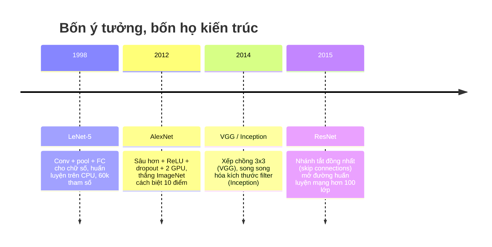
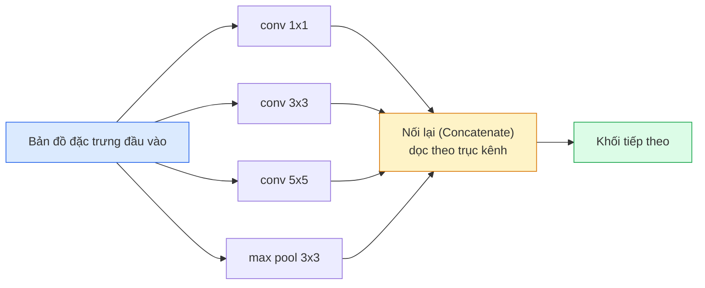
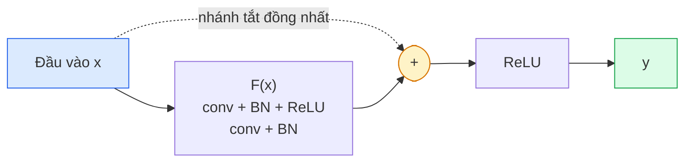

# Mạng CNN — Từ LeNet tới ResNet (CNNs — LeNet to ResNet)

> Mọi mạng CNN lớn trong ba mươi năm qua đều tuân theo cùng một công thức: tích chập - phi tuyến tính - giảm mẫu, cộng thêm duy nhất một ý tưởng đột phá được lắp ghép vào. Hãy học các ý tưởng đó theo đúng trình tự thời gian.

**Type:** Learn + Build
**Languages:** Python
**Prerequisites:** Phase 3 Bài học 11 (PyTorch), Phase 4 Bài học 01 (Image Fundamentals), Phase 4 Bài học 02 (Convolutions from Scratch)
**Time:** ~75 phút

## Learning Objectives

- Truy vết dòng dõi tiến hóa kiến trúc: LeNet-5 -> AlexNet -> VGG -> Inception -> ResNet và nêu rõ ý tưởng cốt lõi mới duy nhất mà mỗi họ mạng đóng góp
- Cài đặt LeNet-5, khối kiểu VGG, và khối ResNet BasicBlock bằng PyTorch, mỗi khối dưới 40 dòng mã
- Giải thích tại sao kết nối phần dư (residual connections) biến một mạng 1.000 lớp từ trạng thái hoàn toàn không thể huấn luyện nổi trở thành đỉnh cao công nghệ (state-of-the-art)
- Đọc hiểu một kiến trúc khung xương (backbone) hiện đại (ResNet-18, ResNet-50) và dự đoán chính xác kích thước đầu ra, vùng tiếp nhận (receptive field), và số lượng tham số trước khi xem mã nguồn

## Vấn đề thực tế (The Problem)

Năm 2011, bộ phân loại ImageNet tốt nhất đạt độ chính xác top-5 khoảng 74%. Năm 2012, AlexNet nhảy vọt lên 85%. Đến năm 2015, ResNet đạt 96%. Không hề có tập dữ liệu mới nào. Không hề có thế hệ GPU thần kỳ nào mới ra đời. Mức tăng trưởng đột phá đó đến hoàn toàn từ **các ý tưởng kiến trúc**. Một kỹ sư thị giác máy tính thực chiến bắt buộc phải biết rõ ý tưởng nào đến từ bài báo nghiên cứu nào, bởi vì mọi backbone trong môi trường sản xuất năm 2026 đều là sự tái kết hợp của chính những khối xây dựng đó -- và bởi vì các ý tưởng này liên tục được chuyển giao: tích chập theo nhóm (grouped convs) chuyển từ CNN sang transformer, kết nối phần dư chuyển từ ResNet sang mọi mô hình ngôn ngữ lớn (LLM) hiện hữu, và chuẩn hóa theo batch (batch norm) hiện diện trong các mô hình khuếch tán (diffusion models).

Nghiên cứu các mạng nơ-ron này theo thứ tự thời gian cũng giúp bạn miễn nhiễm trước một sai lầm sơ đẳng: vội vã với tới mô hình khổng lồ nhất có thể trong khi một mạng cỡ LeNet đã đủ giải quyết bài toán gọn gàng. Tập MNIST không bao giờ cần đến một mạng ResNet. Hiểu rõ đường cong mở rộng (scaling curve) của từng họ mô hình giúp bạn biết chính xác mình nên dừng lại ở đâu.

## Khái niệm (The Concept)

### Bốn ý tưởng làm thay đổi hoàn toàn thị giác máy tính



Không có bất kỳ bước phát triển nào khác trong thị giác cổ điển mang lại sức ảnh hưởng to lớn như bốn bước nhảy vọt này.

### LeNet-5 (1998)

Mô hình nhận diện chữ số viết tay của Yann LeCun. 60.000 tham số. Gồm hai khối tích chập - gộp mẫu (conv-pool), hai lớp kết nối đầy đủ (fully connected), hàm kích hoạt tanh. Nó đã định hình nên khuôn mẫu kinh điển mà mọi mạng CNN kế thừa cho đến tận ngày nay:

```text
input (1, 32, 32)
  conv 5x5 -> (6, 28, 28)
  avg pool 2x2 -> (6, 14, 14)
  conv 5x5 -> (16, 10, 10)
  avg pool 2x2 -> (16, 5, 5)
  flatten -> 400
  dense -> 120
  dense -> 84
  dense -> 10
```

Mọi thứ mà thế giới hiện đại gọi là CNN -- sự xen kẽ giữa các lớp tích chập và lớp giảm mẫu cấp dữ liệu cho một đầu phân loại (classifier head) nhỏ phía sau -- đều chính là LeNet với nhiều lớp hơn, số kênh rộng hơn, và các hàm kích hoạt tốt hơn.

### AlexNet (2012)

Ba thay đổi mang tính bản lề đã phá vỡ mọi kỷ lục của ImageNet:

1. **Hàm kích hoạt ReLU** thay cho tanh: Gradient không còn bị triệt tiêu ở các vùng bão hòa. Quá trình huấn luyện tăng tốc gấp 6 lần.
2. **Kỹ thuật Dropout** ở các lớp dense phía sau: Điều chuẩn (regularization) chính thức trở thành một tầng kiến trúc riêng biệt chứ không còn là mẹo toán học chắp vá.
3. **Độ sâu và độ rộng**: Năm lớp conv, ba lớp dense, 60 triệu tham số, huấn luyện phân tán trên 2 GPU bằng cách chia đôi mô hình.

Hình 2 trong bài báo gốc của AlexNet vẫn vẽ mô hình bị chẻ đôi thành hai luồng song song trên 2 GPU. Việc chạy song song đó chỉ là giải pháp tình thế cho phần cứng thời điểm đó chứ không phải đột phá kiến trúc -- nhưng ba ý tưởng kể trên vẫn hiện diện trong từng mô hình bạn dùng ngày nay.

### VGG (2014)

VGG đặt ra câu hỏi: điều gì sẽ xảy ra nếu ta **chỉ sử dụng duy nhất các kernel 3x3** và đẩy mạng thật sâu?

```text
khối xếp chồng: conv 3x3 -> conv 3x3 -> pool 2x2
lặp lại:        16 hoặc 19 lớp tích chập
```

Hai lớp conv 3x3 quan sát cùng một vùng tiếp nhận 5x5 của đầu vào như một lớp conv 5x5, nhưng lại tốn ít tham số hơn nhiều ($2 \cdot 9 \cdot C^2 = 18C^2$ so với $25 \cdot C^2$) và có thêm một hàm kích hoạt ReLU ở giữa. VGG biến quan sát thực nghiệm này thành toàn bộ một triết lý thiết kế. Sự đơn giản tột cùng -- chỉ dùng duy nhất một kiểu khối lặp đi lặp lại -- đã biến nó thành thước đo tham chiếu chuẩn cho mọi kiến trúc sau này.

Nhược điểm: 138 triệu tham số, huấn luyện chậm và tiêu tốn bộ nhớ khi suy luận.

### Inception (2014, cùng năm)

Câu trả lời của Google cho câu hỏi "tôi nên dùng kernel kích thước nào?" là: **dùng tất cả các kích thước, chạy song song cùng lúc**.



Mỗi nhánh chuyên môn hóa vào một nhiệm vụ riêng -- conv 1x1 để phối trộn các kênh, 3x3 cho kết cấu cục bộ, 5x5 cho các mẫu hình lớn hơn, và pooling cho các đặc trưng bất biến với phép dịch chuyển -- sau đó phép nối concat cho phép lớp tiếp theo tùy ý chọn nhánh nào hữu ích nhất. Inception v1 sử dụng conv 1x1 bên trong mỗi nhánh như một nút cổ chai (bottleneck) để kiềm chế số lượng tham số không bị bùng nổ.

### Vấn đề suy thoái hiệu năng (The degradation problem)

Đến năm 2015, VGG-19 hoạt động tốt nhưng VGG-32 thì thất bại thảm hại. Theo lý thuyết, tăng độ sâu sẽ giúp mô hình biểu diễn tốt hơn, nhưng khi vượt quá ~20 lớp tích chập thông thường, cả hàm mất mát huấn luyện lẫn kiểm thử đều trở nên tệ hơn. Đây hoàn toàn **không phải là overfitting** (khớp quá mức). Đây là hiện tượng bộ tối ưu hóa optimizer bất lực trong việc tìm ra bộ trọng số hữu ích vì gradient bị triệt tiêu theo cấp số nhân qua từng lớp.

```text
Mạng sâu truyền thống:
  y = f_L( f_{L-1}( ... f_1(x) ... ) )

Gradient theo tầng đầu tiên:
  dL/dW_1 = dL/dy * df_L/df_{L-1} * ... * df_2/df_1 * df_1/dW_1

Mỗi số hạng nhân vào có độ lớn xấp xỉ (độ lớn trọng số) * (hệ số khuếch đại kích hoạt).
Nhân liên tiếp 100 số hạng có hệ số < 1, gradient sẽ tiêu biến hoàn toàn về 0.
```

VGG hoạt động được ở 19 lớp nhờ có batch normalization (được công bố đồng thời) giữ cho các kích hoạt được co giãn hợp lý. Nhưng ngay cả batch norm cũng không thể cứu vãn độ sâu vượt quá 30 lớp.

### ResNet (2015)

Kaiming He, Xiangyu Zhang, Shaoqing Ren, và Jian Sun đã đề xuất duy nhất một thay đổi nhỏ làm thay đổi toàn bộ cuộc chơi:

```math
\begin{aligned}
\text{khối tiêu chuẩn:} \quad & y = F(x) \\
\text{khối phần dư (residual):} \quad & y = F(x) + x
\end{aligned}
```

Phép cộng `+ x` mang ý nghĩa: một lớp luôn có thể chọn phương án "không làm gì cả" (hàm đồng nhất identity) bằng cách đẩy toàn bộ các trọng số trong nhánh biến đổi $F(x)$ về 0. Một mạng ResNet 1.000 lớp giờ đây ở trường hợp xấu nhất cũng chỉ hoạt động ngang bằng một mạng 1 lớp, bởi vì mỗi khối bổ sung đều có một lối thoát hiểm hiển nhiên (trivial escape hatch). Với sự bảo đảm số học vững chắc đó, bộ tối ưu hóa hoàn toàn tự tin biến mỗi khối trở nên *hữu ích một chút* -- và hàng trăm đóng góp nhỏ hữu ích xếp chồng lên nhau đã tạo nên đỉnh cao công nghệ thế giới.



Hai biến thể khối xuất hiện khắp mọi nơi:

- **BasicBlock** (ResNet-18, ResNet-34): gồm hai lớp conv 3x3, nhánh tắt bọc vòng qua cả hai.
- **Bottleneck** (ResNet-50, -101, -152): gồm conv 1x1 giảm chiều, 3x3 ở giữa, 1x1 tăng chiều trở lại, nhánh tắt bọc qua bộ ba. Cực kỳ tiết kiệm chi phí tính toán khi số kênh lên tới hàng trăm hoặc hàng nghìn.

Khi nhánh tắt phải đi qua một bước giảm mẫu (stride=2), đường dẫn đồng nhất được thay thế bằng một lớp conv 1x1 với stride=2 để khớp kích thước không gian và số lượng kênh.

### Tầm ảnh hưởng vượt ra ngoài thị giác máy tính

Ý tưởng về kết nối phần dư không chỉ dành cho bài toán phân loại hình ảnh. Bản chất thực sự của nó là biến mạng nơ-ron sâu từ trò chơi may rủi "chắp tay cầu nguyện gradient sống sót" trở thành một công cụ kỹ thuật phần mềm có khả năng mở rộng (scale) vô hạn và cực kỳ tin cậy. Mọi mô hình Transformer bạn sẽ học ở các phase sau đều chứa chính xác kết nối tắt này trong từng khối Attention và MLP. Không có ResNet, thế giới sẽ không có GPT.

```figure
pooling
```

## Tự tay xây dựng (Build It)

### Bước 1: LeNet-5

Một bản cài đặt LeNet trung thành và tối giản: hàm kích hoạt tanh, phép gộp trung bình average pooling. Điểm cải tiến duy nhất so với nguyên bản năm 1998 là sử dụng `nn.CrossEntropyLoss` thay cho các kết nối Gaussian lỗi thời.

```python
import torch
import torch.nn as nn
import torch.nn.functional as F

class LeNet5(nn.Module):
    def __init__(self, num_classes=10):
        super().__init__()
        self.conv1 = nn.Conv2d(1, 6, kernel_size=5)
        self.conv2 = nn.Conv2d(6, 16, kernel_size=5)
        self.pool = nn.AvgPool2d(2)
        self.fc1 = nn.Linear(16 * 5 * 5, 120)
        self.fc2 = nn.Linear(120, 84)
        self.fc3 = nn.Linear(84, num_classes)

    def forward(self, x):
        x = self.pool(torch.tanh(self.conv1(x)))
        x = self.pool(torch.tanh(self.conv2(x)))
        x = torch.flatten(x, 1)
        x = torch.tanh(self.fc1(x))
        x = torch.tanh(self.fc2(x))
        return self.fc3(x)

net = LeNet5()
x = torch.randn(1, 1, 32, 32)
print(f"output: {net(x).shape}")
print(f"params: {sum(p.numel() for p in net.parameters()):,}")
```

Kết quả mong đợi: `output: torch.Size([1, 10])`, `params: 61,706`. Đó là toàn bộ cỗ máy nhận diện chữ số đã khởi đầu cho kỷ nguyên thị giác hiện đại.

### Bước 2: Khối kiểu VGG

Một khối tái sử dụng hoàn chỉnh: hai lớp conv 3x3, hàm kích hoạt ReLU, chuẩn hóa BatchNorm, và một lớp MaxPool.

```python
class VGGBlock(nn.Module):
    def __init__(self, in_c, out_c):
        super().__init__()
        self.conv1 = nn.Conv2d(in_c, out_c, kernel_size=3, padding=1)
        self.bn1 = nn.BatchNorm2d(out_c)
        self.conv2 = nn.Conv2d(out_c, out_c, kernel_size=3, padding=1)
        self.bn2 = nn.BatchNorm2d(out_c)
        self.pool = nn.MaxPool2d(2)

    def forward(self, x):
        x = F.relu(self.bn1(self.conv1(x)))
        x = F.relu(self.bn2(self.conv2(x)))
        return self.pool(x)

class MiniVGG(nn.Module):
    def __init__(self, num_classes=10):
        super().__init__()
        self.stack = nn.Sequential(
            VGGBlock(3, 32),
            VGGBlock(32, 64),
            VGGBlock(64, 128),
        )
        self.head = nn.Sequential(
            nn.AdaptiveAvgPool2d(1),
            nn.Flatten(),
            nn.Linear(128, num_classes),
        )

    def forward(self, x):
        return self.head(self.stack(x))

net = MiniVGG()
x = torch.randn(1, 3, 32, 32)
print(f"output: {net(x).shape}")
print(f"params: {sum(p.numel() for p in net.parameters()):,}")
```

Ba khối VGG trên đầu vào kích thước CIFAR, một tầng gộp thích nghi adaptive pool, và một lớp tuyến tính. Khoảng 290k tham số. Quá đủ mạnh cho bài toán CIFAR-10.

### Bước 3: Khối ResNet BasicBlock

Khối xây dựng nền tảng của ResNet-18 và ResNet-34:

```python
class BasicBlock(nn.Module):
    def __init__(self, in_c, out_c, stride=1):
        super().__init__()
        self.conv1 = nn.Conv2d(in_c, out_c, kernel_size=3, stride=stride, padding=1, bias=False)
        self.bn1 = nn.BatchNorm2d(out_c)
        self.conv2 = nn.Conv2d(out_c, out_c, kernel_size=3, stride=1, padding=1, bias=False)
        self.bn2 = nn.BatchNorm2d(out_c)
        if stride != 1 or in_c != out_c:
            self.shortcut = nn.Sequential(
                nn.Conv2d(in_c, out_c, kernel_size=1, stride=stride, bias=False),
                nn.BatchNorm2d(out_c),
            )
        else:
            self.shortcut = nn.Identity()

    def forward(self, x):
        out = F.relu(self.bn1(self.conv1(x)))
        out = self.bn2(self.conv2(out))
        out = out + self.shortcut(x)
        return F.relu(out)
```

Quy ước `bias=False` trong các lớp conv là vì lớp BatchNorm theo sau đã có tham số $\beta$ đóng vai trò là độ chệch bias rồi, nên việc giữ thêm bias ở conv là dư thừa. Nhánh `shortcut` chỉ cần một lớp conv 1x1 thực sự khi có sự thay đổi về stride hoặc số kênh; trong mọi trường hợp khác nó chỉ là một phép ánh xạ đồng nhất `nn.Identity()`.

### Bước 4: Mạng TinyResNet hoàn chỉnh

Xếp chồng 4 nhóm BasicBlock để tạo ra một mạng ResNet hoạt động hoàn hảo trên dữ liệu kích thước CIFAR:

```python
class TinyResNet(nn.Module):
    def __init__(self, num_classes=10):
        super().__init__()
        self.stem = nn.Sequential(
            nn.Conv2d(3, 32, kernel_size=3, stride=1, padding=1, bias=False),
            nn.BatchNorm2d(32),
            nn.ReLU(inplace=True),
        )
        self.layer1 = self._make_group(32, 32, num_blocks=2, stride=1)
        self.layer2 = self._make_group(32, 64, num_blocks=2, stride=2)
        self.layer3 = self._make_group(64, 128, num_blocks=2, stride=2)
        self.layer4 = self._make_group(128, 256, num_blocks=2, stride=2)
        self.head = nn.Sequential(
            nn.AdaptiveAvgPool2d(1),
            nn.Flatten(),
            nn.Linear(256, num_classes),
        )

    def _make_group(self, in_c, out_c, num_blocks, stride):
        blocks = [BasicBlock(in_c, out_c, stride=stride)]
        for _ in range(num_blocks - 1):
            blocks.append(BasicBlock(out_c, out_c, stride=1))
        return nn.Sequential(*blocks)

    def forward(self, x):
        x = self.stem(x)
        x = self.layer1(x)
        x = self.layer2(x)
        x = self.layer3(x)
        x = self.layer4(x)
        return self.head(x)

net = TinyResNet()
x = torch.randn(1, 3, 32, 32)
print(f"output: {net(x).shape}")
print(f"params: {sum(p.numel() for p in net.parameters()):,}")
```

Bốn nhóm, mỗi nhóm gồm 2 khối. Bước trượt stride=2 ở đầu các nhóm 2, 3, 4. Số lượng kênh nhân đôi ở mỗi lần giảm kích thước không gian. Khoảng 2.8 triệu tham số. Đó chính là công thức chuẩn mực mở rộng lên tới ResNet-152.

### Bước 5: So sánh hiệu quả tham số trên đặc trưng

Chạy cùng một đầu vào qua cả 3 mạng và so sánh số lượng tham số:

```python
def summary(name, net, x):
    y = net(x)
    params = sum(p.numel() for p in net.parameters())
    print(f"{name:12s}  input {tuple(x.shape)} -> output {tuple(y.shape)}  params {params:>10,}")

x = torch.randn(1, 3, 32, 32)
summary("LeNet5",     LeNet5(),       torch.randn(1, 1, 32, 32))
summary("MiniVGG",    MiniVGG(),      x)
summary("TinyResNet", TinyResNet(),   x)
```

Ba mô hình, ba kỷ nguyên, ba bậc độ lớn về số lượng tham số. Về độ chính xác trên CIFAR-10 sau vài epoch huấn luyện: LeNet đạt ~60%, MiniVGG đạt ~89%, và TinyResNet đạt ~93%.

## Sử dụng trong thực tế (Use It)

Thư viện `torchvision.models` cung cấp sẵn các phiên bản đã được huấn luyện trước của tất cả các mô hình trên:

```python
from torchvision.models import resnet18, ResNet18_Weights, vgg16, VGG16_Weights

r18 = resnet18(weights=ResNet18_Weights.IMAGENET1K_V1)
r18.eval()

print(f"ResNet-18 params: {sum(p.numel() for p in r18.parameters()):,}")
print(r18.layer1[0])
print()

v16 = vgg16(weights=VGG16_Weights.IMAGENET1K_V1)
v16.eval()
print(f"VGG-16   params: {sum(p.numel() for p in v16.parameters()):,}")
```

ResNet-18 có 11.7 triệu tham số. VGG-16 có 138 triệu tham số. Độ chính xác top-1 trên ImageNet tương đương nhau (69.8% so với 71.6%). Kết nối phần dư mang lại chiến thắng áp đảo gấp **12 lần về hiệu quả tham số**. Đó là lý do tại sao các biến thể ResNet thống trị tuyệt đối từ 2016 cho tới khi Vision Transformer (ViT) xuất hiện vào năm 2021 -- và vẫn là lựa chọn hàng đầu cho các hệ thống triển khai thực tế bị giới hạn tài nguyên tính toán.

Khi áp dụng học chuyển giao (transfer learning), quy trình luôn nhất quán: nạp mô hình tiền huấn luyện, đóng băng phần backbone, và thay thế đầu phân loại:

```python
for p in r18.parameters():
    p.requires_grad = False
r18.fc = nn.Linear(r18.fc.in_features, 10)
```

Chỉ với ba dòng lệnh, bạn đã sở hữu một bộ phân loại 10 lớp cho CIFAR thừa hưởng toàn bộ các biểu diễn đặc trưng đắt giá mà quá trình huấn luyện ImageNet đã tích lũy.

## Sản phẩm bàn giao (Ship It)

Bài học này tạo ra:

- `outputs/prompt-backbone-selector.md` — prompt hỗ trợ lựa chọn đúng họ mạng CNN (LeNet / VGG / ResNet / MobileNet / ConvNeXt) dựa theo bài toán cụ thể, kích thước tập dữ liệu và ngân sách phần cứng.
- `outputs/skill-residual-block-reviewer.md` — kỹ năng phân tích mã PyTorch để phát hiện các lỗi thường gặp trong kết nối phần dư (thiếu shortcut khi đổi stride, sai thứ tự kích hoạt, đặt BatchNorm sai vị trí so với phép cộng).

## Bài tập rèn luyện (Exercises)

1. **(Dễ)** Đếm số lượng tham số bằng tay cho từng lớp trong `TinyResNet`. So sánh với `sum(p.numel() for p in net.parameters())`. Phần lớn ngân sách tham số nằm ở đâu -- các lớp conv, BatchNorm, hay đầu phân loại classifier?
2. **(Trung bình)** Cài đặt khối Bottleneck (1x1 -> 3x3 -> 1x1 kèm kết nối tắt) và dùng nó để xây dựng mạng kiểu ResNet-50 cho tập dữ liệu CIFAR. So sánh số tham số với `TinyResNet`.
3. **(Khó)** Loại bỏ kết nối tắt skip connection khỏi `BasicBlock`, huấn luyện một mạng "plain" (không có kết nối tắt) 34 khối và một mạng ResNet 34 khối trên CIFAR-10 trong 10 epoch. Vẽ biểu đồ hàm mất mát huấn luyện theo epoch cho cả hai. Tái hiện lại kết quả trong Hình 1 của bài báo He et al., chứng minh mạng sâu thông thường bị hội tụ ở mức mất mát cao hơn hẳn so với phiên bản có kết nối phần dư.

## Thuật ngữ then chốt (Key Terms)

| Thuật ngữ | Người ta thường nói | Bản chất thực sự |
|-----------|--------------------|-------------------|
| Backbone (Khung xương) | "Mô hình" | Chuỗi các khối tích chập có nhiệm vụ trích xuất bản đồ đặc trưng để cung cấp cho đầu tác vụ phía sau |
| Residual connection (Kết nối phần dư) | "Skip connection / Nhánh tắt" | Phép toán $y = F(x) + x$; cho phép bộ tối ưu hóa học ánh xạ đồng nhất bằng cách đẩy $F(x) \to 0$, giúp mạng có thể huấn luyện ở độ sâu tùy ý |
| BasicBlock | "Hai lớp conv 3x3 có nhánh tắt" | Khối xây dựng của ResNet-18/34: conv-BN-ReLU-conv-BN-add-ReLU |
| Bottleneck (Khối cổ chai) | "1x1 giảm, 3x3, 1x1 tăng" | Khối xây dựng của ResNet-50/101/152; tiết kiệm tính toán khi số kênh lớn vì lớp 3x3 chỉ chạy trên số kênh thu hẹp |
| Degradation problem (Sự suy thoái) | "Càng sâu càng tồi" | Hiện tượng khi vượt quá ~20 lớp tích chập thông thường, cả sai số train và test đều tăng vọt; được giải quyết triệt để nhờ kết nối phần dư |
| Stem (Tầng gốc) | "Lớp đầu tiên" | Lớp tích chập đầu vào biến đổi ảnh 3 kênh sang số chiều đặc trưng cơ sở; thường là 7x7 stride 2 cho ImageNet, 3x3 stride 1 cho CIFAR |
| Head (Đầu tác vụ) | "Bộ phân loại" | Các lớp nằm sau khối backbone cuối cùng: adaptive pool, flatten, và các lớp tuyến tính |
| Transfer learning (Học chuyển giao) | "Dùng trọng số pretrained" | Nạp một backbone đã huấn luyện trên ImageNet và chỉ cần tinh chỉnh (fine-tune) lại đầu phân loại cho bài toán riêng |

## Tài liệu đọc thêm (Further Reading)

- [Deep Residual Learning for Image Recognition (He et al., 2015)](https://arxiv.org/abs/1512.03385) — bài báo gốc về ResNet; từng hình vẽ minh họa đều rất đáng nghiên cứu tỉ mỉ
- [Very Deep Convolutional Networks (Simonyan & Zisserman, 2014)](https://arxiv.org/abs/1409.1556) — bài báo về VGG; tài liệu tham khảo xuất sắc nhất lý giải tại sao nên dùng kernel 3x3
- [ImageNet Classification with Deep CNNs (Krizhevsky et al., 2012)](https://papers.nips.cc/paper_files/paper/2012/hash/c399862d3b9d6b76c8436e924a68c45b-Abstract.html) — bài báo AlexNet; công trình đã chấm dứt kỷ nguyên trích xuất đặc trưng thủ công
- [Going Deeper with Convolutions (Szegedy et al., 2014)](https://arxiv.org/abs/1409.4842) — Inception v1; ý tưởng bộ lọc song song mà ngày nay vẫn xuất hiện trong Vision Transformers

