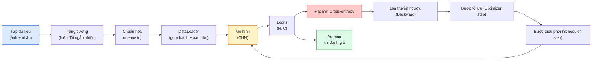

# Phân loại Hình ảnh (Image Classification)

> Một bộ phân loại bản chất là một hàm số ánh xạ từ các pixel đầu vào thành một phân phối xác suất trên các lớp mục tiêu. Mọi thứ còn lại chỉ là hệ thống ống nối kỹ thuật.

**Type:** Build
**Languages:** Python
**Prerequisites:** Phase 2 Bài học 09 (Model Evaluation), Phase 3 Bài học 10 (Mini Framework), Phase 4 Bài học 03 (CNNs)
**Time:** ~75 phút

## Learning Objectives

- Xây dựng một đường ống phân loại hình ảnh hoàn chỉnh từ đầu đến cuối trên tập dữ liệu CIFAR-10: dataset, tăng cường dữ liệu, mô hình, vòng lặp huấn luyện, đánh giá
- Giải thích vai trò của từng thành phần (dataloader, hàm mất mát, bộ tối ưu hóa, bộ điều phối lịch biểu, tăng cường dữ liệu) và dự đoán việc một thành phần bị lỗi sẽ biểu hiện thế nào trên đường cong hàm mất mát
- Tự tay cài đặt mixup, cutout, và làm mịn nhãn (label smoothing) từ đầu và lý giải trường hợp nào nên áp dụng chúng
- Đọc hiểu ma trận nhầm lẫn (confusion matrix) và bảng precision/recall theo từng lớp để chẩn đoán các lỗi của dữ liệu và mô hình thay vì chỉ nhìn vào độ chính xác tổng thể

## Vấn đề thực tế (The Problem)

Mọi tác vụ thị giác máy tính trong thực tế ở một mức độ nào đó đều quy về bài toán phân loại hình ảnh. Phát hiện đối tượng (detection) bản chất là phân loại các vùng đề xuất (regions). Phân đoạn ảnh (segmentation) là phân loại từng điểm ảnh pixel. Truy vấn hình ảnh (retrieval) là xếp hạng theo độ tương đồng với tâm các lớp. Làm chủ bài toán phân loại -- từ vòng lặp nạp dữ liệu, chính sách tăng cường, hàm mất mát cho đến phương pháp đánh giá -- là kỹ năng nền tảng có thể chuyển giao sang mọi tác vụ thị giác khác trong giai đoạn này.

Hầu hết các lỗi trong bài toán phân loại không nằm ở mô hình mạng nơ-ron. Chúng ẩn nấp ngay trong đường ống xử lý dữ liệu: chuẩn hóa sai thông số, tập huấn luyện không được xáo trộn (unshuffled), phép tăng cường làm biến dạng nhãn gốc, tập kiểm định bị rò rỉ dữ liệu từ tập huấn luyện, hoặc tốc độ học âm thầm phân kỳ sau epoch 30. Một mạng CNN vốn dĩ có thể đạt 93% trên CIFAR-10 trong điều kiện chuẩn mực sẽ dễ dàng rớt xuống chỉ còn 70-75% nếu quy trình bị lỗi, trong khi đường cong mất mát vẫn thoạt nhìn có vẻ giảm rất bình thường.

Bài học này sẽ tự tay kết nối toàn bộ đường ống xử lý từ đầu để mọi ngóc ngách đều có thể soi chiếu và kiểm soát. Bạn sẽ không sử dụng bất kỳ lớp trừu tượng che giấu nào từ `torchvision.datasets`.

## Khái niệm (The Concept)

### Đường ống phân loại hình ảnh hoàn chỉnh



Mỗi dòng mã trong vòng lặp này đều là nơi lỗi có thể ẩn nấp. Hàm cross-entropy nhận logits thô chứ không phải xác suất sau softmax, vì vậy việc gọi `model(x).softmax()` trước khi tính mất mát sẽ âm thầm tính toán sai toàn bộ gradient. Các phép tăng cường dữ liệu chỉ áp dụng cho ảnh đầu vào chứ không áp dụng cho nhãn -- ngoại trừ kỹ thuật mixup (nội suy cả ảnh và nhãn). Lệnh `optimizer.zero_grad()` phải được gọi đúng một lần mỗi bước lặp; nếu bỏ sót, gradient sẽ bị cộng dồn vô hạn và biểu hiện như một tốc độ học dao động dữ dội mất kiểm soát. Mỗi lỗi này đều làm phẳng lì đường cong học tập mà không hề ném ra bất kỳ thông báo lỗi nào.

### Cross-entropy, Logits và Softmax

Một bộ phân loại tạo ra $C$ con số cho mỗi bức ảnh được gọi là logits. Áp dụng hàm softmax sẽ biến đổi các giá trị này thành một phân phối xác suất:

```math
\mathop{\mathrm{softmax}}(z)_i = \frac{\exp(z_i)}{\sum_j \exp(z_j)}
```

Cross-entropy đo lường giá trị logarit phủ định của xác suất gán cho lớp đúng:

```math
\begin{aligned}
\mathrm{CE}(z, y) &= -\log\left( \mathop{\mathrm{softmax}}(z)_y \right) \\
&= -z_y + \log\left( \sum_j \exp(z_j) \right)
\end{aligned}
```

Vế phải của phương trình là công thức ổn định số học (thủ thuật log-sum-exp). Lớp `nn.CrossEntropyLoss` của PyTorch đã hợp nhất cả softmax và NLLLoss trong một thao tác duy nhất và nhận trực tiếp logits thô. Việc tự ý gọi softmax trước khi truyền vào hàm này hầu như luôn là một lỗi logic nghiêm trọng -- khi đó bạn đang vô tình tính toán $\log(\mathop{\mathrm{softmax}}(\mathop{\mathrm{softmax}}(z)))$, một đại lượng toán học vô nghĩa.

### Tại sao tăng cường dữ liệu (Data Augmentation) lại hiệu quả?

Mạng CNN vốn có sẵn tiên nghiệm quy nạp về tính bất biến với phép tịnh tiến (nhờ chia sẻ trọng số), nhưng nó hoàn toàn không có tính bất biến đối với các phép cắt ảnh, lật ảnh, đổi màu hay che khuất đối tượng. Cách duy nhất để dạy mô hình những bất biến này là cho nó nhìn thấy các pixel mô phỏng những biến đổi đó. Mỗi phép biến đổi ngẫu nhiên trong quá trình huấn luyện tương đương với lời chỉ dẫn: "hai bức ảnh này có cùng một nhãn; hãy học các đặc trưng bỏ qua sự khác biệt bề mặt đó."

```text
Ảnh cắt gốc:         "con chó nhìn sang trái"
Lật ngang (flip):    "con chó nhìn sang phải"       <- cùng nhãn, pixel khác biệt
Xoay (+15 độ):       "con chó hơi nghiêng đầu"
Nhiễu màu sắc:       "con chó dưới ánh sáng ấm hơn"
Xóa ngẫu nhiên:      "con chó bị che khuất một phần"
```

Quy tắc bất di bất dịch: **phép tăng cường bắt buộc phải bảo toàn nhãn lớp**. Cắt hoặc xoay góc quá lớn trên tập chữ số viết tay có thể biến số "6" thành số "9"; với tập dữ liệu như vậy bạn phải giới hạn góc xoay thật nhỏ và chỉ chọn các phép tăng cường tôn trọng tính bất biến của chữ số.

### Kỹ thuật Mixup và Cutmix

Tăng cường dữ liệu thông thường biến đổi pixel nhưng vẫn giữ nguyên nhãn dạng one-hot cứng nhắc. **Mixup** và **Cutmix** phá vỡ giới hạn đó bằng cách nội suy đồng thời cả ảnh và nhãn:

```text
Mixup:
  lambda ~ Beta(alpha, alpha)
  x = lambda * x_i + (1 - lambda) * x_j
  y = lambda * y_i + (1 - lambda) * y_j

Cutmix:
  dán một vùng chữ nhật ngẫu nhiên từ x_j đè lên x_i
  y = nhãn pha trộn theo tỷ lệ diện tích của y_i và y_j
```

Lý do nó hiệu quả: mô hình ngừng việc ghi nhớ mù quáng các nhãn one-hot cực đoan và học cách nội suy mượt mà giữa các ranh giới lớp. Mất mát huấn luyện (train loss) có thể tăng lên, nhưng độ chính xác kiểm định (test accuracy) và độ bền vững trước nhiễu sẽ tăng vọt. Đây là nâng cấp rẻ nhất và hiệu quả nhất cho bất kỳ bộ phân loại hình ảnh nào.

### Làm mịn nhãn (Label Smoothing)

Một kỹ thuật họ hàng với mixup. Thay vì huấn luyện mô hình ép về nhãn tuyệt đối `[0, 0, 1, 0, 0]`, bạn huấn luyện nó với nhãn mềm `[eps/C, eps/C, 1-eps+eps/C, eps/C, eps/C]` với một hệ số $\epsilon$ nhỏ như 0.1 (nhãn one-hot được pha trộn với phân phối đều, do đó tổng xác suất vẫn bằng 1). Kỹ thuật này ngăn chặn mô hình xuất ra các giá trị logit quá lớn và cải thiện đáng kể độ định chuẩn xác suất (calibration) mà hầu như không tốn thêm chi phí tính toán nào. Đã được tích hợp sẵn qua tham số `nn.CrossEntropyLoss(label_smoothing=0.1)` từ PyTorch 1.10.

### Đánh giá toàn diện vượt ra ngoài độ chính xác (Accuracy)

Độ chính xác tổng thể (aggregate accuracy) thường che giấu sự mất cân bằng dữ liệu. Một bộ phân loại nhị phân trên tập dữ liệu tỷ lệ 90-10 nếu chỉ dự đoán toàn bộ là lớp chiếm đa số thì vẫn đạt 90% accuracy. Những công cụ thực sự phản ánh đúng năng lực mô hình:

- **Độ chính xác theo từng lớp (Per-class accuracy):** Tính riêng cho từng danh mục; lập tức phát hiện các lớp đang hoạt động kém cỏi.
- **Ma trận nhầm lẫn (Confusion matrix):** Bảng $C \times C$ trong đó hàng $i$ cột $j$ là số lượng mẫu thuộc lớp thật $i$ nhưng bị dự đoán nhầm thành lớp $j$; đường chéo chính là các dự đoán đúng, các vị trí lệch chéo là nơi phơi bày các điểm yếu của mô hình.
- **Top-1 / Top-5 Accuracy:** Kiểm tra xem nhãn đúng có nằm trong 1 hoặc 5 dự đoán có xác suất cao nhất hay không; Top-5 đặc biệt quan trọng trên ImageNet vì nhiều lớp như "chó sục Norwich" và "chó sục Norfolk" rất khó phân biệt ngay cả với mắt người.
- **Độ định chuẩn xác suất (Calibration / ECE):** Liệu một dự đoán với độ tin cậy 0.8 có thực sự đúng trong 80% trường hợp hay không? Các mạng hiện đại có xu hướng tự tin thái quá (over-confident); khắc phục bằng chia nhiệt độ (temperature scaling) hoặc làm mịn nhãn.

```figure
receptive-field
```

## Tự tay xây dựng (Build It)

### Bước 1: Tạo tập dữ liệu nhân tạo mang tính tất định

Để bài học chạy nhanh và có tính lặp lại độc lập, chúng ta tự dựng một tập dữ liệu nhân tạo có cấu trúc tương tự CIFAR-10 -- các ảnh 32x32 RGB với các mẫu hình đặc trưng theo từng lớp. Cùng một đường ống này sẽ chạy mượt mà trên tập CIFAR-10 thật mà không cần sửa đổi.

```python
import numpy as np
import torch
from torch.utils.data import Dataset


def synthetic_cifar(num_per_class=1000, num_classes=10, seed=0):
    rng = np.random.default_rng(seed)
    X = []
    Y = []
    for c in range(num_classes):
        centre = rng.uniform(0, 1, (3,))
        freq = 2 + c
        for _ in range(num_per_class):
            yy, xx = np.meshgrid(np.linspace(0, 1, 32), np.linspace(0, 1, 32), indexing="ij")
            r = np.sin(xx * freq) * 0.5 + centre[0]
            g = np.cos(yy * freq) * 0.5 + centre[1]
            b = (xx + yy) * 0.5 * centre[2]
            img = np.stack([r, g, b], axis=-1)
            img += rng.normal(0, 0.08, img.shape)
            img = np.clip(img, 0, 1)
            X.append(img.astype(np.float32))
            Y.append(c)
    X = np.stack(X)
    Y = np.array(Y)
    idx = rng.permutation(len(X))
    return X[idx], Y[idx]


class ArrayDataset(Dataset):
    def __init__(self, X, Y, transform=None):
        self.X = X
        self.Y = Y
        self.transform = transform

    def __len__(self):
        return len(self.X)

    def __getitem__(self, i):
        img = self.X[i]
        if self.transform is not None:
            img = self.transform(img)
        img = torch.from_numpy(img).permute(2, 0, 1)
        return img, int(self.Y[i])
```

Mỗi lớp có bảng màu và tần số vân riêng biệt, cộng thêm nhiễu Gaussian để buộc mô hình phải học đặc trưng thực thay vì ghi nhớ từng pixel.

### Bước 2: Chuẩn hóa và tăng cường dữ liệu

Hai phép biến đổi cốt lõi trong mọi hệ thống thị giác:

```python
def standardize(mean, std):
    mean = np.array(mean, dtype=np.float32)
    std = np.array(std, dtype=np.float32)
    def _fn(img):
        return (img - mean) / std
    return _fn


def random_hflip(p=0.5):
    def _fn(img):
        if np.random.random() < p:
            return img[:, ::-1, :].copy()
        return img
    return _fn


def random_crop(pad=4):
    def _fn(img):
        h, w = img.shape[:2]
        padded = np.pad(img, ((pad, pad), (pad, pad), (0, 0)), mode="reflect")
        y = np.random.randint(0, 2 * pad)
        x = np.random.randint(0, 2 * pad)
        return padded[y:y + h, x:x + w, :]
    return _fn


def compose(*fns):
    def _fn(img):
        for fn in fns:
            img = fn(img)
        return img
    return _fn
```

Đệm phản xạ (reflect mode) trước khi cắt ngẫu nhiên, không dùng zero-pad vì viền đen nhân tạo sẽ trở thành tín hiệu gây nhiễu cho mô hình.

### Bước 3: Cài đặt kỹ thuật Mixup

Pha trộn hai hình ảnh và hai nhãn trong từng bước huấn luyện. Triển khai dưới dạng biến đổi theo batch ngay trước lượt tính xuôi forward pass:

```python
def mixup_batch(x, y, num_classes, alpha=0.2):
    if alpha <= 0:
        return x, torch.nn.functional.one_hot(y, num_classes).float()
    lam = float(np.random.beta(alpha, alpha))
    idx = torch.randperm(x.size(0), device=x.device)
    x_mixed = lam * x + (1 - lam) * x[idx]
    y_onehot = torch.nn.functional.one_hot(y, num_classes).float()
    y_mixed = lam * y_onehot + (1 - lam) * y_onehot[idx]
    return x_mixed, y_mixed


def soft_cross_entropy(logits, soft_targets):
    log_probs = torch.log_softmax(logits, dim=-1)
    return -(soft_targets * log_probs).sum(dim=-1).mean()
```

Hàm `soft_cross_entropy` tính mất mát dựa trên phân phối nhãn mềm, tự động tương đương với cross-entropy thông thường khi nhãn là dạng one-hot chuẩn.

### Bước 4: Vòng lặp huấn luyện chuẩn mực

```python
import torch
import torch.nn as nn
from torch.utils.data import DataLoader
from torch.optim import SGD
from torch.optim.lr_scheduler import CosineAnnealingLR

def train_one_epoch(model, loader, optimizer, device, num_classes, use_mixup=True):
    model.train()
    total, correct, loss_sum = 0, 0, 0.0
    for x, y in loader:
        x, y = x.to(device), y.to(device)
        if use_mixup:
            x_m, y_soft = mixup_batch(x, y, num_classes)
            logits = model(x_m)
            loss = soft_cross_entropy(logits, y_soft)
        else:
            logits = model(x)
            loss = nn.functional.cross_entropy(logits, y, label_smoothing=0.1)
        optimizer.zero_grad()
        loss.backward()
        optimizer.step()
        loss_sum += loss.item() * x.size(0)
        total += x.size(0)
        with torch.no_grad():
            pred = logits.argmax(dim=-1)
            correct += (pred == y).sum().item()
    return loss_sum / total, correct / total


@torch.no_grad()
def evaluate(model, loader, device, num_classes):
    model.eval()
    total, correct = 0, 0
    loss_sum = 0.0
    cm = torch.zeros(num_classes, num_classes, dtype=torch.long)
    for x, y in loader:
        x, y = x.to(device), y.to(device)
        logits = model(x)
        loss = nn.functional.cross_entropy(logits, y)
        pred = logits.argmax(dim=-1)
        for t, p in zip(y.cpu(), pred.cpu()):
            cm[t, p] += 1
        loss_sum += loss.item() * x.size(0)
        total += x.size(0)
        correct += (pred == y).sum().item()
    return loss_sum / total, correct / total, cm
```

Năm bất biến bắt buộc phải kiểm tra mỗi khi viết vòng lặp huấn luyện:

1. `model.train()` trước khi huấn luyện, `model.eval()` trước khi đánh giá.
2. `optimizer.zero_grad()` trước `loss.backward()`.
3. Dùng `.item()` khi tích lũy các đại lượng vô hướng để giải phóng đồ thị tính toán.
4. Dùng decorator `@torch.no_grad()` khi đánh giá để tiết kiệm VRAM và tăng tốc.
5. Lấy `argmax` trực tiếp trên logits thô, không cần gọi softmax.

### Bước 5: Ghép nối và huấn luyện

Sử dụng mạng `TinyResNet` từ Bài học 03 để huấn luyện và đánh giá:

```python
X, Y = synthetic_cifar(num_per_class=500)
split = int(0.9 * len(X))
X_train, Y_train = X[:split], Y[:split]
X_val, Y_val = X[split:], Y[split:]

mean = [0.5, 0.5, 0.5]
std = [0.25, 0.25, 0.25]
train_tf = compose(random_hflip(), random_crop(pad=4), standardize(mean, std))
eval_tf = standardize(mean, std)

train_ds = ArrayDataset(X_train, Y_train, transform=train_tf)
val_ds = ArrayDataset(X_val, Y_val, transform=eval_tf)

train_loader = DataLoader(train_ds, batch_size=128, shuffle=True, num_workers=0)
val_loader = DataLoader(val_ds, batch_size=256, shuffle=False, num_workers=0)

device = "cuda" if torch.cuda.is_available() else "cpu"
model = TinyResNet(num_classes=10).to(device)
optimizer = SGD(model.parameters(), lr=0.1, momentum=0.9, weight_decay=5e-4, nesterov=True)
scheduler = CosineAnnealingLR(optimizer, T_max=10)

for epoch in range(10):
    tr_loss, tr_acc = train_one_epoch(model, train_loader, optimizer, device, 10, use_mixup=True)
    va_loss, va_acc, _ = evaluate(model, val_loader, device, 10)
    scheduler.step()
    print(f"epoch {epoch:2d}  lr {scheduler.get_last_lr()[0]:.4f}  "
          f"train {tr_loss:.3f}/{tr_acc:.3f}  val {va_loss:.3f}/{va_acc:.3f}")
```

Mô hình sẽ nhanh chóng đạt độ chính xác gần như tuyệt đối chỉ sau 5 epoch trên tập dữ liệu này, chứng minh đường ống hoạt động hoàn hảo.

### Bước 6: Phân tích ma trận nhầm lẫn

```python
def print_confusion(cm, labels=None):
    c = cm.shape[0]
    labels = labels or [str(i) for i in range(c)]
    print(f"{'':>6}" + "".join(f"{l:>5}" for l in labels))
    for i in range(c):
        row = cm[i].tolist()
        print(f"{labels[i]:>6}" + "".join(f"{v:>5}" for v in row))
    print()
    tp = cm.diag().float()
    fp = cm.sum(dim=0).float() - tp
    fn = cm.sum(dim=1).float() - tp
    prec = tp / (tp + fp).clamp_min(1)
    rec = tp / (tp + fn).clamp_min(1)
    f1 = 2 * prec * rec / (prec + rec).clamp_min(1e-9)
    for i in range(c):
        print(f"{labels[i]:>6}  prec {prec[i]:.3f}  rec {rec[i]:.3f}  f1 {f1[i]:.3f}")

_, _, cm = evaluate(model, val_loader, device, 10)
print_confusion(cm)
```

Các hàng là nhãn thực tế, các cột là nhãn dự đoán. Các cụm giá trị nằm ngoài đường chéo chính giữa hai lớp bất kỳ chỉ ra rằng mô hình đang bị nhầm lẫn giữa hai danh mục đó, chỉ dẫn trực tiếp cho bạn biết cần bổ sung thêm dữ liệu phân biệt cho các lớp nào.

## Sử dụng trong thực tế (Use It)

Thư viện `torchvision` cung cấp sẵn toàn bộ quy trình trên:

```python
from torchvision.datasets import CIFAR10
from torchvision.transforms import Compose, RandomCrop, RandomHorizontalFlip, ToTensor, Normalize

mean = (0.4914, 0.4822, 0.4465)
std = (0.2470, 0.2435, 0.2616)
train_tf = Compose([
    RandomCrop(32, padding=4, padding_mode="reflect"),
    RandomHorizontalFlip(),
    ToTensor(),
    Normalize(mean, std),
])
eval_tf = Compose([ToTensor(), Normalize(mean, std)])

train_ds = CIFAR10(root="./data", train=True,  download=True, transform=train_tf)
val_ds   = CIFAR10(root="./data", train=False, download=True, transform=eval_tf)
```

Hai điểm cần ghi nhớ: mean/std là **đặc thù của từng tập dữ liệu** (được tính trên tập huấn luyện CIFAR-10 chứ không phải ImageNet), và kỹ thuật đệm phản xạ reflect là quy ước chuẩn của cộng đồng. Sao chép nhầm mean/std của ImageNet vào đây sẽ làm hao hụt khoảng 1% độ chính xác một cách âm thầm.

## Sản phẩm bàn giao (Ship It)

Bài học này tạo ra:

- `outputs/prompt-classifier-pipeline-auditor.md` — prompt kiểm tra kịch bản huấn luyện để phát hiện các vi phạm đối với 5 bất biến bắt buộc nêu trên.
- `outputs/skill-classification-diagnostics.md` — kỹ năng phân tích ma trận nhầm lẫn và danh sách tên lớp để tóm tắt các sai sót theo từng lớp và đề xuất giải pháp khắc phục có tác động lớn nhất.

## Bài tập rèn luyện (Exercises)

1. **(Dễ)** Huấn luyện cùng một mô hình khi có và không có Mixup trong 5 epoch trên tập dữ liệu nhân tạo. Vẽ biểu đồ mất mát train và val cho cả hai. Giải thích tại sao mất mát huấn luyện với Mixup lại cao hơn nhưng độ chính xác kiểm định val lại tương đương hoặc tốt hơn.
2. **(Trung bình)** Cài đặt kỹ thuật Cutout -- che đen một vùng vuông 8x8 ngẫu nhiên trong mỗi ảnh huấn luyện -- và thực hiện thử nghiệm đối chứng (ablation study) giữa: không tăng cường, hflip+crop, hflip+crop+cutout, hflip+crop+mixup. Báo cáo độ chính xác kiểm định cho từng trường hợp.
3. **(Khó)** Xây dựng đường ống cho CIFAR-100 (100 lớp, cùng kích thước ảnh) và tái lập đợt huấn luyện ResNet-34 đạt độ chính xác chênh lệch không quá 1% so với bài báo công bố. Phần mở rộng: quét 3 mức tốc độ học và 2 giá trị weight decay, ghi log ra tệp CSV cục bộ, và xuất ra bảng thống kê các cặp lớp dễ bị nhầm lẫn nhất từ ma trận nhầm lẫn cuối cùng.

## Thuật ngữ then chốt (Key Terms)

| Thuật ngữ | Người ta thường nói | Bản chất thực sự |
|-----------|--------------------|-------------------|
| Logits | "Đầu ra thô" | Vector $C$ số thực trước hàm softmax cho mỗi ảnh; hàm cross-entropy mong đợi nhận giá trị này chứ không phải xác suất sau softmax |
| Cross-entropy | "Hàm mất mát" | Đại lượng đo lường logarit phủ định của xác suất gán cho lớp đúng; kết hợp log-softmax và NLL trong một phép tính số học ổn định |
| DataLoader | "Bộ chia batch" | Lớp bao bọc tập dữ liệu hỗ trợ xáo trộn, gom batch và nạp dữ liệu song song đa tiến trình; là nơi phát sinh phân nửa số lỗi huấn luyện |
| Augmentation (Tăng cường) | "Biến đổi ngẫu nhiên" | Mọi phép biến đổi ở mức pixel lúc huấn luyện nhưng bảo toàn nhãn lớp; dạy cho mạng CNN các tính bất biến mà nó không tự có |
| Mixup / Cutmix | "Trộn hai bức ảnh" | Pha trộn đồng thời cả ảnh đầu vào và nhãn để mô hình học cách nội suy mượt mà thay vì ghi nhớ ranh giới cứng nhắc |
| Label smoothing (Làm mịn nhãn) | "Nhãn mềm hơn" | Thay thế nhãn one-hot bằng $(1-\epsilon+\epsilon/C, \epsilon/C, \dots)$; cải thiện độ định chuẩn xác suất và tăng nhẹ độ chính xác |
| Top-k accuracy | "Top-5" | Nhãn đúng nằm trong số $k$ dự đoán có xác suất cao nhất; dùng trên các tập dữ liệu có các lớp thực sự khó phân biệt rạch ròi |
| Confusion matrix (Ma trận nhầm lẫn) | "Nơi lỗi xuất hiện" | Bảng $C \times C$ đếm số lượng mẫu của lớp thực $i$ bị đoán thành lớp $j$; đường chéo là đúng, ngoài đường chéo chỉ ra những điểm cần khắc phục |

## Tài liệu đọc thêm (Further Reading)

- [CS231n: Training Neural Networks](https://cs231n.github.io/neural-networks-3/) — tài liệu giảng dạy xuất sắc và súc tích nhất về toàn bộ đường ống huấn luyện
- [Bag of Tricks for Image Classification (He et al., 2019)](https://arxiv.org/abs/1812.01187) — tổng hợp toàn bộ các mẹo tinh chỉnh nhỏ giúp tăng 3-4% độ chính xác cho ResNet trên ImageNet
- [mixup: Beyond Empirical Risk Minimization (Zhang et al., 2017)](https://arxiv.org/abs/1710.09412) — bài báo gốc về Mixup; ba trang lý thuyết cô đọng đi kèm các thực nghiệm thuyết phục
- [Why temperature scaling matters (Guo et al., 2017)](https://arxiv.org/abs/1706.04599) — bài báo chứng minh các mạng nơ-ron hiện đại thường bị mất định chuẩn xác suất và cách khắc phục chỉ bằng một tham số vô hướng

