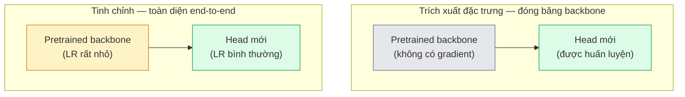

# Học Chuyển Giao & Tinh Chỉnh (Transfer Learning & Fine-Tuning)

> Ai đó đã dành hàng triệu giờ GPU để dạy một mạng nơ-ron nhận biết các cạnh, kết cấu và các bộ phận của đối tượng. Bạn nên mượn những đặc trưng đó trước khi tự huấn luyện mô hình của riêng mình.

**Type:** Build
**Languages:** Python
**Prerequisites:** Phase 4 Lesson 03 (CNNs), Phase 4 Lesson 04 (Image Classification)
**Time:** ~75 phút

## Learning Objectives

- Phân biệt trích xuất đặc trưng (feature extraction) với tinh chỉnh (fine-tuning) và chọn đúng phương pháp dựa trên kích thước tập dữ liệu, khoảng cách miền (domain distance), và ngân sách tính toán
- Nạp một mô hình nền tảng tiền huấn luyện (pretrained backbone), thay thế đầu phân loại (classifier head), và huấn luyện chỉ phần đầu đó đạt baseline hoạt động tốt trong chưa đầy 20 dòng lệnh
- Rã đông từng bước (progressively unfreeze) các tầng với tốc độ học phân biệt (discriminative learning rates) để các đặc trưng tổng quát ban đầu nhận các cập nhật nhỏ hơn so với các đặc trưng chuyên biệt cho tác vụ ở phía sau
- Chẩn đoán ba lỗi sai phổ biến: trôi đặc trưng (feature drift) do LR quá cao trên các khối được rã đông, sụp đổ thống kê BN trên các tập dữ liệu nhỏ, và quên lãng thảm khốc (catastrophic forgetting)

## Vấn Đề Đặt Ra (The Problem)

Huấn luyện một ResNet-50 trên ImageNet tốn khoảng 2.000 giờ GPU. Rất ít đội ngũ có đủ ngân sách đó cho mọi tác vụ họ triển khai. Những gì hầu hết mọi nhóm thực sự triển khai vào sản phẩm là một backbone tiền huấn luyện với một head mới được huấn luyện trên vài trăm hoặc vài nghìn hình ảnh cụ thể của tác vụ.

Đây không phải là đường tắt tùy tiện. Khối tích chập đầu tiên của bất kỳ CNN nào được huấn luyện trên ImageNet đều học các cạnh và bộ lọc dạng Gabor. Vài khối tiếp theo học các kết cấu (textures) và mô-típ đơn giản. Các khối ở giữa học các bộ phận của đối tượng. Các khối cuối cùng học các tổ hợp bắt đầu giống với 1.000 danh mục ImageNet. 90% đầu tiên của hệ thống phân cấp đó chuyển giao gần như nguyên vẹn sang chẩn đoán hình ảnh y tế, kiểm tra công nghiệp, dữ liệu vệ tinh, và mọi tác vụ thị giác khác — bởi vì tự nhiên có một vốn từ vựng giới hạn về các cạnh và kết cấu. 10% cuối cùng mới là phần bạn thực sự huấn luyện.

Để thực hiện học chuyển giao đúng đắn, có ba lỗi ngầm luôn chực chờ: phá hủy các đặc trưng tiền huấn luyện bằng tốc độ học quá cao, bỏ đói mô hình thông tin do đóng băng quá nhiều, và để số liệu thống kê tích lũy của BatchNorm trôi dạt về một tập dữ liệu quá nhỏ mà phần còn lại của mạng chưa từng học qua. Bài học này sẽ dẫn dắt bạn đi qua từng lỗi một cách có chủ đích.

## Khái Niệm Cốt Lõi (The Concept)

### Trích xuất đặc trưng vs tinh chỉnh (Feature extraction vs fine-tuning)

Hai cơ chế, được lựa chọn tùy thuộc vào mức độ bạn tin tưởng vào các đặc trưng tiền huấn luyện và lượng dữ liệu bạn sở hữu.



Quy tắc kinh nghiệm (Rules of thumb):

| Kích thước dữ liệu | Khoảng cách miền | Công thức áp dụng |
|--------------------|------------------|-------------------|
| < 1.000 ảnh | gần với ImageNet | Đóng băng backbone, chỉ huấn luyện head |
| 1.000 - 10.000 | gần | Đóng băng 2-3 stage đầu, tinh chỉnh phần còn lại |
| 10.000 - 100.000 | bất kỳ | Tinh chỉnh end-to-end với discriminative LR |
| 100.000+ | xa | Tinh chỉnh toàn bộ; cân nhắc train từ đầu nếu miền quá xa |

"Gần với ImageNet" đại khái có nghĩa là các bức ảnh RGB tự nhiên có nội dung dạng đồ vật. Ảnh chụp CT y tế, ảnh vệ tinh chụp từ trên cao, và ảnh chụp hiển vi là các miền xa — các đặc trưng vẫn hữu ích, nhưng bạn sẽ cần để nhiều tầng thích ứng hơn.

### Tại sao việc đóng băng lại hoạt động hiệu quả

Các đặc trưng ImageNet mà một CNN học được không chỉ chuyên biệt cho 1.000 danh mục đó. Chúng được chuyên biệt hóa theo số liệu thống kê của hình ảnh tự nhiên: các cạnh ở các hướng cụ thể, kết cấu, mô hình tương phản, các nguyên thủy hình học. Những số liệu thống kê đó ổn định trên hầu hết mọi miền thị giác mà con người có thể gọi tên. Đó là lý do tại sao một mô hình được huấn luyện trên ImageNet và đánh giá zero-shot trên CIFAR-10 chỉ với một linear head mới (không tinh chỉnh backbone) đạt độ chính xác trên 80%. Head chỉ đang học xem nên gán trọng số cho những đặc trưng đã học nào cho tác vụ này.

### Tốc độ học phân biệt (Discriminative learning rates)

Khi bạn rã đông, các tầng đầu tiên nên được huấn luyện chậm hơn các tầng sau. Các tầng đầu mã hóa các đặc trưng tổng quát mà bạn muốn bảo toàn; các tầng sau mã hóa cấu trúc chuyên biệt cho tác vụ mà bạn cần thay đổi nhiều.

```text
Công thức điển hình:

  stage 0 (stem + nhóm đầu tiên): lr = base_lr / 100    (hầu như cố định)
  stage 1:                        lr = base_lr / 10
  stage 2:                        lr = base_lr / 3
  stage 3 (nhóm backbone cuối):   lr = base_lr
  head:                           lr = base_lr  (hoặc cao hơn một chút)
```

Trong PyTorch, điều này chỉ đơn giản là một danh sách các nhóm tham số (parameter groups) được truyền vào bộ tối ưu hóa (optimizer). Một mô hình, năm tốc độ học, không cần thêm dòng mã phức tạp nào.

### Vấn đề BatchNorm

Các tầng BN nắm giữ các bộ đệm `running_mean` và `running_var` được tính toán trên ImageNet. Nếu tác vụ của bạn có phân phối điểm ảnh khác — ánh sáng khác, cảm biến khác, không gian màu khác — các bộ đệm đó sẽ không còn chính xác. Ba lựa chọn theo thứ tự ưu tiên:

1. **Tinh chỉnh với BN ở chế độ train mode.** Để BN cập nhật các thống kê tích lũy cùng với mọi thứ khác. Lựa chọn mặc định khi tập dữ liệu tác vụ có kích thước trung bình (>= 5.000 mẫu).
2. **Đóng băng BN ở chế độ eval mode.** Giữ lại các thống kê ImageNet và chỉ huấn luyện các trọng số (weights). Lựa chọn chuẩn xác khi tập dữ liệu của bạn đủ nhỏ khiến giá trị trung bình trượt của BN bị nhiễu.
3. **Thay thế BN bằng GroupNorm.** Loại bỏ hoàn toàn vấn đề trung bình trượt. Được sử dụng trong các backbone nhận diện và phân đoạn nơi batch size trên mỗi GPU rất nhỏ.

Làm sai điều này có thể âm thầm kéo tụt độ chính xác từ 5-15%.

### Thiết kế đầu phân loại (Head design)

Đầu phân loại (classifier head) thường là 1-3 tầng tuyến tính cộng với dropout tùy chọn. Mọi backbone trong torchvision đều đi kèm một head mặc định mà bạn có thể thay thế:

```python
backbone.fc = nn.Linear(backbone.fc.in_features, num_classes)          # ResNet
backbone.classifier[1] = nn.Linear(..., num_classes)                    # EfficientNet, MobileNet
backbone.heads.head = nn.Linear(..., num_classes)                       # torchvision ViT
```

Đối với các tập dữ liệu nhỏ, một tầng tuyến tính đơn lẻ thường là đủ. Việc thêm một tầng ẩn (Linear -> ReLU -> Dropout -> Linear) sẽ hữu ích khi phân phối của tác vụ cách xa hơn phân phối huấn luyện ban đầu của backbone.

### Phân rã LR theo tầng (Layer-wise LR decay)

Một phiên bản mượt mà hơn của discriminative LR được sử dụng trong các quy trình tinh chỉnh hiện đại (BEiT, DINOv2, ViT-B fine-tunes). Thay vì gom nhóm các tầng thành các stage, hãy gán cho mỗi tầng một LR nhỏ hơn một chút so với tầng ngay phía trên nó:

```math
\text{lr\_layer}_k = \text{base\_lr} \cdot \text{decay}^{L - k}
```

Với decay = 0.75 và L = 12 khối transformer, khối đầu tiên được huấn luyện ở mức `0.75^11 ≈ 0.04x` so với LR của head. Điều này quan trọng hơn đối với việc tinh chỉnh transformer so với CNNs, nơi các LR được gom theo stage thường đã đủ tốt.

### Cần đánh giá những gì

Các lượt chạy học chuyển giao cần hai con số mà bạn thường không theo dõi trong một lượt huấn luyện từ đầu (scratch run):

- **Pretrained-only accuracy (Độ chính xác chỉ tiền huấn luyện)** — độ chính xác của head khi backbone bị đóng băng. Đây là mức sàn (floor) của bạn.
- **Fine-tuned accuracy (Độ chính xác sau tinh chỉnh)** — cùng mô hình đó sau khi huấn luyện end-to-end. Đây là mức trần (ceiling) của bạn.

Nếu fine-tuned kém hơn pretrained-only, bạn đang gặp lỗi về tốc độ học hoặc BN. Luôn in ra cả hai chỉ số.

```figure
transfer-learning
```

## Tự Xây Dựng (Build It)

### Bước 1: Nạp một backbone tiền huấn luyện và kiểm tra cấu trúc

```python
import torch
import torch.nn as nn
from torchvision.models import resnet18, ResNet18_Weights

backbone = resnet18(weights=ResNet18_Weights.IMAGENET1K_V1)
print(backbone)
print()
print("classifier head:", backbone.fc)
print("feature dim:", backbone.fc.in_features)
```

`ResNet18` có bốn stage (`layer1..layer4`) cộng với một stem và một head `fc`. Mọi backbone phân loại trong torchvision đều có cấu trúc tương tự.

### Bước 2: Trích xuất đặc trưng — đóng băng toàn bộ, thay thế head

```python
def make_feature_extractor(num_classes=10):
    model = resnet18(weights=ResNet18_Weights.IMAGENET1K_V1)
    for p in model.parameters():
        p.requires_grad = False
    model.fc = nn.Linear(model.fc.in_features, num_classes)
    return model

model = make_feature_extractor(num_classes=10)
trainable = sum(p.numel() for p in model.parameters() if p.requires_grad)
frozen = sum(p.numel() for p in model.parameters() if not p.requires_grad)
print(f"trainable: {trainable:>10,}")
print(f"frozen:    {frozen:>10,}")
```

Chỉ có `model.fc` là có thể huấn luyện (trainable). Backbone đóng vai trò là một bộ trích xuất đặc trưng bị đóng băng.

### Bước 3: Tinh chỉnh với tốc độ học phân biệt (Discriminative fine-tuning)

Một hàm tiện ích xây dựng các nhóm tham số với tốc độ học riêng cho từng stage:

```python
def discriminative_param_groups(model, base_lr=1e-3, decay=0.3):
    stages = [
        ["conv1", "bn1"],
        ["layer1"],
        ["layer2"],
        ["layer3"],
        ["layer4"],
        ["fc"],
    ]
    groups = []
    for i, names in enumerate(stages):
        lr = base_lr * (decay ** (len(stages) - 1 - i))
        params = [p for n, p in model.named_parameters()
                  if any(n.startswith(k) for k in names)]
        if params:
            groups.append({"params": params, "lr": lr, "name": "_".join(names)})
    return groups

model = resnet18(weights=ResNet18_Weights.IMAGENET1K_V1)
model.fc = nn.Linear(model.fc.in_features, 10)
for p in model.parameters():
    p.requires_grad = True

groups = discriminative_param_groups(model)
for g in groups:
    print(f"{g['name']:>10s}  lr={g['lr']:.2e}  params={sum(p.numel() for p in g['params']):>8,}")
```

`decay=0.3` có nghĩa là mỗi stage được huấn luyện với tốc độ bằng 30% tốc độ của stage tiếp theo. `fc` nhận `base_lr`, `layer4` nhận `0.3 * base_lr`, `conv1` nhận `0.3^5 * base_lr ≈ 0.00243 * base_lr`. Nghe có vẻ cực đoan, nhưng trên thực nghiệm nó hoạt động rất tốt.

### Bước 4: Xử lý BatchNorm

Hàm trợ giúp để đóng băng số liệu thống kê tích lũy của BN mà không đóng băng trọng số của nó:

```python
def freeze_bn_stats(model):
    for m in model.modules():
        if isinstance(m, (nn.BatchNorm1d, nn.BatchNorm2d, nn.BatchNorm3d)):
            m.eval()
            for p in m.parameters():
                p.requires_grad = False
    return model
```

Gọi hàm này sau khi bạn thiết lập `model.train()` ở đầu mỗi epoch. `model.train()` chuyển mọi thứ sang chế độ huấn luyện; hàm này sẽ đảo ngược lại chỉ riêng đối với các tầng BN.

### Bước 5: Một vòng lặp tinh chỉnh end-to-end tối giản

```python
from torch.optim import SGD
from torch.utils.data import DataLoader
from torch.optim.lr_scheduler import CosineAnnealingLR
import torch.nn.functional as F

def fine_tune(model, train_loader, val_loader, device, epochs=5, base_lr=1e-3, freeze_bn=False):
    model = model.to(device)
    groups = discriminative_param_groups(model, base_lr=base_lr)
    optimizer = SGD(groups, momentum=0.9, weight_decay=1e-4, nesterov=True)
    scheduler = CosineAnnealingLR(optimizer, T_max=epochs)

    for epoch in range(epochs):
        model.train()
        if freeze_bn:
            freeze_bn_stats(model)
        tr_loss, tr_correct, tr_total = 0.0, 0, 0
        for x, y in train_loader:
            x, y = x.to(device), y.to(device)
            logits = model(x)
            loss = F.cross_entropy(logits, y, label_smoothing=0.1)
            optimizer.zero_grad()
            loss.backward()
            optimizer.step()
            tr_loss += loss.item() * x.size(0)
            tr_total += x.size(0)
            tr_correct += (logits.argmax(-1) == y).sum().item()
        scheduler.step()

        model.eval()
        va_total, va_correct = 0, 0
        with torch.no_grad():
            for x, y in val_loader:
                x, y = x.to(device), y.to(device)
                pred = model(x).argmax(-1)
                va_total += x.size(0)
                va_correct += (pred == y).sum().item()
        print(f"epoch {epoch}  train {tr_loss/tr_total:.3f}/{tr_correct/tr_total:.3f}  "
              f"val {va_correct/va_total:.3f}")
    return model
```

Năm epoch với công thức trên cho CIFAR-10 đưa `ResNet18-IMAGENET1K_V1` từ độ chính xác kiểm tra tuyến tính (linear probe) zero-shot ~70% lên ~93% sau khi tinh chỉnh. Nếu chỉ huấn luyện head đơn thuần, độ chính xác sẽ chững lại ở khoảng 86% mà không bao giờ can thiệp vào backbone.

### Bước 6: Rã đông lũy tiến (Progressive unfreezing)

Một lịch trình rã đông từng stage sau mỗi epoch từ cuối ngược về đầu. Giúp giảm thiểu hiện tượng trôi đặc trưng (feature drift) với chi phí là thêm một số epoch.

```python
def progressive_unfreeze_schedule(model):
    stages = ["layer4", "layer3", "layer2", "layer1"]
    yielded = set()

    def start():
        for p in model.parameters():
            p.requires_grad = False
        for p in model.fc.parameters():
            p.requires_grad = True

    def unfreeze(epoch):
        if epoch < len(stages):
            name = stages[epoch]
            yielded.add(name)
            for n, p in model.named_parameters():
                if n.startswith(name):
                    p.requires_grad = True
            return name
        return None

    return start, unfreeze
```

Gọi `start()` một lần trước epoch đầu tiên. Gọi `unfreeze(epoch)` ở đầu mỗi epoch. Hãy khởi tạo lại bộ tối ưu hóa (optimizer) bất cứ khi nào tập hợp các tham số có thể huấn luyện thay đổi, nếu không các tham số đã đóng băng vẫn giữ các momentum được lưu trong bộ nhớ đệm gây sai lệch tính toán.

## Sử Dụng Thực Tế (Use It)

Đối với hầu hết các tác vụ thực tế, `torchvision.models` kết hợp với ba dòng lệnh là đủ. Bộ máy phức tạp hơn ở trên phát huy tác dụng khi bạn gặp phải các vấn đề mà thiết lập mặc định của thư viện không thể giải quyết được.

```python
from torchvision.models import resnet50, ResNet50_Weights

model = resnet50(weights=ResNet50_Weights.IMAGENET1K_V2)
model.fc = nn.Linear(model.fc.in_features, num_classes)
optimizer = torch.optim.AdamW(model.parameters(), lr=1e-4, weight_decay=1e-4)
```

Hai lựa chọn mặc định cấp sản phẩm khác:

- `timm` cung cấp khoảng 800 backbone thị giác tiền huấn luyện với API nhất quán (`timm.create_model("resnet50", pretrained=True, num_classes=10)`). Đối với bất kỳ tinh chỉnh nào vượt ra ngoài sở thú mô hình của torchvision, đây là tiêu chuẩn.
- Đối với transformers, `transformers.AutoModelForImageClassification.from_pretrained(name, num_labels=N)` cung cấp cho bạn ViT / BEiT / DeiT với cùng ngữ nghĩa tải như các mô hình văn bản.

## Sản Phẩm Đầu Ra (Ship It)

Bài học này tạo ra:

- `outputs/prompt-fine-tune-planner.md` — một prompt lựa chọn giữa trích xuất đặc trưng, tinh chỉnh lũy tiến hoặc tinh chỉnh end-to-end dựa trên kích thước tập dữ liệu, khoảng cách miền và ngân sách tính toán.
- `outputs/skill-freeze-inspector.md` — một kỹ năng (skill) kiểm tra một mô hình PyTorch, báo cáo tham số nào có thể huấn luyện, tầng BatchNorm nào đang ở chế độ eval mode, và liệu optimizer có thực sự nhận đúng các tham số có thể huấn luyện hay không.

## Bài Tập Thực Hành (Exercises)

1. **(Dễ)** Huấn luyện một `ResNet18` dưới dạng linear probe (đóng băng backbone) và dưới dạng tinh chỉnh toàn bộ trên cùng một tập dữ liệu synthetic-CIFAR. Báo cáo cả hai độ chính xác cạnh nhau. Giải thích khoảng cách nào cho thấy các đặc trưng chuyển giao tốt và khoảng cách nào cho thấy chúng không hiệu quả.
2. **(Trung bình)** Cố tình đưa vào một lỗi: đặt `base_lr = 1e-1` trên stage của backbone thay vì trên head. Quan sát loss huấn luyện bùng nổ, sau đó khắc phục bằng cách áp dụng hàm trợ giúp `discriminative_param_groups`. Ghi lại giá trị LR mà tại đó mỗi stage bắt đầu phân kỳ.
3. **(Khó)** Lấy một tập dữ liệu hình ảnh y tế (ví dụ: CheXpert-small, PatchCamelyon hoặc HAM10000) và so sánh ba chế độ: (a) backbone đóng băng tiền huấn luyện ImageNet + linear head; (b) tinh chỉnh end-to-end tiền huấn luyện ImageNet; (c) huấn luyện từ đầu (scratch training). Báo cáo độ chính xác và chi phí tính toán cho mỗi trường hợp. Ở kích thước tập dữ liệu nào thì việc huấn luyện từ đầu bắt đầu có tính cạnh tranh?

## Thuật Ngữ Then Chốt (Key Terms)

| Thuật ngữ | Cách gọi thông thường | Ý nghĩa kỹ thuật thực sự |
|-----------|----------------------|--------------------------|
| Feature extraction | "Đóng băng và train head" | Các tham số backbone bị đóng băng, chỉ có đầu phân loại mới nhận gradient |
| Fine-tuning | "Huấn luyện lại end-to-end" | Tất cả tham số đều có thể huấn luyện, thường với LR nhỏ hơn nhiều so với train từ đầu |
| Discriminative LR | "LR nhỏ hơn cho các tầng đầu" | Các nhóm tham số của optimizer trong đó LR giai đoạn đầu là một phần nhỏ của LR giai đoạn sau |
| Layer-wise LR decay | "Độ dốc LR mượt mà" | LR mỗi tầng được nhân với decay^(L - k); phổ biến khi tinh chỉnh transformer |
| Catastrophic forgetting | "Mô hình quên mất ImageNet" | LR quá cao ghi đè lên các đặc trưng tiền huấn luyện trước khi tín hiệu tác vụ mới được học |
| BN statistics drift | "Running mean bị sai" | running_mean/var của BatchNorm tính trên một phân phối khác với tác vụ hiện tại, âm thầm làm giảm độ chính xác |
| Linear probe | "Backbone đóng băng + linear head" | Đánh giá các đặc trưng tiền huấn luyện — độ chính xác của bộ phân loại tuyến tính tốt nhất trên biểu diễn đóng băng |
| Catastrophic collapse | "Mọi thứ đều dự đoán ra một lớp" | Xảy ra khi tinh chỉnh với LR đủ cao để phá hủy các đặc trưng trước khi gradient từ head kịp ổn định |

## Đọc Thêm (Further Reading)

- [How transferable are features in deep neural networks? (Yosinski et al., 2014)](https://arxiv.org/abs/1411.1792) — bài báo định lượng khả năng chuyển giao đặc trưng giữa các tầng
- [Universal Language Model Fine-tuning (ULMFiT, Howard & Ruder, 2018)](https://arxiv.org/abs/1801.06146) — công thức gốc về discriminative LR / rã đông lũy tiến; các ý tưởng chuyển giao trực tiếp sang thị giác
- [timm documentation](https://huggingface.co/docs/timm) — tài liệu tham khảo cho các backbone thị giác hiện đại và các thiết lập tinh chỉnh mặc định chính xác mà chúng được huấn luyện
- [A Simple Framework for Linear-Probe Evaluation (Kornblith et al., 2019)](https://arxiv.org/abs/1805.08974) — lý do tại sao độ chính xác của linear-probe lại quan trọng và cách báo cáo nó một cách chuẩn xác

