# Phát Hiện Đối Tượng — YOLO Từ Đầu (Object Detection — YOLO from Scratch)

> Phát hiện đối tượng là sự kết hợp giữa phân loại và hồi quy, được thực thi tại mọi vị trí trên bản đồ đặc trưng, sau đó được tinh lọc bằng kỹ thuật triệt tiêu phi cực đại (non-maximum suppression).

**Type:** Build
**Languages:** Python
**Prerequisites:** Phase 4 Lesson 03 (CNNs), Phase 4 Lesson 04 (Image Classification), Phase 4 Lesson 05 (Transfer Learning)
**Time:** ~75 phút

## Learning Objectives

- Giải thích thiết kế lưới và hộp neo (grid-and-anchor design) giúp chuyển đổi bài toán phát hiện thành bài toán dự đoán dày đặc (dense prediction) và giải nghĩa từng con số trong tensor đầu ra
- Tính toán Intersection-over-Union (IoU) giữa các bounding box và tự cài đặt thuật toán triệt tiêu phi cực đại (non-maximum suppression - NMS) từ đầu
- Xây dựng một detection head tối giản theo phong cách YOLO trên nền một backbone tiền huấn luyện, bao gồm các hàm mất mát phân loại (classification), tính vật thể (objectness), và hồi quy hộp (box-regression)
- Đọc hiểu hàng chỉ số đánh giá phát hiện (precision@0.5, recall, mAP@0.5, mAP@0.5:0.95) và chọn đúng tham số cần tinh chỉnh tiếp theo

## Vấn Đề Đặt Ra (The Problem)

Phân loại hình ảnh chỉ cho biết: "Bức ảnh này là một con chó." Trong khi đó, phát hiện đối tượng cho biết: "Có một con chó tại tọa độ pixel (112, 40, 280, 210), có một con mèo tại (400, 180, 560, 310), và không còn gì khác trong khung hình." Sự thay đổi cấu trúc đó — dự đoán một số lượng biến thiên các bounding box có nhãn thay vì chỉ một nhãn duy nhất cho cả ảnh — là nền tảng mà mọi hệ thống tự hành, sản phẩm giám sát, bộ phân tích bố cục tài liệu và dây chuyền thị giác nhà máy đều phụ thuộc vào.

Phát hiện đối tượng cũng là nơi mọi sự đánh đổi kỹ thuật trong thị giác máy tính xuất hiện cùng một lúc. Bạn muốn các hộp dự đoán chính xác về vị trí (regression head), bạn muốn đúng lớp cho từng hộp (classification head), bạn muốn mô hình nhận biết khi nào không có đối tượng nào để phát hiện (objectness score), và bạn muốn đúng duy nhất một dự đoán cho mỗi đối tượng thực tế (non-maximum suppression). Bỏ sót bất kỳ yếu tố nào trong số này, hệ thống sẽ hoặc bỏ sót đối tượng, hoặc báo cáo các hộp ảo tưởng không có thực, hoặc dự đoán lặp lại cùng một đối tượng mười lăm lần ở các vị trí lệch nhau chút ít.

YOLO (You Only Look Once, Redmon et al. 2016) là thiết kế đã giúp toàn bộ quy trình này chạy trong thời gian thực bằng cách xử lý tất cả trong một lượt lan truyền xuôi duy nhất qua mạng tích chập, và các quyết định kiến trúc tương tự vẫn là xương sống của các bộ phát hiện hiện đại (YOLOv8, YOLOv9, YOLO-NAS, RT-DETR). Nắm vững phần cốt lõi và mọi biến thể sau này sẽ chỉ là sự sắp xếp lại của cùng các thành phần cơ bản đó.

## Khái Niệm Cốt Lõi (The Concept)

### Phát hiện đối tượng dưới dạng dự đoán dày đặc (Dense prediction)

Một bộ phân loại xuất ra C con số cho mỗi bức ảnh. Một bộ phát hiện kiểu YOLO xuất ra `(S x S x (5 + C))` con số cho mỗi bức ảnh, trong đó S là kích thước lưới không gian (spatial grid size).

```mermaid
flowchart LR
    IMG["Đầu vào 416x416 RGB"] --> BB["Backbone<br/>(ResNet, DarkNet, ...)"]
    BB --> FM["Feature map<br/>(C_feat, 13, 13)"]
    FM --> HEAD["Detection head<br/>(1x1 convs)"]
    HEAD --> OUT["Output tensor<br/>(13, 13, B * (5 + C))"]
    OUT --> DEC["Giải mã<br/>(grid + sigmoid + exp)"]
    DEC --> NMS["Non-max suppression"]
    NMS --> RESULT["Hộp cuối cùng"]

    style IMG fill:#dbeafe,stroke:#2563eb
    style HEAD fill:#fef3c7,stroke:#d97706
    style NMS fill:#fecaca,stroke:#dc2626
    style RESULT fill:#dcfce7,stroke:#16a34a
```



Mỗi ô trong số `S * S` ô lưới dự đoán `B` hộp. Đối với mỗi hộp:

- 4 con số mô tả hình học: `tx, ty, tw, th`.
- 1 con số là điểm objectness: "có đối tượng nào nằm ở trung tâm ô này không?"
- C con số là xác suất các lớp.

Tổng cộng trên mỗi ô: `B * (5 + C)`. Đối với tập dữ liệu VOC với `S=13, B=2, C=20`, tức là 50 con số trên mỗi ô lưới.

### Tại sao lại dùng lưới và hộp neo (Grids and anchors)

Hồi quy đơn thuần sẽ dự đoán `(x, y, w, h)` cho mỗi đối tượng dưới dạng tọa độ tuyệt đối. Điều này rất khó khăn đối với mạng tích chập vì việc tịnh tiến hình ảnh không nên làm dịch chuyển tất cả các dự đoán đi cùng một lượng như nhau — mỗi đối tượng đều được neo giữ trong không gian. Thiết kế lưới giải quyết vấn đề này bằng cách gán mỗi bounding box thực tế (ground-truth) cho ô lưới chứa tâm của nó; chỉ duy nhất ô đó chịu trách nhiệm phát hiện đối tượng đó.

Hộp neo (Anchors) giải quyết vấn đề thứ hai. Một phép tích chập 3x3 không thể dễ dàng hồi quy một bounding box rộng 500 pixel từ một ô đặc trưng có vùng tiếp nhận (receptive field) chỉ 16 pixel. Thay vào đó, chúng ta định nghĩa trước `B` hình dạng hộp tiên nghiệm (anchors) trên mỗi ô và chỉ dự đoán các độ lệch nhỏ (deltas) so với từng anchor. Mô hình học cách chọn anchor phù hợp và tinh chỉnh nhẹ thay vì phải hồi quy từ con số không.

```text
Các anchor tiên nghiệm (ví dụ cho ảnh đầu vào 416x416):

  nhỏ:       (30,  60)
  trung bình:(75,  170)
  lớn:       (200, 380)

Tại mỗi ô lưới, mỗi anchor phát ra (tx, ty, tw, th, obj, c_1, ..., c_C).
```

Các bộ phát hiện hiện đại thường sử dụng FPN với các bộ anchor khác nhau cho từng độ phân giải — anchor nhỏ trên các bản đồ nông có độ phân giải cao, anchor lớn trên các bản đồ sâu có độ phân giải thấp. Cùng một ý tưởng, nhưng áp dụng ở nhiều quy mô (scales).

### Giải mã các dự đoán (Decoding predictions)

Các giá trị thô `tx, ty, tw, th` không phải là tọa độ hộp; chúng là các mục tiêu hồi quy cần được biến đổi trước khi vẽ lên ảnh:

```math
\begin{aligned}
\text{tâm } x &= (\sigma(t_x) + \text{cell}_x) \cdot \text{stride} \\
\text{tâm } y &= (\sigma(t_y) + \text{cell}_y) \cdot \text{stride} \\
\text{chiều rộng} &= \text{anchor}_w \cdot \exp(t_w) \\
\text{chiều cao} &= \text{anchor}_h \cdot \exp(t_h)
\end{aligned}
```

Hàm `sigmoid` giữ cho độ lệch tâm luôn nằm bên trong ô lưới. Hàm `exp` cho phép tỷ lệ chiều rộng/cao mở rộng tự do từ anchor mà không bị đảo dấu âm. `stride` giúp co giãn tọa độ ô lưới trở lại kích thước pixel của ảnh gốc. Bước giải mã này giống nhau trong mọi phiên bản YOLO kể từ v2.

### Chỉ số IoU (Intersection-over-Union)

Thước đo độ tương đồng phổ quát trong bài toán phát hiện giữa hai hộp:

```math
\mathrm{IoU}(A, B) = \frac{\mathop{\mathrm{area}}(A \cap B)}{\mathop{\mathrm{area}}(A \cup B)}
```

$\mathrm{IoU} = 1$ nghĩa là hai hộp trùng khít hoàn toàn; $\mathrm{IoU} = 0$ nghĩa là không có phần giao nhau. IoU giữa dự đoán và nhãn thực tế quyết định xem dự đoán đó có được tính là true positive hay không (thường lấy ngưỡng $\mathrm{IoU} \ge 0.5$). IoU giữa hai dự đoán là căn cứ để thuật toán NMS loại bỏ các hộp trùng lặp.

### Triệt tiêu phi cực đại (Non-maximum suppression - NMS)

Một mạng tích chập được huấn luyện trên các anchor liền kề thường sẽ dự đoán các hộp chồng lấn nhau cho cùng một đối tượng. NMS giữ lại dự đoán có độ tin cậy cao nhất và xóa bỏ bất kỳ dự đoán nào khác có IoU vượt quá ngưỡng cho phép đối với hộp đó.

```text
NMS(boxes, scores, iou_threshold):
    sắp xếp boxes theo scores giảm dần
    keep = []
    khi boxes chưa rỗng:
        chọn hộp có điểm cao nhất, thêm vào keep
        loại bỏ tất cả các hộp có IoU > iou_threshold so với hộp vừa chọn
    trả về keep
```

Ngưỡng thông thường: 0.45 cho bài toán phát hiện đối tượng. Các bộ phát hiện gần đây thay thế NMS tiêu chuẩn bằng `soft-NMS`, `DIoU-NMS`, hoặc học việc triệt tiêu trực tiếp (như RT-DETR), nhưng mục đích cốt lõi vẫn giữ nguyên.

### Hàm mất mát (The loss)

Hàm mất mát của YOLO là tổng có trọng số của ba thành phần mất mát:

```math
\begin{aligned}
L = {} & \lambda_{\text{coord}} \cdot L_{\text{box}}(\text{pred}, \text{target}, \text{nơi obj}=1) \\
+ {} & \lambda_{\text{obj}} \cdot L_{\text{obj}}(\text{pred}, 1, \text{nơi obj}=1) \\
+ {} & \lambda_{\text{noobj}} \cdot L_{\text{obj}}(\text{pred}, 0, \text{nơi obj}=0) \\
+ {} & \lambda_{\text{cls}} \cdot L_{\text{cls}}(\text{pred}, \text{target}, \text{nơi obj}=1)
\end{aligned}
```

Chỉ những ô chứa đối tượng mới đóng góp vào mất mát hồi quy hộp và phân loại lớp. Những ô không chứa đối tượng chỉ đóng góp vào mất mát tính vật thể (dạy cho mô hình biết giữ im lặng). `lambda_noobj` thường được đặt nhỏ (~0.5) vì phần lớn các ô lưới đều là ô trống, nếu không chúng sẽ áp đảo hoàn toàn tổng hàm mất mát.

Các biến thể hiện đại thay thế MSE box loss bằng CIoU / DIoU (tối ưu trực tiếp chỉ số IoU), sử dụng focal loss để xử lý mất cân bằng lớp, và cân bằng objectness bằng quality focal loss. Cấu trúc 3 thành phần này vẫn không thay đổi.

### Các chỉ số đánh giá phát hiện (Detection metrics)

Độ chính xác (Accuracy) thông thường không áp dụng được cho bài toán phát hiện. Bốn chỉ số chuẩn xác:

- **Precision@IoU=0.5** — trong số các dự đoán được tính là positive, có bao nhiêu phần trăm thực sự chính xác.
- **Recall@IoU=0.5** — trong số các đối tượng thực tế, mô hình tìm thấy được bao nhiêu phần trăm.
- **AP@0.5** — diện tích dưới đường cong precision-recall tại ngưỡng IoU 0.5; mỗi lớp có một giá trị riêng.
- **mAP@0.5:0.95** — trung bình cộng của AP qua các ngưỡng IoU 0.5, 0.55, ..., 0.95. Đây là chỉ số chuẩn của tập COCO; nghiêm ngặt nhất và cung cấp nhiều thông tin nhất.

Hãy báo cáo cả bốn chỉ số. Một bộ phát hiện mạnh ở mAP@0.5 nhưng yếu ở mAP@0.5:0.95 chứng tỏ nó định vị sơ bộ tốt nhưng viền hộp chưa khít; hãy khắc phục bằng hàm mất mát hồi quy hộp tốt hơn. Một bộ phát hiện có precision cao nhưng recall thấp là quá thận trọng; hãy hạ thấp ngưỡng tin cậy hoặc tăng trọng số objectness.

```figure
object-detection-nms
```

## Tự Xây Dựng (Build It)

### Bước 1: Tính toán IoU

Công cụ nền tảng của toàn bộ bài học. Hoạt động trên hai mảng các bounding box ở định dạng `(x1, y1, x2, y2)`.

```python
import numpy as np

def box_iou(boxes_a, boxes_b):
    ax1, ay1, ax2, ay2 = boxes_a[:, 0], boxes_a[:, 1], boxes_a[:, 2], boxes_a[:, 3]
    bx1, by1, bx2, by2 = boxes_b[:, 0], boxes_b[:, 1], boxes_b[:, 2], boxes_b[:, 3]

    inter_x1 = np.maximum(ax1[:, None], bx1[None, :])
    inter_y1 = np.maximum(ay1[:, None], by1[None, :])
    inter_x2 = np.minimum(ax2[:, None], bx2[None, :])
    inter_y2 = np.minimum(ay2[:, None], by2[None, :])

    inter_w = np.clip(inter_x2 - inter_x1, 0, None)
    inter_h = np.clip(inter_y2 - inter_y1, 0, None)
    inter = inter_w * inter_h

    area_a = (ax2 - ax1) * (ay2 - ay1)
    area_b = (bx2 - bx1) * (by2 - by1)
    union = area_a[:, None] + area_b[None, :] - inter
    return inter / np.clip(union, 1e-8, None)
```

Trả về ma trận kích thước `(N_a, N_b)` chứa các cặp giá trị IoU. Để so sánh với một hộp nhãn thực tế đơn lẻ, chỉ cần đặt một trong hai mảng có kích thước `(1, 4)`.

### Bước 2: Thuật toán Non-max suppression

```python
def nms(boxes, scores, iou_threshold=0.45):
    order = np.argsort(-scores)
    keep = []
    while len(order) > 0:
        i = order[0]
        keep.append(i)
        if len(order) == 1:
            break
        rest = order[1:]
        ious = box_iou(boxes[[i]], boxes[rest])[0]
        order = rest[ious <= iou_threshold]
    return np.array(keep, dtype=np.int64)
```

Đảm bảo tính tất định, độ phức tạp `O(N log N)` từ phép sắp xếp, và khớp hoàn toàn hành vi của `torchvision.ops.nms` trên cùng dữ liệu đầu vào.

### Bước 3: Mã hóa và giải mã bounding box

Chuyển đổi qua lại giữa tọa độ pixel và các mục tiêu `(tx, ty, tw, th)` mà mạng thực sự hồi quy.

```python
def encode(box_xyxy, cell_x, cell_y, stride, anchor_wh):
    x1, y1, x2, y2 = box_xyxy
    cx = 0.5 * (x1 + x2)
    cy = 0.5 * (y1 + y2)
    w = x2 - x1
    h = y2 - y1
    off_x = np.clip(cx / stride - cell_x, 1e-6, 1 - 1e-6)
    off_y = np.clip(cy / stride - cell_y, 1e-6, 1 - 1e-6)
    tx = np.log(off_x / (1 - off_x))
    ty = np.log(off_y / (1 - off_y))
    tw = np.log(w / anchor_wh[0] + 1e-8)
    th = np.log(h / anchor_wh[1] + 1e-8)
    return np.array([tx, ty, tw, th])


def decode(tx_ty_tw_th, cell_x, cell_y, stride, anchor_wh):
    tx, ty, tw, th = tx_ty_tw_th
    cx = (sigmoid(tx) + cell_x) * stride
    cy = (sigmoid(ty) + cell_y) * stride
    w = anchor_wh[0] * np.exp(tw)
    h = anchor_wh[1] * np.exp(th)
    return np.array([cx - w / 2, cy - h / 2, cx + w / 2, cy + h / 2])


def sigmoid(x):
    return 1.0 / (1.0 + np.exp(-x))
```

Kiểm tra: mã hóa một hộp có tâm nằm hoàn toàn bên trong ô lưới, sau đó giải mã, bạn sẽ thu lại được hộp ban đầu với sai số float không đáng kể. Hàm `encode` lưu độ lệch tâm dưới dạng logit, hàm nghịch đảo của `sigmoid` trong `decode`. Phép clip giữ logit luôn hữu hạn; một tâm nằm chính xác trên cạnh ô lưới chỉ dịch chuyển tối đa `1e-6` ô. Hàm `assign_targets` dưới đây cũng lưu các logit tương tự, giúp head được huấn luyện trong đúng không gian mà `decode` mong đợi.

### Bước 4: Một YOLO head tối giản

Một tầng tích chập 1x1 trên bản đồ đặc trưng, biến đổi hình dạng thành `(B, S, S, num_anchors, 5 + C)`.

```python
import torch
import torch.nn as nn

class YOLOHead(nn.Module):
    def __init__(self, in_c, num_anchors, num_classes):
        super().__init__()
        self.num_anchors = num_anchors
        self.num_classes = num_classes
        self.conv = nn.Conv2d(in_c, num_anchors * (5 + num_classes), kernel_size=1)

    def forward(self, x):
        n, _, h, w = x.shape
        y = self.conv(x)
        y = y.view(n, self.num_anchors, 5 + self.num_classes, h, w)
        y = y.permute(0, 3, 4, 1, 2).contiguous()
        return y
```

Kích thước đầu ra: `(N, H, W, num_anchors, 5 + C)`. Chiều cuối cùng chứa `[tx, ty, tw, th, obj, cls_0, ..., cls_{C-1}]`.

### Bước 5: Phân bổ nhãn thực tế (Ground-truth assignment)

Đối với mỗi bounding box thực tế, xác định xem cặp `(cell, anchor)` nào chịu trách nhiệm dự đoán.

```python
def assign_targets(boxes_xyxy, classes, anchors, stride, grid_size, num_classes):
    num_anchors = len(anchors)
    target = np.zeros((grid_size, grid_size, num_anchors, 5 + num_classes), dtype=np.float32)
    has_obj = np.zeros((grid_size, grid_size, num_anchors), dtype=bool)

    for box, cls in zip(boxes_xyxy, classes):
        x1, y1, x2, y2 = box
        cx, cy = 0.5 * (x1 + x2), 0.5 * (y1 + y2)
        gx, gy = int(cx / stride), int(cy / stride)
        bw, bh = x2 - x1, y2 - y1

        ious = np.array([
            (min(bw, aw) * min(bh, ah)) / (bw * bh + aw * ah - min(bw, aw) * min(bh, ah))
            for aw, ah in anchors
        ])
        best = int(np.argmax(ious))
        aw, ah = anchors[best]

        off_x = np.clip(cx / stride - gx, 1e-6, 1 - 1e-6)
        off_y = np.clip(cy / stride - gy, 1e-6, 1 - 1e-6)
        target[gy, gx, best, 0] = np.log(off_x / (1 - off_x))
        target[gy, gx, best, 1] = np.log(off_y / (1 - off_y))
        target[gy, gx, best, 2] = np.log(bw / aw + 1e-8)
        target[gy, gx, best, 3] = np.log(bh / ah + 1e-8)
        target[gy, gx, best, 4] = 1.0
        target[gy, gx, best, 5 + cls] = 1.0
        has_obj[gy, gx, best] = True
    return target, has_obj
```

Việc chọn anchor dựa trên "IoU hình dạng tốt nhất với nhãn thực tế" — một giải pháp đại diện tính toán nhanh tương ứng với cơ chế phân bổ của YOLOv2/v3. Bản v5 và các phiên bản sau này sử dụng các chiến lược tinh vi hơn (task-aligned matching, dynamic k) nhằm hoàn thiện ý tưởng cốt lõi này.

### Bước 6: Ba thành phần mất mát

```python
def yolo_loss(pred, target, has_obj, lambda_coord=5.0, lambda_obj=1.0, lambda_noobj=0.5, lambda_cls=1.0):
    has_obj_t = torch.from_numpy(has_obj).bool()
    target_t = torch.from_numpy(target).float()

    # loss hồi quy hộp: chỉ tính trên các ô có đối tượng
    box_pred = pred[..., :4][has_obj_t]
    box_true = target_t[..., :4][has_obj_t]
    loss_box = torch.nn.functional.mse_loss(box_pred, box_true, reduction="sum")

    # loss tính vật thể (objectness)
    obj_pred = pred[..., 4]
    obj_true = target_t[..., 4]
    loss_obj_pos = torch.nn.functional.binary_cross_entropy_with_logits(
        obj_pred[has_obj_t], obj_true[has_obj_t], reduction="sum")
    loss_obj_neg = torch.nn.functional.binary_cross_entropy_with_logits(
        obj_pred[~has_obj_t], obj_true[~has_obj_t], reduction="sum")

    # loss phân loại trên các ô có đối tượng
    cls_pred = pred[..., 5:][has_obj_t]
    cls_true = target_t[..., 5:][has_obj_t]
    loss_cls = torch.nn.functional.binary_cross_entropy_with_logits(
        cls_pred, cls_true, reduction="sum")

    total = (lambda_coord * loss_box
             + lambda_obj * loss_obj_pos
             + lambda_noobj * loss_obj_neg
             + lambda_cls * loss_cls)
    return total, {"box": loss_box.item(), "obj_pos": loss_obj_pos.item(),
                   "obj_neg": loss_obj_neg.item(), "cls": loss_cls.item()}
```

Bốn trọng số mất mát mà mọi hướng dẫn YOLO đều hoặc gán cố định hoặc quét tìm giá trị tối ưu. Tỷ lệ giữa chúng rất quan trọng: `lambda_coord=5, lambda_noobj=0.5` phản ánh đúng bài báo gốc của YOLOv1 và vẫn là thiết lập mặc định hợp lý.

### Bước 7: Quy trình suy luận (Inference pipeline)

Giải mã đầu ra thô của head, áp dụng sigmoid/exp, lọc ngưỡng theo objectness, và thực hiện NMS.

```python
def postprocess(pred_tensor, anchors, stride, img_size, conf_threshold=0.25, iou_threshold=0.45):
    pred = pred_tensor.detach().cpu().numpy()
    grid_h, grid_w = pred.shape[1], pred.shape[2]
    num_anchors = len(anchors)

    boxes, scores, classes = [], [], []
    for gy in range(grid_h):
        for gx in range(grid_w):
            for a in range(num_anchors):
                tx, ty, tw, th, obj, *cls = pred[0, gy, gx, a]
                score = sigmoid(obj) * sigmoid(np.array(cls)).max()
                if score < conf_threshold:
                    continue
                cls_idx = int(np.argmax(cls))
                cx = (sigmoid(tx) + gx) * stride
                cy = (sigmoid(ty) + gy) * stride
                w = anchors[a][0] * np.exp(tw)
                h = anchors[a][1] * np.exp(th)
                boxes.append([cx - w / 2, cy - h / 2, cx + w / 2, cy + h / 2])
                scores.append(float(score))
                classes.append(cls_idx)

    if not boxes:
        return np.zeros((0, 4)), np.zeros((0,)), np.zeros((0,), dtype=int)
    boxes = np.array(boxes)
    scores = np.array(scores)
    classes = np.array(classes)
    keep = nms(boxes, scores, iou_threshold)
    return boxes[keep], scores[keep], classes[keep]
```

Đó là toàn bộ chu trình đánh giá: head -> decode -> threshold -> NMS.

## Sử Dụng Thực Tế (Use It)

Thư viện `torchvision.models.detection` cung cấp các bộ phát hiện cấp sản phẩm với cùng cấu trúc khái niệm này. Việc nạp một mô hình tiền huấn luyện chỉ tốn ba dòng lệnh:

```python
import torch
from torchvision.models.detection import fasterrcnn_resnet50_fpn_v2

model = fasterrcnn_resnet50_fpn_v2(weights="DEFAULT")
model.eval()
with torch.no_grad():
    predictions = model([torch.randn(3, 400, 600)])
print(predictions[0].keys())
print(f"boxes:  {predictions[0]['boxes'].shape}")
print(f"scores: {predictions[0]['scores'].shape}")
print(f"labels: {predictions[0]['labels'].shape}")
```

Đối với các pipeline suy luận thời gian thực, `ultralytics` (YOLOv8/v9) là chuẩn mực: `from ultralytics import YOLO; model = YOLO('yolov8n.pt'); model(img)`. Mô hình tự động xử lý giải mã và NMS nội bộ rồi trả về bộ ba `boxes / scores / labels` giống như những gì bạn vừa tự tay xây dựng ở trên.

## Sản Phẩm Đầu Ra (Ship It)

Bài học này tạo ra:

- `outputs/prompt-detection-metric-reader.md` — một prompt chuyển đổi một hàng chỉ số `precision, recall, AP, mAP@0.5:0.95` thành chẩn đoán một dòng và chỉ ra thử nghiệm tiếp theo hữu ích nhất.
- `outputs/skill-anchor-designer.md` — một kỹ năng (skill), nhận vào một tập dữ liệu các hộp nhãn thực tế, chạy k-means trên `(w, h)` và trả về các bộ anchor cho từng cấp FPN cùng với các số liệu thống kê độ bao phủ cần thiết để chọn đúng số lượng anchor.

## Bài Tập Thực Hành (Exercises)

1. **(Dễ)** Cài đặt hàm `box_iou` và chạy kiểm thử đối chiếu với `torchvision.ops.box_iou` trên 1.000 cặp hộp ngẫu nhiên. Xác minh rằng chênh lệch tuyệt đối tối đa nhỏ hơn `1e-6`.
2. **(Trung bình)** Chuyển đổi `yolo_loss` sang phiên bản sử dụng `CIoU` box loss thay vì MSE. Chứng minh trên một tập dữ liệu tổng hợp 100 hình ảnh rằng CIoU hội tụ tới mAP@0.5:0.95 cuối cùng tốt hơn MSE trong cùng số lượng epoch.
3. **(Khó)** Cài đặt quy trình suy luận đa tỷ lệ (multi-scale inference): đưa cùng một bức ảnh ở ba độ phân giải khác nhau qua mô hình, hợp nhất các hộp dự đoán, và chạy một lượt NMS duy nhất ở bước cuối. Đo lường mức cải thiện mAP so với suy luận ở độ phân giải đơn trên tập kiểm thử độc lập.

## Thuật Ngữ Then Chốt (Key Terms)

| Thuật ngữ | Cách gọi thông thường | Ý nghĩa kỹ thuật thực sự |
|-----------|----------------------|--------------------------|
| Anchor | "Hộp tiên nghiệm" | Một hình dạng hộp được định nghĩa trước tại mỗi ô lưới, từ đó mạng dự đoán các độ lệch thay vì tọa độ tuyệt đối |
| IoU | "Độ chồng lấn" | Tỷ lệ giao trên hợp của hai hộp; thước đo độ tương đồng phổ quát trong bài toán phát hiện |
| NMS | "Khử trùng lặp" | Thuật toán tham lam giữ lại dự đoán có điểm cao nhất và loại bỏ các dự đoán chồng lấn vượt ngưỡng |
| Objectness | "Có vật thể ở đây không" | Giá trị vô hướng trên mỗi anchor, mỗi ô dự đoán xem có đối tượng nào nằm ở trung tâm ô đó không |
| Grid stride | "Hệ số giảm mẫu" | Số pixel trên mỗi ô lưới; ảnh đầu vào 416-px với head lưới 13x13 có stride là 32 |
| mAP | "Độ chính xác trung bình trung bình" | Trung bình diện tích dưới đường cong precision-recall, tính trung bình qua các lớp và (đối với COCO) qua các ngưỡng IoU |
| AP@0.5 | "PASCAL VOC AP" | Average precision với ngưỡng IoU 0.5; phiên bản dễ tính hơn của chỉ số |
| mAP@0.5:0.95 | "COCO AP" | Trung bình qua các ngưỡng IoU 0.5..0.95 bước nhảy 0.05; phiên bản nghiêm ngặt và là tiêu chuẩn cộng đồng hiện nay |

## Đọc Thêm (Further Reading)

- [YOLOv1: You Only Look Once (Redmon et al., 2016)](https://arxiv.org/abs/1506.02640) — bài báo nền móng; mọi phiên bản YOLO sau này đều là sự cải tiến từ cấu trúc này
- [YOLOv3 (Redmon & Farhadi, 2018)](https://arxiv.org/abs/1804.02767) — bài báo giới thiệu các head đa tỷ lệ kiểu FPN; vẫn là sơ đồ trực quan rõ ràng nhất
- [Ultralytics YOLOv8 docs](https://docs.ultralytics.com) — tài liệu tham khảo cấp sản xuất hiện tại; bao quát định dạng dữ liệu, kỹ thuật tăng cường dữ liệu, các công thức huấn luyện
- [The Illustrated Guide to Object Detection (Jonathan Hui)](https://jonathan-hui.medium.com/object-detection-series-24d03a12f904) — chuyến tham quan dễ hiểu nhất về toàn bộ hệ sinh thái detector; vô giá để hiểu cách DETR, RetinaNet, FCOS và YOLO liên hệ với nhau

