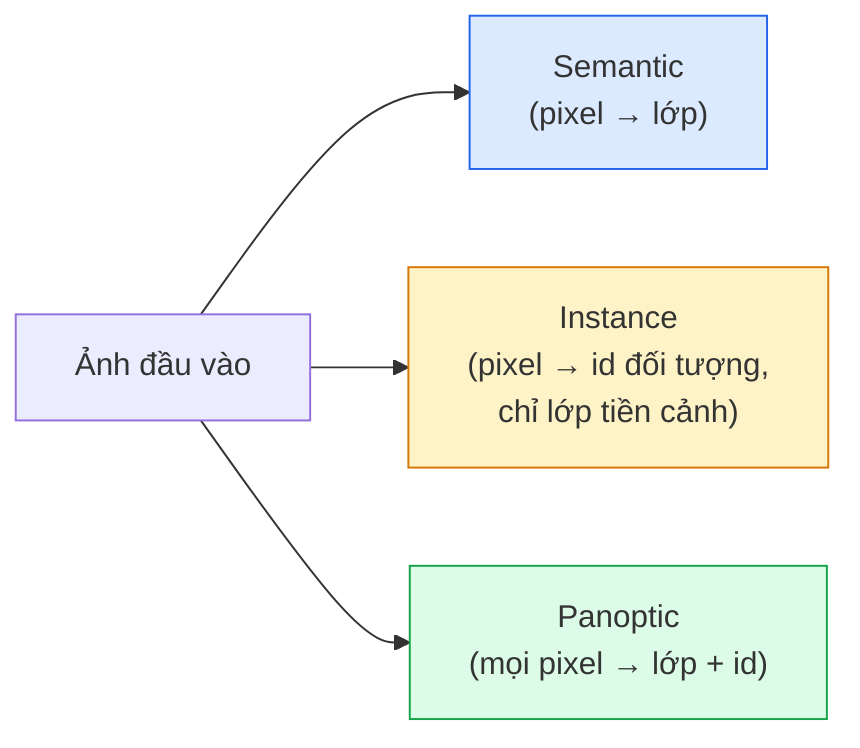
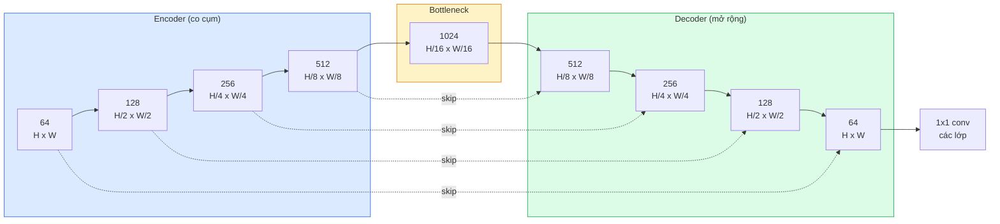

# Phân Đoạn Ngữ Nghĩa — U-Net (Semantic Segmentation — U-Net)

> Phân đoạn là bài toán phân loại tại từng pixel. U-Net giúp việc này hoạt động hiệu quả bằng cách ghép nối một bộ mã hóa giảm mẫu (downsampling encoder) với một bộ giải mã tăng mẫu (upsampling decoder) và kết nối các đường tắt (skip connections) giữa chúng.

**Type:** Build
**Languages:** Python
**Prerequisites:** Phase 4 Lesson 03 (CNNs), Phase 4 Lesson 04 (Image Classification)
**Time:** ~75 phút

## Learning Objectives

- Phân biệt phân đoạn ngữ nghĩa (semantic), phân đoạn thực thể (instance), và phân đoạn toàn cảnh (panoptic segmentation), đồng thời chọn đúng bài toán cho một vấn đề thực tế
- Tự xây dựng kiến trúc U-Net từ đầu trong PyTorch với các khối encoder, bottleneck, decoder dùng tích chập chuyển vị (transposed convolutions) hoặc bilinear upsample, và các kết nối tắt (skip connections)
- Cài đặt cross-entropy theo pixel, Dice loss, và hàm mất mát kết hợp (combined loss) vốn là tiêu chuẩn mặc định hiện nay trong phân đoạn y tế và công nghiệp
- Đọc hiểu các chỉ số IoU và Dice theo từng lớp, chẩn đoán xem điểm số thấp bắt nguồn từ độ bao phủ vật thể nhỏ (small-object recall), độ chính xác đường biên (boundary accuracy), hay do mất cân bằng lớp (class imbalance)

## Vấn Đề Đặt Ra (The Problem)

Phân loại ảnh xuất ra một nhãn duy nhất cho mỗi ảnh. Phát hiện đối tượng xuất ra một số ít bounding box cho mỗi ảnh. Phân đoạn hình ảnh xuất ra một nhãn cho từng pixel. Đối với ảnh đầu vào kích thước `H x W`, đầu ra là một tensor có kích thước `H x W` (semantic) hoặc `H x W x N_instances` (instance). Đó là hàng triệu dự đoán trên mỗi bức ảnh, chứ không phải chỉ một.

Cấu trúc của bài toán phân đoạn là lý do tại sao nó đóng vai trò cốt lõi trong hầu hết các sản phẩm thị giác dự đoán dày đặc (dense-prediction): chẩn đoán hình ảnh y tế (mặt nạ khối u), lái xe tự hành (mặt đường, làn đường, chướng ngại vật), viễn thám vệ tinh (ranh giới tòa nhà, ranh giới mùa màng), phân tích tài liệu (các vùng bố cục), robot học (vùng có thể cầm nắm). Không có tác vụ nào trong số đó có thể giải quyết được chỉ bằng cách vẽ một chiếc hộp bao quanh đối tượng; chúng cần đường viền bóng đen (silhouette) chính xác tuyệt đối.

Vấn đề kiến trúc rất dễ phát biểu nhưng không dễ giải quyết: bạn cần mạng nơ-ron vừa nhìn thấy ngữ cảnh toàn cục của hình ảnh (đây là cảnh gì) vừa thấy được chi tiết pixel cục bộ (chính xác pixel nào là mặt đường so với vỉa hè) cùng một lúc. Một CNN tiêu chuẩn nén không gian để thu được ngữ cảnh, điều này vô tình vứt bỏ các chi tiết tinh xảo. U-Net chính là thiết kế kiến trúc đạt được cả hai mục tiêu này.

## Khái Niệm Cốt Lõi (The Concept)

### Phân đoạn ngữ nghĩa vs thực thể vs toàn cảnh (Semantic vs instance vs panoptic)



- **Semantic** nói rằng: "pixel này là mặt đường, pixel kia là xe hơi." Hai chiếc xe hơi đỗ cạnh nhau sẽ hợp nhất thành một mảng đơn lẻ.
- **Instance** nói rằng: "pixel này thuộc xe hơi số 3, pixel kia thuộc xe hơi số 5." Bỏ qua các thành phần nền tảng ("stuff" = bầu trời, mặt đường, bãi cỏ).
- **Panoptic** thống nhất cả hai: mọi pixel đều nhận một nhãn lớp, mỗi thực thể nhận một định danh duy nhất, phân đoạn cả các thành phần nền (stuff) lẫn đồ vật riêng lẻ (things).

Bài học này tập trung vào phân đoạn ngữ nghĩa (semantic). Bài học tiếp theo (Mask R-CNN) sẽ bao quát phân đoạn thực thể (instance).

### Cấu trúc hình chữ U của U-Net



Encoder giảm một nửa độ phân giải không gian 4 lần và nhân đôi số kênh. Decoder làm ngược lại: nhân đôi độ phân giải không gian 4 lần và giảm một nửa số kênh. Các kết nối tắt (skip connections) nối ghép (concatenate) các đặc trưng tương ứng từ encoder sang decoder ở mỗi cấp độ phân giải. Tầng tích chập 1x1 cuối cùng ánh xạ `64 -> num_classes` ở độ phân giải gốc đầy đủ.

Tại sao skip connections là bắt buộc: khi decoder cố gắng xuất ra các dự đoán cấp pixel, nó chỉ mới nhìn thấy các bản đồ đặc trưng thu nhỏ. Nếu không có các kết nối tắt, nó không thể định vị chính xác các cạnh ranh giới vì thông tin độ phân giải cao đó đã bị nén mất trong quá trình encoder đi xuống. Skip connections chuyển giao trực tiếp các bản đồ đặc trưng độ phân giải cao mà encoder đã tính toán từ trước.

### Tích chập chuyển vị vs nội suy song tuyến tính (Transposed vs bilinear upsample)

Decoder phải mở rộng kích thước không gian. Có hai lựa chọn:

- **Transposed convolution** (`nn.ConvTranspose2d`) — tăng mẫu có thể học được tham số. Lựa chọn mặc định lịch sử của U-Net. Có thể tạo ra các vết nhiễu bàn cờ (checkerboard artifacts) nếu stride và kích thước kernel không chia hết cho nhau.
- **Bilinear upsample + 3x3 conv** — tăng mẫu mượt mà bằng nội suy song tuyến sau đó là một conv. Ít tạo vết nhiễu hơn, ít tham số hơn, hiện là lựa chọn mặc định hiện đại.

Cả hai cách đều xuất hiện trong thực tế. Đối với mô hình U-Net đầu tiên của bạn, bilinear an toàn và ổn định hơn.

### Hàm mất mát Cross-entropy trên lưới pixel

Đối với bài toán phân đoạn ngữ nghĩa với $C$ lớp, đầu ra mô hình có kích thước `(N, C, H, W)`. Nhãn mục tiêu có kích thước `(N, H, W)` với các số nguyên chỉ ID lớp. Cross-entropy hoàn toàn tương tự trường hợp phân loại, chỉ là được áp dụng tại mọi vị trí không gian:

```math
\text{Loss} = \mathop{\mathrm{mean}}\limits_{(n, h, w)} \left[ -\log\left( \mathop{\mathrm{softmax}}(\text{logits}[n, :, h, w])[\text{target}[n, h, w]] \right) \right]
```

Hàm `F.cross_entropy` trong PyTorch hỗ trợ trực tiếp hình dạng tensor này mà không cần biến đổi reshape.

### Dice loss và lý do bạn cần nó

Cross-entropy đối xử bình đẳng với mọi pixel. Điều đó là sai lầm khi một lớp chiếm phần lớn khung hình (chẳng hạn hình ảnh y tế: 99% diện tích là nền, chỉ 1% là khối u). Mạng có thể đạt 99% pixel accuracy chỉ bằng cách dự đoán tất cả là nền, nhưng mô hình đó hoàn toàn vô dụng.

Dice loss giải quyết triệt để điều này bằng cách tối ưu hóa trực tiếp độ chồng lấn giữa mặt nạ dự đoán và mặt nạ thực tế:

```math
\begin{aligned}
\mathop{\mathrm{Dice}}(p, y) &= \frac{2 \sum (p \cdot y)}{\sum p + \sum y + \epsilon} \\
\text{Dice}_{\text{loss}} &= 1 - \text{Dice}
\end{aligned}
```

trong đó `p` là bản đồ xác suất sigmoid/softmax cho một lớp và `y` là mặt nạ nhị phân ground-truth. Loss chỉ bằng 0 khi độ chồng lấn đạt hoàn hảo 100%. Vì Dice loss dựa trên tỷ lệ, hiện tượng mất cân bằng số lượng pixel giữa các lớp không còn là trở ngại.

Trong thực tế, người ta luôn sử dụng **hàm mất mát kết hợp (combined loss)**:

```math
L = L_{\text{cross\_entropy}} + \lambda \cdot L_{\text{dice}} \qquad (\lambda \approx 1)
```

Cross-entropy mang lại gradient ổn định trong giai đoạn đầu huấn luyện; Dice tập trung tinh chỉnh giai đoạn sau để khớp hoàn hảo hình dạng mặt nạ. Sự kết hợp này là tiêu chuẩn trong hình ảnh y tế và rất khó bị đánh bại trên bất kỳ tập dữ liệu mất cân bằng lớp nào.

### Các chỉ số đánh giá (Evaluation metrics)

- **Pixel accuracy** — tỷ lệ phần trăm pixel được dự đoán đúng. Tính toán rẻ. Bị sai lệch trên dữ liệu mất cân bằng giống như accuracy trong bài toán phân loại.
- **IoU per class** — intersection-over-union cho mặt nạ của từng lớp; trung bình qua các lớp = mIoU.
- **Dice (F1 trên pixel)** — tương tự IoU; $\text{Dice} = 2 \cdot \text{IoU} / (1 + \text{IoU})$. Y tế ưa chuộng Dice, lĩnh vực xe tự hành chuộng IoU; chúng có quan hệ đơn điệu với nhau.
- **Boundary F1** — đo lường mức độ sát sao giữa đường biên dự đoán và đường biên thực tế, phạt nặng ngay cả các sai lệch nhỏ. Rất quan trọng đối với các tác vụ yêu cầu độ chính xác cao như kiểm tra bán dẫn.

Hãy báo cáo IoU theo từng lớp, đừng chỉ dựa vào mIoU. Chỉ số mIoU trung bình có thể che giấu một lớp chỉ đạt 15% khi chín lớp khác đạt 85%.

### Sự đánh đổi về độ phân giải đầu vào

Encoder của U-Net giảm một nửa độ phân giải bốn lần, do đó các kết nối tắt chỉ khớp chính xác kích thước khi kích thước đầu vào chia hết cho 16. Các kích thước khác cần đệm thêm padding hoặc sử dụng resize trong khối up (Bước 2). Ảnh y tế thường là 512x512 hoặc 1024x1024. Ảnh cắt từ camera xe tự hành thường là 2048x1024. Chi phí bộ nhớ của U-Net tăng theo tỷ lệ `H * W * C_max`, và ở kích thước 1024x1024 với 1024 kênh tại bottleneck, lượt lan truyền xuôi đã tiêu tốn nhiều gigabyte VRAM.

Hai giải pháp xử lý tiêu chuẩn:
1. Chia ô ảnh (Tile the input) — xử lý các ô 256x256 có phần chồng lấn rồi ghép lại.
2. Thay thế bottleneck bằng các tích chập giãn nở (dilated convolutions) để giữ độ phân giải không gian cao hơn nhưng mở rộng vùng tiếp nhận (dòng kiến trúc DeepLab).

Đối với mô hình đầu tiên, đầu vào 256x256 với U-Net cơ sở 64 kênh có thể huấn luyện dễ dàng trên GPU 8 GB VRAM.

```figure
segmentation-flood
```

## Tự Xây Dựng (Build It)

### Bước 1: Khối Encoder (DoubleConv)

Hai tầng tích chập 3x3 kết hợp với batch norm và ReLU. Tích chập đầu tiên thay đổi số kênh; tích chập thứ hai giữ nguyên số kênh.

```python
import torch
import torch.nn as nn
import torch.nn.functional as F

class DoubleConv(nn.Module):
    def __init__(self, in_c, out_c):
        super().__init__()
        self.net = nn.Sequential(
            nn.Conv2d(in_c, out_c, kernel_size=3, padding=1, bias=False),
            nn.BatchNorm2d(out_c),
            nn.ReLU(inplace=True),
            nn.Conv2d(out_c, out_c, kernel_size=3, padding=1, bias=False),
            nn.BatchNorm2d(out_c),
            nn.ReLU(inplace=True),
        )

    def forward(self, x):
        return self.net(x)
```

Khối này được tái sử dụng xuyên suốt mạng. `bias=False` vì tham số beta của BatchNorm đã đảm nhiệm phần bias.

### Bước 2: Các khối Down và Up

```python
class Down(nn.Module):
    def __init__(self, in_c, out_c):
        super().__init__()
        self.net = nn.Sequential(
            nn.MaxPool2d(2),
            DoubleConv(in_c, out_c),
        )

    def forward(self, x):
        return self.net(x)


class Up(nn.Module):
    def __init__(self, in_c, out_c):
        super().__init__()
        self.up = nn.Upsample(scale_factor=2, mode="bilinear", align_corners=False)
        self.conv = DoubleConv(in_c, out_c)

    def forward(self, x, skip):
        x = self.up(x)
        if x.shape[-2:] != skip.shape[-2:]:
            x = F.interpolate(x, size=skip.shape[-2:], mode="bilinear", align_corners=False)
        x = torch.cat([skip, x], dim=1)
        return self.conv(x)
```

Kiểm tra kích thước chỉ trên chiều không gian (`shape[-2:]`) giúp xử lý các đầu vào có kích thước không chia hết cho 16; hàm `F.interpolate` an toàn sẽ căn chỉnh tensor trước khi ghép nối concat. Việc so sánh toàn bộ shape sẽ kích hoạt cả khi khác số kênh, điều đáng lẽ phải báo lỗi rõ ràng chứ không nên âm thầm nội suy.

### Bước 3: Kiến trúc hoàn chỉnh U-Net

```python
class UNet(nn.Module):
    def __init__(self, in_channels=3, num_classes=2, base=64):
        super().__init__()
        self.inc = DoubleConv(in_channels, base)
        self.d1 = Down(base, base * 2)
        self.d2 = Down(base * 2, base * 4)
        self.d3 = Down(base * 4, base * 8)
        self.d4 = Down(base * 8, base * 16)
        self.u1 = Up(base * 16 + base * 8, base * 8)
        self.u2 = Up(base * 8 + base * 4, base * 4)
        self.u3 = Up(base * 4 + base * 2, base * 2)
        self.u4 = Up(base * 2 + base, base)
        self.outc = nn.Conv2d(base, num_classes, kernel_size=1)

    def forward(self, x):
        x1 = self.inc(x)
        x2 = self.d1(x1)
        x3 = self.d2(x2)
        x4 = self.d3(x3)
        x5 = self.d4(x4)
        x = self.u1(x5, x4)
        x = self.u2(x, x3)
        x = self.u3(x, x2)
        x = self.u4(x, x1)
        return self.outc(x)

net = UNet(in_channels=3, num_classes=2, base=32)
x = torch.randn(1, 3, 256, 256)
print(f"output: {net(x).shape}")
print(f"params: {sum(p.numel() for p in net.parameters()):,}")
```

Kích thước đầu ra: `(1, 2, 256, 256)` — cùng kích thước không gian với đầu vào, với `num_classes` kênh. Khoảng 7.7 triệu tham số tại `base=32`.

### Bước 4: Các hàm mất mát

```python
def dice_loss(logits, targets, num_classes, eps=1e-6):
    probs = F.softmax(logits, dim=1)
    targets_one_hot = F.one_hot(targets, num_classes).permute(0, 3, 1, 2).float()
    dims = (0, 2, 3)
    intersection = (probs * targets_one_hot).sum(dim=dims)
    denom = probs.sum(dim=dims) + targets_one_hot.sum(dim=dims)
    dice = (2 * intersection + eps) / (denom + eps)
    return 1 - dice.mean()


def combined_loss(logits, targets, num_classes, lam=1.0):
    ce = F.cross_entropy(logits, targets)
    dc = dice_loss(logits, targets, num_classes)
    return ce + lam * dc, {"ce": ce.item(), "dice": dc.item()}
```

Dice được tính riêng cho từng lớp sau đó lấy trung bình (macro Dice). Giá trị `eps` giúp ngăn chặn lỗi chia cho 0 đối với các lớp không xuất hiện trong batch.

### Bước 5: Đo lường chỉ số IoU

```python
@torch.no_grad()
def iou_per_class(logits, targets, num_classes):
    preds = logits.argmax(dim=1)
    ious = torch.zeros(num_classes)
    for c in range(num_classes):
        pred_c = (preds == c)
        true_c = (targets == c)
        inter = (pred_c & true_c).sum().float()
        union = (pred_c | true_c).sum().float()
        ious[c] = (inter / union) if union > 0 else torch.tensor(float("nan"))
    return ious
```

Trả về một vector độ dài C. Giá trị `nan` đánh dấu các lớp vắng mặt trong batch — đừng tính trung bình trên các giá trị đó khi tính mIoU.

### Bước 6: Tập dữ liệu tổng hợp để kiểm chứng end-to-end

Tạo các hình học ngẫu nhiên trên nền màu để mạng buộc phải học hình dạng chứ không phải màu sắc điểm ảnh:

```python
import numpy as np
from torch.utils.data import Dataset, DataLoader

def synthetic_segmentation(num_samples=200, size=64, seed=0):
    rng = np.random.default_rng(seed)
    images = np.zeros((num_samples, size, size, 3), dtype=np.float32)
    masks = np.zeros((num_samples, size, size), dtype=np.int64)
    for i in range(num_samples):
        bg = rng.uniform(0, 1, (3,))
        images[i] = bg
        masks[i] = 0
        num_shapes = rng.integers(1, 4)
        for _ in range(num_shapes):
            cls = int(rng.integers(1, 3))
            color = rng.uniform(0, 1, (3,))
            cx, cy = rng.integers(10, size - 10, size=2)
            r = int(rng.integers(4, 12))
            yy, xx = np.meshgrid(np.arange(size), np.arange(size), indexing="ij")
            if cls == 1:
                mask = (xx - cx) ** 2 + (yy - cy) ** 2 < r ** 2
            else:
                mask = (np.abs(xx - cx) < r) & (np.abs(yy - cy) < r)
            images[i][mask] = color
            masks[i][mask] = cls
        images[i] += rng.normal(0, 0.02, images[i].shape)
        images[i] = np.clip(images[i], 0, 1)
    return images, masks


class SegDataset(Dataset):
    def __init__(self, images, masks):
        self.images = images
        self.masks = masks

    def __len__(self):
        return len(self.images)

    def __getitem__(self, i):
        img = torch.from_numpy(self.images[i]).permute(2, 0, 1).float()
        mask = torch.from_numpy(self.masks[i]).long()
        return img, mask
```

Ba lớp đối tượng: nền (0), hình tròn (1), hình vuông (2). Mạng nơ-ron phải học cách phân biệt hình khối.

### Bước 7: Vòng lặp huấn luyện

```python
def train_one_epoch(model, loader, optimizer, device, num_classes):
    model.train()
    loss_sum, total = 0.0, 0
    iou_sum = torch.zeros(num_classes)
    for x, y in loader:
        x, y = x.to(device), y.to(device)
        logits = model(x)
        loss, _ = combined_loss(logits, y, num_classes)
        optimizer.zero_grad()
        loss.backward()
        optimizer.step()
        loss_sum += loss.item() * x.size(0)
        total += x.size(0)
        iou_sum += iou_per_class(logits, y, num_classes).nan_to_num(0)
    return loss_sum / total, iou_sum / len(loader)
```

Chạy quy trình này trong 10-30 epoch trên tập dữ liệu tổng hợp và quan sát mIoU vượt ngưỡng 0.9 đối với các lớp hình dạng. Lưu ý rằng `nan_to_num(0)` coi các lớp vắng mặt trong một batch có IoU bằng 0; để tính IoU chính xác cho từng lớp, hãy lọc theo sự hiện diện và sử dụng `torch.nanmean` trên các batch tại thời điểm đánh giá thay vì lấy trung bình cộng đơn thuần ở đây.

## Sử Dụng Thực Tế (Use It)

Trong môi trường sản xuất, thư viện `segmentation_models_pytorch` ("smp") đóng gói sẵn mọi kiến trúc phân đoạn tiêu chuẩn với bất kỳ backbone nào từ torchvision hoặc timm. Chỉ cần ba dòng lệnh:

```python
import segmentation_models_pytorch as smp

model = smp.Unet(
    encoder_name="resnet34",
    encoder_weights="imagenet",
    in_channels=3,
    classes=3,
)
```

Những kiến trúc cũng rất đáng nắm vững trong công việc thực tế:
- **DeepLabV3+** thay thế max-pooling bằng các tích chập giãn nở (dilated convs) để bottleneck giữ nguyên độ phân giải; cho đường biên sắc nét hơn trên dữ liệu ảnh vệ tinh và xe tự hành.
- **SegFormer** thay thế encoder tích chập bằng transformer phân cấp (hierarchical transformer); hiện là SOTA trên nhiều bảng xếp hạng chuẩn.
- **Mask2Former** / **OneFormer** thống nhất cả ba bài toán phân đoạn ngữ nghĩa, thực thể và toàn cảnh trong một kiến trúc duy nhất.

Cả ba kiến trúc này đều là các giải pháp thay thế trực tiếp (drop-in replacements) trong `smp` hoặc `transformers` với cùng bộ nạp dữ liệu data loader.

## Sản Phẩm Đầu Ra (Ship It)

Bài học này tạo ra:

- `outputs/prompt-segmentation-task-picker.md` — một prompt giúp lựa chọn giữa phân đoạn ngữ nghĩa, thực thể, và toàn cảnh, đồng thời gợi ý kiến trúc phù hợp cho một tác vụ nhất định.
- `outputs/skill-segmentation-mask-inspector.md` — một kỹ năng (skill) báo cáo phân phối lớp, các số liệu thống kê mặt nạ dự đoán, và chỉ ra các lớp bị dự đoán thiếu hoặc bị nhòe ranh giới.

## Bài Tập Thực Hành (Exercises)

1. **(Dễ)** Cài đặt `bce_dice_loss` cho tác vụ phân đoạn nhị phân (tiền cảnh vs hậu cảnh). Xác minh trên tập dữ liệu hai lớp tổng hợp rằng hàm mất mát kết hợp hội tụ nhanh hơn BCE đơn thuần khi tiền cảnh chỉ chiếm 5% số lượng pixel.
2. **(Trung bình)** Thay thế khối up-block `nn.Upsample + conv` bằng khối `nn.ConvTranspose2d`. Huấn luyện cả hai trên tập dữ liệu tổng hợp và so sánh mIoU. Quan sát các vị trí xuất hiện vết nhiễu bàn cờ (checkerboard artifacts) ở phiên bản dùng tích chập chuyển vị.
3. **(Khó)** Lấy một tập dữ liệu phân đoạn thực tế (Oxford-IIIT Pets, tập con Cityscapes mini, hoặc một tập dữ liệu y tế) và huấn luyện U-Net đạt chênh lệch không quá 2 điểm IoU so với mô hình tham chiếu `smp.Unet`. Báo cáo IoU từng lớp và xác định lớp nào hưởng lợi nhiều nhất từ việc bổ sung Dice vào hàm mất mát.

## Thuật Ngữ Then Chốt (Key Terms)

| Thuật ngữ | Cách gọi thông thường | Ý nghĩa kỹ thuật thực sự |
|-----------|----------------------|--------------------------|
| Semantic segmentation | "Gán nhãn mọi pixel" | Phân loại từng pixel thành C lớp; các thực thể cùng lớp sẽ hợp nhất làm một |
| Instance segmentation | "Gán nhãn mọi đối tượng" | Phân tách các thực thể riêng biệt của cùng một lớp; chỉ áp dụng cho tiền cảnh |
| Panoptic segmentation | "Semantic + instance" | Mọi pixel đều có nhãn lớp; mỗi thực thể rời rạc đều có thêm một ID duy nhất |
| Skip connection | "Cầu nối U-Net" | Ghép nối các đặc trưng của encoder vào các đặc trưng decoder có cùng độ phân giải; bảo toàn chi tiết tần số cao |
| Transposed conv | "Tích chập giải mã" | Tăng mẫu có thể học tham số; dễ gây ra hiện tượng vết nhiễu bàn cờ |
| Dice loss | "Hàm mất mát chồng lấn" | 1 - 2\|A ∩ B\| / (\|A\| + \|B\|); tối ưu trực tiếp độ trùng khít của mặt nạ và miễn nhiễm với mất cân bằng lớp |
| mIoU | "IoU trung bình" | Trung bình chỉ số IoU qua các lớp; thước đo tiêu chuẩn cộng đồng cho bài toán phân đoạn |
| Boundary F1 | "Độ chính xác đường viền" | Điểm F1 chỉ tính riêng trên các pixel thuộc đường biên; quan trọng cho các tác vụ cần độ chuẩn xác vi mô |

## Đọc Thêm (Further Reading)

- [U-Net: Convolutional Networks for Biomedical Image Segmentation (Ronneberger et al., 2015)](https://arxiv.org/abs/1505.04597) — bài báo gốc; sơ đồ kiến trúc kinh điển mà mọi người sao chép nằm ở trang 2
- [Fully Convolutional Networks (Long et al., 2015)](https://arxiv.org/abs/1411.4038) — bài báo đầu tiên biến phân đoạn hình ảnh thành bài toán tích chập end-to-end
- [segmentation_models_pytorch](https://github.com/qubvel/segmentation_models.pytorch) — thư viện tham khảo cho phân đoạn cấp sản phẩm; mọi kiến trúc và hàm mất mát chuẩn
- [iafoss, Unet34 submission with TTA (Kaggle notebook)](https://www.kaggle.com/code/iafoss/unet34-submission-tta-0-699-new-public-lb) — kỹ thuật test-time augmentation (TTA) cho U-Net trong một cuộc thi phân đoạn thực tế

