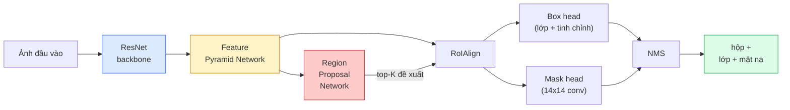

# Phân Đoạn Thực Thể — Mask R-CNN (Instance Segmentation — Mask R-CNN)

> Thêm một nhánh mặt nạ (mask branch) nhỏ vào bộ phát hiện Faster R-CNN và bạn sẽ có một bộ phân đoạn thực thể. Phần khó nhất nằm ở RoIAlign, và nó tinh vi hơn vẻ bề ngoài rất nhiều.

**Type:** Build + Learn
**Languages:** Python
**Prerequisites:** Phase 4 Lesson 06 (YOLO), Phase 4 Lesson 07 (U-Net)
**Time:** ~75 phút

## Learning Objectives

- Lần theo toàn bộ quy trình kiến trúc Mask R-CNN từ đầu đến cuối: backbone, FPN, RPN, RoIAlign, box head, mask head
- Tự cài đặt thuật toán RoIAlign từ đầu và giải thích lý do tại sao RoIPool không còn được sử dụng
- Sử dụng mô hình tiền huấn luyện `maskrcnn_resnet50_fpn_v2` trong torchvision để tạo các mặt nạ thực thể chất lượng thương phẩm và đọc hiểu đúng định dạng đầu ra của nó
- Tinh chỉnh (fine-tune) Mask R-CNN trên một tập dữ liệu tùy chỉnh quy mô nhỏ bằng cách thay thế box head và mask head trong khi vẫn đóng băng backbone

## Vấn Đề Đặt Ra (The Problem)

Phân đoạn ngữ nghĩa (semantic segmentation) cung cấp cho bạn một mặt nạ cho mỗi lớp. Phân đoạn thực thể (instance segmentation) cung cấp cho bạn một mặt nạ cho từng đối tượng riêng biệt, ngay cả khi hai đối tượng thuộc cùng một lớp. Việc đếm số lượng cá thể, theo dõi qua các khung hình video, và đo lường kích thước các vật thể (bounding box của từng viên gạch trên bức tường, từng tế bào dưới kính hiển vi) đều bắt buộc phải sử dụng phân đoạn thực thể.

Mask R-CNN (He et al., 2017) đã giải quyết vấn đề này bằng cách tái định nghĩa phân đoạn thực thể thành bài toán phát hiện-cộng-thêm-mặt-nạ (detection-plus-a-mask). Thiết kế này tinh tế đến mức trong suốt năm năm tiếp theo, hầu như mọi bài báo nghiên cứu về phân đoạn thực thể đều là các biến thể của Mask R-CNN, và bản cài đặt trong thư viện torchvision hiện vẫn là tiêu chuẩn mặc định cho các tập dữ liệu từ nhỏ đến trung bình trong sản xuất.

Vấn đề kỹ thuật hóc búa ở đây là việc lấy mẫu (sampling): làm thế nào để cắt trích xuất một vùng đặc trưng có kích thước cố định từ một bounding box đề xuất mà các góc của nó không nằm khớp với ranh giới của các pixel nguyên? Xử lý sai điều này sẽ làm giảm nhiều phần mười điểm mAP ở khắp mọi nơi. RoIAlign chính là câu trả lời triệt để.

## Khái Niệm Cốt Lõi (The Concept)

### Kiến trúc tổng thể



Năm thành phần cốt lõi cần nắm vững:

1. **Backbone** — ResNet-50 hoặc ResNet-101 được huấn luyện trên ImageNet. Tạo ra một hệ thống phân cấp các bản đồ đặc trưng ở các bước nhảy (stride) 4, 8, 16, 32.
2. **FPN (Feature Pyramid Network)** — các kết nối từ trên xuống (top-down) và kết nối ngang (lateral) giúp mỗi cấp độ sở hữu C kênh đặc trưng giàu thông tin ngữ nghĩa. Việc phát hiện sẽ truy vấn cấp độ FPN tương ứng với kích thước đối tượng.
3. **RPN (Region Proposal Network)** — một head tích chập nhỏ dự đoán tại mỗi vị trí anchor: "ở đây có đối tượng không?" và "cần tinh chỉnh hộp như thế nào?". RPN xuất ra khoảng 1.000 đề xuất (proposals) cho mỗi ảnh.
4. **RoIAlign** — lấy mẫu một mảng đặc trưng kích thước cố định (ví dụ: 7x7) từ bất kỳ hộp nào trên bất kỳ cấp độ FPN nào bằng nội suy song tuyến (bilinear sampling), không làm tròn số lượng tử hóa.
5. **Heads** — box head gồm hai tầng giúp tinh chỉnh tọa độ hộp và dự đoán lớp, cộng với một conv head nhỏ xuất ra một mặt nạ nhị phân kích thước `28x28` cho mỗi vùng đề xuất.

### Tại sao dùng RoIAlign thay vì RoIPool

Mô hình Fast R-CNN ban đầu sử dụng RoIPool, kỹ thuật chia một bounding box đề xuất thành một lưới ô, lấy giá trị đặc trưng lớn nhất trong mỗi ô và làm tròn tất cả các tọa độ thành số nguyên. Việc làm tròn đó khiến bản đồ đặc trưng bị lệch so với tọa độ pixel ảnh gốc lên tới cả một pixel bản đồ đặc trưng — sai lệch nhỏ trên ảnh 224x224, nhưng thảm khốc khi bản đồ đặc trưng có stride là 32.

```text
RoIPool:
  hộp (34.7, 51.3, 98.2, 142.9)
  làm tròn -> (34, 51, 98, 142)
  chia lưới ô -> làm tròn từng ranh giới ô
  sai lệch tích lũy tại mỗi bước tính toán

RoIAlign:
  hộp (34.7, 51.3, 98.2, 142.9)
  lấy mẫu tại chính xác tọa độ thực float bằng nội suy song tuyến
  hoàn toàn không làm tròn ở bất kỳ bước nào
```

RoIAlign giúp tăng điểm AP của mặt nạ thêm 3-4 điểm trên COCO mà không tốn thêm chi phí tham số. Mọi bộ phát hiện chú trọng định vị chính xác hiện nay đều sử dụng nó — từ YOLOv7 seg, RT-DETR, cho tới Mask2Former.

### RPN gói gọn trong một đoạn văn

Tại mỗi vị trí trên bản đồ đặc trưng, đặt K anchor box với các kích thước và tỷ lệ khung hình khác nhau. Dự đoán một điểm objectness cho mỗi anchor và các độ lệch hồi quy để biến đổi anchor thành một hộp vừa vặn hơn. Giữ lại khoảng 1.000 hộp có điểm cao nhất, áp dụng NMS ở ngưỡng IoU 0.7, và chuyển các hộp còn lại sang các head tiếp theo. RPN được huấn luyện với hàm mất mát mini riêng — có cùng cấu trúc với loss của YOLO từ Bài 6, chỉ khác là chỉ có hai lớp (có đối tượng / không có đối tượng).

### Nhánh mặt nạ (The mask head)

Đối với mỗi vùng đề xuất (sau khi qua RoIAlign), mask head là một mạng tích chập toàn phần (FCN) nhỏ: bốn tầng conv 3x3, một tầng deconv phóng đại 2x, và một conv 1x1 cuối cùng tạo ra `num_classes` kênh đầu ra ở độ phân giải `28x28`. Chỉ kênh tương ứng với lớp được dự đoán mới được giữ lại; các kênh khác bị bỏ qua. Điều này giúp tách biệt việc dự đoán mặt nạ khỏi bài toán phân loại lớp.

Tăng mẫu (upsample) mặt nạ 28x28 về kích thước pixel gốc của vùng đề xuất để tạo ra mặt nạ nhị phân cuối cùng.

### Các hàm mất mát (Losses)

Mask R-CNN cộng tổng năm thành phần mất mát lại với nhau:

```math
L = L_{\text{rpn\_cls}} + L_{\text{rpn\_box}} + L_{\text{box\_cls}} + L_{\text{box\_reg}} + L_{\text{mask}}
```

- `L_rpn_cls`, `L_rpn_box` — mất mát objectness + hồi quy hộp cho các đề xuất của RPN.
- `L_box_cls` — cross-entropy qua (C+1) lớp (bao gồm cả lớp nền) trên bộ phân loại của head.
- `L_box_reg` — smooth L1 trên phần tinh chỉnh bounding box của head.
- `L_mask` — binary cross-entropy theo từng pixel trên đầu ra mặt nạ 28x28.

Mỗi hàm mất mát đều có trọng số mặc định riêng; bản cài đặt torchvision cho phép điều chỉnh chúng qua các tham số khởi tạo.

### Định dạng đầu ra (Output format)

Mô hình `torchvision.models.detection.maskrcnn_resnet50_fpn_v2` trả về một danh sách các dictionary, mỗi dict tương ứng với một ảnh:

```text
{
    "boxes":  (N, 4) theo tọa độ pixel (x1, y1, x2, y2),
    "labels": (N,) ID các lớp, 0 = nền (background) nên chỉ số lớp bắt đầu từ 1,
    "scores": (N,) điểm tin cậy (confidence scores),
    "masks":  (N, 1, H, W) mặt nạ float trong khoảng [0, 1] — lọc ngưỡng tại 0.5 để thành nhị phân,
}
```

Mặt nạ đã ở độ phân giải đầy đủ của hình ảnh gốc. Đầu ra 28x28 của head đã được tự động nội suy tăng mẫu từ bên trong.

```figure
cv3-roialign-sampling
```

## Tự Xây Dựng (Build It)

### Bước 1: Tự cài đặt RoIAlign từ đầu

Đây là thành phần duy nhất của Mask R-CNN dễ hiểu hơn khi đọc code thay vì đọc lý thuyết suông.

```python
import torch
import torch.nn.functional as F

def roi_align_single(feature, box, output_size=7, spatial_scale=1 / 16.0):
    """
    feature: (C, H, W) bản đồ đặc trưng của một ảnh đơn
    box: (x1, y1, x2, y2) theo tọa độ pixel của ảnh gốc
    output_size: kích thước cạnh lưới đầu ra (7 cho box head, 14 cho mask head)
    spatial_scale: nghịch đảo của stride của bản đồ đặc trưng
    """
    C, H, W = feature.shape
    x1, y1, x2, y2 = [c * spatial_scale - 0.5 for c in box]
    bin_w = (x2 - x1) / output_size
    bin_h = (y2 - y1) / output_size

    grid_y = torch.linspace(y1 + bin_h / 2, y2 - bin_h / 2, output_size)
    grid_x = torch.linspace(x1 + bin_w / 2, x2 - bin_w / 2, output_size)
    yy, xx = torch.meshgrid(grid_y, grid_x, indexing="ij")

    gx = 2 * (xx + 0.5) / W - 1
    gy = 2 * (yy + 0.5) / H - 1
    grid = torch.stack([gx, gy], dim=-1).unsqueeze(0)
    sampled = F.grid_sample(feature.unsqueeze(0), grid, mode="bilinear",
                            align_corners=False)
    return sampled.squeeze(0)
```

Mọi con số đều nằm ở vị trí được lấy mẫu song tuyến tính. Không làm tròn, không lượng tử hóa, không làm mất gradient.

### Bước 2: So sánh với RoIAlign của torchvision

```python
from torchvision.ops import roi_align

feature = torch.randn(1, 16, 50, 50)
boxes = torch.tensor([[0, 10, 20, 100, 90]], dtype=torch.float32)  # (batch_idx, x1, y1, x2, y2)

ours = roi_align_single(feature[0], boxes[0, 1:].tolist(), output_size=7, spatial_scale=1/4)
theirs = roi_align(feature, boxes, output_size=(7, 7), spatial_scale=1/4, sampling_ratio=1, aligned=True)[0]

print(f"shape ours:   {tuple(ours.shape)}")
print(f"shape theirs: {tuple(theirs.shape)}")
print(f"max|diff|:    {(ours - theirs).abs().max().item():.3e}")
```

Với thiết lập `sampling_ratio=1` và `aligned=True`, hai kết quả khớp nhau với độ lệch nhỏ hơn `1e-5`.

### Bước 3: Nạp một mô hình Mask R-CNN tiền huấn luyện

```python
import torch
from torchvision.models.detection import maskrcnn_resnet50_fpn_v2, MaskRCNN_ResNet50_FPN_V2_Weights

model = maskrcnn_resnet50_fpn_v2(weights=MaskRCNN_ResNet50_FPN_V2_Weights.DEFAULT)
model.eval()
print(f"params: {sum(p.numel() for p in model.parameters()):,}")
print(f"classes (including background): {len(model.roi_heads.box_predictor.cls_score.out_features * [0])}")
```

46 triệu tham số, 91 lớp (COCO). Lớp đầu tiên (ID 0) là background; mọi lớp mà mô hình thực sự phát hiện bắt đầu từ ID 1.

### Bước 4: Chạy suy luận (Inference)

```python
with torch.no_grad():
    x = torch.randn(3, 400, 600)
    predictions = model([x])
p = predictions[0]
print(f"boxes:  {tuple(p['boxes'].shape)}")
print(f"labels: {tuple(p['labels'].shape)}")
print(f"scores: {tuple(p['scores'].shape)}")
print(f"masks:  {tuple(p['masks'].shape)}")
```

Tensor mặt nạ có hình dạng `(N, 1, H, W)`. Lọc ngưỡng tại 0.5 để thu được mặt nạ nhị phân cho từng đối tượng:

```python
binary_masks = (p['masks'] > 0.5).squeeze(1)  # (N, H, W) boolean
```

### Bước 5: Thay thế các head cho số lượng lớp tùy chỉnh

Công thức tinh chỉnh phổ biến: tái sử dụng backbone, FPN, và RPN; thay thế hai classifier head.

```python
from torchvision.models.detection.faster_rcnn import FastRCNNPredictor
from torchvision.models.detection.mask_rcnn import MaskRCNNPredictor

def build_custom_maskrcnn(num_classes):
    model = maskrcnn_resnet50_fpn_v2(weights=MaskRCNN_ResNet50_FPN_V2_Weights.DEFAULT)
    in_features = model.roi_heads.box_predictor.cls_score.in_features
    model.roi_heads.box_predictor = FastRCNNPredictor(in_features, num_classes)
    in_features_mask = model.roi_heads.mask_predictor.conv5_mask.in_channels
    hidden_layer = 256
    model.roi_heads.mask_predictor = MaskRCNNPredictor(in_features_mask, hidden_layer, num_classes)
    return model

custom = build_custom_maskrcnn(num_classes=5)
print(f"custom cls_score.out_features: {custom.roi_heads.box_predictor.cls_score.out_features}")
```

`num_classes` phải bao gồm cả lớp nền, vì vậy một tập dữ liệu có 4 lớp đối tượng sẽ cần cấu hình `num_classes=5`.

### Bước 6: Đóng băng những thành phần không cần huấn luyện

Trên các tập dữ liệu nhỏ, hãy đóng băng backbone và FPN. Chỉ cho phép các nhánh objectness + hồi quy của RPN và hai head học tham số mới:

```python
def freeze_backbone_and_fpn(model):
    # torchvision Mask R-CNN đóng gói FPN bên trong `model.backbone` (dưới dạng
    # `model.backbone.fpn`), do đó duyệt qua `model.backbone.parameters()` sẽ bao quát
    # cả các tầng đặc trưng ResNet lẫn các conv ngang/đầu ra của FPN.
    for p in model.backbone.parameters():
        p.requires_grad = False
    return model

custom = freeze_backbone_and_fpn(custom)
trainable = sum(p.numel() for p in custom.parameters() if p.requires_grad)
print(f"trainable after freeze: {trainable:,}")
```

Trên các tập dữ liệu khoảng 500 ảnh, bước này tạo ra sự khác biệt giữa mô hình hội tụ tốt hay bị overfitting nghiêm trọng.

## Sử Dụng Thực Tế (Use It)

Vòng lặp huấn luyện đầy đủ cho Mask R-CNN trong torchvision chỉ khoảng 40 dòng và không thay đổi nhiều giữa các tác vụ — chỉ cần đổi dataset là có thể chạy ngay.

```python
def train_step(model, images, targets, optimizer):
    model.train()
    loss_dict = model(images, targets)
    losses = sum(loss for loss in loss_dict.values())
    optimizer.zero_grad()
    losses.backward()
    optimizer.step()
    return {k: v.item() for k, v in loss_dict.items()}
```

Danh sách `targets` phải chứa các dict cho từng ảnh với `boxes`, `labels`, và `masks` (dưới dạng tensor nhị phân `(num_instances, H, W)`). Mô hình trả về một dict gồm 5 hàm mất mát khi đang huấn luyện và trả về danh sách các dự đoán khi đánh giá, dựa trên cờ `model.training`.

Bộ đánh giá `pycocotools` tạo ra điểm mAP@IoU=0.5:0.95 cho cả bounding box lẫn mask; bạn cần cả hai con số này để biết box head hay mask head đang là điểm nghẽn của hệ thống.

## Sản Phẩm Đầu Ra (Ship It)

Bài học này tạo ra:

- `outputs/prompt-instance-vs-semantic-router.md` — một prompt đặt ba câu hỏi và đưa ra lựa chọn giữa phân đoạn thực thể, ngữ nghĩa, hoặc toàn cảnh cùng với kiến trúc mô hình chính xác để bắt đầu.
- `outputs/skill-mask-rcnn-head-swapper.md` — một kỹ năng (skill) tạo ra 10 dòng mã để thay thế các head trên bất kỳ mô hình phát hiện nào trong torchvision, dựa trên số lượng `num_classes` mới.

## Bài Tập Thực Hành (Exercises)

1. **(Dễ)** Xác minh cài đặt RoIAlign của bạn với `torchvision.ops.roi_align` trên 100 bounding box ngẫu nhiên. Báo cáo chênh lệch tuyệt đối tối đa. Đồng thời chạy RoIPool (hành vi trước năm 2017) và chứng minh rằng nó bị lệch khoảng 1-2 pixel bản đồ đặc trưng trên các hộp gần ranh giới viền.
2. **(Trung bình)** Tinh chỉnh `maskrcnn_resnet50_fpn_v2` trên một tập dữ liệu tùy chỉnh gồm 50 ảnh (hai lớp bất kỳ: bóng bay, cá, ổ gà, logo). Đóng băng backbone, huấn luyện trong 20 epoch, và báo cáo điểm mask AP@0.5.
3. **(Khó)** Thay thế mask head của Mask R-CNN bằng một head dự đoán ở độ phân giải 56x56 thay vì 28x28. Đo mAP@IoU=0.75 trước và sau khi thay thế. Giải thích tại sao mức cải thiện (hoặc không cải thiện) khớp với sự đánh đổi giữa độ chính xác đường biên và chi phí bộ nhớ.

## Thuật Ngữ Then Chốt (Key Terms)

| Thuật ngữ | Cách gọi thông thường | Ý nghĩa kỹ thuật thực sự |
|-----------|----------------------|--------------------------|
| Mask R-CNN | "Phát hiện cộng mặt nạ" | Faster R-CNN + một head FCN nhỏ dự đoán mặt nạ 28x28 cho mỗi vùng đề xuất trên từng lớp |
| FPN | "Kim tự tháp đặc trưng" | Các kết nối từ trên xuống và kết nối ngang cung cấp các kênh đặc trưng giàu ngữ nghĩa tại mọi cấp độ bước nhảy |
| RPN | "Bộ đề xuất vùng" | Một conv head nhỏ tạo ra khoảng 1.000 đề xuất đối tượng/không có đối tượng cho mỗi ảnh |
| RoIAlign | "Cắt trích xuất không làm tròn" | Lấy mẫu song tuyến một lưới đặc trưng kích thước cố định từ bất kỳ bounding box tọa độ float nào |
| RoIPool | "Kỹ thuật cắt trước năm 2017" | Cùng mục đích với RoIAlign nhưng làm tròn tọa độ hộp thành số nguyên; nay đã lỗi thời |
| Mask AP | "mAP cho thực thể" | Average precision được tính bằng mask IoU thay vì box IoU; thước đo chuẩn của tập COCO cho phân đoạn thực thể |
| Binary mask head | "Mặt nạ theo từng lớp" | Dự đoán một mặt nạ nhị phân cho mỗi lớp trên từng đề xuất; chỉ giữ lại kênh của lớp được phân loại |
| Background class | "Lớp 0" | Lớp "không có đối tượng" đại diện cho nền; các chỉ số của lớp đối tượng thật bắt đầu từ 1 |

## Đọc Thêm (Further Reading)

- [Mask R-CNN (He et al., 2017)](https://arxiv.org/abs/1703.06870) — bài báo gốc; mục 3 về RoIAlign là phần bắt buộc phải đọc
- [FPN: Feature Pyramid Networks (Lin et al., 2017)](https://arxiv.org/abs/1612.03144) — bài báo giới thiệu FPN; mọi detector hiện đại đều kế thừa
- [torchvision Mask R-CNN tutorial](https://pytorch.org/tutorials/intermediate/torchvision_tutorial.html) — tài liệu tham khảo chuẩn cho vòng lặp tinh chỉnh mô hình
- [Detectron2 model zoo](https://github.com/facebookresearch/detectron2/blob/main/MODEL_ZOO.md) — các bản cài đặt cấp sản phẩm với trọng số đã huấn luyện cho hầu hết các biến thể phát hiện và phân đoạn

