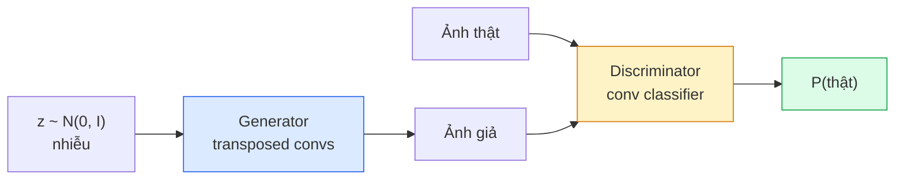
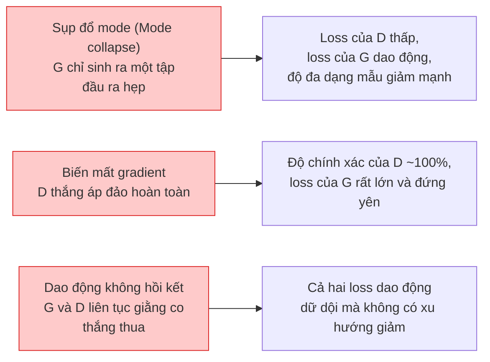

# Sinh Ảnh — Mạng Đối Nghịch Tạo Sinh GAN (Image Generation — GANs)

> Một mô hình GAN bao gồm hai mạng nơ-ron cùng tham gia một trò chơi có tổng bằng không. Một mạng vẽ tranh, một mạng phê bình. Cả hai cùng tiến bộ cùng nhau cho đến khi các bức vẽ đánh lừa được nhà phê bình.

**Type:** Build
**Languages:** Python
**Prerequisites:** Phase 4 Lesson 03 (CNNs), Phase 3 Lesson 06 (Optimizers), Phase 3 Lesson 07 (Regularization)
**Time:** ~75 phút

## Learning Objectives

- Giải thích trò chơi minimax giữa bộ tạo (generator) và bộ phân biệt (discriminator) và lý do tại sao điểm cân bằng tương ứng với $p_{\text{model}} = p_{\text{data}}$
- Cài đặt một mạng DCGAN trong PyTorch và sinh ra các hình ảnh tổng hợp 32x32 mạch lạc trong chưa đầy 60 dòng lệnh
- Ổn định quá trình huấn luyện GAN với ba kỹ thuật chuẩn: hàm mất mát không bão hòa (non-saturating loss), chuẩn hóa phổ (spectral norm), và quy tắc cập nhật hai thang thời gian (two-timescale update rule - TTUR)
- Đọc hiểu các đường cong huấn luyện để phân biệt sự hội tụ lành mạnh với hiện tượng sụp đổ mode (mode collapse), dao động (oscillation), và tình trạng discriminator áp đảo hoàn toàn

## Vấn Đề Đặt Ra (The Problem)

Bài toán phân loại dạy một mạng nơ-ron ánh xạ hình ảnh thành các nhãn. Sinh ảnh đảo ngược bài toán đó: lấy mẫu các bức ảnh mới trông như thể chúng được rút ra từ cùng một phân phối dữ liệu gốc. Không có đầu ra "chính xác" duy nhất nào để bạn có thể so sánh chênh lệch trực tiếp; chỉ có một phân phối xác suất mà bạn muốn mô phỏng.

Các hàm mất mát tiêu chuẩn (như MSE, cross-entropy) không thể đo lường xem "mẫu này có thực sự đến từ phân phối thực tế hay không." Việc giảm thiểu sai số trên từng pixel sẽ tạo ra các bức ảnh mờ nhòe là giá trị trung bình cộng, chứ không phải các mẫu ảnh chân thực. Bước đột phá là học chính hàm mất mát: huấn luyện một mạng nơ-ron thứ hai có nhiệm vụ phân biệt ảnh thật và ảnh giả, rồi sử dụng sự phán xét của nó để thúc đẩy mạng tạo sinh.

Mô hình GAN (Generative Adversarial Networks, Goodfellow et al., 2014) đã định hình khuôn khổ đó. Đến năm 2018, StyleGAN đã tạo ra những khuôn mặt người ở độ phân giải 1024x1024 không thể phân biệt nổi với ảnh chụp thật. Dù các mô hình khuếch tán (diffusion models) hiện đã chiếm ngôi vương về chất lượng và khả năng kiểm soát điều kiện, mọi kỹ thuật giúp diffusion vận hành hiệu quả trong thực tế — từ việc lựa chọn chuẩn hóa, không gian ẩn (latent spaces), đến feature losses — đều được khám phá và thấu hiểu đầu tiên trên các mạng GAN.

## Khái Niệm Cốt Lõi (The Concept)

### Hai mạng nơ-ron đối nghịch



Mạng **tạo sinh (Generator - G)** nhận một vector nhiễu ngẫu nhiên `z` và xuất ra một bức ảnh. Mạng **phân biệt (Discriminator - D)** nhận một bức ảnh và xuất ra một giá trị vô hướng: xác suất bức ảnh đó là thật.

### Trò chơi đối kháng Minimax

G muốn D đoán sai. D muốn đoán đúng. Về mặt toán học:

```math
\min_G \max_D \; \mathbb{E}_x[\log D(x)] + \mathbb{E}_z[\log(1 - D(G(z)))]
```

Đọc từ phải sang trái: D đang tối đa hóa độ chính xác trên ảnh thật (`log D(thật)`) và ảnh giả (`log (1 - D(giả))`). G đang tối thiểu hóa độ chính xác của D trên ảnh giả — nó muốn giá trị `D(G(z))` càng cao càng tốt (gần 1).

Goodfellow đã chứng minh rằng trò chơi minimax này có một điểm cân bằng toàn cục khi `p_G = p_data`, D xuất ra giá trị 0.5 ở mọi nơi, và độ phân kỳ Jensen-Shannon giữa phân phối sinh ra và phân phối thực bằng 0. Phần khó nhất là làm thế nào để đưa quá trình tối ưu đến được điểm cân bằng đó.

### Hàm mất mát không bão hòa (Non-saturating loss)

Công thức gốc ở trên không ổn định về mặt số học. Ở giai đoạn đầu huấn luyện, `D(G(z))` gần bằng 0 cho mọi ảnh giả, do đó `log(1 - D(G(z)))` có gradient biến mất (vanishing gradients) đối với G. Giải pháp: đảo ngược mục tiêu mất mát của G.

```math
\begin{aligned}
L_D &= -\mathbb{E}_x[\log D(x)] - \mathbb{E}_z[\log(1 - D(G(z)))] \\
L_G &= -\mathbb{E}_z[\log D(G(z))] \qquad \text{(không bão hòa - non-saturating)}
\end{aligned}
```

Bây giờ, khi `D(G(z))` gần bằng 0, loss của G rất lớn và gradient của nó mang nhiều thông tin cập nhật phong phú. Mọi mô hình GAN hiện đại đều huấn luyện với biến thể này.

### Các quy tắc kiến trúc DCGAN

Radford, Metz, Chintala (2015) đã đúc kết nhiều năm thử nghiệm thất bại thành năm quy tắc vàng giúp việc huấn luyện GAN trở nên ổn định:

1. Thay thế các tầng pooling bằng tích chập có bước nhảy lớn (strided convs) trên cả hai mạng.
2. Sử dụng batch norm trong cả generator và discriminator, ngoại trừ tầng đầu ra của G và tầng đầu vào của D.
3. Loại bỏ hoàn toàn các tầng kết nối đầy đủ (fully connected) trong các kiến trúc sâu hơn.
4. G sử dụng ReLU ở tất cả các tầng ngoại trừ đầu ra (dùng tanh cho đầu ra trong khoảng [-1, 1]).
5. D sử dụng LeakyReLU (với negative_slope=0.2) ở tất cả các tầng.

Mọi mô hình GAN tích chập hiện đại (StyleGAN, BigGAN, GigaGAN) vẫn luôn khởi đầu từ các quy tắc này và thay thế từng thành phần một cách có kiểm soát.

### Các dạng lỗi thất bại và dấu hiệu nhận biết



- **Sụp đổ mode (Mode collapse)**: G tìm thấy một kiểu ảnh đánh lừa được D và chỉ sinh duy nhất kiểu ảnh đó. Khắc phục: thêm minibatch discrimination, chuẩn hóa phổ (spectral norm), hoặc điều kiện hóa theo nhãn (label-conditioning).
- **Discriminator thắng hoàn toàn**: D trở nên quá mạnh quá nhanh, gradient truyền về cho G bị triệt tiêu. Khắc phục: giảm kích thước D, hạ tốc độ học của D, hoặc áp dụng label smoothing trên nhãn thật.
- **Dao động không hội tụ**: Hai mạng thay phiên nhau thắng mà không bao giờ tiệm cận điểm cân bằng. Khắc phục: áp dụng TTUR (D học nhanh hơn G từ 2-4 lần), hoặc chuyển sang hàm mất mát Wasserstein loss.

### Đánh giá chất lượng mô hình

GAN không có nhãn đúng sai tuyệt đối, làm sao để biết mô hình hoạt động hiệu quả?

- **Quan sát mẫu sinh (Sample inspection)** — trực tiếp nhìn vào 64 mẫu ảnh ở cuối mỗi epoch. Đây là bước bắt buộc.
- **FID (Fréchet Inception Distance)** — khoảng cách giữa các phân phối đặc trưng trích xuất từ Inception-v3 của tập ảnh thật và tập ảnh sinh ra. Càng thấp càng tốt. Tiêu chuẩn vàng của cộng đồng.
- **Inception Score** — chỉ số cũ hơn, kém bền vững hơn; nên ưu tiên FID.
- **Precision/Recall cho mô hình tạo sinh** — đo lường chất lượng (precision) và độ bao phủ phân phối (recall) riêng biệt. Mang lại nhiều thông tin sâu sắc hơn FID đơn thuần.

Đối với các thử nghiệm dữ liệu tổng hợp quy mô nhỏ, quan sát mẫu sinh trực quan là đủ.

```figure
cv-gan-image
```

## Tự Xây Dựng (Build It)

### Bước 1: Mạng tạo sinh (Generator)

Một generator DCGAN nhỏ nhận vector nhiễu 64 chiều và tạo ra ảnh kích thước 32x32.

```python
import torch
import torch.nn as nn

class Generator(nn.Module):
    def __init__(self, z_dim=64, img_channels=3, feat=64):
        super().__init__()
        self.net = nn.Sequential(
            nn.ConvTranspose2d(z_dim, feat * 4, kernel_size=4, stride=1, padding=0, bias=False),
            nn.BatchNorm2d(feat * 4),
            nn.ReLU(inplace=True),
            nn.ConvTranspose2d(feat * 4, feat * 2, kernel_size=4, stride=2, padding=1, bias=False),
            nn.BatchNorm2d(feat * 2),
            nn.ReLU(inplace=True),
            nn.ConvTranspose2d(feat * 2, feat, kernel_size=4, stride=2, padding=1, bias=False),
            nn.BatchNorm2d(feat),
            nn.ReLU(inplace=True),
            nn.ConvTranspose2d(feat, img_channels, kernel_size=4, stride=2, padding=1, bias=False),
            nn.Tanh(),
        )

    def forward(self, z):
        return self.net(z.view(z.size(0), -1, 1, 1))
```

Bốn tầng tích chập chuyển vị (transposed convs), mỗi tầng dùng `kernel_size=4, stride=2, padding=1` giúp nhân đôi kích thước không gian một cách chuẩn xác. Đầu ra được kích hoạt trong khoảng [-1, 1] qua hàm tanh.

### Bước 2: Mạng phân biệt (Discriminator)

Hình ảnh phản chiếu của generator. Dùng LeakyReLU, tích chập có bước nhảy lớn, kết thúc bằng một logit vô hướng.

```python
class Discriminator(nn.Module):
    def __init__(self, img_channels=3, feat=64):
        super().__init__()
        self.net = nn.Sequential(
            nn.Conv2d(img_channels, feat, kernel_size=4, stride=2, padding=1),
            nn.LeakyReLU(0.2, inplace=True),
            nn.Conv2d(feat, feat * 2, kernel_size=4, stride=2, padding=1, bias=False),
            nn.BatchNorm2d(feat * 2),
            nn.LeakyReLU(0.2, inplace=True),
            nn.Conv2d(feat * 2, feat * 4, kernel_size=4, stride=2, padding=1, bias=False),
            nn.BatchNorm2d(feat * 4),
            nn.LeakyReLU(0.2, inplace=True),
            nn.Conv2d(feat * 4, 1, kernel_size=4, stride=1, padding=0),
        )

    def forward(self, x):
        return self.net(x).view(-1)
```

Tầng conv cuối cùng giảm bản đồ đặc trưng `4x4` xuống `1x1`. Đầu ra là một giá trị vô hướng cho mỗi ảnh; chỉ áp dụng sigmoid khi tính toán hàm mất mát.

### Bước 3: Bước huấn luyện (Training step)

Cơ chế luân phiên: cập nhật D một lần, sau đó cập nhật G một lần trên mỗi batch.

```python
import torch.nn.functional as F

def train_step(G, D, real, z, opt_g, opt_d, device):
    real = real.to(device)
    bs = real.size(0)

    # Bước cập nhật D
    opt_d.zero_grad()
    d_real = D(real)
    d_fake = D(G(z).detach())
    loss_d = (F.binary_cross_entropy_with_logits(d_real, torch.ones_like(d_real))
              + F.binary_cross_entropy_with_logits(d_fake, torch.zeros_like(d_fake)))
    loss_d.backward()
    opt_d.step()

    # Bước cập nhật G
    opt_g.zero_grad()
    d_fake = D(G(z))
    loss_g = F.binary_cross_entropy_with_logits(d_fake, torch.ones_like(d_fake))
    loss_g.backward()
    opt_g.step()

    return loss_d.item(), loss_g.item()
```

Lệnh `G(z).detach()` trong bước cập nhật D mang tính sống còn: chúng ta không muốn gradient lan truyền ngược vào G trong lượt tối ưu của D. Bỏ quên lệnh này là lỗi kinh điển của người mới bắt đầu.

### Bước 4: Vòng lặp huấn luyện đầy đủ trên hình khối tổng hợp

```python
from torch.utils.data import DataLoader, TensorDataset
import numpy as np

def synthetic_images(num=2000, size=32, seed=0):
    rng = np.random.default_rng(seed)
    imgs = np.zeros((num, 3, size, size), dtype=np.float32) - 1.0
    for i in range(num):
        r = rng.uniform(6, 12)
        cx, cy = rng.uniform(r, size - r, size=2)
        yy, xx = np.meshgrid(np.arange(size), np.arange(size), indexing="ij")
        mask = (xx - cx) ** 2 + (yy - cy) ** 2 < r ** 2
        color = rng.uniform(-0.5, 1.0, size=3)
        for c in range(3):
            imgs[i, c][mask] = color[c]
    return torch.from_numpy(imgs)

device = "cuda" if torch.cuda.is_available() else "cpu"
data = synthetic_images()
loader = DataLoader(TensorDataset(data), batch_size=64, shuffle=True)

G = Generator(z_dim=64, img_channels=3, feat=32).to(device)
D = Discriminator(img_channels=3, feat=32).to(device)
opt_g = torch.optim.Adam(G.parameters(), lr=2e-4, betas=(0.5, 0.999))
opt_d = torch.optim.Adam(D.parameters(), lr=2e-4, betas=(0.5, 0.999))

for epoch in range(10):
    for (batch,) in loader:
        z = torch.randn(batch.size(0), 64, device=device)
        ld, lg = train_step(G, D, batch, z, opt_g, opt_d, device)
    print(f"epoch {epoch}  D {ld:.3f}  G {lg:.3f}")
```

`Adam(lr=2e-4, betas=(0.5, 0.999))` là thiết lập mặc định của DCGAN — giá trị beta1 thấp giúp hạn chế động lượng (momentum) làm trò chơi đối kháng bị trượt quá đà.

### Bước 5: Lấy mẫu tạo ảnh (Sampling)

```python
@torch.no_grad()
def sample(G, n=16, z_dim=64, device="cpu"):
    G.eval()
    z = torch.randn(n, z_dim, device=device)
    imgs = G(z)
    imgs = (imgs + 1) / 2
    return imgs.clamp(0, 1)
```

Luôn chuyển mô hình sang chế độ eval mode trước khi lấy mẫu. Đối với DCGAN, điều này rất quan trọng vì các thống kê tích lũy của batch norm sẽ được dùng thay vì thống kê tức thời của batch.

### Bước 6: Chuẩn hóa phổ (Spectral Normalization)

Giải pháp thay thế trực tiếp cho BN trong discriminator nhằm đảm bảo mạng thỏa mãn điều kiện 1-Lipschitz. Khắc phục hầu hết các trường hợp "D thắng quá áp đảo".

```python
from torch.nn.utils import spectral_norm

def build_sn_discriminator(img_channels=3, feat=64):
    return nn.Sequential(
        spectral_norm(nn.Conv2d(img_channels, feat, 4, 2, 1)),
        nn.LeakyReLU(0.2, inplace=True),
        spectral_norm(nn.Conv2d(feat, feat * 2, 4, 2, 1)),
        nn.LeakyReLU(0.2, inplace=True),
        spectral_norm(nn.Conv2d(feat * 2, feat * 4, 4, 2, 1)),
        nn.LeakyReLU(0.2, inplace=True),
        spectral_norm(nn.Conv2d(feat * 4, 1, 4, 1, 0)),
    )
```

Thay thế `Discriminator` bằng `build_sn_discriminator()` và bạn thường sẽ không cần phải áp dụng mẹo TTUR nữa. Chuẩn hóa phổ là bản nâng cấp đơn lẻ hiệu quả nhất giúp tăng độ ổn định của GAN.

## Sử Dụng Thực Tế (Use It)

Đối với các bài toán sinh ảnh quy mô lớn thực tế, hãy sử dụng trọng số tiền huấn luyện hoặc chuyển sang các mô hình khuếch tán (diffusion). Hai thư viện tiêu chuẩn:

- `torch_fidelity` tính toán chỉ số FID / IS trên mô hình của bạn mà không cần tự viết mã đánh giá tùy chỉnh.
- `pytorch-gan-zoo` (cũ) và `StudioGAN` cung cấp các bản cài đặt chuẩn của DCGAN, WGAN-GP, SN-GAN, StyleGAN, và BigGAN.

Đến năm 2026, GAN vẫn là lựa chọn tốt nhất cho: sinh ảnh thời gian thực với độ trễ siêu thấp (latency <10 ms), chuyển đổi phong cách (style transfer), biến đổi ảnh sang ảnh với khả năng kiểm soát chính xác (Pix2Pix, CycleGAN). Mô hình Diffusion chiếm ưu thế vượt trội về độ chân thực quang học và khả năng tạo ảnh theo văn bản mô tả.

## Sản Phẩm Đầu Ra (Ship It)

Bài học này tạo ra:

- `outputs/prompt-gan-training-triage.md` — một prompt đọc mô tả đường cong huấn luyện và xác định dạng lỗi (sụp đổ mode, D thắng, dao động) kèm giải pháp khắc phục duy nhất được khuyến nghị.
- `outputs/skill-dcgan-scaffold.md` — một kỹ năng (skill) sinh khung mã nguồn DCGAN từ `z_dim`, `image_size` mục tiêu, và `num_channels`, bao gồm cả vòng lặp huấn luyện và bộ lưu mẫu ảnh.

## Bài Tập Thực Hành (Exercises)

1. **(Dễ)** Huấn luyện DCGAN ở trên trên tập dữ liệu hình tròn tổng hợp và lưu một lưới gồm 16 mẫu ảnh ở cuối mỗi epoch. Đến epoch thứ mấy thì các hình tròn sinh ra bắt đầu có dạng hình tròn rõ rệt?
2. **(Trung bình)** Thay thế batch norm của discriminator bằng chuẩn hóa phổ (spectral norm). Huấn luyện cả hai phiên bản song song. Phiên bản nào hội tụ nhanh hơn? Phiên bản nào có phương sai thấp hơn qua ba giá trị seed ngẫu nhiên khác nhau?
3. **(Khó)** Cài đặt một mạng conditional DCGAN (cGAN): đưa nhãn lớp vào cả G và D (nối one-hot vector vào nhiễu trong G, nối một kênh embedding lớp vào D). Huấn luyện trên tập dữ liệu "hình tròn vs hình vuông" từ Bài 7 và chứng minh việc điều kiện hóa hoạt động tốt bằng cách sinh ảnh theo nhãn chỉ định.

## Thuật Ngữ Then Chốt (Key Terms)

| Thuật ngữ | Cách gọi thông thường | Ý nghĩa kỹ thuật thực sự |
|-----------|----------------------|--------------------------|
| Generator (G) | "Mạng vẽ tranh" | Ánh xạ nhiễu ngẫu nhiên thành ảnh; được huấn luyện để đánh lừa discriminator |
| Discriminator (D) | "Nhà phê bình" | Bộ phân loại nhị phân; được huấn luyện để phân biệt ảnh thật và ảnh được sinh ra |
| Minimax | "Trò chơi đối kháng" | Tối thiểu hóa trên G, tối đa hóa trên D một hàm mất mát đối kháng; điểm cân bằng là $p_G = p_{\text{data}}$ |
| Non-saturating loss | "Phiên bản ổn định số học" | Loss của G là $-\log(D(G(z)))$ thay vì $\log(1 - D(G(z)))$ để tránh biến mất gradient ở giai đoạn đầu |
| Mode collapse | "Mô hình chỉ tạo một thứ" | G chỉ sinh ra một tập con nhỏ hẹp của phân phối dữ liệu; khắc phục bằng SN, minibatch discrimination |
| TTUR | "Hai tốc độ học" | D học nhanh hơn G, thường gấp 2-4 lần; giúp ổn định trò chơi đối kháng |
| Spectral norm | "Tầng 1-Lipschitz" | Chuẩn hóa trọng số giới hạn hằng số Lipschitz của mỗi tầng; ngăn D trở nên quá dốc |
| FID | "Khoảng cách Fréchet Inception" | Khoảng cách giữa các phân phối đặc trưng Inception-v3 của tập thật và tập sinh; thước đo chuẩn của ngành |

## Đọc Thêm (Further Reading)

- [Generative Adversarial Networks (Goodfellow et al., 2014)](https://arxiv.org/abs/1406.2661) — bài báo khởi nguồn toàn bộ trường phái này
- [DCGAN (Radford, Metz, Chintala, 2015)](https://arxiv.org/abs/1511.06434) — các quy tắc kiến trúc giúp GAN có thể huấn luyện ổn định
- [Spectral Normalization for GANs (Miyato et al., 2018)](https://arxiv.org/abs/1802.05957) — kỹ thuật ổn định hóa đơn lẻ hữu ích nhất
- [StyleGAN3 (Karras et al., 2021)](https://arxiv.org/abs/2106.12423) — đỉnh cao công nghệ GAN; tổng hợp toàn bộ các thủ thuật tinh hoa trong suốt một thập kỷ qua

