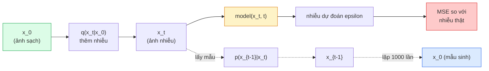

# Sinh Ảnh — Mô Hình Khuếch Tán (Image Generation — Diffusion Models)

> Mô hình khuếch tán học cách khử nhiễu. Huấn luyện mô hình loại bỏ một lượng nhiễu cực nhỏ từ một bức ảnh bị nhiễu, lặp lại quá trình đó ngược dòng một nghìn lần, và bạn sẽ có một cỗ máy sinh ảnh kỳ diệu.

**Type:** Build
**Languages:** Python
**Prerequisites:** Phase 4 Lesson 07 (U-Net), Phase 1 Lesson 06 (Probability), Phase 3 Lesson 06 (Optimizers)
**Time:** ~75 phút

## Learning Objectives

- Suy diễn quá trình thêm nhiễu xuôi (forward noising process) `x_0 -> x_1 -> ... -> x_T` và giải thích lý do tại sao công thức dạng đóng `q(x_t | x_0)` có giá trị đúng với bất kỳ bước thời gian t nào
- Cài đặt mục tiêu huấn luyện theo chuẩn DDPM để hồi quy lượng nhiễu được thêm vào tại mỗi bước, và một bộ lấy mẫu (sampler) đi ngược từ nhiễu thuần túy để tạo ra ảnh
- Xây dựng một mạng U-Net có điều kiện hóa thời gian (time-conditioned U-Net đủ nhỏ để huấn luyện trên CPU) nhằm dự đoán nhiễu tại mọi timestep
- Giải thích sự khác biệt giữa hai thuật toán lấy mẫu DDPM và DDIM, cũng như thời điểm thích hợp để sử dụng từng loại (Bài 23 sẽ đi sâu vào flow matching và rectified flow)

## Vấn Đề Đặt Ra (The Problem)

Mạng GAN sinh ảnh trong một lượt duy nhất (one-shot): đưa nhiễu vào, ảnh xuất ra, đúng một lượt lan truyền xuôi. Chúng chạy nhanh nhưng cực kỳ khó huấn luyện. Các mô hình khuếch tán (diffusion models) sinh ảnh theo cơ chế lặp (iterative): bắt đầu từ nhiễu Gauss thuần túy, khử nhiễu từng bước nhỏ, bức ảnh dần dần hiện rõ. Chúng tạo ảnh chậm hơn nhưng lại rất dễ huấn luyện. Trong năm năm qua, đặc tính dễ huấn luyện này đã chiếm ưu thế áp đảo: bất kỳ đội ngũ kỹ thuật nhỏ nào cũng có thể huấn luyện một mô hình diffusion và thu được các mẫu ảnh chất lượng; trong khi việc huấn luyện GAN là một ngón nghề đòi hỏi nhiều năm trải nghiệm với vô số lần chạy thất bại.

Bên cạnh tính ổn định trong huấn luyện, cấu trúc lặp lại của diffusion chính là chìa khóa mở ra mọi đột phá của các hệ thống sinh ảnh hiện đại: điều kiện hóa bằng văn bản (text conditioning), chỉnh sửa ảnh theo vùng (inpainting), biến đổi ảnh, siêu phân giải (super-resolution), kiểm soát phong cách chi tiết. Mỗi bước trong vòng lặp lấy mẫu là một cơ hội để đưa vào các ràng buộc mới. Chính điểm móc nối (hook) đó là lý do tại sao Stable Diffusion, Imagen, DALL-E 3, Midjourney và mọi mô hình sinh ảnh có thể kiểm soát được mà bạn sử dụng hiện nay đều dựa trên nền tảng khuếch tán.

Bài học này xây dựng mô hình DDPM tối giản: quy trình thêm nhiễu xuôi, khử nhiễu ngược, và vòng lặp huấn luyện. Bài học tiếp theo (Stable Diffusion) sẽ kết nối nó vào một hệ thống thương phẩm hoàn chỉnh với VAE, text encoder và cơ chế hướng dẫn không cần bộ phân loại (classifier-free guidance).

## Khái Niệm Cốt Lõi (The Concept)

### Quá trình khuếch tán xuôi (Forward process)

Lấy một bức ảnh gốc `x_0`. Thêm một lượng nhiễu Gauss cực nhỏ để thu được `x_1`. Tiếp tục thêm một chút nhiễu nữa để có `x_2`. Lặp lại liên tục qua $T$ bước cho đến khi `x_T` hầu như không thể phân biệt nổi với nhiễu Gauss thuần túy ngẫu nhiên.

```math
q(x_t \mid x_{t-1}) = \mathcal{N}\left(x_t; \sqrt{1 - \beta_t} \, x_{t-1}, \; \beta_t I\right)
```

`beta_t` là một lịch trình phương sai (variance schedule) nhỏ, thường tăng tuyến tính từ 0.0001 đến 0.02 qua $T=1000$ bước. Mỗi bước làm co tín hiệu ảnh gốc đi một chút và tiêm thêm nhiễu mới.

### Bước nhảy công thức dạng đóng (Closed-form jump)

Việc thêm nhiễu từng bước một là một chuỗi Markov, nhưng các công thức toán học có thể gộp lại: bạn có thể lấy mẫu trực tiếp `x_t` từ `x_0` chỉ trong một bước tính toán duy nhất:

```math
\begin{aligned}
&\text{Định nghĩa: } \alpha_t = 1 - \beta_t \\
&\text{Định nghĩa: } \bar{\alpha}_t = \prod_{s=1}^{t} \alpha_s \\[6pt]
&\text{Khi đó: } q(x_t \mid x_0) = \mathcal{N}\left(x_t; \sqrt{\bar{\alpha}_t} \, x_0, \; (1 - \bar{\alpha}_t) I\right) \\[6pt]
&\text{Tương đương: } x_t = \sqrt{\bar{\alpha}_t} \, x_0 + \sqrt{1 - \bar{\alpha}_t} \, \epsilon \quad \text{với } \epsilon \sim \mathcal{N}(0, I)
\end{aligned}
```

Phương trình duy nhất này chính là lý do khiến mô hình khuếch tán trở nên khả thi trong thực tế. Trong quá trình huấn luyện, bạn chỉ cần chọn một bước thời gian ngẫu nhiên `t`, lấy mẫu `x_t` trực tiếp từ `x_0`, và huấn luyện mạng trong một bước — không cần phải mô phỏng toàn bộ chuỗi Markov 1.000 bước.

### Quá trình khử nhiễu ngược (Reverse process)

Quá trình xuôi là cố định. Quá trình ngược `p(x_{t-1} | x_t)` mới là điều mạng nơ-ron phải học. Mô hình diffusion không dự đoán trực tiếp `x_{t-1}`; chúng dự đoán vector nhiễu `epsilon` đã được thêm vào tại bước $t$, và các công thức toán học sẽ suy ra `x_{t-1}` từ giá trị đó.



### Hàm mất mát huấn luyện (The training loss)

Tại mỗi bước huấn luyện:

1. Lấy mẫu một bức ảnh thật `x_0`.
2. Lấy mẫu một bước thời gian `t` phân phối đều từ $[1, T]$.
3. Lấy mẫu một vector nhiễu `epsilon ~ N(0, I)`.
4. Tính toán `x_t = sqrt(alpha_bar_t) * x_0 + sqrt(1 - alpha_bar_t) * epsilon`.
5. Dự đoán `epsilon_theta(x_t, t)` thông qua mạng nơ-ron.
6. Cực tiểu hóa hàm mất mát `|| epsilon - epsilon_theta(x_t, t) ||^2`.

Chỉ đơn giản như vậy. Mạng nơ-ron học cách dự đoán lượng nhiễu tại bất kỳ timestep nào. Hàm mất mát chỉ là lỗi bình phương trung bình (MSE). Hoàn toàn không có cuộc chiến đối kháng, không lo sụp đổ mode, không bị dao động bất ổn định.

### Bộ lấy mẫu (DDPM Sampler)

Để sinh ảnh: bắt đầu từ nhiễu thuần `x_T ~ N(0, I)` và lùi dần từng bước một:

```text
cho t = T, T-1, ..., 1:
    eps = model(x_t, t)
    x_{t-1} = (1 / sqrt(alpha_t)) * (x_t - (beta_t / sqrt(1 - alpha_bar_t)) * eps) + sqrt(beta_t) * z
    trong đó z ~ N(0, I) nếu t > 1, ngược lại z = 0
trả về x_0
```

Điểm cốt lõi là dù xác suất có điều kiện ngược nói chung không có dạng đóng, đối với quá trình xuôi chuẩn Gauss này, ta hoàn toàn có thể tính toán được. Các hệ số nhìn có vẻ phức tạp ở trên là kết quả suy ra từ định lý Bayes.

### Tại sao lại cần 1000 bước

Lịch trình nhiễu xuôi được thiết kế sao cho mỗi bước chỉ thêm một lượng nhiễu vừa đủ nhỏ để bước đảo ngược gần như tuân theo phân phối Gauss. Quá ít bước, bước đảo ngược sẽ khác xa phân phối Gauss khiến mạng không thể mô hình hóa tốt. Quá nhiều bước, việc lấy mẫu sẽ trở nên đắt đỏ với hiệu suất suy giảm dần. $T=1000$ với lịch trình tuyến tính là thiết lập chuẩn mực của DDPM.

### DDIM: Lấy mẫu nhanh gấp 20 lần

Quy trình huấn luyện hoàn toàn giữ nguyên, chỉ có quy trình lấy mẫu thay đổi. Thuật toán DDIM (Song et al., 2020) định nghĩa một quá trình ngược tất định cho phép bỏ qua nhiều bước thời gian mà không cần huấn luyện lại mô hình. Lấy mẫu trong 50 bước với DDIM mang lại chất lượng tương đương 1000 bước của DDPM. Mọi hệ thống trong thực tế đều sử dụng DDIM hoặc các biến thể nhanh hơn nữa (DPM-Solver, Euler ancestral).

### Điều kiện hóa thời gian (Time conditioning)

Mạng nơ-ron `epsilon_theta(x_t, t)` cần phải biết nó đang tiến hành khử nhiễu tại bước thời gian nào. Các mô hình khuếch tán hiện đại tiêm giá trị `t` thông qua vector nhúng thời gian dạng sóng sin (sinusoidal time embeddings — cùng ý tưởng với positional encoding trong Transformer), sau đó cộng trực tiếp vào các bản đồ đặc trưng ở mỗi cấp độ của U-Net.

```text
t_embedding = sinusoidal(t)
feature_map += MLP(t_embedding)
```

Nếu không có điều kiện hóa thời gian, mạng buộc phải tự phỏng đoán mức độ nhiễu từ chính bức ảnh, điều này vẫn có thể hoạt động nhưng hiệu quả mẫu kém hơn rất nhiều.

```figure
cv-diffusion-image
```

## Tự Xây Dựng (Build It)

### Bước 1: Lịch trình thêm nhiễu (Noise schedule)

```python
import torch

def linear_beta_schedule(T=1000, beta_start=1e-4, beta_end=2e-2):
    return torch.linspace(beta_start, beta_end, T)


def precompute_schedule(betas):
    alphas = 1.0 - betas
    alphas_cumprod = torch.cumprod(alphas, dim=0)
    return {
        "betas": betas,
        "alphas": alphas,
        "alphas_cumprod": alphas_cumprod,
        "sqrt_alphas_cumprod": torch.sqrt(alphas_cumprod),
        "sqrt_one_minus_alphas_cumprod": torch.sqrt(1.0 - alphas_cumprod),
        "sqrt_recip_alphas": torch.sqrt(1.0 / alphas),
    }

schedule = precompute_schedule(linear_beta_schedule(T=1000))
```

Tính toán sẵn một lần duy nhất, sau đó truy xuất theo chỉ số trong quá trình huấn luyện và lấy mẫu.

### Bước 2: Quá trình khuếch tán xuôi (q_sample)

```python
def q_sample(x0, t, noise, schedule):
    sqrt_a = schedule["sqrt_alphas_cumprod"][t].view(-1, 1, 1, 1)
    sqrt_one_minus_a = schedule["sqrt_one_minus_alphas_cumprod"][t].view(-1, 1, 1, 1)
    return sqrt_a * x0 + sqrt_one_minus_a * noise
```

Công thức dạng đóng chỉ trong một dòng lệnh. `t` là một batch các bước thời gian, mỗi ảnh trong batch có một giá trị riêng.

### Bước 3: U-Net mini có điều kiện hóa thời gian

```python
import torch.nn as nn
import torch.nn.functional as F
import math

def timestep_embedding(t, dim=64):
    half = dim // 2
    freqs = torch.exp(-math.log(10000) * torch.arange(half, device=t.device) / half)
    args = t[:, None].float() * freqs[None]
    emb = torch.cat([args.sin(), args.cos()], dim=-1)
    return emb


class TinyUNet(nn.Module):
    def __init__(self, img_channels=3, base=32, t_dim=64):
        super().__init__()
        self.t_mlp = nn.Sequential(
            nn.Linear(t_dim, base * 4),
            nn.SiLU(),
            nn.Linear(base * 4, base * 4),
        )
        self.t_dim = t_dim
        self.enc1 = nn.Conv2d(img_channels, base, 3, padding=1)
        self.enc2 = nn.Conv2d(base, base * 2, 4, stride=2, padding=1)
        self.mid = nn.Conv2d(base * 2, base * 2, 3, padding=1)
        self.dec1 = nn.ConvTranspose2d(base * 2, base, 4, stride=2, padding=1)
        self.dec2 = nn.Conv2d(base * 2, img_channels, 3, padding=1)
        self.time_proj = nn.Linear(base * 4, base * 2)

    def forward(self, x, t):
        t_emb = timestep_embedding(t, self.t_dim)
        t_emb = self.t_mlp(t_emb)
        t_proj = self.time_proj(t_emb)[:, :, None, None]

        h1 = F.silu(self.enc1(x))
        h2 = F.silu(self.enc2(h1)) + t_proj
        h3 = F.silu(self.mid(h2))
        d1 = F.silu(self.dec1(h3))
        d2 = torch.cat([d1, h1], dim=1)
        return self.dec2(d2)
```

Mạng U-Net 2 cấp độ với điều kiện hóa thời gian được tiêm tại bottleneck. Bạn có thể mở rộng độ sâu và số kênh cho các tập ảnh thực tế lớn hơn.

### Bước 4: Vòng lặp huấn luyện

```python
def train_step(model, x0, schedule, optimizer, device, T=1000):
    model.train()
    x0 = x0.to(device)
    bs = x0.size(0)
    t = torch.randint(0, T, (bs,), device=device)
    noise = torch.randn_like(x0)
    x_t = q_sample(x0, t, noise, schedule)
    pred = model(x_t, t)
    loss = F.mse_loss(pred, noise)
    optimizer.zero_grad()
    loss.backward()
    optimizer.step()
    return loss.item()
```

Đó là toàn bộ vòng lặp huấn luyện: không trò chơi GAN, không hàm mất mát chuyên biệt phức tạp, chỉ một hàm gọi MSE duy nhất.

### Bước 5: Bộ lấy mẫu chuẩn DDPM

```python
@torch.no_grad()
def sample(model, schedule, shape, T=1000, device="cpu"):
    model.eval()
    x = torch.randn(shape, device=device)
    betas = schedule["betas"].to(device)
    sqrt_one_minus_a = schedule["sqrt_one_minus_alphas_cumprod"].to(device)
    sqrt_recip_alphas = schedule["sqrt_recip_alphas"].to(device)

    for t in reversed(range(T)):
        t_batch = torch.full((shape[0],), t, dtype=torch.long, device=device)
        eps = model(x, t_batch)
        coef = betas[t] / sqrt_one_minus_a[t]
        mean = sqrt_recip_alphas[t] * (x - coef * eps)
        if t > 0:
            x = mean + torch.sqrt(betas[t]) * torch.randn_like(x)
        else:
            x = mean
    return x
```

1000 lượt lan truyền xuôi để tạo ra một batch mẫu ảnh. Trong code sản xuất thực tế, bạn sẽ thay thế hàm này bằng bộ lấy mẫu DDIM 50 bước.

### Bước 6: Bộ lấy mẫu DDIM (Tất định, nhanh hơn ~20 lần)

```python
@torch.no_grad()
def sample_ddim(model, schedule, shape, steps=50, T=1000, device="cpu", eta=0.0):
    model.eval()
    x = torch.randn(shape, device=device)
    alphas_cumprod = schedule["alphas_cumprod"].to(device)

    ts = torch.linspace(T - 1, -1, steps + 1).round().long()
    for i in range(steps):
        t = ts[i]
        t_prev = ts[i + 1]
        t_batch = torch.full((shape[0],), t, dtype=torch.long, device=device)
        eps = model(x, t_batch)
        a_t = alphas_cumprod[t]
        a_prev = alphas_cumprod[t_prev] if t_prev >= 0 else torch.tensor(1.0, device=device)
        x0_pred = (x - torch.sqrt(1 - a_t) * eps) / torch.sqrt(a_t)
        sigma = eta * torch.sqrt((1 - a_prev) / (1 - a_t) * (1 - a_t / a_prev))
        dir_xt = torch.sqrt(1 - a_prev - sigma ** 2) * eps
        noise = sigma * torch.randn_like(x) if eta > 0 else 0
        x = torch.sqrt(a_prev) * x0_pred + dir_xt + noise
    return x
```

Lịch trình kết thúc tại `t_prev = -1`, do đó bước cuối cùng sử dụng `a_prev = 1.0` và trả về `x0_pred` sạch sẽ mà không còn nhiễu thừa. `eta=0` là tất định hoàn toàn (cùng một vector nhiễu đầu vào luôn tạo ra cùng một bức ảnh). `eta=1` sẽ phục hồi lại hành vi của DDPM khi số bước lấy mẫu bằng tổng số timestep (`steps=T`).

## Sử Dụng Thực Tế (Use It)

Trong các dự án thương mại, hãy sử dụng thư viện `diffusers`:

```python
from diffusers import DDPMScheduler, UNet2DModel

unet = UNet2DModel(sample_size=32, in_channels=3, out_channels=3, layers_per_block=2)
scheduler = DDPMScheduler(num_train_timesteps=1000)
```

Thư viện này cung cấp sẵn các bộ lập lịch (DDPM, DDIM, DPM-Solver, Euler, Heun), các kiến trúc U-Net tùy biến linh hoạt, các pipeline chuyên biệt cho text-to-image và image-to-image, cùng các công cụ hỗ trợ tinh chỉnh LoRA.

Đối với nghiên cứu chuyên sâu, thư viện `k-diffusion` (của Katherine Crowson) chứa các bản cài đặt chuẩn xác nhất và các thuật toán lấy mẫu tiên tiến nhất.

## Sản Phẩm Đầu Ra (Ship It)

Bài học này tạo ra:

- `outputs/prompt-diffusion-sampler-picker.md` — một prompt lựa chọn thuật toán lấy mẫu phù hợp giữa DDPM / DDIM / DPM-Solver / Euler dựa trên yêu cầu chất lượng, ngân sách độ trễ, và loại điều kiện hóa.
- `outputs/skill-noise-schedule-designer.md` — một kỹ năng (skill) tạo lịch trình beta dạng linear, cosine, hoặc sigmoid dựa trên tham số T và mức độ phá hủy ảnh mục tiêu, kèm theo biểu đồ chẩn đoán tỷ số tín hiệu trên nhiễu (SNR) theo thời gian.

## Bài Tập Thực Hành (Exercises)

1. **(Dễ)** Trực quan hóa quá trình thêm nhiễu xuôi: lấy một bức ảnh và vẽ đồ thị biểu diễn `x_t` tại các bước `t in [0, 100, 250, 500, 750, 1000]`. Xác nhận rằng `x_1000` trông hoàn toàn giống nhiễu Gauss thuần túy.
2. **(Trung bình)** Huấn luyện TinyUNet trên tập dữ liệu hình tròn tổng hợp trong 20 epoch và lấy mẫu 16 hình tròn. So sánh bộ lấy mẫu DDPM (1000 bước) và DDIM (50 bước) — liệu chúng có tạo ra các hình ảnh tương đồng khi dùng chung một seed nhiễu ngẫu nhiên không?
3. **(Khó)** Cài đặt lịch trình nhiễu dạng hàm cos (Nichol & Dhariwal, 2021): `alpha_bar_t = cos^2((t/T + s) / (1 + s) * pi / 2)`. Huấn luyện cùng một mô hình với lịch trình tuyến tính và lịch trình cos, chứng minh rằng lịch trình cos tạo ra các mẫu ảnh đẹp hơn ở số bước lấy mẫu thấp.

## Thuật Ngữ Then Chốt (Key Terms)

| Thuật ngữ | Cách gọi thông thường | Ý nghĩa kỹ thuật thực sự |
|-----------|----------------------|--------------------------|
| Forward process | "Thêm nhiễu theo thời gian" | Chuỗi Markov cố định làm suy biến một bức ảnh thành nhiễu Gauss qua $T$ bước |
| Reverse process | "Khử nhiễu từng bước" | Phân phối xác suất học được giúp đi ngược dòng từ nhiễu về lại ảnh ban đầu |
| Epsilon prediction | "Dự đoán nhiễu" | Mục tiêu huấn luyện: `epsilon_theta(x_t, t)` học cách dự đoán lượng nhiễu đã được thêm vào ở bước $t$ |
| Beta schedule | "Lượng nhiễu mỗi bước" | Chuỗi $T$ giá trị phương sai nhỏ xác định lượng nhiễu được đưa vào tại mỗi bước |
| $\bar{\alpha}_t$ | "Hệ số bảo toàn tích lũy" | Tích của các giá trị $(1 - \beta_s)$ tính đến thời điểm $t$; $t$ càng lớn thì tín hiệu còn lại càng ít |
| DDPM sampler | "Lấy mẫu ngẫu nhiên tổ tiên" | Lấy mẫu mỗi $x_{t-1}$ từ phân phối Gauss có điều kiện; cần 1000 bước |
| DDIM sampler | "Lấy mẫu tất định, nhanh" | Viết lại quá trình lấy mẫu dưới dạng ODE tất định; cần 20-100 bước với chất lượng tương đương |
| Time conditioning | "Báo cho mô hình biết bước t" | Vector nhúng hình sin của $t$ được đưa vào U-Net để mạng biết mức độ nhiễu hiện tại |

## Đọc Thêm (Further Reading)

- [Denoising Diffusion Probabilistic Models (Ho et al., 2020)](https://arxiv.org/abs/2006.11239) — bài báo nền móng giúp diffusion trở nên thực tế và vượt mặt GAN trên chỉ số FID
- [Improved DDPM (Nichol & Dhariwal, 2021)](https://arxiv.org/abs/2102.09672) — giới thiệu lịch trình cos và v-parameterisation
- [DDIM (Song, Meng, Ermon, 2020)](https://arxiv.org/abs/2010.02502) — bộ lấy mẫu tất định mở đường cho suy luận thời gian thực
- [Elucidating the Design Space of Diffusion (Karras et al., 2022)](https://arxiv.org/abs/2206.00364) — góc nhìn thống nhất về mọi quyết định thiết kế kiến trúc của diffusion; tài liệu tham khảo hàng đầu hiện nay

