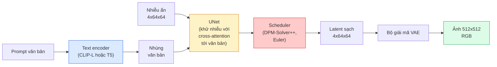

# Stable Diffusion — Kiến Trúc & Tinh Chỉnh (Stable Diffusion — Architecture & Fine-Tuning)

> Stable Diffusion là một mô hình DDPM vận hành trong không gian ẩn (latent space) của một VAE tiền huấn luyện, được điều kiện hóa theo văn bản qua cơ chế cross-attention, lấy mẫu bằng bộ giải ODE tất định tốc độ cao, và được định hướng bởi cơ chế classifier-free guidance.

**Type:** Learn + Use
**Languages:** Python
**Prerequisites:** Phase 4 Lesson 10 (Diffusion), Phase 7 Lesson 02 (Self-Attention)
**Time:** ~75 phút

## Learning Objectives

- Lần theo năm thành phần của một đường ống Stable Diffusion: VAE, text encoder, U-Net, scheduler, safety checker — và hiểu rõ nhiệm vụ thực tế của từng bộ phận
- Giải thích mô hình khuếch tán không gian ẩn (latent diffusion) và lý do tại sao việc huấn luyện trong không gian ẩn 4x64x64 (thay vì không gian ảnh 3x512x512) giúp giảm chi phí tính toán tới 48 lần mà không làm suy giảm chất lượng
- Sử dụng thư viện `diffusers` để sinh ảnh từ văn bản (text-to-image), biến đổi ảnh sang ảnh (image-to-image), chỉnh sửa xóa vùng (inpainting), và sinh ảnh có định hướng với ControlNet
- Tinh chỉnh Stable Diffusion bằng LoRA trên một tập dữ liệu tùy chỉnh quy mô nhỏ và nạp LoRA adapter trong quá trình suy luận

## Vấn Đề Đặt Ra (The Problem)

Huấn luyện một mô hình DDPM trực tiếp trên các bức ảnh RGB kích thước 512x512 là cực kỳ đắt đỏ. Mỗi bước huấn luyện phải lan truyền ngược qua một mạng U-Net nhìn thấy 3x512x512 = 786.432 giá trị đầu vào, và quá trình lấy mẫu đòi hỏi hơn 50 lượt lan truyền xuôi qua chính mạng U-Net khổng lồ đó. Ở cấp độ chất lượng của Stable Diffusion 1.5 (phát hành năm 2022), mô hình khuếch tán trong không gian điểm ảnh (pixel space) sẽ cần khoảng 256 tháng GPU để huấn luyện và mất 10-30 giây cho mỗi bức ảnh trên một GPU dân dụng.

Thủ thuật giúp mô hình sinh ảnh từ văn bản mã nguồn mở trở nên khả thi trong thực tế chính là **khuếch tán trong không gian ẩn (latent diffusion)** (Rombach et al., CVPR 2022). Huấn luyện một mô hình VAE có khả năng ánh xạ ảnh 3x512x512 thành tensor ẩn kích thước 4x64x64 và ngược lại, sau đó thực hiện toàn bộ quá trình khuếch tán bên trong không gian ẩn đó. Khối lượng tính toán giảm ngay `(3*512*512)/(4*64*64) = 48 lần`. Thời gian lấy mẫu giảm từ hàng chục giây xuống dưới hai giây trên cùng một phần cứng GPU.

Hầu hết mọi mô hình sinh ảnh hiện đại — từ SDXL, SD3, FLUX, HunyuanDiT, cho đến Wan-Video — đều là các mô hình latent diffusion với những biến thể khác nhau về bộ tự mã hóa (autoencoder), mạng khử nhiễu (U-Net hoặc DiT), và cơ chế điều kiện hóa văn bản. Nắm vững Stable Diffusion là bạn đã làm chủ bản thiết kế mẫu cho toàn bộ lĩnh vực này.

## Khái Niệm Cốt Lõi (The Concept)

### Đường ống xử lý (The pipeline)



- **VAE** — bộ tự mã hóa (autoencoder) bị đóng băng trọng số. Bộ mã hóa chuyển ảnh thành các latent (dùng cho img2img và huấn luyện). Bộ giải mã chuyển latent ngược lại thành ảnh sắc nét.
- **Text encoder** — bộ mã hóa văn bản CLIP (SD 1.x/2.x), kết hợp CLIP-L + CLIP-G (SDXL), hoặc T5-XXL (SD3/FLUX). Xuất ra chuỗi các vector nhúng token.
- **U-Net** — mạng khử nhiễu trung tâm. Chứa các tầng cross-attention chú ý từ các token latent sang vector nhúng văn bản ở mọi cấp độ phân giải.
- **Scheduler** — thuật toán lấy mẫu (DDIM, Euler, DPM-Solver++). Lựa chọn các giá trị độ lệch chuẩn sigma, hòa trộn nhiễu dự đoán trở lại vào latent.
- **Safety checker** — bộ lọc nội dung nhạy cảm / không phù hợp tùy chọn trên ảnh đầu ra.

### Hướng dẫn không cần bộ phân loại (Classifier-Free Guidance - CFG)

Cơ chế điều kiện hóa văn bản thông thường học `epsilon_theta(x_t, t, c)` cho mỗi prompt `c`. Kỹ thuật CFG huấn luyện cùng một mạng nhưng cố tình loại bỏ điều kiện `c` trong 10% số lần chạy (thay bằng một vector nhúng rỗng), tạo ra một mô hình duy nhất vừa dự đoán được nhiễu có điều kiện lẫn nhiễu không điều kiện. Tại thời điểm suy luận:

```math
\epsilon = \epsilon_{\text{uncond}} + w \cdot (\epsilon_{\text{cond}} - \epsilon_{\text{uncond}})
```

`w` là hệ số hướng dẫn (guidance scale). `w=0` là hoàn toàn không điều kiện, `w=1` là điều kiện hóa thông thường, `w>1` đẩy kết quả đầu ra bám sát prompt hơn với sự đánh đổi về tính đa dạng. Mức mặc định của SD là `w=7.5`.

CFG là lý do duy nhất giúp mô hình sinh ảnh từ văn bản đạt được chất lượng thương phẩm. Không có CFG, các prompt chỉ tác động yếu ớt lên hình ảnh; có CFG, nội dung prompt sẽ hoàn toàn chi phối cảnh sinh ra.

### Hình học không gian ẩn (Latent space geometry)

Không gian ẩn 4 kênh của VAE không đơn thuần là một bức ảnh bị nén. Nó là một đa tạp (manifold) nơi các phép tính số học tương ứng đại khái với các thao tác chỉnh sửa ngữ nghĩa (cả prompt engineering lẫn nội suy không gian đều diễn ra tại đây), và là nơi mạng U-Net khuếch tán đã được huấn luyện để dồn toàn bộ ngân sách mô hình hóa của nó vào. Giải mã một tensor ngẫu nhiên 4x64x64 sẽ không tạo ra một bức ảnh có hình khối ngẫu nhiên — nó chỉ tạo ra nhiễu rác vô nghĩa, bởi vì chỉ một đa tạp con cụ thể của các latent mới giải mã thành hình ảnh hợp lệ.

Hai hệ quả quan trọng:

1. **Img2img** = mã hóa ảnh thành latent, thêm nhiễu từng phần, chạy mạng khử nhiễu, rồi giải mã. Cấu trúc tổng thể của ảnh được giữ lại vì quá trình mã hóa gần như khả nghịch; nội dung chi tiết thay đổi theo prompt.
2. **Inpainting** = tương tự img2img nhưng mạng khử nhiễu chỉ cập nhật các vùng bị che mặt nạ (masked); các vùng không che được giữ nguyên giá trị latent ban đầu.

### Kiến trúc U-Net của Stable Diffusion

U-Net của SD là phiên bản mở rộng quy mô lớn của TinyUNet từ Bài 10 với ba điểm bổ sung quan trọng:

- **Các khối Transformer** tại mọi cấp độ không gian, chứa cơ chế self-attention + cross-attention liên kết với vector nhúng văn bản.
- **Nhúng thời gian** thông qua MLP trên mã hóa hình sin.
- **Skip connections** nối trực tiếp giữa encoder và decoder ở các độ phân giải tương ứng.

Tổng số tham số trong SD 1.5: ~860 triệu. SDXL: ~2.6 tỷ. FLUX: ~12 tỷ. Sự gia tăng vượt bậc về số lượng tham số chủ yếu nằm ở các tầng attention.

### Tinh chỉnh LoRA (Low-Rank Adaptation)

Tinh chỉnh toàn bộ tham số của Stable Diffusion đòi hỏi hơn 20 GB VRAM và cập nhật tới 860 triệu tham số. LoRA giữ nguyên toàn bộ mô hình gốc ở trạng thái đóng băng và chỉ tiêm các ma trận phân rã hạng thấp (rank-decomposition) vào các tầng attention. Một tệp LoRA adapter cho SD thường chỉ nặng 10-50 MB, huấn luyện trong 10-60 phút trên một GPU dân dụng duy nhất, và nạp vào lúc suy luận như một bản nâng cấp gắn thêm tức thì.

```text
Gốc:   W_q : (d_in, d_out)   bị đóng băng
LoRA:  W_q + alpha * (A @ B)   với A : (d_in, r), B : (r, d_out)

r thường nằm trong khoảng 4-32.
```

LoRA là phương thức chính mà hầu hết mọi bản tinh chỉnh trong cộng đồng được phân phối. Các nền tảng như CivitAI và Hugging Face đang lưu trữ hàng triệu bản LoRA như vậy.

### Các bộ lập lịch phổ biến (Schedulers)

- **DDIM** — tất định, ~50 bước, cấu trúc đơn giản.
- **Euler ancestral** — ngẫu nhiên (stochastic), 30-50 bước, tạo ra các mẫu ảnh mang tính sáng tạo cao hơn một chút.
- **DPM-Solver++ 2M Karras** — tất định, 20-30 bước, lựa chọn mặc định trong môi trường thương phẩm.
- **LCM / TCD / Turbo** — các mô hình nhất quán (consistency models) và các biến thể chưng cất (distilled); chỉ cần 1-4 bước với chi phí đánh đổi một phần chất lượng chi tiết.

Việc thay đổi scheduler chỉ tốn đúng một dòng lệnh trong `diffusers` và đôi khi có thể sửa chữa các lỗi sinh ảnh mà không cần huấn luyện lại bất cứ thứ gì.

```figure
cv3-latent-compression
```

## Tự Xây Dựng (Build It)

Bài học này sử dụng thư viện `diffusers` từ đầu đến cuối thay vì xây dựng lại Stable Diffusion từ số không. Các thành phần riêng lẻ (VAE, text encoder, U-Net, scheduler) đều là chủ đề của các bài học chuyên sâu riêng; mục tiêu ở đây là làm chủ hoàn toàn API cấp thương phẩm.

### Bước 1: Sinh ảnh từ văn bản (Text-to-image)

```python
import torch
from diffusers import StableDiffusionPipeline

pipe = StableDiffusionPipeline.from_pretrained(
    "runwayml/stable-diffusion-v1-5",
    torch_dtype=torch.float16,
).to("cuda")

image = pipe(
    prompt="a dog riding a skateboard in tokyo, studio ghibli style",
    guidance_scale=7.5,
    num_inference_steps=25,
    generator=torch.Generator("cuda").manual_seed(42),
).images[0]
image.save("dog.png")
```

Kiểu dữ liệu `float16` giúp giảm một nửa dung lượng VRAM mà không làm suy giảm chất lượng mắt thường thấy được. Thiết lập `num_inference_steps=25` với bộ lập lịch mặc định DPM-Solver++ cho kết quả tương đương `num_inference_steps=50` của DDIM.

### Bước 2: Thay đổi bộ lập lịch (Scheduler)

```python
from diffusers import DPMSolverMultistepScheduler, EulerAncestralDiscreteScheduler

pipe.scheduler = DPMSolverMultistepScheduler.from_config(pipe.scheduler.config)
pipe.scheduler = EulerAncestralDiscreteScheduler.from_config(pipe.scheduler.config)
```

Trạng thái của scheduler hoàn toàn tách biệt khỏi trọng số của mạng U-Net. Bạn có thể huấn luyện mô hình bằng DDPM nhưng lấy mẫu bằng bất kỳ scheduler nào khác.

### Bước 3: Biến đổi ảnh sang ảnh (Image-to-image)

```python
from diffusers import StableDiffusionImg2ImgPipeline
from PIL import Image

img2img = StableDiffusionImg2ImgPipeline.from_pretrained(
    "runwayml/stable-diffusion-v1-5",
    torch_dtype=torch.float16,
).to("cuda")

init_image = Image.open("dog.png").convert("RGB").resize((512, 512))
out = img2img(
    prompt="a dog riding a skateboard, oil painting",
    image=init_image,
    strength=0.6,
    guidance_scale=7.5,
).images[0]
```

Tham số `strength` xác định lượng nhiễu được thêm vào trước khi khử nhiễu (0.0 = giữ nguyên ảnh gốc, 1.0 = tái tạo hoàn toàn ảnh mới). Mức 0.5-0.7 là khoảng chuẩn mực cho việc chuyển đổi phong cách (style transfer).

### Bước 4: Chỉnh sửa xóa vùng (Inpainting)

```python
from diffusers import StableDiffusionInpaintPipeline

inpaint = StableDiffusionInpaintPipeline.from_pretrained(
    "runwayml/stable-diffusion-inpainting",
    torch_dtype=torch.float16,
).to("cuda")

image = Image.open("dog.png").convert("RGB").resize((512, 512))
mask = Image.open("dog_mask.png").convert("L").resize((512, 512))

out = inpaint(
    prompt="a cat",
    image=image,
    mask_image=mask,
    guidance_scale=7.5,
).images[0]
```

Các pixel màu trắng trong mặt nạ (mask) là vùng sẽ được vẽ lại. Các pixel màu đen được giữ nguyên vẹn.

### Bước 5: Nạp trọng số LoRA

```python
pipe.load_lora_weights(
    "artificialguybr/studioghibli-redmond-1-5v-studio-ghibli-lora-for-liberteredmond-sd-1-5",
    weight_name="StudioGhibliRedmond-15V-LiberteRedmond-StdGBRedmAF-StudioGhibli.safetensors",
)
pipe.fuse_lora(lora_scale=0.8)

image = pipe(prompt="a village square, StdGBRedmAF, Studio Ghibli").images[0]
```

Cụm từ kích hoạt (trigger phrase) từ model card (`StdGBRedmAF, Studio Ghibli`) sẽ kích hoạt phong cách mong muốn. `lora_scale` kiểm soát độ đậm nhạt của phong cách; 0.0 = không ảnh hưởng, 1.0 = tác động tối đa. Lệnh `fuse_lora` nạp trực tiếp adapter vào các trọng số để tăng tốc suy luận, nhưng sẽ ngăn việc chuyển đổi nóng. Hãy gọi `pipe.unfuse_lora()` trước khi muốn nạp một adapter khác.

### Bước 6: Phác thảo quy trình huấn luyện LoRA

Quy trình huấn luyện LoRA thực tế nằm trong thư viện `peft` hoặc `diffusers.training`. Cấu trúc cốt lõi:

```python
# Mã giả minh họa
for step, batch in enumerate(dataloader):
    images, prompts = batch
    latents = vae.encode(images).latent_dist.sample() * 0.18215

    t = torch.randint(0, num_train_timesteps, (batch_size,))
    noise = torch.randn_like(latents)
    noisy_latents = scheduler.add_noise(latents, noise, t)

    text_emb = text_encoder(tokenizer(prompts))

    pred_noise = unet(noisy_latents, t, text_emb)  # Trọng số LoRA được tiêm tại đây

    loss = F.mse_loss(pred_noise, noise)
    loss.backward()
    optimizer.step()
```

Chỉ có các ma trận LoRA mới nhận gradient; toàn bộ mạng U-Net gốc, VAE và text encoder đều bị đóng băng. Với batch size bằng 1 và cơ chế gradient checkpointing, quy trình này chạy vừa vặn trên 8 GB VRAM.

## Sử Dụng Thực Tế (Use It)

Trong môi trường thương mại, những quyết định bạn thực sự phải đưa ra:

- **Họ mô hình (Model family)**: SD 1.5 cho các bản tinh chỉnh phong phú của cộng đồng nguồn mở, SDXL cho độ chi tiết cao hơn, SD3 / FLUX cho chất lượng hình ảnh đỉnh cao hiện nay cùng các yêu cầu giấy phép nghiêm ngặt.
- **Bộ lập lịch (Scheduler)**: DPM-Solver++ 2M Karras cho 20-30 bước, LCM-LoRA khi yêu cầu độ trễ dưới 1 giây.
- **Độ chính xác số học (Precision)**: `float16` trên GPU RTX 4080/4090, `bfloat16` trên A100 và các dòng mới hơn, `int8` (qua `bitsandbytes`) khi bộ nhớ VRAM eo hẹp.
- **Điều kiện hóa (Conditioning)**: prompt văn bản thông thường; để kiểm soát cấu trúc chặt chẽ hơn, hãy tích hợp thêm ControlNet (canny, depth, pose) lên trên đường ống cơ sở.

Đối với sinh ảnh hàng loạt, `AUTO1111` / `ComfyUI` là các công cụ giao diện mạnh mẽ của cộng đồng; đối với các API triển khai sản phẩm, sự kết hợp giữa `diffusers` + `accelerate` hoặc `optimum-nvidia` với biên dịch TensorRT là tiêu chuẩn tối ưu.

## Sản Phẩm Đầu Ra (Ship It)

Bài học này tạo ra:

- `outputs/prompt-sd-pipeline-planner.md` — một prompt giúp lựa chọn phiên bản SD 1.5 / SDXL / SD3 / FLUX cùng scheduler và độ chính xác phù hợp dựa trên ngân sách độ trễ, mục tiêu chất lượng và ràng buộc về giấy phép bản quyền.
- `outputs/skill-lora-training-setup.md` — một kỹ năng (skill) sinh cấu hình huấn luyện LoRA hoàn chỉnh cho một tập dữ liệu tùy chỉnh, bao gồm chú thích ảnh (captions), rank, batch size và learning rate.

## Bài Tập Thực Hành (Exercises)

1. **(Dễ)** Sinh ảnh từ cùng một prompt với các giá trị `guidance_scale` trong `[1, 3, 5, 7.5, 10, 15]`. Mô tả sự biến đổi của bức ảnh. Ở giá trị guidance nào thì bắt đầu xuất hiện các vết dị vật (artefacts)?
2. **(Trung bình)** Lấy một bức ảnh chụp thực tế bất kỳ, đưa qua `StableDiffusionImg2ImgPipeline` với các mức `strength` trong `[0.2, 0.4, 0.6, 0.8, 1.0]`. Mức strength nào giúp bảo toàn bố cục ban đầu tốt nhất trong khi vẫn chuyển đổi thành công phong cách? Tại sao mức 1.0 lại bỏ qua hoàn toàn bức ảnh đầu vào?
3. **(Khó)** Huấn luyện một LoRA trên 10-20 bức ảnh của một chủ thể duy nhất (thú cưng, logo, nhân vật) và sinh ra các khung cảnh mới mẻ có sự xuất hiện của chủ thể đó. Báo cáo giá trị rank của LoRA và số bước huấn luyện giúp bảo toàn đặc điểm nhận dạng tốt nhất mà không bị hiện tượng học vẹt (overfitting).

## Thuật Ngữ Then Chốt (Key Terms)

| Thuật ngữ | Cách gọi thông thường | Ý nghĩa kỹ thuật thực sự |
|-----------|----------------------|--------------------------|
| Latent diffusion | "Khuếch tán trong không gian ẩn" | Chạy toàn bộ DDPM trong không gian ẩn của VAE (4x64x64) thay vì không gian điểm ảnh (3x512x512); tiết kiệm 48 lần tính toán |
| VAE scale factor | "Hệ số 0.18215" | Hằng số dùng để co giãn latent thô của VAE về phương sai xấp xỉ đơn vị; được gán cứng trong mọi pipeline SD |
| Classifier-free guidance | "CFG" | Hòa trộn giữa dự đoán nhiễu có điều kiện và không điều kiện; tham số suy luận tác động mạnh mẽ nhất đến chất lượng ảnh |
| Scheduler | "Bộ lấy mẫu" | Thuật toán chuyển đổi nhiễu và dự đoán của mô hình thành một quỹ đạo latent được khử nhiễu hoàn chỉnh |
| LoRA | "Adapter hạng thấp" | Các ma trận phân rã hạng nhỏ giúp tinh chỉnh các tầng attention mà không làm thay đổi trọng số gốc |
| Cross-attention | "Chú ý chéo văn bản-hình ảnh" | Cơ chế attention từ các token latent sang các token văn bản; tiêm thông tin prompt vào mọi cấp độ U-Net |
| ControlNet | "Điều kiện hóa cấu trúc" | Một adapter được huấn luyện riêng biệt giúp định hướng SD bằng một đầu vào phụ (canny, depth, pose, segmentation) |
| DPM-Solver++ | "Scheduler mặc định" | Bộ giải ODE tất định bậc hai; mang lại chất lượng tốt nhất ở số bước lấy mẫu thấp (20-30 bước) hiện nay |

## Đọc Thêm (Further Reading)

- [High-Resolution Image Synthesis with Latent Diffusion (Rombach et al., 2022)](https://arxiv.org/abs/2112.10752) — bài báo gốc về Stable Diffusion; bao gồm mọi nghiên cứu phân tích chứng minh tính ưu việt của thiết kế
- [Classifier-Free Diffusion Guidance (Ho & Salimans, 2022)](https://arxiv.org/abs/2207.12598) — bài báo giới thiệu kỹ thuật CFG
- [LoRA: Low-Rank Adaptation of Large Language Models (Hu et al., 2021)](https://arxiv.org/abs/2106.09685) — kỹ thuật LoRA bắt nguồn từ NLP và được chuyển giao sang SD gần như không cần thay đổi
- [diffusers documentation](https://huggingface.co/docs/diffusers) — tài liệu tham khảo chính thức cho mọi pipeline SD / SDXL / SD3 / FLUX

