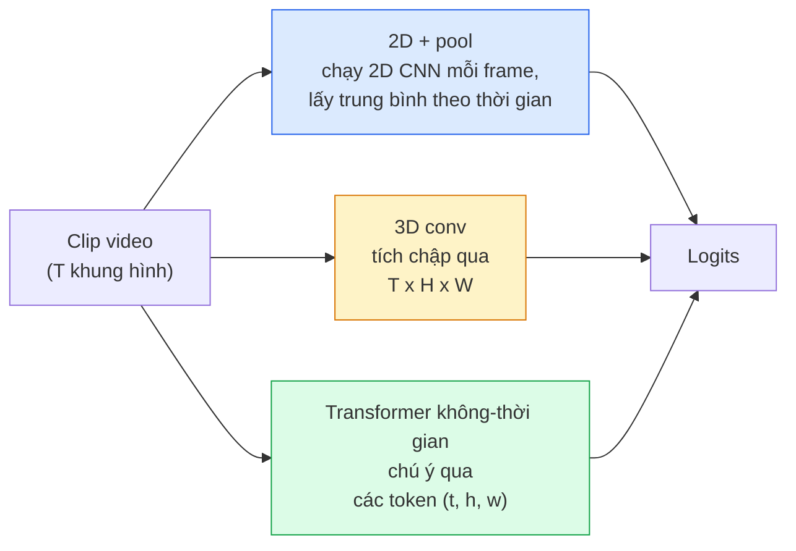

# Hiểu Video — Mô Hình Hóa Thời Gian (Video Understanding — Temporal Modeling)

> Video là một chuỗi các hình ảnh tĩnh cộng với các quy luật vật lý kết nối chúng lại với nhau. Mọi mô hình video đều xem thời gian như một trục bổ sung (3D conv), một chuỗi tuần tự để áp dụng cơ chế chú ý (transformer), hoặc một đặc trưng được trích xuất từng khung hình rồi gom gộp lại (2D+pool).

**Type:** Learn + Build
**Languages:** Python
**Prerequisites:** Phase 4 Lesson 03 (CNNs), Phase 4 Lesson 04 (Image Classification)
**Time:** ~45 phút

## Learning Objectives

- Phân biệt ba phương pháp tiếp cận mô hình hóa video chính (2D+pool, 3D conv, transformer không-thời gian) và dự đoán được sự đánh đổi giữa chi phí tính toán và độ chính xác của chúng
- Cài đặt quy trình lấy mẫu khung hình (frame sampling), gom gộp thời gian (temporal pooling), và một mô hình phân loại baseline 2D+pool trong PyTorch
- Giải thích lý do tại sao các kernel 3D "phóng đại" (inflated) của I3D chuyển giao rất tốt từ trọng số ImageNet và tích chập nhân tử hóa (factorised) (2+1)D hoạt động khác biệt như thế nào
- Đọc hiểu các tập dữ liệu và chỉ số nhận dạng hành động tiêu chuẩn: Kinetics-400/600, UCF101, Something-Something V2; độ chính xác top-1 ở cấp độ đoạn trích (clip) và toàn bộ video

## Vấn Đề Đặt Ra (The Problem)

Một đoạn video dài 30 giây ở tốc độ 30 khung hình/giây (fps) bao gồm 900 bức ảnh. Một cách ngây thơ, phân loại video chỉ là việc phân loại hình ảnh được lặp lại 900 lần rồi sau đó tổng hợp kết quả lại. Cách làm này hoạt động tốt khi hành động hiển thị rõ ràng trong hầu hết mọi khung hình (thể thao, nấu ăn, tập thể dục) nhưng sẽ thất bại thảm hại khi hành động được định nghĩa bằng chính chuyển động: hành động "đẩy vật từ trái sang phải" trông giống hệt như hai vật đứng yên trong từng khung hình riêng lẻ.

Câu hỏi cốt lõi cho mọi kiến trúc video là: cấu trúc thời gian được mô hình hóa vào thời điểm nào, và bằng cách nào? Câu trả lời sẽ quyết định mọi thứ khác — chi phí tính toán, chiến lược tiền huấn luyện, khả năng tái sử dụng trọng số ImageNet, và loại tập dữ liệu mà mô hình có thể học tốt.

Bài học này được thiết kế ngắn gọn hơn các bài học về hình ảnh tĩnh. Các cơ chế thị giác cốt lõi đã được xây dựng từ trước, và bài toán hiểu video chủ yếu xoay quanh câu chuyện về chiều thời gian: lấy mẫu, mô hình hóa và gom gộp kết quả.

## Khái Niệm Cốt Lõi (The Concept)

### Ba họ kiến trúc chính



### Phương pháp 2D + pool

Sử dụng một mạng CNN 2D (ResNet, EfficientNet, ViT). Chạy độc lập trên từng khung hình được lấy mẫu. Lấy trung bình (hoặc max-pool, attention-pool) các vector nhúng của từng khung hình. Đưa vector gom gộp cuối cùng qua bộ phân loại.

Ưu điểm:
- Tận dụng trực tiếp các mô hình tiền huấn luyện từ ImageNet.
- Cài đặt đơn giản nhất.
- Chi phí thấp: T khung hình * chi phí suy luận của một ảnh đơn lẻ.

Nhược điểm:
- Không mô hình hóa được chuyển động. Hành động chỉ là sự tổng hợp của diện mạo tĩnh (appearances).
- Phép gom gộp thời gian bất biến với thứ tự; hành động "mở cửa" và "đóng cửa" cho ra kết quả giống hệt nhau.

Khi nào nên dùng: các tác vụ thiên về diện mạo/bối cảnh, học chuyển giao trên tập dữ liệu video nhỏ, hoặc làm mô hình cơ sở (baseline) ban đầu.

### Tích chập 3 chiều (3D Convolutions)

Thay thế các kernel 2D (H, W) bằng các kernel 3D (T, H, W). Mạng thực hiện phép tích chập đồng thời trên cả không gian và thời gian. Các kiến trúc tiêu biểu ban đầu: C3D, I3D, SlowFast.

Thủ thuật I3D (Inflation): lấy một mô hình ImageNet 2D tiền huấn luyện, "bơm phồng" (inflate) từng kernel 2D bằng cách sao chép nó dọc theo trục thời gian mới. Một phép conv 2D kích thước 3x3 trở thành conv 3D kích thước 3x3x3. Điều này cung cấp cho mô hình 3D bộ trọng số tiền huấn luyện mạnh mẽ thay vì phải huấn luyện lại từ số không.

Ưu điểm:
- Mô hình hóa trực tiếp chuyển động trong video.
- Cơ chế phóng đại kernel của I3D mang lại khả năng học chuyển giao miễn phí.

Nhược điểm:
- Tăng khoảng gấp 3 lần lượng tính toán FLOPs so với mạng 2D chạy từng khung hình, vì mỗi kernel 3x3 nay thành 3x3x3.
- Các kernel thời gian có phạm vi hẹp; chuyển động dài hạn đòi hỏi cấu trúc kim tự tháp hoặc kiến trúc hai luồng (dual-stream).

Khi nào nên dùng: bài toán nhận dạng hành động mà trong đó chuyển động là tín hiệu phân biệt chính (Something-Something V2, hoặc các lớp giàu chuyển động trong Kinetics).

### Transformer không-thời gian (Spatio-temporal Transformers)

Chia video thành một lưới các mảng không-thời gian (space-time patches) và áp dụng cơ chế chú ý (attention) trên toàn bộ chúng. Các mô hình tiêu biểu: TimeSformer, ViViT, Video Swin, VideoMAE.

Các mô hình attention quan trọng:
- **Joint (Đồng thời)** — một phép attention khổng lồ trên cả bộ ba (t, h, w). Độ phức tạp bậc hai theo `T*H*W`; rất tốn kém tài nguyên.
- **Divided (Chia tách)** — hai lượt attention trong mỗi khối: một lượt theo trục thời gian, một lượt theo trục không gian. Mức tăng chi phí xấp xỉ tuyến tính.
- **Factorised (Nhân tử hóa)** — attention thời gian xen kẽ với attention không gian qua các khối liên tiếp.

Ưu điểm:
- Đạt độ chính xác SOTA trên mọi bảng xếp hạng tiêu chuẩn lớn.
- Kế thừa dễ dàng từ Vision Transformer (ViT) qua kỹ thuật patch inflation.
- Hỗ trợ video ngữ cảnh dài thông qua cơ chế chú ý thưa (sparse attention).

Nhược điểm:
- Đòi hỏi năng lực tính toán cực lớn.
- Đòi hỏi thiết kế mô hình attention cẩn thận, nếu không thời gian chạy sẽ bùng nổ.

Khi nào nên dùng: tập dữ liệu quy mô lớn, hiểu video độ phân giải cao, các tác vụ đa phương thức video + văn bản.

### Lấy mẫu khung hình (Frame sampling)

Một clip dài 10 giây ở 30 fps có 300 khung hình; đưa cả 300 frame vào mô hình là lãng phí. Các chiến lược tiêu chuẩn:

- **Lấy mẫu đều (Uniform sampling)** — chọn đều T khung hình trên toàn bộ clip. Lựa chọn mặc định cho phương pháp 2D+pool.
- **Lấy mẫu dày (Dense sampling)** — chọn một cửa sổ T khung hình ngẫu nhiên liên tiếp nhau. Phổ biến cho 3D conv vì chuyển động đòi hỏi các khung hình liền kề nhau.
- **Đa đoạn (Multi-clip)** — lấy mẫu nhiều cửa sổ T khung hình từ cùng một video, phân loại từng đoạn, rồi lấy trung bình kết quả dự đoán tại thời điểm kiểm thử.

T thường là 8, 16, 32, hoặc 64. T càng lớn = càng nhiều tín hiệu thời gian với chi phí tính toán tăng tương ứng.

### Đánh giá chất lượng mô hình

Hai cấp độ đánh giá:
- **Độ chính xác cấp clip (Clip-level accuracy)** — mô hình nhìn một clip T khung hình và đưa ra top-k nhãn.
- **Độ chính xác cấp video (Video-level accuracy)** — lấy trung bình các dự đoán cấp clip từ nhiều clip trên mỗi video; chỉ số này cao hơn và ổn định hơn.

Luôn báo cáo cả hai chỉ số. Một mô hình đạt 78% cấp clip / 82% cấp video đang phụ thuộc nhiều vào việc lấy trung bình lúc kiểm thử; trong khi mô hình đạt 80% / 81% sẽ bền vững và độc lập hơn trên từng clip đơn lẻ.

### Các tập dữ liệu tiêu chuẩn

- **Kinetics-400 / 600 / 700** — tập dữ liệu hành động tổng quát chuẩn mực. 400.000 clip từ các đường link YouTube (nhiều link hiện đã chết).
- **Something-Something V2** — các hành động được định nghĩa chặt chẽ bởi chuyển động ("di chuyển vật X từ trái sang phải"). Không thể giải quyết bằng phương pháp 2D+pool.
- **UCF-101**, **HMDB-51** — các tập dữ liệu nhỏ hơn, lâu đời hơn, vẫn thường được dùng để đối sánh.
- **AVA** — định vị hành động (action localization) trong cả không gian và thời gian; phức tạp hơn bài toán phân loại đơn thuần.

```figure
v4-video-temporal
```

## Tự Xây Dựng (Build It)

### Bước 1: Bộ lấy mẫu khung hình (Frame Sampler)

Bộ lấy mẫu đều và lấy mẫu dày hoạt động trên danh sách các khung hình (hoặc tensor video).

```python
import numpy as np

def sample_uniform(num_frames_total, T):
    if num_frames_total <= T:
        return list(range(num_frames_total)) + [num_frames_total - 1] * (T - num_frames_total)
    step = num_frames_total / T
    return [int(i * step) for i in range(T)]


def sample_dense(num_frames_total, T, rng=None):
    rng = rng or np.random.default_rng()
    if num_frames_total <= T:
        return list(range(num_frames_total)) + [num_frames_total - 1] * (T - num_frames_total)
    start = int(rng.integers(0, num_frames_total - T + 1))
    return list(range(start, start + T))
```

Cả hai hàm đều trả về `T` chỉ số dùng để cắt lát tensor video.

### Bước 2: Mô hình cơ sở 2D+pool

Chạy ResNet-18 2D trên từng khung hình, gom gộp đặc trưng bằng trung bình cộng (average-pool), rồi phân loại.

```python
import torch
import torch.nn as nn
from torchvision.models import resnet18, ResNet18_Weights

class FramePool(nn.Module):
    def __init__(self, num_classes=400, pretrained=True):
        super().__init__()
        weights = ResNet18_Weights.IMAGENET1K_V1 if pretrained else None
        backbone = resnet18(weights=weights)
        self.features = nn.Sequential(*(list(backbone.children())[:-1]))  # giữ lại global avg pool
        self.head = nn.Linear(512, num_classes)

    def forward(self, x):
        # x: (N, T, 3, H, W)
        N, T = x.shape[:2]
        x = x.view(N * T, *x.shape[2:])
        feats = self.features(x).view(N, T, -1)
        pooled = feats.mean(dim=1)
        return self.head(pooled)

model = FramePool(num_classes=10)
x = torch.randn(2, 8, 3, 224, 224)
print(f"output: {model(x).shape}")
print(f"params: {sum(p.numel() for p in model.parameters()):,}")
```

11 triệu tham số, tiền huấn luyện trên ImageNet, xử lý từng khung hình, lấy trung bình rồi phân loại. Mô hình baseline này thường chỉ kém các mô hình 3D chuyên sâu từ 5-10 điểm trên các tác vụ giàu diện mạo — đôi khi còn vượt trội hơn vì tái sử dụng được backbone ImageNet mạnh mẽ hơn.

### Bước 3: Phóng đại Conv 2D thành Conv 3D kiểu I3D

Biến đổi một conv 2D đơn lẻ thành conv 3D bằng cách lặp lại trọng số dọc theo trục thời gian mới.

```python
def inflate_2d_to_3d(conv2d, time_kernel=3):
    out_c, in_c, kh, kw = conv2d.weight.shape
    weight_3d = conv2d.weight.data.unsqueeze(2)  # (out, in, 1, kh, kw)
    weight_3d = weight_3d.repeat(1, 1, time_kernel, 1, 1) / time_kernel
    conv3d = nn.Conv3d(in_c, out_c, kernel_size=(time_kernel, kh, kw),
                        padding=(time_kernel // 2, conv2d.padding[0], conv2d.padding[1]),
                        stride=(1, conv2d.stride[0], conv2d.stride[1]),
                        bias=False)
    conv3d.weight.data = weight_3d
    return conv3d

conv2d = nn.Conv2d(3, 64, kernel_size=3, padding=1, bias=False)
conv3d = inflate_2d_to_3d(conv2d, time_kernel=3)
print(f"2D weight shape:  {tuple(conv2d.weight.shape)}")
print(f"3D weight shape:  {tuple(conv3d.weight.shape)}")
x = torch.randn(1, 3, 8, 56, 56)
print(f"3D output shape:  {tuple(conv3d(x).shape)}")
```

Phép chia cho `time_kernel` giữ cho độ lớn kích hoạt (activation magnitudes) xấp xỉ không đổi — điều này rất quan trọng để không làm phá vỡ các thống kê tích lũy của batch norm ngay trong lượt chạy đầu tiên.

### Bước 4: Tích chập nhân tử hóa (2+1)D

Tách một conv 3D thành một conv 2D (không gian) và một conv 1D (thời gian). Cùng vùng tiếp nhận (receptive field), ít tham số hơn, đạt độ chính xác tốt hơn trên một số benchmark.

```python
class Conv2Plus1D(nn.Module):
    def __init__(self, in_c, out_c, kernel_size=3):
        super().__init__()
        mid_c = (in_c * out_c * kernel_size * kernel_size * kernel_size) \
                // (in_c * kernel_size * kernel_size + out_c * kernel_size)
        self.spatial = nn.Conv3d(in_c, mid_c, kernel_size=(1, kernel_size, kernel_size),
                                 padding=(0, kernel_size // 2, kernel_size // 2), bias=False)
        self.bn = nn.BatchNorm3d(mid_c)
        self.act = nn.ReLU(inplace=True)
        self.temporal = nn.Conv3d(mid_c, out_c, kernel_size=(kernel_size, 1, 1),
                                  padding=(kernel_size // 2, 0, 0), bias=False)

    def forward(self, x):
        return self.temporal(self.act(self.bn(self.spatial(x))))

c = Conv2Plus1D(3, 64)
x = torch.randn(1, 3, 8, 56, 56)
print(f"(2+1)D output: {tuple(c(x).shape)}")
```

Một mạng R(2+1)D hoàn chỉnh tương đương với ResNet-18 nhưng mọi conv 3x3 đều được thay thế bằng `Conv2Plus1D`.

## Sử Dụng Thực Tế (Use It)

Hai thư viện bao quát hầu hết công việc video trong sản xuất:

- `torchvision.models.video` — cung cấp R(2+1)D, MViT, Swin3D với các trọng số tiền huấn luyện trên Kinetics. API hoàn toàn tương đồng với các mô hình hình ảnh.
- `pytorchvideo` (Meta) — sở thú mô hình phong phú, bộ nạp dữ liệu data loader cho Kinetics / SSv2 / AVA, cùng các phép biến đổi tăng cường tiêu chuẩn.

Đối với các mô hình video thị giác-ngôn ngữ (video captioning, video QA), hãy sử dụng thư viện `transformers` (`VideoMAE`, `VideoLLaMA`, `InternVideo`).

## Sản Phẩm Đầu Ra (Ship It)

Bài học này tạo ra:

- `outputs/prompt-video-architecture-picker.md` — một prompt giúp lựa chọn giữa 2D+pool / I3D / (2+1)D / transformer dựa trên tỷ trọng diện mạo vs chuyển động, quy mô dữ liệu, và ngân sách tính toán.
- `outputs/skill-frame-sampler-auditor.md` — một kỹ năng (skill) kiểm tra bộ lấy mẫu của đường ống video và cảnh báo các lỗi thường gặp: lệch chỉ số off-by-one, lấy mẫu không đều khi `num_frames < T`, thiếu bước cắt ảnh bảo toàn tỷ lệ khung hình, v.v.

## Bài Tập Thực Hành (Exercises)

1. **(Dễ)** Tính toán lượng FLOPs (xấp xỉ) cho FramePool với T=8 so với ResNet 3D kiểu I3D với T=8. Giải thích tại sao phương pháp 2D+pool rẻ hơn từ 3-5 lần.
2. **(Trung bình)** Tạo một tập dữ liệu video tổng hợp: các quả bóng ngẫu nhiên chuyển động theo các hướng ngẫu nhiên, được gắn nhãn theo hướng di chuyển ("trái-sang-phải", "phải-sang-trái", "chéo-lên"). Huấn luyện FramePool trên tập dữ liệu này. Chứng minh rằng mô hình chỉ đạt độ chính xác tương đương đoán mò, qua đó khẳng định diện mạo tĩnh là không đủ cho các tác vụ chuyển động.
3. **(Khó)** Xây dựng mạng R(2+1)D-18 bằng cách thay thế mọi Conv2d trong ResNet-18 bằng `Conv2Plus1D`. Phóng đại trọng số conv đầu tiên từ một ResNet-18 tiền huấn luyện trên ImageNet. Huấn luyện trên tập dữ liệu chuyển động từ Bài tập 2 và đánh bại FramePool.

## Thuật Ngữ Then Chốt (Key Terms)

| Thuật ngữ | Cách gọi thông thường | Ý nghĩa kỹ thuật thực sự |
|-----------|----------------------|--------------------------|
| 2D + pool | "Bộ phân loại từng khung hình" | Chạy CNN 2D trên mọi khung hình lấy mẫu, lấy trung bình đặc trưng qua thời gian rồi phân loại |
| 3D convolution | "Kernel không-thời gian" | Kernel tích chập đồng thời trên (T, H, W); có khả năng mô hình hóa chuyển động tự nhiên |
| Inflation | "Nâng trọng số 2D lên 3D" | Khởi tạo trọng số conv 3D bằng cách lặp lại trọng số conv 2D dọc theo trục thời gian, chia cho kernel_T để bảo toàn biên độ |
| (2+1)D | "Tích chập nhân tử hóa" | Tách conv 3D thành 2D không gian + 1D thời gian; giảm tham số, chèn thêm tính phi tuyến ở giữa |
| Divided attention | "Thời gian trước, không gian sau" | Khối transformer với hai cơ chế attention mỗi tầng: một trên các token cùng khung hình, một trên các token cùng vị trí |
| Clip | "Cửa sổ T khung hình" | Chuỗi con gồm T khung hình được lấy mẫu; đơn vị xử lý đầu vào của mô hình video |
| Clip vs video accuracy | "Hai thiết lập đánh giá" | Clip = đánh giá trên một mẫu đơn lẻ, video = lấy trung bình trên nhiều clip lấy mẫu từ một video |
| Kinetics | "ImageNet của video" | Bộ dữ liệu gồm 400-700 lớp hành động với hơn 300.000 clip YouTube; tập ngữ liệu chuẩn để tiền huấn luyện video |

## Đọc Thêm (Further Reading)

- [I3D: Quo Vadis, Action Recognition (Carreira & Zisserman, 2017)](https://arxiv.org/abs/1705.07750) — giới thiệu kỹ thuật inflation và tập dữ liệu Kinetics kinh điển
- [R(2+1)D: A Closer Look at Spatiotemporal Convolutions (Tran et al., 2018)](https://arxiv.org/abs/1711.11248) — bài báo về tích chập nhân tử hóa; vẫn là baseline rất mạnh
- [TimeSformer: Is Space-Time Attention All You Need? (Bertasius et al., 2021)](https://arxiv.org/abs/2102.05095) — mô hình transformer video mạnh mẽ đầu tiên
- [VideoMAE (Tong et al., 2022)](https://arxiv.org/abs/2203.12602) — phương pháp tiền huấn luyện tự giám sát masked autoencoder cho video; công thức thống trị hiện nay

