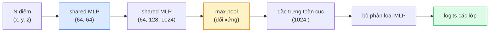

# Thị Giác 3D — Đám Mây Điểm & NeRFs (3D Vision — Point Clouds & NeRFs)

> Thị giác 3D có hai trường phái chính. Đám mây điểm (Point clouds) là đầu ra thô từ cảm biến vật lý. NeRFs là trường thể tích được học bằng mạng nơ-ron. Cả hai đều trả lời câu hỏi cốt lõi: "vật gì đang nằm ở đâu trong không gian 3 chiều."

**Type:** Learn + Build
**Languages:** Python
**Prerequisites:** Phase 4 Lesson 03 (CNNs), Phase 1 Lesson 12 (Tensor Operations)
**Time:** ~45 phút

## Learning Objectives

- Phân biệt các biểu diễn 3D tường minh (đám mây điểm, lưới tam giác mesh, voxel) và tiềm ẩn (trường khoảng cách có dấu SDF, NeRF) cùng trường hợp sử dụng tối ưu của từng loại
- Hiểu rõ thủ thuật hàm đối xứng (symmetric-function trick) của PointNet giúp mạng nơ-ron đạt tính bất biến hoán vị (permutation-invariant) trên tập hợp các điểm không có thứ tự
- Lần theo toàn bộ lượt lan truyền xuôi của NeRF: bắn tia (ray casting), kết xuất thể tích (volumetric rendering), mã hóa vị trí (positional encoding), và head MLP dự đoán mật độ + màu sắc
- Sử dụng các thư viện như `nerfstudio` hoặc `instant-ngp` để tái tạo không gian 3D từ một tập hợp nhỏ các bức ảnh đã xác định góc chụp (posed images)

## Vấn Đề Đặt Ra (The Problem)

Một chiếc máy ảnh thông thường tạo ra một bức ảnh 2D. Cảm biến LIDAR tạo ra một tập hợp các điểm 3D không có thứ tự. Một quy trình cấu trúc từ chuyển động (Structure-from-Motion - SfM) tạo ra một đám mây thưa các điểm đặc trưng 3D. Mô hình NeRF tái tạo toàn bộ khung cảnh 3D từ một số ít bức ảnh chụp ở các góc độ khác nhau. Tất cả những điều này đều thuộc về "thị giác máy tính", nhưng không có dạng nào trông giống tensor dày đặc mà một mạng CNN mong đợi.

Thị giác 3D rất quan trọng vì hầu như mọi tác vụ robot giá trị cao đều vận hành trong không gian 3D: cầm nắm đồ vật, tránh chướng ngại vật, định vị dẫn đường, xử lý che khuất trong thực tế ảo tăng cường (AR occlusion), và thu nhận nội dung 3D. Một kỹ sư thị giác máy tính chỉ hiểu về ảnh 2D sẽ bị đứng ngoài phân khúc phát triển nhanh nhất của ngành công nghiệp (nội dung AR/VR, robot học, hệ thống xe tự hành, và tái tạo 3D cho bất động sản hay xây dựng).

Hai dạng biểu diễn này thống trị vì các lý do khác nhau: Đám mây điểm là những gì các cảm biến phần cứng cung cấp trực tiếp. NeRFs và các biến thể kế thừa của nó (3D Gaussian Splatting, neural SDFs) là những gì bạn thu được khi yêu cầu một mạng nơ-ron học cách mô phỏng toàn cảnh một không gian.

## Khái Niệm Cốt Lõi (The Concept)

### Đám mây điểm (Point clouds)

Một đám mây điểm là một tập hợp không có thứ tự gồm $N$ điểm trong không gian $\mathbb{R}^3$, có thể đi kèm các đặc trưng bổ sung (màu sắc, cường độ phản xạ, vector pháp tuyến):

```text
cloud = [
  (x1, y1, z1, r1, g1, b1),
  (x2, y2, z2, r2, g2, b2),
  ...
  (xN, yN, zN, rN, gN, bN),
]
```

Không có lưới ô, không có thông tin kết nối cạnh/mặt. Hai tính chất khiến dạng dữ liệu này trở nên khó khăn đối với mạng nơ-ron:

- **Tính bất biến hoán vị (Permutation invariance)** — đầu ra của mô hình không được phụ thuộc vào thứ tự sắp xếp của các điểm.
- **Kích thước N biến thiên** — một mô hình duy nhất phải xử lý được các đám mây có số lượng điểm khác nhau.

PointNet (Qi et al., 2017) đã giải quyết cả hai thách thức bằng một ý tưởng thanh lịch: áp dụng một mạng MLP dùng chung (shared MLP) cho từng điểm độc lập, sau đó tổng hợp bằng một hàm đối xứng (như max pool). Kết quả là một vector có kích thước cố định, hoàn toàn không phụ thuộc vào thứ tự điểm:

```math
f(P) = \max_{p \in P} \mathop{\mathrm{MLP}}(p)
```

Đây là cốt lõi của PointNet. Các biến thể sâu hơn sau này (PointNet++, Point Transformer) bổ sung thêm cơ chế lấy mẫu phân cấp và tổng hợp cục bộ, nhưng thủ thuật hàm đối xứng vẫn là nền tảng không đổi.

### Kiến trúc PointNet



"Shared MLP" có nghĩa là cùng một mạng MLP chạy độc lập trên từng điểm. Trong thực tế, nó được cài đặt dưới dạng tích chập 1x1 trên chiều của điểm để đạt hiệu năng tối đa.

### Trường bức xạ thần kinh (Neural Radiance Fields - NeRFs)

NeRFs (Mildenhall et al., 2020) tiếp cận câu hỏi: "liệu ta có thể tái tạo một khung cảnh 3D từ N bức ảnh chụp?" bằng câu trả lời: chính mạng nơ-ron là khung cảnh đó. Mạng học ánh xạ từ tọa độ và góc nhìn `(x, y, z, hướng_nhìn)` thành `(mật_độ, màu_sắc)`. Kết xuất một góc nhìn mới thực chất là một vòng lặp bắn tia qua mạng nơ-ron này.

```text
NeRF MLP:  (x, y, z, theta, phi) -> (sigma, r, g, b)

Để kết xuất điểm ảnh (u, v) của một góc nhìn mới:
  1. Bắn một tia từ tâm camera đi qua pixel (u, v)
  2. Lấy mẫu các điểm dọc theo tia tại các khoảng cách t_1, t_2, ..., t_N
  3. Truy vấn mạng MLP tại từng điểm mẫu
  4. Trộn màu sắc với trọng số theo độ mờ (1 - exp(-sigma * dt))
  5. Tổng tích lũy chính là màu sắc RGB cuối cùng của pixel
```

Hàm mất mát so sánh trực tiếp pixel kết xuất với pixel thật trong các ảnh chụp huấn luyện. Lan truyền ngược qua bước kết xuất sẽ cập nhật trọng số của MLP. Không cần dữ liệu hình học 3D thực tế (ground truth), không cần dựng hình tường minh — toàn bộ cảnh được lưu trữ trong trọng số của mạng MLP.

### Mã hóa vị trí trong NeRF (Positional encoding)

Một MLP thông thường trên đầu vào `(x, y, z)` không thể biểu diễn các chi tiết tần số cao vì các mạng MLP có xu hướng thiên vị phổ về các tần số thấp. NeRF khắc phục điều này bằng cách mã hóa từng tọa độ thành một vector đặc trưng Fourier trước khi đưa vào MLP:

```math
\gamma(p) = \left(\sin(2^0 \pi p), \cos(2^0 \pi p), \sin(2^1 \pi p), \cos(2^1 \pi p), \ldots\right)
```

Với tối đa $L=10$ cấp độ tần số. Đây cũng chính là thủ thuật mà các Transformer sử dụng cho vị trí token, và xuất hiện lại trong việc điều kiện hóa thời gian của diffusion (Bài 10). Nếu không có mã hóa này, ảnh kết xuất từ NeRF sẽ bị mờ nhòe.

### Kết xuất thể tích (Volumetric rendering)

```math
\begin{aligned}
C(r) &= \sum_i T_i \left(1 - \exp(-\sigma_i \delta_i)\right) c_i \\[4pt]
T_i &= \exp\left(-\sum_{j<i} \sigma_j \delta_j\right) \\
\delta_i &= t_{i+1} - t_i
\end{aligned}
```

`T_i` là độ truyền qua (transmittance) — lượng ánh sáng còn tồn tại truyền tới điểm $i$. `(1 - exp(-sigma_i * delta_i))` là độ mờ đục tại điểm $i$. `c_i` là màu sắc RGB. Pixel cuối cùng là tổng có trọng số của các điểm mẫu dọc theo tia.

### Những công nghệ kế thừa NeRF

NeRF nguyên bản huấn luyện rất chậm (mất nhiều giờ) và kết xuất cũng chậm (mất nhiều giây cho một khung hình). Dòng phát triển công nghệ sau đó:

- **Instant-NGP** (2022) — mã hóa lưới băm đa độ phân giải (hash-grid) thay thế đầu vào tọa độ của MLP; huấn luyện chỉ trong vài giây.
- **Mip-NeRF 360** — xử lý các khung cảnh không giới hạn biên và khử hiện tượng răng cưa (anti-aliasing).
- **3D Gaussian Splatting** (2023) — thay thế trường thể tích liên tục bằng hàng triệu khối Gauss 3D rời rạc; huấn luyện trong vài phút, kết xuất thời gian thực (>100 fps). Hiện là tiêu chuẩn sản xuất hàng đầu.

Hầu như mọi sản phẩm thực tế gắn mác NeRF vào năm 2026 thực chất đều dùng 3D Gaussian Splatting. Tuy nhiên, mô hình tư duy cốt lõi vẫn bắt nguồn từ NeRF.

### Các tập dữ liệu và chuẩn đánh giá

- **ShapeNet** — phân loại và phân đoạn các mô hình CAD 3D dưới dạng đám mây điểm.
- **ScanNet** — dữ liệu quét 3D không gian trong nhà thực tế cho bài toán phân đoạn.
- **KITTI** — đám mây điểm LIDAR ngoài trời cho xe tự hành.
- **NeRF Synthetic** / **Blended MVS** — tập ảnh có góc chụp chuẩn cho bài toán tổng hợp góc nhìn mới.
- **Mip-NeRF 360** — tập dữ liệu các cảnh thực tế không gian mở.

```figure
nerf-rays
```

## Tự Xây Dựng (Build It)

### Bước 1: Bộ phân loại PointNet

```python
import torch
import torch.nn as nn

class PointNet(nn.Module):
    def __init__(self, num_classes=10):
        super().__init__()
        self.mlp1 = nn.Sequential(
            nn.Conv1d(3, 64, 1),    nn.BatchNorm1d(64),   nn.ReLU(inplace=True),
            nn.Conv1d(64, 64, 1),   nn.BatchNorm1d(64),   nn.ReLU(inplace=True),
        )
        self.mlp2 = nn.Sequential(
            nn.Conv1d(64, 128, 1),  nn.BatchNorm1d(128),  nn.ReLU(inplace=True),
            nn.Conv1d(128, 1024, 1), nn.BatchNorm1d(1024), nn.ReLU(inplace=True),
        )
        self.head = nn.Sequential(
            nn.Linear(1024, 512),   nn.BatchNorm1d(512),  nn.ReLU(inplace=True),
            nn.Dropout(0.3),
            nn.Linear(512, 256),    nn.BatchNorm1d(256),  nn.ReLU(inplace=True),
            nn.Dropout(0.3),
            nn.Linear(256, num_classes),
        )

    def forward(self, x):
        # x: (N, 3, num_points) — chuyển vị cho Conv1d
        x = self.mlp1(x)
        x = self.mlp2(x)
        x = torch.max(x, dim=-1)[0]       # (N, 1024)
        return self.head(x)

pts = torch.randn(4, 3, 1024)
net = PointNet(num_classes=10)
print(f"output: {net(pts).shape}")
print(f"params: {sum(p.numel() for p in net.parameters()):,}")
```

Khoảng 1.6 triệu tham số. Xử lý 1.024 điểm trên mỗi đám mây điểm.

### Bước 2: Mã hóa vị trí Fourier (Positional Encoding)

```python
def positional_encoding(x, L=10):
    """
    x: (..., D) -> (..., D * 2 * L)
    """
    freqs = 2.0 ** torch.arange(L, dtype=x.dtype, device=x.device)
    args = x.unsqueeze(-1) * freqs * 3.141592653589793
    sinc = torch.cat([args.sin(), args.cos()], dim=-1)
    return sinc.reshape(*x.shape[:-1], -1)

x = torch.randn(5, 3)
y = positional_encoding(x, L=10)
print(f"input:  {x.shape}")
print(f"encoded: {y.shape}     # (5, 60)")
```

Nhân với `2^l * pi` cung cấp các tần số tăng dần theo cấp số nhân.

### Bước 3: Mạng Tiny NeRF MLP

```python
class TinyNeRF(nn.Module):
    def __init__(self, L_pos=10, L_dir=4, hidden=128):
        super().__init__()
        self.L_pos = L_pos
        self.L_dir = L_dir
        pos_dim = 3 * 2 * L_pos
        dir_dim = 3 * 2 * L_dir
        self.trunk = nn.Sequential(
            nn.Linear(pos_dim, hidden), nn.ReLU(inplace=True),
            nn.Linear(hidden, hidden),  nn.ReLU(inplace=True),
            nn.Linear(hidden, hidden),  nn.ReLU(inplace=True),
            nn.Linear(hidden, hidden),  nn.ReLU(inplace=True),
        )
        self.sigma = nn.Linear(hidden, 1)
        self.color = nn.Sequential(
            nn.Linear(hidden + dir_dim, hidden // 2), nn.ReLU(inplace=True),
            nn.Linear(hidden // 2, 3), nn.Sigmoid(),
        )

    def forward(self, x, d):
        x_enc = positional_encoding(x, self.L_pos)
        d_enc = positional_encoding(d, self.L_dir)
        h = self.trunk(x_enc)
        sigma = torch.relu(self.sigma(h)).squeeze(-1)
        rgb = self.color(torch.cat([h, d_enc], dim=-1))
        return sigma, rgb

nerf = TinyNeRF()
x = torch.randn(128, 3)
d = torch.randn(128, 3)
s, c = nerf(x, d)
print(f"sigma: {s.shape}   rgb: {c.shape}")
```

Mô hình nhỏ gọn so với NeRF gốc (vốn có 2 nhánh MLP sâu 8 tầng), nhưng đủ để minh họa đầy đủ luồng xử lý kiến trúc.

### Bước 4: Kết xuất thể tích dọc theo một tia

```python
def volumetric_render(sigma, rgb, t_vals):
    """
    sigma: (..., N_samples)
    rgb:   (..., N_samples, 3)
    t_vals: (N_samples,) khoảng cách dọc theo tia
    """
    delta = torch.cat([t_vals[1:] - t_vals[:-1], torch.full_like(t_vals[:1], 1e10)])
    alpha = 1.0 - torch.exp(-sigma * delta)
    trans = torch.cumprod(torch.cat([torch.ones_like(alpha[..., :1]), 1.0 - alpha + 1e-10], dim=-1), dim=-1)[..., :-1]
    weights = alpha * trans
    rendered = (weights.unsqueeze(-1) * rgb).sum(dim=-2)
    depth = (weights * t_vals).sum(dim=-1)
    return rendered, depth, weights


N = 64
t_vals = torch.linspace(2.0, 6.0, N)
sigma = torch.rand(N) * 0.5
rgb = torch.rand(N, 3)
rendered, depth, weights = volumetric_render(sigma, rgb, t_vals)
print(f"rendered colour: {rendered.tolist()}")
print(f"depth:           {depth.item():.2f}")
```

Một tia duy nhất, 64 điểm mẫu, được tổng hợp thành một pixel màu RGB và một giá trị độ sâu depth.

## Sử Dụng Thực Tế (Use It)

Trong các bài toán thực tế:

- `nerfstudio` (Tancik et al.) — thư viện tham chiếu chuẩn hiện nay cho NeRF / Instant-NGP / Gaussian Splatting, tích hợp giao diện web trực quan.
- `pytorch3d` (Meta) — kết xuất khả vi (differentiable rendering), tiện ích xử lý đám mây điểm, và thao tác trên lưới mesh.
- `open3d` — xử lý, đăng ký khớp nối và trực quan hóa đám mây điểm.

Trong triển khai sản xuất, 3D Gaussian Splatting đã gần như thay thế hoàn toàn NeRF nguyên bản nhờ tốc độ kết xuất nhanh hơn 100 lần trong khi vẫn duy trì chất lượng tái tạo tương đương.

## Sản Phẩm Đầu Ra (Ship It)

Bài học này tạo ra:

- `outputs/prompt-3d-task-router.md` — một prompt giúp định tuyến đến biểu diễn 3D phù hợp (đám mây điểm, mesh, voxel, NeRF, Gaussian splat) dựa trên bài toán cụ thể và định dạng dữ liệu đầu vào.
- `outputs/skill-point-cloud-loader.md` — một kỹ năng (skill) xây dựng một `Dataset` PyTorch đọc các tệp định dạng .ply / .pcd / .xyz với các bước chuẩn hóa tọa độ, căn giữa và lấy mẫu điểm chuẩn xác.

## Bài Tập Thực Hành (Exercises)

1. **(Dễ)** Chứng minh tính bất biến hoán vị của PointNet: cho cùng một đám mây điểm đi qua mạng hai lần, trong đó lần thứ hai xáo trộn ngẫu nhiên thứ tự các điểm. Xác nhận rằng các đầu ra hoàn toàn trùng khớp với sai số float không đáng kể.
2. **(Trung bình)** Cài đặt một hàm tạo tia cơ bản: nhận vào các thông số nội tại (intrinsics) và tư thế góc chụp (pose) của camera, xuất ra điểm gốc và vector hướng của các tia cho mọi pixel của bức ảnh kích thước H x W.
3. **(Khó)** Huấn luyện TinyNeRF trên tập dữ liệu tổng hợp gồm các góc nhìn kết xuất của một khối lập phương màu sắc. Báo cáo loss kết xuất tại epoch 1, 10, và 100. Đến epoch thứ mấy thì mô hình bắt đầu tạo ra các góc nhìn có thể nhận diện được?

## Thuật Ngữ Then Chốt (Key Terms)

| Thuật ngữ | Cách gọi thông thường | Ý nghĩa kỹ thuật thực sự |
|-----------|----------------------|--------------------------|
| Point cloud | "Điểm 3D từ LIDAR" | Tập hợp không thứ tự gồm các điểm (x, y, z) + các đặc trưng tùy chọn |
| PointNet | "Mạng đầu tiên cho đám mây điểm" | Shared MLP trên từng điểm + phép gom gộp đối xứng (max pool); bất biến với hoán vị theo thiết kế |
| NeRF | "Mạng nơ-ron đại diện khung cảnh" | Mạng ánh xạ (x, y, z, hướng) thành (mật độ, màu sắc); kết xuất bằng kỹ thuật bắn tia |
| Positional encoding | "Đặc trưng Fourier" | Mã hóa mỗi tọa độ thành sin/cos ở nhiều tần số để vượt qua thiên vị tần số thấp của MLP |
| Volumetric rendering | "Tích phân dọc theo tia" | Tổng hợp các điểm mẫu dọc theo tia thành một pixel duy nhất dựa trên độ truyền qua và alpha |
| Instant-NGP | "NeRF dùng bảng băm" | Thay thế MLP tọa độ bằng lưới băm đa độ phân giải; tăng tốc từ 100-1000 lần |
| 3D Gaussian splatting | "Hàng triệu điểm Gauss" | Khung cảnh được biểu diễn bằng tập hợp các khối Gauss 3D; kết xuất thời gian thực, huấn luyện trong vài phút |
| SDF | "Trường khoảng cách có dấu" | Hàm trả về khoảng cách có dấu tới bề mặt gần nhất; một dạng biểu diễn 3D tiềm ẩn quan trọng |

## Đọc Thêm (Further Reading)

- [PointNet (Qi et al., 2017)](https://arxiv.org/abs/1612.00593) — bộ phân loại bất biến hoán vị kinh điển
- [NeRF (Mildenhall et al., 2020)](https://arxiv.org/abs/2003.08934) — bài báo mở ra kỷ nguyên tái tạo 3D từ ảnh chụp bằng mạng nơ-ron
- [Instant-NGP (Müller et al., 2022)](https://arxiv.org/abs/2201.05989) — kỹ thuật lưới băm mang lại bước nhảy vọt 1000x về tốc độ
- [3D Gaussian Splatting (Kerbl et al., 2023)](https://arxiv.org/abs/2308.04079) — kiến trúc thay thế NeRF trong các ứng dụng thương phẩm hiện đại

