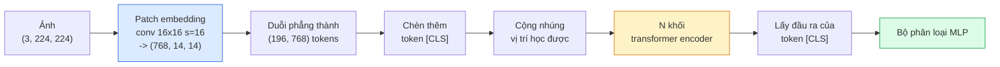

# Vision Transformers (ViT) — Transformer Trong Thị Giác

> Cắt bức ảnh thành các mảnh nhỏ (patches), coi mỗi mảnh như một từ trong câu, chạy một mạng transformer tiêu chuẩn. Đừng nhìn lại phía sau.

**Type:** Build
**Languages:** Python
**Prerequisites:** Phase 7 Lesson 02 (Self-Attention), Phase 4 Lesson 04 (Image Classification)
**Time:** ~45 phút

## Learning Objectives

- Tự tay cài đặt patch embedding, nhúng vị trí có thể học được (learned positional embedding), class token, và các khối transformer encoder từ đầu để xây dựng một mạng ViT tối giản
- Giải thích lý do tại sao ViT từng bị cho là cần tập dữ liệu tiền huấn luyện khổng lồ cho đến khi DeiT và MAE chứng minh điều ngược lại
- So sánh ViT, Swin, và ConvNeXt trên các tiên nghiệm kiến trúc (architectural priors: không có, chú ý cửa sổ cục bộ, backbone tích chập)
- Tinh chỉnh một ViT tiền huấn luyện trên tập dữ liệu nhỏ bằng thư viện `timm` theo quy trình chuẩn linear-probe / fine-tune

## Vấn Đề Đặt Ra (The Problem)

Trong suốt một thập kỷ, tích chập (convolution) là từ đồng nghĩa với thị giác máy tính. Các mạng CNN sở hữu các thiên kiến quy nạp (inductive biases) mạnh mẽ — tính cục bộ (locality), tính tương đương tịnh tiến (translation equivariance) — những thứ mà không ai nghĩ có thể thay thế được. Sau đó, Dosovitskiy et al. (2020) đã chứng minh rằng một mạng transformer thuần túy áp dụng trên các mảnh ảnh phẳng, hoàn toàn không cần bộ máy tích chập nào, có thể bắt kịp hoặc đánh bại các CNN tốt nhất ở quy mô lớn.

Mấu chốt ở đây là "ở quy mô lớn". Khi chỉ huấn luyện trên ImageNet-1k, ViT chịu thua ResNet. Nhưng khi ViT được tiền huấn luyện trên ImageNet-21k hoặc JFT-300M rồi tinh chỉnh trên ImageNet-1k, nó đã đánh bại ResNet. Kết luận ban đầu là transformer thiếu các thiên kiến hữu ích nhưng có thể tự học được chúng nếu có đủ dữ liệu. Các công trình nghiên cứu tiếp theo (DeiT, MAE, DINO) đã chứng minh rằng với công thức huấn luyện đúng đắn — tăng cường dữ liệu mạnh mẽ, tiền huấn luyện tự giám sát, chưng cất tri thức — ViT hoàn toàn có thể huấn luyện xuất sắc ngay cả trên các tập dữ liệu nhỏ.

Đến năm 2026, CNN thuần túy vẫn có tính cạnh tranh trên các thiết bị biên edge (tiêu biểu là ConvNeXt), nhưng transformer áp đảo ở hầu hết mọi lĩnh vực khác: phân đoạn (Mask2Former, SegFormer), phát hiện đối tượng (DETR, RT-DETR), đa phương thức (CLIP, SigLIP), video (VideoMAE, VJEPA). Cấu trúc khối của ViT là kiến trúc bắt buộc phải nắm vững.

## Khái Niệm Cốt Lõi (The Concept)

### Đường ống xử lý (The pipeline)



Bảy bước xử lý rõ ràng: Mảnh ảnh (Patches) -> Token -> Cơ chế chú ý (Attention) -> Bộ phân loại. Mọi biến thể (DeiT, Swin, ConvNeXt, tiền huấn luyện MAE) chỉ thay đổi một hoặc hai trong số bảy bước này và giữ nguyên phần còn lại.

### Nhúng mảnh ảnh (Patch embedding)

Tầng tích chập đầu tiên là bí mật cốt lõi. Kernel kích thước 16, bước nhảy (stride) 16, biến bức ảnh 224x224 thành một lưới 14x14 gồm các mảnh 16x16, mỗi mảnh được chiếu thành một vector nhúng 768 chiều. Tầng conv đơn lẻ đó vừa làm nhiệm vụ cắt mảnh vừa chiếu tuyến tính.

```text
Đầu vào: (3, 224, 224)
Conv (3 -> 768, k=16, s=16, không padding):
Đầu ra:  (768, 14, 14)
Duỗi phẳng không gian: (196, 768)
```

196 mảnh ảnh = 196 token. Chiều đặc trưng của mỗi token là 768 (ViT-B), 1024 (ViT-L), hoặc 1280 (ViT-H).

### Token đại diện lớp (Class token)

Một vector tham số có thể học được chèn vào đầu chuỗi:

```text
tokens = [CLS; patch_1; patch_2; ...; patch_196]   kích thước (197, 768)
```

Sau N khối transformer, đầu ra của `[CLS]` đóng vai trò là biểu diễn toàn cục của cả bức ảnh. Đầu phân loại sẽ chỉ đọc duy nhất vector này để dự đoán.

### Nhúng vị trí (Positional embedding)

Mạng Transformer không có khái niệm nội tại về vị trí không gian. Ta cộng thêm một vector tham số học được vào mỗi token:

```text
tokens = tokens + learned_pos_embedding   (cũng có kích thước (197, 768))
```

Vector nhúng này là tham số của mô hình; quá trình huấn luyện bằng gradient sẽ giúp nó tự thích ứng với cấu trúc không gian 2D của ảnh. Các phương án nhúng hình sin 2D cũng tồn tại nhưng hiếm khi được sử dụng trong thực tế.

### Khối Transformer Encoder

Cấu trúc tiêu chuẩn: Multi-head self-attention, mạng MLP, các kết nối tắt dư thừa (residual connections), và cơ chế tiền chuẩn hóa (pre-LayerNorm).

```text
x = x + MSA(LN(x))
x = x + MLP(LN(x))

MLP gồm 2 tầng với hàm kích hoạt GELU: Linear(d -> 4d) -> GELU -> Linear(4d -> d)
```

Kiến trúc ViT-B/16 xếp chồng 12 khối như vậy, mỗi khối có 12 attention head, tổng cộng khoảng 86 triệu tham số.

### Tại sao lại dùng Pre-LN

Các transformer thời kỳ đầu dùng post-LN (`x = LN(x + sublayer(x))`) và rất khó huấn luyện sâu quá 6-8 tầng nếu không có giai đoạn làm nóng (warmup). Pre-LN (`x = x + sublayer(LN(x))`) cho phép huấn luyện các mạng sâu hơn một cách ổn định mà không nhất thiết phải warmup phức tạp. Mọi mô hình ViT và LLM hiện đại đều dùng pre-LN.

### Sự đánh đổi về kích thước mảnh ảnh (Patch size)

- Mảnh 16x16 -> 196 token, kích thước tiêu chuẩn.
- Mảnh 32x32 -> 49 token, chạy nhanh hơn nhưng độ phân giải chi tiết thấp hơn.
- Mảnh 8x8 -> 784 token, chi tiết mịn hơn nhưng chi phí attention $O(n^2)$ bùng nổ rất nhanh.

Mảnh lớn hơn = ít token hơn = chạy nhanh hơn nhưng mất chi tiết không gian. SwinV2 sử dụng các mảnh 4x4 trong các cửa sổ phân cấp.

### Công thức của DeiT để huấn luyện ViT trên ImageNet-1k

ViT nguyên bản cần JFT-300M để đánh bại CNN. DeiT (Touvron et al., 2020) đã huấn luyện ViT-B đạt 81.8% top-1 chỉ trên tập ImageNet-1k nhờ bốn thay đổi:

1. Tăng cường dữ liệu mạnh mẽ: RandAugment, Mixup, CutMix, Random Erasing.
2. Độ sâu ngẫu nhiên (Stochastic depth — ngắt bỏ ngẫu nhiên các khối nguyên vẹn trong khi huấn luyện).
3. Tăng cường lặp lại (Repeated augmentation — cùng một bức ảnh được lấy mẫu 3 lần trong mỗi batch).
4. Chưng cất từ một giáo viên CNN (tùy chọn, giúp nâng cao độ chính xác hơn nữa).

Mọi công thức huấn luyện ViT hiện đại ngày nay đều kế thừa từ DeiT.

### Swin vs ConvNeXt

- **Swin** (Liu et al., 2021) — cơ chế chú ý dựa trên cửa sổ (window-based attention). Mỗi khối chỉ chú ý trong một cửa sổ cục bộ; các khối xen kẽ sẽ dịch chuyển cửa sổ (shifted window) để hòa trộn thông tin. Mang lại thiên kiến cục bộ giống CNN trong khi vẫn giữ toán tử attention.
- **ConvNeXt** (Liu et al., 2022) — tái thiết kế CNN để khớp với các lựa chọn kiến trúc của Swin (depthwise convs, LayerNorm, GELU, inverted bottleneck). Chứng minh rằng khoảng cách hiệu năng không nằm ở "attention vs tích chập" mà nằm ở "công thức huấn luyện hiện đại + thiết kế kiến trúc vi mô."

Đến năm 2026, cả ConvNeXt-V2 và Swin-V2 đều là các lựa chọn thương phẩm; việc chọn bên nào phụ thuộc vào môi trường suy luận của bạn (ConvNeXt biên dịch tốt hơn cho thiết bị biên edge) và tập dữ liệu tiền huấn luyện.

### Tiền huấn luyện MAE (Masked Autoencoder)

Masked Autoencoder (He et al., 2022): che ngẫu nhiên 75% số mảnh ảnh, huấn luyện encoder chỉ xử lý 25% số mảnh nhìn thấy được, huấn luyện một decoder nhỏ để tái tạo lại các mảnh bị che từ đầu ra của encoder. Sau khi tiền huấn luyện, bỏ decoder và chỉ tinh chỉnh encoder.

MAE giúp ViT có thể huấn luyện hiệu quả chỉ trên tập ImageNet-1k, đạt đỉnh cao SOTA, và là công thức tự giám sát mặc định hiện nay.

```figure
batchnorm-inference
```

## Tự Xây Dựng (Build It)

### Bước 1: Khối nhúng mảnh ảnh (Patch Embedding)

```python
import torch
import torch.nn as nn

class PatchEmbedding(nn.Module):
    def __init__(self, in_channels=3, patch_size=16, dim=192, image_size=64):
        super().__init__()
        assert image_size % patch_size == 0
        self.proj = nn.Conv2d(in_channels, dim, kernel_size=patch_size, stride=patch_size)
        num_patches = (image_size // patch_size) ** 2
        self.num_patches = num_patches

    def forward(self, x):
        x = self.proj(x)
        return x.flatten(2).transpose(1, 2)
```

Một tầng conv, một phép flatten, một phép transpose. Đó là toàn bộ bước chuyển đổi từ bức ảnh sang chuỗi token.

### Bước 2: Khối Transformer Block

Pre-LN, multi-head self-attention, MLP với GELU, và các kết nối tắt residual.

```python
class Block(nn.Module):
    def __init__(self, dim, num_heads, mlp_ratio=4, dropout=0.0):
        super().__init__()
        self.ln1 = nn.LayerNorm(dim)
        self.attn = nn.MultiheadAttention(dim, num_heads, dropout=dropout, batch_first=True)
        self.ln2 = nn.LayerNorm(dim)
        self.mlp = nn.Sequential(
            nn.Linear(dim, dim * mlp_ratio),
            nn.GELU(),
            nn.Dropout(dropout),
            nn.Linear(dim * mlp_ratio, dim),
            nn.Dropout(dropout),
        )

    def forward(self, x):
        a, _ = self.attn(self.ln1(x), self.ln1(x), self.ln1(x), need_weights=False)
        x = x + a
        x = x + self.mlp(self.ln2(x))
        return x
```

`nn.MultiheadAttention` tự động chia tách thành các head, tính toán tích vô hướng có tỷ lệ, và chiếu đầu ra. `batch_first=True` đảm bảo hình dạng tensor là `(N, seq, dim)`.

### Bước 3: Mạng ViT hoàn chỉnh

```python
class ViT(nn.Module):
    def __init__(self, image_size=64, patch_size=16, in_channels=3,
                 num_classes=10, dim=192, depth=6, num_heads=3, mlp_ratio=4):
        super().__init__()
        self.patch = PatchEmbedding(in_channels, patch_size, dim, image_size)
        num_patches = self.patch.num_patches
        self.cls_token = nn.Parameter(torch.zeros(1, 1, dim))
        self.pos_embed = nn.Parameter(torch.zeros(1, num_patches + 1, dim))
        self.blocks = nn.ModuleList([
            Block(dim, num_heads, mlp_ratio) for _ in range(depth)
        ])
        self.ln = nn.LayerNorm(dim)
        self.head = nn.Linear(dim, num_classes)
        nn.init.trunc_normal_(self.pos_embed, std=0.02)
        nn.init.trunc_normal_(self.cls_token, std=0.02)

    def forward(self, x):
        x = self.patch(x)
        cls = self.cls_token.expand(x.size(0), -1, -1)
        x = torch.cat([cls, x], dim=1)
        x = x + self.pos_embed
        for blk in self.blocks:
            x = blk(x)
        x = self.ln(x[:, 0])
        return self.head(x)

vit = ViT(image_size=64, patch_size=16, num_classes=10, dim=192, depth=6, num_heads=3)
x = torch.randn(2, 3, 64, 64)
print(f"output: {vit(x).shape}")
print(f"params: {sum(p.numel() for p in vit.parameters()):,}")
```

Khoảng 2.8 triệu tham số — một mạng ViT nhỏ gọn có thể huấn luyện dễ dàng trên CPU. Bản ViT-B tiêu chuẩn có 86 triệu tham số, dùng cùng định nghĩa lớp này với `dim=768, depth=12, num_heads=12`.

### Bước 4: Kiểm tra nhanh — suy luận trên một ảnh đơn

```python
logits = vit(torch.randn(1, 3, 64, 64))
print(f"logits: {logits}")
print(f"probs:  {logits.softmax(-1)}")
```

Mã nguồn phải chạy mượt mà không có lỗi. Tổng xác suất bằng 1.

## Sử Dụng Thực Tế (Use It)

Thư viện `timm` cung cấp mọi biến thể ViT với các bộ trọng số tiền huấn luyện trên ImageNet. Chỉ cần một dòng lệnh:

```python
import timm

model = timm.create_model("vit_base_patch16_224", pretrained=True, num_classes=10)
```

`timm` là lựa chọn mặc định trong sản xuất cho vision transformer vào năm 2026. Hỗ trợ ViT, DeiT, Swin, Swin-V2, ConvNeXt, ConvNeXt-V2, MaxViT, MViT, EfficientFormer và hàng chục kiến trúc khác dưới cùng một chuẩn giao diện API.

Đối với các tác vụ đa phương thức (hình ảnh + văn bản), thư viện `transformers` cung cấp CLIP, SigLIP, BLIP-2, LLaVA. Bộ mã hóa hình ảnh trong tất cả các mô hình đó đều là một biến thể của ViT.

## Sản Phẩm Đầu Ra (Ship It)

Bài học này tạo ra:

- `outputs/prompt-vit-vs-cnn-picker.md` — một prompt giúp lựa chọn giữa ViT, ConvNeXt, hoặc Swin dựa trên quy mô tập dữ liệu, năng lực tính toán, và nền tảng suy luận.
- `outputs/skill-vit-patch-and-pos-embed-inspector.md` — một kỹ năng (skill) kiểm tra tính tương thích giữa kích thước patch embedding và positional embedding với độ dài chuỗi dự kiến của mô hình, giúp bắt các lỗi chuyển đổi kiến trúc phổ biến nhất.

## Bài Tập Thực Hành (Exercises)

1. **(Dễ)** In ra kích thước của mọi tensor trung gian trong một lượt lan truyền xuôi qua mạng ViT nhỏ ở trên. Xác nhận: đầu vào `(N, 3, 64, 64)` -> các mảnh patches `(N, 16, 192)` -> sau khi ghép CLS `(N, 17, 192)` -> đầu vào bộ phân loại `(N, 192)` -> đầu ra `(N, num_classes)`.
2. **(Trung bình)** Tinh chỉnh một mạng ViT-S/16 tiền huấn luyện từ `timm` trên tập dữ liệu synthetic-CIFAR từ Bài 4. So sánh với việc tinh chỉnh ResNet-18 trên cùng dữ liệu đó. Báo cáo thời gian huấn luyện và độ chính xác cuối cùng.
3. **(Khó)** Cài đặt quy trình tiền huấn luyện MAE cho mô hình ViT nhỏ: che ngẫu nhiên 75% số mảnh ảnh, huấn luyện encoder + một decoder nhỏ để tái tạo lại các mảnh bị che. Đánh giá độ chính xác kiểm tra tuyến tính (linear-probe) trên dữ liệu tổng hợp trước và sau khi tiền huấn luyện.

## Thuật Ngữ Then Chốt (Key Terms)

| Thuật ngữ | Cách gọi thông thường | Ý nghĩa kỹ thuật thực sự |
|-----------|----------------------|--------------------------|
| Patch embedding | "Tầng conv đầu tiên" | Tích chập với kernel size = stride = patch size; biến bức ảnh thành lưới các vector nhúng token |
| Class token | "[CLS]" | Vector tham số học được chèn vào đầu chuỗi token; đầu ra cuối cùng của nó là biểu diễn toàn cục của ảnh |
| Positional embedding | "Nhúng vị trí" | Vector tham số cộng vào mỗi token để transformer nhận biết vị trí không gian ban đầu của mảnh ảnh |
| Pre-LN | "LayerNorm trước tầng con" | Biến thể transformer ổn định: `x + sublayer(LN(x))` thay vì `LN(x + sublayer(x))` |
| Multi-head attention | "Cơ chế chú ý đa đầu" | Attention transformer tiêu chuẩn được chia thành num_heads không gian con độc lập rồi ghép nối lại |
| ViT-B/16 | "Bản Base, patch 16" | Kích thước chuẩn mực: dim=768, depth=12, heads=12, patch_size=16, ảnh 224x224; ~86 triệu tham số |
| DeiT | "ViT tiết kiệm dữ liệu" | ViT huấn luyện thành công chỉ trên ImageNet-1k nhờ tăng cường dữ liệu mạnh mẽ; chứng minh không bắt buộc phải có tập dữ liệu khổng lồ |
| MAE | "Masked autoencoder" | Tiền huấn luyện tự giám sát: che 75% mảnh ảnh rồi tái tạo; công thức tiền huấn luyện thống trị của ViT |

## Đọc Thêm (Further Reading)

- [An Image is Worth 16x16 Words (Dosovitskiy et al., 2020)](https://arxiv.org/abs/2010.11929) — bài báo khai sinh ra ViT
- [DeiT: Data-efficient Image Transformers (Touvron et al., 2020)](https://arxiv.org/abs/2012.12877) — cách huấn luyện ViT đạt hiệu quả cao chỉ trên ImageNet-1k
- [Masked Autoencoders are Scalable Vision Learners (He et al., 2022)](https://arxiv.org/abs/2111.06377) — phương pháp tiền huấn luyện MAE
- [timm documentation](https://huggingface.co/docs/timm) — tài liệu tham khảo cho mọi mô hình vision transformer bạn sử dụng trong sản xuất

