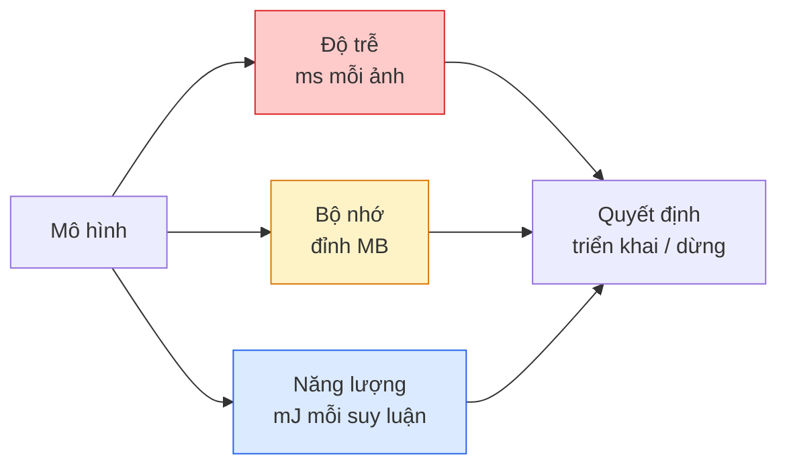

# Thị Giác Thời Gian Thực — Triển Khai Thiết Bị Biên (Real-Time Vision — Edge Deployment)

> Suy luận trên thiết bị biên là kỷ luật đưa một mô hình đạt độ chính xác 90% chạy mượt mà ở tốc độ 30 fps trên một thiết bị chỉ có 2 GB RAM. Từng phần trăm độ chính xác đều phải được đánh đổi bằng từng mili-giây độ trễ.

**Type:** Learn + Build
**Languages:** Python
**Prerequisites:** Phase 4 Lesson 04 (Image Classification), Phase 10 Lesson 11 (Quantization)
**Time:** ~75 phút

## Learning Objectives

- Đo lường chính xác độ trễ suy luận (inference latency), bộ nhớ đỉnh (peak memory), và thông lượng (throughput) cho bất kỳ mô hình PyTorch nào, đồng thời đọc hiểu mối quan hệ đánh đổi FLOPs / tham số / độ trễ
- Lượng tử hóa mô hình thị giác sang INT8 bằng kỹ thuật lượng tử hóa sau huấn luyện (Post-Training Quantization - PTQ) của PyTorch và xác nhận độ suy giảm chính xác < 1%
- Xuất mô hình sang định dạng ONNX và biên dịch với ONNX Runtime hoặc TensorRT; chỉ ra ba lỗi xuất thường gặp nhất cùng cách khắc phục
- Giải thích thời điểm nên chọn MobileNetV3, EfficientNet-Lite, ConvNeXt-Tiny, hoặc MobileViT trước các ràng buộc phần cứng biên

## Vấn Đề Đặt Ra (The Problem)

Một mô hình thị giác ở thời điểm huấn luyện là một "quái vật" số thực dấu phẩy động: 100 triệu tham số, 10 GFLOPs cho mỗi lượt lan truyền xuôi, và ngốn 2 GB VRAM. Không có thông số nào trong số đó có thể chạy vừa trên một chiếc điện thoại, màn hình giải trí xe hơi, camera công nghiệp, hay máy bay không người lái (drone). Triển khai một hệ thống thị giác vào sản phẩm thực tế đồng nghĩa với việc đưa cùng những dự đoán đó vào một ngân sách tài nguyên nhỏ hơn gấp 100 lần.

Ba đòn bẩy kỹ thuật giải quyết phần lớn vấn đề: lựa chọn mô hình (kiến trúc nhỏ hơn với cùng công thức huấn luyện), lượng tử hóa (dùng INT8 thay vì FP32), và môi trường thực thi suy luận (ONNX Runtime, TensorRT, Core ML, TFLite). Làm chủ đúng ba đòn bẩy này tạo nên sự khác biệt giữa một bản demo chạy trên máy trạm và một sản phẩm thương phẩm chạy trên mô-đun camera giá $30.

Bài học này thiết lập tính kỷ luật trong đo lường trước tiên (bạn không thể tối ưu hóa những gì bạn không thể đo lường), sau đó đi qua từng đòn bẩy. Mục tiêu không phải là học thuộc lòng mọi runtime biên, mà là hiểu rõ các công cụ đòn bẩy tồn tại và cách xác minh từng công cụ hoạt động đúng như mong đợi.

## Khái Niệm Cốt Lõi (The Concept)

### Ba ngân sách tài nguyên cốt lõi



- **Độ trễ (Latency)**: p50, p95, p99. Chỉ báo cáo p50 (hoặc giá trị trung bình) sẽ che giấu hành vi đuôi (tail latency) vốn mang tính sống còn cho các hệ thống thời gian thực.
- **Bộ nhớ đỉnh (Peak memory)**: mức RAM tối đa thiết bị phải gánh chịu tại một thời điểm, chứ không phải mức trung bình ổn định. Hiện tượng tràn bộ nhớ (OOM) sẽ làm sập toàn bộ ứng dụng nhúng.
- **Năng lượng / Công suất (Power / Energy)**: millijoules trên mỗi lượt suy luận trên các thiết bị chạy pin. Thường được đại diện bằng tích số giữa mức sử dụng CPU/GPU và thời gian chạy.

Một bảng thông số gồm (mô hình, độ trễ, bộ nhớ, độ chính xác) là căn cứ đưa ra quyết định triển khai. Mọi ô trong bảng phải được đo trực tiếp trên thiết bị mục tiêu, chứ không phải trên máy trạm phát triển.

### Kỷ luật đo lường hiệu năng

Ba nguyên tắc bắt buộc khi phân tích hiệu năng trên thiết bị biên:

1. **Làm nóng (Warm up)** mô hình bằng 5-10 lượt lan truyền xuôi giả định trước khi bấm giờ. Bộ nhớ đệm nguội (cold cache) và biên dịch JIT sẽ tạo ra các con số sai lệch ở những lượt đầu.
2. **Đồng bộ hóa (Synchronise)** khối lượng công việc trên GPU bằng `torch.cuda.synchronize()` trước và sau khối lệnh tính giờ. Nếu không có lệnh này, bạn chỉ đang đo thời gian phát lệnh kernel chứ không phải thời gian kernel thực thi.
3. **Cố định kích thước đầu vào** đúng với độ phân giải sản xuất. Độ trễ ở kích thước 224x224 hoàn toàn khác độ trễ ở 512x512.

### FLOPs như một thước đo đại diện

FLOPs (số phép tính dấu phẩy động trên mỗi lượt suy luận) là một thước đo đại diện rẻ tiền, độc lập với thiết bị. Rất hữu ích khi so sánh kiến trúc, nhưng có thể gây hiểu nhầm nếu dùng làm thời gian thực tế tuyệt đối. Một mô hình có FLOPs cao hơn 10% có thể chạy nhanh gấp 2 lần trong thực tế nếu nó sử dụng các toán tử thân thiện với phần cứng (depthwise convs biên dịch rất tốt, trong khi conv 7x7 lớn thì không).

Nguyên tắc: sử dụng FLOPs khi tìm kiếm kiến trúc, sử dụng độ trễ đo trên thiết bị thực tế để ra quyết định triển khai.

### Lượng tử hóa gói gọn trong một đoạn văn

Thay thế trọng số và các kích hoạt số thực FP32 bằng số nguyên 8-bit INT8. Dung lượng mô hình giảm 4 lần, băng thông bộ nhớ giảm 4 lần, năng lực tính toán tăng 2-4 lần trên phần cứng hỗ trợ kernel INT8 (mọi SoC di động hiện đại, GPU NVIDIA có Tensor Cores). Mức suy giảm độ chính xác trên các bài toán thị giác thường chỉ từ 0.1 đến 1 điểm phần trăm khi áp dụng lượng tử hóa tĩnh sau huấn luyện (PTQ).

Các hình thức lượng tử hóa:

- **Dynamic (Động)** — lượng tử hóa trọng số sang INT8, các kích hoạt tính toán ở dạng FP. Đơn giản, mức tăng tốc khiêm tốn.
- **Static (Tĩnh - sau huấn luyện)** — lượng tử hóa trọng số + hiệu chuẩn (calibrate) dải giá trị kích hoạt trên một tập dữ liệu nhỏ. Nhanh hơn nhiều so với lượng tử hóa động.
- **Quantisation-aware training (QAT)** — mô phỏng lượng tử hóa trong quá trình huấn luyện để mô hình tự học cách thích nghi. Cho độ chính xác tốt nhất, đòi hỏi dữ liệu có nhãn.

Đối với thị giác, lượng tử hóa tĩnh sau huấn luyện mang lại 95% lợi ích chỉ với 5% công sức. Chỉ dùng QAT khi mức giảm độ chính xác từ PTQ không thể chấp nhận được.

### Cắt tỉa và Chưng cất (Pruning and Distillation)

- **Cắt tỉa (Pruning)** — loại bỏ các trọng số không quan trọng (theo độ lớn) hoặc loại bỏ cả kênh (cắt tỉa có cấu trúc). Hoạt động tốt trên các mô hình dư thừa tham số; ít hiệu quả trên các kiến trúc vốn đã nhỏ gọn.
- **Chưng cất (Distillation)** — huấn luyện một mô hình học sinh nhỏ mô phỏng logits của mô hình giáo viên lớn. Thường phục hồi hầu hết độ chính xác bị mất do thu nhỏ mô hình. Tiêu chuẩn vàng cho các mô hình biên trong sản xuất.

### Các môi trường thực thi suy luận (Inference runtimes)

- **PyTorch eager** — chậm, không dành cho triển khai. Chỉ dùng khi phát triển mã nguồn.
- **TorchScript** — công nghệ cũ. Đã được thay thế bởi `torch.compile` và xuất sang ONNX.
- **ONNX Runtime** — môi trường thực thi trung lập. CPU, CUDA, CoreML, TensorRT, OpenVINO đều có provider cho ONNX. Hãy bắt đầu từ đây.
- **TensorRT** — trình biên dịch tối ưu của NVIDIA. Cho độ trễ tốt nhất trên GPU NVIDIA (máy trạm và dòng Jetson). Tích hợp tốt với ONNX Runtime hoặc chạy độc lập.
- **Core ML** — môi trường của Apple cho iOS/macOS. Cần định dạng `.mlmodel` hoặc `.mlpackage`.
- **TFLite** — môi trường của Google cho Android/ARM. Cần định dạng `.tflite`.
- **OpenVINO** — môi trường của Intel cho CPU/VPU. Cần định dạng `.xml` + `.bin`.

Quy trình chuẩn trong thực tế: Xuất từ PyTorch -> ONNX -> chọn runtime tối ưu cho phần cứng mục tiêu. ONNX đóng vai trò là cầu nối ngôn ngữ chung.

### Bảng chọn kiến trúc thiết bị biên

| Ngân sách | Mô hình | Lý do lựa chọn |
|-----------|---------|----------------|
| < 3M params | MobileNetV3-Small | Biên dịch tương thích mọi nơi, baseline tốt |
| 3-10M | EfficientNet-Lite-B0 | Độ chính xác trên mỗi tham số tốt nhất trên TFLite |
| 10-20M | ConvNeXt-Tiny | Độ chính xác/tham số tối ưu, thân thiện CPU |
| 20-30M | MobileViT-S hoặc EfficientViT | Transformer đạt độ chính xác tương đương ImageNet |
| 30-80M | Swin-V2-Tiny | Khi phần cứng hỗ trợ tốt cơ chế window attention |

Hãy luôn lượng tử hóa tất cả các mô hình này sang INT8 trừ khi bạn có lý do kỹ thuật bắt buộc không được làm vậy.

```figure
cnn-param-count
```

## Tự Xây Dựng (Build It)

### Bước 1: Đo lường độ trễ chuẩn xác

```python
import time
import torch

def measure_latency(model, input_shape, device="cpu", warmup=10, iters=50):
    model = model.to(device).eval()
    x = torch.randn(input_shape, device=device)
    with torch.no_grad():
        for _ in range(warmup):
            model(x)
        if device == "cuda":
            torch.cuda.synchronize()
        times = []
        for _ in range(iters):
            if device == "cuda":
                torch.cuda.synchronize()
            t0 = time.perf_counter()
            model(x)
            if device == "cuda":
                torch.cuda.synchronize()
            times.append((time.perf_counter() - t0) * 1000)
    times.sort()
    return {
        "p50_ms": times[len(times) // 2],
        "p95_ms": times[int(len(times) * 0.95)],
        "p99_ms": times[int(len(times) * 0.99)],
        "mean_ms": sum(times) / len(times),
    }
```

Làm nóng bộ nhớ đệm, đồng bộ hóa GPU, sử dụng `time.perf_counter()`. Luôn báo cáo theo phân vị (percentiles), không chỉ dựa vào giá trị trung bình.

### Bước 2: Đếm số lượng tham số và ước lượng FLOPs

```python
def parameter_count(model):
    return sum(p.numel() for p in model.parameters())

def flops_estimate(model, input_shape):
    """
    Ước lượng sơ bộ FLOPs cho mô hình chỉ gồm conv/linear. Trong sản xuất nên dùng `fvcore` hoặc `ptflops`.
    """
    total = 0
    def conv_hook(m, inp, out):
        nonlocal total
        c_out, c_in, kh, kw = m.weight.shape
        h, w = out.shape[-2:]
        total += 2 * c_in * c_out * kh * kw * h * w
    def linear_hook(m, inp, out):
        nonlocal total
        total += 2 * m.in_features * m.out_features
    hooks = []
    for m in model.modules():
        if isinstance(m, torch.nn.Conv2d):
            hooks.append(m.register_forward_hook(conv_hook))
        elif isinstance(m, torch.nn.Linear):
            hooks.append(m.register_forward_hook(linear_hook))
    model.eval()
    with torch.no_grad():
        model(torch.randn(input_shape))
    for h in hooks:
        h.remove()
    return total
```

Đối với các dự án thực tế, hãy sử dụng `fvcore.nn.FlopCountAnalysis` hoặc `ptflops`; chúng xử lý chính xác mọi loại module phức tạp.

### Bước 3: Lượng tử hóa tĩnh sau huấn luyện (PTQ)

```python
def quantise_ptq(model, calibration_loader, backend="x86"):
    import torch.ao.quantization as tq
    model = model.eval().cpu()
    model.qconfig = tq.get_default_qconfig(backend)
    tq.prepare(model, inplace=True)
    with torch.no_grad():
        for x, _ in calibration_loader:
            model(x)
    tq.convert(model, inplace=True)
    return model
```

Ba bước mạch lạc: cấu hình, chuẩn bị (chèn các bộ quan sát observer), hiệu chuẩn với dữ liệu thực, chuyển đổi (gộp tầng + lượng tử hóa). Đòi hỏi mô hình phải được gộp tầng trước (`Conv -> BN -> ReLU` -> `ConvBnReLU`), thao tác này được xử lý bởi `torch.ao.quantization.fuse_modules`.

### Bước 4: Xuất mô hình sang ONNX

```python
def export_onnx(model, sample_input, path="model.onnx"):
    model = model.eval()
    torch.onnx.export(
        model,
        sample_input,
        path,
        input_names=["input"],
        output_names=["output"],
        dynamic_axes={"input": {0: "batch"}, "output": {0: "batch"}},
        opset_version=17,
    )
    return path
```

`opset_version=17` là lựa chọn mặc định an toàn vào năm 2026. `dynamic_axes` cho phép chạy mô hình ONNX với kích thước batch tùy ý.

### Bước 5: Đo kiểm chuẩn và so sánh các chế độ

```python
import torch.nn as nn
from torchvision.models import mobilenet_v3_small

def compare_regimes():
    model = mobilenet_v3_small(weights=None, num_classes=10)
    params = parameter_count(model)
    flops = flops_estimate(model, (1, 3, 224, 224))
    lat_fp32 = measure_latency(model, (1, 3, 224, 224), device="cpu")
    print(f"FP32 MobileNetV3-Small: {params:,} params  {flops/1e9:.2f} GFLOPs  "
          f"p50={lat_fp32['p50_ms']:.2f}ms  p95={lat_fp32['p95_ms']:.2f}ms")
```

Chạy cùng hàm này cho `resnet50`, `efficientnet_v2_s`, và `convnext_tiny`, bạn sẽ có ngay bảng so sánh toàn diện cần thiết cho quyết định triển khai.

## Sử Dụng Thực Tế (Use It)

Các hệ thống sản xuất hội tụ vào một trong ba con đường chính:

- **Web / Serverless**: PyTorch -> ONNX -> ONNX Runtime (CPU hoặc CUDA provider). Đơn giản nhất, đáp ứng tốt phần lớn nhu cầu.
- **NVIDIA Edge (Jetson, máy chủ GPU)**: PyTorch -> ONNX -> TensorRT. Cho độ trễ tối ưu nhất, đòi hỏi kỹ thuật triển khai cao nhất.
- **Di động (Mobile)**: PyTorch -> ONNX -> Core ML (iOS) hoặc TFLite (Android). Hãy lượng tử hóa trước khi xuất file.

Để đo lường chuyên sâu, `torch-tb-profiler`, `nvprof` / `nsys`, và Instruments trên macOS cung cấp phân tích chi tiết từng tầng. Các công cụ dòng lệnh như `benchmark_app` (OpenVINO) và `trtexec` (TensorRT) cung cấp các con số kiểm thử độc lập nhanh chóng.

## Sản Phẩm Đầu Ra (Ship It)

Bài học này tạo ra:

- `outputs/prompt-edge-deployment-planner.md` — một prompt giúp lựa chọn backbone, chiến lược lượng tử hóa, và runtime phù hợp dựa trên thiết bị mục tiêu và cam kết SLA về độ trễ.
- `outputs/skill-latency-profiler.md` — một kỹ năng (skill) tạo ra một tập lệnh đo kiểm chuẩn độ trễ hoàn chỉnh với các bước làm nóng, đồng bộ hóa, tính phân vị và theo dõi dung lượng bộ nhớ.

## Bài Tập Thực Hành (Exercises)

1. **(Dễ)** Đo độ trễ p50 cho `resnet18`, `mobilenet_v3_small`, `efficientnet_v2_s`, và `convnext_tiny` ở kích thước 224x224 trên CPU. Lập bảng báo cáo và chỉ ra kiến trúc nào đạt tỷ lệ độ chính xác trên mỗi mili-giây tốt nhất.
2. **(Trung bình)** Áp dụng lượng tử hóa tĩnh sau huấn luyện (PTQ) cho `mobilenet_v3_small`. Báo cáo độ trễ FP32 so với INT8 và mức suy giảm độ chính xác trên tập kiểm thử CIFAR-10.
3. **(Khó)** Xuất mô hình `convnext_tiny` sang ONNX, chạy qua `onnxruntime` với `CPUExecutionProvider`, và so sánh độ trễ với baseline PyTorch eager. Xác định tầng đầu tiên mà ONNX Runtime chạy nhanh hơn và giải thích nguyên nhân kỹ thuật.

## Thuật Ngữ Then Chốt (Key Terms)

| Thuật ngữ | Cách gọi thông thường | Ý nghĩa kỹ thuật thực sự |
|-----------|----------------------|--------------------------|
| Latency | "Tốc độ chạy" | Thời gian từ lúc nhận đầu vào đến khi có đầu ra; đo bằng phân vị p50/p95/p99 |
| FLOPs | "Kích thước tính toán" | Số phép tính dấu phẩy động trên mỗi lượt lan truyền; đại diện thô cho chi phí tính toán |
| INT8 quantisation | "Lượng tử hóa 8-bit" | Thay thế trọng số/kích hoạt FP32 bằng số nguyên 8-bit; nhẹ hơn ~4 lần, nhanh hơn 2-4 lần |
| PTQ | "Lượng tử hóa sau huấn luyện" | Lượng tử hóa mô hình đã huấn luyện xong mà không cần train lại; nhanh gọn, đủ tốt |
| QAT | "Huấn luyện nhận biết lượng tử" | Mô phỏng sai số lượng tử hóa ngay trong lúc huấn luyện; độ chính xác cao nhất, cần dữ liệu có nhãn |
| ONNX | "Định dạng trung lập" | Định dạng trao đổi mô hình mở được hỗ trợ bởi mọi runtime suy luận phổ biến |
| TensorRT | "Trình biên dịch NVIDIA" | Biên dịch đồ thị ONNX thành engine thực thi tối ưu hóa phần cứng GPU NVIDIA |
| Distillation | "Chưng cất tri thức" | Huấn luyện mô hình nhỏ bắt chước phân phối xác suất của mô hình lớn; lấy lại phần lớn độ chính xác |

## Đọc Thêm (Further Reading)

- [EfficientNet (Tan & Le, 2019)](https://arxiv.org/abs/1905.11946) — phương pháp co giãn phức hợp (compound scaling) cho các kiến trúc hiệu năng cao
- [MobileNetV3 (Howard et al., 2019)](https://arxiv.org/abs/1905.02244) — kiến trúc ưu tiên di động với hàm h-swish và khối squeeze-and-excitation
- [Accelerating Inference Up to 6x Faster in PyTorch with Torch-TensorRT (NVIDIA)](https://developer.nvidia.com/blog/accelerating-inference-up-to-6x-faster-in-pytorch-with-torch-tensorrt/) — cách thức thực tế để đạt được thông lượng vượt trội
- [ONNX Runtime docs](https://onnxruntime.ai/docs/) — tài liệu về lượng tử hóa, tối ưu đồ thị tính toán và lựa chọn execution provider

