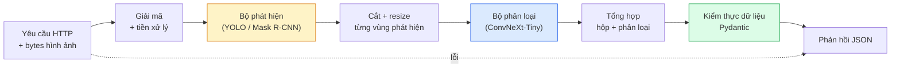

# Xây Dựng Pipeline Thị Giác Toàn Diện — Dự Án Cuối Khóa (Build a Complete Vision Pipeline — Capstone)

> Một hệ thống thị giác máy tính cấp sản phẩm là một chuỗi các mô hình và quy tắc nghiệp vụ được liên kết chặt chẽ bằng các hợp đồng dữ liệu (data contracts). Mọi thành phần đều đã được học trong giai đoạn này; bài tập capstone sẽ ghép nối chúng lại từ đầu đến cuối thành một hệ thống hoàn chỉnh.

**Type:** Build
**Languages:** Python
**Prerequisites:** Phase 4 Lessons 01-15
**Time:** ~120 phút

## Learning Objectives

- Thiết kế một đường ống thị giác cấp sản phẩm thực hiện phát hiện đối tượng, phân loại chi tiết, và xuất dữ liệu JSON có cấu trúc — với mọi nhánh lỗi đều được xử lý an toàn
- Ghép nối một bộ phát hiện (Mask R-CNN hoặc YOLO), một bộ phân loại (ConvNeXt-Tiny), và một hợp đồng dữ liệu chuẩn hóa (Pydantic) thành một dịch vụ duy nhất
- Đo kiểm chuẩn toàn bộ pipeline từ đầu đến cuối và chỉ ra điểm nghẽn hiệu năng đầu tiên (thường là tiền xử lý, sau đó đến bộ phát hiện)
- Đóng gói và phát hành một dịch vụ FastAPI tối giản nhận tệp ảnh tải lên, thực thi pipeline, và trả về danh sách các đối tượng phát hiện kèm phân loại

## Vấn Đề Đặt Ra (The Problem)

Từng mô hình thị giác riêng lẻ đều rất hữu ích; nhưng các sản phẩm thị giác thực tế luôn là một chuỗi kết hợp nhiều mô hình. Hệ thống kiểm toán quầy kệ bán lẻ là sự kết hợp giữa một bộ phát hiện đồ vật + một bộ phân loại sản phẩm + một đường ống OCR đọc giá tiền. Hệ thống lái xe tự hành là sự kết hợp của detector 2D + detector 3D + segmenter phân đoạn + tracker theo dõi + planner lập kế hoạch di chuyển. Hệ thống sàng lọc y tế là sự kết hợp giữa segmenter khoanh vùng tổn thương + classifier phân loại mức độ + giao diện bác sĩ.

Việc liên kết chuỗi các mắt xích đó chính là ranh giới phân biệt giữa một bản thử nghiệm ML nguyên mẫu (prototype) và một sản phẩm thương phẩm thực sự. Mọi giao diện tiếp giáp giữa các mô hình đều là nơi tiềm ẩn lỗi mới. Từng phép biến đổi tọa độ, từng bước chuẩn hóa màu sắc, từng lần resize mặt nạ đều là những ứng viên có thể gây lỗi âm thầm (silent failure). Độ tin cậy của toàn bộ pipeline chỉ mạnh bằng mắt xích yếu nhất trong chuỗi.

Dự án capstone này thiết lập một khung pipeline tối thiểu khả thi: phát hiện + phân loại + đầu ra có cấu trúc + tầng phục vụ API (serving layer). Mọi kiến thức khác trong Phase 4 đều có thể cắm ghép vào bộ khung xương này: thay Mask R-CNN bằng YOLOv8, thêm một nhánh OCR, thêm phân đoạn ngữ nghĩa, hoặc gắn thêm module theo dõi đối tượng. Kiến trúc tổng thể luôn ổn định; các thành phần con có thể tháo lắp linh hoạt.

## Khái Niệm Cốt Lõi (The Concept)

### Đường ống xử lý (The pipeline)



Bảy giai đoạn vận hành. Hai giai đoạn chạy mô hình ML ngốn tài nguyên tính toán nhất; năm giai đoạn còn lại là nơi ẩn nấp của các lỗi lập trình phần mềm.

### Hợp đồng dữ liệu với Pydantic (Data contracts)

Mọi ranh giới giữa các mô hình đều được định kiểu dữ liệu rõ ràng. Điều này biến các lỗi âm thầm nguy hiểm thành các ngoại lệ rõ ràng, dễ xử lý ngay lập tức.

```text
Detection(
    box: tuple[float, float, float, float],   # (x1, y1, x2, y2), tọa độ pixel tuyệt đối
    score: float,                              # điểm tin cậy trong khoảng [0, 1]
    class_id: int,                             # ID từ bản đồ nhãn của detector
    mask_rle: Optional[str],                   # chuỗi nén RLE nếu có mặt nạ
)

PipelineResult(
    image_id: str,
    detections: list[Detection],
    classifications: list[Classification],
    inference_ms: float,
)
```

Khi một detector vô tình trả về các hộp ở định dạng `(cx, cy, w, h)` thay vì `(x1, y1, x2, y2)`, quá trình kiểm thực của Pydantic sẽ báo lỗi ngay tại ranh giới, giúp bạn phát hiện vấn đề lập tức thay vì phải mất nhiều giờ gỡ lỗi một thao tác cắt ảnh ở tầng dưới vốn âm thầm trả về các vùng rỗng.

### Thời gian trôi đi đâu (Where latency goes)

Ba sự thật luôn đúng trong hầu hết các pipeline thị giác máy tính:

1. **Tiền xử lý thường là khối chiếm thời gian đơn lẻ lớn nhất.** Giải mã tệp JPEG, chuyển đổi không gian màu, co giãn ảnh — đây là các thao tác nghẽn CPU và rất dễ bị lãng quên khi tính toán hiệu năng.
2. **Bộ phát hiện detector chiếm ưu thế tuyệt đối về thời gian GPU.** 70-90% thời gian tính toán trên GPU nằm ở lượt lan truyền xuôi của mô hình phát hiện.
3. **Hậu xử lý (NMS, mã hóa/giải mã RLE) tính rất nhanh trên GPU nhưng rất đắt đỏ trên CPU.** Luôn phân tích hiệu năng trực tiếp trên phần cứng mục tiêu thực tế.

Hiểu rõ sự phân bổ thời gian này giúp biến việc tối ưu hóa hiệu năng thành một danh sách các đầu mục công việc được xếp thứ tự ưu tiên rõ ràng.

### Các dạng lỗi và cách xử lý (Failure modes)

- **Không phát hiện được đối tượng nào (Empty detections)** — trả về danh sách rỗng, không được để sập ứng dụng. Ghi nhận log.
- **Hộp nằm ngoài khung hình (Out-of-bounds boxes)** — kẹp (clamp) tọa độ về giới hạn kích thước của ảnh trước khi cắt (crop).
- **Vùng cắt quá nhỏ (Tiny crops)** — bỏ qua bước phân loại đối với các hộp nhỏ hơn kích thước đầu vào tối thiểu của classifier.
- **Tệp ảnh tải lên bị hỏng (Corrupt upload)** — trả về mã HTTP 400 kèm mã lỗi cụ thể, không trả về lỗi máy chủ nội bộ 500.
- **Lỗi tải mô hình (Model load failure)** — bắt buộc phải báo lỗi sập ngay khi khởi động dịch vụ, không chờ đến khi có yêu cầu đầu tiên mới báo lỗi.

Một pipeline chuẩn thương phẩm phải xử lý từng trường hợp trên một cách tường minh mà không sử dụng các khối `try/except` chung chung làm che giấu nguyên nhân lỗi. Mọi thất bại đều có mã định danh và phản hồi tương ứng.

### Cơ chế ghép batch (Batching)

Một dịch vụ sản xuất phục vụ nhiều yêu cầu từ khách hàng cùng lúc. Việc gom các phát hiện và phân loại từ nhiều yêu cầu thành một batch sẽ nhân cấp thông lượng xử lý. Sự đánh đổi: tăng thêm độ trễ do phải chờ đủ batch. Cấu hình tiêu chuẩn: thu thập các yêu cầu trong tối đa 20ms, gom thành một batch, xử lý, rồi phân phối kết quả về từng kết nối. Các hệ thống như `torchserve` và `triton` hỗ trợ sẵn tính năng này; các dịch vụ nhỏ tự viết bộ vi gom batch (micro-batcher) riêng.

```figure
v4-vision-pipeline
```

## Tự Xây Dựng (Build It)

### Bước 1: Định nghĩa hợp đồng dữ liệu

```python
from pydantic import BaseModel, Field
from typing import List, Optional, Tuple

class Detection(BaseModel):
    box: Tuple[float, float, float, float]
    score: float = Field(ge=0, le=1)
    class_id: int = Field(ge=0)
    mask_rle: Optional[str] = None


class Classification(BaseModel):
    detection_index: int
    class_id: int
    class_name: str
    score: float = Field(ge=0, le=1)


class PipelineResult(BaseModel):
    image_id: str
    detections: List[Detection]
    classifications: List[Classification]
    inference_ms: float
```

Năm giây viết code định kiểu dữ liệu sẽ tiết kiệm hàng giờ gỡ lỗi trong bất kỳ hệ thống thực tế nào.

### Bước 2: Lớp VisionPipeline tối giản

```python
import time
import numpy as np
import torch
from PIL import Image

class VisionPipeline:
    def __init__(self, detector, classifier, class_names,
                 device="cpu", min_crop=32):
        self.detector = detector.to(device).eval()
        self.classifier = classifier.to(device).eval()
        self.class_names = class_names
        self.device = device
        self.min_crop = min_crop

    def preprocess(self, image):
        """
        image: PIL.Image hoặc np.ndarray (H, W, 3) uint8
        trả về: CHW float tensor trên thiết bị tính toán
        """
        if isinstance(image, Image.Image):
            image = np.asarray(image.convert("RGB"))
        tensor = torch.from_numpy(image).permute(2, 0, 1).float() / 255.0
        return tensor.to(self.device)

    @torch.no_grad()
    def detect(self, image_tensor):
        return self.detector([image_tensor])[0]

    @torch.no_grad()
    def classify(self, crops):
        if len(crops) == 0:
            return []
        batch = torch.stack(crops).to(self.device)
        logits = self.classifier(batch)
        probs = logits.softmax(-1)
        scores, cls = probs.max(-1)
        return list(zip(cls.tolist(), scores.tolist()))

    def run(self, image, image_id="anonymous"):
        t0 = time.perf_counter()
        tensor = self.preprocess(image)
        det = self.detect(tensor)

        crops = []
        detections = []
        valid_indices = []
        for i, (box, score, cls) in enumerate(zip(det["boxes"], det["scores"], det["labels"])):
            x1, y1, x2, y2 = [max(0, int(b)) for b in box.tolist()]
            x2 = min(x2, tensor.shape[-1])
            y2 = min(y2, tensor.shape[-2])
            detections.append(Detection(
                box=(x1, y1, x2, y2),
                score=float(score),
                class_id=int(cls),
            ))
            if (x2 - x1) < self.min_crop or (y2 - y1) < self.min_crop:
                continue
            crop = tensor[:, y1:y2, x1:x2]
            crop = torch.nn.functional.interpolate(
                crop.unsqueeze(0),
                size=(224, 224),
                mode="bilinear",
                align_corners=False,
            )[0]
            crops.append(crop)
            valid_indices.append(i)

        class_preds = self.classify(crops)

        classifications = []
        for valid_idx, (cls_id, cls_score) in zip(valid_indices, class_preds):
            classifications.append(Classification(
                detection_index=valid_idx,
                class_id=int(cls_id),
                class_name=self.class_names[cls_id],
                score=float(cls_score),
            ))

        return PipelineResult(
            image_id=image_id,
            detections=detections,
            classifications=classifications,
            inference_ms=(time.perf_counter() - t0) * 1000,
        )
```

Mọi giao diện kết nối đều có kiểu dữ liệu rõ ràng. Mọi kịch bản lỗi đều có quyết định xử lý dứt khoát.

### Bước 3: Ghép nối Detector và Classifier

```python
from torchvision.models.detection import maskrcnn_resnet50_fpn_v2
from torchvision.models import convnext_tiny

# Sử dụng trọng số tiền huấn luyện ImageNet để chạy pipeline thực tế mà không cần huấn luyện lại
detector = maskrcnn_resnet50_fpn_v2(weights="DEFAULT")
classifier = convnext_tiny(weights="DEFAULT")
class_names = [f"imagenet_class_{i}" for i in range(1000)]

pipe = VisionPipeline(detector, classifier, class_names)

# Kiểm thử nhanh với một bức ảnh ngẫu nhiên
test_image = (np.random.rand(400, 600, 3) * 255).astype(np.uint8)
result = pipe.run(test_image, image_id="demo")
print(result.model_dump_json(indent=2)[:500])
```

### Bước 4: Xây dựng dịch vụ FastAPI

```python
from fastapi import FastAPI, UploadFile, HTTPException
from io import BytesIO

app = FastAPI()
pipe = None  # khởi tạo khi ứng dụng khởi động

@app.on_event("startup")
def load():
    global pipe
    detector = maskrcnn_resnet50_fpn_v2(weights="DEFAULT").eval()
    classifier = convnext_tiny(weights="DEFAULT").eval()
    pipe = VisionPipeline(detector, classifier, class_names=[f"c{i}" for i in range(1000)])

@app.post("/detect")
async def detect_endpoint(file: UploadFile):
    if file.content_type not in {"image/jpeg", "image/png", "image/webp"}:
        raise HTTPException(status_code=400, detail="định dạng ảnh không được hỗ trợ")
    data = await file.read()
    try:
        img = Image.open(BytesIO(data)).convert("RGB")
    except Exception:
        raise HTTPException(status_code=400, detail="không thể giải mã tệp ảnh")
    result = pipe.run(img, image_id=file.filename or "upload")
    return result.model_dump()
```

Khởi chạy máy chủ bằng lệnh: `uvicorn main:app --host 0.0.0.0 --port 8000`. Kiểm thử bằng: `curl -F 'file=@dog.jpg' http://localhost:8000/detect`.

### Bước 5: Đo kiểm chuẩn đường ống xử lý (Benchmarking)

```python
import time

def benchmark(pipe, num_runs=20, image_size=(400, 600)):
    img = (np.random.rand(*image_size, 3) * 255).astype(np.uint8)
    pipe.run(img)  # bước làm nóng (warm up)

    stages = {"preprocess": [], "detect": [], "classify": [], "total": []}
    for _ in range(num_runs):
        t0 = time.perf_counter()
        tensor = pipe.preprocess(img)
        t1 = time.perf_counter()
        det = pipe.detect(tensor)
        t2 = time.perf_counter()
        crops = []
        for box in det["boxes"]:
            x1, y1, x2, y2 = [max(0, int(b)) for b in box.tolist()]
            x2 = min(x2, tensor.shape[-1])
            y2 = min(y2, tensor.shape[-2])
            if (x2 - x1) >= pipe.min_crop and (y2 - y1) >= pipe.min_crop:
                crop = tensor[:, y1:y2, x1:x2]
                crop = torch.nn.functional.interpolate(
                    crop.unsqueeze(0), size=(224, 224), mode="bilinear", align_corners=False
                )[0]
                crops.append(crop)
        pipe.classify(crops)
        t3 = time.perf_counter()
        stages["preprocess"].append((t1 - t0) * 1000)
        stages["detect"].append((t2 - t1) * 1000)
        stages["classify"].append((t3 - t2) * 1000)
        stages["total"].append((t3 - t0) * 1000)

    for stage, times in stages.items():
        times.sort()
        print(f"{stage:12s}  p50={times[len(times)//2]:7.1f} ms  p95={times[int(len(times)*0.95)]:7.1f} ms")
```

Kết quả điển hình trên CPU: tiền xử lý ~3 ms, phát hiện detector 300-500 ms, phân loại classifier 20-40 ms, tổng cộng 350-550 ms. Trên GPU, bước phát hiện chỉ mất 20-40 ms, lúc này tỷ trọng thời gian của bước tiền xử lý và phân loại sẽ trở nên đáng kể hơn về mặt tỷ lệ tương đối.

## Sử Dụng Thực Tế (Use It)

Các mẫu kiến trúc sản xuất thực tế đều hội tụ về cấu trúc này, bổ sung thêm:

- **Quản lý phiên bản mô hình (Model versioning)** — luôn ghi nhận tên mô hình và mã băm trọng số (weights hash) trong phản hồi JSON.
- **Mã truy vết theo từng yêu cầu (Trace IDs)** — ghi log thời gian thực thi của từng công đoạn cho mỗi request để có thể đối soát các phản hồi bị chậm.
- **Đường dẫn dự phòng (Fallback path)** — nếu bộ phân loại bị quá thời gian (timeout), hãy trả về danh sách bounding box chưa phân loại thay vì làm sập toàn bộ request của người dùng.
- **Bộ lọc an toàn (Safety filters)** — kiểm tra nội dung nhạy cảm / thông tin định danh cá nhân (PII) sau bước phân loại, trước khi phản hồi rời khỏi dịch vụ.
- **Endpoint xử lý theo lô** — cung cấp endpoint `/detect_batch` nhận danh sách URL hình ảnh để xử lý hàng loạt.

Đối với môi trường phục vụ sản xuất quy mô lớn, các nền tảng như `torchserve`, `Triton Inference Server`, và `BentoML` xử lý sẵn tính năng ghép batch tự động, quản lý phiên bản, thu thập số liệu metrics và kiểm tra tính sẵn sàng (health checks). Việc chạy trực tiếp bằng `FastAPI` hoàn toàn phù hợp cho các bản thử nghiệm và các sản phẩm quy mô vừa và nhỏ.

## Sản Phẩm Đầu Ra (Ship It)

Bài học này tạo ra:

- `outputs/prompt-vision-service-shape-reviewer.md` — một prompt đánh giá mã nguồn của một dịch vụ thị giác để phát hiện các vi phạm về cấu trúc phản hồi/hợp đồng dữ liệu và chỉ ra lỗi gây sập đầu tiên.
- `outputs/skill-pipeline-budget-planner.md` — một kỹ năng (skill), nhận vào yêu cầu về độ trễ và thông lượng mục tiêu, phân bổ ngân sách thời gian cho từng công đoạn trong pipeline và cảnh báo công đoạn nào sẽ có nguy cơ vi phạm ngân sách trước tiên.

## Bài Tập Thực Hành (Exercises)

1. **(Dễ)** Chạy pipeline trên 10 bức ảnh từ bất kỳ tập dữ liệu mở nào. Báo cáo thời gian trung bình cho từng giai đoạn và phân phối số lượng đối tượng phát hiện được trên mỗi ảnh.
2. **(Trung bình)** Bổ sung thêm trường mặt nạ vào cấu trúc `Detection` và mã hóa nó dưới dạng chuỗi RLE (Run-Length Encoding). Xác nhận rằng chuỗi JSON trả về vẫn có kích thước dưới 1MB ngay cả đối với ảnh có 10 đối tượng.
3. **(Khó)** Xây dựng một bộ micro-batcher đứng trước bộ phân loại classifier: gom các vùng ảnh cắt (crops) trong khoảng thời gian tối đa 10 ms, phân loại tất cả trong một lệnh gọi GPU duy nhất, rồi trả kết quả về cho từng yêu cầu tương ứng. Đo lường mức tăng thông lượng khi có 5 yêu cầu đồng thời mỗi giây cùng mức độ trễ bị cộng thêm.

## Thuật Ngữ Then Chốt (Key Terms)

| Thuật ngữ | Cách gọi thông thường | Ý nghĩa kỹ thuật thực sự |
|-----------|----------------------|--------------------------|
| Pipeline | "Hệ thống" | Một chuỗi tuần tự gồm các bước tiền xử lý, suy luận và hậu xử lý với giao diện có định kiểu dữ liệu giữa mỗi bước |
| Data contract | "Lược đồ dữ liệu" | Định nghĩa Pydantic / dataclass mà đầu vào và đầu ra của mọi giai đoạn phải tuân thủ; bắt lỗi tích hợp ngay tại ranh giới |
| Preprocessing | "Trước mô hình" | Giải mã, chuyển đổi màu, co giãn ảnh, chuẩn hóa; thường là nơi ngốn nhiều thời gian CPU nhất |
| Postprocessing | "Sau mô hình" | NMS, co giãn mặt nạ, lọc ngưỡng, mã hóa RLE; tính rất nhanh trên GPU nhưng chậm trên CPU |
| Microbatcher | "Gom rồi mới suy luận" | Bộ gom chờ trong một khoảng thời gian cố định để gộp nhiều yêu cầu lại chạy một lượt lan truyền xuôi |
| Trace ID | "Mã yêu cầu" | Định danh duy nhất cho mỗi yêu cầu được ghi log ở mọi công đoạn giúp truy vết toàn diện các lượt xử lý chậm |
| Failure code | "Mã lỗi định danh" | Mã lỗi cụ thể cho từng nhóm sự cố thay vì trả về lỗi 500 chung chung; hỗ trợ logic thử lại của client |
| Health check | "Thăm dò sẵn sàng" | Endpoint phản hồi nhanh cho biết dịch vụ có đang sẵn sàng hoạt động hay không; bộ cân bằng tải dựa vào đây |

## Đọc Thêm (Further Reading)

- [Full Stack Deep Learning — Deploying Models](https://fullstackdeeplearning.com/course/2022/lecture-5-deployment/) — cái nhìn toàn cảnh chuẩn mực về việc triển khai các mô hình ML trong sản xuất
- [BentoML docs](https://docs.bentoml.com) — framework phục vụ mô hình với tính năng gom batch, quản lý phiên bản và theo dõi metrics
- [torchserve docs](https://pytorch.org/serve/) — thư viện phục vụ mô hình chính thức của PyTorch
- [NVIDIA Triton Inference Server](https://developer.nvidia.com/triton-inference-server) — máy chủ suy luận thông lượng cao với khả năng hỗ trợ nhiều mô hình và gom batch tối ưu

