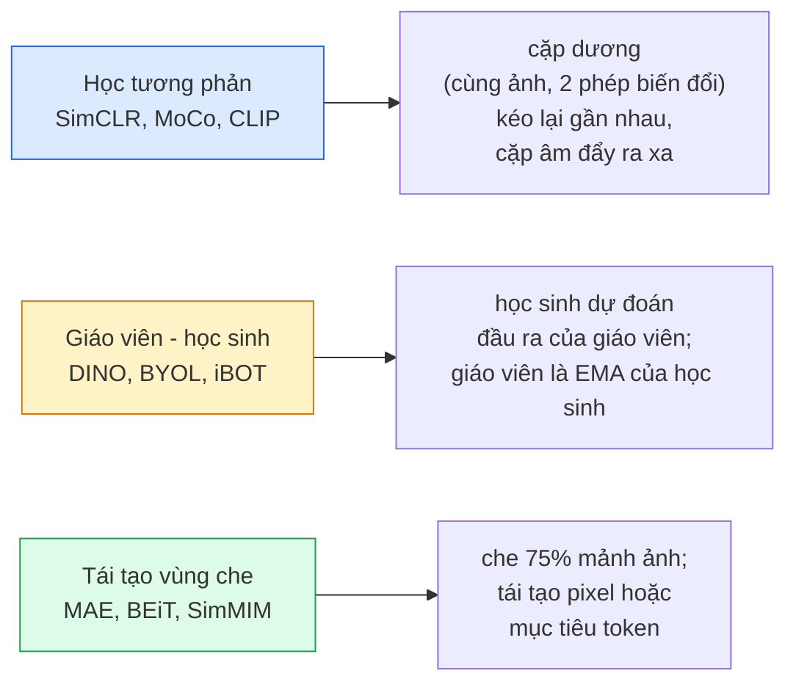

# Thị Giác Tự Giám Sát — SimCLR, DINO, MAE (Self-Supervised Vision — SimCLR, DINO, MAE)

> Nhãn dữ liệu là nút thắt cổ chai lớn nhất của thị giác có giám sát. Học tự giám sát xóa bỏ hoàn toàn rào cản đó: học các đặc trưng thị giác từ 100 triệu bức ảnh không nhãn, rồi tinh chỉnh trên chỉ 10.000 ảnh có nhãn.

**Type:** Learn + Build
**Languages:** Python
**Prerequisites:** Phase 4 Lesson 04 (Image Classification), Phase 4 Lesson 14 (ViT)
**Time:** ~75 phút

## Learning Objectives

- Lần theo ba họ kiến trúc tự giám sát chính — tương phản (contrastive - SimCLR), giáo viên-học sinh (teacher-student - DINO), và tái tạo vùng che (masked reconstruction - MAE) — đồng thời chỉ ra mục tiêu tối ưu hóa cụ thể của từng phương pháp
- Tự tay cài đặt hàm mất mát InfoNCE từ đầu và giải thích lý do tại sao batch size 512 thì hoạt động tốt nhưng batch size 32 lại thất bại
- Giải thích tại sao tỷ lệ che 75% của MAE không phải là con số ngẫu nhiên và nó khác biệt căn bản như thế nào so với tỷ lệ 15% của BERT trong xử lý ngôn ngữ tự nhiên
- Sử dụng các điểm kiểm tra (checkpoints) ImageNet của DINOv2 hoặc MAE để thực hiện đánh giá kiểm tra tuyến tính (linear probing) và truy xuất ảnh zero-shot

## Vấn Đề Đặt Ra (The Problem)

Tập dữ liệu có giám sát ImageNet sở hữu 1.3 triệu hình ảnh được gán nhãn, tiêu tốn chi phí ước tính khoảng 10 triệu USD để gán nhãn thủ công. Các tập dữ liệu y tế và công nghiệp thậm chí còn nhỏ hơn và chi phí dán nhãn còn đắt đỏ hơn gấp bội. Mọi đội ngũ kỹ sư thị giác đều đặt câu hỏi: liệu chúng ta có thể tiền huấn luyện trên nguồn dữ liệu không nhãn khổng lồ, giá rẻ — như khung hình video YouTube, dữ liệu thu thập từ web, camera giám sát, ảnh vệ tinh quét định kỳ — rồi sau đó tinh chỉnh trên một tập nhỏ có nhãn hay không?

Học tự giám sát (Self-Supervised Learning - SSL) chính là câu trả lời toàn diện. Một mô hình ViT tự giám sát hiện đại được huấn luyện trên LAION hoặc JFT có thể đạt hoặc vượt độ chính xác của ImageNet có giám sát sau khi tinh chỉnh. Nó cũng chuyển giao tốt hơn sang các tác vụ hạ nguồn (phát hiện đối tượng, phân đoạn, ước lượng độ sâu) so với tiền huấn luyện có giám sát truyền thống. DINOv2 (Meta, 2023) và MAE (Meta, 2022) hiện là các lựa chọn thương phẩm mặc định cho các đặc trưng thị giác có khả năng chuyển giao cao.

Sự chuyển dịch về mặt tư duy nằm ở chỗ: tác vụ tiền đề (pretext task — nhiệm vụ nhân tạo được đặt ra để mô hình giải quyết) không nhất thiết phải trùng với tác vụ hạ nguồn. Điều cốt lõi là nó buộc mô hình phải học được các đặc trưng biểu diễn hữu ích. Dự đoán màu sắc của ảnh xám, xoay ảnh rồi bắt mô hình phân loại góc xoay, che các mảnh ảnh rồi tái tạo lại — tất cả đều đã từng được thử nghiệm. Ba phương pháp mở rộng quy mô thành công nhất là học tương phản, chưng cất giáo viên-học sinh, và tái tạo vùng bị che.

## Khái Niệm Cốt Lõi (The Concept)

### Ba họ phương pháp chính



### Học tương phản (Contrastive Learning — SimCLR)

Lấy một bức ảnh gốc, áp dụng hai phép tăng cường dữ liệu ngẫu nhiên độc lập để thu được hai góc nhìn (views). Đưa cả hai qua cùng một mạng mã hóa (encoder) kết hợp với một đầu chiếu (projection head). Tối thiểu hóa hàm mất mát với hai mục tiêu: "hai vector nhúng này phải nằm thật gần nhau" và "vector nhúng này phải nằm cách xa vector nhúng của mọi bức ảnh khác trong cùng batch".

```text
Hàm mất mát cho cặp dương (z_i, z_j) trong số 2N góc nhìn trên mỗi batch:

   L_ij = -log( exp(sim(z_i, z_j) / tau) / sum_k in batch \ {i} exp(sim(z_i, z_k) / tau) )

sim = cosine similarity (độ tương đồng cosin)
tau = temperature (ngưỡng nhiệt độ, chuẩn là 0.1)
```

Đây là hàm mất mát InfoNCE. Nó đòi hỏi rất nhiều mẫu âm (negatives) cho mỗi mẫu dương, do đó kích thước batch mang tính quyết định — SimCLR cần batch size từ 512 đến 8192. MoCo sau đó đã giới thiệu hàng đợi động lượng (momentum queue) lưu trữ các batch trong quá khứ để tách rời số lượng mẫu âm khỏi kích thước batch hiện thời.

### Mô hình Giáo viên - Học sinh (DINO)

Hai mạng nơ-ron có cùng kiến trúc: học sinh (student) và giáo viên (teacher). Mạng giáo viên có trọng số được cập nhật theo trung bình trượt hàm mũ (EMA) từ trọng số của học sinh. Cả hai mạng đều nhìn các góc nhìn được tăng cường của cùng bức ảnh. Mạng học sinh được huấn luyện để dự đoán đầu ra của mạng giáo viên — hoàn toàn không cần các mẫu âm tường minh.

```text
loss = CE( student_output(view_1),  teacher_output(view_2) )
     + CE( student_output(view_2),  teacher_output(view_1) )

teacher_weights = m * teacher_weights + (1 - m) * student_weights   (m ≈ 0.996)
```

Tại sao mô hình không bị sụp đổ về việc "luôn dự đoán một hằng số": đầu ra của mạng giáo viên được định tâm (centering — trừ đi giá trị trung bình trên từng chiều) và làm sắc nét (sharpening — chia cho nhiệt độ nhỏ). Thao tác định tâm ngăn một chiều chiếm ưu thế áp đảo; thao tác làm sắc nét ngăn đầu ra bị suy biến thành phân phối đều đồng nhất.

DINO chính là nền tảng mà DINOv2 đã mở rộng quy mô trên 142 triệu hình ảnh được tuyển chọn kỹ lưỡng. Các vector đặc trưng thu được hiện là đỉnh cao SOTA cho các tác vụ truy xuất hình ảnh zero-shot và dự đoán dày đặc.

### Tái tạo vùng bị che (Masked Autoencoder — MAE)

Che 75% số mảnh ảnh (patches) đầu vào của một mạng ViT. Chỉ truyền 25% số mảnh nhìn thấy được qua mạng encoder. Một decoder nhỏ nhận đầu ra của encoder cộng với các token mặt nạ tại các vị trí bị che, và được huấn luyện để tái tạo lại chính xác các giá trị pixel của những mảnh bị che đó.

```text
Encoder:  25% mảnh nhìn thấy được -> vector đặc trưng
Decoder:  đặc trưng + token che tại các vị trí bị che -> pixel được tái tạo
Loss:     MSE giữa pixel tái tạo và pixel gốc chỉ trên các mảnh bị che
```

Những quyết định thiết kế then chốt giúp MAE thành công:

- **Tỷ lệ che 75%** — rất cao. Buộc encoder phải học được các đặc trưng ngữ nghĩa mức cao; nếu chỉ che 25% thì bài toán quá dễ (các pixel lân cận có tính tương quan cao đến mức một mạng CNN đơn giản cũng có thể nội suy được).
- **Bộ mã hóa/giải mã bất đối xứng (Asymmetric encoder/decoder)** — mạng encoder ViT kích thước lớn chỉ nhìn thấy các mảnh không bị che; decoder nhỏ (8 tầng, 512 chiều) đảm nhận việc tái tạo. Tiền huấn luyện nhanh hơn 3 lần so với phương pháp BEiT trước đó.
- **Mục tiêu tái tạo trong không gian điểm ảnh (Pixel space)** — đơn giản hơn mục tiêu mã hóa token của BEiT và hoạt động hiệu quả hơn trên ViT.

Sau khi tiền huấn luyện xong, loại bỏ hoàn toàn decoder. Encoder sẽ được giữ lại làm bộ trích xuất đặc trưng.

### Tại sao lại là 75% chứ không phải 15%

Mô hình BERT che 15% token văn bản. MAE che 75% mảnh ảnh. Sự khác biệt nằm ở mật độ thông tin (information density).

- Ngôn ngữ tự nhiên có độ bất định (entropy) cao trên mỗi token. Dự đoán 15% token vẫn rất khó khăn vì mỗi vị trí bị che có nhiều từ ngữ hợp lý có thể điền vào.
- Hình ảnh có độ bất định thấp — một vùng lân cận không bị che thường xác định gần như hoàn toàn các pixel của mảnh bị che lân cận. Để việc dự đoán đòi hỏi hiểu biết ngữ nghĩa thực sự, bạn buộc phải che đi phần lớn hình ảnh một cách quyết liệt.

75% là mức đủ cao để việc ngoại suy không gian đơn thuần không thể giải quyết được bài toán; encoder buộc phải nắm bắt được toàn bộ nội dung của cảnh.

### Đánh giá bằng kiểm tra tuyến tính (Linear-probe evaluation)

Sau khi tiền huấn luyện tự giám sát, phương pháp đánh giá tiêu chuẩn là **kiểm tra tuyến tính (linear probe)**: đóng băng hoàn toàn encoder, chỉ huấn luyện một tầng phân loại tuyến tính duy nhất trên các nhãn của ImageNet. Báo cáo độ chính xác top-1:

- SimCLR ResNet-50: ~71% (2020)
- DINO ViT-S/16: ~77% (2021)
- MAE ViT-L/16: ~76% (2022)
- DINOv2 ViT-g/14: ~86% (2023)

Linear probe là thước đo thuần khiết nhất về chất lượng biểu diễn đặc trưng; việc tinh chỉnh toàn bộ mô hình thường cộng thêm 2-5 điểm phần trăm nhưng đồng thời làm lẫn lộn hiệu ứng của việc cập nhật lại trọng số backbone.

```figure
data-augmentation
```

## Tự Xây Dựng (Build It)

### Bước 1: Đường ống tăng cường dữ liệu hai góc nhìn (Two-view pipeline)

```python
import torch
import torchvision.transforms as T

two_view_train = lambda: T.Compose([
    T.RandomResizedCrop(96, scale=(0.2, 1.0)),
    T.RandomHorizontalFlip(),
    T.ColorJitter(0.4, 0.4, 0.4, 0.1),
    T.RandomGrayscale(p=0.2),
    T.ToTensor(),
])


class TwoViewDataset(torch.utils.data.Dataset):
    def __init__(self, base):
        self.base = base
        self.aug = two_view_train()

    def __len__(self):
        return len(self.base)

    def __getitem__(self, i):
        img, _ = self.base[i]
        v1 = self.aug(img)
        v2 = self.aug(img)
        return v1, v2
```

Mỗi lần gọi `__getitem__` sẽ trả về hai góc nhìn tăng cường khác nhau của cùng một bức ảnh; hoàn toàn không cần đến nhãn phân loại.

### Bước 2: Hàm mất mát InfoNCE

```python
import torch.nn.functional as F

def info_nce(z1, z2, tau=0.1):
    """
    z1, z2: (N, D) vector nhúng đã được chuẩn hóa L2 của các cặp góc nhìn
    """
    N, D = z1.shape
    z = torch.cat([z1, z2], dim=0)  # (2N, D)
    sim = z @ z.T / tau              # (2N, 2N)

    mask = torch.eye(2 * N, dtype=torch.bool, device=z.device)
    sim = sim.masked_fill(mask, float("-inf"))

    targets = torch.cat([torch.arange(N, 2 * N), torch.arange(0, N)]).to(z.device)
    return F.cross_entropy(sim, targets)
```

Luôn chuẩn hóa L2 các vector nhúng trước khi truyền vào. `tau=0.1` là giá trị mặc định của SimCLR; hạ thấp nhiệt độ sẽ làm hàm loss sắc nét hơn và đòi hỏi nhiều mẫu âm hơn.

### Bước 3: Kiểm tra tính đúng đắn của InfoNCE

```python
z1 = F.normalize(torch.randn(16, 32), dim=-1)
z2 = z1.clone()
loss_same = info_nce(z1, z2, tau=0.1).item()
z2_random = F.normalize(torch.randn(16, 32), dim=-1)
loss_random = info_nce(z1, z2_random, tau=0.1).item()
print(f"InfoNCE với các cặp giống hệt:  {loss_same:.3f}")
print(f"InfoNCE với các cặp ngẫu nhiên: {loss_random:.3f}")
```

Các cặp giống hệt nhau phải cho loss rất thấp (tiệm cận 0 với batch lớn và nhiệt độ thấp). Các cặp ngẫu nhiên phải cho giá trị xấp xỉ $\log(2N-1) \approx \log(31) \approx 3.4$ với batch gồm 16 cặp.

### Bước 4: Cơ chế tạo mặt nạ kiểu MAE

```python
def random_mask_indices(num_patches, mask_ratio=0.75, seed=0):
    g = torch.Generator().manual_seed(seed)
    n_keep = int(num_patches * (1 - mask_ratio))
    perm = torch.randperm(num_patches, generator=g)
    visible = perm[:n_keep]
    masked = perm[n_keep:]
    return visible.sort().values, masked.sort().values


num_patches = 196
visible, masked = random_mask_indices(num_patches, mask_ratio=0.75)
print(f"nhìn thấy: {len(visible)} / {num_patches}")
print(f"bị che:    {len(masked)} / {num_patches}")
```

Đơn giản, tốc độ cao và tất định cho một seed nhất định. Các bản cài đặt MAE thực tế xử lý thao tác này theo batch và duy trì mặt nạ riêng cho từng mẫu.

## Sử Dụng Thực Tế (Use It)

DINOv2 là tiêu chuẩn sản xuất vào năm 2026:

```python
import torch
from transformers import AutoImageProcessor, AutoModel

processor = AutoImageProcessor.from_pretrained("facebook/dinov2-base")
model = AutoModel.from_pretrained("facebook/dinov2-base")
model.eval()

# Trích xuất vector nhúng ảnh cho bài toán truy xuất zero-shot
with torch.no_grad():
    inputs = processor(images=[pil_image], return_tensors="pt")
    outputs = model(**inputs)
    embedding = outputs.last_hidden_state[:, 0]  # token CLS
```

Vector nhúng 768 chiều thu được là xương sống của các hệ thống truy xuất hình ảnh hiện đại, thiết lập tương đồng dày đặc (dense correspondence), và các pipeline học chuyển giao zero-shot. Việc tinh chỉnh trên tác vụ hạ nguồn hiếm khi cần nhiều hơn một linear head đơn giản.

Đối với các vector nhúng hình ảnh-văn bản kết hợp, SigLIP hoặc OpenCLIP là giải pháp tương đương; đối với quy trình tinh chỉnh kiểu MAE, kho lưu trữ `timm` cung cấp đầy đủ các checkpoint MAE chuẩn.

## Sản Phẩm Đầu Ra (Ship It)

Bài học này tạo ra:

- `outputs/prompt-ssl-pretraining-picker.md` — một prompt giúp lựa chọn giữa SimCLR / MAE / DINOv2 dựa trên quy mô tập dữ liệu, tài nguyên tính toán và tác vụ hạ nguồn mục tiêu.
- `outputs/skill-linear-probe-runner.md` — một kỹ năng (skill) sinh mã nguồn đánh giá kiểm tra tuyến tính (linear probe) cho bất kỳ bộ mã hóa đóng băng nào kết hợp với một tập dữ liệu có nhãn.

## Bài Tập Thực Hành (Exercises)

1. **(Dễ)** Xác minh rằng hàm loss InfoNCE giảm xuống khi bạn giảm nhiệt độ đối với các vector nhúng trùng khớp tốt, và tăng lên khi giảm nhiệt độ đối với các vector nhúng ngẫu nhiên. Vẽ biểu đồ thể hiện giá trị loss theo `tau in [0.05, 0.1, 0.2, 0.5]`.
2. **(Trung bình)** Cài đặt một bộ đệm định tâm (centre buffer) kiểu DINO. Chứng minh rằng nếu không có bước định tâm này, mô hình học sinh sẽ nhanh chóng bị sụp đổ (collapse) về một vector hằng số chỉ sau vài epoch.
3. **(Khó)** Huấn luyện MAE trên tập dữ liệu CIFAR-100 sử dụng kiến trúc TinyUNet từ Bài 10 làm backbone. Báo cáo độ chính xác linear-probe tại các mốc 10, 50, và 200 epoch. Chứng minh rằng mô hình linear probe tiền huấn luyện bằng MAE đánh bại mô hình có giám sát huấn luyện từ đầu trên cùng tập con 1.000 hình ảnh.

## Thuật Ngữ Then Chốt (Key Terms)

| Thuật ngữ | Cách gọi thông thường | Ý nghĩa kỹ thuật thực sự |
|-----------|----------------------|--------------------------|
| Self-supervised | "Học không nhãn" | Phương pháp huấn luyện dùng tác vụ tiền đề để tạo ra các biểu diễn đặc trưng hữu ích từ dữ liệu thô |
| Pretext task | "Tác vụ nhân tạo" | Mục tiêu huấn luyện dùng trong SSL (tái tạo mảnh ảnh, so khớp góc nhìn); bị loại bỏ sau khi tiền huấn luyện |
| Linear probe | "Đóng băng backbone + linear head" | Phương thức đánh giá SSL chuẩn: chỉ huấn luyện bộ phân loại tuyến tính trên các đặc trưng cố định |
| InfoNCE | "Hàm mất mát tương phản" | Phép softmax trên độ tương đồng cosin; cặp dương là lớp mục tiêu, tất cả các mẫu khác là mẫu âm |
| EMA teacher | "Giáo viên trung bình trượt" | Mạng giáo viên có trọng số là trung bình trượt hàm mũ của mạng học sinh; dùng trong BYOL, MoCo, DINO |
| Mask ratio | "Tỷ lệ che ảnh" | Tỷ lệ phần trăm các mảnh ảnh bị che giấu trong MAE; 75% cho thị giác, 15% cho văn bản |
| Representation collapse | "Đầu ra hằng số" | Lỗi suy biến trong SSL khi encoder xuất ra cùng một vector cho mọi ảnh đầu vào; ngăn chặn bằng định tâm, làm sắc nét hoặc mẫu âm |
| DINOv2 | "Backbone SSL thương phẩm" | Mô hình ViT tự giám sát của Meta năm 2023; cung cấp đặc trưng hình ảnh tổng quát mạnh nhất hiện nay |

## Đọc Thêm (Further Reading)

- [SimCLR (Chen et al., 2020)](https://arxiv.org/abs/2002.05709) — bài báo kinh điển về học tương phản
- [DINO (Caron et al., 2021)](https://arxiv.org/abs/2104.14294) — mô hình giáo viên-học sinh kết hợp động lượng, định tâm và làm sắc nét
- [MAE (He et al., 2022)](https://arxiv.org/abs/2111.06377) — tiền huấn luyện masked autoencoder cho ViT
- [DINOv2 (Oquab et al., 2023)](https://arxiv.org/abs/2304.07193) — mở rộng quy mô ViT tự giám sát đạt chất lượng thương phẩm xuất sắc

