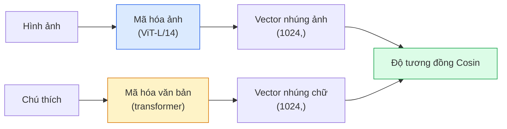

# Thị Giác Với Vốn Từ Vựng Mở — CLIP (Open-Vocabulary Vision — CLIP)

> Huấn luyện một bộ mã hóa hình ảnh và một bộ mã hóa văn bản cùng nhau sao cho các cặp (hình ảnh, chú thích) khớp nhau sẽ rơi vào cùng một điểm trong không gian biểu diễn chung. Đó là toàn bộ bí mật cốt lõi.

**Type:** Build + Use
**Languages:** Python
**Prerequisites:** Phase 4 Lesson 14 (ViT), Phase 4 Lesson 17 (Self-Supervised)
**Time:** ~45 phút

## Learning Objectives

- Giải thích kiến trúc hai tháp (two-tower architecture) và mục tiêu huấn luyện tương phản (contrastive training objective) của CLIP
- Sử dụng mô hình CLIP (hoặc SigLIP) tiền huấn luyện để thực hiện phân loại zero-shot mà không cần bất kỳ bước huấn luyện chuyên biệt nào cho tác vụ
- Tự tay cài đặt quy trình phân loại zero-shot từ đầu: mã hóa các câu prompt của lớp, tính độ tương đồng cosin, và lấy argmax
- Phân biệt rõ ràng các mô hình CLIP, SigLIP, OpenCLIP, và LLaVA/LLaMA-vision — vai trò cụ thể của từng mô hình vào năm 2026

## Vấn Đề Đặt Ra (The Problem)

Các bộ phân loại truyền thống hoạt động theo cơ chế từ vựng đóng (closed-vocabulary): một mô hình ImageNet 1.000 lớp chỉ có thể dự đoán đúng 1.000 nhãn đó. Mỗi khi xuất hiện danh mục mới, bạn bắt buộc phải thu thập dữ liệu có nhãn và huấn luyện lại đầu phân loại (head).

CLIP (Radford et al., OpenAI 2021) đã chứng minh rằng việc huấn luyện trên 400 triệu cặp (hình ảnh, chú thích) thu thập từ web sẽ tạo ra một mô hình có khả năng phân loại vào bất kỳ tập hợp danh mục nào tại thời điểm suy luận, chỉ dựa hoàn toàn trên mô tả ngôn ngữ tự nhiên. Bạn định nghĩa một lớp mới chỉ đơn giản bằng cách viết một câu văn.

Khả năng đó — được gọi là chuyển giao không cần mẫu (zero-shot transfer) — là lý do tại sao mọi hệ thống thị giác hiện đại đều bắt đầu từ một điểm kiểm tra (checkpoint) thuộc họ mô hình CLIP. Phát hiện đối tượng (Grounding DINO, OWL-ViT), phân đoạn hình ảnh (CLIPSeg, SAM), truy xuất thông tin, kiểm duyệt nội dung, các mô hình thị giác-ngôn ngữ lớn (VLMs), và sinh ảnh từ văn bản đều được xây dựng dựa trên không gian nhúng chung kiểu CLIP.

## Khái Niệm Cốt Lõi (The Concept)

### Kiến trúc hai tháp (Two towers)



Cả hai bộ mã hóa đều kết thúc bằng một tầng chiếu tuyến tính về cùng một số chiều vector nhúng (512 cho CLIP-B/32, 1024 cho CLIP-L/14). Sau đó, chuẩn hóa L2 và tính toán độ tương đồng cosin.

### Mục tiêu huấn luyện (The objective)

Với một batch gồm $N$ cặp (hình ảnh, chú thích), xây dựng một ma trận tương đồng kích thước $N \times N$. Huấn luyện cả hai bộ mã hóa sao cho đường chéo chính (các cặp khớp nhau thực tế) có độ tương đồng cao nhất và các phần tử ngoài đường chéo (không khớp) có độ tương đồng thấp nhất.

```text
sim_matrix = image_embeddings @ text_embeddings.T / tau

loss_i2t = cross_entropy(sim_matrix,       targets=arange(N))
loss_t2i = cross_entropy(sim_matrix.T,     targets=arange(N))
loss = (loss_i2t + loss_t2i) / 2
```

Hàm mất mát mang tính đối xứng vì cả hai tác vụ truy xuất từ ảnh sang chữ và từ chữ sang ảnh đều phải hoạt động hiệu quả. `tau` (temperature) thường là một tham số vô hướng có thể học được, khởi tạo ở mức 0.07.

### SigLIP: Hàm mất mát cải tiến

SigLIP (Zhai et al., 2023) đã thay thế hàm softmax bằng hàm sigmoid tính trên từng cặp riêng lẻ:

```math
\begin{aligned}
\text{loss} &= \mathop{\mathrm{mean}}\limits_{\text{các cặp}} \log\left(1 + \exp(-y_{ij} \cdot \text{sim}_{ij})\right) \\
y_{ij} &= \begin{cases} +1 & \text{nếu khớp} \\ -1 & \text{ngược lại} \end{cases}
\end{aligned}
```

Hàm mất mát theo cặp loại bỏ hoàn toàn sự phụ thuộc vào việc chuẩn hóa trên toàn bộ batch mà CLIP đòi hỏi. SigLIP huấn luyện tốt hơn nhiều ở các kích thước batch nhỏ và đạt độ chính xác tương đương hoặc vượt trội hơn CLIP trên cùng lượng dữ liệu.

### Phân loại không cần mẫu (Zero-shot classification)

Với một mô hình CLIP đã huấn luyện:

1. Đối với mỗi lớp, soạn một câu prompt mẫu: "a photo of a {tên_lớp}".
2. Mã hóa tất cả các prompt lớp bằng bộ mã hóa văn bản -> ma trận `T` kích thước (C, d).
3. Mã hóa hình ảnh cần kiểm tra bằng bộ mã hóa ảnh -> vector `I` kích thước (1, d).
4. Tính độ tương đồng = `I @ T.T` kích thước (1, C).
5. Lấy vị trí cực đại (Argmax) -> lớp được dự đoán.

Kỹ nghệ prompt (Prompt engineering) đóng vai trò rất lớn. OpenAI đã công bố 80 mẫu prompt chuẩn cho ImageNet ("a photo of a {}", "a blurry photo of a {}", "a sketch of a {}", ...). Việc lấy trung bình cộng các vector nhúng của tất cả các mẫu prompt cho mỗi lớp sẽ giúp tăng thêm từ 1-3% độ chính xác top-1.

### Các ứng dụng của mô hình họ CLIP vào năm 2026

- **Phân loại zero-shot** — ứng dụng trực tiếp không cần tinh chỉnh.
- **Truy xuất hình ảnh (Image retrieval)** — mã hóa toàn bộ cơ sở dữ liệu ảnh một lần, mã hóa câu truy vấn khi người dùng tìm kiếm.
- **Phát hiện đối tượng theo văn bản** — Grounding DINO, OWL-ViT bọc một tháp văn bản CLIP quanh một mạng detector.
- **Phân đoạn hình ảnh theo văn bản** — CLIPSeg; SAM tiếp nhận các prompt văn bản đầu vào thông qua CLIP.
- **Các mô hình thị giác-ngôn ngữ (VLMs)** — LLaVA, Qwen-VL, InternVL kết nối bộ mã hóa thị giác họ CLIP trực tiếp vào một LLM.
- **Sinh ảnh từ văn bản** — Stable Diffusion, DALL-E 3 nhận điều kiện hóa từ các vector nhúng văn bản của CLIP.

Một khi bạn đã sở hữu một không gian nhúng chung, mọi tác vụ kết hợp thị giác và ngôn ngữ đều quy về bài toán tính khoảng cách vector.

```figure
clip-contrastive
```

## Tự Xây Dựng (Build It)

### Bước 1: Mô hình hai tháp mini

CLIP thực tế sử dụng ViT và Transformer. Trong bài học này, hai tháp được cài đặt bằng các mạng MLP nhỏ trên các đặc trưng trích xuất sẵn để tín hiệu huấn luyện có thể quan sát trực tiếp trên CPU.

```python
import torch
import torch.nn as nn
import torch.nn.functional as F

class TwoTower(nn.Module):
    def __init__(self, img_in=128, txt_in=64, emb=64):
        super().__init__()
        self.image_proj = nn.Sequential(nn.Linear(img_in, 128), nn.ReLU(), nn.Linear(128, emb))
        self.text_proj = nn.Sequential(nn.Linear(txt_in, 128), nn.ReLU(), nn.Linear(128, emb))
        self.logit_scale = nn.Parameter(torch.ones([]) * 2.6592)  # ln(1/0.07)

    def forward(self, img_feats, txt_feats):
        i = F.normalize(self.image_proj(img_feats), dim=-1)
        t = F.normalize(self.text_proj(txt_feats), dim=-1)
        return i, t, self.logit_scale.exp()
```

Hai phép chiếu tuyến tính, đầu ra cùng số chiều, nhiệt độ có thể học được. Chuẩn hóa cấu trúc tương đồng với API CLIP thực tế.

### Bước 2: Hàm mất mát tương phản (Contrastive loss)

```python
def clip_loss(image_emb, text_emb, logit_scale):
    N = image_emb.size(0)
    sim = logit_scale * image_emb @ text_emb.T
    targets = torch.arange(N, device=sim.device)
    l_i = F.cross_entropy(sim, targets)
    l_t = F.cross_entropy(sim.T, targets)
    return (l_i + l_t) / 2
```

Đối xứng hoàn toàn. Giá trị `logit_scale` càng cao = softmax càng sắc nét = tự tin hơn nhưng có nguy cơ bất ổn định số học nếu quá lớn.

### Bước 3: Bộ phân loại Zero-shot

```python
@torch.no_grad()
def zero_shot_classify(model, image_feats, class_text_feats, class_names):
    """
    image_feats:      (N, img_in)
    class_text_feats: (C, txt_in)   vector nhúng trung bình của từng lớp
    """
    i = F.normalize(model.image_proj(image_feats), dim=-1)
    t = F.normalize(model.text_proj(class_text_feats), dim=-1)
    sim = i @ t.T
    pred = sim.argmax(dim=-1)
    return [class_names[p] for p in pred.tolist()]
```

Mỗi bước gói gọn trong một dòng lệnh. Đây chính xác là quy trình phân loại zero-shot được áp dụng trên các checkpoint CLIP thương phẩm.

### Bước 4: Kiểm tra tính đúng đắn

```python
torch.manual_seed(0)
model = TwoTower()

img = torch.randn(8, 128)
txt = torch.randn(8, 64)
i, t, scale = model(img, txt)
loss = clip_loss(i, t, scale)
print(f"kích thước batch: {i.size(0)}   loss: {loss.item():.3f}")
```

Hàm loss phải xấp xỉ `log(N) = log(8) = 2.08` đối với một mô hình khởi tạo ngẫu nhiên — đây là giá trị mục tiêu của cross-entropy đối xứng khi chưa có cấu trúc thông tin nào được học.

## Sử Dụng Thực Tế (Use It)

OpenCLIP là tiêu chuẩn cộng đồng nguồn mở vào năm 2026:

```python
import open_clip
import torch
from PIL import Image

model, _, preprocess = open_clip.create_model_and_transforms("ViT-B-32", pretrained="laion2b_s34b_b79k")
tokenizer = open_clip.get_tokenizer("ViT-B-32")

image = preprocess(Image.open("dog.jpg")).unsqueeze(0)
text = tokenizer(["a photo of a dog", "a photo of a cat", "a photo of a car"])

with torch.no_grad():
    image_features = model.encode_image(image)
    text_features = model.encode_text(text)
    image_features = image_features / image_features.norm(dim=-1, keepdim=True)
    text_features = text_features / text_features.norm(dim=-1, keepdim=True)
    probs = (100.0 * image_features @ text_features.T).softmax(dim=-1)

print(probs)
```

SigLIP hiện đại hơn, huấn luyện hiệu quả hơn ở quy mô vừa và nhỏ, và là lựa chọn ưu tiên cho các dự án mới: `google/siglip-base-patch16-224`. Thư viện Hugging Face cung cấp đầy đủ cả hai dòng mô hình này.

## Sản Phẩm Đầu Ra (Ship It)

Bài học này tạo ra:

- `outputs/prompt-zero-shot-class-picker.md` — một prompt giúp thiết kế các bộ mẫu câu (templates) cho mô hình CLIP zero-shot dựa trên danh sách các lớp và miền bài toán cụ thể.
- `outputs/skill-image-text-retriever.md` — một kỹ năng (skill) xây dựng một chỉ mục nhúng hình ảnh với bất kỳ checkpoint CLIP nào, hỗ trợ truy vấn tìm kiếm bằng văn bản hoặc bằng hình ảnh tương đồng.

## Bài Tập Thực Hành (Exercises)

1. **(Dễ)** Sử dụng mô hình OpenCLIP ViT-B/32 tiền huấn luyện và thực hiện phân loại zero-shot trên tập dữ liệu CIFAR-10 với bộ 80 mẫu prompt chuẩn. Báo cáo độ chính xác top-1; kết quả thường đạt khoảng 85-90%.
2. **(Trung bình)** So sánh độ chính xác giữa việc dùng mẫu đơn lẻ ("a photo of a {}") với việc dùng trung bình cộng 80 mẫu prompt trên cùng bài toán CIFAR-10. Định lượng mức chênh lệch và giải thích tại sao việc dùng nhiều mẫu lại giúp cải thiện hiệu năng.
3. **(Khó)** Xây dựng một hệ thống truy xuất hình ảnh zero-shot: tạo vector nhúng cho 1.000 bức ảnh bằng CLIP, xây dựng chỉ mục tìm kiếm FAISS, và thực hiện truy vấn bằng các câu mô tả ngôn ngữ tự nhiên. Báo cáo chỉ số Recall@5 cho 20 câu truy vấn độc lập do bạn tự soạn thảo.

## Thuật Ngữ Then Chốt (Key Terms)

| Thuật ngữ | Cách gọi thông thường | Ý nghĩa kỹ thuật thực sự |
|-----------|----------------------|--------------------------|
| Two-tower | "Mã hóa kép" | Hai mạng mã hóa hình ảnh và văn bản riêng biệt kết thúc bằng một đầu chiếu về cùng không gian nhúng |
| Zero-shot | "Không cần huấn luyện tác vụ" | Phân loại vào các danh mục chỉ được định nghĩa bằng văn bản lúc suy luận; không cần dữ liệu có nhãn |
| Temperature / logit_scale | "Tham số tau" | Giá trị vô hướng học được dùng để co giãn ma trận tương đồng trước khi đưa vào hàm softmax |
| Prompt template | "Khuôn mẫu câu" | Lớp vỏ ngôn ngữ tự nhiên bao quanh tên lớp; lấy trung bình nhiều mẫu giúp tăng độ chính xác zero-shot |
| CLIP | "Mô hình kết hợp ảnh-chữ" | Mô hình của OpenAI năm 2021; trở thành từ vựng nền tảng của toàn bộ thị giác máy tính hiện đại |
| SigLIP | "CLIP dùng hàm Sigmoid" | Thay thế softmax bằng hàm sigmoid trên từng cặp; giúp huấn luyện ổn định và hiệu quả ở batch nhỏ |
| OpenCLIP | "Bản sao nguồn mở" | Các biến thể CLIP do cộng đồng huấn luyện trên tập LAION; tiêu chuẩn sản xuất cho các hệ thống nguồn mở |
| VLM | "Mô hình thị giác-ngôn ngữ" | Bộ mã hóa họ CLIP kết hợp với một LLM, được huấn luyện để trả lời các câu hỏi về hình ảnh |

## Đọc Thêm (Further Reading)

- [CLIP: Learning Transferable Visual Models from Natural Language Supervision (Radford et al., 2021)](https://arxiv.org/abs/2103.00020) — bài báo gốc khai phá kỷ nguyên open-vocabulary
- [SigLIP: Sigmoid Loss for Language-Image Pre-Training (Zhai et al., 2023)](https://arxiv.org/abs/2303.15343) — cải tiến hàm mất mát sigmoid vượt trội
- [OpenCLIP](https://github.com/mlfoundations/open_clip) — kho mã nguồn cộng đồng chuẩn mực
- [Oquab et al. (2023). DINOv2: Learning Robust Visual Features without Supervision](https://arxiv.org/abs/2304.07193) — bài báo so sánh hiệu năng đặc trưng giữa DINOv2 với các mô hình kiểu CLIP và MAE

