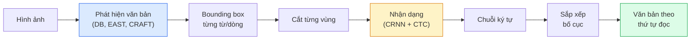

# OCR & Hiểu Tài Liệu (OCR & Document Understanding)

> OCR là một quy trình ba giai đoạn — phát hiện các hộp văn bản, nhận dạng các ký tự, sau đó sắp xếp bố cục. Mọi hệ thống OCR hiện đại đều tái sắp xếp hoặc hợp nhất các giai đoạn này.

**Type:** Learn + Use
**Languages:** Python
**Prerequisites:** Phase 4 Lesson 06 (Detection), Phase 7 Lesson 02 (Self-Attention)
**Time:** ~45 phút

## Learning Objectives

- Lần theo quy trình OCR cổ điển (phát hiện -> nhận dạng -> bố cục) và các giải pháp thay thế đầu-cuối (end-to-end) hiện đại (Donut, Qwen-VL-OCR)
- Triển khai hàm mất mát CTC (Connectionist Temporal Classification) để huấn luyện OCR dạng chuỗi-sang-chuỗi (sequence-to-sequence)
- Sử dụng PaddleOCR hoặc EasyOCR để phân tích tài liệu thực tế trong môi trường sản xuất mà không cần huấn luyện lại
- Phân biệt giữa OCR, phân tích bố cục (layout parsing) và hiểu tài liệu (document understanding) — chọn đúng công cụ cho từng tác vụ

## The Problem

Hình ảnh chứa đầy văn bản có mặt khắp mọi nơi: biên lai, hoá đơn, thẻ căn cước, sách quét (scan), biểu mẫu, bảng trắng, biển hiệu và ảnh chụp màn hình. Trích xuất dữ liệu có cấu trúc từ chúng — không chỉ là các ký tự thô, mà phải hiểu được "đây là tổng số tiền" — là một trong những bài toán thị giác máy tính ứng dụng có giá trị kinh tế cao nhất.

Lĩnh vực này được chia thành ba tầng kỹ năng:

1. **OCR thuần túy (OCR proper)**: biến đổi điểm ảnh (pixels) thành văn bản.
2. **Phân tích bố cục (Layout parsing)**: gom nhóm kết quả đầu ra của OCR thành các vùng (tiêu đề, nội dung chính, bảng biểu, đầu trang).
3. **Hiểu tài liệu (Document understanding)**: trích xuất các trường có cấu trúc ("invoice_total = $42.50") từ bố cục.

Mỗi tầng đều có các phương pháp cổ điển và hiện đại, và khoảng cách giữa "tôi muốn lấy chữ từ một bức ảnh" với "tôi cần tổng số tiền từ biên lai này" lớn hơn nhiều so với hình dung của hầu hết các đội ngũ kỹ thuật.

## The Concept

### Quy trình cổ điển (The classical pipeline)



- **Phát hiện văn bản (Text detection)**: tạo ra các tứ giác bao quanh từng dòng hoặc từng từ.
- **Nhận dạng (Recognition)**: cắt từng vùng ảnh đưa về chiều cao cố định, chạy qua mạng CNN + BiLSTM + CTC để sinh ra chuỗi ký tự.
- **Bố cục (Layout)**: tái tạo thứ tự đọc (từ trên xuống dưới, từ trái sang phải đối với chữ Latinh; đảo ngược hoặc khác biệt đối với tiếng Ả Rập, tiếng Nhật).

### CTC gói gọn trong một đoạn văn

Khâu nhận dạng OCR sinh ra một chuỗi có độ dài thay đổi từ một bản đồ đặc trưng (feature map) có độ dài cố định. CTC (Graves et al., 2006) cho phép bạn huấn luyện điều này mà không cần căn chỉnh (alignment) ở cấp độ ký tự. Mô hình xuất ra phân phối xác suất trên (tập từ vựng + ký tự trống `blank`) tại mỗi bước thời gian; hàm mất mát CTC cận biên hoá (marginalises) trên tất cả các căn chỉnh hợp lệ rút gọn về văn bản mục tiêu sau khi gộp các ký tự lặp liên tiếp và loại bỏ các ký tự trống.

```text
đầu ra thô: "h h h _ _ e e l l _ l l o _ _"
sau khi gộp lặp và bỏ ký tự trống: "hello"
```

CTC là lý do giúp CRNN thành công vang dội vào năm 2015 và vẫn tiếp tục được dùng để huấn luyện hầu hết các mô hình OCR trong sản xuất thực tế năm 2026.

### Các mô hình đầu-cuối (end-to-end) hiện đại

- **Donut** (Kim et al., 2022) — Bộ mã hoá ViT + bộ giải mã văn bản; đọc trực tiếp hình ảnh và phát ra chuỗi JSON. Không cần bộ phát hiện văn bản, không cần mô-đun bố cục riêng.
- **TrOCR** — ViT + transformer decoder cho tác vụ OCR cấp dòng.
- **Qwen-VL-OCR / InternVL** — Các mô hình thị giác-ngôn ngữ (VLM) hoàn chỉnh được tinh chỉnh riêng cho các tác vụ OCR; độ chính xác hàng đầu năm 2026 trên các tài liệu phức tạp.
- **PaddleOCR** — Quy trình cổ điển DB + CRNN được đóng gói công nghiệp hoàn thiện; vẫn là công cụ mã nguồn mở chủ lực phổ biến nhất.

Các mô hình end-to-end đòi hỏi nhiều dữ liệu và năng lực tính toán hơn, nhưng loại bỏ hoàn toàn sự tích tụ sai số (error accumulation) qua nhiều giai đoạn của quy trình cổ điển.

### Phân tích bố cục (Layout parsing)

Đối với các tài liệu có cấu trúc, hãy chạy một mô hình bố cục (LayoutLMv3, hoặc một mô hình phát hiện được huấn luyện trên tập dữ liệu DocLayNet) để gán nhãn cho từng vùng: Title (Tiêu đề), Paragraph (Đoạn văn), Figure (Hình minh hoạ), Table (Bảng), Footnote (Chú thích chân trang). Khi đó, thứ tự đọc sẽ trở thành "duyệt qua các vùng theo thứ tự bố cục rồi ghép nối lại".

Đối với các biểu mẫu (forms), sử dụng các mô hình **Trích xuất Cặp Khóa-Giá trị (Key-Value extraction)** (Donut cho các tài liệu phong phú về mặt thị giác, LayoutLMv3 cho các bản quét thông thường). Chúng nhận hình ảnh + văn bản phát hiện được + toạ độ vị trí và dự đoán các cặp key-value có cấu trúc.

### Các chỉ số đánh giá (Evaluation metrics)

- **Character Error Rate (CER)** — Khoảng cách Levenshtein / độ dài chuỗi tham chiếu. Càng thấp càng tốt. Mục tiêu sản xuất: < 2% trên các bản scan sạch.
- **Word Error Rate (WER)** — Tương tự CER nhưng tính ở cấp độ từ.
- **F1 trên các trường có cấu trúc** — Dành cho tác vụ key-value; đo lường xem cặp `{invoice_total: 42.50}` có xuất hiện chính xác hay không.
- **Khoảng cách chỉnh sửa trên JSON (Edit distance on JSON)** — Dành cho phân tích tài liệu end-to-end; bài báo Donut giới thiệu chỉ số khoảng cách chỉnh sửa cây chuẩn hoá (normalised tree edit distance).

```figure
cv3-ctc-collapse
```

## Build It

### Bước 1: Hàm mất mát CTC + bộ giải mã tham lam (greedy decoder)

```python
import torch
import torch.nn as nn
import torch.nn.functional as F


def ctc_loss(log_probs, targets, input_lengths, target_lengths, blank=0):
    """
    log_probs:      (T, N, C) log-softmax trên vocab bao gồm blank tại chỉ số 0
    targets:        (N, S) int targets (không chứa blank)
    input_lengths:  (N,) số bước thời gian được dùng cho mỗi mẫu
    target_lengths: (N,) độ dài target của mỗi mẫu
    """
    return F.ctc_loss(log_probs, targets, input_lengths, target_lengths,
                      blank=blank, reduction="mean", zero_infinity=True)


def greedy_ctc_decode(log_probs, blank=0):
    """
    log_probs: (T, N, C) log-softmax
    trả về: danh sách các chuỗi chỉ số (đã xoá blanks, đã gộp các ký tự lặp)
    """
    preds = log_probs.argmax(dim=-1).transpose(0, 1).cpu().tolist()
    out = []
    for seq in preds:
        decoded = []
        prev = None
        for idx in seq:
            if idx != prev and idx != blank:
                decoded.append(idx)
            prev = idx
        out.append(decoded)
    return out
```

`F.ctc_loss` tận dụng bản triển khai CuDNN hiệu năng cao khi có sẵn GPU. Bộ giải mã tham lam (greedy decoder) đơn giản hơn beam search và thông thường có CER chỉ chênh lệch trong vòng 1%.

### Bước 2: Bộ nhận dạng Tiny CRNN

Mô hình CNN + BiLSTM tối giản cho tác vụ OCR theo dòng văn bản.

```python
class TinyCRNN(nn.Module):
    def __init__(self, vocab_size=40, hidden=128, feat=32):
        super().__init__()
        self.cnn = nn.Sequential(
            nn.Conv2d(1, feat, 3, 1, 1), nn.BatchNorm2d(feat), nn.ReLU(inplace=True),
            nn.MaxPool2d(2),
            nn.Conv2d(feat, feat * 2, 3, 1, 1), nn.BatchNorm2d(feat * 2), nn.ReLU(inplace=True),
            nn.MaxPool2d(2),
            nn.Conv2d(feat * 2, feat * 4, 3, 1, 1), nn.BatchNorm2d(feat * 4), nn.ReLU(inplace=True),
            nn.MaxPool2d((2, 1)),
            nn.Conv2d(feat * 4, feat * 4, 3, 1, 1), nn.BatchNorm2d(feat * 4), nn.ReLU(inplace=True),
            nn.MaxPool2d((2, 1)),
        )
        self.rnn = nn.LSTM(feat * 4, hidden, bidirectional=True, batch_first=True)
        self.head = nn.Linear(hidden * 2, vocab_size)

    def forward(self, x):
        # x: (N, 1, H, W)
        f = self.cnn(x)                # (N, C, H', W')
        f = f.mean(dim=2).transpose(1, 2)  # (N, W', C)
        h, _ = self.rnn(f)
        return F.log_softmax(self.head(h).transpose(0, 1), dim=-1)  # (W', N, vocab)
```

Đầu vào có chiều cao cố định (mạng CNN dùng max-pool để rút gọn chiều cao về 1). Chiều rộng đóng vai trò là chiều thời gian (time dimension) cho CTC.

### Bước 3: Tạo dữ liệu OCR tổng hợp (Synthetic OCR)

Tạo các chuỗi chữ đen trên nền trắng để chạy thử nghiệm kiểm tra tính thông suốt (smoke test). Mỗi ký tự trở thành một cột gồm 6 thanh thể hiện chỉ số từ vựng của nó dưới dạng nhị phân. Hình ảnh bắt buộc phải mang đặc trưng nhận dạng của ký tự: nếu mọi ký tự đều là các hộp trống giống hệt nhau, mô hình sẽ không thể phân biệt `a` với `x`, và hàm mất mát sẽ bị đình trệ.

```python
import numpy as np

GLYPHS = "0123456789abcdefghijklmnopqrstuvwxyz"

def synthetic_line(text, height=32, char_width=16):
    W = char_width * len(text)
    img = np.ones((height, W), dtype=np.float32)
    for i, c in enumerate(text):
        x = i * char_width
        code = GLYPHS.find(c) + 1
        for bit in range(6):
            if code >> bit & 1:
                y = 4 + 4 * bit
                img[y:y + 3, x + 2:x + char_width - 2] = 0.0
    return img


def build_batch(strings, vocab):
    H = 32
    W = 16 * max(len(s) for s in strings)
    imgs = np.ones((len(strings), 1, H, W), dtype=np.float32)
    target_lengths = []
    targets = []
    for i, s in enumerate(strings):
        imgs[i, 0, :, :16 * len(s)] = synthetic_line(s)
        ids = [vocab.index(c) for c in s]
        targets.extend(ids)
        target_lengths.append(len(ids))
    return torch.from_numpy(imgs), torch.tensor(targets), torch.tensor(target_lengths)


vocab = ["_"] + list("0123456789abcdefghijklmnopqrstuvwxyz")
imgs, targets, lengths = build_batch(["hello", "world"], vocab)
print(f"images: {imgs.shape}   targets: {targets.shape}   lengths: {lengths.tolist()}")
```

Một tập dữ liệu OCR thực tế sẽ bổ sung thêm các phông chữ, nhiễu, độ xoay nghiêng, độ mờ và màu sắc. Nhưng quy trình xử lý cốt lõi hoàn toàn giống hệt như trên.

### Bước 4: Khung huấn luyện (Training sketch)

```python
model = TinyCRNN(vocab_size=len(vocab))
opt = torch.optim.Adam(model.parameters(), lr=1e-3)

for step in range(400):
    strings = ["abc" + str(step % 10)] * 4 + ["xyz" + str((step + 1) % 10)] * 4
    imgs, targets, target_lens = build_batch(strings, vocab)
    log_probs = model(imgs)  # (W', 8, vocab)
    input_lens = torch.full((8,), log_probs.size(0), dtype=torch.long)
    loss = ctc_loss(log_probs, targets, input_lens, target_lens, blank=0)
    opt.zero_grad(); loss.backward(); opt.step()
```

Hàm mất mát sẽ giảm từ hai chữ số xuống khoảng 0.3 trong vòng 400 bước trên tập dữ liệu tổng hợp đơn giản này. `code/main.py` chạy vòng lặp tương tự trên tập chuỗi riêng và giải mã ba chuỗi kiểm tra.

## Use It

Ba hướng tiếp cận chính trong sản xuất:

- **PaddleOCR** — hoàn thiện, nhanh, hỗ trợ đa ngôn ngữ. Sử dụng trong một dòng: `paddleocr.PaddleOCR(lang="en").ocr(image_path)`.
- **EasyOCR** — viết thuần Python, đa ngôn ngữ, kiến trúc nền tảng PyTorch.
- **Tesseract** — giải pháp cổ điển; vẫn hữu ích cho các tài liệu quét cũ khi các mô hình học sâu gặp khó khăn.

Đối với phân tích tài liệu toàn diện đầu-cuối (end-to-end), hãy dùng Donut hoặc VLM:

```python
from transformers import DonutProcessor, VisionEncoderDecoderModel

processor = DonutProcessor.from_pretrained("naver-clova-ix/donut-base-finetuned-cord-v2")
model = VisionEncoderDecoderModel.from_pretrained("naver-clova-ix/donut-base-finetuned-cord-v2")
```

Đối với biên lai, hoá đơn và các biểu mẫu có cấu trúc lặp lại, hãy tinh chỉnh (fine-tune) Donut. Đối với các tài liệu tuỳ ý hoặc tác vụ OCR kèm theo suy luận ngữ cảnh, một mô hình VLM như Qwen-VL-OCR là lựa chọn mặc định hàng đầu hiện nay.

## Ship It

Bài học này tạo ra:

- `outputs/prompt-ocr-stack-picker.md` — một câu lệnh prompt giúp lựa chọn giữa Tesseract / PaddleOCR / Donut / VLM-OCR dựa trên loại tài liệu, ngôn ngữ và cấu trúc.
- `outputs/skill-ctc-decoder.md` — một kỹ năng viết các bộ giải mã CTC tham lam và beam-search từ con số không, bao gồm cả chuẩn hoá độ dài.

## Exercises

1. **(Dễ)** Huấn luyện TinyCRNN trên các chuỗi số ngẫu nhiên gồm 5 chữ số trong 500 bước. Báo cáo CER trên tập kiểm thử riêng biệt.
2. **(Trung bình)** Thay thế bộ giải mã tham lam bằng tìm kiếm chùm (beam search với beam_width=5). Báo cáo mức độ chênh lệch CER. Beam search mang lại lợi thế vượt trội trên những dạng dữ liệu đầu vào nào?
3. **(Khó)** Sử dụng PaddleOCR trên tập hợp 20 biên lai, trích xuất các mục hàng (line items), và tính điểm F1 so với nhãn chuẩn gán thủ công cho các cặp {tên_mục, giá_tiền}.

## Key Terms

| Thuật ngữ | Cách gọi thông thường | Bản chất kỹ thuật thực sự |
|-----------|----------------------|---------------------------|
| OCR | "Lấy chữ từ ảnh" | Biến đổi các vùng hình ảnh thành các chuỗi ký tự |
| CTC | "Hàm mất mát không cần căn chỉnh" | Hàm mất mát huấn luyện mô hình chuỗi mà không cần gán nhãn từng bước thời gian; cận biên hoá trên mọi căn chỉnh hợp lệ |
| CRNN | "Mô hình OCR kinh điển" | Bộ trích xuất đặc trưng tích chập + BiLSTM + CTC; đường cơ sở năm 2015 vẫn được tin dùng trong sản xuất |
| Donut | "OCR đầu-cuối" | Bộ mã hoá ViT + bộ giải mã văn bản; xuất trực tiếp JSON từ hình ảnh |
| Layout parsing | "Tìm các vùng tài liệu" | Phát hiện và gán nhãn cho các vùng Title/Table/Figure/Paragraph trong tài liệu |
| Reading order | "Trình tự văn bản" | Sắp xếp các vùng đã nhận dạng thành câu văn hoàn chỉnh; đơn giản với chữ Latinh, phức tạp với các bố cục đan xen |
| CER / WER | "Tỷ lệ lỗi" | Khoảng cách Levenshtein / độ dài tham chiếu ở cấp độ ký tự hoặc cấp độ từ |
| VLM-OCR | "LLM biết đọc chữ" | Mô hình thị giác-ngôn ngữ được huấn luyện hoặc dùng prompt cho tác vụ OCR; hiện là SOTA trên các tài liệu phức tạp |

## Further Reading

- [CRNN (Shi et al., 2015)](https://arxiv.org/abs/1507.05717) — Kiến trúc gốc kết hợp CNN+RNN+CTC
- [CTC (Graves et al., 2006)](https://www.cs.toronto.edu/~graves/icml_2006.pdf) — Bài báo gốc về CTC; chứa đầy đủ các ý tưởng thuật toán cốt lõi
- [Donut (Kim et al., 2022)](https://arxiv.org/abs/2111.15664) — Transformer hiểu tài liệu không cần qua bước OCR truyền thống
- [PaddleOCR](https://github.com/PaddlePaddle/PaddleOCR) — Bộ công cụ OCR mã nguồn mở hoàn chỉnh cho môi trường sản xuất

