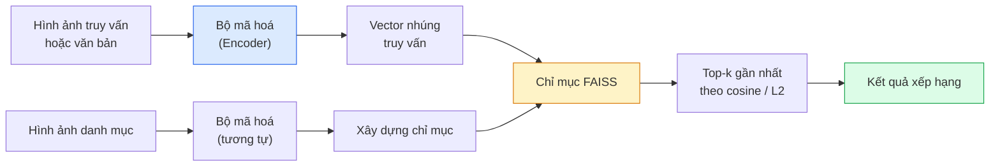

# Truy Vấn Hình Ảnh & Học Đo Lường Khoảng Cách (Image Retrieval & Metric Learning)

> Hệ thống truy vấn xếp hạng các ứng viên dựa trên khoảng cách trong không gian nhúng (embedding space). Học đo lường khoảng cách (Metric learning) là kỹ thuật định hình không gian đó để các khoảng cách phản ánh đúng ý nghĩa mà bạn mong muốn.

**Type:** Build
**Languages:** Python
**Prerequisites:** Phase 4 Lesson 14 (ViT), Phase 4 Lesson 18 (CLIP)
**Time:** ~45 phút

## Learning Objectives

- Giải thích các hàm mất mát metric learning dạng bộ ba (triplet), tương phản (contrastive), và dựa trên đại diện (proxy-based) để chọn đúng hàm mất mát cho tập dữ liệu cụ thể
- Triển khai chuẩn hoá L2 (L2-normalisation) và độ tương đồng cosine một cách chính xác; phân biệt rõ truy vấn "cùng một vật thể cụ thể" (same item) với "cùng một lớp đối tượng" (same class)
- Xây dựng chỉ mục FAISS, truy vấn bằng văn bản và bằng hình ảnh, đánh giá chỉ số recall@K trên tập truy vấn kiểm thử
- Sử dụng DINOv2, CLIP, và SigLIP như các mô hình trích xuất đặc trưng nhúng có sẵn và hiểu rõ thời điểm mỗi mô hình phát huy thế mạnh

## The Problem

Truy vấn hình ảnh (retrieval) xuất hiện khắp nơi trong các sản phẩm thị giác máy tính thực tế: phát hiện nội dung trùng lặp, tìm kiếm hình ảnh đảo ngược, tìm kiếm trực quan ("tìm các sản phẩm tương tự"), nhận diện lại khuôn mặt (face re-ID), nhận diện lại người đi bộ trong hệ thống giám sát an ninh, và đối sánh sản phẩm ở cấp độ cá thể trong thương mại điện tử. Câu hỏi nghiệp vụ luôn giống nhau: "với bức ảnh truy vấn này, hãy xếp hạng danh mục sản phẩm của tôi."

Hai quyết định thiết kế định hình toàn bộ hệ thống: Vector nhúng (embedding) — mô hình nào tạo ra các vector đặc trưng; Chỉ mục (index) — cách tìm kiếm các láng giềng gần nhất ở quy mô lớn. Cả hai đều đã trở thành các thành phần tiêu chuẩn hóa vào năm 2026 (DINOv2 cho vector nhúng, FAISS cho chỉ mục). Điều này nâng cao tiêu chuẩn bài toán: phần khó khăn nhất là định nghĩa *thế nào được coi là tương đồng* cho ứng dụng của bạn, sau đó định hình không gian nhúng để khoảng cách hình học khớp chính xác với định nghĩa đó.

Quá trình định hình đó chính là metric learning — một lĩnh vực chuyên sâu nhưng có đòn bẩy hiệu năng cực lớn.

## The Concept

### Tổng quan quy trình truy vấn



### Bốn họ hàm mất mát (loss families)

| Hàm mất mát | Yêu cầu dữ liệu | Ưu điểm | Nhược điểm |
|-------------|-----------------|---------|------------|
| **Contrastive** | (mỏ neo, mẫu dương) + các mẫu âm | Đơn giản, hoạt động với mọi nhãn cặp | Hội tụ chậm nếu không có nhiều mẫu âm |
| **Triplet** | (mỏ neo, mẫu dương, mẫu âm) | Trực quan; kiểm soát trực tiếp lề cách biệt (margin) | Khâu khai thác bộ ba khó (hard-triplet mining) tốn kém tài nguyên |
| **NT-Xent / InfoNCE** | Các cặp + khai thác mẫu âm ngay trong batch | Mở rộng tốt với kích thước batch lớn | Cần batch lớn hoặc hàng đợi xung lượng (momentum queue) |
| **Dựa trên đại diện (ProxyNCA)** | Chỉ cần nhãn phân lớp | Nhanh, ổn định, không cần khai thác cặp/bộ ba | Dễ bị quá khớp (overfit) vào các proxy trên tập dữ liệu nhỏ |

Đối với hầu hết các trường hợp sử dụng trong sản xuất, hãy bắt đầu bằng một mô hình nền tảng đã huấn luyện trước và chỉ bổ sung bước tinh chỉnh metric-learning nếu các vector nhúng có sẵn không đạt yêu cầu trên tập kiểm thử của bạn.

### Bản chất toán học của Triplet loss

```math
L = \max\left(0, \lVert f(a) - f(p) \rVert^2 - \lVert f(a) - f(n) \rVert^2 + \text{margin}\right)
```

Kéo mỏ neo (anchor) `a` lại gần mẫu dương (positive) `p`, đẩy nó ra xa mẫu âm (negative) `n`, với một khoảng cách an toàn `margin` để đảm bảo một khoảng trống ngăn cách. Cấu trúc ba hình ảnh này khái quát hoá cho mọi thứ tự tương đồng.

Kỹ thuật khai thác mẫu (mining) đóng vai trò quyết định: các bộ ba dễ (`n` vốn đã cách xa `a`) tạo ra hàm mất mát bằng 0; chỉ các bộ ba khó mới giúp mạng học được tri thức mới. Khai thác bán khó (semi-hard mining — `n` ở xa hơn `p` nhưng vẫn nằm trong phạm vi margin) là công thức kinh điển từ bài báo FaceNet 2016 và vẫn thống trị đến nay.

### So sánh Độ tương đồng Cosine và Khoảng cách L2

Hai thước đo, hai quy ước:

- **Cosine**: góc giữa hai vector. Yêu cầu các vector nhúng phải được chuẩn hoá L2.
- **L2**: khoảng cách Euclid. Hoạt động trên vector thô hoặc đã chuẩn hoá, nhưng thông thường được kết hợp chuẩn hoá L2 + bình phương khoảng cách L2.

Đối với hầu hết các mạng nơ-ron hiện đại, hai phép đo này tương đương nhau: `||a - b||^2 = 2 - 2 cos(a, b)` khi `||a|| = ||b|| = 1`. Hãy chọn đúng quy ước phù hợp với quá trình huấn luyện vector nhúng của bạn; việc trộn lẫn chúng sẽ làm thay đổi âm thầm ý nghĩa của khái niệm "gần nhất".

### Chỉ số Recall@K

Chỉ số tiêu chuẩn đánh giá hệ thống truy vấn:

```text
recall@K = tỷ lệ các truy vấn có ít nhất một kết quả khớp chính xác nằm trong top K kết quả đầu tiên
```

Hãy báo cáo recall@1, @5, @10 song song với nhau. Một hệ thống có recall@10 trên 0.95 nhưng recall@1 dưới 0.5 phản ánh không gian nhúng đã có cấu trúc đúng nhưng thứ tự xếp hạng chi tiết còn nhiều nhiễu — khi đó hãy thử huấn luyện tinh chỉnh lâu hơn hoặc bổ sung thêm bước tái xếp hạng (re-ranking).

Đối với bài toán phát hiện trùng lặp, precision@K quan trọng hơn vì mỗi kết quả dương tính giả là một lỗi hiển thị trực tiếp với người dùng. Đối với tìm kiếm trực quan, recall@K là thước đo phản ánh trải nghiệm sản phẩm thực tế.

### FAISS gói gọn trong một đoạn văn

FAISS (Facebook AI Similarity Search) là thư viện chuẩn mực cho bài toán tìm kiếm láng giềng gần nhất. Ba lựa chọn chỉ mục chính:

- `IndexFlatIP` / `IndexFlatL2` — vét cạn (brute force), chính xác tuyệt đối, không cần huấn luyện chỉ mục. Thích hợp cho quy mô dưới ~1 triệu vector.
- `IndexIVFFlat` — phân vùng không gian thành K ô (cells), chỉ tìm kiếm trong vài ô gần nhất. Tìm kiếm xấp xỉ, rất nhanh, cần dữ liệu huấn luyện chỉ mục ban đầu.
- `IndexHNSW` — dựa trên đồ thị, nhanh nhất cho khối lượng truy vấn lớn, nhưng dung lượng chỉ mục tốn RAM hơn.

Với 100k vector, bạn thường chọn `IndexFlatIP` trên độ tương đồng cosine. Với 10 triệu vector, hãy dùng `IndexIVFFlat`. Với trên 100 triệu vector, kết hợp thêm lượng tử hoá tích (product quantisation — `IndexIVFPQ`).

### Truy vấn cấp cá thể (Instance-level) vs cấp danh mục (Category-level)

Hai bài toán rất khác nhau nhưng hay dùng chung tên gọi:

- **Cấp danh mục (Category-level)** — "tìm các hình ảnh con mèo trong danh mục." Tương đồng có điều kiện theo lớp; các vector nhúng có sẵn từ CLIP / DINOv2 hoạt động rất xuất sắc.
- **Cấp cá thể (Instance-level)** — "tìm *chính xác sản phẩm này* trong danh mục." Đòi hỏi phân biệt chi tiết giữa các vật thể trông tương tự nhau thuộc cùng một phân loại chung; vector nhúng thông thường không đủ nhạy; việc tinh chỉnh với metric learning đóng vai trò sống còn.

Luôn xác định rõ bạn đang giải bài toán nào trước khi quyết định chọn mô hình.

```figure
metric-embedding
```

## Build It

### Bước 1: Triplet loss

```python
import torch
import torch.nn.functional as F

def triplet_loss(anchor, positive, negative, margin=0.2):
    d_ap = F.pairwise_distance(anchor, positive, p=2)
    d_an = F.pairwise_distance(anchor, negative, p=2)
    return F.relu(d_ap - d_an + margin).mean()
```

Chỉ một dòng code. Hoạt động trên các vector nhúng đã chuẩn hoá L2 hoặc vector thô.

### Bước 2: Khai thác mẫu âm bán khó (Semi-hard mining)

Với một batch các vector nhúng và nhãn tương ứng, tìm mẫu âm bán khó nhất cho mỗi mỏ neo.

```python
def semi_hard_negatives(emb, labels, margin=0.2):
    dist = torch.cdist(emb, emb)
    same_class = labels[:, None] == labels[None, :]
    diff_class = ~same_class
    N = emb.size(0)

    positives = dist.clone()
    positives[~same_class] = float("-inf")
    positives.fill_diagonal_(float("-inf"))
    pos_idx = positives.argmax(dim=1)

    semi_hard = dist.clone()
    semi_hard[same_class] = float("inf")
    d_ap = dist[torch.arange(N), pos_idx].unsqueeze(1)
    semi_hard[dist <= d_ap] = float("inf")
    neg_idx = semi_hard.argmin(dim=1)

    fallback_mask = semi_hard[torch.arange(N), neg_idx] == float("inf")
    if fallback_mask.any():
        hardest = dist.clone()
        hardest[same_class] = float("inf")
        neg_idx = torch.where(fallback_mask, hardest.argmin(dim=1), neg_idx)
    return pos_idx, neg_idx
```

Mỗi mỏ neo sẽ lấy mẫu dương khó nhất trong cùng lớp và một mẫu âm bán khó nằm xa hơn mẫu dương nhưng vẫn nằm trong phạm vi margin.

### Bước 3: Tính Recall@K

```python
def recall_at_k(query_emb, gallery_emb, query_labels, gallery_labels, k=1):
    sim = query_emb @ gallery_emb.T
    _, top_k = sim.topk(k, dim=-1)
    matches = (gallery_labels[top_k] == query_labels[:, None]).any(dim=-1)
    return matches.float().mean().item()
```

Lấy top-k bằng tích vô hướng (inner product) trên các vector nhúng đã chuẩn hoá L2 tương đương với top-k theo cosine. Hàm trả về tỷ lệ trung bình các truy vấn có ít nhất một láng giềng chính xác.

### Bước 4: Ghép nối toàn bộ quy trình

```python
import torch
import torch.nn as nn
from torch.optim import Adam

class Encoder(nn.Module):
    def __init__(self, in_dim=128, emb_dim=64):
        super().__init__()
        self.net = nn.Sequential(
            nn.Linear(in_dim, 128), nn.ReLU(),
            nn.Linear(128, emb_dim),
        )

    def forward(self, x):
        return F.normalize(self.net(x), dim=-1)

torch.manual_seed(0)
num_classes = 6
protos = F.normalize(torch.randn(num_classes, 128), dim=-1)

def sample_batch(bs=32):
    labels = torch.randint(0, num_classes, (bs,))
    x = protos[labels] + 0.15 * torch.randn(bs, 128)
    return x, labels

enc = Encoder()
opt = Adam(enc.parameters(), lr=3e-3)

for step in range(200):
    x, y = sample_batch(32)
    emb = enc(x)
    pos_idx, neg_idx = semi_hard_negatives(emb, y)
    loss = triplet_loss(emb, emb[pos_idx], emb[neg_idx])
    opt.zero_grad(); loss.backward(); opt.step()
```

Sau vài trăm bước lặp, các vector nhúng sẽ tự động hội tụ thành từng cụm riêng biệt cho mỗi lớp đối tượng.

## Use It

Các kiến trúc công nghệ sản xuất tiêu chuẩn năm 2026:

- **DINOv2 + FAISS** — truy vấn hình ảnh tổng quát. Hoạt động xuất sắc ngay lập tức mà không cần huấn luyện lại.
- **CLIP + FAISS** — khi câu truy vấn là văn bản (text-to-image search).
- **Fine-tuned DINOv2 + FAISS** — truy vấn cấp cá thể, nhận diện lại khuôn mặt, thời trang, thương mại điện tử.
- **Milvus / Weaviate / Qdrant** — các cơ sở dữ liệu vector có quản trị (managed vector DBs) bao bọc quanh lõi FAISS hoặc HNSW.

Để đạt độ chính xác SOTA trong truy vấn cá thể, công thức là: backbone DINOv2, bổ sung thêm một đầu nhúng (embedding head), tinh chỉnh với hàm mất mát triplet hoặc InfoNCE trên các cặp dữ liệu gán nhãn cá thể, và lưu chỉ mục trong FAISS.

## Ship It

Bài học này tạo ra:

- `outputs/prompt-retrieval-loss-picker.md` — một câu lệnh prompt giúp lựa chọn giữa triplet / InfoNCE / ProxyNCA cho một bài toán truy vấn cụ thể.
- `outputs/skill-recall-at-k-runner.md` — một kỹ năng viết khung kiểm thử đánh giá recall@K chuẩn mực với các phân chia train/val/gallery và hợp đồng dữ liệu chặt chẽ.

## Exercises

1. **(Dễ)** Chạy ví dụ mô phỏng ở trên. Trực quan hoá các vector nhúng bằng PCA trước và sau huấn luyện để quan sát sự hình thành rõ rệt của 6 cụm.
2. **(Trung bình)** Triển khai hàm mất mát ProxyNCA: một đại diện học được (learned "proxy") cho mỗi lớp, áp dụng cross-entropy tiêu chuẩn trên độ tương đồng cosine. So sánh tốc độ hội tụ với Triplet loss trên dữ liệu mô phỏng.
3. **(Khó)** Lấy 1.000 hình ảnh từ tập xác thực ImageNet, tạo vector nhúng bằng DINOv2 qua HuggingFace, xây dựng chỉ mục phẳng FAISS, và báo cáo recall@{1, 5, 10} khi dùng chính các hình ảnh đó làm truy vấn (kết quả phải là 1.0) và khi dùng một tập kiểm thử tách biệt với nhãn ImageNet làm chuẩn.

## Key Terms

| Thuật ngữ | Cách gọi thông thường | Bản chất kỹ thuật thực sự |
|-----------|----------------------|---------------------------|
| Metric learning | "Định hình không gian" | Huấn luyện bộ mã hoá sao cho khoảng cách trong không gian đầu ra phản ánh đúng mức độ tương đồng mục tiêu |
| Triplet loss | "Kéo gần và đẩy xa" | $L = \max(0, d(a, p) - d(a, n) + \text{margin})$; hàm mất mát kinh điển của học khoảng cách |
| Semi-hard mining | "Mẫu âm hữu ích" | Các mẫu âm xa mỏ neo hơn mẫu dương nhưng vẫn nằm trong margin; trên thực nghiệm đem lại nhiều thông tin học tập nhất |
| Proxy-based loss | "Nguyên mẫu phân lớp" | Mỗi lớp có một vector đại diện học được; áp dụng cross-entropy trên độ tương đồng với các đại diện; không cần khai thác cặp |
| Recall@K | "Tỷ lệ trúng top-K" | Tỷ lệ truy vấn có ít nhất một kết quả chính xác nằm trong K vị trí đầu |
| Instance retrieval | "Tìm chính xác vật thể này" | Khớp đối sánh chi tiết vi mô; các vector đặc trưng có sẵn thường không đạt hiệu năng tối ưu |
| FAISS | "Thư viện tìm láng giềng" | Thư viện tìm kiếm láng giềng gần nhất của Meta; hỗ trợ các cấu trúc chỉ mục chính xác và xấp xỉ |
| HNSW | "Chỉ mục đồ thị" | Cấu trúc đồ thị thế giới nhỏ có thể điều hướng phân tầng; tìm kiếm xấp xỉ cực nhanh với chi phí bộ nhớ vừa phải |

## Further Reading

- [FaceNet: A Unified Embedding for Face Recognition (Schroff et al., 2015)](https://arxiv.org/abs/1503.03832) — Bài báo đặt nền móng cho triplet loss và semi-hard mining
- [In Defense of the Triplet Loss for Person Re-Identification (Hermans et al., 2017)](https://arxiv.org/abs/1703.07737) — Cẩm nang thực tiễn cho tinh chỉnh triplet loss
- [FAISS documentation](https://github.com/facebookresearch/faiss/wiki) — Mọi cấu trúc chỉ mục và đánh đổi hiệu năng
- [SMoT: Metric Learning Taxonomy (Kim et al., 2021)](https://arxiv.org/abs/2010.06927) — Khảo sát toàn diện về các hàm mất mát metric learning hiện đại

