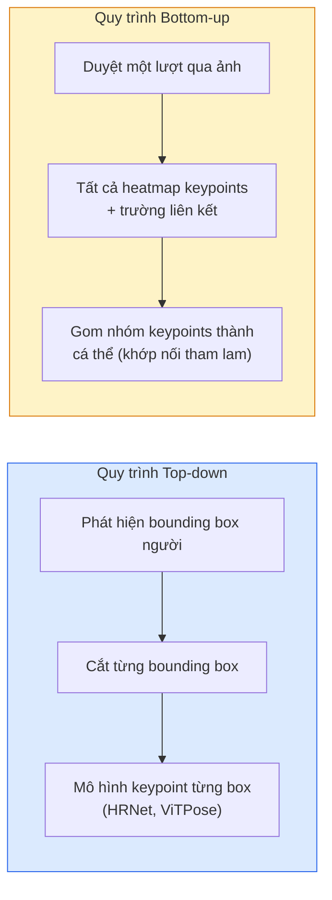

# Phát Hiện Điểm Then Chốt & Ước Lượng Tư Thế (Keypoint Detection & Pose Estimation)

> Một tư thế là một tập hợp các điểm then chốt có thứ tự. Một bộ phát hiện điểm then chốt bản chất là một bộ hồi quy bản đồ nhiệt (heatmap regressor). Mọi thứ còn lại chỉ là khâu tổ chức dữ liệu.

**Type:** Build
**Languages:** Python
**Prerequisites:** Phase 4 Lesson 06 (Detection), Phase 4 Lesson 07 (U-Net)
**Time:** ~45 phút

## Learning Objectives

- Phân biệt ước lượng tư thế theo hướng từ trên xuống (top-down) và từ dưới lên (bottom-up); xác định rõ thời điểm sử dụng từng phương pháp
- Hồi quy bản đồ nhiệt cho K điểm then chốt với mục tiêu hàm Gauss cho mỗi điểm và trích xuất toạ độ điểm then chốt khi suy luận
- Giải thích Trường Liên kết Bộ phận (Part Affinity Fields - PAFs) và cách các quy trình bottom-up gom nhóm các điểm then chốt thành từng cá thể
- Sử dụng MediaPipe Pose hoặc MMPose cho bài toán ước lượng tư thế trong sản xuất thực tế và hiểu rõ định dạng đầu ra của chúng

## The Problem

Các tác vụ điểm then chốt (keypoint tasks) ẩn mình dưới rất nhiều tên gọi: tư thế cơ thể người (17 khớp xương cơ thể), các điểm mốc trên khuôn mặt (68 hoặc 478 điểm landmarks), bàn tay (21 điểm), tư thế động vật, tư thế vật thể trong robot học, các điểm mốc giải phẫu trong y tế. Tất cả chúng đều chia sẻ chung một cấu trúc: phát hiện K điểm rời rạc trên một đối tượng và xuất ra toạ độ (x, y) của chúng.

Ước lượng tư thế là nền tảng của công nghệ bắt chuyển động (motion capture), ứng dụng thể hình (fitness), phân tích thể thao, điều khiển bằng cử chỉ, hoạt hình đồ hoạ, thử đồ ảo AR và tay gắp robot. Trường hợp 2D đã rất hoàn thiện; tư thế 3D (ước lượng vị trí các khớp trong toạ độ thế giới từ một camera duy nhất) hiện là biên giới nghiên cứu tích cực.

Vấn đề kỹ thuật cốt lõi là khả năng mở rộng quy mô. Ước lượng tư thế một người trong một bức ảnh đơn lẻ chỉ mất 20ms. Nhưng ước lượng tư thế của hàng chục người trong đám đông ở tốc độ 30 khung hình/giây là một bài toán hoàn toàn khác đòi hỏi kiến trúc chuyên biệt.

## The Concept

### Quy trình Top-down vs Bottom-up



- **Top-down (Từ trên xuống)** — phát hiện người trước, sau đó chạy mô hình điểm then chốt cho từng vùng ảnh cắt ra. Độ chính xác cao nhất; thời gian tính toán tăng tuyến tính theo số lượng người.
- **Bottom-up (Từ dưới lên)** — một lượt truyền xuôi duy nhất dự đoán tất cả các điểm then chốt cùng với một trường liên kết; sau đó gom nhóm chúng lại. Thời gian xử lý là hằng số bất kể số lượng người trong cảnh.

Top-down (HRNet, ViTPose) dẫn đầu về độ chính xác; bottom-up (OpenPose, HigherHRNet) dẫn đầu về thông lượng tốc độ trong các cảnh đông người.

### Hồi quy bản đồ nhiệt (Heatmap regression)

Thay vì hồi quy trực tiếp toạ độ `(x, y)`, mô hình dự đoán một bản đồ nhiệt kích thước `H x W` cho mỗi điểm then chốt với một đốm Gauss (Gaussian blob) tập trung tại vị trí thực tế.

```math
\text{target}[k, y, x] = \exp\left(-\frac{(x - \mathit{cx}_k)^2 + (y - \mathit{cy}_k)^2}{2 \sigma^2}\right)
```

Khi suy luận, vị trí cực đại (argmax) của mỗi bản đồ nhiệt chính là toạ độ điểm then chốt dự đoán.

Lý do bản đồ nhiệt hoạt động tốt hơn nhiều so với hồi quy toạ độ trực tiếp: cấu trúc không gian của mạng nơ-ron (bản đồ đặc trưng tích chập) ăn khớp tự nhiên với đầu ra không gian. Mục tiêu dạng Gauss cũng mang tính chất điều chuẩn (regularisation) — một sai số định vị nhỏ sẽ tạo ra hàm mất mát nhỏ thay vì triệt tiêu về 0.

### Định vị dưới cấp độ điểm ảnh (Sub-pixel localisation)

Argmax chỉ cung cấp toạ độ số nguyên. Để đạt độ chính xác dưới cấp độ điểm ảnh (sub-pixel), ta tinh chỉnh bằng cách khớp đường parabol với vị trí argmax và các điểm lân cận, hoặc dịch chuyển vị trí argmax về phía lân cận có giá trị cao hơn với `dx = 0.25 * (heatmap[y, x+1] - heatmap[y, x-1])` và tương tự cho `dy`, như triển khai trong mã nguồn.

### Trường Liên kết Bộ phận (Part Affinity Fields - PAFs)

Kỹ thuật đột phá của OpenPose cho bài toán liên kết bottom-up. Đối với mỗi cặp điểm then chốt nối với nhau (ví dụ: vai trái nối với khuỷu tay trái), mô hình dự đoán một trường 2 kênh mã hoá vector đơn vị chỉ hướng từ điểm này sang điểm kia. Để liên kết một khớp vai với khuỷu tay tương ứng, ta tích phân đường dọc theo đoạn thẳng nối các cặp ứng viên; cặp nào có tích phân lớn nhất sẽ được ghép với nhau.

```text
Đối với mỗi liên kết (chi / bộ phận):
  Số kênh PAF: 2 (vector đơn vị x, y)
  Tích phân đường: tổng trên các điểm lấy mẫu của (PAF . hướng_đoạn_thẳng)
  Tích phân càng cao = độ tương thích ghép đôi càng mạnh
```

Giải pháp tinh tế này mở rộng quy mô cho đám đông tuỳ ý mà không cần cắt ảnh từng người.

### Tập dữ liệu COCO Keypoints

Tập dữ liệu tiêu chuẩn cho tư thế cơ thể người: 17 điểm then chốt cho mỗi người, sử dụng PCK (Tỷ lệ phần trăm điểm then chốt chính xác) và OKS (Độ tương đồng điểm then chốt của đối tượng) làm thước đo. OKS là chỉ số tương đương với IoU nhưng dành cho điểm then chốt, và là cơ sở để tính COCO mAP@OKS.

### So sánh 2D và 3D

- **Tư thế 2D** — toạ độ trên mặt phẳng ảnh; đã được giải quyết hoàn thiện ở chất lượng sản xuất thương mại (MediaPipe, HRNet, ViTPose).
- **Tư thế 3D** — toạ độ trong thế giới thực / hệ toạ độ camera; vẫn là lĩnh vực nghiên cứu sôi động. Các cách tiếp cận phổ biến:
  - Nâng toạ độ 2D lên không gian 3D bằng một mạng MLP nhỏ (VideoPose3D).
  - Hồi quy 3D trực tiếp từ hình ảnh (PyMAF, MHFormer).
  - Sử dụng hệ thống nhiều camera đồng bộ (CMU Panoptic) để lấy nhãn chuẩn.

```figure
cv3-pose-heatmap
```

## Build It

### Bước 1: Mục tiêu bản đồ nhiệt Gauss

```python
import numpy as np
import torch

def gaussian_heatmap(size, cx, cy, sigma=2.0):
    yy, xx = np.meshgrid(np.arange(size), np.arange(size), indexing="ij")
    return np.exp(-((xx - cx) ** 2 + (yy - cy) ** 2) / (2 * sigma ** 2)).astype(np.float32)

hm = gaussian_heatmap(64, 32, 32, sigma=2.0)
print(f"peak: {hm.max():.3f} at ({hm.argmax() % 64}, {hm.argmax() // 64})")
```

Các bản đồ nhiệt của từng điểm then chốt được xếp chồng dọc theo trục kênh để tạo thành tensor mục tiêu hoàn chỉnh.

### Bước 2: Đầu mạng Tiny Keypoint

Một mô hình dạng U-Net xuất ra K kênh bản đồ nhiệt.

```python
import torch.nn as nn
import torch.nn.functional as F

class TinyKeypointNet(nn.Module):
    def __init__(self, num_keypoints=4, base=16):
        super().__init__()
        self.down1 = nn.Sequential(nn.Conv2d(3, base, 3, 2, 1), nn.ReLU(inplace=True))
        self.down2 = nn.Sequential(nn.Conv2d(base, base * 2, 3, 2, 1), nn.ReLU(inplace=True))
        self.mid = nn.Sequential(nn.Conv2d(base * 2, base * 2, 3, 1, 1), nn.ReLU(inplace=True))
        self.up1 = nn.ConvTranspose2d(base * 2, base, 2, 2)
        self.up2 = nn.ConvTranspose2d(base, num_keypoints, 2, 2)

    def forward(self, x):
        h1 = self.down1(x)
        h2 = self.down2(h1)
        h3 = self.mid(h2)
        u1 = self.up1(h3)
        return self.up2(u1)
```

Đầu vào `(N, 3, H, W)`, đầu ra `(N, K, H, W)`. Hàm mất mát là MSE trên từng điểm ảnh so với các bản đồ nhiệt Gauss mục tiêu.

### Bước 3: Suy luận — trích xuất toạ độ điểm then chốt

```python
def heatmap_to_coords(heatmaps):
    """
    heatmaps: (N, K, H, W)
    trả về:   (N, K, 2) toạ độ số thực theo điểm ảnh của ảnh
    """
    N, K, H, W = heatmaps.shape
    hm = heatmaps.reshape(N, K, -1)
    idx = hm.argmax(dim=-1)
    ys = (idx // W).float()
    xs = (idx % W).float()
    return torch.stack([xs, ys], dim=-1)

coords = heatmap_to_coords(torch.randn(2, 4, 32, 32))
print(f"coords: {coords.shape}")  # (2, 4, 2)
```

Chỉ một dòng khi suy luận. Để tinh chỉnh dưới cấp độ điểm ảnh, thực hiện nội suy xung quanh vị trí argmax.

### Bước 4: Tạo tập dữ liệu điểm then chốt tổng hợp

Đơn giản: vẽ 4 điểm trên khung vẽ màu trắng và huấn luyện mô hình dự đoán vị trí của chúng.

```python
def make_synthetic_sample(size=64):
    img = np.ones((3, size, size), dtype=np.float32)
    rng = np.random.default_rng()
    kps = rng.integers(8, size - 8, size=(4, 2))
    for cx, cy in kps:
        img[:, cy - 2:cy + 2, cx - 2:cx + 2] = 0.0
    hms = np.stack([gaussian_heatmap(size, cx, cy) for cx, cy in kps])
    return img, hms, kps
```

Đủ đơn giản để một mô hình nhỏ có thể học thành thạo chỉ trong 1 phút.

### Bước 5: Huấn luyện

```python
model = TinyKeypointNet(num_keypoints=4)
opt = torch.optim.Adam(model.parameters(), lr=3e-3)

for step in range(200):
    batch = [make_synthetic_sample() for _ in range(16)]
    imgs = torch.from_numpy(np.stack([b[0] for b in batch]))
    hms = torch.from_numpy(np.stack([b[1] for b in batch]))
    pred = model(imgs)
    # Lấy mẫu nội suy (upsample) pred về độ phân giải đầy đủ
    pred = F.interpolate(pred, size=hms.shape[-2:], mode="bilinear", align_corners=False)
    loss = F.mse_loss(pred, hms)
    opt.zero_grad(); loss.backward(); opt.step()
```

## Use It

- **MediaPipe Pose** — Giải pháp ước lượng tư thế thương mại của Google; hỗ trợ thời gian thực WebGL + mobile với độ trễ dưới 10ms.
- **MMPose** (OpenMMLab) — Kho mã nguồn nghiên cứu toàn diện; hỗ trợ mọi kiến trúc SOTA kèm trọng số huấn luyện sẵn.
- **YOLOv8-pose** — Giải pháp ước lượng tư thế nhiều người theo thời gian thực nhanh nhất chỉ với một lượt truyền xuôi.
- **transformers HumanDPT / PoseAnything** — Các hướng tiếp cận thị giác-ngôn ngữ mới mẻ cho phép ước lượng tư thế theo từ vựng mở (bất kỳ đối tượng nào, bất kỳ bộ điểm then chốt nào).

## Ship It

Bài học này tạo ra:

- `outputs/prompt-pose-stack-picker.md` — một câu lệnh prompt giúp lựa chọn giữa MediaPipe / YOLOv8-pose / HRNet / ViTPose dựa trên yêu cầu độ trễ, quy mô đám đông và nhu cầu 2D vs 3D.
- `outputs/skill-heatmap-to-coords.md` — một kỹ năng viết hàm chuyển đổi từ bản đồ nhiệt sang toạ độ dưới cấp độ điểm ảnh được sử dụng trong mọi mô hình tư thế sản xuất thực tế.

## Exercises

1. **(Dễ)** Huấn luyện mô hình keypoint nhỏ trên tập dữ liệu tổng hợp 4 điểm. Báo cáo sai số khoảng cách L2 trung bình giữa điểm dự đoán và điểm chuẩn sau 200 bước.
2. **(Trung bình)** Bổ sung tính năng tinh chỉnh dưới cấp độ điểm ảnh: từ vị trí argmax, khớp một đường cong parabol 1D dọc theo trục x và y từ các điểm ảnh lân cận. Báo cáo mức độ cải thiện độ chính xác so với argmax số nguyên.
3. **(Khó)** Xây dựng tập dữ liệu tổng hợp gồm 2 người, trong đó mỗi hình ảnh hiển thị hai cá thể có mẫu 4 điểm then chốt. Huấn luyện một quy trình bottom-up với các trường liên kết PAF để dự đoán điểm then chốt nào thuộc về cá thể nào, sau đó đánh giá chỉ số OKS.

## Key Terms

| Thuật ngữ | Cách gọi thông thường | Bản chất kỹ thuật thực sự |
|-----------|----------------------|---------------------------|
| Keypoint | "Điểm mốc" | Một điểm rời rạc có thứ tự xác định trên vật thể (khớp xương, góc, đặc trưng) |
| Pose | "Bộ xương khung" | Một tập hợp các điểm then chốt có thứ tự thuộc về cùng một cá thể |
| Top-down | "Phát hiện rồi tìm khớp" | Quy trình 2 giai đoạn: phát hiện người + mô hình keypoint trên từng vùng cắt; độ chính xác cao nhất |
| Bottom-up | "Tìm khớp rồi gom nhóm" | Dự đoán toàn bộ keypoint trong một lượt duy nhất + gom nhóm; thời gian không đổi theo số người |
| Heatmap | "Mục tiêu Gauss" | Tensor kích thước H x W cho mỗi keypoint với đỉnh tại vị trí thực tế; mục tiêu hồi quy ưu tiên |
| PAF | "Trường liên kết bộ phận" | Trường vector đơn vị 2 kênh mã hoá hướng chi; dùng để gom nhóm keypoint thành cá thể |
| OKS | "IoU của keypoint" | Object Keypoint Similarity; chỉ số đo lường chuẩn mực của tập dữ liệu COCO cho tư thế |
| HRNet | "Mạng độ phân giải cao" | Kiến trúc keypoint top-down thống trị; duy trì các đặc trưng độ phân giải cao xuyên suốt mạng |

## Further Reading

- [OpenPose (Cao et al., 2017)](https://arxiv.org/abs/1812.08008) — Kiến trúc bottom-up dùng PAFs; tài liệu giải thích rõ ràng và trực quan nhất về phương pháp này
- [HRNet (Sun et al., 2019)](https://arxiv.org/abs/1902.09212) — Kiến trúc tham chiếu tiêu chuẩn cho hướng tiếp cận top-down
- [ViTPose (Xu et al., 2022)](https://arxiv.org/abs/2204.12484) — Sử dụng ViT thuần túy làm backbone ước lượng tư thế; SOTA hiện nay trên nhiều bảng xếp hạng
- [MediaPipe Pose](https://developers.google.com/mediapipe/solutions/vision/pose_landmarker) — Ước lượng tư thế thời gian thực trong sản xuất thương mại; kiến trúc triển khai nhanh nhất năm 2026

