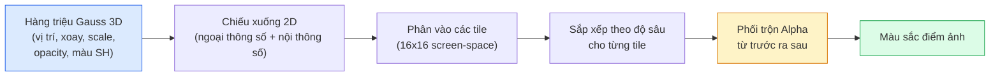

# 3D Gaussian Splatting từ Con Số Không (3D Gaussian Splatting from Scratch)

> Một khung cảnh 3D là một đám mây gồm hàng triệu hàm Gauss 3D. Mỗi hàm Gauss sở hữu vị trí, hướng xoay, tỷ lệ thu phóng, độ mờ đục và màu sắc phụ thuộc vào hướng nhìn. Raster hoá chúng, lan truyền ngược qua bước raster hoá, thế là xong.

**Type:** Build
**Languages:** Python
**Prerequisites:** Phase 4 Lesson 13 (3D Vision & NeRF), Phase 1 Lesson 12 (Tensor Operations), Phase 4 Lesson 10 (Diffusion basics optional)
**Time:** ~90 phút

## Learning Objectives

- Giải thích lý do 3D Gaussian Splatting thay thế NeRF để trở thành tiêu chuẩn mặc định trong sản xuất cho tái tạo 3D chân thực (photorealistic 3D reconstruction) vào năm 2026
- Trình bày rõ 6 tham số cho mỗi hàm Gauss (vị trí, quaternion xoay, tỷ lệ thu phóng, độ mờ đục, màu hàm điều hoà hình cầu, đặc trưng tuỳ chọn) và số lượng số thực float mà mỗi tham số đóng góp
- Triển khai bộ rasterizer 2D Gaussian splatting từ con số không bằng kỹ thuật phối trộn `alpha` (alpha compositing), sau đó chỉ ra cách trường hợp 3D chiếu về cùng vòng lặp đó
- Sử dụng `nerfstudio`, `gsplat`, hoặc `SuperSplat` để tái tạo khung cảnh từ 20-50 bức ảnh chụp và xuất sang phần mở rộng glTF `KHR_gaussian_splatting` hoặc lược đồ OpenUSD 26.03 `UsdVolParticleField3DGaussianSplat`

## The Problem

NeRF lưu trữ một khung cảnh dưới dạng các trọng số của mạng MLP. Mỗi điểm ảnh kết xuất đòi hỏi hàng trăm truy vấn MLP dọc theo một tia sáng. Huấn luyện mất hàng giờ, kết xuất mất hàng giây, và các trọng số không thể chỉnh sửa trực tiếp — nếu muốn di chuyển một chiếc ghế bên trong cảnh, bạn buộc phải huấn luyện lại từ đầu.

3D Gaussian Splatting (Kerbl, Kopanas, Leimkühler, Drettakis, SIGGRAPH 2023) đã thay thế hoàn toàn điều đó. Một khung cảnh là một tập hợp tường minh các hàm Gauss 3D. Quá trình kết xuất là raster hoá trên GPU với tốc độ hơn 100 fps. Huấn luyện chỉ mất vài phút. Việc chỉnh sửa diễn ra trực tiếp: tịnh tiến một tập hợp con các hàm Gauss là bạn đã di chuyển xong chiếc ghế. Đến năm 2026, Khronos Group đã phê chuẩn phần mở rộng glTF cho Gaussian splats, OpenUSD 26.03 tích hợp lược đồ Gaussian splat, Zillow và Apartments.com kết xuất bất động sản bằng kỹ thuật này, và hầu hết các bài báo nghiên cứu mới về tái tạo 3D đều là các biến thể xoay quanh ý tưởng 3DGS cốt lõi.

Mô hình tư duy rất đơn giản, nhưng phần toán học có đủ các chi tiết vận hành khiến hầu hết các tài liệu giới thiệu thường bắt đầu ngay ở khâu raster hoá mà bỏ qua bước phép chiếu và hàm điều hoà hình cầu. Bài học này sẽ xây dựng toàn bộ quy trình — phiên bản 2D trước, sau đó mở rộng sang 3D.

## The Concept

### Một hàm Gauss mang những thông tin gì?

Một hàm Gauss 3D là một đốm tham số trong không gian với các thuộc tính sau:

```text
position (vị trí)      mu         (3,)    tâm trong toạ độ thế giới
rotation (hướng xoay)  q          (4,)    quaternion đơn vị mã hoá hướng xoay
scale (tỷ lệ thu phóng) s         (3,)    log-scale theo từng trục (được mũ hoá khi kết xuất)
opacity (độ mờ đục)    alpha      (1,)    độ mờ đục sau hàm sigmoid [0, 1]
SH coefficients        c_lm       (3 * (L+1)^2,)   màu sắc phụ thuộc hướng nhìn
```

Hướng xoay + tỷ lệ thu phóng tạo nên ma trận hiệp phương sai 3x3: $\Sigma = R S S^T R^T$. Đó chính là hình dạng hình học của hàm Gauss trong không gian 3D. Các hàm điều hoà hình cầu (Spherical harmonics - SH) cho phép màu sắc thay đổi tuỳ theo hướng nhìn — tạo ra các phản xạ gương (specular highlights), ánh kim tinh tế, hiệu ứng phát sáng theo góc nhìn — mà không cần lưu trữ texture riêng cho từng góc nhìn. Với bậc SH là 3, bạn có 16 hệ số cho mỗi kênh màu, tương đương 48 số thực float cho mỗi hàm Gauss chỉ riêng phần màu sắc.

Một khung cảnh thường có từ 1 đến 5 triệu hàm Gauss. Mỗi hàm Gauss lưu khoảng 60 số float (3 + 4 + 3 + 1 + 48 + các trường khác). Toàn bộ khung cảnh 5 triệu Gauss chỉ chiếm khoảng 240 MB — nhỏ hơn nhiều so với đám mây điểm tương đương có gắn texture từng điểm, và nhỏ hơn cả bậc độ lớn so với trọng số MLP của NeRF khi kết xuất ở độ phân giải cao.

### Rasterisation thay vì Ray Marching



Năm bước, hoàn toàn tối ưu cho kiến trúc song song của GPU. Không cần truy vấn MLP trên từng điểm ảnh. Một chiếc card đồ hoạ RTX 3080 Ti duy nhất có thể kết xuất 6 triệu splats ở tốc độ 147 fps.

### Bước chiếu hình học (The projection step)

Hàm Gauss 3D tại vị trí thế giới $\mu$ với ma trận hiệp phương sai 3D $\Sigma$ được chiếu thành một hàm Gauss 2D tại vị trí màn hình $\mu'$ với ma trận hiệp phương sai 2D $\Sigma'$:

```math
\begin{aligned}
\mu' &= \mathop{\mathrm{project}}(\mu) \\
\Sigma' &= J W \Sigma W^T J^T \qquad (2 \times 2) \\[6pt]
W &= \text{phép biến đổi quan sát (xoay + tịnh tiến của camera)} \\
J &= \text{Jacobian của phép chiếu phối cảnh tại } \mu'
\end{aligned}
```

Vùng bao phủ của hàm Gauss 2D là một hình elip có các trục chính là vector riêng của $\Sigma'$. Mọi điểm ảnh nằm trong hình elip đó đều nhận phần đóng góp của hàm Gauss, được đánh trọng số bởi $\exp(-0.5 \cdot (p - \mu')^T {\Sigma'}^{-1} (p - \mu'))$.

### Quy tắc phối trộn Alpha (The alpha-compositing rule)

Đối với một điểm ảnh, các hàm Gauss bao phủ nó được sắp xếp từ trước ra sau (front-to-back, hoặc từ sau ra trước back-to-front với công thức đảo ngược). Màu sắc được phối trộn theo phương trình kinh điển của mọi bộ rasteriser bán trong suốt từ thập niên 1980:

```math
\begin{aligned}
C_{\text{pixel}} &= \sum_i \alpha_i T_i c_i \\[6pt]
T_i &= \prod_{j < i} (1 - \alpha_j) && \text{độ truyền qua tích luỹ tính đến } i \\
\alpha_i &= \text{opacity}_i \cdot \exp\left(-0.5 \, d^T {\Sigma'}^{-1} d\right) && \text{đóng góp cục bộ} \\
c_i &= \mathop{\mathrm{eval\_SH}}(\text{SH}_i, \text{view\_direction}) && \text{màu sắc theo hướng nhìn}
\end{aligned}
```

Đây **chính là phương trình kết xuất thể tích của NeRF**, chỉ khác là được tính trên một tập thưa tường minh các hàm Gauss thay vì lấy mẫu dày đặc dọc theo tia sáng. Sự tương đồng toán học này lý giải vì sao chất lượng hình ảnh kết xuất tương đương NeRF — cả hai đều đang tích phân cùng một phương trình trường bức xạ (radiance field).

### Tại sao quá trình này khả vi (differentiable)?

Mọi bước — chiếu hình, phân chia tile, phối trộn alpha, tính toán hàm điều hoà hình cầu — đều có đạo hàm khả vi đối với các tham số của hàm Gauss. Khi có một hình ảnh thực tế (ground-truth), ta tính sai số điểm ảnh kết xuất, lan truyền ngược đạo hàm qua bộ rasteriser, và cập nhật tất cả $(\mu, q, s, \alpha, c_{lm})$ bằng phương pháp hạ độ dốc (gradient descent). Qua khoảng ~30.000 vòng lặp, các hàm Gauss sẽ tự định vị vào đúng vị trí, kích thước và màu sắc chuẩn xác.

### Làm dày và cắt tỉa (Densification and pruning)

Một tập hợp cố định các hàm Gauss không thể bao quát một khung cảnh phức tạp. Quá trình huấn luyện tích hợp hai cơ chế thích ứng:

- **Nhân bản (Clone)** một hàm Gauss tại vị trí hiện tại khi độ lớn gradient của nó cao nhưng kích thước (scale) nhỏ — vùng tái tạo này cần thêm chi tiết sắc nét.
- **Tách đôi (Split)** một hàm Gauss kích thước lớn thành hai hàm Gauss nhỏ hơn khi gradient của nó cao — một hàm Gauss quá lớn sẽ quá mượt, không khớp được chi tiết cục bộ.
- **Cắt tỉa (Prune)** các hàm Gauss có độ mờ đục giảm xuống dưới ngưỡng tối thiểu — chúng không đóng góp gì cho hình ảnh.

Quá trình làm dày được kích hoạt sau mỗi $N$ vòng lặp. Một khung cảnh thường bắt đầu từ ~100k hàm Gauss ban đầu (khởi tạo từ các điểm SfM) và phát triển lên 1-5 triệu điểm khi kết thúc huấn luyện.

### Hàm điều hoà hình cầu (Spherical harmonics) tóm gọn

Màu sắc phụ thuộc hướng nhìn là một hàm $c(\text{direction})$ trên mặt cầu đơn vị. Các hàm điều hoà hình cầu chính là hệ cơ sở Fourier trên mặt cầu. Cắt ngắn tại bậc $L$, bạn nhận được $(L+1)^2$ hàm cơ sở cho mỗi kênh. Tính màu sắc cho một góc nhìn mới đơn giản là phép nhân vô hướng giữa các hệ số SH học được với các hàm cơ sở được tính tại hướng nhìn đó. Bậc 0 = một hệ số = màu sắc không đổi theo hướng. Bậc 3 = 16 hệ số = đủ để thể hiện đổ bóng Lambert, phản xạ gương và ánh phản chiếu nhẹ. Các bài báo Gaussian Splatting mặc định sử dụng bậc 3.

### Bộ công cụ sản xuất tiêu chuẩn năm 2026

```text
1. Thu thập dữ liệu   điện thoại thông minh / drone DJI / máy quét cầm tay
2. SfM / MVS          COLMAP hoặc GLOMAP tính tư thế camera + đám mây điểm thưa
3. Huấn luyện 3DGS    nerfstudio / gsplat / inria official / PostShot (~10-30 phút trên RTX 4090)
4. Chỉnh sửa          SuperSplat / SplatForge (xoá điểm trôi nổi rác, phân đoạn)
5. Xuất định dạng     .ply -> glTF KHR_gaussian_splatting hoặc .usd (OpenUSD 26.03)
6. Xem & Tương tác    Cesium / Unreal Engine / Babylon.js / Three.js / Apple Vision Pro
```

### Biến thể 4D và mô hình sinh

- **4D Gaussian Splatting** — Các hàm Gauss biến thiên theo thời gian; dùng cho video thể tích (volumetric video).
- **Generative splats** — Mô hình text-to-splat (như Marble của World Labs) tạo ra toàn bộ khung cảnh từ mô tả văn bản.
- **3D Gaussian Unscented Transform** — Biến thể NVIDIA NuRec dùng cho mô phỏng lái xe tự hành.

```figure
cv3-gaussian-splat
```

## Build It

### Bước 1: Hàm Gauss 2D

Đầu tiên ta xây dựng bộ rasteriser 2D. Trường hợp 3D sẽ quy về trường hợp này sau bước chiếu phối cảnh.

```python
import torch
import torch.nn as nn
import torch.nn.functional as F


def eval_2d_gaussian(means, covs, points):
    """
    means:  (G, 2)      toạ độ tâm
    covs:   (G, 2, 2)   ma trận hiệp phương sai
    points: (H, W, 2)   toạ độ điểm ảnh
    trả về: (G, H, W)   mật độ tại mỗi điểm ảnh cho mỗi hàm Gauss
    """
    G = means.size(0)
    H, W, _ = points.shape
    flat = points.view(-1, 2)
    inv = torch.linalg.inv(covs)
    diff = flat[None, :, :] - means[:, None, :]
    d = torch.einsum("gpi,gij,gpj->gp", diff, inv, diff)
    density = torch.exp(-0.5 * d)
    return density.view(G, H, W)
```

Lệnh `einsum` thực hiện dạng toàn phương `diff^T Sigma^-1 diff` cho mọi cặp (Gauss, điểm ảnh).

### Bước 2: Bộ rasteriser 2D Splatting

Phối trộn alpha từ trước ra sau (front-to-back). Độ sâu trong không gian 2D không có ý nghĩa vật lý tự nhiên, nên ta dùng một đại lượng vô hướng học được trên mỗi hàm Gauss để xác định thứ tự.

```python
def rasterise_2d(means, covs, colours, opacities, depths, image_size):
    """
    means:     (G, 2)
    covs:      (G, 2, 2)
    colours:   (G, 3)
    opacities: (G,)     trong đoạn [0, 1]
    depths:    (G,)     đại lượng vô hướng của mỗi Gauss dùng để sắp xếp thứ tự
    image_size: (H, W)
    trả về:    (H, W, 3) ảnh đã kết xuất
    """
    H, W = image_size
    yy, xx = torch.meshgrid(
        torch.arange(H, dtype=torch.float32, device=means.device),
        torch.arange(W, dtype=torch.float32, device=means.device),
        indexing="ij",
    )
    points = torch.stack([xx, yy], dim=-1)

    densities = eval_2d_gaussian(means, covs, points)
    alphas = opacities[:, None, None] * densities
    alphas = alphas.clamp(0.0, 0.99)

    order = torch.argsort(depths)
    alphas = alphas[order]
    colours_sorted = colours[order]

    T = torch.ones(H, W, device=means.device)
    out = torch.zeros(H, W, 3, device=means.device)
    for i in range(means.size(0)):
        a = alphas[i]
        out += (T * a)[..., None] * colours_sorted[i][None, None, :]
        T = T * (1.0 - a)
    return out
```

Mặc dù triển khai thuần Python này không nhanh bằng nhân CUDA dựa trên tile, nhưng nó thể hiện chính xác bản chất toán học và hoàn toàn khả vi.

### Bước 3: Mô hình khung cảnh Splat 2D có thể huấn luyện

```python
class Splats2D(nn.Module):
    def __init__(self, num_splats=128, image_size=64, seed=0):
        super().__init__()
        g = torch.Generator().manual_seed(seed)
        H, W = image_size, image_size
        self.means = nn.Parameter(torch.rand(num_splats, 2, generator=g) * torch.tensor([W, H]))
        self.log_scale = nn.Parameter(torch.ones(num_splats, 2) * math.log(2.0))
        self.rot = nn.Parameter(torch.zeros(num_splats))  # góc xoay đơn trong 2D
        self.colour_logits = nn.Parameter(torch.randn(num_splats, 3, generator=g) * 0.5)
        self.opacity_logit = nn.Parameter(torch.zeros(num_splats))
        self.depth = nn.Parameter(torch.rand(num_splats, generator=g))

    def covs(self):
        s = torch.exp(self.log_scale)
        c, si = torch.cos(self.rot), torch.sin(self.rot)
        R = torch.stack([
            torch.stack([c, -si], dim=-1),
            torch.stack([si, c], dim=-1),
        ], dim=-2)
        S = torch.diag_embed(s ** 2)
        return R @ S @ R.transpose(-1, -2)

    def forward(self, image_size):
        covs = self.covs()
        colours = torch.sigmoid(self.colour_logits)
        opacities = torch.sigmoid(self.opacity_logit)
        return rasterise_2d(self.means, covs, colours, opacities, self.depth, image_size)
```

`log_scale`, `opacity_logit`, và `colour_logits` đều là các tham số không bị ràng buộc (unconstrained) được chuyển đổi qua hàm kích hoạt phù hợp tại thời điểm kết xuất. Đây là mẫu thiết kế tiêu chuẩn trong mọi bộ triển khai 3DGS.

### Bước 4: Khớp các hàm Gauss 2D vào ảnh mục tiêu

```python
import math
import numpy as np

def make_target(size=64):
    yy, xx = np.meshgrid(np.arange(size), np.arange(size), indexing="ij")
    img = np.zeros((size, size, 3), dtype=np.float32)
    # Hình tròn màu đỏ
    mask = (xx - 20) ** 2 + (yy - 20) ** 2 < 10 ** 2
    img[mask] = [1.0, 0.2, 0.2]
    # Hình vuông màu xanh dương
    mask = (np.abs(xx - 45) < 8) & (np.abs(yy - 40) < 8)
    img[mask] = [0.2, 0.3, 1.0]
    return torch.from_numpy(img)


target = make_target(64)
model = Splats2D(num_splats=64, image_size=64)
opt = torch.optim.Adam(model.parameters(), lr=0.05)

for step in range(200):
    pred = model((64, 64))
    loss = F.mse_loss(pred, target)
    opt.zero_grad(); loss.backward(); opt.step()
    if step % 40 == 0:
        print(f"bước {step:3d}  mse {loss.item():.4f}")
```

Sau 200 bước, 64 hàm Gauss sẽ tự định hình khớp hoàn hảo vào hai hình dạng mục tiêu. Đó chính là toàn bộ nguyên lý nền tảng — hạ độ dốc trên các thực thể hình học tường minh.

### Bước 5: Mở rộng từ 2D sang 3D

Phần mở rộng 3D giữ nguyên cấu trúc vòng lặp. Những điểm bổ sung:

1. Hướng xoay của mỗi Gauss là một quaternion thay vì một góc duy nhất.
2. Ma trận hiệp phương sai là $R S S^T R^T$ với $R$ tạo từ quaternion và $S = \text{diag}(\exp(\text{log\_scale}))$.
3. Phép chiếu $(\mu, \Sigma) \to (\mu', \Sigma')$ sử dụng ngoại thông số camera và ma trận Jacobian của phép chiếu phối cảnh tại $\mu$.
4. Màu sắc trở thành khai triển hàm điều hoà hình cầu; tính toán nó tại hướng nhìn hiện tại.
5. Sắp xếp độ sâu dựa trên toạ độ z thực tế trong không gian camera thay vì một đại lượng học được.

Mọi bản triển khai trong thực tế sản xuất (`gsplat`, `inria/gaussian-splatting`, `nerfstudio`) đều thực hiện chính xác các bước này trên GPU với các nhân CUDA theo tile.

### Bước 6: Đánh giá hàm điều hoà hình cầu (Spherical harmonics)

Hệ cơ sở SH lên đến bậc 3 có 16 số hạng cho mỗi kênh màu:

```python
def eval_sh_degree_3(sh_coeffs, dirs):
    """
    sh_coeffs: (..., 16, 3)   chiều cuối là các kênh RGB
    dirs:      (..., 3)       các vector đơn vị
    trả về:    (..., 3)
    """
    C0 = 0.282094791773878
    C1 = 0.488602511902920
    C2 = [1.092548430592079, 1.092548430592079,
          0.315391565252520, 1.092548430592079,
          0.546274215296039]
    x, y, z = dirs[..., 0], dirs[..., 1], dirs[..., 2]
    x2, y2, z2 = x * x, y * y, z * z
    xy, yz, xz = x * y, y * z, x * z

    result = C0 * sh_coeffs[..., 0, :]
    result = result - C1 * y[..., None] * sh_coeffs[..., 1, :]
    result = result + C1 * z[..., None] * sh_coeffs[..., 2, :]
    result = result - C1 * x[..., None] * sh_coeffs[..., 3, :]

    result = result + C2[0] * xy[..., None] * sh_coeffs[..., 4, :]
    result = result + C2[1] * yz[..., None] * sh_coeffs[..., 5, :]
    result = result + C2[2] * (2.0 * z2 - x2 - y2)[..., None] * sh_coeffs[..., 6, :]
    result = result + C2[3] * xz[..., None] * sh_coeffs[..., 7, :]
    result = result + C2[4] * (x2 - y2)[..., None] * sh_coeffs[..., 8, :]

    # các số hạng bậc 3 được rút gọn ở đây; bản đầy đủ 16 hệ số nằm trong file mã nguồn
    return result
```

Hệ số `sh_coeffs` học được lưu trữ "màu sắc theo mọi hướng" cho hàm Gauss đó. Khi kết xuất, ta tính toán hàm này dựa trên hướng nhìn hiện tại để thu được vector RGB 3 chiều.

## Use It

Để làm việc với 3DGS thực tế, hãy dùng `gsplat` (Meta) hoặc `nerfstudio`:

```bash
pip install nerfstudio gsplat
ns-download-data example
ns-train splatfacto --data path/to/data
```

`splatfacto` là quy trình huấn luyện 3DGS của nerfstudio. Quá trình huấn luyện chỉ mất từ 10-30 phút trên card RTX 4090 cho một khung cảnh điển hình.

Các định dạng xuất file tiêu chuẩn năm 2026:

- `.ply` — Đám mây Gauss thô (tương thích rộng, dung lượng lớn nhất).
- `.splat` — Định dạng lượng tử hoá của PlayCanvas / SuperSplat.
- glTF `KHR_gaussian_splatting` — Tiêu chuẩn của Khronos, tương thích trên mọi trình hiển thị (bản phát hành thử nghiệm tháng 2/2026).
- OpenUSD `UsdVolParticleField3DGaussianSplat` — Định dạng chuẩn USD, dành cho NVIDIA Omniverse và hệ sinh thái Apple Vision Pro.

Đối với các khung cảnh 4D / động lực học, `4DGS` và `Deformable-3DGS` mở rộng cùng cơ chế này với toạ độ tâm và độ mờ đục biến thiên theo thời gian.

## Ship It

Bài học này tạo ra:

- `outputs/prompt-3dgs-capture-planner.md` — một câu lệnh prompt giúp lập kế hoạch chụp ảnh khung cảnh (số lượng ảnh, quỹ đạo camera, ánh sáng) cho từng loại cảnh vật.
- `outputs/skill-3dgs-export-router.md` — một kỹ năng lựa chọn định dạng xuất file tối ưu (`.ply` / `.splat` / glTF / USD) dựa trên trình xem hoặc engine đồ hoạ đích.

## Exercises

1. **(Dễ)** Chạy đoạn mã huấn luyện splat 2D ở trên trên một hình ảnh tổng hợp khác. Thay đổi `num_splats` trong `[16, 64, 256]` và vẽ đồ thị MSE theo bước lặp. Xác định điểm bắt đầu của quy luật hiệu suất giảm dần (diminishing returns).
2. **(Trung bình)** Mở rộng bộ rasteriser 2D để hỗ trợ màu RGB phụ thuộc vào một đại lượng vô hướng "góc nhìn" thông qua hàm điều hoà bậc 2. Huấn luyện trên một cặp hình ảnh mục tiêu và kiểm tra xem mô hình có tái tạo thành công cả hai hay không.
3. **(Khó)** Clone `nerfstudio` và huấn luyện `splatfacto` trên tập dữ liệu 20 ảnh chụp từ khung cảnh thực tế xung quanh bạn (bàn làm việc, chậu cây, khuôn mặt, căn phòng). Xuất sang định dạng glTF `KHR_gaussian_splatting` và mở nó trong một trình xem (Three.js `GaussianSplats3D`, SuperSplat, Babylon.js V9). Báo cáo thời gian huấn luyện, số lượng hàm Gauss và tốc độ fps khi kết xuất.

## Key Terms

| Thuật ngữ | Cách gọi thông thường | Bản chất kỹ thuật thực sự |
|-----------|----------------------|---------------------------|
| 3DGS | "Gaussian splats" | Biểu diễn khung cảnh tường minh dưới dạng hàng triệu hàm Gauss 3D với vị trí, xoay, scale, opacity, màu SH riêng biệt |
| Ma trận hiệp phương sai | "Hình dạng của Gauss" | $\Sigma = R S S^T R^T$; định hướng và tỷ lệ dị hướng của một hàm Gauss |
| Phối trộn Alpha | "Hoà trộn từ trước ra sau" | Cùng phương trình với kết xuất thể tích NeRF, nhưng thực hiện trên một tập thưa tường minh |
| Làm dày (Densification) | "Nhân bản và tách đôi" | Cơ chế thích ứng tự động bổ sung thêm các hàm Gauss mới tại những vùng chưa khớp tốt |
| Cắt tỉa (Pruning) | "Xoá điểm mờ đục thấp" | Loại bỏ các hàm Gauss có opacity giảm về gần 0 trong quá trình huấn luyện |
| Hàm điều hoà hình cầu | "Màu sắc đổi theo góc nhìn" | Hệ cơ sở Fourier trên mặt cầu; lưu trữ màu sắc dưới dạng hàm số của hướng quan sát |
| Splatfacto | "3DGS của nerfstudio" | Cách tiếp cận huấn luyện 3DGS tiện lợi nhất năm 2026 |
| `KHR_gaussian_splatting` | "Chuẩn glTF" | Phần mở rộng Khronos 2026 giúp 3DGS tương thích liền mạch trên mọi engine và trình duyệt |

## Further Reading

- [3D Gaussian Splatting for Real-Time Radiance Field Rendering (Kerbl et al., SIGGRAPH 2023)](https://repo-sam.inria.fr/fungraph/3d-gaussian-splatting/) — Bài báo gốc đặt nền móng
- [gsplat (Meta/nerfstudio)](https://github.com/nerfstudio-project/gsplat) — Bộ rasteriser CUDA chất lượng công nghiệp
- [nerfstudio Splatfacto](https://docs.nerf.studio/nerfology/methods/splat.html) — Công thức huấn luyện chuẩn tham chiếu
- [Khronos KHR_gaussian_splatting extension](https://github.com/KhronosGroup/glTF/blob/main/extensions/2.0/Khronos/KHR_gaussian_splatting/README.md) — Định dạng tương thích chuẩn hoá năm 2026
- [OpenUSD 26.03 release notes](https://openusd.org/release/) — Lược đồ `UsdVolParticleField3DGaussianSplat`
- [THE FUTURE 3D State of Gaussian Splatting 2026](https://www.thefuture3d.com/blog-0/2026/4/4/state-of-gaussian-splatting-2026) — Báo cáo tổng quan toàn ngành

