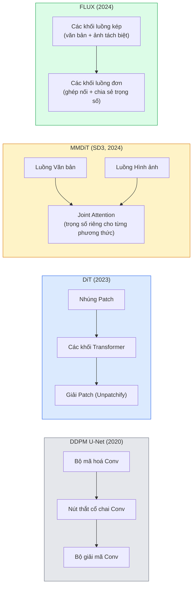

# Diffusion Transformers & Rectified Flow

> Mạng U-Net không phải là bí mật cốt lõi của mô hình khuếch tán. Hãy thay thế nó bằng một kiến trúc transformer, đổi lịch trình nhiễu thành một dòng chảy đường thẳng (straight-line flow), và đột nhiên bạn có SD3, FLUX, và mọi mô hình chuyển văn bản thành hình ảnh (text-to-image) hàng đầu năm 2026.

**Type:** Learn + Build
**Languages:** Python
**Prerequisites:** Phase 4 Lesson 10 (Diffusion DDPM), Phase 4 Lesson 14 (ViT), Phase 7 Lesson 02 (Self-Attention)
**Time:** ~75 phút

## Learning Objectives

- Lần theo tiến trình tiến hoá từ U-Net DDPM (Bài 10) sang Diffusion Transformer (DiT), MMDiT (SD3), và DiT luồng đơn + luồng kép (single+double-stream trong FLUX)
- Giải thích nguyên lý Rectified Flow: tại sao một quỹ đạo đường thẳng nối giữa nhiễu và dữ liệu cho phép mô hình lấy mẫu chỉ trong 20 bước thay vì 1000 bước
- Triển khai một khối DiT nhỏ gọn và vòng lặp huấn luyện rectified-flow, cả hai đều dưới 100 dòng mã
- Phân biệt các biến thể mô hình (SD3, FLUX.1-dev, FLUX.1-schnell, Z-Image, Qwen-Image) theo kiến trúc, số lượng tham số và giấy phép sử dụng

## The Problem

Bài 10 đã xây dựng một mạng DDPM với bộ khử nhiễu U-Net. Công thức đó đã thống trị giai đoạn 2020-2023: U-Net + lịch trình beta + hàm mất mát dự đoán nhiễu. Nó đã tạo nên Stable Diffusion 1.5, 2.1 và DALL-E 2.

Tuy nhiên, mọi mô hình text-to-image tiên tiến nhất năm 2026 đều đã vượt qua giới hạn đó. Stable Diffusion 3, FLUX, SD4, Z-Image, Qwen-Image, Hunyuan-Image — không mô hình nào còn sử dụng U-Net. Chúng sử dụng Diffusion Transformers (DiT). SD3 và FLUX cũng đồng thời thay thế lịch trình nhiễu DDPM bằng rectified flow, giúp nắn thẳng đường đi từ nhiễu về dữ liệu thực tế và cho phép suy luận siêu tốc chỉ trong 1-4 bước bằng các biến thể chưng cất (distilled) hoặc nhất quán (consistency).

Sự dịch chuyển này mang tính sống còn vì nó là lý do giúp thế hệ mô hình sinh hình ảnh khuếch tán trở nên dễ kiểm soát hơn, tuân thủ câu lệnh chính xác tuyệt đối (SD3/SD4 đã giải quyết triệt để bài toán vẽ chữ/văn bản trong ảnh), và đạt tốc độ kết xuất sẵn sàng cho môi trường sản xuất. Hiểu được DiT + rectified flow chính là nắm giữ chìa khóa công nghệ của toàn bộ hệ sinh thái mô hình sinh hình ảnh năm 2026.

## The Concept

### Từ U-Net đến Transformer



- **DiT** (Peebles & Xie, 2023) — thay thế mạng U-Net bằng transformer dạng ViT hoạt động trên các mảng tiềm ẩn (latent patches). Điều kiện hoá được truyền qua chuẩn hoá lớp thích ứng (adaptive layer norm - AdaLN).
- **MMDiT** (SD3, Esser et al., 2024) — hai luồng xử lý với các tập trọng số riêng biệt cho token văn bản và token hình ảnh nhưng cùng chia sẻ một cơ chế tự chú ý chung (joint attention).
- **FLUX** (Black Forest Labs, 2024) — $N$ khối đầu tiên chạy luồng kép tương tự SD3, các khối phía sau ghép nối lại và chia sẻ trọng số (luồng đơn) nhằm tối ưu hiệu năng tính toán ở các tầng sâu hơn.
- **Z-Image** (2025) — kiến trúc DiT luồng đơn hiệu quả cao với 6 tỷ tham số (6B), thách thức quan niệm "mở rộng quy mô bằng mọi giá".

### Rectified Flow tóm gọn trong một đoạn văn

DDPM định nghĩa quá trình xuôi dưới dạng một phương trình vi phân ngẫu nhiên (SDE), trong đó $x_t$ ngày càng bị phá huỷ bởi nhiễu. Quá trình ngược học được là một SDE thứ hai, được giải quyết bằng 1000 bước nhỏ.

Rectified Flow định nghĩa một phép nội suy **đường thẳng** trực tiếp giữa dữ liệu sạch và nhiễu thuần tuý:

```math
x_t = (1 - t) \, x_0 + t \, \epsilon, \qquad t \in [0, 1]
```

Huấn luyện một mạng nơ-ron để dự đoán vận tốc $v_\theta(x_t, t) = \epsilon - x_0$ — hướng đi xuôi dọc theo quỹ đạo đường thẳng từ dữ liệu sạch đến nhiễu ($dx_t/dt$). Trong quá trình lấy mẫu, bạn tích phân vận tốc này ngược trở lại để bước dần từ nhiễu về phía dữ liệu. Phương trình vi phân thường (ODE) tạo thành thẳng hơn rất nhiều so với DDPM, do đó chỉ cần rất ít bước tích phân để hoàn thành quá trình sinh ảnh.

SD3 gọi kỹ thuật này là **Rectified Flow Matching**. FLUX, Z-Image và hầu hết các mô hình năm 2026 đều sử dụng cùng mục tiêu này. Suy luận thông thường: 20-30 bước Euler (xác định) so với hơn 50 bước DDIM trong kỷ nguyên DDPM cũ. Các biến thể chưng cất / turbo / schnell / LCM thậm chí rút ngắn xuống còn 1-4 bước.

### Điều kiện hoá AdaLN (AdaLN Conditioning)

Các mạng DiT nhận điều kiện về bước thời gian (timestep) và lớp/văn bản thông qua **chuẩn hoá lớp thích ứng (adaptive layer norm)**: dự đoán `scale` và `shift` từ vector điều kiện và áp dụng chúng ngay sau lớp LayerNorm. Cách làm này sạch sẽ và ổn định hơn nhiều so với cơ chế biến điệu kiểu FiLM trong các mạng U-Net và đã trở thành tiêu chuẩn mặc định trong mọi DiT hiện đại.

```text
cond -> MLP -> (scale, shift, gate)
norm(x) * (1 + scale) + shift, sau đó cộng phần dư (residual) * gate
```

### Bộ mã hoá văn bản trong SD3 và FLUX

- **SD3** kết hợp ba bộ mã hoá văn bản: hai mô hình CLIP + T5-XXL. Các vector nhúng được ghép nối lại và đưa vào luồng hình ảnh dưới dạng điều kiện ngữ nghĩa.
- **FLUX** sử dụng một mô hình CLIP-L + T5-XXL.
- Các biến thể **Qwen-Image / Z-Image** sử dụng bộ mã hoá văn bản tự phát triển nội bộ được căn chỉnh đồng bộ với các mô hình ngôn ngữ lớn (LLM) nền tảng của họ.

Bộ mã hoá văn bản là lý do trọng yếu giải thích vì sao SD3/FLUX hiểu sâu sắc câu lệnh prompt hơn hẳn SD1.5. Riêng mô hình T5-XXL đã có dung lượng lên tới 4.7 tỷ tham số.

### Classifier-Free Guidance vẫn giữ nguyên giá trị

Rectified flow thay đổi thuật toán lấy mẫu, chứ không thay đổi cơ chế điều kiện hoá. Kỹ thuật Classifier-free guidance (ngẫu nhiên loại bỏ văn bản với xác suất 10% khi huấn luyện, kết hợp dự đoán có điều kiện và không điều kiện khi suy luận) hoạt động hoàn toàn tương thích với rectified flow. Hầu hết các mô hình năm 2026 sử dụng hệ số guidance scale khoảng 3.5-5 — thấp hơn mức 7.5 của SD1.5 vì các mô hình rectified-flow bám sát prompt tự nhiên hơn.

### Consistency, Turbo, Schnell, LCM

Bốn tên gọi khác nhau cho cùng một ý tưởng cốt lõi: chưng cất (distil) một mô hình chậm nhiều bước thành một mô hình nhanh chỉ cần vài bước.

- **LCM (Latent Consistency Model)** — huấn luyện một mô hình học trò dự đoán thẳng trạng thái đích $x_0$ từ bất kỳ trạng thái trung gian $x_t$ nào chỉ trong một bước duy nhất.
- **SDXL Turbo / FLUX schnell** — mô hình 1-4 bước được huấn luyện bằng kỹ thuật chưng cất đối kháng khuếch tán (adversarial diffusion distillation).
- **SD Turbo** — Mô hình Nhất quán kiểu OpenAI được điều chỉnh cho không gian khuếch tán tiềm ẩn (latent diffusion).

Trong môi trường sản xuất thực tế, mọi dòng mô hình mới đều phát hành song song cả bản "chất lượng đầy đủ" và biến thể "turbo / schnell". Schnell (tiếng Đức nghĩa là "nhanh", quy ước đặt tên của Black Forest Labs) chạy trong 1-4 bước và cực kỳ thích hợp cho các ứng dụng xử lý theo thời gian thực.

### Toàn cảnh các mô hình năm 2026

| Mô hình | Kích thước | Kiến trúc | Giấy phép |
|---------|-----------|-----------|-----------|
| Stable Diffusion 3 Medium | 2B | MMDiT | SAI Community |
| Stable Diffusion 3.5 Large | 8B | MMDiT | SAI Community |
| FLUX.1-dev | 12B | Double + Single Stream DiT | Phi thương mại |
| FLUX.1-schnell | 12B | tương tự, đã chưng cất | Apache 2.0 |
| FLUX.2 | — | bản nâng cấp của FLUX.1 | Hỗn hợp |
| Z-Image | 6B | S3-DiT (Scalable Single-Stream) | Giấy phép mở |
| Qwen-Image | ~20B | DiT + tháp văn bản Qwen | Apache 2.0 |
| Hunyuan-Image-3.0 | ~80B | DiT | Nghiên cứu |
| SD4 Turbo | 3B | DiT + chưng cất | SAI Commercial |

FLUX.1-schnell là lựa chọn mã nguồn mở mặc định năm 2026. Z-Image dẫn đầu về hiệu suất tài nguyên. FLUX.2 và SD4 đang nắm giữ vị trí đỉnh cao về chất lượng chi tiết.

### Tại sao bước chuyển dịch này quan trọng?

DDPM + U-Net đã hoàn thành tốt sứ mệnh lịch sử. Nhưng DiT + rectified flow hoạt động **tốt hơn, nhanh hơn, và mở rộng quy mô mượt mà hơn**. Sự chuyển dịch này tương đồng hoàn toàn với bước chuyển từ RNN sang Transformer trong lĩnh vực NLP: cả hai kiến trúc đều giải cùng một bài toán, nhưng Transformer sở hữu khả năng mở rộng quy mô vượt trội và hiện thống trị tuyệt đối. Mọi công trình nghiên cứu năm 2026 về sinh ảnh, sinh video hay sinh vật thể 3D đều xây dựng trên bộ khử nhiễu dạng DiT kết hợp mục tiêu rectified flow. Kiến trúc U-Net DDPM giờ đây chủ yếu mang ý nghĩa sư phạm giảng dạy (Bài 10).

```figure
cv3-rectified-flow
```

## Build It

### Bước 1: Khối DiT với AdaLN

```python
import torch
import torch.nn as nn


class AdaLNZero(nn.Module):
    """
    Chuẩn hoá Adaptive LayerNorm có cổng kiểm soát (gate). Dự đoán (scale, shift, gate) từ vector điều kiện.
    Khởi tạo sao cho toàn bộ khối ban đầu hoạt động như một hàm đồng nhất identity ("zero init").
    """

    def __init__(self, dim, cond_dim):
        super().__init__()
        self.norm = nn.LayerNorm(dim, elementwise_affine=False)
        self.mlp = nn.Linear(cond_dim, dim * 3)
        nn.init.zeros_(self.mlp.weight)
        nn.init.zeros_(self.mlp.bias)

    def forward(self, x, cond):
        scale, shift, gate = self.mlp(cond).chunk(3, dim=-1)
        h = self.norm(x) * (1 + scale.unsqueeze(1)) + shift.unsqueeze(1)
        return h, gate.unsqueeze(1)


class DiTBlock(nn.Module):
    def __init__(self, dim=192, heads=3, mlp_ratio=4, cond_dim=192):
        super().__init__()
        self.adaln1 = AdaLNZero(dim, cond_dim)
        self.attn = nn.MultiheadAttention(dim, heads, batch_first=True)
        self.adaln2 = AdaLNZero(dim, cond_dim)
        self.mlp = nn.Sequential(
            nn.Linear(dim, dim * mlp_ratio),
            nn.GELU(),
            nn.Linear(dim * mlp_ratio, dim),
        )

    def forward(self, x, cond):
        h, gate1 = self.adaln1(x, cond)
        a, _ = self.attn(h, h, h, need_weights=False)
        x = x + gate1 * a
        h, gate2 = self.adaln2(x, cond)
        x = x + gate2 * self.mlp(h)
        return x
```

`AdaLNZero` bắt đầu như một ánh xạ đồng nhất vì các trọng số MLP của nó được khởi tạo bằng 0. Quá trình huấn luyện sẽ dịch chuyển dần khối này ra khỏi trạng thái đồng nhất; kỹ thuật này giúp ổn định các mô hình diffusion transformer sâu một cách kỳ diệu.

### Bước 2: Mô hình Tiny DiT

```python
def timestep_embedding(t, dim):
    import math
    half = dim // 2
    freqs = torch.exp(-math.log(10000) * torch.arange(half, device=t.device) / half)
    args = t[:, None].float() * freqs[None]
    return torch.cat([args.sin(), args.cos()], dim=-1)


class TinyDiT(nn.Module):
    def __init__(self, image_size=16, patch_size=2, in_channels=3, dim=96, depth=4, heads=3):
        super().__init__()
        self.patch_size = patch_size
        self.num_patches = (image_size // patch_size) ** 2
        self.patch = nn.Conv2d(in_channels, dim, kernel_size=patch_size, stride=patch_size)
        self.pos = nn.Parameter(torch.zeros(1, self.num_patches, dim))
        self.time_mlp = nn.Sequential(
            nn.Linear(dim, dim * 2),
            nn.SiLU(),
            nn.Linear(dim * 2, dim),
        )
        self.blocks = nn.ModuleList([DiTBlock(dim, heads, cond_dim=dim) for _ in range(depth)])
        self.norm_out = nn.LayerNorm(dim, elementwise_affine=False)
        self.head = nn.Linear(dim, patch_size * patch_size * in_channels)

    def forward(self, x, t):
        n = x.size(0)
        x = self.patch(x)
        x = x.flatten(2).transpose(1, 2) + self.pos
        t_emb = self.time_mlp(timestep_embedding(t, self.pos.size(-1)))
        for blk in self.blocks:
            x = blk(x, t_emb)
        x = self.norm_out(x)
        x = self.head(x)
        return self._unpatchify(x, n)

    def _unpatchify(self, x, n):
        p = self.patch_size
        h = w = int(self.num_patches ** 0.5)
        x = x.view(n, h, w, p, p, -1).permute(0, 5, 1, 3, 2, 4).reshape(n, -1, h * p, w * p)
        return x
```

### Bước 3: Huấn luyện Rectified Flow

```python
import torch.nn.functional as F

def rectified_flow_train_step(model, x0, optimizer, device):
    model.train()
    x0 = x0.to(device)
    n = x0.size(0)
    t = torch.rand(n, device=device)
    epsilon = torch.randn_like(x0)
    x_t = (1 - t[:, None, None, None]) * x0 + t[:, None, None, None] * epsilon

    target_velocity = epsilon - x0
    pred_velocity = model(x_t, t)

    loss = F.mse_loss(pred_velocity, target_velocity)
    optimizer.zero_grad()
    loss.backward()
    optimizer.step()
    return loss.item()
```

So sánh với hàm mất mát dự đoán nhiễu của DDPM (Bài 10): cùng cấu trúc, nhưng mục tiêu khác biệt. Thay vì dự đoán nhiễu `epsilon`, ta dự đoán **vận tốc (velocity)** `epsilon - x_0`, chỉ hướng thẳng từ dữ liệu về phía nhiễu dọc theo đường nội suy.

### Bước 4: Bộ lấy mẫu Euler (Euler Sampler)

Rectified flow bản chất là một phương trình vi phân thường (ODE). Phương pháp Euler là giải thuật đơn giản nhất và đối với một mô hình rectified-flow được huấn luyện tốt, nó đạt độ chính xác gần như tương đương các bộ giải bậc cao khi chạy từ 20 bước trở lên.

```python
@torch.no_grad()
def rectified_flow_sample(model, shape, steps=20, device="cpu"):
    model.eval()
    x = torch.randn(shape, device=device)
    dt = 1.0 / steps
    t = torch.ones(shape[0], device=device)
    for _ in range(steps):
        v = model(x, t)
        x = x - dt * v
        t = t - dt
    return x
```

20 bước. Trên một mô hình đã huấn luyện hoàn chỉnh, đoạn mã này tạo ra chất lượng hình ảnh tương đương với 1000 bước của DDPM.

### Bước 5: Kiểm tra thông suốt đầu-cuối (End-to-end smoke test)

```python
import numpy as np

def synthetic_blobs(num=200, size=16, seed=0):
    rng = np.random.default_rng(seed)
    out = np.zeros((num, 3, size, size), dtype=np.float32)
    yy, xx = np.meshgrid(np.arange(size), np.arange(size), indexing="ij")
    for i in range(num):
        cx, cy = rng.uniform(4, size - 4, size=2)
        r = rng.uniform(2, 4)
        mask = (xx - cx) ** 2 + (yy - cy) ** 2 < r ** 2
        colour = rng.uniform(-1, 1, size=3)
        for c in range(3):
            out[i, c][mask] = colour[c]
    return torch.from_numpy(out)
```

Huấn luyện `TinyDiT` trên tập dữ liệu này với rectified flow. Sau 500 bước, các mẫu sinh ra sẽ hiện rõ các đốm màu sắc nét.

## Use It

Để sinh hình ảnh thực tế với FLUX / SD3 / Z-Image, thư viện `diffusers` hỗ trợ tất cả các mô hình này qua một giao diện API thống nhất:

```python
from diffusers import FluxPipeline, StableDiffusion3Pipeline
import torch

pipe = FluxPipeline.from_pretrained(
    "black-forest-labs/FLUX.1-schnell",
    torch_dtype=torch.bfloat16,
).to("cuda")

out = pipe(
    prompt="a golden retriever surfing a tsunami, hyperrealistic, studio lighting",
    guidance_scale=0.0,           # schnell được huấn luyện không cần CFG
    num_inference_steps=4,
    max_sequence_length=256,
).images[0]
out.save("surf.png")
```

Chỉ ba dòng lệnh. `FLUX.1-schnell` tạo ảnh chất lượng cao chỉ trong 4 bước. Đổi ID mô hình thành `black-forest-labs/FLUX.1-dev` nếu bạn muốn chất lượng tuyệt đối với 20-30 bước kèm CFG.

Đối với SD3:

```python
pipe = StableDiffusion3Pipeline.from_pretrained(
    "stabilityai/stable-diffusion-3.5-large",
    torch_dtype=torch.bfloat16,
).to("cuda")
out = pipe(prompt, guidance_scale=3.5, num_inference_steps=28).images[0]
```

## Ship It

Bài học này tạo ra:

- `outputs/prompt-dit-model-picker.md` — lựa chọn tối ưu giữa SD3, FLUX.1-dev, FLUX.1-schnell, Z-Image, SD4 Turbo dựa trên yêu cầu về chất lượng, độ trễ và ràng buộc giấy phép bản quyền.
- `outputs/skill-rectified-flow-trainer.md` — viết một vòng lặp huấn luyện hoàn chỉnh cho rectified flow với AdaLN DiT và lấy mẫu Euler.

## Exercises

1. **(Dễ)** Huấn luyện mạng TinyDiT ở trên trên tập dữ liệu đốm tổng hợp trong 500 bước. So sánh chất lượng các mẫu sinh ra với 10, 20 và 50 bước lấy mẫu Euler.
2. **(Trung bình)** Bổ sung điều kiện hoá văn bản bằng cách ghép nối vector nhúng phân lớp học được vào vector nhúng bước thời gian (10 "lớp" đốm màu). Lấy mẫu với lớp 0, 5, và 9 để xác minh màu sắc sinh ra có khớp chuẩn xác không.
3. **(Khó)** Tính khoảng cách Fréchet (chỉ số FID đại diện) giữa các mẫu sinh ra từ phiên bản rectified-flow và phiên bản DDPM có cùng kích thước mạng, được huấn luyện trên cùng tập dữ liệu với cùng số bước lặp. Đánh giá phiên bản nào hội tụ nhanh hơn.

## Key Terms

| Thuật ngữ | Cách gọi thông thường | Bản chất kỹ thuật thực sự |
|-----------|----------------------|---------------------------|
| DiT | "Diffusion transformer" | Mô hình transformer thay thế U-Net làm bộ khử nhiễu khuếch tán; hoạt động trên các mảng tiềm ẩn |
| AdaLN | "Chuẩn hoá lớp thích ứng" | Điều kiện hoá bước thời gian/văn bản thông qua các tham số scale, shift, gate học được sau LayerNorm; chuẩn mực trong mọi DiT hiện đại |
| MMDiT | "DiT đa phương thức (SD3)" | Các luồng trọng số riêng cho token văn bản và token ảnh nhưng cùng chia sẻ một cơ chế tự chú ý |
| Single-stream / double-stream | "Kỹ thuật của FLUX" | $N$ khối đầu là luồng kép (trọng số tách biệt), các khối sau là luồng đơn (ghép nối + chia sẻ trọng số) để tối ưu hiệu năng |
| Rectified flow | "Nắn thẳng từ nhiễu về dữ liệu" | Phép nội suy tuyến tính giữa dữ liệu và nhiễu; mạng dự đoán vận tốc; cần ít bước giải ODE khi suy luận |
| Velocity target | "epsilon - x_0" | Mục tiêu hồi quy trong rectified flow; chỉ hướng từ dữ liệu sạch đến nhiễu |
| CFG guidance | "Hướng dẫn không cần bộ phân lớp" | Hoà trộn giữa dự đoán có điều kiện và không điều kiện; tiếp tục được dùng hiệu quả trong rectified flow |
| Schnell / turbo / LCM | "Chưng cất 1-4 bước" | Các biến thể số bước cực ngắn được chưng cất từ mô hình đầy đủ; phục vụ thời gian thực trong sản xuất |

## Further Reading

- [Scalable Diffusion Models with Transformers (Peebles & Xie, 2023)](https://arxiv.org/abs/2212.09748) — Bài báo gốc giới thiệu kiến trúc DiT
- [Scaling Rectified Flow Transformers (Esser et al., SD3 paper)](https://arxiv.org/abs/2403.03206) — MMDiT và rectified-flow ở quy mô lớn
- [FLUX.1 model card and technical report (Black Forest Labs)](https://huggingface.co/black-forest-labs/FLUX.1-dev) — Chi tiết kiến trúc luồng kép + luồng đơn
- [Z-Image: Efficient Image Generation Foundation Model (2025)](https://arxiv.org/html/2511.22699v1) — DiT luồng đơn ở quy mô 6B
- [Elucidating the Design Space of Diffusion (Karras et al., 2022)](https://arxiv.org/abs/2206.00364) — Tài liệu tham chiếu kinh điển về mọi đánh đổi thiết kế khuếch tán
- [Latent Consistency Models (Luo et al., 2023)](https://arxiv.org/abs/2310.04378) — Cách LCM-LoRA mang lại khả năng suy luận trong 4 bước

