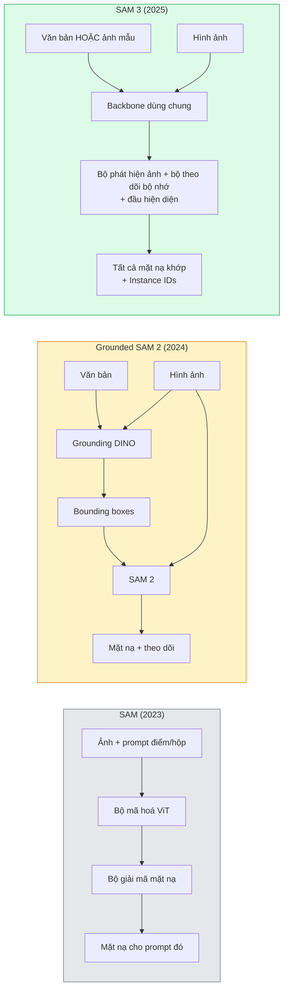

# SAM 3 & Phân Đoạn Theo Từ Vựng Mở (SAM 3 & Open-Vocabulary Segmentation)

> Đưa cho mô hình một câu lệnh văn bản và một bức ảnh, bạn sẽ nhận lại mặt nạ (masks) cho mọi đối tượng phù hợp. SAM 3 đã biến toàn bộ quy trình đó thành một lượt truyền xuôi duy nhất.

**Type:** Use + Build
**Languages:** Python
**Prerequisites:** Phase 4 Lesson 07 (U-Net), Phase 4 Lesson 08 (Mask R-CNN), Phase 4 Lesson 18 (CLIP)
**Time:** ~60 phút

## Learning Objectives

- Phân biệt SAM (chỉ nhận câu lệnh thị giác bằng điểm/hộp), Grounded SAM / SAM 2 (bộ phát hiện hộp + SAM), và SAM 3 (nhận trực tiếp câu lệnh văn bản thông qua Phân đoạn Khái niệm theo Câu lệnh - Promptable Concept Segmentation)
- Giải thích kiến trúc của SAM 3: backbone dùng chung + bộ phát hiện hình ảnh + bộ theo dõi video dựa trên bộ nhớ + đầu hiện diện (presence head) + thiết kế tách rời giữa bộ phát hiện và bộ theo dõi
- Sử dụng tích hợp SAM 3 trong thư viện `transformers` của Hugging Face cho các bài toán phát hiện, phân đoạn và theo dõi đối tượng video theo câu lệnh văn bản
- Lựa chọn tối ưu giữa SAM 3, Grounded SAM 2, YOLO-World, và SAM-MI dựa trên yêu cầu độ trễ, độ phức tạp của khái niệm và môi trường triển khai thực tế

## The Problem

Phiên bản SAM năm 2023 là một mô hình chỉ nhận câu lệnh thị giác: bạn nhấp chuột vào một điểm hoặc vẽ một bounding box và mô hình trả về mặt nạ phân đoạn. Để thực hiện yêu cầu "hãy phân đoạn tất cả các quả cam trong bức ảnh này", bạn cần một bộ phát hiện (như Grounding DINO) để sinh ra các hộp toạ độ trước, sau đó đưa từng hộp vào SAM để phân đoạn. Grounded SAM đã xâu chuỗi chúng thành một quy trình, nhưng đó là sự ghép nối của hai mô hình đóng băng (frozen) riêng biệt với sự tích tụ sai số không thể tránh khỏi giữa các khâu.

SAM 3 (Meta, tháng 11/2025, ICLR 2026) đã xoá bỏ hoàn toàn quy trình ghép nối này. Mô hình nhận trực tiếp một cụm danh từ ngắn hoặc một hình ảnh mẫu đại diện làm câu lệnh và trả về tất cả các mặt nạ phân đoạn kèm định danh cá thể (instance IDs) phù hợp trong một lượt truyền xuôi duy nhất. Đó chính là **Phân đoạn Khái niệm theo Câu lệnh (Promptable Concept Segmentation - PCS)**. Kết hợp với bản cập nhật Object Multiplex vào tháng 3/2026 (SAM 3.1), mô hình có thể theo dõi đồng thời nhiều cá thể thuộc cùng một khái niệm xuyên suốt video với hiệu năng vượt trội.

Bài học này làm rõ sự dịch chuyển mang tính cấu trúc: phân đoạn 2D, phát hiện vật thể và căn chỉnh văn bản-hình ảnh đã được hợp nhất vào một mô hình duy nhất. Câu hỏi đặt ra trong sản xuất không còn là "tôi nên kết nối các mắt xích nào trong pipeline" mà là "mô hình promptable nào xử lý trọn vẹn trường hợp sử dụng của tôi từ đầu đến cuối".

## The Concept

### Ba thế hệ phát triển



### Phân đoạn Khái niệm theo Câu lệnh (Promptable Concept Segmentation - PCS)

Một "câu lệnh khái niệm" (concept prompt) là một cụm danh từ ngắn (`"xe buýt trường học màu vàng"`, `"chiếc ô màu đỏ có sọc"`, `"bàn tay đang cầm cốc"`) hoặc một hình ảnh mẫu đại diện. Mô hình sẽ trả về các mặt nạ phân đoạn cho mọi cá thể trong hình ảnh khớp với khái niệm đó, kèm theo một định danh ID duy nhất cho từng cá thể.

Điều này khác biệt với SAM kinh điển ở ba điểm:

1. Không cần nhấp chuột hay gợi ý hộp cho từng đối tượng — chỉ một câu lệnh văn bản duy nhất trả về toàn bộ các đối tượng khớp.
2. Từ vựng mở (open-vocabulary) — khái niệm có thể là bất kỳ thực thể nào mô tả được bằng ngôn ngữ tự nhiên.
3. Trả về đồng thời nhiều cá thể cùng lúc thay vì chỉ một mặt nạ cho mỗi lần gợi ý.

### Các thành phần kiến trúc then chốt

- **Backbone dùng chung (Shared backbone)** — một mạng ViT duy nhất xử lý hình ảnh đầu vào. Cả đầu phát hiện và đầu theo dõi video đều đọc đặc trưng từ backbone này.
- **Đầu hiện diện (Presence head)** — dự đoán xem khái niệm đó có thực sự tồn tại trong ảnh hay không. Cơ chế này tách biệt câu hỏi "khái niệm có ở đây không?" khỏi câu hỏi "nó nằm ở vị trí nào?". Giúp giảm thiểu tối đa hiện tượng dương tính giả đối với các đối tượng không xuất hiện trong ảnh.
- **Tách rời bộ phát hiện và bộ theo dõi (Decoupled detector-tracker)** — khâu phát hiện trên ảnh tĩnh và khâu theo dõi theo chuỗi video sở hữu các đầu mạng riêng biệt để không gây nhiễu loạn lẫn nhau.
- **Ngân hàng bộ nhớ (Memory bank)** — lưu trữ các đặc trưng của từng cá thể qua các khung hình để phục vụ theo dõi video (cùng cơ chế với SAM 2).

### Huấn luyện ở quy mô khổng lồ

SAM 3 được huấn luyện trên **4 triệu khái niệm độc nhất** được sinh ra bởi một cỗ máy dữ liệu (data engine) tự động gán nhãn và hiệu chỉnh lặp đi lặp lại nhờ kết hợp AI + chuyên gia thẩm định. Bộ tiêu chuẩn đánh giá mới **SA-CO benchmark** chứa tới 270.000 khái niệm độc nhất, lớn gấp 50 lần so với mọi benchmark phân đoạn từ vựng mở trước đó. SAM 3 đạt 75-80% hiệu năng của con người trên SA-CO và vượt gấp đôi các hệ thống trước đây trên tác vụ PCS cho cả hình ảnh và video.

### SAM 3.1 và cơ chế Object Multiplex

Bản cập nhật tháng 3/2026: **Object Multiplex** giới thiệu cơ chế chia sẻ bộ nhớ để theo dõi đồng thời nhiều cá thể thuộc cùng một khái niệm. Trước đây, theo dõi $N$ cá thể đồng nghĩa với việc duy trì $N$ ngân hàng bộ nhớ tách biệt. Multiplex gom tất cả vào một bộ nhớ chia sẻ duy nhất với các truy vấn riêng cho từng cá thể. Kết quả: tốc độ theo dõi đa đối tượng tăng vọt mà không làm suy giảm độ chính xác.

### Khi nào Grounded SAM vẫn hữu ích vào năm 2026?

- Khi bạn muốn thay thế một bộ phát hiện từ vựng mở chuyên biệt cụ thể (DINO-X, Florence-2).
- Khi giấy phép sử dụng của SAM 3 (bị kiểm soát quyền truy cập trên Hugging Face) là rào cản pháp lý của doanh nghiệp bạn.
- Khi bạn cần kiểm soát ngưỡng phát hiện một cách chi tiết và thủ công hơn mức SAM 3 cung cấp.
- Khi thực hiện các nghiên cứu thử nghiệm thành phần (ablation studies) trên mô-đun phát hiện.

Các đường ống mô-đun hoá vẫn có chỗ đứng riêng. Nhưng đối với hầu hết các bài toán thực tế trong sản xuất, SAM 3 là câu trả lời tinh gọn và mạnh mẽ hơn.

### So sánh YOLO-World và SAM 3

- **YOLO-World** — chỉ phát hiện từ vựng mở dưới dạng bounding box (không có mặt nạ phân đoạn). Chạy theo thời gian thực (real-time). Lựa chọn tối ưu khi bạn cần toạ độ hộp ở tốc độ khung hình cao (FPS cao).
- **SAM 3** — phân đoạn toàn diện từng điểm ảnh + theo dõi video. Tốc độ chậm hơn nhưng thông tin đầu ra chi tiết hơn nhiều.

Quy tắc phân chia: Dùng YOLO-World cho các pipeline chỉ cần hộp với tốc độ cao (điều hướng robot, dashboard giám sát), dùng SAM 3 cho mọi tác vụ cần mặt nạ chính xác hoặc theo dõi chi tiết.

### Tối ưu hiệu năng với SAM-MI

SAM-MI (2025-2026) giải quyết nút thắt cổ chai ở bộ giải mã của SAM bằng các kỹ thuật:

- **Sparse point prompting** — dùng một vài điểm thưa được chọn lọc kỹ thay vì câu lệnh dày đặc; giảm 96% số lần gọi decoder.
- **Shallow mask aggregation** — gộp các mặt nạ thô thành một mặt nạ sắc nét duy nhất.
- **Decoupled mask injection** — decoder nhận trực tiếp các đặc trưng mặt nạ đã tính toán trước thay vì phải chạy lại từ đầu.

Kết quả: tăng tốc ~1.6× so với Grounded-SAM trên các bài đánh giá từ vựng mở.

### Định dạng đầu ra thống nhất

Cả ba mô hình đều trả về cấu trúc chung tương đương (boxes + nhãn + điểm tin cậy + masks + IDs). Điều này rất thuận lợi vì mã nguồn xử lý hạ nguồn của bạn không cần phân nhánh logic phức tạp tuỳ theo mô hình nền tảng.

```figure
cv3-open-vocab
```

## Build It

### Bước 1: Xây dựng câu lệnh khái niệm (Prompt construction)

Xây dựng hàm trợ giúp chuyển đổi câu văn của người dùng thành danh sách các khái niệm cho SAM 3. Đây là ranh giới tiếp giáp giữa "những gì người dùng nhập" và "những gì mô hình tiêu thụ".

```python
def split_concepts(sentence):
    """
    Hàm phân tách heuristic cho các câu lệnh đa khái niệm.
    Trả về danh sách các cụm danh từ ngắn.
    """
    for sep in [",", ";", "and", "or", "&"]:
        if sep in sentence:
            parts = [p.strip() for p in sentence.replace("and ", ",").split(",")]
            return [p for p in parts if p]
    return [sentence.strip()]

print(split_concepts("cats, dogs and balloons"))
```

SAM 3 nhận một khái niệm cho mỗi lượt truyền xuôi; với các câu truy vấn đa khái niệm, ta chạy vòng lặp hoặc đưa vào theo batch.

### Bước 2: Hàm tiện ích hậu xử lý (Post-processing)

Chuyển đổi kết quả thô của SAM 3 thành danh sách các phát hiện rõ ràng, tuân thủ đúng hợp đồng kiến trúc của Bài học 16.

```python
from dataclasses import dataclass
from typing import List

@dataclass
class ConceptDetection:
    concept: str
    instance_id: int
    box: tuple          # (x1, y1, x2, y2)
    score: float
    mask_rle: str       # mã hoá độ dài dòng chạy run-length

def rle_encode(binary_mask):
    flat = binary_mask.flatten().astype("uint8")
    runs = []
    prev, count = flat[0], 0
    for v in flat:
        if v == prev:
            count += 1
        else:
            runs.append((int(prev), count))
            prev, count = v, 1
    runs.append((int(prev), count))
    return ";".join(f"{v}x{c}" for v, c in runs)
```

Mã hoá RLE giữ cho kích thước dữ liệu truyền tải cực kỳ gọn nhẹ ngay cả với hàng chục mặt nạ độ phân giải cao. Cùng một định dạng này hoạt động đồng nhất trên SAM 2, SAM 3 và Grounded SAM 2.

### Bước 3: Giao diện phân đoạn từ vựng mở thống nhất

Bao bọc bất kỳ backend nào (SAM 3, Grounded SAM 2, YOLO-World + SAM 2) đằng sau một phương thức trừu tượng duy nhất. Mã nguồn tầng dưới của bạn sẽ không bao giờ bị ảnh hưởng khi bạn thay đổi mô hình nền tảng.

```python
from abc import ABC, abstractmethod
import numpy as np

class OpenVocabSeg(ABC):
    @abstractmethod
    def detect(self, image: np.ndarray, concept: str) -> List[ConceptDetection]:
        ...

class StubOpenVocabSeg(OpenVocabSeg):
    """
    Bộ giả lập xác định dùng để kiểm thử quy trình khi chưa tải mô hình nặng thực tế.
    """
    def detect(self, image, concept):
        h, w = image.shape[:2]
        return [
            ConceptDetection(
                concept=concept,
                instance_id=0,
                box=(w * 0.2, h * 0.3, w * 0.5, h * 0.8),
                score=0.89,
                mask_rle="0x100;1x50;0x200",
            ),
            ConceptDetection(
                concept=concept,
                instance_id=1,
                box=(w * 0.55, h * 0.25, w * 0.85, h * 0.75),
                score=0.74,
                mask_rle="0x80;1x40;0x220",
            ),
        ]
```

Lớp triển khai thực tế `SAM3OpenVocabSeg` sẽ bao bọc trực tiếp `transformers.Sam3Model` và `Sam3Processor`.

### Bước 4: Tham chiếu sử dụng SAM 3 qua Hugging Face

Với mô hình thực tế, đoạn mã tích hợp qua `transformers`:

```python
from transformers import Sam3Processor, Sam3Model
import torch

processor = Sam3Processor.from_pretrained("facebook/sam3")
model = Sam3Model.from_pretrained("facebook/sam3").eval()

inputs = processor(images=pil_image, return_tensors="pt")
inputs = processor.set_text_prompt(inputs, "yellow school bus")

with torch.no_grad():
    outputs = model(**inputs)

masks = processor.post_process_masks(
    outputs.masks, inputs.original_sizes, inputs.reshaped_input_sizes
)
boxes = outputs.boxes
scores = outputs.scores
```

Một câu lệnh duy nhất, trả về toàn bộ kết quả phân đoạn chỉ trong một lệnh gọi.

### Bước 5: Đánh giá so sánh thực tế

Một đánh giá khách quan: điều gì xảy ra khi bạn thay thế Grounded SAM 2 bằng SAM 3 trong quy trình thực tế?

- Độ trễ: SAM 3 tiết kiệm được một lượt truyền xuôi (không cần mô hình phát hiện riêng), nhưng bản thân mô hình nặng hơn; tổng thể thời gian thường tương đương hoặc nhanh hơn một chút.
- Độ chính xác: SAM 3 vượt trội rõ rệt trên các khái niệm hiếm hoặc mang tính kết hợp ngữ nghĩa phức tạp ("chiếc ô màu đỏ có sọc"). Tương đương nhau trên các danh từ đơn giản phổ biến.
- Độ linh hoạt: Grounded SAM 2 cho phép bạn tuỳ ý thay đổi các bộ phát hiện (DINO-X, Florence-2, Grounding DINO 1.5); trong khi SAM 3 là một khối nguyên khối (monolithic).

Kết luận: SAM 3 là lựa chọn mặc định hàng đầu năm 2026 cho phân đoạn từ vựng mở. Grounded SAM 2 vẫn là giải pháp chuẩn mực khi bạn cần sự linh hoạt tối đa về detector hoặc các ràng buộc bản quyền khắt khe.

## Use It

Các mô hình triển khai phổ biến trong sản xuất:

- **Gán nhãn dữ liệu thời gian thực** — Kết hợp SAM 3 với tính năng câu lệnh văn bản của CVAT. Người gán nhãn chỉ cần chọn tên nhãn; SAM 3 tự động gắn trước mặt nạ cho mọi cá thể phù hợp để con người kiểm tra và hiệu chỉnh.
- **Phân tích dữ liệu video** — Sử dụng cơ chế SAM 3.1 Object Multiplex để theo dõi đa đối tượng xuyên suốt các khung hình.
- **Robot học** — SAM 3 phục vụ thao tác gắp thả theo từ vựng mở ("nhặt chiếc cốc màu đỏ"); đóng vai trò là một khối chức năng nguyên thuỷ trong lập kế hoạch hành động.
- **Chẩn đoán hình ảnh y tế** — Tinh chỉnh SAM 3 trên các khái niệm giải phẫu chuyên ngành; yêu cầu đăng ký quyền truy cập trên Hugging Face.

Thư viện Ultralytics tích hợp trực tiếp SAM 3:

```python
from ultralytics import SAM

model = SAM("sam3.pt")
results = model(image_path, prompts="yellow school bus")
```

Cùng một giao diện đồng nhất với YOLO và SAM 2.

## Ship It

Bài học này tạo ra:

- `outputs/prompt-open-vocab-stack-picker.md` — một câu lệnh prompt giúp lựa chọn giữa SAM 3 / Grounded SAM 2 / YOLO-World / SAM-MI dựa trên độ trễ, độ phức tạp của khái niệm và giấy phép sử dụng.
- `outputs/skill-concept-prompt-designer.md` — một kỹ năng chuyển đổi câu nói tự nhiên của người dùng thành các câu lệnh khái niệm chuẩn xác cho SAM 3 (phân tách, gỡ bỏ nhập nhằng, cơ chế dự phòng).

## Exercises

1. **(Dễ)** Chạy SAM 3 trên 10 hình ảnh với các câu lệnh khái niệm tự chọn. So sánh kết quả với SAM 2 + Grounding DINO 1.5 trên cùng tập ảnh. Báo cáo các khái niệm mà mỗi mô hình bỏ sót.
2. **(Trung bình)** Xây dựng giao diện tương tác "nhấp để giữ lại / nhấp để loại bỏ" trên nền SAM 3: câu lệnh văn bản trả về các cá thể ứng viên; người dùng nhấp chuột để chọn đối tượng hợp lệ. Xuất tập hợp khái niệm cuối cùng dưới dạng JSON.
3. **(Khó)** Tinh chỉnh (fine-tune) SAM 3 trên một tập khái niệm tuỳ chỉnh (ví dụ: 5 loại linh kiện điện tử) với 20 ảnh có nhãn cho mỗi loại. So sánh độ chính xác IoU của mặt nạ với SAM 3 nguyên bản ở chế độ zero-shot trên tập kiểm thử.

## Key Terms

| Thuật ngữ | Cách gọi thông thường | Bản chất kỹ thuật thực sự |
|-----------|----------------------|---------------------------|
| Open-vocabulary segmentation | "Phân đoạn bằng văn bản" | Tạo mặt nạ cho các đối tượng được mô tả bằng ngôn ngữ tự nhiên, không bị giới hạn trong tập nhãn cố định |
| PCS | "Phân đoạn khái niệm theo câu lệnh" | Tác vụ cốt lõi của SAM 3 — nhận một cụm danh từ hoặc ảnh mẫu và phân đoạn toàn bộ các cá thể khớp |
| Concept prompt | "Câu lệnh khái niệm" | Cụm danh từ ngắn hoặc hình ảnh mẫu đại diện; không phải là một câu văn hoàn chỉnh dài dòng |
| Presence head | "Có ở đây không?" | Mô-đun trong SAM 3 quyết định xem khái niệm có xuất hiện trong ảnh hay không trước khi thực hiện định vị |
| SA-CO | "Benchmark của SAM 3" | Bộ kiểm thử phân đoạn từ vựng mở với 270.000 khái niệm độc nhất; quy mô gấp 50 lần các benchmark trước đây |
| Object Multiplex | "Nâng cấp SAM 3.1" | Cơ chế chia sẻ bộ nhớ giúp theo dõi đồng thời nhiều cá thể của cùng một khái niệm với tốc độ cao |
| Grounded SAM 2 | "Đường ống mô-đun" | Ghép nối giữa bộ phát hiện và SAM 2; vẫn quan trọng khi cần linh hoạt hoán đổi detector |
| SAM-MI | "Biến thể SAM tối ưu" | Kỹ thuật Mask Injection giúp tăng tốc 1.6x so với Grounded-SAM |

## Further Reading

- [SAM 3: Segment Anything with Concepts (arXiv 2511.16719)](https://arxiv.org/abs/2511.16719)
- [SAM 3.1 Object Multiplex (Meta AI, March 2026)](https://ai.meta.com/blog/segment-anything-model-3/)
- [SAM 3 model page on Hugging Face](https://huggingface.co/facebook/sam3)
- [Grounded SAM 2 tutorial (PyImageSearch)](https://pyimagesearch.com/2026/01/19/grounded-sam-2-from-open-set-detection-to-segmentation-and-tracking/)
- [Ultralytics SAM 3 docs](https://docs.ultralytics.com/models/sam-3/)
- [SAM3-I: Instruction-aware SAM (arXiv 2512.04585)](https://arxiv.org/abs/2512.04585)

