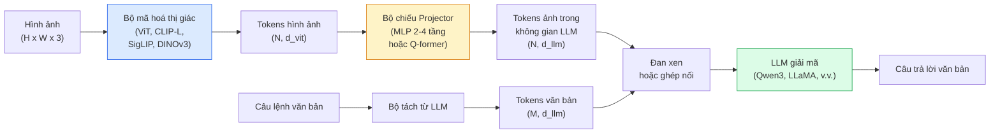

# Mô Hình Thị Giác-Ngôn Ngữ — Mẫu Thiết Kế ViT-MLP-LLM (Vision-Language Models — The ViT-MLP-LLM Pattern)

> Một bộ mã hoá thị giác chuyển đổi hình ảnh thành các token. Một bộ chiếu MLP (MLP projector) ánh xạ các token đó vào không gian nhúng của LLM. Một mô hình ngôn ngữ lớn làm phần còn lại. Mẫu thiết kế đó — ViT-MLP-LLM — là nền tảng của mọi mô hình VLM thương mại năm 2026.

**Type:** Learn + Use
**Languages:** Python
**Prerequisites:** Phase 4 Lesson 14 (ViT), Phase 4 Lesson 18 (CLIP), Phase 7 Lesson 02 (Self-Attention)
**Time:** ~75 phút

## Learning Objectives

- Trình bày kiến trúc ViT-MLP-LLM và giải thích vai trò đóng góp của từng thành phần trong bộ ba này
- So sánh Qwen3-VL, InternVL3.5, LLaVA-Next, và GLM-4.6V về số lượng tham số, độ dài ngữ cảnh và hiệu năng trên các bảng xếp hạng chuẩn
- Giải thích cơ chế DeepStack: tại sao việc lấy đặc trưng ViT từ nhiều tầng độ sâu giúp tăng cường sự căn chỉnh thị giác-ngôn ngữ chặt chẽ hơn so với chỉ lấy đặc trưng tầng cuối cùng
- Đo lường hiện tượng ảo giác (hallucination) của VLM trong môi trường sản xuất bằng Tỷ lệ Lỗi Xuyên Phương thức (Cross-Modal Error Rate - CMER) và đưa ra quyết định xử lý phù hợp

## The Problem

CLIP (Bài 18) cung cấp cho bạn một không gian nhúng chung cho cả hình ảnh và văn bản, đủ tốt cho tác vụ phân loại zero-shot và truy vấn tương đồng. Tuy nhiên, CLIP không thể trả lời câu hỏi "có bao nhiêu chiếc xe hơi màu đỏ trong bức ảnh này?" bởi vì CLIP không có khả năng sinh văn bản — nó chỉ chấm điểm độ tương đồng.

Các Mô hình Thị giác-Ngôn ngữ (Vision-Language Models - VLM) — như Qwen3-VL, InternVL3.5, LLaVA-Next, GLM-4.6V — gắn kết một bộ mã hoá hình ảnh thuộc họ CLIP với một mô hình ngôn ngữ hoàn chỉnh. Mô hình tiếp nhận hình ảnh kèm theo một câu hỏi và tự động tạo ra câu trả lời chi tiết. Vào năm 2026, các mô hình VLM mã nguồn mở đã sánh ngang hoặc thậm chí vượt qua cả GPT-5 và Gemini-2.5-Pro trên các bộ kiểm chuẩn đa phương thức khắt khe (MMMU, MMBench, DocVQA, ChartQA, MathVista, OSWorld).

Bộ ba thành phần (ViT, projector, LLM) là tiêu chuẩn bất biến. Sự khác biệt giữa các dòng mô hình chủ yếu nằm ở việc chọn ViT nào, projector kiến trúc gì, LLM nền tảng nào, tập dữ liệu huấn luyện và công thức căn chỉnh (alignment recipe). Một khi bạn nắm vững mẫu thiết kế này, việc hoán đổi bất kỳ thành phần nào cũng trở nên đơn giản và mang tính máy móc.

## The Concept

### Kiến trúc ViT-MLP-LLM



1. **Bộ mã hoá thị giác (Vision encoder)** — một mạng ViT huấn luyện sẵn (CLIP-L/14, SigLIP, DINOv3 hoặc biến thể tinh chỉnh). Trích xuất các token mảng (patch tokens).
2. **Bộ chiếu (Projector)** — một mô-đun nhỏ (mạng MLP 2-4 tầng, hoặc Q-former) ánh xạ các token thị giác vào số chiều không gian nhúng của LLM. Đây là nơi diễn ra phần lớn quá trình huấn luyện tinh chỉnh.
3. **Mô hình ngôn ngữ lớn (LLM)** — một mô hình ngôn ngữ chỉ giải mã (decoder-only LLM như Qwen3, Llama, Mistral, GLM, InternLM). Đọc chuỗi kết hợp gồm token thị giác + token văn bản và sinh văn bản tự hồi quy.

Về mặt nguyên lý, cả ba thành phần đều có thể huấn luyện được. Trên thực tế, bộ mã hoá thị giác và LLM phần lớn được đóng băng (freeze) trong khi chỉ huấn luyện bộ chiếu — mang lại tín hiệu căn chỉnh mạnh mẽ với chi phí tính toán cực kỳ tiết kiệm.

### Cơ chế DeepStack

Kiểu chiếu thông thường chỉ sử dụng đặc trưng từ tầng cuối cùng của ViT. DeepStack (áp dụng trong Qwen3-VL) lấy mẫu đặc trưng từ nhiều tầng độ sâu khác nhau của ViT và xếp chồng chúng lại. Các tầng sâu mang ngữ nghĩa trừu tượng cấp cao; các tầng nông mang thông tin không gian và chi tiết bề mặt mịn. Đưa cả hai tầng thông tin này vào LLM giúp xoá bỏ khoảng cách giữa "bức ảnh chứa đối tượng gì" (ngữ nghĩa) và "đối tượng nằm chính xác ở đâu" (định vị không gian).

### Ba giai đoạn huấn luyện (Three training stages)

Các mô hình VLM hiện đại được huấn luyện qua ba giai đoạn:

1. **Căn chỉnh (Alignment)** — đóng băng ViT và LLM. Chỉ huấn luyện bộ chiếu trên các cặp ảnh-chú thích. Dạy cho bộ chiếu cách ánh xạ không gian thị giác sang không gian ngôn ngữ.
2. **Tiền huấn luyện (Pre-training)** — mở đóng băng toàn bộ mạng. Huấn luyện trên dữ liệu ảnh-văn bản đan xen quy mô lớn (hơn 500 triệu cặp). Xây dựng tri thức thị giác toàn diện cho mô hình.
3. **Tinh chỉnh theo chỉ dẫn (Instruction tuning)** — tinh chỉnh trên tập dữ liệu chọn lọc gồm các bộ ba (ảnh, câu hỏi, câu trả lời). Rèn luyện hành vi hội thoại và định dạng tác vụ mong muốn. Đây là bước biến một mô hình ngôn ngữ nhận biết thị giác thành một trợ lý AI hữu ích.

Hầu hết các kỹ thuật tinh chỉnh LoRA trong thực tế đều nhắm vào giai đoạn 3 với một tập dữ liệu gán nhãn vừa phải.

### So sánh các dòng mô hình (đầu năm 2026)

| Mô hình | Tham số | Bộ mã hoá thị giác | LLM | Ngữ cảnh | Thế mạnh nổi bật |
|---------|---------|-------------------|-----|----------|-------------------|
| Qwen3-VL-235B-A22B (MoE) | 235B (22B kích hoạt) | ViT tuỳ chỉnh + DeepStack | Qwen3 | 256K | SOTA tổng quát, GUI agent |
| Qwen3-VL-30B-A3B (MoE) | 30B (3B kích hoạt) | ViT tuỳ chỉnh + DeepStack | Qwen3 | 256K | Lựa chọn MoE nhỏ gọn hơn |
| Qwen3-VL-8B (dense) | 8B | ViT tuỳ chỉnh | Qwen3 | 128K | Tiêu chuẩn dày đặc cho sản xuất |
| InternVL3.5-38B | 38B | InternViT-6B | Qwen3 + GPT-OSS | 128K | MMBench / MMVet rất mạnh |
| InternVL3.5-241B-A28B | 241B (28B kích hoạt) | InternViT-6B | Qwen3 | 128K | Cạnh tranh sòng phẳng với GPT-4o |
| LLaVA-Next 72B | 72B | SigLIP | Llama-3 | 32K | Mã nguồn mở, rất dễ tinh chỉnh |
| GLM-4.6V | ~70B | Tuỳ chỉnh | GLM | 64K | Mã nguồn mở, OCR xuất sắc |
| MiniCPM-V-2.6 | 8B | SigLIP | MiniCPM | 32K | Tối ưu cho thiết bị biên (Edge) |

### Tác tử thị giác (Visual agents)

Qwen3-VL-235B đạt hiệu năng hàng đầu thế giới trên OSWorld — bộ kiểm chuẩn dành cho **các tác tử thị giác** điều khiển giao diện người dùng GUI (máy tính để bàn, điện thoại, trình duyệt web). Mô hình quan sát ảnh chụp màn hình, hiểu cấu trúc UI và phát ra các hành động cụ thể (nhấp chuột, gõ phím, cuộn trang). Kết hợp với các công cụ ngoài, nó thực hiện trọn vẹn các tác vụ phức tạp trên máy tính. Đây chính là công nghệ cốt lõi vận hành bên dưới hầu hết các bản demo "AI PC" năm 2026.

### Khả năng tác tử & Biến thể RoPE

VLM cần hiểu rõ **thời điểm** xuất hiện của một khung hình trong video. Qwen3-VL đã tiến hoá từ T-RoPE (nhúng vị trí xoay theo thời gian) sang **căn chỉnh thời gian bằng văn bản (text-based time alignment)** — chèn các token văn bản mốc thời gian rõ ràng xen kẽ giữa các khung hình video. Mô hình nhìn thấy chuỗi dạng "`<timestamp 00:32>` frame, câu hỏi" và từ đó suy luận chính xác về các mối quan hệ thời gian.

### Vấn đề căn chỉnh và ảo giác

Khoảng 12% các cặp ảnh-văn bản thu thập từ web chứa các mô tả không hoàn toàn ăn khớp với nội dung thực tế trong ảnh. Một mô hình VLM học trên dữ liệu này sẽ âm thầm học cách tạo ảo giác (hallucination) — bịa đặt vật thể, đọc sai số liệu, thêu dệt các mối quan hệ không có thật. Trong môi trường sản xuất, đây là nguyên nhân gây lỗi nghiêm trọng nhất.

Skywork.ai đã đề xuất chỉ số **Tỷ lệ Lỗi Xuyên Phương thức (Cross-Modal Error Rate - CMER)** để giám sát hiện tượng này:

```text
CMER = tỷ lệ các kết quả đầu ra có độ tin cậy văn bản cao nhưng độ tương đồng ảnh-văn bản (qua mô hình kiểm tra họ CLIP) lại thấp
```

CMER cao đồng nghĩa với việc mô hình đang tự tin khẳng định những điều không hề tồn tại trong ảnh. Việc giám sát CMER như một chỉ số KPI vận hành sản xuất đã giúp giảm tỷ lệ ảo giác tới ~35% trong hệ thống thực tế của họ. Chiến lược khôn ngoan không phải là cố gắng "sửa chữa mô hình hoàn hảo" mà là "chuyển hướng các kết quả có CMER cao sang cho con người thẩm định".

### Tinh chỉnh với LoRA / QLoRA

Huấn luyện toàn diện một mô hình VLM 70B nằm ngoài khả năng tài chính của hầu hết các đội ngũ. Sử dụng LoRA (rank 16-64) trên các tầng attention + projector, hoặc QLoRA với trọng số cơ sở 4-bit có thể chạy vừa vặn trên một GPU A100 / H100 duy nhất. Chi phí: 5.000 đến 50.000 mẫu dữ liệu, 100$ - 5.000$ chi phí điện toán đám mây và 2-10 giờ huấn luyện.

### Suy luận không gian vẫn là điểm yếu

Các mô hình VLM hiện tại chỉ đạt 50-60% trên các bài kiểm tra suy luận không gian (trên-dưới, trái-phải, đếm số lượng, ước lượng khoảng cách). Nếu trường hợp sử dụng của bạn phụ thuộc sống còn vào việc "vật thể nào nằm đè lên vật thể nào", hãy kiểm tra và đánh giá cẩn trọng — khả năng suy luận không gian tổng quát của VLM hiện vẫn dưới mức con người. Các giải pháp thay thế vượt trội hơn VLM cho các tác vụ thuần không gian: mô hình ước lượng tư thế/điểm then chốt chuyên biệt, mô hình ước lượng bản đồ độ sâu, hoặc mô hình phát hiện vật thể kết hợp xử lý hậu kỳ hình học bounding box.

```figure
v4-vlm-projector
```

## Build It

### Bước 1: Bộ chiếu Projector

Thành phần bạn sẽ huấn luyện thường xuyên nhất. Mạng MLP 2-4 tầng kèm hàm kích hoạt GELU.

```python
import torch
import torch.nn as nn


class Projector(nn.Module):
    def __init__(self, vit_dim=768, llm_dim=4096, hidden=4096):
        super().__init__()
        self.net = nn.Sequential(
            nn.Linear(vit_dim, hidden),
            nn.GELU(),
            nn.Linear(hidden, llm_dim),
        )

    def forward(self, x):
        return self.net(x)
```

Đầu vào là tensor token kích thước `(N_patches, d_vit)`. Đầu ra là `(N_patches, d_llm)`. LLM xem mỗi hàng đầu ra như một token bình thường trong chuỗi ngữ cảnh.

### Bước 2: Ghép nối mô hình ViT-MLP-LLM hoàn chỉnh

Bộ khung truyền xuôi cho một mô hình VLM tối giản. Mã nguồn thực tế sử dụng `transformers`; đây là cấu trúc minh hoạ trực quan bản chất logic.

```python
class MinimalVLM(nn.Module):
    def __init__(self, vit, projector, llm, image_token_id):
        super().__init__()
        self.vit = vit
        self.projector = projector
        self.llm = llm
        self.image_token_id = image_token_id  # token giữ chỗ trong câu lệnh văn bản

    def forward(self, image, input_ids, attention_mask):
        # 1. Trích xuất đặc trưng thị giác
        vision_tokens = self.vit(image)                     # (B, N_patches, d_vit)
        vision_embeds = self.projector(vision_tokens)       # (B, N_patches, d_llm)

        # 2. Vector nhúng văn bản
        text_embeds = self.llm.get_input_embeddings()(input_ids)  # (B, M, d_llm)

        # 3. Thay thế token giữ chỗ hình ảnh bằng vector nhúng thị giác
        merged = self._merge(text_embeds, vision_embeds, input_ids)

        # 4. Chạy LLM
        return self.llm(inputs_embeds=merged, attention_mask=attention_mask)

    def _merge(self, text_embeds, vision_embeds, input_ids):
        out = text_embeds.clone()
        expected = vision_embeds.size(1)
        for b in range(input_ids.size(0)):
            positions = (input_ids[b] == self.image_token_id).nonzero(as_tuple=True)[0]
            if len(positions) != expected:
                raise ValueError(
                    f"mẫu batch {b} có {len(positions)} token ảnh nhưng vision_embeds lại có {expected} patches."
                    " Mọi mẫu trong batch phải được đệm (pad) trước về cùng số lượng token giữ chỗ ảnh.")
            out[b, positions] = vision_embeds[b]
        return out
```

Token giữ chỗ `<image>` trong văn bản được thay thế trực tiếp bằng các vector nhúng hình ảnh thực tế — đây chính xác là cơ chế mà LLaVA, Qwen-VL và InternVL đang vận hành.

### Bước 3: Tính toán chỉ số CMER

Hàm kiểm tra nhẹ nhàng chạy tại thời gian thực (runtime).

```python
import torch.nn.functional as F


def cross_modal_error_rate(image_emb, text_emb, text_confidence, sim_threshold=0.25, conf_threshold=0.8):
    """
    image_emb, text_emb: vector nhúng của ảnh và văn bản sinh ra (được chuẩn hoá nội bộ)
    text_confidence:     xác suất trung bình trên mỗi token trong đoạn [0, 1]
    Trả về:              tỷ lệ các đầu ra có độ tin cậy cao nhưng độ căn chỉnh ảnh-văn bản thấp
    """
    image_emb = F.normalize(image_emb, dim=-1)
    text_emb = F.normalize(text_emb, dim=-1)
    sim = (image_emb * text_emb).sum(dim=-1)        # độ tương đồng cosine
    high_conf_low_sim = (text_confidence > conf_threshold) & (sim < sim_threshold)
    return high_conf_low_sim.float().mean().item()
```

Hãy coi CMER là chỉ số KPI trong sản xuất. Theo dõi nó theo từng endpoint, từng loại câu lệnh prompt và từng phân khúc khách hàng. Khi CMER tăng đột biến, điều đó báo hiệu mô hình bắt đầu bị ảo giác trên một phân phối dữ liệu mới.

### Bước 4: Bộ phân loại VLM mô phỏng có thể chạy ngay

Chứng minh bộ chiếu projector thực sự học được. Các đặc trưng ViT giả lập được đưa vào; một token kiểu LLM thu nhỏ dự đoán phân lớp đối tượng.

```python
class ToyVLM(nn.Module):
    def __init__(self, vit_dim=32, llm_dim=64, num_classes=5):
        super().__init__()
        self.projector = Projector(vit_dim, llm_dim, hidden=64)
        self.head = nn.Linear(llm_dim, num_classes)

    def forward(self, vision_tokens):
        projected = self.projector(vision_tokens)
        pooled = projected.mean(dim=1)
        return self.head(pooled)
```

Bạn có thể huấn luyện khớp mạng này trên các cặp tổng hợp (đặc trưng, lớp) chỉ trong chưa đầy 200 bước — đủ để chứng minh cơ chế ánh xạ của projector hoạt động hiệu quả.

## Use It

Ba phương thức triển khai VLM phổ biến trong sản xuất năm 2026:

- **API Đám mây có sẵn** — OpenAI Vision, Anthropic Claude Vision, Google Gemini Vision. Không cần hạ tầng, nhưng phụ thuộc nhà cung cấp.
- **Tự lưu trữ mã nguồn mở (Self-host)** — Chạy Qwen3-VL hoặc InternVL3.5 thông qua `transformers` và `vllm`. Kiểm soát tuyệt đối, nhưng tốn công vận hành hạ tầng ban đầu.
- **Tinh chỉnh chuyên ngành (Fine-tune)** — Tải Qwen2.5-VL-7B hoặc LLaVA-1.6-7B, áp dụng LoRA trên 5.000 - 50.000 ví dụ thực tế của doanh nghiệp, triển khai qua `vllm` hoặc `TGI`.

```python
from transformers import AutoProcessor, AutoModelForVision2Seq
import torch
from PIL import Image

model_id = "Qwen/Qwen3-VL-8B-Instruct"
processor = AutoProcessor.from_pretrained(model_id)
model = AutoModelForVision2Seq.from_pretrained(model_id, torch_dtype=torch.bfloat16, device_map="auto")

messages = [{
    "role": "user",
    "content": [
        {"type": "image", "image": Image.open("plot.png")},
        {"type": "text", "text": "Biểu đồ này hiển thị nội dung gì?"},
    ],
}]
inputs = processor.apply_chat_template(messages, add_generation_prompt=True, tokenize=True, return_dict=True, return_tensors="pt").to("cuda")
generated = model.generate(**inputs, max_new_tokens=256)
answer = processor.decode(generated[0][inputs["input_ids"].shape[1]:], skip_special_tokens=True)
```

`apply_chat_template` tự động xử lý token hoá cho token giữ chỗ `<image>`; mô hình sẽ tự quản lý khâu ghép nối bên trong.

## Ship It

Bài học này tạo ra:

- `outputs/prompt-vlm-selector.md` — một câu lệnh prompt giúp lựa chọn giữa Qwen3-VL / InternVL3.5 / LLaVA-Next / API thương mại dựa trên yêu cầu độ chính xác, độ trễ, độ dài ngữ cảnh và ngân sách.
- `outputs/skill-cmer-monitor.md` — kỹ năng tự động tạo mã nguồn thiết lập giám sát chỉ số CMER cho endpoint VLM sản xuất, kèm dashboard và ngưỡng cảnh báo.

## Exercises

1. **(Dễ)** Chạy 3 dạng câu lệnh ("đây là cái gì?", "hãy đếm các vật thể", "mô tả chi tiết khung cảnh") qua một mô hình VLM mở bất kỳ trên 5 hình ảnh. Tự tay chấm điểm từng câu trả lời theo tiêu chí đúng / đúng một phần / ảo giác. Tính toán tỷ lệ lỗi sơ bộ tương tự CMER.
2. **(Trung bình)** Tinh chỉnh Qwen2.5-VL-3B hoặc LLaVA-1.6-7B bằng LoRA (rank 16) trên 500 hình ảnh thuộc miền dữ liệu mục tiêu kèm chú thích. So sánh độ chính xác dạng MMBench giữa phiên bản zero-shot và phiên bản tinh chỉnh.
3. **(Khó)** Thay thế bộ mã hoá hình ảnh của VLM bằng DINOv3 thay vì SigLIP/CLIP mặc định. Huấn luyện lại chỉ riêng bộ chiếu projector (đóng băng cả LLM và DINOv3). Đo lường xem các tác vụ dự đoán dày đặc (đếm số lượng, suy luận không gian) có cải thiện không.

## Key Terms

| Thuật ngữ | Cách gọi thông thường | Bản chất kỹ thuật thực sự |
|-----------|----------------------|---------------------------|
| ViT-MLP-LLM | "Mẫu thiết kế VLM" | Bộ mã hoá thị giác + bộ chiếu + mô hình ngôn ngữ; kiến trúc chuẩn của mọi VLM năm 2026 |
| Projector | "Cầu nối" | Mạng MLP 2-4 tầng (hoặc Q-former) ánh xạ các token thị giác vào không gian nhúng của LLM |
| DeepStack | "Kỹ thuật đặc trưng của Qwen3-VL" | Lấy đặc trưng ViT từ nhiều tầng độ sâu xếp chồng lên nhau thay vì chỉ lấy tầng cuối |
| Image token | "Token giữ chỗ <image>" | Token đặc biệt trong luồng văn bản được thay thế bằng các vector nhúng thị giác sau khi chiếu |
| CMER | "KPI đo ảo giác" | Cross-Modal Error Rate; tăng cao khi độ tin cậy văn bản cao nhưng độ tương đồng ảnh-văn bản thấp |
| Visual agent | "VLM biết tương tác" | VLM thao tác trên giao diện GUI (OSWorld, di động, web) thông qua các lệnh gọi công cụ |
| Q-former | "Cầu nối token số lượng cố định" | Bộ chiếu kiểu BLIP-2 tạo ra một số lượng cố định các token truy vấn thị giác |
| Alignment / pre-training / instruction tuning | "Ba giai đoạn huấn luyện" | Quy trình huấn luyện tiêu chuẩn của các mô hình VLM |

## Further Reading

- [Qwen3-VL Technical Report (arXiv 2511.21631)](https://arxiv.org/abs/2511.21631)
- [InternVL3.5 Advancing Open-Source Multimodal Models (arXiv 2508.18265)](https://arxiv.org/html/2508.18265v1)
- [LLaVA-Next series](https://llava-vl.github.io/blog/2024-05-10-llava-next-stronger-llms/)
- [BentoML: Best Open-Source VLMs 2026](https://www.bentoml.com/blog/multimodal-ai-a-guide-to-open-source-vision-language-models)
- [MMMU: Multi-discipline Multimodal Understanding benchmark](https://mmmu-benchmark.github.io/)
- [VLMs in manufacturing (Robotics Tomorrow, March 2026)](https://www.roboticstomorrow.com/story/2026/03/when-machines-learn-to-see-like-experts-the-rise-of-vision-language-models-in-manufacturing/26335/)

