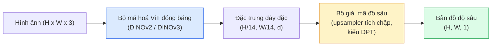

# Ước Lượng Độ Sâu Đơn Mắt & Hình Học Không Gian (Monocular Depth & Geometry Estimation)

> Một bản đồ độ sâu (depth map) là một hình ảnh đơn kênh trong đó mỗi điểm ảnh thể hiện một khoảng cách tính từ camera. Việc dự đoán nó chỉ từ một khung hình RGB duy nhất từng là điều bất khả thi nếu không có camera âm thể (stereo) hoặc cảm biến LiDAR. Đến năm 2026, một bộ mã hoá ViT đóng băng kết hợp với một đầu mạng gọn nhẹ đã có thể đạt độ chính xác chỉ chênh lệch vài phần trăm so với nhãn chuẩn thực tế.

**Type:** Build + Use
**Languages:** Python
**Prerequisites:** Phase 4 Lesson 14 (ViT), Phase 4 Lesson 17 (Self-Supervised Vision), Phase 4 Lesson 07 (U-Net)
**Time:** ~60 phút

## Learning Objectives

- Phân biệt độ sâu tương đối (relative depth) và độ sâu hệ mét (metric depth); xác định rõ loại độ sâu mà mỗi mô hình sản xuất (MiDaS, Marigold, Depth Anything V3, ZoeDepth) giải quyết
- Sử dụng Depth Anything V3 (backbone DINOv2) để dự đoán bản đồ độ sâu cho các hình ảnh đơn lẻ tuỳ ý mà không cần hiệu chuẩn camera trước
- Giải thích nguyên lý tại sao ước lượng độ sâu đơn mắt có thể hoạt động được chỉ từ một bức ảnh duy nhất (các manh mối phối cảnh, gradient kết cấu bề mặt, tiên nghiệm học được) và những giới hạn mà nó không thể phục hồi (tỷ lệ kích thước tuyệt đối, hình học bị che khuất)
- Nâng các toạ độ phát hiện 2D lên các điểm 3D trong không gian bằng bản đồ độ sâu và các thông số nội camera lỗ kim (pinhole camera intrinsics)

## The Problem

Độ sâu là trục toạ độ còn thiếu trong thị giác máy tính 2D. Cho trước một bức ảnh RGB, bạn biết vật thể xuất hiện ở đâu trên mặt phẳng ảnh; nhưng bạn không biết chúng cách camera bao xa. Các cảm biến độ sâu phần cứng (dàn camera stereo, LiDAR, cảm biến thời gian bay time-of-flight) giải quyết trực tiếp bài toán này nhưng lại đắt đỏ, dễ hỏng hóc và bị giới hạn phạm vi đo.

Ước lượng độ sâu đơn mắt (Monocular depth estimation) — dự đoán độ sâu từ một khung hình RGB đơn lẻ — từng chỉ tạo ra các kết quả mờ nhạt và kém tin cậy. Đến năm 2026, các bộ mã hoá lớn được huấn luyện trước đã thay đổi hoàn toàn cục diện: Depth Anything V3 sử dụng một backbone DINOv2 đóng băng và xuất ra các bản đồ độ sâu có khả năng khái quát hoá tuyệt vời trên ảnh trong nhà, ngoài trời, ảnh y tế và ảnh vệ tinh. Marigold tái cấu trúc bài toán độ sâu dưới dạng mô hình khuếch tán có điều kiện. ZoeDepth hồi quy trực tiếp khoảng cách mét thực tế.

Độ sâu cũng là cây cầu nối giữa bài toán phát hiện 2D và bài toán hiểu không gian 3D: nhân các điểm ảnh của một bounding box với độ sâu tương ứng sẽ giúp bạn nâng vật thể 2D thành một đám mây điểm 3D (point cloud). Đây là nền tảng cốt lõi của mọi hệ thống che khuất AR (AR occlusion), mọi hệ thống tránh vật cản cho xe tự hành, và mọi cánh tay robot thực hiện thao tác "nhặt chiếc cốc".

## The Concept

### Độ sâu tương đối vs Độ sâu hệ mét

- **Độ sâu tương đối (Relative depth)** — các giá trị toạ độ `z` có thứ tự nhưng không gắn với đơn vị đo lường trong thế giới thực. "Điểm ảnh A gần camera hơn điểm ảnh B, nhưng tỷ lệ khoảng cách không được neo vào đơn vị mét."
- **Độ sâu hệ mét (Metric depth)** — khoảng cách tuyệt đối tính bằng mét từ camera. Đòi hỏi mô hình phải học được mối quan hệ thống kê giữa các dấu hiệu thị giác và khoảng cách vật lý thực tế.

MiDaS và Depth Anything V3 dự đoán độ sâu tương đối. Marigold dự đoán độ sâu tương đối. ZoeDepth, UniDepth, và Metric3D dự đoán độ sâu hệ mét. Các mô hình hệ mét rất nhạy cảm với các thông số nội camera; trong khi các mô hình tương đối thì không bị ảnh hưởng.

### Mẫu thiết kế Encoder-Decoder



Depth Anything V3 đóng băng hoàn toàn bộ mã hoá và chỉ huấn luyện bộ giải mã kiểu DPT. Bộ mã hoá cung cấp các biểu diễn đặc trưng vô cùng phong phú; bộ giải mã nội suy chúng trở lại độ phân giải ban đầu của ảnh và hồi quy giá trị độ sâu.

### Tại sao một bức ảnh duy nhất có thể tái tạo được độ sâu?

Một bức ảnh 2D chứa đựng rất nhiều manh mối đơn mắt (monocular cues) tương quan chặt chẽ với chiều sâu không gian:

- **Phối cảnh (Perspective)** — các đường thẳng song song trong 3D sẽ hội tụ lại trong mặt phẳng 2D.
- **Gradient kết cấu (Texture gradient)** — bề mặt càng ở xa thì hoa văn kết cấu càng nhỏ và dày đặc hơn.
- **Thứ tự che khuất (Occlusion order)** — các vật thể ở gần sẽ che khuất các vật thể ở xa hơn.
- **Tính bất biến của kích thước (Size constancy)** — các vật thể quen thuộc (xe hơi, người) cung cấp ước lượng sơ bộ về tỷ lệ kích thước.
- **Phối cảnh khí quyển (Atmospheric perspective)** — trong các cảnh ngoài trời, các vật thể ở xa thường có vẻ mờ sương và ngả sang sắc xanh lơ.

Một mạng ViT được huấn luyện trên hàng tỷ bức ảnh sẽ tự động nội suy và ghi nhớ các manh mối này. Với lượng dữ liệu khổng lồ và backbone mạnh mẽ, bài toán độ sâu đơn mắt đạt được độ chính xác đáng kinh ngạc mà không cần giám sát 3D tường minh.

### Những giới hạn của độ sâu đơn mắt

- **Tỷ lệ mét tuyệt đối (Absolute metric scale)** không thể xác định nếu không có thông số nội camera hoặc một vật thể biết trước kích thước trong cảnh. Mạng có thể dự đoán "chiếc cốc ở xa gấp đôi chiếc thìa" mà không biết chắc chiếc cốc cách 1 m hay 10 m.
- **Hình học bị che khuất (Occluded geometry)** — mặt sau của chiếc ghế hoàn toàn không nhìn thấy được và không thể suy luận chính xác.
- **Bề mặt không có kết cấu hoặc phản chiếu mạnh** — gương, kính trong suốt, bức tường trắng trơn phẳng lì. Mạng nơ-ron có thể xuất ra độ sâu trông hợp lý nhưng thực chất là sai.

### Depth Anything V3 năm 2026

- Sử dụng DINOv2 ViT-L/14 nguyên bản làm bộ mã hoá (được đóng băng).
- Bộ giải mã dạng DPT.
- Huấn luyện trên các cặp ảnh có tư thế chụp từ nhiều nguồn đa dạng (không cần dữ liệu độ sâu tường minh ngoài tính nhất quán quang học photometric).
- Dự đoán hình học không gian nhất quán từ **số lượng đầu vào thị giác tuỳ ý, dù có hoặc không biết trước tư thế camera**.
- Giữ vị trí SOTA trên các tác vụ độ sâu đơn mắt, hình học từ góc nhìn bất kỳ, kết xuất thị giác và ước lượng tư thế camera.

Đây là mô hình tiêu chuẩn cắm-là-chạy mặc định khi bạn cần ước lượng độ sâu trong năm 2026.

### Marigold — Tiếp cận độ sâu bằng mô hình khuếch tán

Marigold (Ke et al., CVPR 2024) tái định nghĩa bài toán ước lượng độ sâu thành bài toán khuếch tán chuyển đổi ảnh-sang-ảnh có điều kiện. Điều kiện: ảnh RGB. Mục tiêu: bản đồ độ sâu. Sử dụng mạng U-Net của Stable Diffusion 2 huấn luyện sẵn làm khung sườn. Các bản đồ độ sâu đầu ra cực kỳ sắc nét tại các đường biên của vật thể. Đánh đổi: tốc độ suy luận chậm hơn các mô hình truyền thẳng feed-forward (cần từ 10-50 bước khử nhiễu).

### Thông số nội và Camera lỗ kim (Pinhole camera)

Để nâng một điểm ảnh `(u, v)` có độ sâu `d` thành một điểm 3D `(X, Y, Z)` trong hệ toạ độ camera:

```math
\begin{aligned}
f_x, f_y, c_x, c_y &= \text{thông số nội camera (camera intrinsics)} \\
X &= (u - c_x) \cdot d / f_x \\
Y &= (v - c_y) \cdot d / f_y \\
Z &= d
\end{aligned}
```

Thông số nội camera có thể lấy từ siêu dữ liệu EXIF, bảng hiệu chuẩn camera (checkerboard pattern), hoặc từ các mô hình ước lượng thông số nội đơn mắt (Perspective Fields, UniDepth). Nếu không có sẵn thông số nội, bạn vẫn có thể kết xuất đám mây điểm bằng cách giả định góc nhìn FOV khoảng 60-70° và điểm chính (principal point) nằm tại tâm ảnh. Kết quả này đủ dùng cho trực quan hoá hình ảnh, nhưng không dùng để đo đạc kỹ thuật chính xác.

### Đánh giá hiệu năng

Hai chỉ số đo lường tiêu chuẩn:

- **AbsRel** (sai số tương đối tuyệt đối): `mean(|d_pred - d_gt| / d_gt)`. Càng thấp càng tốt. Khoảng 0.05-0.1 đối với các mô hình sản xuất.
- **delta < 1.25** (độ chính xác theo ngưỡng): tỷ lệ các điểm ảnh thoả mãn `max(d_pred/d_gt, d_gt/d_pred) < 1.25`. Càng cao càng tốt. Trên 0.9 đối với các mô hình SOTA.

Đối với độ sâu tương đối (Depth Anything V3, MiDaS), việc đánh giá sử dụng các phiên bản bất biến với tỷ lệ thu phóng và độ dịch chuyển (scale-and-shift invariant) của cả hai chỉ số trên.

```figure
depth-sweep
```

## Build It

### Bước 1: Các chỉ số đo lường độ sâu

```python
import torch

def abs_rel_error(pred, target, mask=None):
    if mask is not None:
        pred = pred[mask]
        target = target[mask]
    return (torch.abs(pred - target) / target.clamp(min=1e-6)).mean().item()


def delta_accuracy(pred, target, threshold=1.25, mask=None):
    if mask is not None:
        pred = pred[mask]
        target = target[mask]
    ratio = torch.maximum(pred / target.clamp(min=1e-6), target / pred.clamp(min=1e-6))
    return (ratio < threshold).float().mean().item()
```

Luôn loại bỏ các điểm ảnh độ sâu không hợp lệ (giá trị 0, NaN, điểm bão hoà cảm biến) bằng mặt nạ trước khi đánh giá.

### Bước 2: Căn chỉnh tỷ lệ và độ dịch chuyển (Scale-and-shift alignment)

Đối với các mô hình độ sâu tương đối, hãy căn chỉnh dự đoán về cùng thang đo với nhãn chuẩn trước khi tính toán các chỉ số lỗi. Khớp bình phương tối thiểu cho phương trình `a * pred + b = target`:

```python
def align_scale_shift(pred, target, mask=None):
    if mask is not None:
        p = pred[mask]
        t = target[mask]
    else:
        p = pred.flatten()
        t = target.flatten()
    A = torch.stack([p, torch.ones_like(p)], dim=1)
    coeffs, *_ = torch.linalg.lstsq(A, t.unsqueeze(-1))
    a, b = coeffs[:2, 0]
    return a * pred + b
```

Chạy `align_scale_shift` trước khi gọi `abs_rel_error` khi đánh giá MiDaS / Depth Anything.

### Bước 3: Nâng độ sâu thành đám mây điểm 3D

```python
import numpy as np

def depth_to_point_cloud(depth, intrinsics):
    H, W = depth.shape
    fx, fy, cx, cy = intrinsics
    v, u = np.meshgrid(np.arange(H), np.arange(W), indexing="ij")
    z = depth
    x = (u - cx) * z / fx
    y = (v - cy) * z / fy
    return np.stack([x, y, z], axis=-1)


depth = np.random.uniform(0.5, 4.0, (240, 320))
intr = (320.0, 320.0, 160.0, 120.0)
pc = depth_to_point_cloud(depth, intr)
print(f"kích thước point cloud: {pc.shape}  (H, W, 3)")
```

Một hàm duy nhất phục vụ mọi ứng dụng nâng 3D. Xuất đám mây điểm sang định dạng `.ply` và mở trong MeshLab hoặc CloudCompare.

### Bước 4: Kiểm thử tính thông suốt trên khung cảnh độ sâu tổng hợp

```python
def synthetic_depth(size=96):
    yy, xx = np.meshgrid(np.arange(size), np.arange(size), indexing="ij")
    # Sàn nhà: gradient tuyến tính từ gần (đỉnh ảnh) đến xa (đáy ảnh)
    depth = 1.0 + (yy / size) * 4.0
    # Khối hộp ở giữa: ở gần camera hơn
    mask = (np.abs(xx - size / 2) < size / 6) & (np.abs(yy - size * 0.6) < size / 6)
    depth[mask] = 2.0
    return depth.astype(np.float32)


gt = torch.from_numpy(synthetic_depth(96))
pred = gt + 0.3 * torch.randn_like(gt)  # mô phỏng dự đoán có nhiễu
aligned = align_scale_shift(pred, gt)
print(f"trước căn chỉnh  absRel = {abs_rel_error(pred, gt):.3f}")
print(f"sau căn chỉnh    absRel = {abs_rel_error(aligned, gt):.3f}")
```

### Bước 5: Tham chiếu sử dụng Depth Anything V2

```python
import numpy as np
from transformers import pipeline
from PIL import Image

pipe = pipeline(task="depth-estimation", model="depth-anything/Depth-Anything-V2-Large-hf")

image = Image.open("street.jpg").convert("RGB")
out = pipe(image)
depth_np = np.array(out["depth"])
```

Ba dòng lệnh. `out["depth"]` là một ảnh xám PIL; chuyển đổi sang numpy để tính toán toán học. Depth Anything 3 (tháng 11/2025) không tải qua pipeline thông thường này mà cung cấp gói riêng `depth_anything_3`: gọi `DepthAnything3.from_pretrained("depth-anything/DA3MONO-LARGE")` để tải mô hình tương đối, và `model.inference(images).depth` sẽ trả về mảng độ sâu `[N, H, W]`.

## Use It

- **Depth Anything V3** (Meta AI / ByteDance, 2024-2026) — lựa chọn mặc định cho độ sâu tương đối. Mô hình ViT-large chạy nhanh nhất trong sản xuất.
- **Marigold** (ETH, 2024) — chất lượng thị giác cao nhất, thời gian suy luận chậm.
- **UniDepth** (ETH, 2024) — ước lượng độ sâu hệ mét kết hợp dự đoán thông số nội camera.
- **ZoeDepth** (Intel, 2023) — ước lượng độ sâu hệ mét; thế hệ trước nhưng vẫn rất ổn định.
- **MiDaS v3.1** — mô hình kinh điển, ổn định; đường cơ sở tốt để so sánh đối chứng.

Mẫu tích hợp sản xuất điển hình:

1. Khung hình RGB truyền đến.
2. Mô hình độ sâu sinh ra bản đồ độ sâu tương ứng.
3. Bộ phát hiện nhận diện các bounding box đối tượng.
4. Nâng tâm các bounding box qua bản đồ độ sâu lên không gian 3D; hợp nhất với đám mây điểm sẵn có.
5. Ứng dụng hạ nguồn: tạo hiệu ứng che khuất AR, lập kế hoạch quỹ đạo di chuyển, ước lượng kích thước vật thể, thay thế cảm biến stereo vật lý.

Trong ứng dụng thời gian thực, Depth Anything V2 Small (được lượng tử hoá INT8) đạt tốc độ ~30 fps trên GPU phổ thông ở độ phân giải 518x518.

## Ship It

Bài học này tạo ra:

- `outputs/prompt-depth-model-picker.md` — một câu lệnh prompt giúp lựa chọn giữa Depth Anything V3, Marigold, UniDepth, MiDaS dựa trên độ trễ, nhu cầu độ sâu hệ mét vs tương đối và loại khung cảnh.
- `outputs/skill-depth-to-pointcloud.md` — kỹ năng xây dựng đám mây điểm từ bản đồ độ sâu kèm xử lý thông số nội camera chuẩn xác và xuất sang định dạng `.ply`.

## Exercises

1. **(Dễ)** Chạy Depth Anything V2 trên 10 bức ảnh chụp bàn làm việc của bạn. Lưu bản đồ độ sâu dưới dạng ảnh PNG thang độ xám và quan sát kỹ. Xác định một vật thể có độ sâu dự đoán bị sai và giải thích nguyên nhân vì sao manh mối đơn mắt bị đánh lừa.
2. **(Trung bình)** Cho trước ảnh RGB + bản đồ độ sâu từ Depth Anything V2, nâng lên thành đám mây điểm và hiển thị bằng `open3d`. So sánh hai khung cảnh (trong nhà và ngoài trời) và đánh giá cảnh nào trông chân thực hơn.
3. **(Khó)** Chụp 5 cặp hình ảnh chỉ khác nhau về vị trí của một vật thể đã biết khoảng cách dịch chuyển (ví dụ: chai nước được dời lại gần thêm 30 cm). Sử dụng UniDepth để dự đoán độ sâu hệ mét trên cả hai ảnh. Báo cáo mức chênh lệch khoảng cách dự đoán so với giá trị thực tế 30 cm.

## Key Terms

| Thuật ngữ | Cách gọi thông thường | Bản chất kỹ thuật thực sự |
|-----------|----------------------|---------------------------|
| Monocular depth | "Độ sâu từ ảnh đơn" | Ước lượng độ sâu chỉ từ một khung hình RGB, không cần camera stereo hay LiDAR |
| Relative depth | "Độ sâu tương đối" | Giá trị toạ độ z có thứ tự trước sau nhưng không gắn với đơn vị đo thực tế |
| Metric depth | "Khoảng cách tuyệt đối" | Giá trị độ sâu tính bằng mét; đòi hỏi hiệu chuẩn hoặc mô hình học từ nhãn hệ mét |
| AbsRel | "Sai số tương đối tuyệt đối" | Trung bình của $\lvert d_{\text{pred}} - d_{\text{gt}} \rvert / d_{\text{gt}}$; chỉ số đo lường độ sâu tiêu chuẩn |
| Delta accuracy | "Độ chính xác delta < 1.25" | Tỷ lệ điểm ảnh có dự đoán nằm trong phạm vi sai số 25% so với nhãn chuẩn |
| Pinhole camera | "fx, fy, cx, cy" | Mô hình hình học camera dùng để chiếu các điểm (u, v, d) thành toạ độ 3D (X, Y, Z) |
| DPT | "Transformer dự đoán dày đặc" | Bộ giải mã tích chập gắn trên bộ mã hoá ViT đóng băng để dự đoán độ sâu |
| DINOv2 backbone | "Lý do mô hình hoạt động tốt" | Các đặc trưng tự giám sát có khả năng khái quát hoá trên mọi miền dữ liệu mà không cần nhãn độ sâu |

## Further Reading

- [Trang bài báo Depth Anything V3](https://depth-anything.github.io/) — SOTA độ sâu đơn mắt với bộ mã hoá DINOv2
- [Marigold (Ke et al., CVPR 2024)](https://marigoldmonodepth.github.io/) — Ước lượng độ sâu dựa trên mô hình khuếch tán
- [UniDepth (Piccinelli et al., 2024)](https://arxiv.org/abs/2403.18913) — Dự đoán độ sâu hệ mét kèm thông số nội camera
- [MiDaS v3.1 (Intel ISL)](https://github.com/isl-org/MiDaS) — Đường cơ sở chuẩn mực cho độ sâu tương đối
- [Bài viết DINOv3 (Meta)](https://ai.meta.com/blog/dinov3-self-supervised-vision-model/) — Dòng bộ mã hoá giúp nâng tầm độ chính xác hình học không gian

