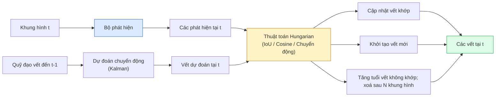

# Theo Dõi Đa Đối Tượng & Bộ Nhớ Video (Multi-Object Tracking & Video Memory)

> Theo dõi đối tượng là bài toán phát hiện cộng với liên kết. Phát hiện ở mỗi khung hình. Ghép nối các phát hiện của khung hình này với các quỹ đạo vết (tracks) của khung hình trước bằng định danh ID.

**Type:** Build
**Languages:** Python
**Prerequisites:** Phase 4 Lesson 06 (YOLO Detection), Phase 4 Lesson 08 (Mask R-CNN), Phase 4 Lesson 24 (SAM 3)
**Time:** ~60 phút

## Learning Objectives

- Phân biệt theo dõi dựa trên phát hiện (tracking-by-detection) với theo dõi dựa trên truy vấn (query-based tracking) và kể tên các họ thuật toán tiêu biểu (SORT, DeepSORT, ByteTrack, BoT-SORT, bộ theo dõi bộ nhớ SAM 2, SAM 3.1 Object Multiplex)
- Triển khai thuật toán gán Hungarian dựa trên IoU từ con số không cho hệ thống tracking-by-detection cổ điển
- Giải thích nguyên lý ngân hàng bộ nhớ (memory bank) của SAM 2 và lý do nó xử lý che khuất vượt trội hơn phép liên kết thuần IoU
- Đọc hiểu ba chỉ số đo lường theo dõi video (MOTA, IDF1, HOTA) và chọn đúng chỉ số phù hợp cho từng bài toán thực tế

## The Problem

Một bộ phát hiện chỉ cho bạn biết các vật thể đang nằm ở đâu trong một khung hình tĩnh đơn lẻ. Một bộ theo dõi (tracker) cho bạn biết phát hiện nào trong khung hình `t` là cùng một vật thể với phát hiện trong khung hình `t-1`. Không có khả năng này, bạn không thể đếm số lượng người/xe đi qua một vạch kẻ, không thể theo dõi quả bóng khi nó bị che khuất tạm thời, hoặc không thể xác định "chiếc xe số 4 đã đỗ trong làn đường được 8 giây".

Theo dõi đối tượng là thành phần không thể thiếu trong mọi sản phẩm xử lý video: phân tích thể thao, giám sát an ninh, xe tự hành, phân tích video y tế, theo dõi động vật hoang dã. Các khối xây dựng cốt lõi đều tương tự nhau: một bộ phát hiện trên từng khung hình, một mô hình chuyển động (bộ lọc Kalman hoặc giải pháp tinh vi hơn), một bước liên kết (thuật toán Hungarian trên IoU / khoảng cách cosine / đặc trưng học được), và vòng đời quỹ đạo vết (khởi tạo, cập nhật, kết thúc).

Năm 2026 mang đến hai mẫu thiết kế mới mang tính đột phá: **theo dõi dựa trên bộ nhớ của SAM 2** (sử dụng bộ nhớ đặc trưng thay vì mô hình chuyển động) và **SAM 3.1 Object Multiplex** (chia sẻ bộ nhớ cho nhiều cá thể của cùng một khái niệm). Bài học này sẽ dẫn dắt bạn qua ngăn xếp công nghệ cổ điển trước, sau đó tiến tới phương pháp tiếp cận dựa trên bộ nhớ hiện đại.

## The Concept

### Quy trình Tracking-by-detection



Mọi bộ theo dõi bạn bắt gặp trong năm 2026 đều là biến thể của vòng lặp này. Những điểm khác biệt chính:

- **SORT** (2016): Bộ lọc Kalman + gán Hungarian theo IoU. Đơn giản, cực nhanh, không có mô hình diện mạo.
- **DeepSORT** (2017): SORT + đặc trưng diện mạo dựa trên CNN cho mỗi vết (vector nhúng ReID). Xử lý tình huống giao cắt tốt hơn.
- **ByteTrack** (2021): liên kết các phát hiện có độ tin cậy thấp ở giai đoạn hai; không cần đặc trưng diện mạo nhưng vẫn đứng đầu bảng xếp hạng MOT17.
- **BoT-SORT** (2022): ByteTrack + bù trừ chuyển động của camera + ReID.
- **StrongSORT / OC-SORT** — Các thế hệ kế thừa của ByteTrack với mô hình chuyển động và diện mạo cải tiến.

### Bộ lọc Kalman gói gọn trong một đoạn văn

Một bộ lọc Kalman duy trì trạng thái cho mỗi vết gồm `(x, y, w, h, dx, dy, dw, dh)` cùng với một ma trận hiệp phương sai sai số. Tại mỗi khung hình, nó **dự đoán (predict)** trạng thái tiếp theo bằng mô hình vận tốc không đổi, sau đó **cập nhật (update)** trạng thái bằng phát hiện thực tế khớp được. Phép cập nhật sẽ tin tưởng phát hiện mới nhiều hơn khi độ bất định của bước dự đoán cao. Cơ chế này tạo ra các quỹ đạo chuyển động mượt mà và duy trì được vết qua các khoảng che khuất ngắn (1-5 khung hình).

Mọi bộ theo dõi cổ điển đều tích hợp bộ lọc Kalman trong bước dự đoán chuyển động.

### Thuật toán Hungarian

Cho trước một ma trận chi phí kích thước `M x N` (số lượng vết x số lượng phát hiện), thuật toán tìm phép ghép cặp một-một sao cho tổng chi phí là nhỏ nhất. Chi phí thường là `1 - IoU(hộp_vết, hộp_phát_hiện)` hoặc khoảng cách cosine âm của đặc trưng diện mạo. Độ phức tạp tính toán là $O((M+N)^3)$; với $M, N$ lên đến ~1000, thuật toán chạy rất nhanh trong Python qua `scipy.optimize.linear_sum_assignment`.

### Ý tưởng đột phá của ByteTrack

Các bộ theo dõi thông thường sẽ loại bỏ các phát hiện có độ tin cậy thấp (< 0.5). ByteTrack giữ lại chúng làm **các ứng viên giai đoạn hai**: sau khi đã ghép các vết với các phát hiện độ tin cậy cao, những vết chưa được ghép sẽ tiếp tục cố gắng ghép nối với các phát hiện độ tin cậy thấp bằng một ngưỡng IoU nới lỏng hơn. Kỹ thuật này giúp khôi phục các đối tượng bị che khuất một phần hoặc giảm hiện tượng tráo đổi ID (ID switches) trong đám đông.

### Theo dõi dựa trên bộ nhớ của SAM 2

SAM 2 xử lý video bằng cách duy trì một **ngân hàng bộ nhớ (memory bank)** chứa các đặc trưng không-thời gian của từng cá thể. Khi nhận được một gợi ý (nhấp chuột, hộp hoặc mặt nạ) trên một khung hình, nó mã hoá cá thể đó vào bộ nhớ. Trên các khung hình tiếp theo, bộ nhớ này thực hiện cơ chế chú ý chéo (cross-attention) với các đặc trưng của khung hình mới, và bộ giải mã sẽ sinh ra mặt nạ cho chính cá thể đó trên khung hình mới.

Không cần bộ lọc Kalman, không cần thuật toán Hungarian. Phép liên kết diễn ra ngầm định ngay bên trong toán tử cơ chế chú ý bộ nhớ.

Ưu điểm:
- Khả năng chống chịu tuyệt vời trước sự che khuất kéo dài (bộ nhớ lưu giữ nhận diện cá thể qua rất nhiều khung hình).
- Hoạt động theo từ vựng mở khi kết hợp với câu lệnh văn bản của SAM 3.
- Hoạt động độc lập không cần mô hình chuyển động riêng.

Nhược điểm:
- Tốc độ chậm hơn ByteTrack khi cần theo dõi số lượng đối tượng cực lớn.
- Ngân hàng bộ nhớ phình to theo thời gian; giới hạn cửa sổ ngữ cảnh.

### SAM 3.1 và cơ chế Object Multiplex

Trước đây, theo dõi với SAM 2 / SAM 3 phải duy trì một ngân hàng bộ nhớ riêng biệt cho từng cá thể. Với 50 đối tượng, bạn cần 50 ngân hàng bộ nhớ. Object Multiplex (tháng 3/2026) gom tất cả vào một bộ nhớ chia sẻ duy nhất với **các token truy vấn riêng cho từng cá thể**. Chi phí tài nguyên tăng dưới tuyến tính (sub-linear) theo số lượng cá thể.

Multiplex trở thành tiêu chuẩn mặc định mới cho bài toán theo dõi đám đông năm 2026: đám đông tại buổi hoà nhạc, công nhân trong nhà kho, nút giao thông đô thị.

### Ba chỉ số đo lường cần nắm vững

- **MOTA (Multi-Object Tracking Accuracy)** — $1 - (\text{FN} + \text{FP} + \text{ID switches}) / \text{GT}$. Đánh trọng số theo loại lỗi; một chỉ số đơn lẻ gộp chung cả lỗi phát hiện và lỗi liên kết vết.
- **IDF1 (ID F1)** — trung bình điều hoà của độ chuẩn xác ID (precision) và độ thu hồi ID (recall). Tập trung đánh giá mức độ duy trì ID ổn định xuyên suốt thời gian của từng đối tượng chuẩn. Tốt hơn MOTA cho các tác vụ nhạy cảm với việc đổi ID.
- **HOTA (Higher Order Tracking Accuracy)** — tách bạch rõ ràng thành độ chính xác phát hiện (DetA) và độ chính xác liên kết (AssA). Đây là tiêu chuẩn vàng của cộng đồng nghiên cứu từ năm 2020; phản ánh toàn diện nhất chất lượng theo dõi.

Đối với giám sát an ninh (ai là ai): hãy báo cáo chỉ số IDF1. Đối với phân tích thể thao (đếm lượt chuyền bóng): dùng HOTA. Để so sánh học thuật nói chung: HOTA.

```figure
cv3-track-assoc
```

## Build It

### Bước 1: Ma trận chi phí dựa trên IoU

```python
import numpy as np


def bbox_iou(a, b):
    """
    a, b: mảng (N, 4) chứa toạ độ [x1, y1, x2, y2].
    Trả về ma trận IoU kích thước (N_a, N_b).
    """
    ax1, ay1, ax2, ay2 = a[:, 0], a[:, 1], a[:, 2], a[:, 3]
    bx1, by1, bx2, by2 = b[:, 0], b[:, 1], b[:, 2], b[:, 3]
    inter_x1 = np.maximum(ax1[:, None], bx1[None, :])
    inter_y1 = np.maximum(ay1[:, None], by1[None, :])
    inter_x2 = np.minimum(ax2[:, None], bx2[None, :])
    inter_y2 = np.minimum(ay2[:, None], by2[None, :])
    inter = np.clip(inter_x2 - inter_x1, 0, None) * np.clip(inter_y2 - inter_y1, 0, None)
    area_a = (ax2 - ax1) * (ay2 - ay1)
    area_b = (bx2 - bx1) * (by2 - by1)
    union = area_a[:, None] + area_b[None, :] - inter
    return inter / np.clip(union, 1e-8, None)
```

### Bước 2: Bộ theo dõi tối giản kiểu SORT

Bộ lọc Kalman vận tốc không đổi được giản lược ở đây để tập trung vào logic liên kết IoU cốt lõi; trong sản xuất bước dự đoán Kalman là bắt buộc. Thư viện `sort` cung cấp phiên bản đầy đủ.

```python
from scipy.optimize import linear_sum_assignment


class Track:
    def __init__(self, tid, bbox, frame):
        self.id = tid
        self.bbox = bbox
        self.last_frame = frame
        self.hits = 1

    def update(self, bbox, frame):
        self.bbox = bbox
        self.last_frame = frame
        self.hits += 1


class SimpleTracker:
    def __init__(self, iou_threshold=0.3, max_age=5):
        self.tracks = []
        self.next_id = 1
        self.iou_threshold = iou_threshold
        self.max_age = max_age

    def step(self, detections, frame):
        if not self.tracks:
            for d in detections:
                self.tracks.append(Track(self.next_id, d, frame))
                self.next_id += 1
            return [(t.id, t.bbox) for t in self.tracks]

        track_boxes = np.array([t.bbox for t in self.tracks])
        det_boxes = np.array(detections) if len(detections) else np.empty((0, 4))

        iou = bbox_iou(track_boxes, det_boxes) if len(det_boxes) else np.zeros((len(track_boxes), 0))
        cost = 1 - iou
        cost[iou < self.iou_threshold] = 1e6

        matched_track = set()
        matched_det = set()
        if cost.size > 0:
            row, col = linear_sum_assignment(cost)
            for r, c in zip(row, col):
                if cost[r, c] < 1.0:
                    self.tracks[r].update(det_boxes[c], frame)
                    matched_track.add(r); matched_det.add(c)

        for i, d in enumerate(det_boxes):
            if i not in matched_det:
                self.tracks.append(Track(self.next_id, d, frame))
                self.next_id += 1

        self.tracks = [t for t in self.tracks if frame - t.last_frame <= self.max_age]
        return [(t.id, t.bbox) for t in self.tracks]
```

Khoảng 60 dòng mã. Nhận các phát hiện từng khung hình, trả về ID theo dõi cho từng đối tượng. Các hệ thống thực tế sẽ bổ sung thêm bước dự đoán Kalman, vòng lặp tái ghép giai đoạn hai của ByteTrack và đặc trưng diện mạo ReID.

### Bước 3: Kiểm thử trên quỹ đạo chuyển động tổng hợp

```python
def synthetic_frames(num_frames=20, num_objects=3, H=240, W=320, seed=0):
    rng = np.random.default_rng(seed)
    starts = rng.uniform(20, 200, size=(num_objects, 2))
    velocities = rng.uniform(-5, 5, size=(num_objects, 2))
    frames = []
    for f in range(num_frames):
        dets = []
        for i in range(num_objects):
            cx, cy = starts[i] + f * velocities[i]
            dets.append([cx - 10, cy - 10, cx + 10, cy + 10])
        frames.append(dets)
    return frames


tracker = SimpleTracker()
for f, dets in enumerate(synthetic_frames()):
    tracks = tracker.step(dets, f)
```

Ba vật thể chuyển động thẳng đều sẽ duy trì chính xác ID của chúng qua toàn bộ 20 khung hình.

### Bước 4: Đo lường số lần đổi ID (ID-switch metric)

```python
def count_id_switches(tracks_per_frame, gt_per_frame):
    """
    tracks_per_frame: danh sách các list chứa (track_id, bbox)
    gt_per_frame:     danh sách các list chứa (gt_id, bbox)
    Trả về số lần tráo đổi ID (ID switches).
    """
    prev_assignment = {}
    switches = 0
    for tracks, gts in zip(tracks_per_frame, gt_per_frame):
        if not tracks or not gts:
            continue
        t_boxes = np.array([b for _, b in tracks])
        g_boxes = np.array([b for _, b in gts])
        iou = bbox_iou(g_boxes, t_boxes)
        for g_idx, (gt_id, _) in enumerate(gts):
            j = iou[g_idx].argmax()
            if iou[g_idx, j] > 0.5:
                t_id = tracks[j][0]
                if gt_id in prev_assignment and prev_assignment[gt_id] != t_id:
                    switches += 1
                prev_assignment[gt_id] = t_id
    return switches
```

Đây là phiên bản đơn giản hoá cận kề với chỉ số IDF1: đếm số lần một vật thể chuẩn bị đổi sang một ID dự đoán khác. Các công cụ tính toán toàn diện MOTA / IDF1 / HOTA chuẩn mực nằm trong các gói `py-motmetrics` và `TrackEval`.

## Use It

Các bộ theo dõi sản xuất phổ biến năm 2026:

- `ultralytics` — Tích hợp sẵn YOLOv8 + ByteTrack / BoT-SORT. Gọi đơn giản: `results = model.track(source, tracker="bytetrack.yaml")`. Lựa chọn mặc định nhanh chóng.
- `supervision` (Roboflow) — Các bộ bao bọc ByteTrack kèm tiện ích trực quan hoá và đếm vùng giao cắt.
- SAM 2 / SAM 3.1 — theo dõi dựa trên bộ nhớ qua `processor.track()`.
- Kiến trúc tuỳ chỉnh: bộ phát hiện (YOLOv8 / RT-DETR) + `sort-tracker` / `OC-SORT` / `StrongSORT`.

Quy tắc lựa chọn:

- Người đi bộ / xe cộ / kiện hàng ở tốc độ 30+ fps: **ByteTrack với ultralytics**.
- Nhiều cá thể của cùng một lớp trong đám đông: **SAM 3.1 Object Multiplex**.
- Che khuất nặng nề nhưng diện mạo có thể phân biệt rõ: **DeepSORT / StrongSORT** (đặc trưng ReID).
- Thể thao / tương tác phức tạp, camera rung lắc: **BoT-SORT** hoặc các bộ theo dõi học sâu (MOTRv3).

## Ship It

Bài học này tạo ra:

- `outputs/prompt-tracker-picker.md` — một câu lệnh prompt giúp lựa chọn giữa SORT / ByteTrack / BoT-SORT / SAM 2 / SAM 3.1 dựa trên loại khung cảnh, mức độ che khuất và giới hạn độ trễ.
- `outputs/skill-mot-evaluator.md` — kỹ năng viết khung kiểm thử đánh giá các chỉ số MOTA / IDF1 / HOTA so với quỹ đạo chuẩn thực tế.

## Exercises

1. **(Dễ)** Chạy bộ theo dõi tổng hợp ở trên với 3, 10 và 30 vật thể. Báo cáo số lần tráo đổi ID trong mỗi trường hợp. Xác định ngưỡng mà phép liên kết thuần IoU bắt đầu bị vỡ.
2. **(Trung bình)** Bổ sung bước dự đoán chuyển động bằng bộ lọc Kalman vận tốc không đổi trước khi liên kết. Chứng minh rằng các trường hợp che khuất ngắn (2-3 khung hình) không còn gây ra hiện tượng đổi ID.
3. **(Khó)** Tích hợp bộ theo dõi dựa trên bộ nhớ của SAM 2 (qua `transformers`) như một backend thay thế. Chạy cả SimpleTracker và SAM 2 trên một đoạn clip đám đông dài 30 giây và so sánh số lần đổi ID, gắn nhãn thủ công ID chuẩn cho 5 người nổi bật.

## Key Terms

| Thuật ngữ | Cách gọi thông thường | Bản chất kỹ thuật thực sự |
|-----------|----------------------|---------------------------|
| Tracking-by-detection | "Phát hiện rồi liên kết" | Bộ phát hiện từng khung hình + gán Hungarian trên IoU / đặc trưng diện mạo |
| Bộ lọc Kalman | "Dự đoán chuyển động" | Động lực học tuyến tính + ma trận hiệp phương sai giúp dự đoán vết mượt mà và xử lý che khuất |
| Thuật toán Hungarian | "Phân công tối ưu" | Giải bài toán ghép cặp đồ thị hai phía cực tiểu hoá chi phí; hàm `scipy.optimize.linear_sum_assignment` |
| ByteTrack | "Vòng quét phụ độ tin cậy thấp" | Ghép nối các vết chưa khớp với các phát hiện độ tin cậy thấp để cứu các ca che khuất ngắn |
| DeepSORT | "SORT + diện mạo" | Bổ sung vector đặc trưng ReID để đối sánh diện mạo xuyên khung hình; giữ ID tốt hơn |
| Ngân hàng bộ nhớ | "Kỹ thuật của SAM 2" | Lưu trữ đặc trưng không-thời gian của cá thể qua các khung hình; cơ chế chú ý chéo thay thế bước liên kết tường minh |
| Object Multiplex | "Bộ nhớ chia sẻ SAM 3.1" | Một bộ nhớ dùng chung duy nhất với các truy vấn riêng cho từng cá thể giúp theo dõi đám đông siêu tốc |
| HOTA | "Chỉ số tracking hiện đại" | Tách bạch độ chính xác phát hiện và độ chính xác liên kết; tiêu chuẩn vàng của cộng đồng |

## Further Reading

- [SORT (Bewley et al., 2016)](https://arxiv.org/abs/1602.00763) — Bài báo đặt nền móng cho tracking-by-detection tối giản
- [DeepSORT (Wojke et al., 2017)](https://arxiv.org/abs/1703.07402) — Bổ sung đặc trưng nhận diện diện mạo
- [ByteTrack (Zhang et al., 2022)](https://arxiv.org/abs/2110.06864) — Cơ chế ghép nối phát hiện độ tin cậy thấp giai đoạn hai
- [BoT-SORT (Aharon et al., 2022)](https://arxiv.org/abs/2206.14651) — Kỹ thuật bù trừ chuyển động camera
- [HOTA (Luiten et al., 2020)](https://arxiv.org/abs/2009.07736) — Chỉ số đánh giá theo dõi phân rã toàn diện
- [SAM 2 video segmentation (Meta, 2024)](https://ai.meta.com/sam2/) — Bộ theo dõi video dựa trên bộ nhớ
- [SAM 3.1 Object Multiplex (Meta, March 2026)](https://ai.meta.com/blog/segment-anything-model-3/)

