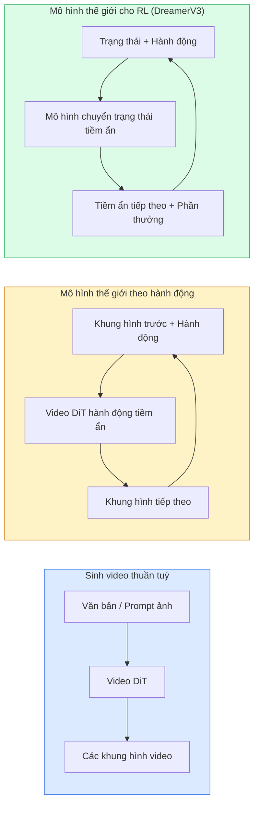

# Mô Hình Thế Giới & Mô Hình Khuếch Tán Video (World Models & Video Diffusion)

> Một mô hình video có khả năng dự đoán những giây tiếp theo của một khung cảnh chính là một bộ mô phỏng thế giới (world simulator). Khi điều kiện hoá dự đoán đó theo các hành động (actions), bạn sẽ sở hữu một cỗ máy game engine học được.

**Type:** Learn + Build
**Languages:** Python
**Prerequisites:** Phase 4 Lesson 10 (Diffusion), Phase 4 Lesson 12 (Video Understanding), Phase 4 Lesson 23 (DiT + Rectified Flow)
**Time:** ~75 phút

## Learning Objectives

- Giải thích sự khác biệt giữa một mô hình sinh video thuần tuý (Sora 2) và một mô hình thế giới có điều kiện hoá hành động (Genie 3, DreamerV3)
- Mô tả kiến trúc Video DiT: các mảng không-thời gian (spatio-temporal patches), mã hoá vị trí 3D, cơ chế chú ý kết hợp trên các token (T, H, W)
- Lần theo cách thức một mô hình thế giới tích hợp vào robot học: VLM lập kế hoạch $\to$ mô hình video mô phỏng $\to$ động lực học nghịch đảo phát ra lệnh điều khiển
- Lựa chọn tối ưu giữa Sora 2, Genie 3, Runway GWM-1 Worlds, Wan-Video, và HunyuanVideo cho từng trường hợp sử dụng cụ thể (video sáng tạo, mô phỏng tương tác, tổng hợp dữ liệu lái xe tự hành)

## The Problem

Lĩnh vực sinh video và mô hình hoá thế giới đã hội tụ làm một vào năm 2026. Một mô hình có khả năng sinh ra một phút video nhất quán về bản chất đã học được các quy luật vận động của thế giới thực: tính bất biến của vật thể (object permanence), trọng lực, quan hệ nhân quả và phong cách thị giác. Nếu bạn điều kiện hoá dự đoán đó dựa trên các hành động (bước sang trái, mở cánh cửa), mô hình video sẽ trở thành một bộ mô phỏng học được có thể thay thế game engine, trình mô phỏng lái xe hoặc môi trường huấn luyện robot.

Tác động thực tiễn là vô cùng to lớn. Genie 3 tạo ra các môi trường tương tác chơi được chỉ từ một bức ảnh duy nhất. Runway GWM-1 Worlds tổng hợp các khung cảnh 3D vô tận có thể khám phá. Sora 2 sản xuất các đoạn video dài cả phút kèm âm thanh đồng bộ và tuân thủ các quy luật vật lý. NVIDIA Cosmos-Drive, Wayve Gaia-2, và Tesla DrivingWorld sinh dữ liệu video lái xe chân thực phục vụ huấn luyện xe tự hành. Mô hình thế giới đang âm thầm chiếm lĩnh toàn bộ quy trình chuyển giao từ mô phỏng sang đời thực (sim-to-real) trong robot học.

Đây là bài học mang tính bức tranh toàn cảnh (big picture) khép lại Phase 4. Nó kết nối sinh hình ảnh, hiểu video và suy luận tác tử thành một mẫu kiến trúc trung tâm mà giới nghiên cứu đỉnh cao đang hướng tới.

## The Concept

### Ba họ mô hình thế giới



- **Sora 2** là mô hình sinh video thuần tuý nhận điều kiện từ câu lệnh prompt. Không có giao diện hành động. Bạn không thể "lái" hoặc can thiệp hướng đi ở giữa quá trình sinh.
- **Genie 3**, **GWM-1 Worlds**, **Mirage / Magica** là các mô hình thế giới có điều kiện hoá hành động. Chúng suy luận các hành động tiềm ẩn (latent actions) từ video quan sát, sau đó dự đoán các khung hình tương lai dựa trên hành động đó. Mang tính tương tác — bạn bấm phím hoặc di chuyển camera và khung cảnh sẽ phản hồi tức thì.
- **DreamerV3** và họ mô hình thế giới học tăng cường (RL) cổ điển dự đoán trong không gian tiềm ẩn với điều kiện hành động rõ ràng, được huấn luyện dựa trên tín hiệu phần thưởng. Ít trực quan thị giác hơn; hữu ích cho việc tối ưu hoá mẫu trong RL.

### Kiến trúc Video DiT

```text
Không gian tiềm ẩn video: (C, T, H, W)
Chia mảng không gian:     lưới gồm P_h x P_w mảng trên mỗi khung hình
Chia mảng thời gian:      gom nhóm P_t khung hình thành một mảng thời gian
Số lượng token tạo thành: (T / P_t) * (H / P_h) * (W / P_w) tokens
```

Mã hoá vị trí là 3D: sử dụng nhúng xoay RoPE hoặc nhúng học được trên từng toạ độ (t, h, w). Cơ chế chú ý (attention) có thể triển khai theo:

- **Chú ý kết hợp toàn diện (Full joint)** — tất cả token chú ý đến tất cả token. Độ phức tạp $O(N^2)$ với $N$ token. Chi phí quá lớn cho video dài.
- **Chú ý phân tách (Divided attention)** — luân phiên giữa chú ý thời gian (cùng toạ độ không gian, qua trục thời gian: `(H*W) * T^2`) và chú ý không gian (cùng bước thời gian, qua mặt phẳng ảnh: `T * (H*W)^2`). Được TimeSformer và hầu hết các Video DiT áp dụng.
- **Chú ý theo cửa sổ (Window attention)** — các cửa sổ cục bộ trong không gian (t, h, w). Được dùng trong Video Swin.

Mọi mô hình khuếch tán video năm 2026 đều sử dụng một trong ba mẫu thiết kế này kết hợp với điều kiện hoá AdaLN (Bài 23) và mục tiêu rectified flow.

### Điều kiện hoá hành động: Mô hình hành động tiềm ẩn (Latent action models)

Genie học một **hành động tiềm ẩn (latent action)** cho mỗi khung hình bằng cách phân biệt và dự đoán hành động diễn ra giữa hai khung hình liên tiếp. Bộ giải mã sau đó nhận điều kiện từ hành động tiềm ẩn suy luận được — chứ không phải các phím bấm bàn phím cụ thể. Khi suy luận, người dùng có thể chỉ định một hành động tiềm ẩn (hoặc lấy mẫu từ một phân phối tiên nghiệm mới) và mô hình sẽ sinh ra khung hình tiếp theo nhất quán với hành động đó.

Sora bỏ qua hoàn toàn giao diện hành động. Bộ giải mã của nó dự đoán các token không-thời gian tiếp theo từ các token trong quá khứ. Câu lệnh prompt quy định trạng thái bắt đầu; không có gì can thiệp được giữa chừng.

### Tính hợp lý về mặt vật lý (Physical plausibility)

Bản phát hành năm 2026 của Sora 2 đặc biệt quảng bá về **tính hợp lý vật lý**: khối lượng, sự cân bằng, tính bất biến của vật thể, nguyên nhân-kết quả. Được đo lường bởi đội ngũ phát triển qua các điểm đánh giá tính hợp lý thủ công; mô hình cải thiện rõ rệt ở các tình huống vật thể rơi, va chạm nhân vật và các thất bại có chủ đích (nhảy hụt) so với Sora 1.

Tính hợp lý vẫn là điểm yếu gây lỗi phổ biến nhất. Các video giai đoạn 2024-2025 quay cảnh người ăn mì spaghetti hoặc uống nước từ cốc thuỷ tinh đã phơi bày sự thiếu hụt biểu diễn vật thể bền vững của mô hình. Các mô hình năm 2026 (Sora 2, Runway Gen-5, HunyuanVideo) đã giảm bớt nhưng chưa thể triệt tiêu hoàn toàn các lỗi này.

### Mô hình thế giới trong xe tự hành

Các mô hình thế giới lái xe sinh ra các khung cảnh đường phố chân thực có điều kiện theo quỹ đạo di chuyển, bounding box hoặc bản đồ điều hướng. Ứng dụng:

- **Cosmos-Drive-Dreams** (NVIDIA) — sinh ra hàng phút video lái xe phục vụ huấn luyện học tăng cường (RL).
- **Gaia-2** (Wayve) — tổng hợp cảnh dựa trên quỹ đạo để đánh giá chính sách điều khiển.
- **DrivingWorld** (Tesla) — mô phỏng thời tiết đa dạng, các thời điểm trong ngày và tình trạng giao thông phức tạp.
- **Vista** (ByteDance) — tổng hợp khung cảnh giao thông có tính phản hồi tương tác.

Chúng thay thế khâu thu thập dữ liệu thực địa đắt đỏ cho các trường hợp góc chết (corner cases) — người đi bộ băng qua đường ban đêm, giao lộ đóng băng, các loại phương tiện dị thường — những tình huống mà nếu thu thập thực tế sẽ phải lái hàng triệu dặm.

### Ngăn xếp Robot học: VLM + Mô hình Video + Động lực học nghịch đảo

Vòng lặp ba thành phần đang trở thành tiêu chuẩn mới trong robot học:

1. **VLM** phân tích mục tiêu ("hãy nhặt chiếc cốc màu đỏ"), lập kế hoạch cho chuỗi hành động cấp cao.
2. **Mô hình sinh video** mô phỏng kết quả thực thi từng hành động — dự đoán các quan sát trực quan trước $N$ khung hình.
3. **Mô hình động lực học nghịch đảo (Inverse dynamics model)** trích xuất các lệnh điều khiển động cơ cụ thể để tạo ra các quan sát mô phỏng đó.

Quy trình này thay thế hoàn toàn kỹ thuật định hình phần thưởng (reward shaping) và việc huấn luyện RL tốn kém mẫu. Mô hình thế giới đóng vai trò "tưởng tượng"; động lực học nghịch đảo khép kín vòng lặp chấp hành cơ học. Genie Envisioner là một ví dụ tiêu biểu; nhiều nhóm nghiên cứu lớn đang hội tụ về cấu trúc này.

### Đánh giá hiệu năng

- **Chất lượng thị giác** — FVD (Fréchet Video Distance), khảo sát đánh giá của người dùng.
- **Độ bám sát câu lệnh** — CLIPScore trên từng khung hình, đánh giá dạng VQA.
- **Tính hợp lý vật lý** — chấm điểm thủ công trên bộ tiêu chuẩn benchmark (bộ kiểm chuẩn nội bộ của Sora 2, VBench).
- **Khả năng kiểm soát** (đối với mô hình thế giới tương tác) — tính nhất quán giữa hành động $\to$ quan sát; liệu bạn có thể quay trở lại trạng thái trước đó hay không?

### Toàn cảnh mô hình năm 2026

| Mô hình | Ứng dụng | Tham số | Đầu ra | Giấy phép |
|---------|----------|---------|--------|-----------|
| Sora 2 | text-to-video, âm thanh | — | 1 phút 1080p + âm thanh | Chỉ qua API |
| Runway Gen-5 | text/image-to-video | — | Clip 10 giây | API |
| Runway GWM-1 Worlds | thế giới tương tác | — | Khám phá 3D vô tận | API |
| Genie 3 | thế giới tương tác từ ảnh | 11B+ | Khung hình chơi được | Bản xem trước nghiên cứu |
| Wan-Video 2.1 | text-to-video mã nguồn mở | 14B | Clip chất lượng cao | Phi thương mại |
| HunyuanVideo | text-to-video mã nguồn mở | 13B | Clip 10 giây | Giấy phép mở |
| Cosmos / Cosmos-Drive | mô phỏng lái xe tự hành | 7-14B | Khung cảnh lái xe | NVIDIA mở |
| Magica / Mirage 2 | game engine thuần AI | — | Thế giới có thể chỉnh sửa | Thương mại |

```figure
v4-world-rollout
```

## Build It

### Bước 1: Chia mảng 3D cho video (3D patchify)

```python
import torch
import torch.nn as nn


class VideoPatch3D(nn.Module):
    def __init__(self, in_channels=4, dim=64, patch_t=2, patch_h=2, patch_w=2):
        super().__init__()
        self.proj = nn.Conv3d(
            in_channels, dim,
            kernel_size=(patch_t, patch_h, patch_w),
            stride=(patch_t, patch_h, patch_w),
        )
        self.patch_t = patch_t
        self.patch_h = patch_h
        self.patch_w = patch_w

    def forward(self, x):
        # x: (N, C, T, H, W)
        x = self.proj(x)
        n, c, t, h, w = x.shape
        tokens = x.reshape(n, c, t * h * w).transpose(1, 2)
        return tokens, (t, h, w)
```

Một lớp Conv3D với bước nhảy stride bằng kích thước kernel đóng vai trò là bộ chia mảng không-thời gian. Lưới token tạo thành có kích thước `(T, H, W) -> (T/2, H/2, W/2)`.

### Bước 2: Nhúng vị trí xoay 3D (3D RoPE)

Mã hoá vị trí xoay (RoPE) được áp dụng riêng biệt dọc theo các trục `t`, `h`, `w`:

```python
def rope_3d(tokens, t_dim, h_dim, w_dim, grid):
    """
    tokens: (N, T*H*W, D)
    grid: kích thước (T, H, W)
    t_dim + h_dim + w_dim == D
    """
    T, H, W = grid
    n, seq, d = tokens.shape
    if t_dim + h_dim + w_dim != d:
        raise ValueError(f"t_dim+h_dim+w_dim ({t_dim}+{h_dim}+{w_dim}) phải bằng D={d}")
    assert seq == T * H * W
    t_idx = torch.arange(T, device=tokens.device).repeat_interleave(H * W)
    h_idx = torch.arange(H, device=tokens.device).repeat_interleave(W).repeat(T)
    w_idx = torch.arange(W, device=tokens.device).repeat(T * H)
    # Dạng đơn giản hoá: điều chỉnh kênh theo tần số. RoPE thực tế xoay từng cặp kênh.
    freqs_t = torch.exp(-torch.log(torch.tensor(10000.0)) * torch.arange(t_dim // 2, device=tokens.device) / (t_dim // 2))
    freqs_h = torch.exp(-torch.log(torch.tensor(10000.0)) * torch.arange(h_dim // 2, device=tokens.device) / (h_dim // 2))
    freqs_w = torch.exp(-torch.log(torch.tensor(10000.0)) * torch.arange(w_dim // 2, device=tokens.device) / (w_dim // 2))
    emb_t = torch.cat([torch.sin(t_idx[:, None] * freqs_t), torch.cos(t_idx[:, None] * freqs_t)], dim=-1)
    emb_h = torch.cat([torch.sin(h_idx[:, None] * freqs_h), torch.cos(h_idx[:, None] * freqs_h)], dim=-1)
    emb_w = torch.cat([torch.sin(w_idx[:, None] * freqs_w), torch.cos(w_idx[:, None] * freqs_w)], dim=-1)
    return tokens + torch.cat([emb_t, emb_h, emb_w], dim=-1)
```

Đây là dạng cộng đơn giản hoá. RoPE thực tế xoay các cặp kênh theo các tần số góc; thông tin vị trí truyền tải hoàn toàn tương đương.

### Bước 3: Khối chú ý phân tách (Divided Attention Block)

```python
class DividedAttentionBlock(nn.Module):
    def __init__(self, dim=64, heads=2):
        super().__init__()
        self.time_attn = nn.MultiheadAttention(dim, heads, batch_first=True)
        self.space_attn = nn.MultiheadAttention(dim, heads, batch_first=True)
        self.ln1 = nn.LayerNorm(dim)
        self.ln2 = nn.LayerNorm(dim)
        self.ln3 = nn.LayerNorm(dim)
        self.mlp = nn.Sequential(nn.Linear(dim, 4 * dim), nn.GELU(), nn.Linear(4 * dim, dim))

    def forward(self, x, grid):
        T, H, W = grid
        n, seq, d = x.shape
        # Chú ý thời gian: cùng vị trí (h, w), duyệt qua trục t
        xt = x.view(n, T, H * W, d).permute(0, 2, 1, 3).reshape(n * H * W, T, d)
        a, _ = self.time_attn(self.ln1(xt), self.ln1(xt), self.ln1(xt), need_weights=False)
        xt = (xt + a).reshape(n, H * W, T, d).permute(0, 2, 1, 3).reshape(n, seq, d)
        # Chú ý không gian: cùng bước thời gian t, duyệt qua (h, w)
        xs = xt.view(n, T, H * W, d).reshape(n * T, H * W, d)
        a, _ = self.space_attn(self.ln2(xs), self.ln2(xs), self.ln2(xs), need_weights=False)
        xs = (xs + a).reshape(n, T, H * W, d).reshape(n, seq, d)
        xs = xs + self.mlp(self.ln3(xs))
        return xs
```

Cơ chế chú ý thời gian thực hiện trong nội bộ từng vị trí không gian xuyên suốt thời gian; cơ chế chú ý không gian thực hiện trong nội bộ từng khung hình xuyên suốt các vị trí. Biến một phép tính $O((THW)^2)$ khổng lồ thành hai phép tính $O(T^2 + (HW)^2)$ dễ thở hơn nhiều. Đây là trái tim của TimeSformer và mọi mô hình Video DiT hiện đại.

### Bước 4: Ghép nối mô hình Tiny Video DiT

```python
class TinyVideoDiT(nn.Module):
    def __init__(self, in_channels=4, dim=64, depth=2, heads=2):
        super().__init__()
        self.patch = VideoPatch3D(in_channels=in_channels, dim=dim, patch_t=2, patch_h=2, patch_w=2)
        self.blocks = nn.ModuleList([DividedAttentionBlock(dim, heads) for _ in range(depth)])
        self.out = nn.Linear(dim, in_channels * 2 * 2 * 2)

    def forward(self, x):
        tokens, grid = self.patch(x)
        for blk in self.blocks:
            tokens = blk(tokens, grid)
        return self.out(tokens), grid
```

Đây không phải là một mô hình sinh video hoàn chỉnh có thể sinh ra hình ảnh ngay; mà là minh hoạ kiến trúc giúp bạn nắm vững cách thức định hình kích thước các tensor.

### Bước 5: Kiểm tra kích thước tensor (Shape check)

```python
vid = torch.randn(1, 4, 8, 16, 16)  # (N, C, T, H, W)
model = TinyVideoDiT()
out, grid = model(vid)
print(f"input  {tuple(vid.shape)}")
print(f"tokens grid {grid}")
print(f"output {tuple(out.shape)}")
```

Kết quả mong đợi: `grid = (4, 8, 8)` và `out = (1, 256, 32)` sau bước patchify; đầu ra sau đó chiếu ngược về các mảng không-thời gian cho từng token, sẵn sàng để tái cấu trúc un-patchify trở lại thành video.

## Use It

Các phương thức tiếp cận thực tế năm 2026:

- **Sora 2 API** (OpenAI) — chuyển văn bản thành video chất lượng cao, âm thanh đồng bộ. Chi phí dịch vụ cao cấp.
- **Runway Gen-5 / GWM-1** (Runway) — chuyển ảnh thành video, môi trường tương tác 3D.
- **Wan-Video 2.1 / HunyuanVideo** — mô hình mã nguồn mở có thể tự lưu trữ (self-host).
- **Cosmos / Cosmos-Drive** (NVIDIA) — bộ trọng số mở phục vụ mô phỏng xe tự hành.
- **Genie 3** — bản xem trước nghiên cứu của Google DeepMind, yêu cầu đăng ký quyền truy cập.

Để xây dựng một bản demo mô hình thế giới tương tác: hãy bắt đầu với Wan-Video để có chất lượng hình ảnh tốt, sau đó phủ lên một adapter hành động tiềm ẩn để tạo tính năng tương tác. Đối với mô phỏng lái xe tự hành: Cosmos-Drive là tài liệu tham khảo mã nguồn mở tiêu chuẩn năm 2026.

Quy trình trong robot học thực tế:

1. Mục tiêu ngôn ngữ tự nhiên $\to$ VLM (Qwen3-VL) $\to$ Kế hoạch cấp cao.
2. Kế hoạch $\to$ Mô hình video hành động tiềm ẩn $\to$ Chuỗi quan sát mô phỏng.
3. Chuỗi quan sát $\to$ Mô hình động lực học nghịch đảo $\to$ Lệnh điều khiển động cơ cấp thấp.
4. Robot thực thi hành động $\to$ Quan sát thực tế được đưa ngược trở lại bước 1.

## Ship It

Bài học này tạo ra:

- `outputs/prompt-video-model-picker.md` — một câu lệnh prompt giúp lựa chọn giữa Sora 2 / Runway / Wan / HunyuanVideo / Cosmos dựa trên tác vụ, giấy phép và yêu cầu độ trễ.
- `outputs/skill-physical-plausibility-checks.md` — kỹ năng thiết lập các kiểm tra tự động về tính hợp lý vật lý (tính bất biến của vật thể, trọng lực, tính liên tục) trên video sinh ra trước khi chuyển giao sản phẩm.

## Exercises

1. **(Dễ)** Tính toán số lượng token cho một video 5 giây độ phân giải 360p với cấu hình patch-t=2, patch-h=8, patch-w=8. Ước lượng dung lượng bộ nhớ RAM cần thiết cho cơ chế tự chú ý ở kích thước này.
2. **(Trung bình)** Thay thế khối chú ý phân tách (divided attention) ở trên bằng khối chú ý kết hợp toàn diện (full joint attention) và đo lường kích thước tensor cùng số lượng tham số. Giải thích tại sao chú ý phân tách là điều bắt buộc đối với các mô hình video thực tế.
3. **(Khó)** Xây dựng một mô hình video hành động tiềm ẩn tối giản: lấy tập dữ liệu gồm các bộ ba (khung_hình_t, hành_động_t, khung_hình_{t+1}) từ một trò chơi 2D đơn giản, huấn luyện một mạng Video DiT nhỏ nhận điều kiện từ vector nhúng hành động, và chứng minh rằng các hành động khác nhau sẽ sinh ra các khung hình tiếp theo khác nhau.

## Key Terms

| Thuật ngữ | Cách gọi thông thường | Bản chất kỹ thuật thực sự |
|-----------|----------------------|---------------------------|
| Mô hình thế giới (World model) | "Bộ mô phỏng học được" | Mô hình dự đoán các quan sát tương lai dựa trên trạng thái và hành động |
| Video DiT | "Transformer không-thời gian" | Diffusion transformer với cơ chế chia mảng 3D và chú ý phân tách |
| Hành động tiềm ẩn (Latent action) | "Lệnh điều khiển ngầm định" | Vector hành động rời rạc hoặc liên tục được suy luận từ các cặp khung hình; dùng làm điều kiện sinh khung hình tiếp theo |
| Chú ý phân tách (Divided attention) | "Thời gian rồi đến không gian" | Hai phép tính chú ý riêng biệt trong mỗi khối — qua thời gian rồi qua không gian — để kiểm soát độ phức tạp $O(N^2)$ |
| Tính bất biến của vật thể | "Vật thể không biến mất vô lý" | Thuộc tính của thế giới thực mà mô hình video phải học; điểm yếu kinh điển trên đồ ăn, ly cốc thuỷ tinh |
| FVD | "Khoảng cách video Fréchet" | Chỉ số đo lường chất lượng video tương đương FID trong hình ảnh |
| Động lực học nghịch đảo | "Từ quan sát ra hành động" | Cho trước (trạng thái, trạng thái tiếp theo), xuất ra hành động kết nối chúng; khép kín vòng lặp robot |
| Cosmos-Drive | "Trình mô phỏng lái xe của NVIDIA" | Mô hình thế giới lái xe tự hành có trọng số mở phục vụ học tăng cường và đánh giá an toàn |

## Further Reading

- [Báo cáo kỹ thuật Sora (OpenAI)](https://openai.com/index/video-generation-models-as-world-simulators/)
- [Genie: Generative Interactive Environments (Bruce et al., 2024)](https://arxiv.org/abs/2402.15391) — Mô hình thế giới với hành động tiềm ẩn
- [TimeSformer (Bertasius et al., 2021)](https://arxiv.org/abs/2102.05095) — Cơ chế chú ý phân tách cho video transformer
- [DreamerV3 (Hafner et al., 2023)](https://arxiv.org/abs/2301.04104) — Mô hình thế giới cho học tăng cường
- [Cosmos-Drive-Dreams (NVIDIA, 2025)](https://research.nvidia.com/labs/toronto-ai/cosmos-drive-dreams/) — Mô hình thế giới lái xe tự hành
- [Top 10 Video Generation Models 2026 (DataCamp)](https://www.datacamp.com/blog/top-video-generation-models)
- [From Video Generation to World Model — survey repo](https://github.com/ziqihuangg/Awesome-From-Video-Generation-to-World-Model/)

