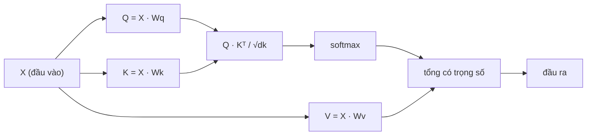

# Tự chú ý (Self-Attention) từ con số không

> Cơ chế chú ý (attention) giống như một bảng tra cứu, nơi mỗi từ đều đặt câu hỏi: "Ai có ý nghĩa quan trọng đối với tôi?" — và học cách tìm ra câu trả lời.

**Phân loại:** Xây dựng thực hành (Build)  
**Ngôn ngữ:** Python  
**Điều kiện tiên quyết:** Giai đoạn 3 (Nền tảng Học sâu), Giai đoạn 5 · Bài 10 (Mô hình Sequence-to-Sequence)  
**Thời lượng:** ~90 phút

## Mục tiêu học tập

- Cài đặt cơ chế tự chú ý tích vô hướng có chia tỷ lệ (scaled dot-product self-attention) từ con số không chỉ bằng NumPy, bao gồm các phép chiếu truy vấn/khóa/giá trị (query/key/value) và phép tính tổng có trọng số softmax.
- Xây dựng tầng chú ý đa đầu (multi-head attention layer) thực hiện chia tách các đầu chú ý, tính toán chú ý song song và ghép nối (concatenate) kết quả.
- Phân tích cách ma trận chú ý biểu diễn mối quan hệ giữa các token và giải thích vì sao việc chia tỷ lệ cho $\sqrt{d_k}$ giúp ngăn ngừa hiện tượng bão hòa softmax.
- Áp dụng mặt nạ nhân quả (causal masking) để chuyển đổi cơ chế chú ý hai chiều thành cơ chế chú ý tự hồi quy (autoregressive attention kiểu bộ giải mã - decoder).

## Vấn đề đặt ra

Mạng nơ-ron hồi quy (RNN) xử lý chuỗi tuần tự từng token một. Đến khi chạm tới token thứ 50, thông tin từ token thứ 1 đã bị nén qua 50 bước liên tiếp. Các phụ thuộc tầm xa (long-range dependencies) bị ép nghẽn vào một trạng thái ẩn (hidden state) có kích thước cố định — một nút thắt cổ chai mà không cấu trúc cổng LSTM nào có thể giải quyết triệt để.

Năm 2014, bài báo về cơ chế chú ý của Bahdanau đã đưa ra giải pháp: cho phép bộ giải mã (decoder) nhìn lại toàn bộ các vị trí trong bộ mã hóa (encoder) và tự quyết định xem vị trí nào mang tính quyết định cho bước dự đoán hiện tại. Tuy vậy, cơ chế này ban đầu vẫn bị phụ thuộc vào một khung xương RNN. Đến năm 2017, bài báo "Attention Is All You Need" đã đặt ra một câu hỏi táo bạo hơn: điều gì sẽ xảy ra nếu cơ chế chú ý là cơ chế *duy nhất*? Không còn hồi quy. Không còn tích chập. Chỉ thuần túy là sự chú ý.

Cơ chế tự chú ý (self-attention) cho phép mọi vị trí trong một chuỗi có thể trực tiếp chú ý đến mọi vị trí khác chỉ trong một bước tính toán song song duy nhất. Đó chính là yếu tố biến Transformer thành kiến trúc có tốc độ vượt trội, khả năng mở rộng quy mô lớn và thống trị toàn bộ lĩnh vực học sâu.

## Khái niệm cốt lõi

### Phép loại suy tra cứu cơ sở dữ liệu

Hãy hình dung cơ chế chú ý như một phép tra cứu cơ sở dữ liệu dạng mờ (soft lookup):

```text
Cơ sở dữ liệu truyền thống:
  Truy vấn (Query): "thủ đô của nước Pháp"  -->  khớp chính xác  -->  "Paris"

Cơ chế chú ý (Attention):
  Truy vấn (Query): "thủ đô của nước Pháp"  -->  độ tương đồng với TẤT CẢ các khóa (Keys)  -->  hòa trộn có trọng số của TẤT CẢ các giá trị (Values)
```

Mỗi token tạo ra ba vector đại diện:
- **Truy vấn (Query - Q)**: "Tôi đang tìm kiếm thông tin gì?"
- **Khóa (Key - K)**: "Tôi chứa đựng nội dung gì?"
- **Giá trị (Value - V)**: "Tôi sẽ cung cấp thông tin gì nếu được chọn?"

Tích vô hướng giữa một query và toàn bộ các key tạo ra điểm số chú ý (attention scores). Điểm số càng cao có nghĩa là "key này rất phù hợp với query của tôi". Các điểm số này đóng vai trò làm trọng số để cân chỉnh các vector value. Đầu ra là tổng có trọng số của các vector value.

### Tính toán Q, K, V

Mỗi vector nhúng token (token embedding) được chiếu qua ba ma trận trọng số học được:

```text
Các vector nhúng đầu vào (chuỗi n token, mỗi token có số chiều d):

  X = [x1, x2, x3, ..., xn]       kích thước: (n, d)

Ba ma trận trọng số:

  Wq  kích thước: (d, dk)
  Wk  kích thước: (d, dk)
  Wv  kích thước: (d, dv)

Các phép chiếu (projections):

  Q = X @ Wq    kích thước: (n, dk)      query của từng token
  K = X @ Wk    kích thước: (n, dk)      key của từng token
  V = X @ Wv    kích thước: (n, dv)      value của từng token
```

Trực quan hóa đối với một token đơn lẻ:

```text
             Wq
  x_i ------[*]------> q_i    "Tôi đang tìm kiếm điều gì?"
       |
       |     Wk
       +----[*]------> k_i    "Tôi mang nội dung gì?"
       |
       |     Wv
       +----[*]------> v_i    "Tôi cung cấp thông tin gì?"
```

### Ma trận chú ý

Khi đã có Q, K, V cho toàn bộ các token, điểm số chú ý tạo thành một ma trận:

```text
Điểm số (Scores) = Q @ K^T    kích thước: (n, n)

              k1    k2    k3    k4    k5
        +-----+-----+-----+-----+-----+
   q1   | 2.1 | 0.3 | 0.1 | 0.8 | 0.2 |   <- mức độ q1 chú ý tới từng key
        +-----+-----+-----+-----+-----+
   q2   | 0.4 | 1.9 | 0.7 | 0.1 | 0.3 |
        +-----+-----+-----+-----+-----+
   q3   | 0.2 | 0.6 | 2.3 | 0.5 | 0.1 |
        +-----+-----+-----+-----+-----+
   q4   | 0.9 | 0.1 | 0.4 | 1.7 | 0.6 |
        +-----+-----+-----+-----+-----+
   q5   | 0.1 | 0.3 | 0.2 | 0.5 | 2.0 |
        +-----+-----+-----+-----+-----+

Mỗi hàng: phân bố chú ý của một token trên toàn bộ chuỗi
```

Quan sát từng query quét qua các key: mỗi hàng tính điểm cho từng token, hàm softmax biến các điểm số thành trọng số xác suất, và vector ngữ cảnh chính là phép hòa trộn có trọng số của các vector value.

````figure
attention-matrix
````

### Vì sao cần chia tỷ lệ?

Tích vô hướng có xu hướng tăng theo chiều không gian $d_k$. Nếu $d_k = 64$, tích vô hướng có thể đạt giá trị lên đến hàng chục, đẩy hàm softmax vào các vùng có độ dốc cực nhỏ khiến gradient bị triệt tiêu (hiện tượng bão hòa softmax). Giải pháp: chia tích vô hướng cho $\sqrt{d_k}$.

```math
\text{Điểm số có chia tỷ lệ} = \frac{Q K^T}{\sqrt{d_k}}
```

Phép chia này giữ cho giá trị điểm số nằm trong khoảng biến thiên ổn định, nơi hàm softmax sinh ra gradient hữu ích phục vụ quá trình lan truyền ngược.

### Hàm Softmax chuyển điểm số thành trọng số

Hàm softmax chuyển đổi các điểm số thô thành một phân phối xác suất trên từng hàng:

```text
Điểm số thô cho q1:      [2.1, 0.3, 0.1, 0.8, 0.2]
                                   |
                                softmax
                                   |
Trọng số chú ý:          [0.52, 0.09, 0.07, 0.14, 0.08]   (tổng xấp xỉ ~1.0)
```

Giờ đây, mỗi token sở hữu một tập hợp các trọng số xác định mức độ cần tập trung chú ý vào từng token khác.

### Tổng có trọng số của các giá trị

Đầu ra cuối cùng cho mỗi token là tổng có trọng số của toàn bộ các vector giá trị:

```text
output_i = sum( attention_weight[i][j] * v_j  cho mọi j )

Đối với token 1:
  output_1 = 0.52 * v1 + 0.09 * v2 + 0.07 * v3 + 0.14 * v4 + 0.08 * v5
```

### Toàn bộ quy trình tính toán



Công thức toán học gói gọn trong một dòng:

```math
\text{Attention}(Q, K, V) = \mathop{\mathrm{softmax}}\left( \frac{Q K^T}{\sqrt{d_k}} \right) V
```

````figure
softmax-attention-scaling
````

## Xây dựng thực tế

````figure
iso-machine {"machine":"self-attention"}
````

### Bước 1: Cài đặt hàm Softmax từ con số không

Hàm softmax biến đổi các giá trị logit thô thành các xác suất. Trừ đi giá trị lớn nhất (max) để đảm bảo độ ổn định số học (numerical stability).

```python
import numpy as np

def softmax(x):
    shifted = x - np.max(x, axis=-1, keepdims=True)
    exp_x = np.exp(shifted)
    return exp_x / np.sum(exp_x, axis=-1, keepdims=True)

logits = np.array([2.0, 1.0, 0.1])
print(f"logits:  {logits}")
print(f"softmax: {softmax(logits)}")
print(f"sum:     {softmax(logits).sum():.4f}")
```

### Bước 2: Tự chú ý tích vô hướng có chia tỷ lệ

Hàm cốt lõi nhận các ma trận Q, K, V và trả về vector đầu ra của cơ chế chú ý kèm theo ma trận trọng số.

```python
def scaled_dot_product_attention(Q, K, V):
    dk = Q.shape[-1]
    scores = Q @ K.T / np.sqrt(dk)
    weights = softmax(scores)
    output = weights @ V
    return output, weights
```

### Bước 3: Lớp Self-Attention với các phép chiếu học được

Một khối tự chú ý hoàn chỉnh với các ma trận trọng số Wq, Wk, Wv được khởi tạo theo cơ chế tỷ lệ kiểu Xavier.

```python
class SelfAttention:
    def __init__(self, d_model, dk, dv, seed=42):
        rng = np.random.default_rng(seed)
        scale = np.sqrt(2.0 / (d_model + dk))
        self.Wq = rng.normal(0, scale, (d_model, dk))
        self.Wk = rng.normal(0, scale, (d_model, dk))
        scale_v = np.sqrt(2.0 / (d_model + dv))
        self.Wv = rng.normal(0, scale_v, (d_model, dv))
        self.dk = dk

    def forward(self, X):
        Q = X @ self.Wq
        K = X @ self.Wk
        V = X @ self.Wv
        output, weights = scaled_dot_product_attention(Q, K, V)
        return output, weights
```

### Bước 4: Chạy thử nghiệm trên một câu mẫu

Tạo các vector nhúng giả lập cho một câu văn và quan sát ma trận trọng số chú ý sinh ra.

```python
sentence = ["The", "cat", "sat", "on", "the", "mat"]
n_tokens = len(sentence)
d_model = 8
dk = 4
dv = 4

rng = np.random.default_rng(42)
X = rng.normal(0, 1, (n_tokens, d_model))

attn = SelfAttention(d_model, dk, dv, seed=42)
output, weights = attn.forward(X)

print("Trọng số chú ý (mỗi hàng: hướng nhìn của token đó):\n")
print(f"{'':>6}", end="")
for token in sentence:
    print(f"{token:>6}", end="")
print()

for i, token in enumerate(sentence):
    print(f"{token:>6}", end="")
    for j in range(n_tokens):
        w = weights[i][j]
        print(f"{w:6.3f}", end="")
    print()
```

### Bước 5: Trực quan hóa ma trận chú ý bằng biểu đồ nhiệt ASCII

Ánh xạ các trọng số chú ý thành các ký tự trực quan để xem nhanh mô hình chú ý trên màn hình dòng lệnh.

```python
def ascii_heatmap(weights, tokens, chars=" ░▒▓█"):
    n = len(tokens)
    print(f"\n{'':>6}", end="")
    for t in tokens:
        print(f"{t:>6}", end="")
    print()

    for i in range(n):
        print(f"{tokens[i]:>6}", end="")
        for j in range(n):
            level = int(weights[i][j] * (len(chars) - 1) / weights.max())
            level = min(level, len(chars) - 1)
            print(f"{'  ' + chars[level] + '   '}", end="")
        print()

ascii_heatmap(weights, sentence)
```

## Ứng dụng thực tế

Lớp `nn.MultiheadAttention` trong PyTorch thực hiện chính xác những gì chúng ta vừa xây dựng, kết hợp thêm việc chia tách đa đầu và chiếu đầu ra:

```python
import torch
import torch.nn as nn

d_model = 8
n_heads = 2
seq_len = 6

mha = nn.MultiheadAttention(embed_dim=d_model, num_heads=n_heads, batch_first=True)

X_torch = torch.randn(1, seq_len, d_model)

output, attn_weights = mha(X_torch, X_torch, X_torch)

print(f"Kích thước đầu vào:         {X_torch.shape}")
print(f"Kích thước đầu ra:          {output.shape}")
print(f"Kích thước trọng số chú ý:  {attn_weights.shape}")
print(f"\nTrọng số chú ý (trung bình trên các đầu):")
print(attn_weights[0].detach().numpy().round(3))
```

Điểm khác biệt then chốt: chú ý đa đầu (multi-head attention) chạy nhiều hàm chú ý song song với nhau, mỗi đầu có các phép chiếu Q, K, V riêng biệt với kích thước $d_k = d_{\text{model}} / n_{\text{heads}}$, sau đó ghép nối các kết quả lại. Cơ chế này cho phép mô hình đồng thời chú ý đến nhiều loại quan hệ ngữ nghĩa khác nhau trong cùng một thời điểm.

## Triển khai thành phẩm

Bài học này tạo ra:
- `outputs/prompt-attention-explainer.md` — một chỉ dẫn (prompt) giải thích trực quan cơ chế chú ý thông qua phép loại suy tra cứu cơ sở dữ liệu.

## Bài tập

1. Sửa đổi hàm `scaled_dot_product_attention` để tiếp nhận thêm một ma trận mặt nạ (mask matrix) tùy chọn, gán các vị trí chỉ định thành âm vô cực ($-\infty$) trước khi tính softmax (đây là nguyên lý hoạt động của mặt nạ nhân quả / mặt nạ bộ giải mã).
2. Tự cài đặt cơ chế chú ý đa đầu từ con số không: chia Q, K, V thành `n_heads` phần riêng biệt, thực thi cơ chế chú ý trên từng phần, ghép nối kết quả và chiếu qua ma trận trọng số cuối cùng $W_o$.
3. Lấy hai câu khác nhau có cùng độ dài, đưa qua cùng một thực thể `SelfAttention` và so sánh cấu trúc trọng số chú ý của chúng. Những đặc điểm nào thay đổi? Những đặc điểm nào giữ nguyên?

## Thuật ngữ then chốt

| Thuật ngữ | Cách nói thông thường | Ý nghĩa kỹ thuật chính xác |
|-----------|----------------------|---------------------------|
| Truy vấn (Query - Q) | "Vector câu hỏi" | Phép chiếu tuyến tính học được từ đầu vào đại diện cho thông tin mà token này đang tìm kiếm. |
| Khóa (Key - K) | "Vector nhãn" | Phép chiếu tuyến tính học được đại diện cho thông tin mà token này chứa đựng, dùng để so khớp với các query. |
| Giá trị (Value - V) | "Vector nội dung" | Phép chiếu tuyến tính mang thông tin thực tế sẽ được tổng hợp dựa trên điểm số chú ý. |
| Chú ý tích vô hướng có chia tỷ lệ (Scaled dot-product attention) | "Công thức tính attention" | $\mathop{\mathrm{softmax}}(QK^T / \sqrt{d_k}) V$ — phép chia tỷ lệ ngăn ngừa hiện tượng bão hòa softmax ở không gian số chiều lớn. |
| Tự chú ý (Self-attention) | "Token tự nhìn vào chính nó và các từ khác" | Cơ chế chú ý trong đó Q, K, V đều bắt nguồn từ cùng một chuỗi đầu vào, cho phép mọi vị trí chú ý đến nhau. |
| Trọng số chú ý (Attention weights) | "Mức độ tập trung" | Phân phối xác suất trên các vị trí trong chuỗi, sinh ra bởi hàm softmax áp dụng lên tích vô hướng có chia tỷ lệ. |
| Chú ý đa đầu (Multi-head attention) | "Chú ý song song" | Kỹ thuật chạy song song nhiều hàm chú ý với các không gian chiếu khác nhau, sau đó ghép nối kết quả để tạo biểu diễn phong phú hơn. |

## Tài liệu đọc thêm

- [Attention Is All You Need (Vaswani et al., 2017)](https://arxiv.org/abs/1706.03762) — bài báo gốc đặt nền móng cho kiến trúc Transformer.
- [The Illustrated Transformer (Jay Alammar)](https://jalammar.github.io/illustrated-transformer/) — tài liệu trực quan hóa xuất sắc nhất về toàn bộ cấu trúc Transformer.
- [The Annotated Transformer (Harvard NLP)](https://nlp.seas.harvard.edu/annotated-transformer/) — bản cài đặt PyTorch từng dòng mã kèm lời giải thích chi tiết.
