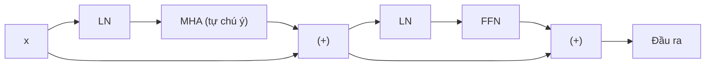
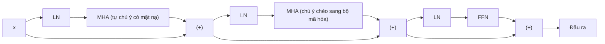

# Mô hình Transformer hoàn chỉnh — Bộ mã hóa + Bộ giải mã

> Cơ chế chú ý là ngôi sao trung tâm. Mọi thành phần còn lại — kết nối phần dư, chuẩn hóa, mạng truyền thẳng, chú ý chéo — là bộ khung giàn giáo cho phép xếp chồng mô hình lên nhiều tầng sâu.

**Phân loại:** Xây dựng thực hành (Build)  
**Ngôn ngữ:** Python  
**Điều kiện tiên quyết:** Giai đoạn 7 · 02 (Tự chú ý), Giai đoạn 7 · 03 (Chú ý đa đầu), Giai đoạn 7 · 04 (Mã hóa vị trí)  
**Thời lượng:** ~75 phút

## Vấn đề đặt ra

Một tầng chú ý đơn lẻ chỉ đóng vai trò như một bộ trích xuất đặc trưng (feature extractor), chứ chưa phải là một mô hình hoàn chỉnh. Một phép nhân ma trận trên mỗi tầng không đủ dung lượng biểu diễn cho ngôn ngữ tự nhiên. Bạn cần độ sâu — và việc tăng độ sâu sẽ đổ vỡ nếu thiếu đi hệ thống đường ống dẫn luồng thông tin phù hợp.

Bài báo của Vaswani năm 2017 đã đóng gói sáu quyết định thiết kế kiến trúc, biến một tầng chú ý đơn lẻ thành một khối kiến trúc có thể xếp chồng nhiều lớp liên tiếp. Mọi mô hình Transformer kể từ thời điểm đó — chỉ dùng bộ mã hóa (BERT), chỉ dùng bộ giải mã (GPT), hay kết hợp bộ mã hóa - giải mã (T5) — đều kế thừa bộ khung xương cơ bản này. Tính đến năm 2026, các khối thành phần đã được cải tiến tinh chỉnh (RMSNorm, SwiGLU, pre-norm, RoPE) nhưng cấu trúc bộ khung vẫn hoàn toàn nhất quán.

Bài học này xây dựng bộ khung xương cốt lõi đó. Các bài học tiếp theo sẽ đi sâu vào từng nhánh chuyên biệt — Bài 06 cho bộ mã hóa, Bài 07 cho bộ giải mã, Bài 08 cho mô hình kết hợp bộ mã hóa - giải mã.

## Khái niệm cốt lõi


### Sáu thành phần cốt lõi

1. **Nhúng từ + Tín hiệu vị trí (Embedding + Positional signal):** Chuyển đổi token thành vector. Tín hiệu vị trí được đưa vào qua RoPE (chuẩn hiện đại) hoặc hàm hình sin (chuẩn cổ điển).
2. **Tự chú ý (Self-attention):** Mọi vị trí chú ý đến nhau. Trong bộ giải mã, cơ chế này được áp dụng thêm mặt nạ (masked).
3. **Mạng truyền thẳng (Feed-Forward Network - FFN):** Mạng nơ-ron hai tầng perceptron đa tầng (MLP) tác động độc lập trên từng vị trí: $W_2 \cdot \text{activation}(W_1 \cdot x)$. Tỷ lệ mở rộng ẩn mặc định là 4 lần.
4. **Kết nối phần dư (Residual connection):** Công thức $x + \text{sublayer}(x)$. Nếu không có thành phần này, gradient sẽ biến mất hoàn toàn khi mạng vượt quá khoảng 6 tầng.
5. **Chuẩn hóa tầng (Layer Normalization):** Sử dụng `LayerNorm` hoặc `RMSNorm` (chuẩn hiện đại). Giúp ổn định luồng thông tin trong dòng chảy phần dư (residual stream).
6. **Chú ý chéo (Cross-attention - chỉ có ở bộ giải mã):** Các truy vấn (queries) lấy từ bộ giải mã, trong khi khóa (keys) và giá trị (values) được lấy từ đầu ra của bộ mã hóa.

Quan sát dòng chảy vector qua một khối: cơ chế chú ý hòa trộn thông tin giữa các vị trí, kết nối phần dư mang thông tin nguyên bản đi tiếp, mạng FFN chuyển đổi phi tuyến, và phép chuẩn hóa duy trì sự ổn định cho luồng tensor.

````figure
transformer-block
````

### Khối bộ mã hóa (Encoder block — sử dụng bởi BERT, bộ mã hóa T5)



Bộ mã hóa có tính chất hai chiều (bidirectional). Không sử dụng mặt nạ che tương lai. Mọi vị trí đều có thể nhìn thấy mọi vị trí khác.

### Khối bộ giải mã (Decoder block — sử dụng bởi GPT, bộ giải mã T5)



Mỗi khối bộ giải mã có ba tầng con (sublayers). Tầng con ở giữa — chú ý chéo — là vị trí duy nhất dòng thông tin truyền từ bộ mã hóa sang bộ giải mã. Trong kiến trúc thuần bộ giải mã (như GPT), chú ý chéo được loại bỏ hoàn toàn, chỉ giữ lại tự chú ý có mặt nạ kèm theo mạng FFN.

### Chuẩn hóa trước (Pre-norm) so với Chuẩn hóa sau (Post-norm)

Bài báo nguyên bản sử dụng post-norm: $LN(x + \text{sublayer}(x))$. Tuy nhiên, post-norm dần bị thay thế từ năm 2019 vì rất khó huấn luyện khi mạng có độ sâu lớn nếu thiếu giai đoạn khởi động (warmup) tỉ mỉ. Chuẩn hóa trước (pre-norm), tức áp dụng $x + \text{sublayer}(LN(x))$, đã trở thành tiêu chuẩn mặc định vào năm 2026: Llama, Qwen, GPT-3+, Mistral đều áp dụng phương pháp này.

### Khối Transformer hiện đại hóa năm 2026

Vaswani 2017 sử dụng LayerNorm kết hợp ReLU. Các ngăn xếp hiện đại đã thay thế cả hai. Cấu trúc thực tế của một khối kiến trúc trong môi trường sản xuất hiện nay:

| Thành phần | Năm 2017 | Năm 2026 |
|------------|----------|----------|
| Chuẩn hóa | LayerNorm | RMSNorm |
| Hàm kích hoạt FFN | ReLU | SwiGLU |
| Hệ số mở rộng FFN | 4× | 2.6× (SwiGLU dùng 3 ma trận, tổng tham số tương đương) |
| Mã hóa vị trí | Hình sin tuyệt đối | RoPE |
| Cơ chế chú ý | MHA đầy đủ | GQA (hoặc MLA) |
| Số hạng độ lệch (Bias) | Có | Không (Bias-free) |

RMSNorm loại bỏ bước chuẩn hóa trừ đi giá trị trung bình của LayerNorm (bớt đi một phép trừ), giúp tiết kiệm tài nguyên tính toán trong khi thực nghiệm chứng minh độ ổn định tương đương. Hàm kích hoạt SwiGLU ($\text{Swish}(W_1 x) \odot W_3 x$) liên tục cho thấy hiệu quả vượt trội hơn FFN dùng ReLU/GELU khoảng 0.5 điểm perplexity trong các báo cáo kỹ thuật của Llama, PaLM và Qwen.

### Tính toán số lượng tham số

Đối với một khối biến đổi với $d_{\text{model}} = d$ và hệ số mở rộng FFN là $r$:

- Khối MHA: $4 \cdot d^2$ (các phép chiếu Q, K, V, O)
- Khối FFN (SwiGLU): $3 \cdot d \cdot (r \cdot d) \approx 3rd^2$
- Các tầng chuẩn hóa: Không đáng kể

Với cấu hình $d = 4096, r = 2.6, \text{số tầng} = 32$ (tương đương mô hình Llama 3 8B):
Tổng tham số trong các khối: $32 \cdot (4 \cdot 4096^2 + 3 \cdot 2.6 \cdot 4096^2) \approx 32 \cdot (67\text{M} + 131\text{M}) \approx 32 \cdot 198\text{M} \approx 6.3\text{ tỷ}$ tham số. Cộng thêm khoảng 1 tỷ tham số cho tầng nhúng từ và đầu ra dự đoán (bộ từ vựng 128K $\times$ 4096, không chia sẻ trọng số), tổng cộng đạt xấp xỉ quy mô 8B được công bố. Mô hình thực tế sử dụng GQA (giảm kích thước phép chiếu K và V) và mở rộng FFN rộng hơn ($r = 3.5$), dịch chuyển tham số từ tầng attention sang FFN nhưng vẫn giữ tổng số tham số quanh mốc 8B.

## Xây dựng thực tế

### Bước 1: Các khối thành phần nền tảng

Sử dụng lớp `Matrix` nhỏ gọn từ Bài 03 (được sao chép lại để đảm bảo tính độc lập của bài học):

- `layer_norm(x, eps=1e-5)` — trừ kỳ vọng trung bình, chia cho độ lệch chuẩn.
- `rms_norm(x, eps=1e-6)` — chia cho giá trị RMS. Không thực hiện phép trừ kỳ vọng.
- `gelu(x)` và `silu(x) * W3 x` (SwiGLU).
- `ffn_swiglu(x, W1, W2, W3)`.
- `encoder_block(x, params)` và `decoder_block(x, enc_out, params)`.

Xem chi tiết kết nối hoàn chỉnh trong file `code/main.py`.

### Bước 2: Ghép nối bộ mã hóa 2 tầng và bộ giải mã 2 tầng

Xếp chồng các khối. Truyền đầu ra của bộ mã hóa vào tầng chú ý chéo của từng khối bộ giải mã. Bổ sung một tầng LayerNorm cuối cùng trước khi đưa qua phép chiếu đầu ra:

```python
def encode(tokens, params):
    x = embed(tokens, params.emb) + sinusoidal(len(tokens), params.d)
    for block in params.encoder_blocks:
        x = encoder_block(x, block)
    return x

def decode(target_tokens, encoder_out, params):
    x = embed(target_tokens, params.emb) + sinusoidal(len(target_tokens), params.d)
    for block in params.decoder_blocks:
        x = decoder_block(x, encoder_out, block)
    return x
```

### Bước 3: Chạy lan truyền xuôi trên một ví dụ minh họa

Đưa một chuỗi nguồn 6 token và chuỗi đích 5 token qua mô hình. Kiểm tra kích thước đầu ra có đạt chuẩn `(5, vocab)` hay không. Không thực hiện huấn luyện ở đây — bài học này tập trung vào kiến trúc thay vì hàm mất mát.

### Bước 4: Thay thế bằng RMSNorm + SwiGLU

Thay thế LayerNorm và FFN dạng ReLU bằng RMSNorm và SwiGLU. Xác nhận kích thước các chiều tensor vẫn khớp hoàn toàn. Đây chính là bước hiện đại hóa chuẩn 2026 chỉ thông qua việc thay đổi các hàm thành phần.

## Ứng dụng thực tế

Các lớp cài đặt chuẩn mực trong PyTorch/TensorFlow gồm có: `nn.TransformerEncoderLayer`, `nn.TransformerDecoderLayer`. Tuy nhiên, phần lớn mã nguồn trong môi trường sản xuất năm 2026 tự xây dựng khối riêng vì:

- FlashAttention được gọi trực tiếp bên trong kernel chú ý thay vì qua `nn.MultiheadAttention`.
- GQA / MLA không có sẵn trong thư viện chuẩn.
- RoPE, RMSNorm, SwiGLU không phải là các thiết lập mặc định của PyTorch.

Thư viện `transformers` của HuggingFace có các khối mẫu mã nguồn mở rất rõ ràng: file `modeling_llama.py` là chuẩn mực kinh điển cho một khối chỉ dùng bộ giải mã (decoder-only) năm 2026. File này dài khoảng 500 dòng và rất đáng để đọc kỹ một lần.

**Lựa chọn: Bộ mã hóa, Bộ giải mã, hay Bộ mã hóa - giải mã:**

| Nhu cầu | Lựa chọn kiến trúc | Ví dụ thực tế |
|---------|-------------------|---------------|
| Phân loại văn bản, trích xuất embedding, hỏi đáp trích xuất | Chỉ bộ mã hóa (Encoder-only) | BERT, DeBERTa, ModernBERT |
| Sinh văn bản, hội thoại, sinh mã nguồn, suy luận logic | Chỉ bộ giải mã (Decoder-only) | GPT, Llama, Claude, Qwen |
| Đầu vào có cấu trúc → Đầu ra có cấu trúc (dịch máy, tóm tắt) | Bộ mã hóa - giải mã (Encoder-decoder) | T5, BART, Whisper |

Mô hình chỉ dùng bộ giải mã (decoder-only) đã giành ưu thế áp đảo trong mô hình hóa ngôn ngữ vì khả năng mở rộng quy mô tối ưu nhất và xử lý trơn tru cả tác vụ thấu hiểu lẫn tác vụ sinh văn bản. Cấu trúc bộ mã hóa - giải mã (encoder-decoder) vẫn giữ vững vị thế khi dữ liệu đầu vào mang bản sắc chuỗi nguồn rõ rệt (dịch máy, nhận dạng giọng nói, tác vụ có cấu trúc).

## Triển khai thành phẩm

Xem file `outputs/skill-transformer-block-reviewer.md`. Kỹ năng này đánh giá việc cài đặt một khối Transformer mới so với các tiêu chuẩn thiết kế năm 2026 và chỉ ra những phần còn thiếu sót (pre-norm, RoPE, RMSNorm, GQA, tỷ lệ mở rộng FFN).

## Bài tập

1. **Dễ.** Đếm số lượng tham số trong `encoder_block` với $d_{\text{model}}=512, n_{\text{heads}}=8, \text{ffn\_expansion}=4, \text{swiglu}=\text{True}$. Kiểm chứng bằng cách khởi tạo khối và gọi `sum(p.numel() for p in block.parameters())`.
2. **Trung bình.** Chuyển đổi từ post-norm sang pre-norm. Khởi tạo cả hai và đo độ lớn chuẩn (norm) của các kích hoạt sau khi đi qua 12 tầng xếp chồng với đầu vào ngẫu nhiên. Kích hoạt của post-norm sẽ có xu hướng bùng nổ, trong khi của pre-norm vẫn nằm trong giới hạn kiểm soát.
3. **Khó.** Cài đặt một mô hình encoder-decoder 4 tầng cho tác vụ sao chép chuỗi đồ chơi (sao chép ngược chuỗi `x`). Huấn luyện trong 100 bước. Ghi nhận hàm mất mát. Thay thế bằng RMSNorm + SwiGLU + RoPE — xem hàm mất mát có giảm nhanh hơn không?

## Thuật ngữ then chốt

| Thuật ngữ | Cách nói thông thường | Ý nghĩa kỹ thuật chính xác |
|-----------|----------------------|---------------------------|
| Khối biến đổi (Block) | "Một tầng Transformer" | Tổ hợp gồm chuẩn hóa + cơ chế chú ý + chuẩn hóa + FFN, được bao bọc bởi các kết nối phần dư. |
| Kết nối phần dư (Residual) | "Đường tắt (Skip connection)" | Phép cộng đầu ra $x + f(x)$; giúp dòng gradient lan truyền thuận lợi qua các tầng mạng rất sâu. |
| Chuẩn hóa trước (Pre-norm) | "Chuẩn hóa trước, không chuẩn hóa sau" | Cấu hình hiện đại: $x + \text{sublayer}(LN(x))$. Giúp huấn luyện các mô hình sâu hơn mà không cần điều chỉnh lịch trình warmup phức tạp. |
| RMSNorm | "LayerNorm bỏ đi giá trị trung bình" | Phép chia cho căn bậc hai của trung bình bình phương; bớt một phép tính, giữ nguyên độ ổn định thực nghiệm. |
| SwiGLU | "Hàm kích hoạt FFN tiêu chuẩn mới" | Tầng tính toán $\text{Swish}(W_1 x) \odot W_3 x \rightarrow W_2$. Vượt trội hơn ReLU/GELU về độ hỗn loạn mô hình ngôn ngữ. |
| Chú ý chéo (Cross-attention) | "Cách bộ giải mã nhìn sang bộ mã hóa" | Cơ chế MHA với Q lấy từ bộ giải mã, K và V lấy từ đầu ra của bộ mã hóa. |
| Hệ số mở rộng FFN (FFN expansion) | "Độ rộng của mạng MLP trung gian" | Tỷ lệ giữa kích thước lớp ẩn và $d_{\text{model}}$, thường là 4 (với LayerNorm) hoặc 2.6 (với SwiGLU). |
| Không độ lệch (Bias-free) | "Bỏ các số hạng +b" | Xu hướng kiến trúc hiện đại loại bỏ hoàn toàn tham số bias trong các tầng tuyến tính; giảm nhẹ kích thước mô hình và cải thiện chất lượng. |

## Tài liệu đọc thêm

- [Vaswani et al. (2017). Attention Is All You Need](https://arxiv.org/abs/1706.03762) — bài báo gốc mô tả chi tiết khối kiến trúc Transformer.
- [Xiong et al. (2020). On Layer Normalization in the Transformer Architecture](https://arxiv.org/abs/2002.04745) — phân tích toán học giải thích lý do pre-norm vượt trội hơn post-norm ở độ sâu lớn.
- [Zhang, Sennrich (2019). Root Mean Square Layer Normalization](https://arxiv.org/abs/1910.07467) — bài báo giới thiệu RMSNorm.
- [Shazeer (2020). GLU Variants Improve Transformer](https://arxiv.org/abs/2002.05202) — bài báo giới thiệu các biến thể GLU và SwiGLU.
- [HuggingFace `modeling_llama.py`](https://github.com/huggingface/transformers/blob/main/src/transformers/models/llama/modeling_llama.py) — mã nguồn tham chiếu kinh điển của khối kiến trúc chỉ dùng bộ giải mã năm 2026.
