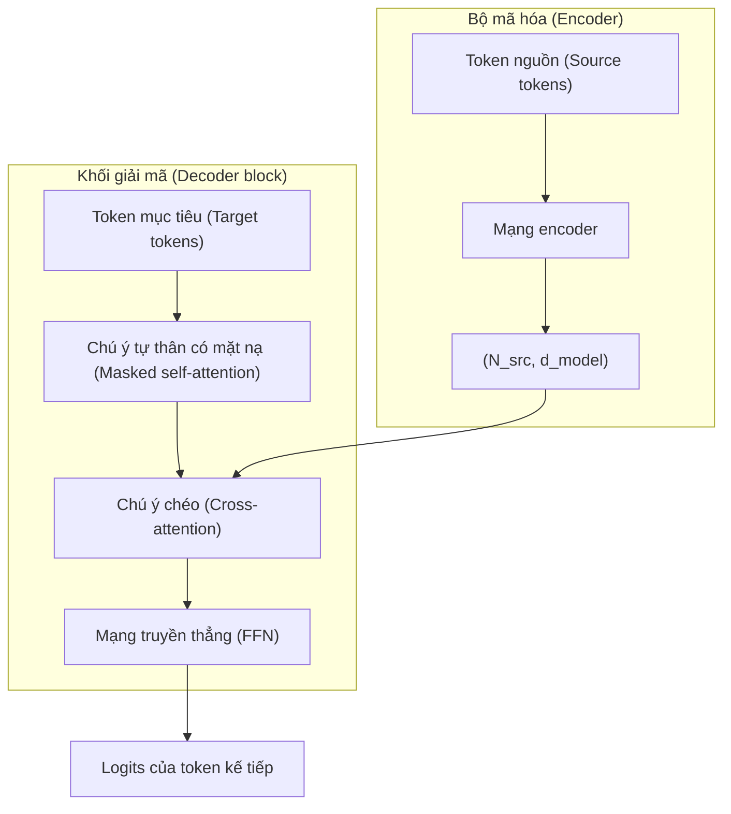

# T5, BART — Các mô hình Encoder-Decoder (Encoder-Decoder Models)

> Bộ mã hóa (encoder) đảm nhận phần hiểu. Bộ giải mã (decoder) đảm nhận phần tạo sinh. Kết hợp chúng lại với nhau và bạn có một mô hình chuyên biệt cho các tác vụ chuyển đổi đầu vào → đầu ra: dịch thuật, tóm tắt, viết lại, phiên âm.

**Type:** Learn
**Languages:** Python
**Prerequisites:** Phase 7 · 05 (Full Transformer), Phase 7 · 06 (BERT), Phase 7 · 07 (GPT)
**Time:** ~45 phút

## Vấn đề (The Problem)

Mô hình chỉ gồm bộ giải mã (decoder-only) như GPT và chỉ gồm bộ mã hóa (encoder-only) như BERT đều tinh giản kiến trúc gốc năm 2017 để phục vụ các mục tiêu khác nhau. Tuy nhiên, rất nhiều bài toán trong thực tế mang bản chất tự nhiên là ánh xạ đầu vào - đầu ra (input-output):

- Dịch máy (Translation): Tiếng Anh → Tiếng Pháp.
- Tóm tắt văn bản (Summarization): Bài báo 5.000 token → Bản tóm tắt 200 token.
- Nhận dạng tiếng nói (Speech recognition): Token âm thanh → Token văn bản.
- Trích xuất có cấu trúc (Structured extraction): Văn bản tự nhiên → JSON.

Đối với những tác vụ này, kiến trúc encoder-decoder là sự lựa chọn phù hợp và tự nhiên nhất. Encoder tạo ra một biểu diễn dày đặc (dense representation) của chuỗi nguồn. Decoder tạo sinh chuỗi đầu ra một cách tự hồi quy, đồng thời thực hiện cơ chế chú ý chéo (cross-attention) tới biểu diễn đó tại mỗi bước. Quá trình huấn luyện sử dụng chiến lược dịch chuyển một vị trí (shift-by-one) ở phía đầu ra. Về bản chất, đây là cùng một hàm mất mát với GPT, chỉ khác là được điều kiện hóa (conditioned) dựa trên đầu ra của encoder.

Hai bài báo kinh điển đã định hình nên cẩm nang hiện đại cho nhánh kiến trúc này:

1. **T5** (Raffel và cộng sự, 2019). "Text-to-Text Transfer Transformer" (Transformer truyền tri thức dạng văn bản sang văn bản). Mọi tác vụ NLP đều được tái cấu trúc dưới dạng văn bản đầu vào, văn bản đầu ra. Một kiến trúc duy nhất, một bộ từ vựng duy nhất, một hàm mất mát duy nhất. Được tiền huấn luyện trên tác vụ dự đoán đoạn bị che (masked span prediction - làm biến dạng các đoạn trong đầu vào và giải mã chúng ở đầu ra).
2. **BART** (Lewis và cộng sự, 2019). "Bidirectional and Auto-Regressive Transformer" (Transformer hai chiều và tự hồi quy). Bộ tự mã hóa khử nhiễu (denoising autoencoder): làm biến dạng đầu vào theo nhiều cách khác nhau (xáo trộn, che mặt nạ, xóa, xoay vòng), và yêu cầu decoder tái tạo lại chuỗi ban đầu.

Vào năm 2026, định dạng encoder-decoder vẫn giữ vị thế vững chắc ở những nơi mà cấu trúc đầu vào đóng vai trò then chốt:

- Whisper (tiếng nói → văn bản).
- Ngăn xếp dịch thuật của Google.
- Một số mô hình hoàn thiện mã nguồn / sửa lỗi code (code repair) với cấu trúc phân tách rõ ràng giữa ngữ cảnh và phần chỉnh sửa.
- Flan-T5 và các biến thể phục vụ các tác vụ suy luận có cấu trúc.

Mặc dù kiến trúc chỉ gồm decoder đã thu hút mọi sự chú ý của truyền thông, mô hình encoder-decoder chưa bao giờ biến mất.

## Khái niệm (The Concept)


### Vòng lặp truyền xuôi (The forward loop)



Điểm then chốt là: encoder chỉ chạy một lần duy nhất cho mỗi đầu vào. Decoder chạy một cách tự hồi quy nhưng thực hiện chú ý chéo tới *cùng một* đầu ra cố định của encoder ở mỗi bước giải mã. Việc lưu bộ đệm (cache) đầu ra của encoder giúp tăng tốc đáng kể mà không tốn thêm chi phí cho các chuỗi đầu vào dài.

### Tiền huấn luyện T5 — làm biến dạng đoạn (span corruption)

Chọn ngẫu nhiên các đoạn trong chuỗi đầu vào (độ dài trung bình 3 token, chiếm tổng cộng 15% chuỗi). Thay thế mỗi đoạn bằng một token lính canh (sentinel token) duy nhất: `<extra_id_0>`, `<extra_id_1>`, v.v. Decoder chỉ cần dự đoán các đoạn bị biến dạng đó kèm theo tiền tố lính canh tương ứng:

```text
source: The quick <extra_id_0> fox jumps <extra_id_1> dog
target: <extra_id_0> brown <extra_id_1> over the lazy
```

Tín hiệu học này tiết kiệm chi phí tính toán hơn so với việc dự đoán lại toàn bộ chuỗi. Nó đạt hiệu năng tương đương với MLM (BERT) và prefix-LM (UniLM) trong các thực nghiệm loại trừ của bài báo T5.

### Tiền huấn luyện BART — khử nhiều loại nhiễu (multi-noise denoising)

BART thử nghiệm năm hàm gây nhiễu:

1. Che token (Token masking).
2. Xóa token (Token deletion).
3. Điền khuyết văn bản (Text infilling - che một đoạn văn, decoder phải chèn vào đúng độ dài và nội dung).
4. Hoán vị câu (Sentence permutation).
5. Xoay văn bản (Document rotation).

Sự kết hợp giữa điền khuyết văn bản + hoán vị câu mang lại kết quả tốt nhất cho các tác vụ hạ nguồn. Decoder luôn phải tái tạo lại toàn bộ chuỗi gốc ban đầu. Đầu ra của BART là chuỗi hoàn chỉnh chứ không chỉ là các đoạn bị biến dạng — do đó chi phí tính toán tiền huấn luyện cao hơn so với T5.

### Quá trình suy luận (Inference)

Quá trình này sử dụng cơ chế tạo sinh tự hồi quy tương tự như GPT. Các chiến lược lấy mẫu greedy / beam / top-p đều có thể áp dụng. Tìm kiếm chùm (beam search, với độ rộng chùm 4–5) là tiêu chuẩn thường dùng cho dịch thuật và tóm tắt vì phân phối đầu ra của các tác vụ này hẹp và tập trung hơn nhiều so với trò chuyện tự do (chat).

### Khi nào nên chọn từng biến thể vào năm 2026

| Tác vụ | Dùng Encoder-decoder? | Lý do |
|------|------------------|-----|
| Dịch máy | Có, thường là vậy | Chuỗi nguồn rõ ràng; phân phối đầu ra xác định; tìm kiếm chùm hoạt động rất hiệu quả |
| Nhận dạng giọng nói (Speech-to-text) | Có (Whisper) | Phương thức đầu vào (modalities) khác với đầu ra; encoder định hình các đặc trưng âm thanh |
| Trò chuyện / suy luận (Chat / reasoning) | Không, chỉ dùng decoder | Không có "đầu vào" cố định tách biệt — toàn bộ cuộc hội thoại chính là một chuỗi liên tục |
| Hoàn thiện code (Code completion) | Thường là không | Decoder-only với ngữ cảnh dài chiếm ưu thế; các mô hình lập trình như Qwen 2.5 Coder đều là decoder-only |
| Tóm tắt văn bản | Cả hai đều tốt | BART, PEGASUS từng vượt qua các baseline decoder-only thời kỳ đầu; các LLM decoder-only hiện đại đã bắt kịp chất lượng |
| Trích xuất có cấu trúc | Cả hai | T5 rất tự nhiên vì mô hình "văn bản → văn bản" có thể tiếp nhận bất kỳ định dạng đầu ra nào |

Xu hướng từ khoảng năm 2022 đến nay: kiến trúc decoder-only dần chiếm lĩnh các tác vụ mà trước đây encoder-decoder từng thống trị, vì (a) các LLM decoder-only được tinh chỉnh theo chỉ dẫn (instruction-tuned) có thể tổng quát hóa cho mọi tác vụ thông qua câu nhắc (prompting), (b) việc mở rộng quy mô một kiến trúc duy nhất dễ hơn hai kiến trúc kết hợp, (c) kỹ thuật RLHF mặc định tối ưu trên decoder. Kiến trúc encoder-decoder tiếp tục duy trì vị thế ở những nơi mà phương thức dữ liệu đầu vào khác biệt (âm thanh, hình ảnh) hoặc khi chất lượng của tìm kiếm chùm đóng vai trò quyết định.

```figure
encoder-decoder
```

## Tự xây dựng (Build It)

Xem `code/main.py`. Chúng ta sẽ triển khai cơ chế làm biến dạng đoạn (span corruption) theo phong cách của T5 trên một ngữ liệu đồ chơi — đây là phần hữu ích nhất của bài học vì nó xuất hiện trong mọi công thức tiền huấn luyện encoder-decoder kể từ đó.

### Bước 1: làm biến dạng đoạn (span corruption)

```python
def corrupt_spans(tokens, mask_rate=0.15, mean_span=3.0, rng=None):
    """Chọn các đoạn có tổng độ dài ~mask_rate số lượng token. Trả về (corrupted_input, target)."""
    n = len(tokens)
    n_mask = max(1, int(n * mask_rate))
    n_spans = max(1, int(round(n_mask / mean_span)))
    ...
```

Định dạng mục tiêu tuân theo quy ước của T5: `<sent0> span0 <sent1> span1 ...`. Đầu vào bị biến dạng xen kẽ các token không đổi với các token lính canh tại các vị trí của đoạn bị che.

### Bước 2: kiểm tra tính khép kín hai chiều (verify round-trip)

Cho trước đầu vào bị biến dạng và mục tiêu, hãy khôi phục lại câu gốc ban đầu. Nếu quá trình biến dạng có thể đảo ngược hoàn toàn, thì lượt truyền xuôi được xác định chặt chẽ. Đây là bước kiểm tra tính hợp lý (sanity check) — quá trình huấn luyện thực tế không bao giờ làm điều này, nhưng bài kiểm tra rất nhẹ nhàng và giúp phát hiện sớm các lỗi lệch một đơn vị (off-by-one bugs) trong việc quản lý chỉ số đoạn.

### Bước 3: tạo nhiễu theo phong cách BART (BART noising)

Năm hàm gây nhiễu: `token_mask`, `token_delete`, `text_infill`, `sentence_permute`, `document_rotate`. Kết hợp hai hàm trong số đó và quan sát kết quả sinh ra.

## Sử dụng trong thực tế (Use It)

Mã nguồn tham khảo với HuggingFace:

```python
from transformers import T5ForConditionalGeneration, T5Tokenizer
tok = T5Tokenizer.from_pretrained("google/flan-t5-base")
model = T5ForConditionalGeneration.from_pretrained("google/flan-t5-base")

inputs = tok("translate English to French: Attention is all you need.", return_tensors="pt")
out = model.generate(**inputs, max_new_tokens=32)
print(tok.decode(out[0], skip_special_tokens=True))
```

Bí quyết của T5: tên của tác vụ được đưa trực tiếp vào văn bản đầu vào. Cùng một mô hình có thể xử lý hàng chục tác vụ khác nhau vì mọi tác vụ đều tuân theo nguyên lý văn bản vào, văn bản ra (text-in, text-out). Đến năm 2026, mô thức này đã được tổng quát hóa bởi các mô hình decoder-only tinh chỉnh theo chỉ dẫn, nhưng chính T5 là mô hình đầu tiên chuẩn hóa phương pháp này.

## Đưa vào triển khai (Ship It)

Xem `outputs/skill-seq2seq-picker.md`. Kỹ năng này hỗ trợ lựa chọn giữa mô hình encoder-decoder và decoder-only cho một tác vụ mới, dựa trên cấu trúc đầu vào - đầu ra, yêu cầu về độ trễ và các mục tiêu chất lượng.

## Bài tập thực hành (Exercises)

1. **Dễ.** Chạy `code/main.py`, áp dụng kỹ thuật làm biến dạng đoạn lên một câu có độ dài 30 token, xác minh rằng việc ghép nối các token nguồn không phải lính canh với các đoạn mục tiêu đã được giải mã sẽ tái tạo lại chính xác câu gốc.
2. **Trung bình.** Triển khai cơ chế gây nhiễu `text_infill` của BART: thay thế các đoạn ngẫu nhiên bằng một token `<mask>` duy nhất, và decoder phải suy luận được cả độ dài chính xác lẫn nội dung của đoạn bị thiếu. Trình bày một ví dụ minh họa.
3. **Khó.** Tinh chỉnh mô hình `flan-t5-small` trên một tập ngữ liệu dịch tiếng Anh → tiếng lóng Pig Latin nhỏ (200 cặp câu). Đo lường điểm BLEU trên tập kiểm tra độc lập gồm 50 cặp câu. So sánh với việc tinh chỉnh mô hình `Llama-3.2-1B` trên cùng tập dữ liệu với cùng ngân sách tính toán.

## Thuật ngữ then chốt (Key Terms)

| Thuật ngữ | Cách gọi thông thường | Ý nghĩa kỹ thuật thực tế |
|------|-----------------|-----------------------|
| Encoder-decoder | "Transformer tuần tự sang tuần tự (seq2seq)" | Hai ngăn xếp mạng: encoder hai chiều xử lý đầu vào, decoder nhân quả với cơ chế chú ý chéo sinh đầu ra. |
| Chú ý chéo (Cross-attention) | "Nơi nguồn giao tiếp với đích" | Ma trận Q của decoder nhân với K/V của encoder. Đây là vị trí duy nhất thông tin từ encoder đi vào decoder. |
| Làm biến dạng đoạn (Span corruption) | "Thủ thuật tiền huấn luyện của T5" | Thay thế các đoạn token ngẫu nhiên bằng các token lính canh; decoder dự đoán lại các đoạn đó. |
| Mục tiêu khử nhiễu (Denoising objective) | "Chiến lược của BART" | Áp dụng một hàm gây nhiễu lên đầu vào, huấn luyện decoder tái tạo lại chuỗi sạch ban đầu. |
| Token lính canh (Sentinel token) | "Ký tự giữ chỗ `<extra_id_N>`" | Các token đặc biệt dùng để đánh dấu các đoạn bị biến dạng ở chuỗi nguồn và gắn nhãn lại chúng ở chuỗi đích. |
| Flan | "T5 tinh chỉnh theo chỉ dẫn" | Mô hình T5 được tinh chỉnh trên hơn 1.800 tác vụ; giúp encoder-decoder có khả năng cạnh tranh trong việc tuân thủ chỉ dẫn. |
| Tìm kiếm chùm (Beam search) | "Chiến lược giải mã" | Giữ lại top k chuỗi con triển vọng nhất ở mỗi bước; là tiêu chuẩn vàng cho dịch máy và tóm tắt. |
| Cưỡng bức giáo viên (Teacher forcing) | "Đầu vào thời điểm huấn luyện" | Trong lúc huấn luyện, đưa token mục tiêu đúng của bước trước vào decoder thay vì dùng token do mô hình tự lấy mẫu. |

## Tài liệu đọc thêm (Further Reading)

- [Raffel et al. (2019). Exploring the Limits of Transfer Learning with a Unified Text-to-Text Transformer](https://arxiv.org/abs/1910.10683) — T5.
- [Lewis et al. (2019). BART: Denoising Sequence-to-Sequence Pre-training for Natural Language Generation, Translation, and Comprehension](https://arxiv.org/abs/1910.13461) — BART.
- [Chung et al. (2022). Scaling Instruction-Finetuned Language Models](https://arxiv.org/abs/2210.11416) — Flan-T5.
- [Radford et al. (2022). Robust Speech Recognition via Large-Scale Weak Supervision](https://arxiv.org/abs/2212.04356) — Whisper, kiến trúc encoder-decoder tiêu biểu của năm 2026.
- [HuggingFace `modeling_t5.py`](https://github.com/huggingface/transformers/blob/main/src/transformers/models/t5/modeling_t5.py) — mã nguồn triển khai tham chiếu.
