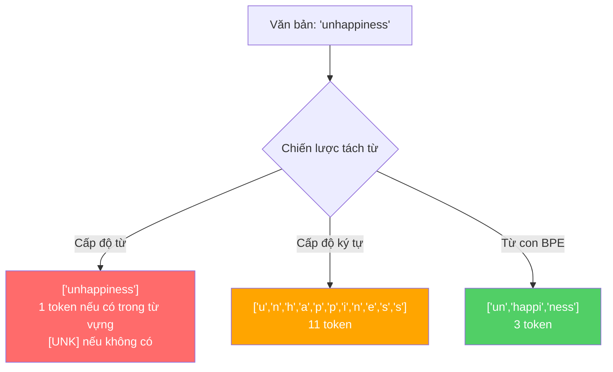
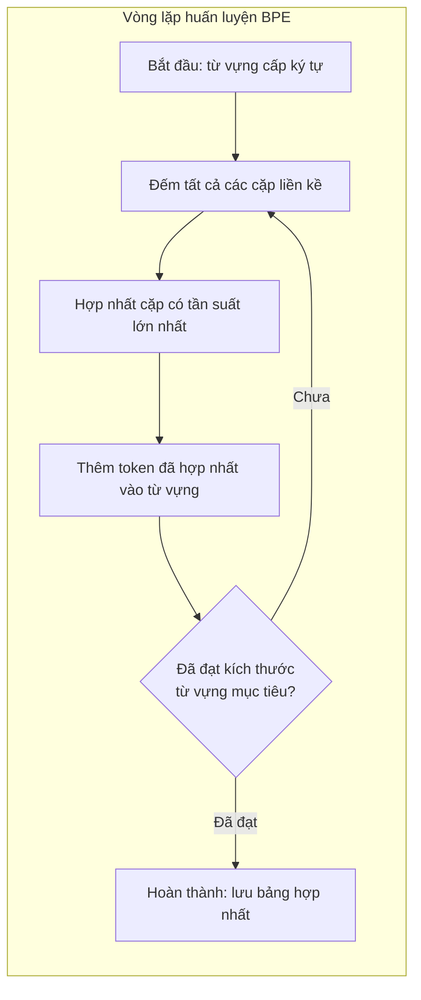
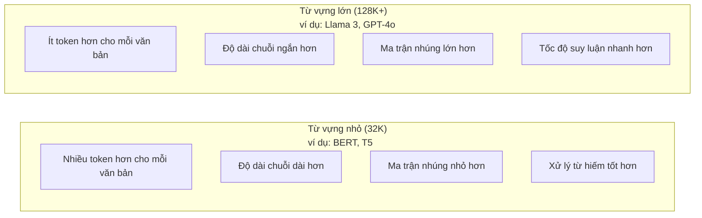

# Bộ tách từ: BPE, WordPiece, SentencePiece

> LLM của bạn không đọc tiếng Anh hay ngôn ngữ tự nhiên. Nó đọc các số nguyên. Bộ tách từ (tokenizer) sẽ quyết định liệu các số nguyên đó mang tải đầy đủ ý nghĩa hay làm lãng phí ngữ cảnh.

**Type:** Build
**Languages:** Python
**Prerequisites:** Giai đoạn 05 (Nền tảng NLP)
**Time:** ~90 phút

## Mục tiêu học tập

- Tự tay triển khai các thuật toán tách từ BPE, WordPiece và Unigram từ đầu và so sánh các chiến lược hợp nhất (merge strategies) của chúng
- Giải thích kích thước từ vựng (vocabulary size) ảnh hưởng thế nào đến hiệu quả mô hình: quá nhỏ sẽ tạo chuỗi quá dài, quá lớn sẽ lãng phí tham số tầng nhúng (embedding)
- Phân tích các hiện tượng dị thường (artifacts) của quá trình tách từ trên nhiều ngôn ngữ và mã nguồn, xác định điểm nghẽn của từng bộ tách từ
- Sử dụng các thư viện `tiktoken` và `sentencepiece` để tách từ văn bản và kiểm tra các ID token thu được

## Vấn đề đặt ra

LLM của bạn không đọc tiếng Anh. Nó không đọc bất kỳ ngôn ngữ nào của con người. Nó chỉ đọc các con số.

Khoảng cách giữa chuỗi `"Hello, world!"` và danh sách số nguyên `[15496, 11, 995, 0]` chính là bộ tách từ (tokenizer). Mọi từ, mọi khoảng trắng, mọi dấu câu đều phải được chuyển đổi thành một số nguyên trước khi mô hình có thể xử lý. Sự chuyển đổi này không hề mang tính trung lập. Nó cài cắm sẵn các giả định vào mô hình mà sau này bạn không thể đảo ngược.

Nếu làm sai, mô hình của bạn sẽ lãng phí dung lượng để mã hóa các từ phổ biến bằng nhiều token. Từ "unfortunately" có thể bị chia thành bốn token thay vì một. Cửa sổ ngữ cảnh (context window) 128K của bạn vừa bị thu hẹp đi 75% đối với các văn bản chứa nhiều từ đa âm tiết. Nếu làm đúng, cùng một cửa sổ ngữ cảnh đó có thể chứa lượng thông tin gấp đôi. Sự khác biệt giữa việc "mô hình này xử lý code rất tốt" và "mô hình này chật vật với Python" thường bắt nguồn từ cách mà bộ tách từ được huấn luyện.

Mỗi lượt gọi API đến GPT-4 hoặc Claude đều tính phí theo từng token. Mỗi token mô hình sinh ra đều tiêu tốn tài nguyên tính toán. Càng cần ít token để biểu diễn một đầu ra, tốc độ suy luận (inference) đầu-cuối càng nhanh. Tách từ (tokenization) không đơn thuần là tiền xử lý dữ liệu. Nó là một phần của kiến trúc mô hình.

## Khái niệm cốt lõi

### Ba hướng tiếp cận thất bại (và một hướng chiến thắng)

Có ba cách hiển nhiên để chuyển đổi văn bản thành số. Hai trong số đó không thể hoạt động hiệu quả ở quy mô lớn.

**Tách từ cấp độ từ (word-level tokenization)** thực hiện chia cắt dựa trên khoảng trắng và dấu câu. `"The cat sat"` trở thành `["The", "cat", "sat"]`. Đơn giản. Nhưng với `"tokenization"` thì sao? Hay `"GPT-4o"`? Hoặc một từ ghép tiếng Đức như `"Geschwindigkeitsbegrenzung"`? Tách từ cấp độ từ đòi hỏi một tập từ vựng khổng lồ để bao phủ mọi từ trong mọi ngôn ngữ. Chỉ cần bỏ sót một từ, bạn sẽ gặp phải token `[UNK]` đáng sợ -- cách mô hình thông báo "Tôi hoàn toàn không hiểu từ này là gì". Riêng tiếng Anh đã có hơn một triệu hình thái từ. Thêm vào đó mã nguồn, URL, ký hiệu khoa học và hàng trăm ngôn ngữ khác, bạn sẽ cần một tập từ vựng vô hạn.

**Tách từ cấp độ ký tự (character-level tokenization)** đi theo hướng ngược lại. `"hello"` trở thành `["h", "e", "l", "l", "o"]`. Tập từ vựng lúc này cực kỳ nhỏ (chỉ vài trăm ký tự). Không bao giờ xuất hiện token chưa biết (unknown token). Nhưng độ dài chuỗi lại trở nên cực kỳ dài. Một câu vốn chỉ tốn 10 token ở cấp độ từ nay biến thành 50 token ở cấp độ ký tự. Mô hình buộc phải học rằng "t", "h", "e" ghép lại với nhau mới mang nghĩa là "the" -- làm hao tổn năng lực của cơ chế chú ý (attention capacity) cho những điều mà một đứa trẻ ba tuổi đã nắm vững.

**Tách từ cấp độ từ con (subword tokenization)** tìm ra điểm cân bằng tối ưu. Các từ phổ biến được giữ nguyên vẹn: `"the"` là một token duy nhất. Các từ hiếm gặp được phân rã thành các mảnh ghép có ý nghĩa: `"unhappiness"` trở thành `["un", "happi", "ness"]`. Tập từ vựng giữ ở mức vừa phải (từ 30K đến 128K token). Chuỗi đầu vào ngắn gọn. Token chưa biết gần như biến mất hoàn toàn vì bất kỳ từ lạ nào cũng có thể được ghép lại từ các mảnh từ con.

Mọi LLM hiện đại đều sử dụng phương pháp tách từ cấp độ từ con. GPT-2, GPT-4, BERT, Llama 3, Claude -- tất cả đều dùng nó. Câu hỏi đặt ra là: nên chọn thuật toán nào?



### BPE: Mã hóa cặp byte (Byte Pair Encoding)

BPE là một thuật toán nén dữ liệu tham lam (greedy compression algorithm) được điều chỉnh dùng cho tác vụ tách từ. Ý tưởng đơn giản đến mức có thể tóm gọn trên một mảnh giấy ghi chú.

Bắt đầu với từng ký tự riêng lẻ. Đếm tần suất xuất hiện của mọi cặp ký tự liền kề trong tập dữ liệu huấn luyện (corpus). Hợp nhất (merge) cặp có tần suất xuất hiện nhiều nhất thành một token mới. Lặp lại quá trình này cho đến khi đạt được kích thước từ vựng mục tiêu.

```figure
tokenizer-bpe
```

Dưới đây là mô phỏng BPE hoạt động trên một tập ngữ liệu nhỏ gồm các từ "lower", "lowest", và "newest":

```text
Ngữ liệu (kèm tần suất từ):
  "lower"  x5
  "lowest" x2
  "newest" x6

Bước 0 -- Bắt đầu với các ký tự riêng lẻ:
  l o w e r       (x5)
  l o w e s t     (x2)
  n e w e s t     (x6)

Bước 1 -- Đếm các cặp liền kề:
  (e,s): 8    (s,t): 8    (l,o): 7    (o,w): 7
  (w,e): 13   (e,r): 5    (n,e): 6    ...

Bước 2 -- Hợp nhất cặp phổ biến nhất (w,e) -> "we":
  l o we r        (x5)
  l o we s t      (x2)
  n e we s t      (x6)

Bước 3 -- Đếm lại các cặp sau khi gộp "we":
  (l,o): 7   (o,we): 7   (we,r): 5   (we,s): 8
  (s,t): 8   (n,e): 6    (e,we): 6

Bước 4 -- Hợp nhất (we,s) -> "wes" hoặc (s,t) -> "st" (hòa ở mức 8, chọn cặp đầu tiên):
  Hợp nhất (we,s) -> "wes":
  l o we r        (x5)
  l o wes t       (x2)
  n e wes t       (x6)

Bước 5 -- Hợp nhất (wes,t) -> "west":
  l o we r        (x5)
  l o west        (x2)
  n e west        (x6)

...tiếp tục cho đến khi đạt kích thước từ vựng mục tiêu.
```

Bảng hợp nhất (merge table) chính là bộ tách từ. Để mã hóa văn bản mới, ta áp dụng các phép hợp nhất theo đúng thứ tự mà chúng đã được học. Ngữ liệu huấn luyện sẽ quyết định những phép hợp nhất nào tồn tại, và lựa chọn đó sẽ định hình vĩnh viễn cách mà mô hình quan sát thế giới.



### BPE cấp độ Byte (Byte-Level BPE trong GPT-2, GPT-3, GPT-4)

BPE tiêu chuẩn hoạt động trên các ký tự Unicode. Trong khi đó, BPE cấp độ byte (byte-level BPE) hoạt động trực tiếp trên các byte thô (từ 0 đến 255). Điều này cung cấp cho bạn một tập từ vựng cơ sở có đúng 256 phần tử, xử lý được bất kỳ ngôn ngữ hay bảng mã nào và không bao giờ tạo ra token chưa biết.

GPT-2 là mô hình tiên phong giới thiệu cách tiếp cận này. Tập từ vựng cơ sở bao phủ mọi byte có thể có. Các phép hợp nhất BPE được xây dựng tiếp nối từ nền tảng đó. Thư viện `tiktoken` của OpenAI triển khai byte-level BPE với các kích thước từ vựng sau:

- GPT-2: 50.257 token
- GPT-3.5/GPT-4: ~100.256 token (bảng mã `cl100k_base`)
- GPT-4o: 200.019 token (bảng mã `o200k_base`)

### WordPiece (BERT)

WordPiece trông khá giống với BPE nhưng tiêu chí lựa chọn cặp để hợp nhất lại khác biệt. Thay vì dựa vào tần suất thô (raw frequency), nó tối đa hóa hàm hợp lý (likelihood) của dữ liệu huấn luyện:

```text
Tiêu chí hợp nhất của BPE:       count(A, B)
Tiêu chí hợp nhất của WordPiece: count(AB) / (count(A) * count(B))
```

BPE đặt câu hỏi: "Cặp nào xuất hiện nhiều nhất?". WordPiece đặt câu hỏi: "Cặp nào xuất hiện cùng nhau thường xuyên hơn mức ngẫu nhiên?". Sự khác biệt tinh tế này tạo ra các tập từ vựng khác hẳn nhau. WordPiece ưu tiên các phép hợp nhất mà sự đồng xuất hiện mang tính bất ngờ, chứ không chỉ đơn thuần là phổ biến.

WordPiece cũng sử dụng tiền tố `"##"` cho các từ con nối tiếp:

```text
"unhappiness" -> ["un", "##happi", "##ness"]
"embedding"   -> ["em", "##bed", "##ding"]
```

Tiền tố `"##"` cho biết phần tử này là phần tiếp nối của token đứng trước. BERT sử dụng WordPiece với kích thước từ vựng là 30.522 token. (Lưu ý: bộ tách từ của RoBERTa thực tế là BPE, nhưng bản thân BERT nguyên bản dùng WordPiece).

### SentencePiece (Llama, T5)

SentencePiece xử lý đầu vào như một chuỗi liên tục các ký tự Unicode thô, bao gồm cả các khoảng trắng. Không cần bước tiền tách từ (pre-tokenization). Không cần các quy tắc phân tách từ đặc thù cho từng ngôn ngữ. Điều này giúp nó thực sự độc lập với ngôn ngữ (language-agnostic) -- nó hoạt động tốt trên tiếng Trung, tiếng Nhật, tiếng Thái và các ngôn ngữ không dùng dấu cách để ngăn cách từ.

SentencePiece hỗ trợ hai thuật toán:
- **Chế độ BPE (BPE mode)**: logic hợp nhất giống như BPE tiêu chuẩn, áp dụng trên chuỗi ký tự thô.
- **Chế độ Unigram (Unigram mode)**: bắt đầu với một tập từ vựng lớn và loại bỏ dần các token ít ảnh hưởng nhất đến hàm hợp lý tổng thể. Đây là hướng đi ngược lại của BPE -- cắt tỉa (prune) thay vì hợp nhất (merge).

Llama 2 sử dụng SentencePiece BPE với kích thước từ vựng 32.000 token. T5 sử dụng SentencePiece Unigram với 32.000 token. Lưu ý: Llama 3 đã chuyển sang bộ tách từ byte-level BPE dựa trên `tiktoken` với 128.256 token.

### Đánh đổi về kích thước từ vựng (Vocabulary Size Tradeoffs)

Đây là một quyết định kỹ thuật thực tế với những hệ quả có thể đo lường rõ ràng.



Hãy nhìn vào những con số cụ thể. Với từ vựng 128K và vector nhúng 4.096 chiều, chỉ riêng ma trận nhúng (embedding matrix) đã chiếm 128.000 x 4.096 = 524 triệu tham số. Với từ vựng 32K, con số này chỉ là 131 triệu tham số. Đó là mức chênh lệch tới 400 triệu tham số chỉ đến từ quyết định chọn bộ tách từ!

Tuy nhiên, từ vựng lớn hơn sẽ nén văn bản hiệu quả hơn. Cùng một đoạn văn bản tiếng Anh tốn 100 token với từ vựng 32K có thể chỉ tốn 70 token với từ vựng 128K. Điều đó đồng nghĩa với việc giảm 30% số lượt lan truyền tiến (forward passes) trong quá trình sinh văn bản. Đối với một hệ thống phục vụ hàng triệu truy vấn, đây là sự cắt giảm trực tiếp chi phí tính toán.

Xu hướng hiện nay rất rõ ràng: kích thước từ vựng ngày càng tăng. GPT-2 sử dụng 50.257. GPT-4 sử dụng ~100K. Llama 3 sử dụng 128K. GPT-4o sử dụng 200K.

| Mô hình | Kích thước từ vựng | Loại bộ tách từ | Số token trung bình / từ tiếng Anh |
|---|---|---|---|
| BERT | 30.522 | WordPiece | ~1,4 |
| GPT-2 | 50.257 | Byte-level BPE | ~1,3 |
| Llama 2 | 32.000 | SentencePiece BPE | ~1,4 |
| GPT-4 | ~100.256 | Byte-level BPE | ~1,2 |
| Llama 3 | 128.256 | Byte-level BPE (tiktoken) | ~1,1 |
| GPT-4o | 200.019 | Byte-level BPE | ~1,0 |

### "Thuế" đa ngôn ngữ (The Multilingual Tax)

Các bộ tách từ được huấn luyện chủ yếu trên tiếng Anh thường gây bất lợi lớn cho các ngôn ngữ khác. Văn bản tiếng Hàn trong bộ tách từ của GPT-2 trung bình tốn 2 đến 3 token cho mỗi từ. Tiếng Trung thậm chí còn tốn hơn. Điều này đồng nghĩa với việc người dùng tiếng Hàn trên thực tế chỉ có một cửa sổ ngữ cảnh bằng một nửa so với người dùng tiếng Anh -- phải trả cùng một mức giá cho mật độ thông tin thấp hơn.

Đó là lý do tại sao Llama 3 tăng gấp bốn lần kích thước từ vựng từ 32K lên 128K. Việc dành thêm nhiều token cho các hệ chữ viết phi Latinh giúp nén công bằng hơn giữa các ngôn ngữ.

```figure
tokenizer-tradeoff
```

## Tự tay xây dựng (Build It)

### Bước 1: Bộ tách từ cấp ký tự (Character-Level Tokenizer)

Bắt đầu từ nền móng cơ bản. Bộ tách từ cấp ký tự ánh xạ mỗi ký tự thành mã Unicode code point tương ứng. Không cần huấn luyện. Không có token chưa biết. Chỉ là một phép ánh xạ trực tiếp.

```python
class CharTokenizer:
    def encode(self, text):
        return [ord(c) for c in text]

    def decode(self, tokens):
        return "".join(chr(t) for t in tokens)
```

Chuỗi `"hello"` trở thành `[104, 101, 108, 108, 111]`. Mỗi ký tự là một token riêng biệt. Đây là mốc cơ sở để chúng ta cải tiến.

### Bước 2: Tự xây dựng BPE Tokenizer từ con số không

Đây là phần triển khai thực tế. Ta huấn luyện trên các byte thô (như GPT-2), đếm các cặp byte, hợp nhất cặp phổ biến nhất và ghi lại từng phép hợp nhất theo thứ tự. Bảng hợp nhất chính là bộ tách từ.

```python
from collections import Counter

class BPETokenizer:
    def __init__(self):
        self.merges = {}
        self.vocab = {}

    def _get_pairs(self, tokens):
        pairs = Counter()
        for i in range(len(tokens) - 1):
            pairs[(tokens[i], tokens[i + 1])] += 1
        return pairs

    def _merge_pair(self, tokens, pair, new_token):
        merged = []
        i = 0
        while i < len(tokens):
            if i < len(tokens) - 1 and tokens[i] == pair[0] and tokens[i + 1] == pair[1]:
                merged.append(new_token)
                i += 2
            else:
                merged.append(tokens[i])
                i += 1
        return merged

    def train(self, text, num_merges):
        tokens = list(text.encode("utf-8"))
        self.vocab = {i: bytes([i]) for i in range(256)}

        for i in range(num_merges):
            pairs = self._get_pairs(tokens)
            if not pairs:
                break
            best_pair = max(pairs, key=pairs.get)
            new_token = 256 + i
            tokens = self._merge_pair(tokens, best_pair, new_token)
            self.merges[best_pair] = new_token
            self.vocab[new_token] = self.vocab[best_pair[0]] + self.vocab[best_pair[1]]

        return self

    def encode(self, text):
        tokens = list(text.encode("utf-8"))
        for pair, new_token in self.merges.items():
            tokens = self._merge_pair(tokens, pair, new_token)
        return tokens

    def decode(self, tokens):
        byte_sequence = b"".join(self.vocab[t] for t in tokens)
        return byte_sequence.decode("utf-8", errors="replace")
```

Vòng lặp huấn luyện là trái tim của BPE: đếm các cặp, hợp nhất cặp thắng cuộc và lặp lại. Mỗi phép hợp nhất sẽ làm giảm tổng số lượng token của ngữ liệu. Sau `num_merges` lượt, từ vựng tăng từ 256 (các byte cơ bản) lên 256 + num_merges.

Quá trình mã hóa (`encode`) áp dụng các phép hợp nhất theo đúng thứ tự đã học. Thứ tự này mang tính quyết định: nếu phép hợp nhất 1 tạo ra `"th"` và phép hợp nhất 5 tạo ra `"the"`, quá trình mã hóa bắt buộc phải áp dụng phép 1 trước để `"the"` có thể hình thành từ `"th"` + `"e"` ở phép 5.

Quá trình giải mã (`decode`) là chiều nghịch: tra cứu từng ID token trong bảng từ vựng, ghép các chuỗi byte lại với nhau và giải mã về UTF-8.

### Bước 3: Kiểm tra tính toàn vẹn hai chiều (Encode và Decode Roundtrip)

```python
corpus = (
    "The cat sat on the mat. The cat ate the rat. "
    "The dog sat on the log. The dog ate the frog. "
    "Natural language processing is the study of how computers "
    "understand and generate human language. "
    "Tokenization is the first step in any NLP pipeline."
)

tokenizer = BPETokenizer()
tokenizer.train(corpus, num_merges=40)

test_sentences = [
    "The cat sat on the mat.",
    "Natural language processing",
    "tokenization pipeline",
    "unhappiness",
]

for sentence in test_sentences:
    encoded = tokenizer.encode(sentence)
    decoded = tokenizer.decode(encoded)
    raw_bytes = len(sentence.encode("utf-8"))
    ratio = len(encoded) / raw_bytes
    print(f"'{sentence}'")
    print(f"  Tokens: {len(encoded)} (from {raw_bytes} bytes) -- ratio: {ratio:.2f}")
    print(f"  Roundtrip: {'PASS' if decoded == sentence else 'FAIL'}")
```

Tỷ lệ nén (compression ratio) cho thấy mức độ hiệu quả của bộ tách từ. Tỷ lệ 0,50 nghĩa là bộ tách từ đã nén văn bản xuống số lượng token chỉ bằng một nửa số byte thô. Tỷ lệ càng thấp càng tốt. Trên ngữ liệu huấn luyện, tỷ lệ này sẽ rất tốt. Với văn bản ngoài phân phối (out-of-distribution) như `"unhappiness"` (từ không xuất hiện trong ngữ liệu huấn luyện), tỷ lệ sẽ kém hơn -- bộ tách từ sẽ tự động lùi về mã hóa cấp ký tự/byte đối với các mẫu chưa từng thấy.

### Bước 4: So sánh với tiktoken

```python
import tiktoken

enc = tiktoken.get_encoding("cl100k_base")

texts = [
    "The cat sat on the mat.",
    "unhappiness",
    "Hello, world!",
    "def fibonacci(n): return n if n < 2 else fibonacci(n-1) + fibonacci(n-2)",
    "Geschwindigkeitsbegrenzung",
]

for text in texts:
    our_tokens = tokenizer.encode(text)
    tiktoken_tokens = enc.encode(text)
    tiktoken_pieces = [enc.decode([t]) for t in tiktoken_tokens]
    print(f"'{text}'")
    print(f"  Our BPE:   {len(our_tokens)} tokens")
    print(f"  tiktoken:  {len(tiktoken_tokens)} tokens -> {tiktoken_pieces}")
```

`tiktoken` sử dụng thuật toán hoàn toàn tương tự, nhưng được huấn luyện trên hàng trăm gigabyte văn bản với 100.000 phép hợp nhất. Về bản chất, thuật toán là đồng nhất. Sự khác biệt chỉ nằm ở dữ liệu huấn luyện và số lượng phép hợp nhất. Bộ tách từ huấn luyện trên một đoạn văn với 40 phép hợp nhất hiển nhiên không thể so sánh với 100K phép hợp nhất của `tiktoken` trên một siêu ngữ liệu. Nhưng cơ chế cốt lõi là như nhau.

### Bước 5: Phân tích phân phối từ vựng (Vocabulary Analysis)

```python
def analyze_vocabulary(tokenizer, test_texts):
    total_tokens = 0
    total_chars = 0
    token_usage = Counter()

    for text in test_texts:
        encoded = tokenizer.encode(text)
        total_tokens += len(encoded)
        total_chars += len(text)
        for t in encoded:
            token_usage[t] += 1

    print(f"Vocabulary size: {len(tokenizer.vocab)}")
    print(f"Total tokens across all texts: {total_tokens}")
    print(f"Total characters: {total_chars}")
    print(f"Avg tokens per character: {total_tokens / total_chars:.2f}")

    print(f"\nMost used tokens:")
    for token_id, count in token_usage.most_common(10):
        token_bytes = tokenizer.vocab[token_id]
        display = token_bytes.decode("utf-8", errors="replace")
        print(f"  Token {token_id:4d}: '{display}' (used {count} times)")

    unused = [t for t in tokenizer.vocab if t not in token_usage]
    print(f"\nUnused tokens: {len(unused)} out of {len(tokenizer.vocab)}")
```

Đoạn mã này làm sáng tỏ quy luật phân phối Zipf (Zipfian distribution) trong từ vựng. Một vài token chiếm tỷ trọng áp đảo (khoảng trắng, `"the"`, `"e"`). Đa số các token khác hiếm khi được dùng tới. Các bộ tách từ môi trường sản xuất (production tokenizers) luôn tối ưu hóa cho phân phối này -- các mẫu phổ biến có ID ngắn gọn, trong khi các mẫu hiếm dùng biểu diễn dài hơn.

## Sử dụng trong thực tế (Use It)

Bản BPE tự xây dựng đã hoạt động. Bây giờ hãy xem các công cụ trong môi trường sản xuất vận hành ra sao.

### tiktoken (OpenAI)

```python
import tiktoken

enc = tiktoken.get_encoding("cl100k_base")

text = "Tokenizers convert text to integers"
tokens = enc.encode(text)
print(f"Tokens: {tokens}")
print(f"Pieces: {[enc.decode([t]) for t in tokens]}")
print(f"Roundtrip: {enc.decode(tokens)}")
```

`tiktoken` được viết bằng Rust với các liên kết Python (Python bindings). Nó có khả năng mã hóa hàng triệu token mỗi giây. Cùng một thuật toán BPE nhưng được tối ưu hóa ở cấp độ công nghiệp.

### Thư viện tokenizers của Hugging Face

```python
from tokenizers import Tokenizer
from tokenizers.models import BPE
from tokenizers.trainers import BpeTrainer
from tokenizers.pre_tokenizers import ByteLevel

tokenizer = Tokenizer(BPE())
tokenizer.pre_tokenizer = ByteLevel()

trainer = BpeTrainer(vocab_size=1000, special_tokens=["<pad>", "<eos>", "<unk>"])
tokenizer.train(["corpus.txt"], trainer)

output = tokenizer.encode("The cat sat on the mat.")
print(f"Tokens: {output.tokens}")
print(f"IDs: {output.ids}")
```

Thư viện `tokenizers` của Hugging Face cũng được xây dựng bằng Rust bên dưới. Nó có thể huấn luyện BPE trên các tập ngữ liệu quy mô gigabyte chỉ trong vài giây. Đây là công cụ tiêu chuẩn bạn sẽ dùng khi huấn luyện mô hình của riêng mình.

### Nạp bộ tách từ của Llama

```python
from transformers import AutoTokenizer

tokenizer = AutoTokenizer.from_pretrained("meta-llama/Llama-3.1-8B")

text = "Tokenizers are the unsung heroes of LLMs"
tokens = tokenizer.encode(text)
print(f"Token IDs: {tokens}")
print(f"Tokens: {tokenizer.convert_ids_to_tokens(tokens)}")
print(f"Vocab size: {tokenizer.vocab_size}")

multilingual = ["Hello world", "Hola mundo", "Bonjour le monde"]
for text in multilingual:
    ids = tokenizer.encode(text)
    print(f"'{text}' -> {len(ids)} tokens")
```

Từ vựng 128K của Llama 3 nén văn bản phi tiếng Anh tốt hơn đáng kể so với từ vựng 50K của GPT-2. Bạn có thể tự mình kiểm chứng điều này -- hãy mã hóa cùng một câu qua nhiều ngôn ngữ khác nhau và đếm số lượng token.

## Bàn giao sản phẩm (Ship It)

Bài học này tạo ra artifact `outputs/prompt-tokenizer-analyzer.md` -- một prompt có thể tái sử dụng để phân tích hiệu suất tách từ cho bất kỳ sự kết hợp nào giữa văn bản và mô hình. Khi đưa vào một mẫu văn bản, nó sẽ cho biết bộ tách từ của mô hình nào xử lý văn bản đó tối ưu nhất.

## Bài tập thực hành

1. Chỉnh sửa bộ tách từ BPE để in ra từ vựng ở từng bước hợp nhất. Quan sát cách `"t"` + `"h"` trở thành `"th"`, rồi `"th"` + `"e"` trở thành `"the"`. Theo dõi cách các từ tiếng Anh thông dụng được ghép nối từng mảnh một.

2. Thêm các token đặc biệt (`<pad>`, `<eos>`, `<unk>`) vào bộ tách từ BPE. Gán cho chúng các ID 0, 1, 2 và dịch chuyển các token khác tương ứng. Triển khai một bước tiền tách từ (pre-tokenization) phân tách theo khoảng trắng trước khi chạy BPE.

3. Triển khai tiêu chí hợp nhất của WordPiece (tỷ lệ hợp lý thay vì tần suất xuất hiện). Huấn luyện cả BPE và WordPiece trên cùng một ngữ liệu với cùng số lượng phép hợp nhất. So sánh các tập từ vựng thu được -- phương pháp nào tạo ra các từ con có ý nghĩa ngôn ngữ học rõ ràng hơn?

4. Xây dựng một bài đo chuẩn (benchmark) hiệu suất bộ tách từ đa ngôn ngữ. Lấy 10 câu bằng tiếng Anh, tiếng Tây Ban Nha, tiếng Trung, tiếng Hàn và tiếng Ả Rập. Tách từ từng câu bằng `tiktoken` (`cl100k_base`) và đo số token trung bình trên mỗi ký tự. Định lượng mức "thuế đa ngôn ngữ" cho từng ngôn ngữ.

5. Huấn luyện bộ tách từ BPE của bạn trên một ngữ liệu lớn hơn (tải xuống một bài viết Wikipedia). Tinh chỉnh số lượng phép hợp nhất để đạt được tỷ lệ nén chênh lệch trong vòng 10% so với `tiktoken` trên chính văn bản đó. Bài tập này giúp bạn hiểu rõ mối quan hệ giữa kích thước ngữ liệu, số lượng phép hợp nhất và chất lượng nén.

## Các thuật ngữ chính

| Thuật ngữ | Người ta thường nói | Ý nghĩa thực sự |
|---|---|---|
| Token (Từ tố) | "Một từ" | Một đơn vị trong từ vựng của mô hình -- có thể là một ký tự, một từ con, một từ hoàn chỉnh, hoặc một cụm nhiều từ |
| BPE | "Một thuật toán nén nào đó" | Mã hóa cặp byte (Byte Pair Encoding) -- lặp đi lặp lại việc hợp nhất cặp token liền kề phổ biến nhất cho đến khi đạt kích thước từ vựng mục tiêu |
| WordPiece | "Bộ tách từ của BERT" | Tương tự BPE nhưng các phép hợp nhất tối đa hóa tỷ lệ hợp lý `count(AB)/(count(A)*count(B))` thay vì tần suất thô |
| SentencePiece | "Một thư viện tách từ" | Bộ tách từ độc lập ngôn ngữ xử lý chuỗi Unicode thô mà không cần bước tiền tách từ, hỗ trợ cả hai thuật toán BPE và Unigram |
| Kích thước từ vựng (Vocabulary size) | "Số từ mô hình biết" | Tổng số lượng token phân biệt duy nhất: GPT-2 có 50.257, BERT có 30.522, Llama 3 có 128.256 |
| Độ sinh từ (Fertility) | "Không phải thuật ngữ của tokenizer" | Số lượng token trung bình trên mỗi từ -- đo lường hiệu quả của bộ tách từ qua các ngôn ngữ (1,0 là lý tưởng, 3,0 nghĩa là mô hình phải tốn tài nguyên gấp 3 lần) |
| Byte-level BPE | "Bộ tách từ của GPT" | BPE hoạt động trực tiếp trên byte thô (0-255) thay vì ký tự Unicode, đảm bảo không bao giờ sinh ra token chưa biết cho bất kỳ đầu vào nào |
| Bảng hợp nhất (Merge table) | "File của tokenizer" | Danh sách có thứ tự các cặp hợp nhất được học trong quá trình huấn luyện -- đây CHÍNH LÀ bộ tách từ, và thứ tự các phép ghép mang tính quyết định |
| Tiền tách từ (Pre-tokenization) | "Tách từ theo khoảng trắng" | Các quy tắc được áp dụng trước khi tách từ con: tách theo khoảng trắng, phân tách số, xử lý dấu câu |
| Tỷ lệ nén (Compression ratio) | "Mức độ hiệu quả của bộ tách từ" | Số token sinh ra chia cho số byte đầu vào -- tỷ lệ càng thấp nghĩa là độ nén càng tốt và tốc độ suy luận càng nhanh |

## Tài liệu đọc thêm

- [Sennrich et al., 2016 -- "Neural Machine Translation of Rare Words with Subword Units"](https://arxiv.org/abs/1508.07909) -- bài báo giới thiệu BPE cho NLP, biến thuật toán nén từ năm 1994 thành nền tảng của các bộ tách từ hiện đại
- [Kudo & Richardson, 2018 -- "SentencePiece: A simple and language independent subword tokenizer"](https://arxiv.org/abs/1808.06226) -- kỹ thuật tách từ độc lập ngôn ngữ giúp mô hình đa ngôn ngữ trở nên khả thi trong thực tế
- [OpenAI tiktoken repository](https://github.com/openai/tiktoken) -- triển khai BPE chuẩn sản xuất viết bằng Rust với liên kết Python, được sử dụng bởi GPT-3.5/4/4o
- [Hugging Face Tokenizers documentation](https://huggingface.co/docs/tokenizers) -- huấn luyện bộ tách từ chuẩn công nghiệp với hiệu năng cao của Rust
