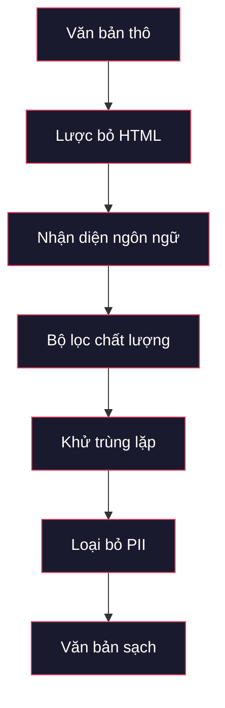
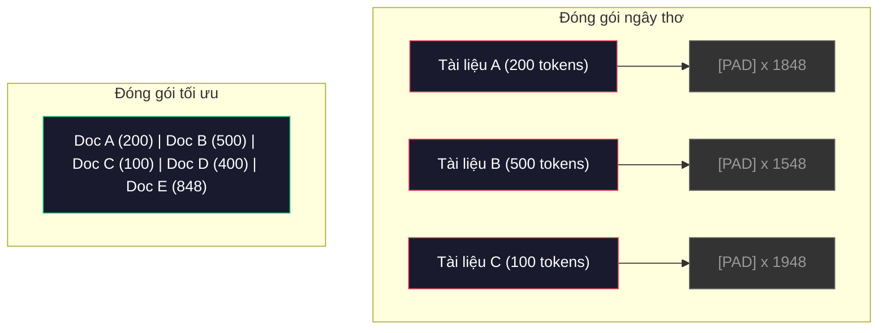

# Đường ống dữ liệu cho Tiền huấn luyện (Data Pipelines for Pre-Training)

> Mô hình giống như một tấm gương. Nó phản chiếu bất cứ dữ liệu nào bạn nạp vào. Nạp vào rác rưởi, nó sẽ phản chiếu lại rác rưởi với độ trôi chảy hoàn hảo.

**Type:** Build
**Languages:** Python
**Prerequisites:** Giai đoạn 10, Bài 01-02 (Bộ tách từ, Xây dựng bộ tách từ)
**Time:** ~90 phút

## Mục tiêu học tập

- Xây dựng một đường ống dữ liệu luồng (streaming data pipeline) có khả năng tách từ, phân khối, xáo trộn và gom batch hàng terabyte văn bản mà không cần nạp toàn bộ vào bộ nhớ
- Triển khai các bộ lọc chất lượng dữ liệu (khử trùng lặp, nhận diện ngôn ngữ, lọc nội dung) được áp dụng trong các đường ống tiền huấn luyện thực tế
- Tạo các chuỗi huấn luyện có độ dài cố định kèm mặt nạ chú ý (attention masks) chuẩn xác và xử lý ranh giới tài liệu
- Đo kiểm thông lượng đường ống (throughput profiling) để đảm bảo bộ nạp dữ liệu (dataloader) theo kịp tốc độ huấn luyện của GPU

## Vấn đề đặt ra

Bạn đã có bộ tách từ. Bây giờ bạn cần dữ liệu.

Không chỉ là một bộ dữ liệu nhỏ. Không phải là một tệp CSV. Chúng ta cần hàng terabyte văn bản -- đã được làm sạch, khử trùng lặp, lọc chất lượng, tách từ thành các chuỗi có độ dài cố định và phân phối thành các batch ngẫu nhiên đủ nhanh để cụm 8 GPU không bao giờ rơi vào trạng thái chờ dữ liệu.

Nhiều người lầm tưởng rằng huấn luyện LLM mấu chốt nằm ở kiến trúc mô hình. Thực tế không phải vậy. Llama 3 sử dụng 15,6 nghìn tỷ token. GPT-3 sử dụng 300 tỷ. DeepSeek-V2 sử dụng 8,1 nghìn tỷ. Kiến trúc của cả ba mô hình này về cơ bản tương đồng nhau: các khối transformer xếp chồng lên nhau với các tầng chú ý (attention) và truyền thẳng (feedforward). Sự khác biệt vượt trội về chất lượng đầu ra chủ yếu đến từ dữ liệu.

Bài báo về định luật Chinchilla của DeepMind đã làm rõ điều này về mặt toán học. Với một ngân sách tính toán nhất định, luôn tồn tại một tỷ lệ tối ưu giữa số lượng tham số mô hình và số lượng token huấn luyện. Chinchilla chỉ ra rằng hầu hết các mô hình năm 2022 đều bị thiếu huấn luyện (undertrained) nghiêm trọng -- chúng có quá nhiều tham số so với lượng dữ liệu được nạp. Một mô hình 70B tham số được huấn luyện trên 1,4 nghìn tỷ token (chuẩn tối ưu Chinchilla) đã vượt trội hơn một mô hình 280B tham số nhưng chỉ được huấn luyện trên 300 tỷ token (Gopher).

Đường ống dữ liệu sẽ quyết định mô hình của bạn học được tri thức ngôn ngữ hay chỉ học toàn nhiễu.

## Khái niệm cốt lõi

### Nguồn gốc của dữ liệu

Mỗi mô hình ngôn ngữ lớn đều được huấn luyện trên sự kết hợp của nhiều nguồn khác nhau. Tỷ lệ phân bổ chính xác là bí mật được bảo vệ nghiêm ngặt của các phòng nghiên cứu, nhưng chúng ta có thể nắm bắt các danh mục chính.

| Nguồn | Kích thước | Chất lượng | Được sử dụng bởi |
|---|---|---|---|
| Common Crawl | ~250 TB thô | Thấp (cần lọc rất kỹ) | GPT-3, Llama, hầu hết các mô hình mở |
| Wikipedia | ~20 GB | Rất cao | Hầu hết các LLM lớn |
| Mã nguồn GitHub | ~1 TB+ | Trung bình (nhiều bản sao, mã rác) | StarCoder, CodeLlama, DeepSeek-Coder |
| Sách (BookCorpus, Pile) | ~100 GB | Cao | GPT-2, GPT-3, các mô hình đời đầu |
| Bài báo học thuật (arXiv, S2ORC) | ~100 GB | Rất cao cho STEM | Llama, Galactica |
| StackOverflow, Reddit | ~100 GB | Trung bình | Llama, Falcon |
| Web chọn lọc (C4, RefinedWeb) | ~5 TB | Trung bình-Cao (đã lọc sẵn) | T5, Falcon |

Llama 3 đã công bố tỷ lệ pha trộn dữ liệu: khoảng 50% dữ liệu web, 25% mã nguồn, 13% sách và bài báo học thuật, 8% dữ liệu toán học và 4% dữ liệu web đa ngôn ngữ. Tổng cộng là 15,6 nghìn tỷ token trích xuất từ các nguồn văn bản thô vượt quá 5 TB.

Tỷ lệ pha trộn mang ý nghĩa quyết định không kém gì tổng dung lượng. Quá nhiều dữ liệu web sẽ biến mô hình thành một con vẹt Reddit. Quá ít mã nguồn thì mô hình không thể lập trình. Quá ít toán học thì mô hình thất bại trong khả năng suy luận logic. Tìm ra công thức pha trộn tối ưu là một trong những bài toán hóc búa nhất khi huấn luyện LLM, và không có công thức cố định -- nó đòi hỏi thực nghiệm và đánh giá liên tục.

### Làm sạch dữ liệu (Data Cleaning)

Dữ liệu web thô vô cùng hỗn tạp. Một bản tải về điển hình từ Common Crawl sẽ chứa:

- Các thẻ HTML và mã JavaScript
- Phần đầu trang, chân trang, menu điều hướng mẫu
- Các trang trùng lặp (trùng hoàn toàn hoặc gần trùng lặp)
- Thư rác và nội dung do máy tạo ra (spam)
- Thông tin định danh cá nhân (Personally Identifiable Information - PII)
- Văn bản chất lượng thấp (danh sách từ khóa nhồi nhét SEO)
- Dữ liệu phi văn bản bị mã hóa thành văn bản

Làm sạch dữ liệu là bước bắt buộc. Đó là ranh giới giữa một mô hình tạo ra các đoạn văn mạch lạc và một mô hình nhả ra các thẻ HTML xen lẫn danh mục sản phẩm thương mại điện tử.



Mỗi bước đều triệt tiêu một dạng nhiễu cụ thể:

**Lược bỏ HTML (HTML stripping):** Loại bỏ toàn bộ thẻ định dạng. Chỉ giữ lại phần nội dung văn bản nhìn thấy được. Các thư viện như `trafilatura` hoặc `readability` giúp trích xuất phần nội dung bài viết và vứt bỏ thanh điều hướng, quảng cáo và phần mẫu lặp lại.

**Nhận diện ngôn ngữ (Language detection):** Sử dụng mô hình nhận diện ngôn ngữ của fastText (`lid.176.bin`) để phân loại tài liệu. Chỉ giữ lại các ngôn ngữ mục tiêu. Một tài liệu được phân loại là tiếng Anh với độ tin cậy dưới 0,8 nhiều khả năng không phải là tiếng Anh chuẩn.

**Lọc chất lượng (Quality filtering):** Đây là khâu then chốt. RefinedWeb (bộ dữ liệu của Falcon) sử dụng bộ lọc dựa trên độ hỗn loạn (perplexity-based filter): huấn luyện một mô hình ngôn ngữ nhỏ trên Wikipedia, sau đó chấm điểm từng tài liệu. Độ hỗn loạn cao nghĩa là tài liệu có phân phối rất khác Wikipedia -- thường là thư rác, danh sách từ khóa hoặc văn bản máy sinh. Những tài liệu vượt ngưỡng cho phép sẽ bị loại bỏ.

**Khử trùng lặp (Deduplication):** Bước làm sạch mang lại tác động lớn nhất. Common Crawl chứa lượng khổng lồ các trang trùng lặp -- văn bản pháp lý từ chối trách nhiệm, thông báo cookie, điều khoản dịch vụ. Huấn luyện trên dữ liệu trùng lặp làm lãng phí năng lực tính toán và khiến mô hình học vẹt, sao chép nguyên văn các đoạn văn bản dài.

**Loại bỏ PII (PII removal):** Tên riêng, địa chỉ email, số điện thoại, số an sinh xã hội. Dùng biểu thức chính quy (regex) để phát hiện PII có cấu trúc và các mô hình nhận dạng thực thể có tên (NER) cho tên người trong ngữ cảnh.

### Khử trùng lặp với MinHash và LSH

Khử trùng lặp tuyệt đối (exact deduplication) rất đơn giản: băm từng tài liệu và loại bỏ các bản trùng. Nhưng trùng lặp gần (near-duplicates) mới là vấn đề nan giải. Hai bản sao của cùng một bài báo với các banner quảng cáo xung quanh khác nhau là những bản gần trùng lặp. Nội dung giống nhau 95%, nhưng từng byte dữ liệu lại khác biệt.

Thuật toán MinHash kết hợp Băm nhạy cảm vị trí (Locality-Sensitive Hashing - LSH) giải quyết bài toán này một cách tối ưu.


Ý tưởng cốt lõi:

1. **Phân đoạn (Shingling):** Chuyển đổi mỗi tài liệu thành một tập các n-gram (ví dụ: chuỗi 5 từ hoặc ký tự). Cụm "the quick brown fox" với shingle 3 từ trở thành `{"the quick brown", "quick brown fox"}`.

2. **Chữ ký MinHash (MinHash signature):** Với tập shingle của mỗi tài liệu, tính toán $k$ giá trị băm. Mỗi giá trị là giá trị băm nhỏ nhất trên tất cả các shingle dưới một hàm băm khác nhau. Việc này tạo ra một "chữ ký" có kích thước cố định xấp xỉ độ tương đồng Jaccard giữa hai tài liệu bất kỳ.

3. **LSH:** Gom các tài liệu vào các ngăn chứa (buckets) dựa trên các dải (bands) trong chữ ký MinHash của chúng. Các tài liệu rơi vào cùng một ngăn là các ứng viên gần trùng lặp. Cách này tránh việc phải so sánh từng cặp tài liệu trong toàn bộ tập dữ liệu -- ta chỉ cần so sánh các ứng viên trong cùng một ngăn.

4. **Xác minh (Verify):** Với mỗi cặp ứng viên, tính toán độ tương đồng Jaccard thực tế. Loại bỏ một bản sao nếu độ tương đồng vượt ngưỡng (thường là 0,8).

Đội ngũ phát triển Llama báo cáo rằng họ đã loại bỏ khoảng 38% dữ liệu web nhờ khâu khử trùng lặp. Đó là một con số khổng lồ: hơn một phần ba nội dung trên Common Crawl thực chất là rác trùng lặp hoặc gần trùng lặp.

### Đóng gói chuỗi (Sequence Packing)

Mô hình của bạn yêu cầu chuỗi đầu vào có độ dài cố định. Nhưng các tài liệu thực tế lại có độ dài biến thiên: có tài liệu chỉ 50 token, có tài liệu dài 50.000 token.

Cách làm ngây thơ: thêm token đệm (`[PAD]`) cho mọi tài liệu cho đến khi đạt độ dài chuỗi tối đa. Cách này lãng phí lượng tài nguyên tính toán khổng lồ vào các token đệm vô giá trị đối với việc học.

Cách làm tối ưu: đóng gói (pack) nhiều tài liệu vào một chuỗi duy nhất, phân cách bởi token kết thúc chuỗi (`[EOS]`). Một chuỗi 2048 token có thể chứa ba tài liệu ngắn được ghép lại với các token `[EOS]` nằm giữa.



Mặt nạ chú ý (attention mask) bắt buộc phải được thiết lập chuẩn xác. Các token thuộc Tài liệu A không được phép chú ý đến các token của Tài liệu B trong cùng một chuỗi đã đóng gói. Điều này đòi hỏi ma trận chú ý dạng khối đường chéo (block-diagonal attention mask).

Các tài liệu quá dài sẽ bị cắt ngắn hoặc chia thành các khối tại ranh giới chuỗi. Vị trí cắt rất quan trọng: cắt ngang giữa câu khiến mô hình phải tiếp nhận các ý niệm dở dang. Một số đường ống hiện đại sẽ căn chỉnh ranh giới cắt trùng với ranh giới đoạn văn hoặc câu khi có thể.

### Định luật tỷ lệ Chinchilla (The Chinchilla Scaling Law)

Với một ngân sách tính toán cố định $C$ (tính theo số phép tính số thực FLOPs), kích thước mô hình tối ưu $N$ và dung lượng tập dữ liệu $D$ tuân theo hệ thức:

```math
\begin{aligned}
N_{\text{opt}} &\sim C^{0.5} \\
D_{\text{opt}} &\sim C^{0.5}
\end{aligned}
```

Trong thực tế, điều này hàm ý rằng bạn nên tăng quy mô kích thước mô hình và số lượng token huấn luyện theo tỷ lệ gần như tương đương. Một mô hình có số tham số gấp 10 lần sẽ cần lượng token huấn luyện gấp khoảng 10 lần để đạt được hàm mất mát tương đương.

| Mô hình | Số tham số | Token huấn luyện | Tối ưu Chinchilla? |
|---|---|---|---|
| GPT-3 | 175B | 300B | Không (thiếu huấn luyện 3-4 lần) |
| Chinchilla | 70B | 1,4T | Có (do thiết kế) |
| Llama 2 | 70B | 2T | Huấn luyện vượt mức (chủ đích) |
| Llama 3 | 70B | 15T | Huấn luyện vượt mức rất sâu |

Llama 3 chủ động phá vỡ định luật Chinchilla. Meta nhận thấy rằng việc huấn luyện vượt mức (overtraining) trên nhiều dữ liệu hơn -- vượt xa tỷ lệ tối ưu tính toán -- tạo ra các mô hình phục vụ suy luận (inference) tốt hơn rất nhiều. Chi phí huấn luyện bổ sung chỉ trả một lần duy nhất, nhưng mô hình nhỏ gọn hơn sẽ giúp tiết kiệm chi phí suy luận mãi mãi về sau. Phương pháp này thường được gọi là quy mô tối ưu suy luận (inference-optimal scaling) và đã trở thành tiêu chuẩn công nghiệp từ năm 2024.

```figure
l5-data-pipeline
```

## Tự tay xây dựng (Build It)

### Bước 1: Làm sạch văn bản (Text Cleaning)

Lược bỏ HTML, chuẩn hóa khoảng trắng, loại bỏ các ký tự phi văn bản. Chúng ta sẽ sử dụng văn bản thuộc phạm vi công cộng (Project Gutenberg) làm ngữ liệu mẫu nhỏ.

```python
import re

def clean_text(text):
    text = re.sub(r"<[^>]+>", "", text)
    text = re.sub(r"http\S+", "", text)
    text = re.sub(r"[^\x20-\x7E\n]", "", text)
    text = re.sub(r"\n{3,}", "\n\n", text)
    text = re.sub(r" {2,}", " ", text)
    return text.strip()

def quality_filter(text, min_words=50, max_ratio_caps=0.3, max_ratio_special=0.1):
    words = text.split()
    if len(words) < min_words:
        return False
    caps_ratio = sum(1 for w in words if w.isupper()) / len(words)
    if caps_ratio > max_ratio_caps:
        return False
    special_chars = sum(1 for c in text if not c.isalnum() and not c.isspace())
    if special_chars / max(len(text), 1) > max_ratio_special:
        return False
    return True
```

Bộ lọc chất lượng loại bỏ thư rác SEO (VIẾT HOA TOÀN BỘ), nhiễu do máy tạo (tỷ lệ ký tự đặc biệt cao) và các trang quá ngắn. Chỉ riêng ba tiêu chí kiểm tra này đã lọc được lượng rác đáng ngạc nhiên từ các bản thu thập dữ liệu web.

### Bước 2: Khử trùng lặp bằng MinHash

Triển khai MinHash từ đầu mà không cần thư viện ngoài -- chỉ sử dụng `hashlib`.

```python
import hashlib
from collections import defaultdict

def get_shingles(text, k=5):
    words = text.lower().split()
    if len(words) < k:
        return set()
    return {" ".join(words[i:i+k]) for i in range(len(words) - k + 1)}

def minhash_signature(shingles, num_hashes=128):
    signature = []
    for i in range(num_hashes):
        min_hash = float("inf")
        for shingle in shingles:
            h = int(hashlib.sha256(f"{i}:{shingle}".encode()).hexdigest(), 16)
            min_hash = min(min_hash, h)
        signature.append(min_hash)
    return signature

def lsh_buckets(signature, bands=16):
    rows_per_band = len(signature) // bands
    buckets = []
    for b in range(bands):
        start = b * rows_per_band
        band_data = tuple(signature[start:start + rows_per_band])
        bucket_hash = hashlib.md5(str(band_data).encode()).hexdigest()
        buckets.append((b, bucket_hash))
    return buckets

def deduplicate(documents, threshold=0.8, num_hashes=128, bands=16):
    signatures = []
    shingle_sets = []
    for doc in documents:
        shingles = get_shingles(doc)
        shingle_sets.append(shingles)
        signatures.append(minhash_signature(shingles, num_hashes))

    bucket_map = defaultdict(list)
    for doc_idx, sig in enumerate(signatures):
        for band_id, bucket_hash in lsh_buckets(sig, bands):
            bucket_map[(band_id, bucket_hash)].append(doc_idx)

    duplicate_pairs = set()
    for bucket_docs in bucket_map.values():
        if len(bucket_docs) < 2:
            continue
        for i in range(len(bucket_docs)):
            for j in range(i + 1, len(bucket_docs)):
                duplicate_pairs.add((bucket_docs[i], bucket_docs[j]))

    removed = set()
    for i, j in duplicate_pairs:
        if i in removed or j in removed:
            continue
        s1, s2 = shingle_sets[i], shingle_sets[j]
        if not s1 or not s2:
            continue
        jaccard = len(s1 & s2) / len(s1 | s2)
        if jaccard >= threshold:
            removed.add(j)

    return [doc for idx, doc in enumerate(documents) if idx not in removed], len(removed)
```

Các tham số `num_hashes=128` và `bands=16` điều chỉnh sự cân bằng giữa độ chính xác (precision) và độ phủ (recall). Càng nhiều hàm băm thì ước lượng độ tương đồng càng chính xác. Càng nhiều dải thì độ phủ càng tăng (bắt được nhiều bản trùng lặp hơn) nhưng sẽ tăng tỷ lệ dương tính giả. Các thông số này hoạt động rất tốt đối với văn bản web thông thường.

### Bước 3: Tách từ và Đóng gói chuỗi (Tokenize and Pack Sequences)

Nhận văn bản đã được làm sạch và khử trùng lặp, tiến hành tách từ và đóng gói vào các chuỗi có độ dài cố định phục vụ huấn luyện.

```python
def tokenize_corpus(documents, tokenizer):
    all_tokens = []
    for doc in documents:
        tokens = tokenizer.encode(doc)
        all_tokens.extend(tokens)
        all_tokens.append(tokenizer.eos_id)
    return all_tokens

def pack_sequences(token_ids, seq_length, pad_id=0):
    sequences = []
    attention_masks = []
    for i in range(0, len(token_ids), seq_length):
        seq = token_ids[i:i + seq_length]
        mask = [1] * len(seq)
        if len(seq) < seq_length:
            pad_count = seq_length - len(seq)
            seq = seq + [pad_id] * pad_count
            mask = mask + [0] * pad_count
        sequences.append(seq)
        attention_masks.append(mask)
    return sequences, attention_masks
```

### Bước 4: DataLoader phục vụ Huấn luyện

Sinh ra các batch ngẫu nhiên chứa các chuỗi đã đóng gói. Đây là đầu vào trực tiếp cho vòng lặp huấn luyện.

```python
import random

class PreTrainingDataLoader:
    def __init__(self, sequences, attention_masks, batch_size, shuffle=True):
        self.sequences = sequences
        self.attention_masks = attention_masks
        self.batch_size = batch_size
        self.shuffle = shuffle

    def __len__(self):
        return (len(self.sequences) + self.batch_size - 1) // self.batch_size

    def __iter__(self):
        indices = list(range(len(self.sequences)))
        if self.shuffle:
            random.shuffle(indices)
        for start in range(0, len(indices), self.batch_size):
            batch_idx = indices[start:start + self.batch_size]
            batch_seqs = [self.sequences[i] for i in batch_idx]
            batch_masks = [self.attention_masks[i] for i in batch_idx]
            yield batch_seqs, batch_masks
```

### Bước 5: Thống kê Tập dữ liệu (Dataset Statistics)

Đo lường các con số quan trọng: tổng số token, số token phân biệt, tỷ lệ nén, phân phối độ dài tài liệu.

```python
from collections import Counter

def compute_statistics(documents, token_ids, sequences, tokenizer_vocab_size):
    total_chars = sum(len(d) for d in documents)
    total_tokens = len(token_ids)
    unique_tokens = len(set(token_ids))
    compression_ratio = total_chars / total_tokens

    doc_lengths = [len(d.split()) for d in documents]
    avg_doc_length = sum(doc_lengths) / max(len(doc_lengths), 1)
    max_doc_length = max(doc_lengths) if doc_lengths else 0
    min_doc_length = min(doc_lengths) if doc_lengths else 0

    token_counts = Counter(token_ids)
    top_tokens = token_counts.most_common(10)

    non_pad_tokens = sum(sum(1 for t in seq if t != 0) for seq in sequences)
    total_positions = sum(len(seq) for seq in sequences)
    utilization = non_pad_tokens / max(total_positions, 1)

    stats = {
        "total_documents": len(documents),
        "total_characters": total_chars,
        "total_tokens": total_tokens,
        "unique_tokens": unique_tokens,
        "vocab_utilization": unique_tokens / tokenizer_vocab_size,
        "compression_ratio": compression_ratio,
        "avg_doc_length_words": avg_doc_length,
        "max_doc_length_words": max_doc_length,
        "min_doc_length_words": min_doc_length,
        "num_sequences": len(sequences),
        "sequence_utilization": utilization,
        "top_10_tokens": top_tokens,
    }
    return stats
```

Tỷ lệ nén (compression ratio) cho biết mức độ hiệu quả của bộ tách từ trên ngữ liệu này. Văn bản tiếng Anh thường nén được khoảng 3-4 ký tự trên mỗi token. Nếu tỷ lệ là 1,5 ký tự/token, bộ tách từ đang phân cắt quá vụn. Nếu lên đến 8+, nó đã học được các phép hợp nhất quá đặc thù cho miền dữ liệu đó.

Hệ số sử dụng chuỗi (sequence utilization) cho biết tỷ lệ dữ liệu thực tế so với phần đệm (padding) trong các chuỗi đóng gói. Dưới 90% nghĩa là việc đóng gói chưa tối ưu -- bạn đang lãng phí tính toán cho các token đệm.

## Sử dụng trong thực tế (Use It)

### So sánh với HuggingFace Datasets

Nạp cùng một ngữ liệu thông qua thư viện `datasets` của HuggingFace và so sánh tốc độ xử lý của đường ống.

```python
from datasets import load_dataset
from transformers import AutoTokenizer

ds = load_dataset("wikitext", "wikitext-2-raw-v1", split="train")
tokenizer = AutoTokenizer.from_pretrained("meta-llama/Meta-Llama-3-8B")

import time

start = time.time()
tokenized = ds.map(
    lambda x: tokenizer(x["text"], truncation=True, max_length=2048),
    batched=True,
    num_proc=4,
)
hf_time = time.time() - start
total_tokens = sum(len(t) for t in tokenized["input_ids"])
print(f"HuggingFace: {total_tokens:,} tokens in {hf_time:.2f}s ({total_tokens/hf_time:,.0f} tokens/sec)")
```

Đường ống của HuggingFace sử dụng bộ tách từ viết bằng Rust bên dưới kết hợp xử lý song song trên 4 lõi CPU. Đường ống Python thuần túy của bạn sẽ chậm hơn từ 10 đến 50 lần. Khoảng cách hiệu năng đó lý giải vì sao các đội ngũ sản xuất luôn dùng các bộ tách từ đã biên dịch. Thuật toán là như nhau, nhưng ngôn ngữ triển khai tạo nên sự khác biệt.

## Bàn giao sản phẩm (Ship It)

Bài học này cung cấp artifact `outputs/prompt-data-quality-checker.md` -- một prompt chuyên dùng để kiểm định và gỡ lỗi chất lượng dữ liệu trong các đường ống huấn luyện LLM.

## Bài tập thực hành

1. **Dễ:** Thêm bước nhận diện ngôn ngữ vào đường ống làm sạch bằng phương pháp phỏng đoán đơn giản (phân tích bảng ký tự). Lọc để chỉ giữ lại các tài liệu tiếng Anh và đo xem có bao nhiêu tài liệu bị loại bỏ.
2. **Trung bình:** Triển khai khử trùng lặp tuyệt đối bằng mã băm SHA-256 song song với khử trùng lặp gần MinHash. So sánh số lượng tài liệu trùng lặp được phát hiện bởi từng phương pháp trên ngữ liệu thu thập từ web.
3. **Khó:** Xây dựng bộ lọc chất lượng dựa trên độ hỗn loạn (perplexity). Huấn luyện một mô hình ngôn ngữ bigram nhỏ trên văn bản Wikipedia, chấm điểm độ hỗn loạn của từng tài liệu và loại bỏ 20% tài liệu có điểm tệ nhất. So sánh chất lượng mô hình khi huấn luyện trên dữ liệu đã lọc so với chưa lọc.

## Các thuật ngữ chính

| Thuật ngữ | Người ta thường nói | Ý nghĩa thực sự |
|---|---|---|
| Common Crawl | "Toàn bộ Internet" | Tổ chức phi lợi nhuận thu thập web hàng tháng -- khoảng 250TB dữ liệu thô, điểm khởi đầu cho hầu hết dữ liệu huấn luyện LLM |
| MinHash | "Thủ thuật băm" | Kỹ thuật ước lượng độ tương đồng Jaccard giữa các tập hợp bằng các chữ ký có kích thước cố định -- cho phép phát hiện trùng lặp gần ở quy mô lớn |
| LSH | "Băm nhạy cảm vị trí" | Phương pháp gom các mục tương đồng vào cùng một nhóm -- giảm độ phức tạp so sánh từng cặp từ $O(n^2)$ xuống mức gần tuyến tính |
| Đóng gói chuỗi (Sequence packing) | "Ghép các văn bản lại" | Ghép nhiều tài liệu vào chuỗi có độ dài cố định kèm mặt nạ chú ý phù hợp -- loại bỏ việc lãng phí tài nguyên do đệm |
| Định luật Chinchilla (Chinchilla scaling) | "Huấn luyện trên nhiều dữ liệu hơn" | Với một ngân sách tính toán cố định, hiệu năng tối ưu đòi hỏi phải tăng kích thước mô hình và số lượng token huấn luyện theo tỷ lệ tương đương |
| Độ sinh từ (Fertility) | "Số token trên mỗi từ" | Số token trung bình để biểu diễn một từ -- khoảng 1,3 với tiếng Anh trong GPT-4, cao hơn đối với các hệ chữ phi Latinh |
| Phối trộn dữ liệu (Data mixing) | "Chọn dữ liệu huấn luyện" | Tỷ lệ giữa mã nguồn, văn bản thông thường, toán học và dữ liệu đa ngôn ngữ -- không có công thức cố định, cần thực nghiệm liên tục |
| Bộ lọc độ hỗn loạn (Perplexity filter) | "Chấm điểm chất lượng" | Dùng mô hình ngôn ngữ nhỏ để chấm điểm tài liệu -- độ hỗn loạn cao nghĩa là văn bản có phân phối khác xa dữ liệu chuẩn sạch |
| Khử trùng lặp (Deduplication) | "Xóa bản sao" | Loại bỏ các tài liệu trùng lặp tuyệt đối và gần trùng lặp -- thường giúp cắt giảm 30-40% dữ liệu web thô |
| Mặt nạ chú ý (Attention mask) | "Quy định token nào được nhìn" | Mặt nạ nhị phân ngăn các token chú ý xuyên qua ranh giới tài liệu trong các chuỗi đóng gói |

## Tài liệu đọc thêm

- [Hoffmann et al., 2022 -- Training Compute-Optimal Large Language Models (Chinchilla)](https://arxiv.org/abs/2203.15556) -- Bài báo làm thay đổi tư duy về quy mô dữ liệu
- [Penedo et al., 2023 -- The RefinedWeb Dataset for Falcon LLM](https://arxiv.org/abs/2306.01116) -- Cách lọc dữ liệu Common Crawl đạt chất lượng cao
- [Touvron et al., 2023 -- Llama 2: Open Foundation and Fine-Tuned Chat Models](https://arxiv.org/abs/2307.09288) -- Chi tiết về đường ống dữ liệu của Llama 2
- [Lee et al., 2022 -- Deduplicating Training Data Makes Language Models Better](https://arxiv.org/abs/2107.06499) -- Tầm quan trọng bất ngờ của khâu khử trùng lặp
- [Broder, 1997 -- On the Resemblance and Containment of Documents](https://ieeexplore.ieee.org/document/666900) -- Bài báo gốc giới thiệu thuật toán MinHash
- [Meta, 2024 -- Llama 3 Technical Report](https://arxiv.org/abs/2407.21783) -- Báo cáo về 15,6 nghìn tỷ token, tỷ lệ phối trộn và quy trình lọc dữ liệu
