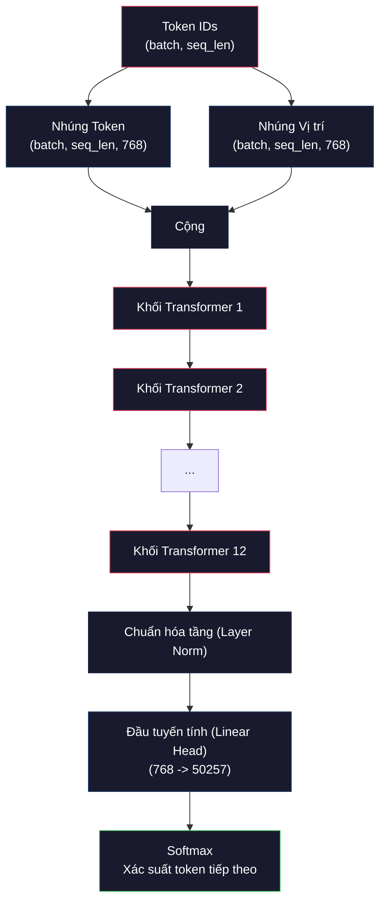
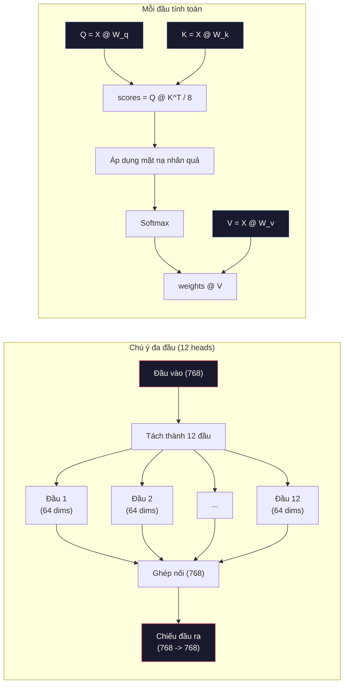
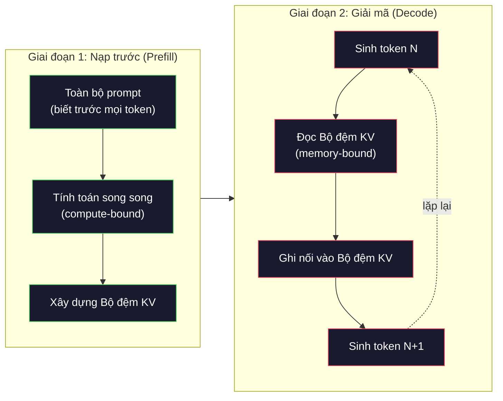

# Tiền huấn luyện Mini GPT (124M tham số)

> GPT-2 Small sở hữu 124 triệu tham số. Con số đó bao gồm 12 tầng transformer, 12 đầu chú ý (attention heads) và không gian nhúng 768 chiều. Bạn có thể tự tay huấn luyện nó từ con số không trên một GPU đơn lẻ chỉ trong vài giờ. Hầu hết mọi người chưa từng làm điều này -- họ chỉ sử dụng các checkpoint đã huấn luyện sẵn. Nhưng nếu chưa từng tự mình huấn luyện một mô hình, bạn sẽ không thể thực sự thấu hiểu những gì đang diễn ra bên trong hệ thống mà mình dùng để xây dựng sản phẩm.

**Type:** Build
**Languages:** Python (với numpy)
**Prerequisites:** Giai đoạn 10, Bài 01-03 (Bộ tách từ, Xây dựng bộ tách từ, Đường ống dữ liệu)
**Time:** ~120 phút

## Mục tiêu học tập

- Tự tay triển khai toàn bộ kiến trúc GPT-2 (124M tham số) từ con số không: nhúng token, nhúng vị trí, các khối transformer và đầu mô hình ngôn ngữ (language model head)
- Huấn luyện mô hình GPT trên ngữ liệu văn bản bằng tác vụ dự đoán token tiếp theo (next-token prediction) với hàm mất mát entropy chéo (cross-entropy loss)
- Triển khai quá trình sinh văn bản tự hồi quy (autoregressive text generation) kết hợp lấy mẫu theo nhiệt độ (temperature sampling) và bộ lọc top-k/top-p
- Theo dõi đường cong suy giảm hàm mất mát (loss curves) và kiểm chứng mô hình học được các cấu trúc ngôn ngữ mạch lạc

## Vấn đề đặt ra

Bạn biết transformer là gì. Bạn đã đọc qua các sơ đồ. Bạn có thể đọc vanh vách câu khẩu hiệu "attention is all you need" và vẽ các hộp ghi nhãn "Multi-Head Attention" lên bảng trắng.

Nhưng những điều đó không đồng nghĩa với việc bạn thực sự hiểu chuyện gì xảy ra khi mô hình sinh ra một đoạn văn bản.

Có 124.438.272 tham số trong GPT-2 Small (khi áp dụng kỹ thuật chia sẻ trọng số - weight tying). Từng tham số đơn lẻ trong số đó đều được định hình thông qua một vòng lặp huấn luyện: lan truyền tiến (forward pass), tính hàm mất mát (compute loss), lan truyền ngược (backward pass) và cập nhật trọng số (update weights). Mười hai khối transformer. Mười hai đầu chú ý trên mỗi khối. Một không gian nhúng 768 chiều. Tập từ vựng gồm 50.257 token. Mỗi khi mô hình sinh ra một token mới, toàn bộ 124 triệu tham số sẽ cùng tham gia vào một chuỗi phép nhân ma trận liên hoàn: nhận chuỗi ID token đầu vào và sinh ra phân phối xác suất cho token kế tiếp.

Nếu chưa bao giờ tự mình xây dựng hệ thống này, bạn vẫn đang làm việc với một "hộp đen". Bạn có thể gọi API, có thể tinh chỉnh (fine-tune). Nhưng khi sự cố phát sinh -- khi mô hình xuất hiện ảo giác (hallucination), lặp từ vô tận, hoặc từ chối tuân thủ chỉ dẫn -- bạn sẽ không có mô hình tư duy trực quan để giải thích *nguyên nhân tại sao*.

Bài học này sẽ hướng dẫn bạn xây dựng GPT-2 Small từ con số không. Không dùng PyTorch. Chúng ta sử dụng `numpy`. Mọi phép nhân ma trận đều hiển hiện rõ ràng. Mọi gradient đều được tính toán bằng chính dòng mã của bạn. Bạn sẽ tận mắt chứng kiến cách 124 triệu con số phối hợp nhịp nhàng để dự đoán từ tiếp theo.

## Khái niệm cốt lõi

### Kiến trúc GPT

GPT là một mô hình ngôn ngữ tự hồi quy (autoregressive language model). "Tự hồi quy" nghĩa là mô hình sinh từng token một tại mỗi bước, và mỗi token sinh ra đều phụ thuộc vào toàn bộ các token đã xuất hiện trước đó. Kiến trúc của nó là một chồng các khối giải mã (decoder blocks) của transformer.

Dưới đây là toàn bộ đồ thị tính toán từ các ID token đầu vào cho đến xác suất token kế tiếp:

1. Tiếp nhận các ID token. Kích thước (shape): `(batch_size, seq_len)`.
2. Tra cứu bảng nhúng token (token embedding lookup). Mỗi ID ánh xạ thành vector 768 chiều. Kích thước: `(batch_size, seq_len, 768)`.
3. Tra cứu bảng nhúng vị trí (position embedding lookup). Mỗi vị trí (0, 1, 2, ...) ánh xạ thành vector 768 chiều cùng kích thước.
4. Cộng vector nhúng token + vector nhúng vị trí.
5. Truyền qua 12 khối transformer liên tiếp.
6. Chuẩn hóa tầng cuối cùng (final layer normalization).
7. Chiếu tuyến tính lên không gian kích thước từ vựng. Kích thước: `(batch_size, seq_len, vocab_size)`.
8. Áp dụng Softmax để nhận phân phối xác suất.

Đó là toàn bộ mô hình. Không có tích chập (convolution). Không có mạng hồi quy (recurrent). Chỉ có các tầng nhúng, cơ chế chú ý, mạng truyền thẳng (feedforward) và chuẩn hóa tầng (LayerNorm) được xếp chồng 12 lần.



### Khối Transformer (The Transformer Block)

Mỗi khối trong 12 khối đều tuân theo cùng một cấu trúc chuẩn. Kiến trúc tiền chuẩn hóa (pre-norm architecture -- GPT-2 dùng pre-norm thay vì post-norm như transformer nguyên bản):

1. Chuẩn hóa tầng (LayerNorm)
2. Cơ chế tự chú ý đa đầu (Multi-Head Self-Attention)
3. Kết nối phần dư (Residual connection -- cộng ngược đầu vào ban đầu)
4. Chuẩn hóa tầng (LayerNorm)
5. Mạng truyền thẳng (Feed-Forward Network / MLP)
6. Kết nối phần dư (Residual connection -- cộng ngược đầu vào)

Các kết nối phần dư (skip connection) đóng vai trò sống còn. Nếu không có chúng, gradient sẽ bị triệt tiêu (vanishing gradient) trước khi kịp truyền ngược về khối số 1 trong quá trình lan truyền ngược. Nhờ có kết nối tắt, gradient có thể chảy thông suốt từ hàm mất mát trực tiếp đến bất kỳ tầng nào. Đây là lý do ta có thể xếp chồng 12, 32 hay thậm chí 96 khối (GPT-4 được cho là dùng tới 120 khối).

### Cơ chế Chú ý: Trái tim của Mô hình

Tự chú ý (self-attention) cho phép mỗi token quan sát mọi token đứng trước nó và quyết định mức độ tập trung cần dành cho từng token. Dưới đây là công thức toán học.

Với mỗi vị trí token, tính toán ba vector từ đầu vào:
- **Query (Q)**: "Tôi đang tìm kiếm điều gì?"
- **Key (K)**: "Tôi đang chứa đựng thông tin gì?"
- **Value (V)**: "Nội dung thực tế tôi mang lại là gì?"

```text
Q = input @ W_q    (768 -> 768)
K = input @ W_k    (768 -> 768)
V = input @ W_v    (768 -> 768)

attention_scores = Q @ K^T / sqrt(d_k)
attention_scores = mask(attention_scores)   # mặt nạ nhân quả: gán -inf cho các vị trí tương lai
attention_weights = softmax(attention_scores)
output = attention_weights @ V
```

Mặt nạ nhân quả (causal mask) chính là yếu tố biến GPT thành mô hình tự hồi quy. Vị trí 5 có thể chú ý đến các vị trí từ 0 đến 5, nhưng tuyệt đối không được nhìn thấy các vị trí 6, 7, 8,... Điều này ngăn mô hình "gian lận" bằng cách nhìn trộm các token tương lai trong quá trình huấn luyện.

**Cơ chế chú ý đa đầu (Multi-head attention)** chia không gian 768 chiều thành 12 đầu độc lập, mỗi đầu có 64 chiều. Mỗi đầu học một mẫu quan hệ chú ý khác biệt: một đầu chuyên theo dõi mối quan hệ cú pháp (sự hòa hợp chủ-vị), đầu khác theo dõi sự tương đồng ngữ nghĩa (từ đồng nghĩa), đầu khác lại theo dõi khoảng cách vị trí (các từ liền kề). Đầu ra của cả 12 đầu được ghép nối (concatenate) lại và chiếu ngược về không gian 768 chiều ban đầu.



Phép chia cho $\sqrt{d_k}$ -- cụ thể ở đây là $\sqrt{64} = 8$ -- mang tính co giãn tỷ lệ (scaling). Nếu thiếu nó, tích vô hướng của các vector số chiều lớn sẽ trở nên rất lớn, đẩy hàm softmax vào các vùng bão hòa nơi gradient tiệm cận 0. Đây là một trong những phát kiến the chốt trong bài báo "Attention Is All You Need".

### Bộ đệm KV (KV Cache): Bí quyết suy luận tốc độ cao

Khi huấn luyện, ta xử lý toàn bộ chuỗi cùng một lúc. Nhưng khi suy luận, ta sinh từng token một. Nếu không tối ưu, để sinh token thứ $N$, mô hình phải tính toán lại attention cho toàn bộ $N-1$ token trước đó. Độ phức tạp sẽ là $O(N^2)$ cho mỗi token sinh ra, hoặc $O(N^3)$ cho toàn bộ chuỗi độ dài $N$.

Bộ đệm KV (KV Cache) giải quyết triệt để vấn đề này. Sau khi tính toán vector K và V cho mỗi token, ta lưu trữ chúng vào bộ nhớ đệm. Khi sinh token thứ $N+1$, ta chỉ cần tính vector Q cho token mới và tra cứu K, V đã lưu của các token trước. Điều này giảm chi phí tính toán K và V từ $O(N)$ xuống $O(1)$ cho mỗi token. Phép tính điểm attention vẫn là $O(N)$ do phải so khớp với các vị trí trước, nhưng ta đã triệt tiêu hoàn toàn các phép nhân ma trận dư thừa trên đầu vào.

Với GPT-2 có 12 tầng và 12 đầu, bộ đệm KV lưu trữ: 2 (K + V) x 12 tầng x 12 đầu x 64 chiều = 18.432 giá trị cho mỗi token. Với một chuỗi 1024 token, dung lượng đệm tốn khoảng 75MB ở định dạng FP32. Nhưng với Llama 3 405B có 128 tầng, bộ đệm KV cho một chuỗi duy nhất có thể vượt quá 10GB. Đây là lý do vì sao suy luận ngữ cảnh dài thường bị nghẽn ở bộ nhớ (memory-bound).

### Nạp trước và Giải mã (Prefill vs Decode): Hai giai đoạn suy luận

Khi gửi prompt đến LLM, quá trình suy luận diễn ra qua hai giai đoạn hoàn toàn khác biệt.

**Giai đoạn nạp trước (Prefill phase)** xử lý toàn bộ prompt đầu vào song song. Tất cả các token đều đã biết trước, do đó mô hình có thể tính toán attention cho mọi vị trí cùng lúc. Giai đoạn này bị ràng buộc bởi năng lực tính toán (compute-bound) -- GPU hoạt động hết công suất các phép nhân ma trận. Với prompt 1000 token trên GPU A100, giai đoạn nạp trước mất khoảng 20-50ms.

**Giai đoạn giải mã (Decode phase)** sinh từng token một tuần tự. Mỗi token mới phụ thuộc vào token vừa sinh. Giai đoạn này bị ràng buộc bởi băng thông bộ nhớ (memory-bound) -- điểm nghẽn nằm ở việc đọc trọng số mô hình và bộ đệm KV từ bộ nhớ GPU (VRAM), chứ không phải ở phép tính số học. Các nhân tính toán của GPU phần lớn thời gian phải "ngồi chơi xơi nước" để chờ nạp dữ liệu từ bộ nhớ.

Sự phân biệt này mang tính quyết định khi thiết kế hệ thống sản xuất. Thông lượng Prefill mở rộng theo năng lực tính toán GPU (càng nhiều FLOPS thì Prefill càng nhanh). Thông lượng Decode mở rộng theo băng thông bộ nhớ (bộ nhớ càng nhanh thì Decode càng nhanh). Đó là lý do NVIDIA H100 tập trung nâng cấp mạnh mẽ băng thông bộ nhớ so với A100 -- nhằm trực tiếp tăng tốc độ sinh token.



### Vòng lặp huấn luyện (The Training Loop)

Huấn luyện LLM bản chất là bài toán dự đoán token tiếp theo. Cho trước chuỗi $[0, 1, 2, \dots, N-1]$, mục tiêu là dự đoán chuỗi $[1, 2, 3, \dots, N]$. Hàm mất mát là entropy chéo (cross-entropy) giữa phân phối xác suất dự đoán của mô hình và token thực tế tiếp theo.

Một bước huấn luyện:

1. **Lan truyền tiến (Forward pass)**: Truyền batch qua toàn bộ 12 khối transformer. Thu được các giá trị logits (điểm số trước softmax) cho từng vị trí.
2. **Tính toán hàm mất mát (Compute loss)**: Tính entropy chéo giữa logits và các token mục tiêu (chuỗi đầu vào dịch chuyển 1 vị trí).
3. **Lan truyền ngược (Backward pass)**: Tính gradient cho toàn bộ 124M tham số thông qua lan truyền ngược.
4. **Cập nhật tối ưu (Optimizer step)**: Cập nhật trọng số. GPT-2 sử dụng thuật toán tối ưu Adam kết hợp khởi động tốc độ học (warmup) và suy giảm cosine (cosine decay).

Lịch trình điều chỉnh tốc độ học (learning rate schedule) quan trọng hơn nhiều người nghĩ. GPT-2 tăng dần tốc độ học từ 0 lên giá trị cực đại trong 2.000 bước đầu tiên, sau đó giảm dần theo đường cong cosine. Nếu khởi đầu ngay với tốc độ học cao, mô hình sẽ phân kỳ. Nếu giữ tốc độ học cao cố định, mô hình sẽ dao động không ổn định ở các bước sau. Mô hình khởi động rồi giảm dần này là chuẩn mực được áp dụng cho mọi LLM hiện nay.

### Chi tiết tham số của GPT-2 Small

| Thành phần | Kích thước | Số lượng tham số |
|---|---|---|
| Nhúng token (Token embeddings) | (50257, 768) | 38.597.376 |
| Nhúng vị trí (Position embeddings) | (1024, 768) | 786.432 |
| Chú ý trên mỗi khối ($W_q, W_k, W_v, W_{\text{out}}$) | 4 x (768, 768) | 2.359.296 |
| FFN trên mỗi khối (up + down) | (768, 3072) + (3072, 768) | 4.718.592 |
| LayerNorm trên mỗi khối (2x) | 2 x 768 x 2 | 3.072 |
| LayerNorm cuối cùng | 768 x 2 | 1.536 |
| **Tổng trên mỗi khối** | | **7.080.960** |
| **Tổng cộng (12 khối)** | | **85.054.464 + 39.383.808 = 124.438.272** |

Tầng chiếu đầu ra (logits head) dùng chung ma trận trọng số với tầng nhúng token. Kỹ thuật này được gọi là trói buộc trọng số (weight tying) -- giúp cắt giảm 38 triệu tham số và cải thiện chất lượng mô hình vì ép mô hình phải sử dụng chung một không gian biểu diễn cho cả việc tiếp nhận đầu vào và dự đoán đầu ra.

## Tự tay xây dựng (Build It)

```figure
iso-machine {"machine":"mini-gpt"}
```

### Bước 1: Tầng Nhúng (Embedding Layer)

Tầng nhúng token ánh xạ mỗi token trong số 50.257 token thành một vector 768 chiều. Tầng nhúng vị trí bổ sung thông tin về vị trí đứng của từng token trong chuỗi. Hai vector này được cộng trực tiếp với nhau.

```python
import numpy as np

class Embedding:
    def __init__(self, vocab_size, embed_dim, max_seq_len):
        self.token_embed = np.random.randn(vocab_size, embed_dim) * 0.02
        self.pos_embed = np.random.randn(max_seq_len, embed_dim) * 0.02

    def forward(self, token_ids):
        seq_len = token_ids.shape[-1]
        tok_emb = self.token_embed[token_ids]
        pos_emb = self.pos_embed[:seq_len]
        return tok_emb + pos_emb
```

Độ lệch chuẩn khởi tạo 0,02 được lấy trực tiếp từ bài báo GPT-2. Nếu khởi tạo quá lớn, các giá trị lan truyền tiến ban đầu sẽ bùng nổ làm mất ổn định huấn luyện. Nếu quá nhỏ, đầu ra ban đầu của mọi đầu vào sẽ gần như giống hệt nhau, khiến tín hiệu gradient ban đầu mất tác dụng.

### Bước 2: Tự chú ý với Mặt nạ nhân quả (Self-Attention with Causal Mask)

Bắt đầu với cơ chế chú ý đơn đầu. Mặt nạ nhân quả gán các vị trí tương lai bằng âm vô cùng trước khi qua softmax, đảm bảo mỗi vị trí chỉ có thể chú ý đến chính nó và các vị trí đứng trước.

```python
def attention(Q, K, V, mask=None):
    d_k = Q.shape[-1]
    scores = Q @ K.transpose(0, -1, -2 if Q.ndim == 4 else 1) / np.sqrt(d_k)
    if mask is not None:
        scores = scores + mask
    weights = np.exp(scores - scores.max(axis=-1, keepdims=True))
    weights = weights / weights.sum(axis=-1, keepdims=True)
    return weights @ V
```

Hàm softmax thực hiện trừ giá trị cực đại trước khi lũy thừa e. Nếu không có bước này, `exp(số_lớn)` sẽ tràn số thành vô cực (overflow). Đây là kỹ thuật ổn định số học (numerical stability) không làm thay đổi kết quả vì $\mathop{\mathrm{softmax}}(x - c) = \mathop{\mathrm{softmax}}(x)$ với mọi hằng số $c$.

### Bước 3: Cơ chế Chú ý đa đầu (Multi-Head Attention)

Phân chia đầu vào 768 chiều thành 12 đầu, mỗi đầu 64 chiều. Mỗi đầu tính toán attention độc lập. Ghép nối kết quả và chiếu ngược về 768 chiều.

```python
class MultiHeadAttention:
    def __init__(self, embed_dim, num_heads):
        self.num_heads = num_heads
        self.head_dim = embed_dim // num_heads
        self.W_q = np.random.randn(embed_dim, embed_dim) * 0.02
        self.W_k = np.random.randn(embed_dim, embed_dim) * 0.02
        self.W_v = np.random.randn(embed_dim, embed_dim) * 0.02
        self.W_out = np.random.randn(embed_dim, embed_dim) * 0.02

    def forward(self, x, mask=None):
        batch, seq_len, d = x.shape
        Q = (x @ self.W_q).reshape(batch, seq_len, self.num_heads, self.head_dim).transpose(0, 2, 1, 3)
        K = (x @ self.W_k).reshape(batch, seq_len, self.num_heads, self.head_dim).transpose(0, 2, 1, 3)
        V = (x @ self.W_v).reshape(batch, seq_len, self.num_heads, self.head_dim).transpose(0, 2, 1, 3)

        scores = Q @ K.transpose(0, 1, 3, 2) / np.sqrt(self.head_dim)
        if mask is not None:
            scores = scores + mask
        weights = np.exp(scores - scores.max(axis=-1, keepdims=True))
        weights = weights / weights.sum(axis=-1, keepdims=True)
        attn_out = weights @ V

        attn_out = attn_out.transpose(0, 2, 1, 3).reshape(batch, seq_len, d)
        return attn_out @ self.W_out
```

Các thao tác `reshape-transpose-reshape` thường là phần gây khó hiểu nhất. Bản chất diễn biến như sau: tensor `(batch, seq_len, 768)` chuyển thành `(batch, seq_len, 12, 64)`, sau đó chuyển trục thành `(batch, 12, seq_len, 64)`. Bây giờ mỗi đầu trong 12 đầu sở hữu riêng ma trận `(seq_len, 64)` để tính attention. Sau khi tính xong, ta đảo ngược lại: `(batch, 12, seq_len, 64)` về `(batch, seq_len, 12, 64)` rồi gộp thành `(batch, seq_len, 768)`.

### Bước 4: Khối Transformer hoàn chỉnh

Một khối transformer hoàn chỉnh: LayerNorm, chú ý đa đầu kèm kết nối phần dư, LayerNorm, mạng truyền thẳng kèm kết nối phần dư.

```python
class LayerNorm:
    def __init__(self, dim, eps=1e-5):
        self.gamma = np.ones(dim)
        self.beta = np.zeros(dim)
        self.eps = eps

    def forward(self, x):
        mean = x.mean(axis=-1, keepdims=True)
        var = x.var(axis=-1, keepdims=True)
        return self.gamma * (x - mean) / np.sqrt(var + self.eps) + self.beta


class FeedForward:
    def __init__(self, embed_dim, ff_dim):
        self.W1 = np.random.randn(embed_dim, ff_dim) * 0.02
        self.b1 = np.zeros(ff_dim)
        self.W2 = np.random.randn(ff_dim, embed_dim) * 0.02
        self.b2 = np.zeros(embed_dim)

    def forward(self, x):
        h = x @ self.W1 + self.b1
        h = np.maximum(0, h)  # Xấp xỉ GELU: dùng tạm ReLU để đơn giản hóa
        return h @ self.W2 + self.b2


class TransformerBlock:
    def __init__(self, embed_dim, num_heads, ff_dim):
        self.ln1 = LayerNorm(embed_dim)
        self.attn = MultiHeadAttention(embed_dim, num_heads)
        self.ln2 = LayerNorm(embed_dim)
        self.ffn = FeedForward(embed_dim, ff_dim)

    def forward(self, x, mask=None):
        x = x + self.attn.forward(self.ln1.forward(x), mask)
        x = x + self.ffn.forward(self.ln2.forward(x))
        return x
```

Mạng truyền thẳng mở rộng đầu vào từ 768 chiều lên 3.072 chiều (gấp 4 lần), áp dụng hàm phi tuyến tính, rồi co lại về 768 chiều. Cấu trúc mở rộng - thu hẹp này cung cấp cho mô hình một không gian biểu diễn rộng hơn tại mỗi vị trí. GPT-2 sử dụng hàm kích hoạt GELU, nhưng ở đây chúng ta dùng ReLU để thuận tiện cho việc nắm bắt kiến trúc.

### Bước 5: Mô hình GPT hoàn chỉnh (MiniGPT)

Xếp chồng 12 khối transformer. Bổ sung tầng nhúng ở đầu vào và tầng chiếu đầu ra ở cuối.

```python
class MiniGPT:
    def __init__(self, vocab_size=50257, embed_dim=768, num_heads=12,
                 num_layers=12, max_seq_len=1024, ff_dim=3072):
        self.embedding = Embedding(vocab_size, embed_dim, max_seq_len)
        self.blocks = [
            TransformerBlock(embed_dim, num_heads, ff_dim)
            for _ in range(num_layers)
        ]
        self.ln_f = LayerNorm(embed_dim)
        self.vocab_size = vocab_size
        self.embed_dim = embed_dim

    def forward(self, token_ids):
        seq_len = token_ids.shape[-1]
        mask = np.triu(np.full((seq_len, seq_len), -1e9), k=1)

        x = self.embedding.forward(token_ids)
        for block in self.blocks:
            x = block.forward(x, mask)
        x = self.ln_f.forward(x)

        logits = x @ self.embedding.token_embed.T
        return logits

    def count_parameters(self):
        total = 0
        total += self.embedding.token_embed.size
        total += self.embedding.pos_embed.size
        for block in self.blocks:
            total += block.attn.W_q.size + block.attn.W_k.size
            total += block.attn.W_v.size + block.attn.W_out.size
            total += block.ffn.W1.size + block.ffn.b1.size
            total += block.ffn.W2.size + block.ffn.b2.size
            total += block.ln1.gamma.size + block.ln1.beta.size
            total += block.ln2.gamma.size + block.ln2.beta.size
        total += self.ln_f.gamma.size + self.ln_f.beta.size
        return total
```

Hãy chú ý kỹ thuật trói buộc trọng số: `logits = x @ self.embedding.token_embed.T`. Tầng chiếu đầu ra tái sử dụng ma trận nhúng token đã chuyển vị. Đây không chỉ là mẹo tiết kiệm tham số mà còn giúp mô hình đồng nhất không gian vector giữa việc hiểu token đầu vào và dự đoán token đầu ra.

### Bước 6: Vòng lặp huấn luyện (Training Loop)

Để huấn luyện thực tế mô hình 124M tham số, bạn sẽ cần GPU và PyTorch. Vòng lặp huấn luyện dưới đây minh họa cơ chế hoạt động trên một mô hình thu nhỏ chạy hoàn toàn bằng `numpy` (4 tầng, 4 đầu, 128 chiều) để có thể chạy mượt mà trên CPU.

```python
def cross_entropy_loss(logits, targets):
    batch, seq_len, vocab_size = logits.shape
    logits_flat = logits.reshape(-1, vocab_size)
    targets_flat = targets.reshape(-1)

    max_logits = logits_flat.max(axis=-1, keepdims=True)
    log_softmax = logits_flat - max_logits - np.log(
        np.exp(logits_flat - max_logits).sum(axis=-1, keepdims=True)
    )

    loss = -log_softmax[np.arange(len(targets_flat)), targets_flat].mean()
    return loss


def train_mini_gpt(text, vocab_size=256, embed_dim=128, num_heads=4,
                   num_layers=4, seq_len=64, num_steps=200, lr=3e-4):
    tokens = np.array(list(text.encode("utf-8")[:2048]))
    model = MiniGPT(
        vocab_size=vocab_size, embed_dim=embed_dim, num_heads=num_heads,
        num_layers=num_layers, max_seq_len=seq_len, ff_dim=embed_dim * 4
    )

    print(f"Tham số mô hình: {model.count_parameters():,}")
    print(f"Số lượng token huấn luyện: {len(tokens):,}")
    print(f"Cấu hình: {num_layers} tầng, {num_heads} đầu, {embed_dim} chiều nhúng")
    print()

    for step in range(num_steps):
        start_idx = np.random.randint(0, max(1, len(tokens) - seq_len - 1))
        batch_tokens = tokens[start_idx:start_idx + seq_len + 1]

        input_ids = batch_tokens[:-1].reshape(1, -1)
        target_ids = batch_tokens[1:].reshape(1, -1)

        logits = model.forward(input_ids)
        loss = cross_entropy_loss(logits, target_ids)

        if step % 20 == 0:
            print(f"Bước {step:4d} | Loss: {loss:.4f}")

    return model
```

Hàm mất mát ban đầu sẽ xấp xỉ $\ln(\text{vocab\_size})$ -- với từ vựng cấp byte gồm 256 token, giá trị này là $\ln(256) \approx 5,55$. Mô hình khởi tạo ngẫu nhiên sẽ gán xác suất đồng đều cho mọi token. Khi quá trình huấn luyện diễn ra, hàm mất mát giảm dần khi mô hình học được các quy luật phổ biến: ký tự "h" sau "t", dấu cách sau dấu chấm, v.v.

### Bước 7: Quá trình sinh văn bản (Text Generation)

Quá trình sinh văn bản sử dụng mô hình đã huấn luyện để dự đoán từng token một. Mỗi dự đoán được lấy mẫu từ phân phối xác suất đầu ra (hoặc chọn tham lam token có xác suất cao nhất - argmax).

```python
def generate(model, prompt_tokens, max_new_tokens=100, temperature=0.8):
    tokens = list(prompt_tokens)
    seq_len = model.embedding.pos_embed.shape[0]

    for _ in range(max_new_tokens):
        context = np.array(tokens[-seq_len:]).reshape(1, -1)
        logits = model.forward(context)
        next_logits = logits[0, -1, :]

        next_logits = next_logits / temperature
        probs = np.exp(next_logits - next_logits.max())
        probs = probs / probs.sum()

        next_token = np.random.choice(len(probs), p=probs)
        tokens.append(next_token)

    return tokens
```

Nhiệt độ (temperature) điều chỉnh độ ngẫu nhiên. Nhiệt độ 1,0 giữ nguyên phân phối gốc. Nhiệt độ 0,5 làm nhọn phân phối (tính xác định cao hơn -- mô hình ưu tiên chọn các token hàng đầu). Nhiệt độ 1,5 làm phẳng phân phối (tính ngẫu nhiên cao hơn -- các token xác suất thấp có cơ hội xuất hiện). Nhiệt độ 0,0 tương đương với giải mã tham lam (greedy decoding -- luôn chọn token có xác suất cao nhất).

Cửa sổ `tokens[-seq_len:]` là bắt buộc vì mô hình có giới hạn độ dài ngữ cảnh tối đa (1024 đối với GPT-2). Khi vượt quá giới hạn này, ta phải bỏ bớt các token cũ nhất. Đây chính là "cửa sổ ngữ cảnh" (context window).

```figure
sampling-decoder
```

## Sử dụng trong thực tế (Use It)

### Thử nghiệm Huấn luyện và Sinh văn bản hoàn chỉnh

```python
corpus = """The transformer architecture has revolutionized natural language processing.
Attention mechanisms allow the model to focus on relevant parts of the input.
Self-attention computes relationships between all pairs of positions in a sequence.
Multi-head attention splits the representation into multiple subspaces.
Each attention head can learn different types of relationships.
The feedforward network provides nonlinear transformations at each position.
Residual connections enable gradient flow through deep networks.
Layer normalization stabilizes training by normalizing activations.
Position embeddings give the model information about token ordering.
The causal mask ensures autoregressive generation during training.
Pre-training on large text corpora teaches the model general language understanding.
Fine-tuning adapts the pre-trained model to specific downstream tasks."""

model = train_mini_gpt(corpus, num_steps=200)

prompt = list("The transformer".encode("utf-8"))
output_tokens = generate(model, prompt, max_new_tokens=100, temperature=0.8)
generated_text = bytes(output_tokens).decode("utf-8", errors="replace")
print(f"\nGenerated: {generated_text}")
```

Trên một ngữ liệu nhỏ với mô hình thu nhỏ, văn bản sinh ra chỉ dừng lại ở mức bán mạch lạc. Nó học được một số quy luật byte từ dữ liệu huấn luyện nhưng không thể khái quát hóa như GPT-2 thực thụ được huấn luyện trên 40GB dữ liệu và 124M tham số. Mục đích ở đây không phải là chất lượng văn bản sinh ra, mà là bạn có thể theo dõi tường tận từng khâu: tra cứu nhúng, tính toán chú ý, biến đổi truyền thẳng, chiếu logit, softmax và lấy mẫu.

## Bàn giao sản phẩm (Ship It)

Bài học này cung cấp artifact `outputs/prompt-gpt-architecture-analyzer.md` -- một prompt phân tích các lựa chọn kiến trúc trong bất kỳ mô hình nào thuộc họ GPT. Khi đưa vào bản mô tả mô hình (model card) hoặc báo cáo kỹ thuật, nó sẽ phân rã chi tiết sự phân bổ tham số, thiết kế chú ý và các quyết định mở rộng quy mô.

## Bài tập thực hành

1. Chỉnh sửa mô hình để sử dụng 24 tầng và 16 đầu thay vì 12/12. Đếm số lượng tham số. Việc tăng gấp đôi chiều sâu (số tầng) khác biệt thế nào so với việc tăng gấp đôi chiều rộng (số chiều nhúng)?

2. Triển khai hàm kích hoạt GELU $(\mathop{\mathrm{GELU}}(x) = x \cdot 0.5 \cdot (1 + \mathop{\mathrm{erf}}(x / \sqrt{2})))$ và thay thế cho ReLU trong mạng truyền thẳng. Chạy huấn luyện 500 bước với từng hàm kích hoạt và so sánh hàm mất mát cuối cùng.

3. Thêm bộ đệm KV (KV cache) vào hàm sinh văn bản. Lưu trữ các tensor K và V cho mỗi tầng sau lượt lan truyền tiến đầu tiên và tái sử dụng chúng cho các token kế tiếp. Đo lường mức độ tăng tốc: sinh 200 token có và không có bộ đệm để so sánh thời gian thực thi thực tế.

4. Triển khai phương pháp lấy mẫu top-k (chỉ xét $k$ token có xác suất cao nhất) và lấy mẫu top-p (nucleus sampling: chỉ xét tập token nhỏ nhất có tổng xác suất tích lũy vượt ngưỡng $p$). So sánh chất lượng văn bản ở nhiệt độ 0,8 giữa top-k=50 và top-p=0,95.

5. Xây dựng công cụ vẽ biểu đồ đường cong hàm mất mát (loss curve). Huấn luyện mô hình trong 1000 bước và vẽ biểu đồ loss theo bước. Nhận diện ba giai đoạn: giảm nhanh ban đầu (học các byte thông dụng), giảm chậm ở giữa (học các mẫu kết hợp byte), và đi ngang (overfitting trên tập ngữ liệu nhỏ). Hình dạng của đường cong này hoàn toàn tương đồng dù bạn huấn luyện mô hình 128 chiều hay siêu mô hình GPT-4.

## Các thuật ngữ chính

| Thuật ngữ | Người ta thường nói | Ý nghĩa thực sự |
|---|---|---|
| Tự hồi quy (Autoregressive) | "Sinh từng từ một" | Mỗi token đầu ra phụ thuộc vào toàn bộ token đứng trước -- mô hình dự đoán $P(\text{token}_n \mid \text{token}_0, \dots, \text{token}_{n-1})$ |
| Mặt nạ nhân quả (Causal mask) | "Không cho nhìn tương lai" | Ma trận tam giác trên chứa các giá trị $-\infty$ ngăn chặn việc chú ý đến các vị trí tương lai trong quá trình huấn luyện |
| Chú ý đa đầu (Multi-head attention) | "Nhiều mẫu chú ý" | Chia tách Q, K, V thành các đầu song song (ví dụ: 12 đầu, mỗi đầu 64 chiều trong GPT-2) để mỗi đầu học một dạng quan hệ ngữ nghĩa khác nhau |
| Bộ đệm KV (KV Cache) | "Lưu cache cho nhanh" | Lưu trữ các tensor Key và Value đã tính toán của các token trước để tránh tính toán trùng lặp trong quá trình sinh tự hồi quy |
| Nạp trước (Prefill) | "Xử lý prompt" | Giai đoạn suy luận đầu tiên xử lý song song toàn bộ prompt -- bị ràng buộc bởi năng lực tính toán (compute-bound) của GPU |
| Giải mã (Decode) | "Sinh token" | Giai đoạn suy luận thứ hai sinh tuần tự từng token một -- bị ràng buộc bởi băng thông bộ nhớ (memory-bound) của GPU |
| Trói buộc trọng số (Weight tying) | "Dùng chung tầng nhúng" | Dùng chung một ma trận trọng số cho tầng nhúng token đầu vào và tầng chiếu logit đầu ra -- tiết kiệm 38M tham số trong GPT-2 |
| Kết nối phần dư (Residual connection) | "Đường tắt" | Cộng trực tiếp đầu vào vào đầu ra của một tầng con ($x + \text{sublayer}(x)$) -- giúp dòng gradient truyền thông suốt trong mạng sâu |
| Chuẩn hóa tầng (Layer normalization) | "Chuẩn hóa kích hoạt" | Chuẩn hóa theo chiều đặc trưng về giá trị trung bình bằng 0 và phương sai bằng 1, kèm theo các tham số co giãn và dịch chuyển có thể học được |
| Mất mát entropy chéo (Cross-entropy loss) | "Độ lệch của dự đoán" | $-\log(\text{xác suất gán cho token đúng tiếp theo})$, lấy trung bình trên mọi vị trí -- mục tiêu huấn luyện tiêu chuẩn của LLM |

## Tài liệu đọc thêm

- [Radford et al., 2019 -- "Language Models are Unsupervised Multitask Learners" (GPT-2)](https://cdn.openai.com/better-language-models/language_models_are_unsupervised_multitask_learners.pdf) -- Bài báo về GPT-2 giới thiệu họ mô hình từ 124M đến 1.5B tham số
- [Vaswani et al., 2017 -- "Attention Is All You Need"](https://arxiv.org/abs/1706.03762) -- Bài báo nền tảng giới thiệu kiến trúc Transformer với chú ý tích vô hướng co giãn và chú ý đa đầu
- [Llama 3 Technical Report](https://arxiv.org/abs/2407.21783) -- Cách Meta mở rộng kiến trúc GPT lên 405B tham số trên cụm 16K GPU
- [Pope et al., 2022 -- "Efficiently Scaling Transformer Inference"](https://arxiv.org/abs/2211.05102) -- Bài báo chuẩn hóa lý thuyết phân tích Prefill vs Decode và bộ đệm KV
