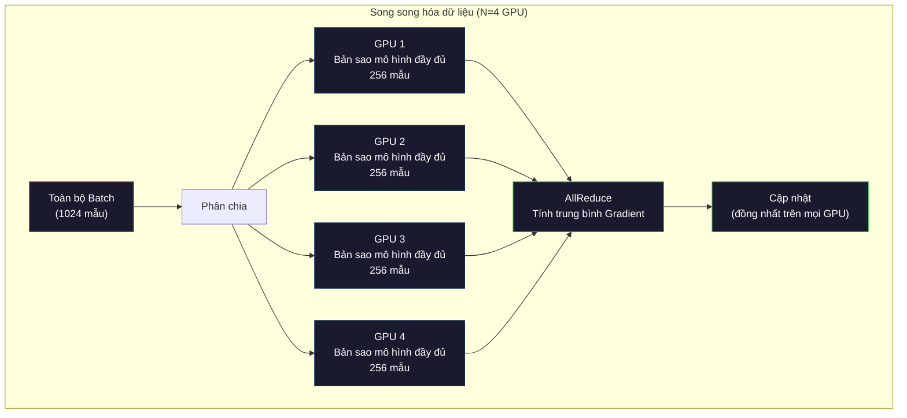
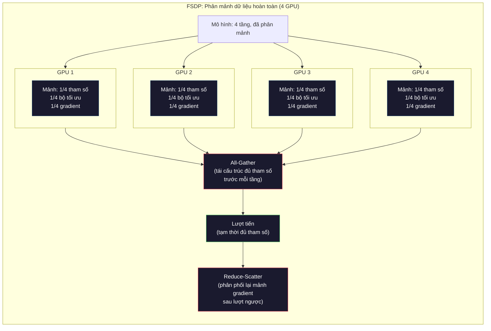
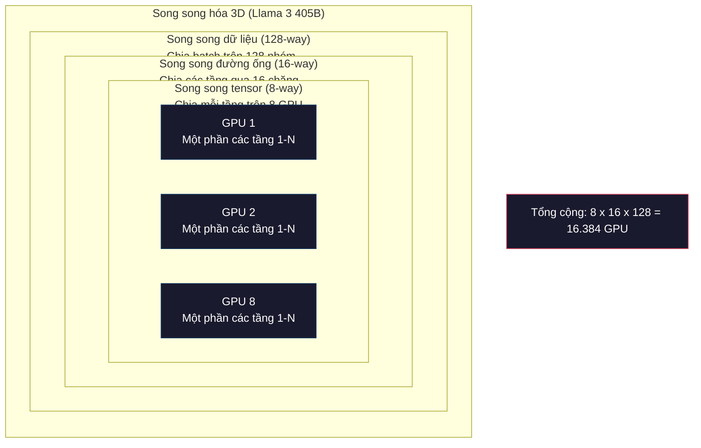

# Mở rộng quy mô: Huấn luyện phân tán, FSDP, DeepSpeed

> Mô hình 124M của bạn có thể huấn luyện trên một GPU đơn lẻ. Nhưng hãy thử với mô hình 7 tỷ tham số. Mô hình không còn vừa trong bộ nhớ. Dữ liệu mất hàng tuần để xử lý trên một máy đơn. Huấn luyện phân tán (distributed training) không phải là tùy chọn khi mở rộng quy mô. Đó là con đường duy nhất để tiến về phía trước.

**Type:** Build
**Languages:** Python
**Prerequisites:** Giai đoạn 10, Bài 04 (Tiền huấn luyện Mini GPT)
**Time:** ~120 phút

## Mục tiêu học tập

- Giải thích ba mô hình song song hóa cốt lõi (song song dữ liệu, song song tensor, song song đường ống) và thời điểm bắt buộc phải áp dụng từng loại dựa trên kích thước mô hình và cụm phần cứng
- Triển khai huấn luyện song song dữ liệu (data-parallel training) dùng PyTorch DDP với cơ chế đồng bộ hóa gradient giữa nhiều GPU
- Tính toán ngân sách bộ nhớ chi tiết cho một mô hình bất kỳ (trọng số + trạng thái bộ tối ưu + gradient + giá trị kích hoạt) để xác định cấu hình phần cứng tối thiểu
- Cấu hình các giai đoạn FSDP hoặc DeepSpeed ZeRO để phân mảnh trạng thái mô hình trên cụm GPU, giúp huấn luyện những mô hình vượt quá dung lượng VRAM của một GPU đơn lẻ

## Vấn đề đặt ra

Một mô hình 7B tham số ở định dạng FP16 tiêu tốn 14GB chỉ riêng cho trọng số. Thuật toán tối ưu Adam lưu thêm hai bản sao cho mỗi tham số (ước lượng mô-men bậc một và bậc hai). Con số đó ngốn thêm 28GB. Gradient trong quá trình lan truyền ngược cộng thêm 14GB nữa. Bạn đã mất 56GB bộ nhớ trước khi lưu trữ dù chỉ một giá trị kích hoạt (activation) trung gian.

Một chiếc card NVIDIA A100 có 80GB VRAM.

56GB trong tổng số 80GB đã bốc hơi. Bạn chỉ còn lại 24GB cho các giá trị kích hoạt -- các giá trị trung gian được tính toán trong lượt lan truyền tiến bắt buộc phải lưu giữ để phục vụ tính đạo hàm trong lượt lan truyền ngược. Với chuỗi 2048 token trên mô hình 4096 chiều, các giá trị kích hoạt của một tầng đơn lẻ chiếm khoảng 64MB. Với 32 tầng, bạn cần 2GB cho mỗi mẫu dữ liệu. Kích thước batch bằng 8 đòi hỏi 16GB. Bạn có 24GB. Tăng kích thước batch lên 12, bộ nhớ lập tức phát nổ (Out of Memory - OOM).

Bây giờ hãy thử với mô hình 70B tham số. Riêng trọng số đã là 140GB ở định dạng FP16. Hoàn toàn không thể đặt vừa trên một GPU. Bạn cần tối thiểu 2 chiếc A100 (2 x 80GB = 160GB) chỉ để chứa trọng số. Khi tính thêm trạng thái bộ tối ưu và gradient, bạn cần nhiều hơn thế rất nhiều: tối thiểu từ 3 GPU trở lên và trong thực tế là 8 đến 16 GPU tùy thuộc vào chiến lược phân mảnh.

Llama 3 405B được huấn luyện trên cụm 16.384 GPU NVIDIA H100. Chi phí tính toán cho đợt huấn luyện này ước tính lên tới 100 triệu USD. DeepSeek V3 huấn luyện một mô hình tương đương với chi phí chỉ khoảng 5,6 triệu USD nhờ sự thông minh trong kiến trúc (Kiến trúc hỗn hợp chuyên gia - Mixture of Experts - chỉ kích hoạt một phần nhỏ tham số cho mỗi token) và tối ưu hóa hiệu quả huấn luyện phân tán.

Bài học này bao quát bốn chiến lược giúp quá trình huấn luyện quy mô lớn trở nên khả thi: song song hóa dữ liệu (data parallelism), song song hóa tensor (tensor parallelism), song song hóa đường ống (pipeline parallelism), và song song hóa dữ liệu phân mảnh hoàn toàn (fully sharded data parallelism). Bạn sẽ mô phỏng từng kỹ thuật bằng Python thuần để thấu hiểu bản chất cơ chế trước khi tương tác với bất kỳ khung huấn luyện phân tán nào.

## Khái niệm cốt lõi

### Vì sao bắt buộc phải huấn luyện phân tán?

Dưới đây là bảng tính toán bộ nhớ toán học cho các mô hình thực tế. Mọi con số đều được tính toán chính xác, không phải ước tính cảm tính.

| Mô hình | Số tham số | Trọng số (FP16) | Trạng thái Adam | Gradient (FP16) | Tổng (chưa tính activation) |
|---|---|---|---|---|---|
| GPT-2 Small | 124M | 248 MB | 992 MB | 248 MB | 1,5 GB |
| Llama 3 8B | 8B | 16 GB | 64 GB | 16 GB | 96 GB |
| Llama 3 70B | 70B | 140 GB | 560 GB | 140 GB | 840 GB |
| Llama 3 405B | 405B | 810 GB | 3.240 GB | 810 GB | 4.860 GB |

Cột "Trạng thái Adam" (Adam States) chính là thủ phạm ngốn bộ nhớ khủng khiếp nhất. Adam lưu giá trị trung bình chạy (m) và phương sai chạy (v) cho mọi tham số, cả hai đều ở định dạng FP32. Với mô hình 70B, phép tính là: $70\text{B} \times 4\text{ bytes} \times 2 = 560\text{GB}$. Riêng bộ tối ưu đã cần tới 7 chiếc card A100 80GB.

Một chiếc H100 có 80GB VRAM. Llama 3 405B cần ít nhất 61 chiếc H100 chỉ để chứa trọng số, bộ tối ưu và gradient. Thêm các giá trị kích hoạt vào, con số này còn tăng vọt. Meta sử dụng 16.384 GPU không phải vì họ thích phô trương, mà vì bài toán vật lý bắt buộc như vậy.

### Song song hóa Dữ liệu (Data Parallelism)

Chiến lược phân tán đơn giản nhất. Sao chép toàn bộ mô hình sang $N$ GPU. Chia mỗi batch huấn luyện thành $N$ phần bằng nhau. Mỗi GPU thực hiện lượt lan truyền tiến và lan truyền ngược trên phần dữ liệu (shard) của riêng nó. Sau lượt lan truyền ngược, tính trung bình gradient trên tất cả các GPU. Mỗi GPU sẽ cập nhật bản sao trọng số của nó bằng gradient trung bình giống hệt nhau, giúp tất cả các bản sao luôn đồng bộ.

**Ưu điểm:** Khả năng mở rộng thông lượng gần như tuyến tính. $N$ GPU xử lý lượng dữ liệu gấp $N$ lần trong mỗi bước. Giao tiếp mạng chỉ giới hạn ở khâu tính trung bình gradient, và có thể gối đầu (overlap) với quá trình tính toán.

**Nhược điểm:** Mỗi GPU bắt buộc phải chứa một bản sao hoàn chỉnh của mô hình, trạng thái bộ tối ưu và gradient. Với mô hình 70B, mỗi GPU cần 840GB. Song song dữ liệu không hề giúp giảm bớt bộ nhớ VRAM trên từng GPU đơn lẻ. Nó chỉ giúp rút ngắn thời gian huấn luyện.

**Công thức:** Kích thước batch hiệu dụng = `per_gpu_batch_size` $\times N$. Với $N=64$ GPU và kích thước batch trên mỗi GPU là 16, kích thước batch hiệu dụng là 1.024. Llama 3 sử dụng kích thước batch hiệu dụng lên tới 16 triệu token cho mỗi bước cập nhật.



### Song song hóa Tensor (Tensor Parallelism)

Chia nhỏ từng tầng mạng riêng lẻ trên nhiều GPU. Một phép nhân ma trận đơn lẻ được phân chia cho các GPU cùng xử lý, mỗi GPU tính toán một phần của kết quả.

Xét một ma trận trọng số có kích thước (8192, 8192) trong tầng feedforward. Với song song tensor 4 chiều, mỗi GPU nắm giữ một mảnh có kích thước (8192, 2048). Mỗi GPU nhân đầu vào với mảnh của mình, tạo ra một kết quả cục bộ. Các kết quả này được gộp lại (thông qua phép all-reduce hoặc all-gather) để tạo thành đầu ra hoàn chỉnh.

**Ưu điểm:** Giảm dung lượng bộ nhớ cho trọng số trên từng GPU. Một mô hình 70B được chia trên 8 GPU đồng nghĩa mỗi GPU chỉ cần chứa trọng số tương đương ~8,75B tham số.

**Nhược điểm:** Đòi hỏi tốc độ giao tiếp liên GPU cực kỳ nhanh sau mỗi tầng mạng. Thao tác all-reduce sau mỗi phép nhân ma trận gây thêm độ trễ. Kỹ thuật này hoạt động hoàn hảo với kết nối NVLink (băng thông 900 GB/s giữa các GPU trong cùng một node máy chủ), nhưng hoạt động rất kém giữa các node nối qua mạng InfiniBand (400 Gb/s, tương đương khoảng 50 GB/s). Do đó, song song tensor hầu như luôn bị giới hạn trong phạm vi một node đơn lẻ (8 GPU).

**Ứng dụng thực tế:** Megatron-LM là framework tiên phong trong kỹ thuật này. Llama 3 405B sử dụng song song tensor 8 chiều (8-way TP) bên trong mỗi node.

### Song song hóa Đường ống (Pipeline Parallelism)

Phân chia mô hình theo các tầng liên tiếp. GPU 1 chạy các tầng 1-8. GPU 2 chạy các tầng 9-16. GPU 3 chạy các tầng 17-24. GPU 4 chạy các tầng 25-32. Dữ liệu chảy tuần tự qua đường ống: GPU 1 tính toán xong phần của mình và gửi các giá trị kích hoạt sang GPU 2, GPU 2 tiếp tục tính và chuyển sang GPU 3, và cứ thế tiếp diễn.

**Ưu điểm:** Lưu lượng giao tiếp giữa các GPU rất thấp -- chỉ truyền các vector kích hoạt tại ranh giới giữa các tầng, vốn rất nhỏ so với toàn bộ gradient hay trọng số. Hoạt động tốt giữa các node mạng khác nhau do không đòi hỏi băng thông cực cao.

**Nhược điểm:** Hiện tượng "bọt đường ống" (pipeline bubbles). Khi GPU 4 đang tính lượt tiến cho micro-batch 1, các GPU 1, 2 và 3 đều rơi vào trạng thái nhàn rỗi (vì đã làm xong phần việc của mình). Trong lượt lan truyền ngược, quy trình đảo ngược lại. Với cách phân chia tuần tự thô sơ, hiệu suất sử dụng GPU chỉ đạt $1/N$ đối với hệ thống có $N$ tầng đường ống.

**GPipe và PipeDream** giải quyết bài toán bọt đường ống bằng cách chia nhỏ batch thành các micro-batch. GPU 1 bắt đầu xử lý micro-batch 2 ngay khi nó vừa chuyển tiếp xong micro-batch 1. Điều này giúp gối đầu các phép tính giữa các tầng. Với $M$ micro-batch và $N$ giai đoạn đường ống, tỷ lệ bọt giảm xuống còn $(N-1)/M$. Ví dụ: với $M=16$ micro-batch và $N=4$ giai đoạn, tỷ lệ nhàn rỗi chỉ còn $3/16 = 18,75\%$.

### FSDP: Song song hóa Dữ liệu Phân mảnh Hoàn toàn (Fully Sharded Data Parallel)

FSDP kết hợp khả năng mở rộng thông lượng của song song dữ liệu với tính hiệu quả bộ nhớ của kỹ thuật phân mảnh (sharding). Thay vì mỗi GPU ôm trọn một bản sao mô hình, mỗi GPU chỉ giữ đúng $1/N$ tham số, gradient và trạng thái bộ tối ưu.

Trước khi thực hiện lượt tiến của một tầng mạng, FSDP kích hoạt lệnh **all-gather** để thu thập đầy đủ tham số từ tất cả các GPU vào bộ nhớ cục bộ. Sau khi tính xong lượt tiến cho tầng đó, GPU lập tức giải phóng các tham số không thuộc quyền sở hữu của nó. Trong lượt lan truyền ngược, lệnh all-gather lại được gọi để tái cấu trúc lại tham số phục vụ việc tính đạo hàm. Sau khi tính xong gradient, lệnh **reduce-scatter** sẽ phân phối các mảnh gradient về đúng GPU phụ trách để mỗi GPU chỉ lưu trữ $1/N$ gradient.

**Tính toán bộ nhớ cho mô hình 70B trên 8 GPU:**

| Thành phần | Không dùng FSDP | Dùng FSDP |
|---|---|---|
| Trọng số (FP16) | 140 GB mỗi GPU | 17,5 GB mỗi GPU |
| Trạng thái Adam (FP32) | 560 GB mỗi GPU | 70 GB mỗi GPU |
| Gradient (FP16) | 140 GB mỗi GPU | 17,5 GB mỗi GPU |
| **Tổng cộng** | **840 GB mỗi GPU** | **105 GB mỗi GPU** |

Nếu không có FSDP, bạn không thể chứa nổi mô hình 70B trên card 80GB. Khi dùng FSDP trên 8 GPU, mỗi card cần 105GB -- con số này vẫn vượt mức 80GB. Bạn sẽ cần ít nhất 16 GPU để đưa mức sử dụng xuống dưới 80GB mỗi card, hoặc kết hợp FSDP với kỹ thuật lưu điểm kiểm tra kích hoạt (activation checkpointing -- tính toán lại kích hoạt trong lượt ngược thay vì lưu trữ chúng).

Chi phí giao tiếp mạng của FSDP cao hơn song song dữ liệu thông thường vì phải chạy all-gather trước mỗi tầng. Nhưng sự tiết kiệm bộ nhớ vượt trội đã biến những bài toán huấn luyện bất khả thi trở nên khả thi.



### DeepSpeed ZeRO

Công nghệ ZeRO (Zero Redundancy Optimizer) của DeepSpeed về mặt lý thuyết hoàn toàn tương đồng với FSDP, do Microsoft phát triển độc lập. ZeRO định nghĩa ba giai đoạn phân mảnh lũy tiến:

| Giai đoạn | Phân mảnh những gì | Mức tiết kiệm bộ nhớ | Giao tiếp mạng |
|---|---|---|---|
| ZeRO-1 | Chỉ trạng thái bộ tối ưu | Giảm ~4 lần | Tương đương song song dữ liệu |
| ZeRO-2 | + Gradient | Giảm ~8 lần | Tăng nhẹ |
| ZeRO-3 | + Toàn bộ tham số mô hình | Giảm ~$N$ lần ($N$ GPU) | Cần All-Gather trước mỗi tầng |

ZeRO-3 tương đương hoàn toàn với FSDP. Tên gọi khác nhau nhưng cơ chế cơ sở là một. PyTorch đã bổ sung FSDP như một tính năng gốc sau khi DeepSpeed chứng minh tính hiệu quả của phương pháp này.

DeepSpeed cũng phát triển thêm ZeRO-Offload (chuyển trạng thái bộ tối ưu sang RAM máy chủ, vốn có dung lượng lớn hơn và giá thành rẻ hơn) và ZeRO-Infinity (chuyển sang ổ cứng NVMe SSD). Các kỹ thuật này đánh đổi tốc độ tính toán lấy dung lượng bộ nhớ.

### Huấn luyện Độ chính xác Hỗn hợp (Mixed Precision Training)

Huấn luyện hiện đại sử dụng đồng thời nhiều định dạng số thực:

- **Lượt lan truyền tiến**: Sử dụng FP16 hoặc BF16 (16-bit). Giảm một nửa bộ nhớ so với FP32. Các phép nhân ma trận chạy nhanh gấp đôi trên nhân Tensor Cores.
- **Trọng số gốc (Master weights)**: Giữ ở định dạng FP32 (32-bit). Được duy trì bởi bộ tối ưu để đảm bảo độ chính xác số học khi cập nhật trọng số.
- **Co giãn mất mát (Loss scaling)**: Nhân hàm mất mát với một hằng số lớn trước khi lan truyền ngược để ngăn gradient FP16 bị triệt tiêu về 0 (underflow). Chia lại cho hằng số đó trước khi cập nhật bước tối ưu.

Định dạng BF16 (Brain Float 16) có dải số mũ tương đương FP32 (8 bit số mũ) nhưng giảm độ chính xác phần định trị (7 bit so với 23 bit của FP32). Nó hầu như không bao giờ cần đến kỹ thuật co giãn mất mát (loss scaling) vì bao phủ được cùng một dải giá trị cực lớn như FP32. Trong khi đó, FP16 chỉ có 5 bit số mũ và 10 bit định trị, rất dễ gặp lỗi tràn số (overflow) hoặc tắt dần (underflow). Các kiến trúc phần cứng hiện đại như NVIDIA A100 và H100 đều hỗ trợ tối ưu cho BF16.

**So sánh bộ nhớ cho mô hình 7B:**

| Định dạng độ chính xác | Trọng số | Bộ tối ưu | Gradient | Tổng cộng |
|---|---|---|---|---|
| FP32 toàn bộ | 28 GB | 56 GB | 28 GB | 112 GB |
| Hỗn hợp (BF16 + FP32 master) | 14 GB | 56 GB | 14 GB | 84 GB |

Độ chính xác hỗn hợp giúp tiết kiệm 28GB cho mô hình 7B. Trạng thái bộ tối ưu vẫn bắt buộc phải duy trì ở FP32 -- đây chính là nơi chiếm phần lớn dung lượng bộ nhớ.

### Megatron-LM và Song song hóa 3D (3D Parallelism)

Trong thực tế huấn luyện quy mô siêu lớn, các kỹ sư kết hợp cả ba kỹ thuật song song:

- **Song song dữ liệu (DP)** giữa các nhóm node máy chủ (để mở rộng kích thước batch)
- **Song song tensor (TP)** bên trong từng node đơn lẻ (chia sẻ tầng mạng qua 8 GPU kết nối NVLink)
- **Song song đường ống (PP)** giữa các node mạng (chia các nhóm tầng qua nhiều máy chủ)

Cụm 16.384 GPU H100 huấn luyện Llama 3 405B được cấu hình:
- 8-way Tensor Parallelism bên trong mỗi node (8 GPU/node)
- 16-way Pipeline Parallelism giữa các node (16 chặng đường ống)
- 128-way Data Parallelism trên chiều còn lại ($16.384 / 8 / 16 = 128$)

Phép tích phân rã 3 chiều này ($8 \times 16 \times 128 = 16.384$) chính là chìa khóa mở rộng hệ thống lên hàng vạn GPU.

DeepSeek V3 lại chọn một lối đi khác: Kiến trúc hỗn hợp chuyên gia (MoE) của họ chỉ kích hoạt 37B trong tổng số 671B tham số cho mỗi token. Nhờ đó, mỗi GPU chỉ cần tính toán và lưu kích hoạt cho các tham số đang kích hoạt. Họ đã hoàn thành đợt huấn luyện trên 2.048 GPU H800 -- chưa bằng 1/8 số lượng GPU của Meta -- với chi phí chỉ 5,6 triệu USD so với 100 triệu USD của Meta.



```figure
paged-kv-cache
```

## Tự tay xây dựng (Build It)

### Bước 1: Mô phỏng Song song hóa Dữ liệu

Chia một batch dữ liệu trên các GPU ảo. Mỗi GPU tính lượt lan truyền tiến trên mảnh dữ liệu của nó, sau đó tính trung bình gradient thông qua phép mô phỏng All-Reduce.

```python
import numpy as np

def simulate_data_parallelism(data, num_gpus, model_fn):
    batch_size = len(data)
    shard_size = batch_size // num_gpus
    remainder = batch_size % num_gpus

    gpu_losses = []
    gpu_gradients = []

    offset = 0
    for gpu_id in range(num_gpus):
        extra = 1 if gpu_id < remainder else 0
        shard = data[offset:offset + shard_size + extra]
        offset += shard_size + extra

        loss, grad = model_fn(shard)
        gpu_losses.append(loss)
        gpu_gradients.append(grad)

    avg_loss = np.mean(gpu_losses)
    avg_gradient = np.mean(gpu_gradients, axis=0)

    return avg_loss, avg_gradient
```

Thao tác all-reduce (tính trung bình gradient) là điểm giao tiếp duy nhất trong song song dữ liệu. Trong thực tế, thư viện NCCL của NVIDIA triển khai thuật toán ring all-reduce: mỗi GPU gửi $1/N$ gradient cho GPU kế bên và nhận $1/N$ từ phía còn lại, sau $N-1$ bước, mọi GPU đều nắm giữ giá trị trung bình hoàn chỉnh.

### Bước 2: Mô phỏng Song song hóa Tensor

Phân chia một ma trận trọng số trên các GPU. Mỗi GPU tính toán một phần của phép nhân ma trận. Sau đó ghép nối lại để kiểm tra độ chính xác so với tính toán gốc.

```python
def simulate_tensor_parallelism(input_data, weight_matrix, num_gpus):
    d_in, d_out = weight_matrix.shape
    assert d_out % num_gpus == 0, f"d_out {d_out} không chia hết cho num_gpus {num_gpus}"
    shard_size = d_out // num_gpus

    partial_results = []
    for gpu_id in range(num_gpus):
        start = gpu_id * shard_size
        end = start + shard_size
        weight_shard = weight_matrix[:, start:end]

        partial = input_data @ weight_shard
        partial_results.append(partial)

    full_output = np.concatenate(partial_results, axis=-1)

    direct_output = input_data @ weight_matrix
    error = np.abs(full_output - direct_output).max()

    return full_output, error
```

Sai số thu được phải bằng 0 tuyệt đối (hoặc sai số số thực máy tính). Song song tensor hoàn toàn tương đương toán học với phép nhân ma trận trên một GPU đơn lẻ.

### Bước 3: Mô phỏng Song song hóa Đường ống

Phân bổ các tầng của mô hình qua các GPU ảo và theo dõi hiện tượng bọt đường ống (pipeline bubble).

```python
def simulate_pipeline_parallelism(num_layers, num_stages, num_microbatches):
    layers_per_stage = num_layers // num_stages

    timeline = {}
    clock = 0

    for mb in range(num_microbatches):
        for stage in range(num_stages):
            start_time = max(
                timeline.get((stage, mb - 1, "fwd"), (0, 0))[1] if mb > 0 else 0,
                timeline.get((stage - 1, mb, "fwd"), (0, 0))[1] if stage > 0 else 0,
            )
            end_time = start_time + layers_per_stage
            timeline[(stage, mb, "fwd")] = (start_time, end_time)

    last_fwd_end = max(v[1] for v in timeline.values())

    for mb in range(num_microbatches - 1, -1, -1):
        for stage in range(num_stages - 1, -1, -1):
            deps = [last_fwd_end]
            if mb < num_microbatches - 1 and (stage, mb + 1, "bwd") in timeline:
                deps.append(timeline[(stage, mb + 1, "bwd")][1])
            if stage < num_stages - 1 and (stage + 1, mb, "bwd") in timeline:
                deps.append(timeline[(stage + 1, mb, "bwd")][1])
            start_time = max(deps)
            end_time = start_time + layers_per_stage
            timeline[(stage, mb, "bwd")] = (start_time, end_time)

    total_time = max(v[1] for v in timeline.values())
    compute_time = num_microbatches * num_stages * layers_per_stage * 2
    bubble_fraction = 1.0 - compute_time / (total_time * num_stages)

    return timeline, total_time, bubble_fraction
```

Với 4 giai đoạn và chỉ 1 micro-batch, tỷ lệ bọt lên tới 75% -- nghĩa là 3 trong số 4 GPU luôn nhàn rỗi tại bất kỳ thời điểm nào. Với 16 micro-batch, tỷ lệ bọt giảm xuống chỉ còn khoảng 19%.

### Bước 4: Công cụ tính toán Bộ nhớ (Memory Calculator)

Tính toán chính xác yêu cầu bộ nhớ khi huấn luyện mô hình ở kích thước bất kỳ.

```python
def memory_calculator(
    params_billions,
    precision_bytes=2,
    optimizer="adam",
    num_gpus=1,
    sharding="none",
    sequence_length=2048,
    batch_size_per_gpu=1,
    hidden_dim=None,
    num_layers=None,
):
    params = params_billions * 1e9

    weight_memory = params * precision_bytes

    if optimizer == "adam":
        optimizer_memory = params * 4 * 2
    elif optimizer == "sgd":
        optimizer_memory = params * 4
    else:
        optimizer_memory = 0

    gradient_memory = params * precision_bytes

    total_no_activation = weight_memory + optimizer_memory + gradient_memory

    if hidden_dim and num_layers:
        activation_per_layer = (
            sequence_length * batch_size_per_gpu * hidden_dim * precision_bytes * 4
        )
        activation_memory = activation_per_layer * num_layers
    else:
        activation_memory = params * precision_bytes * 0.5

    if sharding == "fsdp" or sharding == "zero3":
        weight_memory /= num_gpus
        optimizer_memory /= num_gpus
        gradient_memory /= num_gpus
    elif sharding == "zero2":
        optimizer_memory /= num_gpus
        gradient_memory /= num_gpus
    elif sharding == "zero1":
        optimizer_memory /= num_gpus

    per_gpu_total = weight_memory + optimizer_memory + gradient_memory + activation_memory

    return {
        "params_billions": params_billions,
        "weights_gb": weight_memory / 1e9,
        "optimizer_gb": optimizer_memory / 1e9,
        "gradients_gb": gradient_memory / 1e9,
        "activations_gb": activation_memory / 1e9,
        "per_gpu_total_gb": per_gpu_total / 1e9,
        "total_across_gpus_gb": per_gpu_total * num_gpus / 1e9,
        "fits_on_80gb": per_gpu_total / 1e9 <= 80,
        "num_gpus": num_gpus,
        "sharding": sharding,
    }
```

Hàm này giải đáp câu hỏi sống còn của mọi kỹ sư ML: "Tôi cần bao nhiêu GPU?". Hãy điều chỉnh chiến lược phân mảnh cho đến khi tổng bộ nhớ trên mỗi GPU giảm xuống dưới 80GB.

### Bước 5: Mô phỏng Độ chính xác Hỗn hợp

So sánh mức tiêu thụ bộ nhớ giữa FP32, FP16 thuần và độ chính xác hỗn hợp.

```python
def mixed_precision_comparison(params_billions):
    params = params_billions * 1e9

    fp32_weights = params * 4
    fp32_optimizer = params * 4 * 2
    fp32_gradients = params * 4
    fp32_total = fp32_weights + fp32_optimizer + fp32_gradients

    fp16_weights = params * 2
    fp16_master = params * 4
    fp16_optimizer = params * 4 * 2
    fp16_gradients = params * 2
    fp16_total = fp16_weights + fp16_master + fp16_optimizer + fp16_gradients

    mixed_weights = params * 2
    mixed_optimizer = params * 4 * 2
    mixed_gradients = params * 2
    mixed_total = mixed_weights + mixed_optimizer + mixed_gradients

    return {
        "fp32_total_gb": fp32_total / 1e9,
        "fp16_with_master_gb": fp16_total / 1e9,
        "mixed_bf16_gb": mixed_total / 1e9,
        "savings_vs_fp32": 1 - mixed_total / fp32_total,
    }
```

Bất ngờ lớn nhất đối với đa số mọi người: độ chính xác hỗn hợp không làm giảm một nửa dung lượng bộ nhớ. Trạng thái bộ tối ưu (các giá trị $m$ và $v$ của Adam) bắt buộc phải giữ ở FP32. Với mô hình 7B, FP32 tốn 112GB, trong khi độ chính xác hỗn hợp tốn 84GB (chỉ giảm khoảng 25%). Bộ tối ưu luôn là bên chiếm ưu thế.

## Sử dụng trong thực tế (Use It)

### Chạy toàn bộ các kịch bản mô phỏng

```python
def run_all_demos():
    print("=" * 70)
    print("MÔ PHỎNG SONG SONG HÓA DỮ LIỆU (DATA PARALLELISM)")
    print("=" * 70)

    np.random.seed(42)
    data = np.random.randn(64, 32)
    weight = np.random.randn(32, 16)

    def model_fn(batch):
        output = batch @ weight
        loss = np.mean(output ** 2)
        grad = 2 * batch.T @ (batch @ weight) / len(batch)
        return loss, grad

    for n_gpus in [1, 2, 4, 8]:
        loss, grad = simulate_data_parallelism(data, n_gpus, model_fn)
        print(f"  {n_gpus} GPU: loss={loss:.4f}, grad_norm={np.linalg.norm(grad):.4f}")

    print()
    print("=" * 70)
    print("MÔ PHỎNG SONG SONG HÓA TENSOR (TENSOR PARALLELISM)")
    print("=" * 70)

    x = np.random.randn(4, 8192)
    W = np.random.randn(8192, 8192)

    for n_gpus in [1, 2, 4, 8]:
        output, error = simulate_tensor_parallelism(x, W, n_gpus)
        print(f"  {n_gpus} GPU: kích_thước_đầu_ra={output.shape}, sai_số_cực_đại={error:.2e}")

    print()
    print("=" * 70)
    print("MÔ PHỎNG SONG SONG HÓA ĐƯỜNG ỐNG (PIPELINE PARALLELISM)")
    print("=" * 70)

    for n_mb in [1, 4, 8, 16, 32]:
        _, total_t, bubble = simulate_pipeline_parallelism(32, 4, n_mb)
        print(f"  {n_mb:2d} micro-batches: tổng_thời_gian={total_t:4d}, tỷ_lệ_bọt={bubble:.1%}")

    print()
    print("=" * 70)
    print("CÔNG CỤ TÍNH TOÁN BỘ NHỚ VRAM")
    print("=" * 70)

    configs = [
        (7, "none", 1),
        (7, "fsdp", 8),
        (70, "none", 1),
        (70, "fsdp", 8),
        (70, "fsdp", 16),
        (405, "fsdp", 64),
        (405, "fsdp", 128),
    ]

    print(f"  {'Mô hình':>8} {'Phân mảnh':>10} {'GPU':>5} {'VRAM/GPU':>12} {'Vừa 80GB?':>12}")
    print("  " + "-" * 55)
    for params, shard, gpus in configs:
        result = memory_calculator(params, num_gpus=gpus, sharding=shard)
        fits = "Có" if result["fits_on_80gb"] else "Không"
        print(f"  {params:>6}B {shard:>10} {gpus:>5} {result['per_gpu_total_gb']:>10.1f}GB {fits:>12}")

    print()
    print("=" * 70)
    print("SO SÁNH ĐỘ CHÍNH XÁC HỖN HỢP")
    print("=" * 70)

    for params_b in [7, 13, 70, 405]:
        result = mixed_precision_comparison(params_b)
        print(f"  {params_b}B: FP32={result['fp32_total_gb']:.0f}GB, "
              f"Hỗn hợp BF16={result['mixed_bf16_gb']:.0f}GB, "
              f"Tiết kiệm={result['savings_vs_fp32']:.0%}")
```

## Bàn giao sản phẩm (Ship It)

Bài học này cung cấp artifact `outputs/prompt-distributed-training-planner.md` -- một prompt nhận đầu vào là kích thước mô hình và phần cứng hiện có, từ đó tính toán bản kế hoạch huấn luyện phân tán hoàn chỉnh: chiến lược song song hóa, ngân sách bộ nhớ, chi phí giao tiếp và thông lượng dự kiến.

## Bài tập thực hành

1. Chỉnh sửa công cụ tính toán bộ nhớ để tích hợp kỹ thuật lưu điểm kiểm tra kích hoạt (activation checkpointing). Khi kích hoạt checkpointing, chỉ lưu các giá trị kích hoạt tại mỗi tầng thứ $K$ (thường $K=1$, nghĩa là tính lại toàn bộ). Hãy chỉ ra sự đánh đổi giữa bộ nhớ và tính toán: checkpointing tiết kiệm được bao nhiêu bộ nhớ và làm chậm quá trình huấn luyện bao nhiêu (thường tốn thêm ~33% phép tính)?

2. Mở rộng mô phỏng song song đường ống để triển khai lịch biểu 1F1B (một lượt tiến, một lượt lùi) của PipeDream. So sánh tỷ lệ bọt so với lịch biểu thông thường cho 4 giai đoạn và 8 micro-batch. Lịch biểu 1F1B sẽ có đỉnh bộ nhớ thấp hơn vì nó kích hoạt các lượt lùi sớm hơn.

3. Triển khai mô phỏng tích lũy gradient (gradient accumulation). Thay vì chạy all-reduce sau mỗi micro-batch, hãy tích lũy gradient cục bộ trong $K$ bước rồi mới thực hiện all-reduce. Chứng minh điều này giúp giảm lưu lượng giao tiếp mạng đi $K$ lần nhưng cho kết quả gradient cuối cùng tương đương.

4. Xây dựng công cụ ước tính chi phí huấn luyện. Nhận đầu vào là kích thước mô hình, số lượng token mục tiêu, loại GPU (A100 giá $2/giờ, H100 giá $3.50/giờ) và chiến lược song song hóa, từ đó ước tính tổng chi phí ra USD. So sánh với chi phí công bố thực tế: Llama 3 405B tốn ~100 triệu USD, DeepSeek V3 tốn ~5,6 triệu USD.

5. Thêm cơ chế ZeRO-Offload vào công cụ tính bộ nhớ. Giả sử RAM máy chủ là 512GB mỗi node và ổ cứng NVMe là 2TB. Chứng minh việc đẩy trạng thái bộ tối ưu sang RAM máy chủ cho phép huấn luyện mô hình 70B trên 4 GPU thay vì 16 GPU, với cái giá phải trả là bước cập nhật bộ tối ưu chậm hơn 30-50%.

## Các thuật ngữ chính

| Thuật ngữ | Người ta thường nói | Ý nghĩa thực sự |
|---|---|---|
| Song song dữ liệu (Data parallelism) | "Sao chép mô hình sang mọi GPU" | Mỗi GPU xử lý một mảnh dữ liệu khác nhau; gradient được lấy trung bình qua phép all-reduce sau mỗi bước |
| Song song tensor (Tensor parallelism) | "Chia nhỏ một tầng qua các GPU" | Phân vùng các ma trận trọng số để mỗi GPU tính một phần phép nhân ma trận; đòi hỏi kết nối NVLink băng thông cao |
| Song song đường ống (Pipeline parallelism) | "Chia các tầng qua các GPU" | Mỗi GPU chạy một nhóm tầng liên tiếp; dữ liệu chảy qua đường ống theo dạng micro-batch để giảm thiểu thời gian chờ |
| FSDP | "Phân mảnh tất cả" | Song song dữ liệu phân mảnh hoàn toàn -- mỗi GPU chỉ giữ 1/N trọng số, gradient và trạng thái bộ tối ưu; chạy all-gather trước khi tính |
| ZeRO | "Bản FSDP của DeepSpeed" | Zero Redundancy Optimizer với 3 giai đoạn: phân mảnh bộ tối ưu (Stage 1), + gradient (Stage 2), + tham số mô hình (Stage 3) |
| All-reduce | "Tính trung bình qua các GPU" | Thao tác tập thể trong đó mọi GPU đều nhận được tổng (hoặc trung bình) dữ liệu đầu vào của tất cả GPU -- thường dùng ring all-reduce |
| All-gather | "Thu thập từ tất cả GPU" | Thao tác tập thể trong đó mỗi GPU nhận được bản ghép nối dữ liệu từ tất cả GPU -- dùng trong FSDP để khôi phục đủ trọng số |
| Reduce-scatter | "Tính tổng rồi phân phát" | Thao tác tập thể tính tổng dữ liệu rồi phân phối các phần khác nhau về các GPU khác nhau -- dùng trong FSDP để phân mảnh gradient |
| Độ chính xác hỗn hợp (Mixed precision) | "Huấn luyện ở nửa độ chính xác" | Dùng FP16/BF16 cho lượt tiến/ngược và FP32 cho bộ tối ưu -- tiết kiệm ~25% bộ nhớ (chứ không phải 50%) vì bộ tối ưu chiếm phần lớn VRAM |
| Bọt đường ống (Pipeline bubble) | "Thời gian GPU ngồi chờ" | Tỷ lệ thời gian GPU nhàn rỗi để chờ dữ liệu từ giai đoạn trước -- được giảm thiểu bằng cách tăng số lượng micro-batch |

## Tài liệu đọc thêm

- [Rajbhandari et al., 2020 -- "ZeRO: Memory Optimizations Toward Training Trillion Parameter Models"](https://arxiv.org/abs/1910.02054) -- Bài báo gốc về DeepSpeed ZeRO định nghĩa 3 cấp độ phân mảnh
- [Shoeybi et al., 2020 -- "Megatron-LM: Training Multi-Billion Parameter Language Models Using Model Parallelism"](https://arxiv.org/abs/1909.08053) -- Kỹ thuật song song hóa tensor của NVIDIA cho transformer
- [Narayanan et al., 2021 -- "Efficient Large-Scale Language Model Training on GPU Clusters Using Megatron-LM"](https://arxiv.org/abs/2104.04473) -- Kỹ thuật song song hóa 3D kết hợp data, tensor và pipeline
- [Zhao et al., 2023 -- "PyTorch FSDP: Experiences on Scaling Fully Sharded Data Parallel"](https://arxiv.org/abs/2304.11277) -- Triển khai FSDP gốc trong PyTorch
- [Llama 3 Technical Report](https://arxiv.org/abs/2407.21783) -- Chi tiết kỹ thuật huấn luyện trên cụm 16.384 GPU với song song hóa 3D
- [DeepSeek-V3 Technical Report](https://arxiv.org/abs/2412.19437) -- Cách kiến trúc MoE cắt giảm chi phí huấn luyện xuống hàng chục lần
