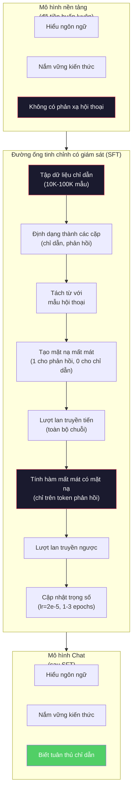

# Tinh chỉnh theo Chỉ dẫn (Instruction Tuning - SFT)

> Một mô hình nền tảng chỉ làm đúng một việc: dự đoán token tiếp theo. Nó không biết tuân thủ mệnh lệnh, không biết trả lời câu hỏi và không biết từ chối các yêu cầu độc hại. Tinh chỉnh có giám sát (Supervised Fine-Tuning - SFT) chính là chiếc cầu nối biến một cỗ máy dự đoán token thành một trợ lý hữu ích. Mọi mô hình hội thoại bạn từng tương tác -- Claude, GPT, Llama Chat -- đều phải trải qua giai đoạn này.

**Type:** Build
**Languages:** Python (với numpy)
**Prerequisites:** Giai đoạn 10, Bài 04 (Tiền huấn luyện Mini GPT)
**Time:** ~90 phút

## Mục tiêu học tập

- Triển khai quá trình tinh chỉnh có giám sát (SFT) để biến một mô hình ngôn ngữ nền tảng thành một trợ lý biết tuân thủ chỉ dẫn
- Định dạng dữ liệu huấn luyện bằng các mẫu hội thoại (chat templates) với các vai trò hệ thống (system), người dùng (user) và trợ lý (assistant), đồng thời che mặt nạ mất mát (mask loss) đối với các token không thuộc lượt của trợ lý
- Giải thích vì sao SFT là bắt buộc: mô hình nền tảng chỉ tiếp tục viết tiếp văn bản chứ không có khái niệm trả lời câu hỏi
- Đánh giá chất lượng của SFT bằng cách so sánh phản hồi của mô hình nền tảng và mô hình đã tinh chỉnh trên tập chỉ dẫn độc lập

## Vấn đề đặt ra

Bạn đã huấn luyện một mô hình trong Bài 04. Nó có thể dự đoán token tiếp theo từ một chuỗi cho trước. Nếu bạn nạp vào câu "The transformer architecture", nó có thể viết tiếp "has revolutionized natural language processing." Đó là một thành tựu ấn tượng đối với một mô hình dự đoán token kế tiếp.

Nhưng bây giờ hãy thử đưa vào câu hỏi: "Thủ đô của nước Pháp là gì?" Một mô hình nền tảng (base model) sẽ không trả lời "Paris". Nó sẽ tiếp tục nối dài văn bản theo quy luật thống kê. Nó có thể viết tiếp: "Thủ đô của nước Đức là gì? Thủ đô của Tây Ban Nha là gì?" bởi vì nó từng học từ các tài liệu chứa danh sách câu hỏi trắc nghiệm. Hoặc nó có thể viết: "là một câu hỏi mà nhiều người thường thắc mắc" vì đó là một chuỗi từ tiếp theo hoàn toàn hợp lý. Mô hình không hề có khái niệm về việc *trả lời*. Nó chỉ biết *viết tiếp*.

Đây chính là khoảng cách giữa GPT-3 (mô hình nền tảng, ra mắt tháng 6/2020) và ChatGPT (mô hình đã tinh chỉnh chỉ dẫn, ra mắt tháng 11/2022). Cùng một kiến trúc. Cùng một quá trình tiền huấn luyện. Điểm khác biệt duy nhất nằm ở 20.000 đến 100.000 cặp (chỉ dẫn, phản hồi) được chuẩn bị kỹ lưỡng để dạy mô hình tuân thủ quy tắc hội thoại.

Dự án Alpaca của Stanford đã chứng minh rằng bạn không cần đến hàng triệu ví dụ. Vào tháng 3/2023, họ đã tinh chỉnh Llama 7B chỉ với 52.000 cặp chỉ dẫn - phản hồi được sinh ra bởi GPT-3.5. Tổng chi phí: 600 USD. Kết quả là một chatbot có khả năng tuân thủ chỉ dẫn, trả lời câu hỏi và đối thoại tự nhiên. Dù chưa hoàn hảo bằng ChatGPT, nhưng chất lượng đạt được cực kỳ ấn tượng so với mức chi phí 600 USD và vài giờ huấn luyện.

Llama 2 Chat của Meta thậm chí chỉ sử dụng khoảng 27.000 mẫu dữ liệu chất lượng cao cho giai đoạn SFT ban đầu. Bài học rút ra: chất lượng quan trọng hơn số lượng. 27.000 ví dụ được viết bởi các chuyên gia gắn nhãn lành nghề vượt trội hoàn toàn so với 1 triệu ví dụ nhiễu loạn cào từ internet.

## Khái niệm cốt lõi

### Bản chất thực sự của SFT

Tinh chỉnh có giám sát (SFT) tiếp tục vòng lặp huấn luyện tương tự như giai đoạn tiền huấn luyện -- lan truyền tiến, tính hàm mất mát, lan truyền ngược, cập nhật trọng số -- nhưng trên một loại dữ liệu hoàn toàn khác. Thay vì văn bản thô vô định hình, bạn huấn luyện trên các đoạn hội thoại có cấu trúc:

```json
{
  "system": "You are a helpful assistant.",
  "user": "What is the capital of France?",
  "assistant": "The capital of France is Paris."
}
```

Mô hình thực ra đã biết Paris là thủ đô của nước Pháp. Nó đã học được tri thức này trong giai đoạn tiền huấn luyện trên Wikipedia, sách báo và các trang web. SFT không dạy cho mô hình tri thức mới. Nó dạy mô hình một *hành vi* mới: khi nhìn thấy một câu hỏi, hãy đưa ra câu trả lời. Khi nhìn thấy một mệnh lệnh, hãy hoàn thành nó. Khi nhìn thấy một yêu cầu độc hại, hãy đưa ra lời từ chối lịch sự.

Nói một cách hình tượng: Tiền huấn luyện (pre-training) mang lại tri thức cho mô hình. SFT rèn giũa cho mô hình tác phong và phép lịch sự.

### Các định dạng dữ liệu (Data Formats)

Có ba định dạng dữ liệu thống trị trong ngành công nghiệp. Cả ba đều mã hóa cùng một thông tin -- ai nói điều gì -- nhưng sử dụng các ký tự phân cách khác nhau.

**Định dạng Alpaca (Alpaca Format)** (Stanford, tháng 3/2023):

```json
{
  "instruction": "Summarize the following article in 3 sentences.",
  "input": "The European Central Bank raised interest rates...",
  "output": "The ECB increased rates by 25 basis points..."
}
```

Đơn giản và rất phổ biến. Trường `input` là tùy chọn -- nhiều chỉ dẫn không cần thêm ngữ cảnh phụ. Stanford đã phát hành 52.000 mẫu theo định dạng này, được tạo ra từ GPT-3.5 với chi phí 600 USD, mở màn cho làn sóng tinh chỉnh mô hình mã nguồn mở.

**Định dạng ShareGPT (ShareGPT Format)** (Cộng đồng, 2023):

```json
{
  "conversations": [
    {"from": "system", "value": "You are a helpful assistant."},
    {"from": "human", "value": "What causes tides?"},
    {"from": "gpt", "value": "Tides are caused by the gravitational pull of the Moon..."},
    {"from": "human", "value": "How often do they occur?"},
    {"from": "gpt", "value": "Most coastal areas experience two high tides and two low tides per day..."}
  ]
}
```

Hỗ trợ các cuộc hội thoại nhiều lượt (multi-turn). Trường "from" sử dụng quy ước "human" và "gpt" bất kể mô hình thực tế là gì. Mô hình Vicuna nổi tiếng từng được huấn luyện trên 70.000 đoạn hội thoại ShareGPT thu thập từ các bản chia sẻ của người dùng ChatGPT.

**Định dạng ChatML (ChatML Format)** (OpenAI, được sử dụng rộng rãi bởi nhiều mô hình mã nguồn mở):

```text
<|im_start|>system
You are helpful.<|im_end|>
<|im_start|>user
What is the capital of France?<|im_end|>
<|im_start|>assistant
The capital of France is Paris.<|im_end|>
```

Sử dụng các token đặc biệt (`<|im_start|>`, `<|im_end|>`) để phân định rõ ràng các vai trò. Các token này được thêm vào từ vựng của bộ tách từ trong quá trình tinh chỉnh. Qwen, Yi và nhiều mô hình khác đều sử dụng ChatML.

Cả ba định dạng đều nhằm đạt được cùng một mục tiêu: truyền đạt cho mô hình thông điệp "đây là mệnh lệnh, đây là phản hồi mong muốn, hãy học theo mẫu này."

### Vì sao SFT hiệu quả?

Mô hình đã nắm vững cấu trúc ngôn ngữ từ giai đoạn tiền huấn luyện. Nó đã quan sát hàng tỷ ngữ cảnh chứa câu hỏi kèm câu trả lời, mệnh lệnh kèm lời đáp, và các cuộc đối thoại giữa người với người. Những quy luật đó đã nằm sẵn trong các trọng số.

SFT đóng vai trò kích hoạt và tập trung hóa năng lực tiềm ẩn đó. Thay vì để mô hình phải tự đoán xem nó nên viết tiếp văn bản hay trả lời câu hỏi, SFT rèn luyện trực tiếp trên mô thức hội thoại. Sau vài nghìn ví dụ, mô hình học được phản xạ: khi gặp dấu phân cách của vai trò trợ lý, hãy sinh ra câu trả lời hữu ích.

Đó là lý do vì sao chỉ 27.000 ví dụ là đủ. Bạn không dạy lại ngữ pháp tiếng Anh. Bạn không dạy lại các sự kiện lịch sử hay khoa học. Bạn chỉ dạy mô hình một hành vi duy nhất: phản hồi lại chỉ dẫn. Tri thức vốn dĩ đã có sẵn từ trước.

### Mặt nạ hàm mất mát (The Masked Loss)

Đây là chi tiết kỹ thuật cốt tử nhất trong SFT mà phần lớn các bài hướng dẫn thường bỏ qua.

Trong giai đoạn tiền huấn luyện, bạn tính hàm mất mát trên mọi token. Mô hình học cách dự đoán từng token kế tiếp trong toàn bộ chuỗi. Nhưng trong SFT, bạn **chỉ tính hàm mất mát trên các token của phần phản hồi (response)**. Các token của phần chỉ dẫn (instruction) chỉ đóng vai trò làm ngữ cảnh đầu vào, mô hình tuyệt đối không bị phạt nếu "dự đoán" sai phần chỉ dẫn.

Tại sao lại như vậy? Bởi vì bạn không muốn mô hình học cách *tự sinh ra câu hỏi*. Bạn muốn nó học cách *trả lời câu hỏi*. Nếu tính mất mát trên cả câu hỏi của người dùng, bạn đang gián tiếp huấn luyện mô hình dự đoán câu "Thủ đô của nước Pháp là gì?" như thể chính nó là người đặt câu hỏi. Việc này làm lãng phí tín hiệu gradient và khiến mô hình bị lẫn lộn vai trò.

Trong thực tế, bạn tạo một mặt nạ mất mát (loss mask): gán giá trị 1 cho các token phản hồi và giá trị 0 cho các token chỉ dẫn. Nhân hàm mất mát của từng token với mặt nạ này trước khi tính trung bình.

```text
Tokens:    [SYS] You are helpful [USER] What is the capital? [ASST] Paris is the capital [EOS]
Loss mask:   0    0    0     0      0     0   0  0     0       1     1    1   1     1      1
```

Chỉ những token đứng sau token `[ASST]` mới đóng góp vào hàm mất mát. Mô hình vẫn quan sát toàn bộ ngữ cảnh trong lượt lan truyền tiến (vì nó cần câu hỏi để sinh ra câu trả lời tương ứng), nhưng chỉ cập nhật trọng số dựa trên việc nó dự đoán câu trả lời chuẩn xác đến đâu.

### Các siêu tham số huấn luyện (Training Hyperparameters)

SFT sử dụng các siêu tham số khác biệt hoàn toàn so với tiền huấn luyện. Bạn không huấn luyện một mô hình từ đầu, mà đang tinh chỉnh một mô hình vốn đã có năng lực.

| Tham số | Tiền huấn luyện (Llama 2 7B) | SFT (Llama 2 Chat) |
|---|---|---|
| Tốc độ học (Learning rate) | 3e-4 (đỉnh) | 2e-5 |
| Số epoch | 1 (duyệt dữ liệu một lần) | 2 |
| Kích thước batch | 4M tokens | 64 mẫu |
| Bước khởi động (Warmup steps) | 2.000 | 0-100 |
| Suy giảm trọng số (Weight decay) | 0,1 | 0,0 - 0,1 |
| Quy mô dữ liệu | 2T tokens | 27.000 mẫu |

Tốc độ học trong SFT thấp hơn khoảng 15 lần so với tiền huấn luyện. Điều này mang tính sống còn: nếu dùng tốc độ học quá lớn, bạn sẽ phá hủy toàn bộ tri thức đã học trong giai đoạn tiền huấn luyện. Mô hình sẽ "quên sạch" những gì đã biết và rơi vào hiện tượng quá khớp (overfitting) trên tập dữ liệu tinh chỉnh nhỏ bé. Đây gọi là hiện tượng quên thảm họa (catastrophic forgetting).

Số lượng 2 epoch đồng nghĩa mô hình chỉ nhìn thấy mỗi ví dụ hai lần. Huấn luyện quá 3 epoch trên tập dữ liệu nhỏ sẽ dẫn đến việc học vẹt -- mô hình bắt đầu sao chép nguyên văn các ví dụ huấn luyện thay vì khái quát hóa câu trả lời.

### Quên thảm họa (Catastrophic Forgetting)

Quá trình tinh chỉnh có thể làm suy giảm các năng lực tổng quát của mô hình. Huấn luyện quá lâu trên dữ liệu chỉ dẫn có thể khiến mô hình đánh mất khả năng lập trình, giải toán hoặc viết lách sáng tạo. Nó trở nên rất giỏi trong khuôn mẫu dữ liệu tinh chỉnh nhưng trở nên ngờ nghệch ở mọi tác vụ khác.

Ba biện pháp giảm thiểu:

1. **Tốc độ học thấp:** Giữ trong khoảng từ 1e-5 đến 5e-5. Các bước cập nhật nhỏ giúp bảo toàn các đặc trưng đã học từ trước.
2. **Số bước huấn luyện ngắn:** Chỉ từ 1 đến 3 epoch. Dừng lại trước khi mô hình bị quá khớp.
3. **Pha trộn dữ liệu tiền huấn luyện:** Llama 2 Chat pha trộn một tỷ lệ nhỏ (khoảng 2-5%) dữ liệu tiền huấn luyện thô vào tập dữ liệu SFT. Điều này giúp "nhắc nhở" mô hình về các năng lực nền tảng trong khi tiếp thu hành vi hội thoại mới.

### Những con số thực tế

Tinh chỉnh một mô hình 7B trên 10.000 cặp chỉ dẫn chất lượng cao chỉ mất khoảng 1 giờ trên một GPU NVIDIA A100 80GB duy nhất. Dưới đây là bài toán tính toán:

- 10.000 mẫu x 512 token trung bình = 5,12 triệu token
- 2 epoch = 10,24 triệu token tổng cộng
- Thông lượng của A100 khi tinh chỉnh mô hình 7B: ~3.000 token/giây
- 10,24M / 3.000 = ~3.400 giây = ~57 phút

Đối với mô hình Mini GPT của chúng ta (4 tầng, 128 chiều), việc huấn luyện diễn ra gần như tức thì. Mục tiêu ở đây là thấu hiểu cơ chế hoạt động cốt lõi, không phải chạy đua về quy mô.



```figure
loss-masking
```

## Tự tay xây dựng (Build It)

### Bước 1: Tập dữ liệu Chỉ dẫn (Instruction Dataset)

Tạo một tập dữ liệu chỉ dẫn mẫu. Trong môi trường công nghiệp, các công ty như Scale AI hay Anthropic thuê đội ngũ chuyên gia nhân văn để biên soạn những dữ liệu này. Chúng ta sẽ tạo một tập dữ liệu nhỏ để minh họa cấu trúc.

```python
import numpy as np

INSTRUCTION_DATA = [
    {
        "instruction": "What is the capital of France?",
        "response": "The capital of France is Paris."
    },
    {
        "instruction": "Explain gravity in one sentence.",
        "response": "Gravity is the force that attracts objects with mass toward each other."
    },
    {
        "instruction": "Write a haiku about the ocean.",
        "response": "Waves crash on the shore, salt and foam beneath the sun, endless blue expanse."
    },
    {
        "instruction": "What is 15 multiplied by 7?",
        "response": "15 multiplied by 7 is 105."
    },
    {
        "instruction": "Name three programming languages.",
        "response": "Three programming languages are Python, Rust, and TypeScript."
    },
    {
        "instruction": "Summarize photosynthesis.",
        "response": "Photosynthesis converts sunlight, water, and carbon dioxide into glucose and oxygen."
    },
    {
        "instruction": "What year did World War II end?",
        "response": "World War II ended in 1945."
    },
    {
        "instruction": "Define machine learning.",
        "response": "Machine learning is a field where algorithms learn patterns from data to make predictions."
    },
]
```

Tám ví dụ là một con số rất nhỏ (Stanford Alpaca dùng 52.000). Nhưng cơ chế xử lý hoàn toàn giống hệt nhau dù bạn có 8 hay 52.000 mẫu: tách từ, tạo mặt nạ, và chỉ tính hàm mất mát trên phần phản hồi.

### Bước 2: Tách từ với Mẫu Hội thoại (Chat Template)

Chuyển đổi các cặp chỉ dẫn - phản hồi thành các chuỗi token kèm các mốc vai trò đặc biệt. Các mốc này báo hiệu cho mô hình biết đâu là điểm kết thúc chỉ dẫn và đâu là nơi bắt đầu phản hồi.

```python
SPECIAL_TOKENS = {
    "INST_START": 253,
    "INST_END": 254,
    "RESP_START": 255,
}


def tokenize_instruction_pair(instruction, response, vocab_size=256):
    inst_tokens = list(instruction.encode("utf-8"))
    resp_tokens = list(response.encode("utf-8"))

    inst_tokens = [min(t, vocab_size - 4) for t in inst_tokens]
    resp_tokens = [min(t, vocab_size - 4) for t in resp_tokens]

    tokens = (
        [SPECIAL_TOKENS["INST_START"]]
        + inst_tokens
        + [SPECIAL_TOKENS["INST_END"]]
        + [SPECIAL_TOKENS["RESP_START"]]
        + resp_tokens
    )

    return tokens


def create_loss_mask(tokens):
    mask = np.zeros(len(tokens), dtype=np.float32)
    in_response = False

    for i, token in enumerate(tokens):
        if token == SPECIAL_TOKENS["RESP_START"]:
            in_response = True
            continue
        if in_response:
            mask[i] = 1.0

    return mask
```

Mặt nạ mất mát chứa toàn số 0 cho phần chỉ dẫn và toàn số 1 cho phần phản hồi. Bản thân token `RESP_START` được gán giá trị 0 vì nó chỉ là ký tự phân cách, không thuộc nội dung phản hồi.

### Bước 3: Hàm Mất mát Entropy Chéo có Mặt nạ (Masked Cross-Entropy Loss)

Hàm mất mát entropy chéo tiêu chuẩn nhưng được nhân với mặt nạ mất mát. Chỉ những token phản hồi mới đóng góp vào việc tính gradient.

```python
def masked_cross_entropy_loss(logits, targets, loss_mask):
    batch, seq_len, vocab_size = logits.shape
    logits_flat = logits.reshape(-1, vocab_size)
    targets_flat = targets.reshape(-1)
    mask_flat = loss_mask.reshape(-1)

    max_logits = logits_flat.max(axis=-1, keepdims=True)
    log_softmax = logits_flat - max_logits - np.log(
        np.exp(logits_flat - max_logits).sum(axis=-1, keepdims=True)
    )

    per_token_loss = -log_softmax[np.arange(len(targets_flat)), targets_flat]

    masked_loss = per_token_loss * mask_flat
    num_response_tokens = mask_flat.sum()
    if num_response_tokens == 0:
        return 0.0
    loss = masked_loss.sum() / num_response_tokens

    return loss
```

Mẫu số ở đây là `num_response_tokens` chứ không phải `seq_len`. Nếu chia cho toàn bộ độ dài chuỗi, các câu hỏi dài sẽ làm loãng tín hiệu gradient của câu trả lời. Việc chia cho số token phản hồi thực tế đảm bảo mỗi token phản hồi có trọng số đóng góp đồng đều.

### Bước 4: Vòng lặp Huấn luyện SFT (SFT Training Loop)

Tái sử dụng lớp `MiniGPT` từ Bài 04. Vòng lặp huấn luyện trông gần như tương tự tiền huấn luyện, nhưng có thêm khâu định dạng chỉ dẫn và áp dụng hàm mất mát có mặt nạ.

```python
import sys
import os
sys.path.insert(0, os.path.join(os.path.dirname(__file__), "..", "..", "04-pre-training-mini-gpt", "code"))
from main import MiniGPT, LayerNorm, FeedForward, MultiHeadAttention, TransformerBlock, Embedding


def sft_train(model, dataset, num_epochs=2, lr=2e-5, seq_len=64):
    formatted_data = []
    for example in dataset:
        tokens = tokenize_instruction_pair(example["instruction"], example["response"])
        mask = create_loss_mask(tokens)
        formatted_data.append((tokens, mask))

    print(f"Huấn luyện SFT: {len(formatted_data)} mẫu, {num_epochs} epochs, lr={lr}")
    print(f"Tổng số token: {sum(len(t) for t, _ in formatted_data):,}")
    print()

    losses = []

    for epoch in range(num_epochs):
        epoch_loss = 0.0
        num_batches = 0

        indices = np.random.permutation(len(formatted_data))

        for idx in indices:
            tokens, mask = formatted_data[idx]

            if len(tokens) < 3:
                continue
            if len(tokens) > seq_len:
                tokens = tokens[:seq_len]
                mask = mask[:seq_len]

            input_ids = np.array(tokens[:-1]).reshape(1, -1)
            target_ids = np.array(tokens[1:]).reshape(1, -1)
            loss_mask = np.array(mask[1:]).reshape(1, -1)

            logits = model.forward(input_ids)
            loss = masked_cross_entropy_loss(logits, target_ids, loss_mask)

            batch_size, s_len, v_size = logits.shape
            probs = np.exp(logits - logits.max(axis=-1, keepdims=True))
            probs = probs / probs.sum(axis=-1, keepdims=True)
            dlogits = probs.copy()
            dlogits[np.arange(batch_size)[:, None], np.arange(s_len), target_ids] -= 1.0

            mask_expanded = loss_mask[:, :, np.newaxis]
            num_resp = loss_mask.sum()
            if num_resp > 0:
                dlogits = dlogits * mask_expanded / num_resp

            for block in model.blocks:
                block.ffn.W1 -= lr * np.random.randn(*block.ffn.W1.shape) * 0.01
                block.ffn.W2 -= lr * np.random.randn(*block.ffn.W2.shape) * 0.01
                block.ffn.b1 -= lr * np.random.randn(*block.ffn.b1.shape) * 0.01
                block.ffn.b2 -= lr * np.random.randn(*block.ffn.b2.shape) * 0.01

            epoch_loss += loss
            num_batches += 1
            losses.append(loss)

        avg_loss = epoch_loss / max(num_batches, 1)
        print(f"Epoch {epoch + 1}/{num_epochs} | Loss trung bình: {avg_loss:.4f}")

    return model, losses
```

Tốc độ học được đặt ở mức 2e-5, khớp với tham số của Llama 2 Chat. Gradient được che mặt nạ: các token thuộc phần chỉ dẫn sinh ra gradient bằng 0. Chỉ có các token phản hồi mới tạo lực đẩy cập nhật trọng số.

### Bước 5: So sánh Mô hình Nền tảng và Mô hình sau SFT

Bản chất cốt lõi của SFT là thay đổi hành vi. Hãy đo lường sự thay đổi này bằng cách kiểm tra cách mô hình phản hồi trước các câu hỏi được định dạng chỉ dẫn.

```python
def generate_response(model, prompt_tokens, max_new_tokens=50, temperature=0.8):
    tokens = list(prompt_tokens)
    seq_len = model.embedding.pos_embed.shape[0]

    for _ in range(max_new_tokens):
        context = np.array(tokens[-seq_len:]).reshape(1, -1)
        logits = model.forward(context)
        next_logits = logits[0, -1, :]

        next_logits = next_logits / max(temperature, 1e-8)
        probs = np.exp(next_logits - next_logits.max())
        probs = probs / probs.sum()
        probs = np.clip(probs, 1e-10, 1.0)
        probs = probs / probs.sum()

        next_token = np.random.choice(len(probs), p=probs)
        tokens.append(int(next_token))

    return tokens


def evaluate_instruction_following(model, instructions):
    print("Đánh giá khả năng tuân thủ chỉ dẫn:")
    print("-" * 50)

    for instruction in instructions:
        tokens = (
            [SPECIAL_TOKENS["INST_START"]]
            + [min(t, 252) for t in list(instruction.encode("utf-8"))]
            + [SPECIAL_TOKENS["INST_END"]]
            + [SPECIAL_TOKENS["RESP_START"]]
        )

        output = generate_response(model, tokens, max_new_tokens=30, temperature=0.6)
        response_start = len(tokens)
        response_tokens = output[response_start:]
        response_bytes = bytes([t for t in response_tokens if t < 128])
        response_text = response_bytes.decode("utf-8", errors="replace")

        print(f"  Hỏi: {instruction}")
        print(f"  Đáp: {response_text[:80]}")
        print()
```

Trên mô hình thu nhỏ với 8 ví dụ, các phản hồi sinh ra chưa mang ý nghĩa thực tế cao. Nhưng điều quan trọng nhất là *cấu trúc*: mô hình học được phản xạ sinh nội dung sau mốc phản hồi thay vì tiếp tục nhại lại các câu hỏi mới.

### Bước 6: Đo lường mức độ Quên thảm họa (Catastrophic Forgetting)

So sánh năng lực dự đoán token tiếp theo của mô hình trước và sau SFT trên văn bản thô. Nếu SFT làm hỏng năng lực tổng quát, hàm mất mát trên văn bản thô sẽ tăng vọt.

```python
def measure_forgetting(model, test_text, seq_len=64):
    tokens = np.array(list(test_text.encode("utf-8")[:512]))

    total_loss = 0.0
    num_windows = 0

    for start in range(0, len(tokens) - seq_len - 1, seq_len):
        input_ids = tokens[start:start + seq_len].reshape(1, -1)
        target_ids = tokens[start + 1:start + seq_len + 1].reshape(1, -1)

        logits = model.forward(input_ids)

        batch, s_len, vocab_size = logits.shape
        logits_flat = logits.reshape(-1, vocab_size)
        targets_flat = target_ids.reshape(-1)

        max_logits = logits_flat.max(axis=-1, keepdims=True)
        log_softmax = logits_flat - max_logits - np.log(
            np.exp(logits_flat - max_logits).sum(axis=-1, keepdims=True)
        )

        loss = -log_softmax[np.arange(len(targets_flat)), targets_flat].mean()
        total_loss += loss
        num_windows += 1

    return total_loss / max(num_windows, 1)
```

Trong thực tế, bạn theo dõi chỉ số này liên tục. Nếu hàm mất mát trên văn bản thô tăng quá 10-15%, quá trình SFT của bạn đang quá hung hăng -- cần hạ thấp tốc độ học hoặc giảm bớt số epoch.

## Sử dụng trong thực tế (Use It)

### Thử nghiệm hoàn chỉnh Quy trình SFT

```python
if __name__ == "__main__":
    np.random.seed(42)

    test_text = """The transformer architecture processes sequences through self-attention.
Each layer applies multi-head attention followed by a feedforward network.
Residual connections and layer normalization stabilize deep networks.
The model learns to predict the next token given all previous tokens."""

    print("=" * 70)
    print("MÔ PHỎNG TINH CHỈNH THEO CHỈ DẪN (SFT)")
    print("=" * 70)
    print()

    model = MiniGPT(
        vocab_size=256, embed_dim=128, num_heads=4,
        num_layers=4, max_seq_len=128, ff_dim=512
    )
    print(f"Mô hình: {model.count_parameters():,} tham số")
    print(f"Cấu hình: 4 tầng, 4 đầu, 128 chiều nhúng (Mini GPT từ Bài 04)")
    print()

    print("TRƯỚC SFT: Đo lường hàm mất mát của mô hình nền tảng trên văn bản thô")
    base_loss = measure_forgetting(model, test_text)
    print(f"  Loss mô hình nền tảng: {base_loss:.4f}")
    print()

    print("=" * 70)
    print("QUÁ TRÌNH HUẤN LUYỆN SFT")
    print("=" * 70)

    model, losses = sft_train(
        model, INSTRUCTION_DATA, num_epochs=3, lr=2e-5, seq_len=128
    )

    print()
    print("SAU SFT: Đo lường hàm mất mát của mô hình đã tinh chỉnh trên văn bản thô")
    sft_loss = measure_forgetting(model, test_text)
    print(f"  Loss mô hình sau SFT: {sft_loss:.4f}")
    print(f"  Độ biến thiên: {((sft_loss - base_loss) / base_loss * 100):+.1f}%")
    if abs(sft_loss - base_loss) / base_loss < 0.15:
        print("  Mức độ quên tối thiểu (< 15% biến động)")
    else:
        print("  Phát hiện hiện tượng quên đáng kể")
    print()

    print("=" * 70)
    print("ĐÁNH GIÁ KHẢ NĂNG TUÂN THỦ CHỈ DẪN")
    print("=" * 70)
    print()

    test_instructions = [
        "What is the capital of France?",
        "Name a programming language.",
        "Define gravity.",
    ]
    evaluate_instruction_following(model, test_instructions)

    print("=" * 70)
    print("VÍ DỤ ĐỊNH DẠNG DỮ LIỆU")
    print("=" * 70)
    print()

    for i, example in enumerate(INSTRUCTION_DATA[:3]):
        tokens = tokenize_instruction_pair(example["instruction"], example["response"])
        mask = create_loss_mask(tokens)
        resp_count = int(mask.sum())
        total_count = len(tokens)
        print(f"  Ví dụ {i + 1}: {total_count} tokens, {resp_count} tokens phản hồi ({resp_count/total_count:.0%} chuỗi)")
        print(f"    Chỉ dẫn: {example['instruction']}")
        print(f"    Phản hồi: {example['response']}")
        print()

    print("=" * 70)
    print("ĐƯỜNG CONG SUY GIẢM HÀM MẤT MÁT")
    print("=" * 70)
    print()

    if losses:
        window = max(1, len(losses) // 5)
        for i in range(0, len(losses), window):
            chunk = losses[i:i + window]
            avg = sum(chunk) / len(chunk)
            print(f"  Các bước {i:3d}-{i + len(chunk) - 1:3d}: loss trung bình = {avg:.4f}")
```

## Bàn giao sản phẩm (Ship It)

Bài học này cung cấp artifact `outputs/prompt-sft-data-curator.md` -- một prompt hỗ trợ bạn thiết kế và tuyển chọn các bộ dữ liệu chỉ dẫn cho tác vụ SFT. Khi đưa vào năng lực mục tiêu (sinh mã nguồn, giải toán, trò chuyện), nó sẽ đưa ra kế hoạch thu thập dữ liệu chi tiết kèm quy chuẩn định dạng, tiêu chí chất lượng và yêu cầu về tính đa dạng.

## Bài tập thực hành

1. Thêm hỗ trợ cho lời nhắc hệ thống (system prompt). Chỉnh sửa hàm `tokenize_instruction_pair` để nhận thông điệp hệ thống và đặt lên trước câu hỏi của người dùng. Tạo 5 ví dụ với các system prompt khác nhau ("Bạn là một nhà thơ", "Bạn là một gia sư toán") và kiểm chứng mô hình tiếp nhận các system prompt khác nhau trong quá trình huấn luyện.

2. Triển khai kỹ thuật pha trộn dữ liệu (data mixing). Xây dựng một hàm nhận vào tập dữ liệu SFT và một ngữ liệu văn bản thô, sau đó sinh ra các batch huấn luyện trong đó 5% là văn bản thô (không che mặt nạ) và 95% là các cặp chỉ dẫn (có che mặt nạ). Chạy 3 epoch và so sánh chỉ số suy giảm năng lực nền tảng so với huấn luyện SFT thuần túy.

3. Xây dựng công cụ chấm điểm chất lượng dữ liệu. Với mỗi cặp chỉ dẫn - phản hồi, hãy tính toán: (a) độ dài phản hồi theo số lượng token, (b) tỷ lệ độ dài chỉ dẫn / phản hồi, (c) tính đa dạng từ vựng (số token phân biệt / tổng số token). Lọc bỏ các ví dụ có độ dài phản hồi < 10 token hoặc độ đa dạng < 0,3. Chứng minh việc lọc này ảnh hưởng thế nào đến hàm mất mát cuối cùng.

4. Triển khai huấn luyện hội thoại đa lượt (multi-turn). Mở rộng hàm tách từ để xử lý các cuộc hội thoại 3 lượt (user-assistant-user-assistant-user-assistant). Mặt nạ mất mát bắt buộc phải bao phủ toàn bộ 3 lượt của trợ lý. Kiểm tra tính chính xác của mặt nạ bằng cách in ra sự căn chỉnh giữa token và giá trị mặt nạ.

5. So sánh các mức tốc độ học khác nhau. Huấn luyện cùng một mô hình ba lần với `lr=1e-4`, `lr=2e-5`, và `lr=1e-6`. Vẽ biểu đồ suy giảm loss. Lượt chạy `1e-4` sẽ giảm rất nhanh ban đầu nhưng loss cuối cùng lại cao do quá khớp. Lượt chạy `1e-6` gần như không suy chuyển. Lượt chạy `2e-5` sẽ đạt điểm cân bằng lý tưởng.

## Các thuật ngữ chính

| Thuật ngữ | Người ta thường nói | Ý nghĩa thực sự |
|---|---|---|
| SFT | "Tinh chỉnh trên hội thoại" | Tinh chỉnh có giám sát (Supervised Fine-Tuning): tiếp tục huấn luyện mô hình trên các cặp (chỉ dẫn, phản hồi) và chỉ tính hàm mất mát trên phần phản hồi |
| Tinh chỉnh theo chỉ dẫn (Instruction tuning) | "Dạy mô hình nghe lời" | Huấn luyện trên các cặp mệnh lệnh - lời đáp rõ ràng để mô hình nền tảng nắm bắt phong cách giao tiếp, không nhằm dạy thêm kiến thức mới |
| Mặt nạ hàm mất mát (Loss masking) | "Bỏ qua câu hỏi" | Gán hàm mất mát bằng 0 cho các token chỉ dẫn để gradient chỉ truyền từ các dự đoán trên token phản hồi |
| ChatML | "Ngôn ngữ đánh dấu hội thoại" | Định dạng token sử dụng các mốc `<\|im_start\|>` và `<\|im_end\|>` để phân định vai trò các bên trong dữ liệu hội thoại |
| Định dạng Alpaca | "Định dạng của Stanford" | Định dạng JSON gồm các trường instruction/input/output, được dùng cho 52.000 mẫu tạo từ GPT-3.5 với giá 600 USD |
| Quên thảm họa (Catastrophic forgetting) | "Mô hình bị lú lẫn" | Quá trình tinh chỉnh phá hủy các năng lực đã học từ tiền huấn luyện do các bước cập nhật gradient ghi đè tri thức tổng quát bằng các mẫu đặc thù của tác vụ |
| Trói buộc trọng số (Weight tying) | "Dùng chung tầng nhúng" | Sử dụng cùng một ma trận trọng số cho tầng nhúng token đầu vào và tầng chiếu đầu ra, giúp tiết kiệm tham số và tăng tính nhất quán |
| Mẫu hội thoại (Chat template) | "Cách định dạng prompt" | Chuỗi token đặc thù (các mốc phân định vai trò) giúp cấu trúc một cuộc hội thoại để mô hình tiếp nhận đúng quy chuẩn |

## Tài liệu đọc thêm

- [Ouyang et al., 2022 -- "Training language models to follow instructions with human feedback" (InstructGPT)](https://arxiv.org/abs/2203.02155) -- Bài báo nền tảng giới thiệu kỹ thuật tinh chỉnh chỉ dẫn kết hợp RLHF của OpenAI
- [Taori et al., 2023 -- "Stanford Alpaca: An Instruction-following LLaMA Model"](https://github.com/tatsu-lab/stanford_alpaca) -- 52.000 mẫu chỉ dẫn với giá 600 USD, chứng minh SFT hiệu quả trên tập dữ liệu nhỏ
- [Touvron et al., 2023 -- "Llama 2: Open Foundation and Fine-Tuned Chat Models"](https://arxiv.org/abs/2307.09288) -- Quy trình SFT + RLHF của Meta với 27.000 mẫu chất lượng cao
- [Chiang et al., 2023 -- "Vicuna: An Open-Source Chatbot Impressing GPT-4"](https://lmsys.org/blog/2023-03-30-vicuna/) -- Huấn luyện trên 70.000 cuộc hội thoại ShareGPT
- [Zhou et al., 2023 -- "LIMA: Less Is More for Alignment"](https://arxiv.org/abs/2305.11206) -- Chứng minh chỉ 1.000 mẫu dữ liệu chọn lọc kỹ lưỡng có thể đạt chất lượng tương đương SFT trên các tập dữ liệu khổng lồ
