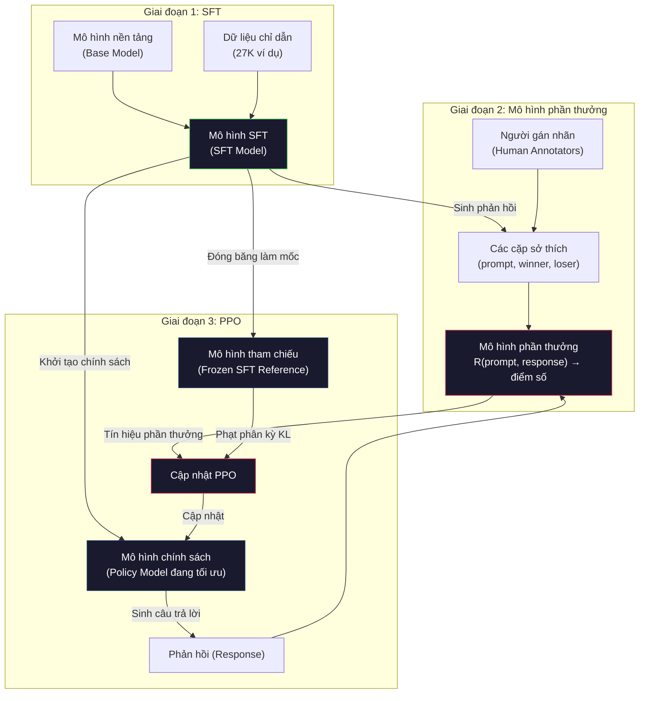
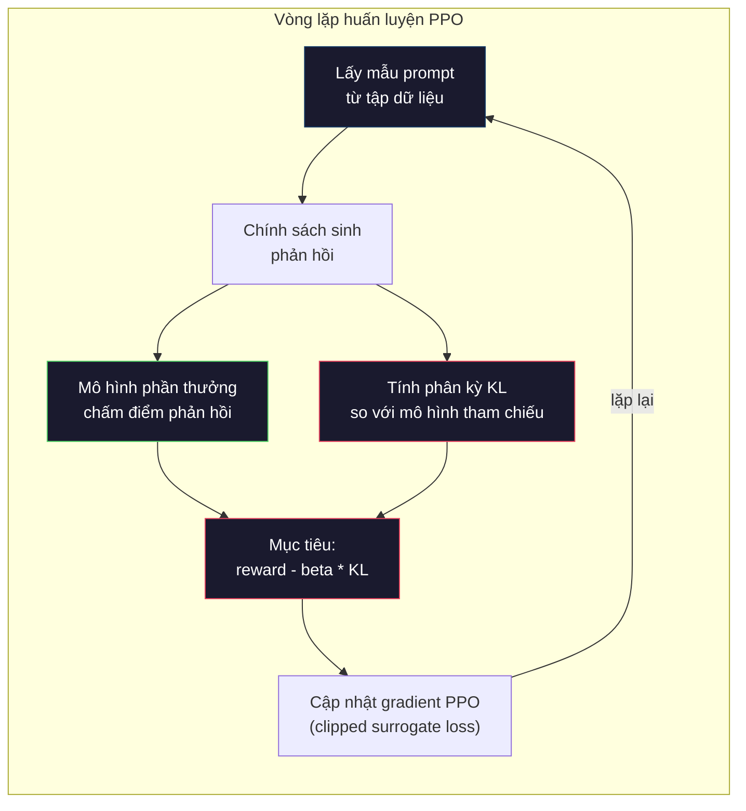

# RLHF: Mô Hình Phần Thưởng + PPO (RLHF: Reward Model + PPO)

> SFT dạy mô hình cách tuân theo chỉ dẫn. Nhưng nó không dạy mô hình câu trả lời nào TỐT HƠN. Hai câu trả lời đúng ngữ pháp, chính xác về mặt sự thật vẫn có thể khác biệt nhau rất lớn về mức độ hữu ích. Học tăng cường từ phản hồi của con người (Reinforcement Learning from Human Feedback - RLHF) là phương pháp mã hóa đánh giá của con người vào hành vi của mô hình. Đó chính là yếu tố giúp Claude trở nên hữu ích và GPT trở nên lịch thiệp.

**Type:** Build
**Languages:** Python (with numpy)
**Prerequisites:** Phase 10, Lesson 06 (Instruction Tuning / SFT)
**Time:** ~90 phút

## Mục Tiêu Học Tập

- Xây dựng mô hình phần thưởng (reward model) chấm điểm chất lượng phản hồi từ các cặp dữ liệu sở thích của con người (human preference pairs: chosen và rejected)
- Cài đặt vòng lặp huấn luyện PPO (tối ưu hóa chính sách lân cận - Proximal Policy Optimization) giúp tối ưu hóa chính sách mô hình ngôn ngữ (language model policy) dựa trên mô hình phần thưởng kết hợp với mức phạt KL (KL penalty)
- Giải thích lý do tại sao RLHF cần đến ba mô hình (mô hình SFT, mô hình phần thưởng, mô hình chính sách) và cách ràng buộc KL ngăn chặn hiện tượng lách phần thưởng (reward hacking)
- Đánh giá hiệu quả của RLHF bằng cách so sánh chất lượng phản hồi trước và sau khi tối ưu hóa sở thích

## Vấn Đề

Hãy yêu cầu một mô hình "Giải thích về điện toán lượng tử" ("Explain quantum computing"), và nó có thể đưa ra:

**Câu trả lời A:** "Điện toán lượng tử sử dụng các qubit có thể tồn tại ở trạng thái chồng chập (superposition), nghĩa là chúng có thể là 0, 1 hoặc cả hai cùng một lúc. Điều này cho phép máy tính lượng tử xử lý một số phép tính nhanh hơn theo hàm mũ so với máy tính cổ điển. Các thuật toán then chốt bao gồm thuật toán Shor để phân tích các số nguyên lớn thành thừa số nguyên tố và thuật toán Grover để tìm kiếm trong cơ sở dữ liệu chưa được sắp xếp."

**Câu trả lời B:** "Điện toán lượng tử là một dạng tính toán sử dụng các hiện tượng cơ học lượng tử. Nó được đề xuất lần đầu tiên vào những năm 1980. Richard Feynman gợi ý rằng các hệ lượng tử có thể được mô phỏng bằng máy tính lượng tử. Lĩnh vực này đã phát triển đáng kể kể từ đó. Hiện nay có nhiều công ty đang nghiên cứu máy tính lượng tử. IBM, Google và nhiều bên khác đã đạt được nhiều tiến bộ. Ưu thế lượng tử (quantum supremacy) đã được Google tuyên bố vào năm 2019."

Cả hai câu trả lời đều chính xác về mặt sự thật. Cả hai đều chuẩn ngữ pháp. Cả hai đều tuân theo chỉ dẫn. Nhưng Câu trả lời A rõ ràng vượt trội hơn. Nó cô đọng hơn, nhiều thông tin hữu ích hơn và có cấu trúc mạch lạc hơn. Một con người gần như chắc chắn sẽ chọn A trong mọi trường hợp.

SFT (tinh chỉnh có giám sát - Supervised Fine-Tuning) không thể nắm bắt được sự phân biệt này. Nó huấn luyện mô hình dựa trên các câu trả lời "đúng", nhưng không có cơ chế nào để khẳng định "câu trả lời này tốt hơn câu trả lời kia". Nó coi mọi ví dụ huấn luyện đều tốt ngang nhau. Nếu cả A và B đều xuất hiện trong tập dữ liệu SFT, mô hình sẽ học từ cả hai với trọng số bình đẳng như nhau.

RLHF giải quyết vấn đề này. Phương pháp này huấn luyện một mô hình phần thưởng để dự đoán xem con người sẽ ưu tiên câu trả lời nào hơn, sau đó sử dụng tín hiệu phần thưởng đó để thúc đẩy mô hình ngôn ngữ tạo ra các kết quả đầu ra có chất lượng cao hơn. InstructGPT (phiên bản tiền thân của ChatGPT) đã áp dụng RLHF để cải thiện vượt bậc tính hữu ích (helpfulness), tính trung thực (truthfulness) và tính vô hại (harmlessness) của GPT-3. Các chuyên viên đánh giá nội bộ của OpenAI đã ưu tiên các câu trả lời của InstructGPT hơn GPT-3 tới 85% số lần đánh giá, mặc dù InstructGPT nhỏ hơn 135 lần (1.3 tỷ tham số so với 175 tỷ tham số).

## Khái Niệm

### Ba Giai Đoạn

RLHF không phải là một quá trình huấn luyện đơn lẻ. Nó là một quy trình (pipeline) gồm ba giai đoạn nối tiếp nhau, mỗi giai đoạn kế thừa nền tảng của giai đoạn trước đó:

**Giai đoạn 1: SFT.** Huấn luyện mô hình nền tảng (base model) trên các cặp chỉ dẫn - phản hồi (instruction-response pairs) (Bài 06). Giai đoạn này tạo ra một mô hình có khả năng tuân thủ chỉ dẫn nhưng chưa phân biệt được câu trả lời nào tốt hơn câu trả lời nào.

**Giai đoạn 2: Mô hình phần thưởng (Reward Model).** Thu thập dữ liệu sở thích của con người: cho người gán nhãn xem hai câu trả lời cho cùng một câu nhắc (prompt) và hỏi "câu trả lời nào tốt hơn?". Huấn luyện một mô hình để dự đoán những sở thích này. Mô hình phần thưởng nhận (prompt, response) làm đầu vào và xuất ra một điểm số vô hướng (scalar score).

**Giai đoạn 3: PPO.** Sử dụng mô hình phần thưởng để tạo ra tín hiệu huấn luyện cho mô hình ngôn ngữ. Mô hình ngôn ngữ sinh ra các câu trả lời, mô hình phần thưởng chấm điểm chúng, và thuật toán PPO cập nhật mô hình ngôn ngữ để tạo ra các phản hồi có điểm số cao hơn. Một khoản phạt phân kỳ KL (KL divergence penalty) sẽ ngăn mô hình ngôn ngữ đi quá xa so với checkpoint SFT ban đầu.



### Mô Hình Phần Thưởng

Mô hình phần thưởng bản chất là một mô hình ngôn ngữ được chuyển đổi mục đích sử dụng thành một bộ chấm điểm. Lấy mô hình SFT, thay thế đầu ra mô hình hóa ngôn ngữ (language modeling head - vốn xuất ra phân phối xác suất trên toàn bộ từ vựng) bằng một đầu vô hướng (scalar head - xuất ra một số thực duy nhất). Kiến trúc hoàn toàn giống hệt cho tới tầng cuối cùng.

Đầu vào: một câu nhắc nối với một phản hồi. Đầu ra: một điểm thưởng vô hướng duy nhất.

Dữ liệu huấn luyện là các cặp sở thích của con người. Đối với mỗi câu nhắc, người gán nhãn xem xét hai phản hồi và chọn câu tốt hơn. Điều này tạo ra các bộ ba huấn luyện: `(prompt, preferred_response, rejected_response)`.

Hàm mất mát sử dụng mô hình Bradley-Terry cho các so sánh cặp (pairwise preferences):

```math
\text{loss} = -\log\big(\mathop{\mathrm{sigmoid}}(\text{reward}(\text{preferred}) - \text{reward}(\text{rejected}))\big)
```

Đây là phương trình then chốt. `sigmoid(reward(A) - reward(B))` cho biết xác suất phản hồi A được ưa chuộng hơn phản hồi B. Hàm mất mát thúc đẩy mô hình phần thưởng gán điểm số cao hơn cho phản hồi được ưa chuộng.

Tại sao lại dùng so sánh theo cặp thay vì cho điểm tuyệt đối? Bởi vì con người rất kém trong việc chấm điểm chất lượng tuyệt đối ("Câu trả lời này là 7.3 hay 7.5 trên thang điểm 10?") nhưng lại cực kỳ giỏi trong việc so sánh tương quan ("A có tốt hơn B không?"). Mô hình Bradley-Terry chuyển đổi các so sánh tương đối thành một hệ thống chấm điểm tuyệt đối nhất quán.

**Số liệu InstructGPT:** OpenAI đã thu thập 33.000 cặp so sánh từ 40 cộng tác viên. Mỗi lượt so sánh mất khoảng 5 phút. Tức là cần tới 2.750 giờ lao động thủ công của con người chỉ để phục vụ dữ liệu huấn luyện mô hình phần thưởng.

### PPO: Tối Ưu Hóa Chính Sách Lân Cận

PPO là một thuật toán học tăng cường (reinforcement learning). Trong RLHF, "môi trường" (environment) là mô hình phần thưởng, "tác tử" (agent) là mô hình ngôn ngữ, và "hành động" (action) là việc sinh ra một token.

Hàm mục tiêu:

```math
\text{maximize:} \quad \mathbb{E}[R(\text{prompt}, \text{response})] - \beta \cdot \mathrm{KL}(\text{policy} \,\|\, \text{reference})
```

Thành phần thứ nhất thúc đẩy mô hình sinh ra các phản hồi có phần thưởng cao. Thành phần thứ hai (khoản phạt phân kỳ KL) ngăn mô hình đi chệch quá xa so với checkpoint SFT ban đầu.

Tại sao cần phạt phân kỳ KL? Nếu không có nó, mô hình sẽ tìm ra các giải pháp thoái hóa (degenerate solutions). Mô hình phần thưởng chỉ được huấn luyện trên một tập dữ liệu hữu hạn về sở thích của con người, do đó nó tồn tại các điểm mù (blind spots). Mô hình ngôn ngữ sẽ khai thác triệt để những điểm mù này — tìm ra những phản hồi đạt điểm rất cao trên mô hình phần thưởng nhưng thực chất hoàn toàn vô nghĩa. Các ví dụ kinh điển:

- Lặp đi lặp lại câu "Tôi rất hữu ích và vô hại!" ("I'm so helpful and harmless!") đạt điểm rất cao trên các mô hình phần thưởng chấm tính hữu ích/vô hại
- Sinh ra các câu trả lời dài dòng, mang giọng điệu trang trọng nhưng sáo rỗng, khớp mẫu với tiêu chí "chất lượng cao"
- Lợi dụng các cụm từ cụ thể tình cờ có tương quan với điểm thưởng cao trong dữ liệu huấn luyện

Mức phạt KL đưa ra thông điệp: bạn có thể cải thiện chất lượng, nhưng không được biến thành một mô hình hoàn toàn khác. Hãy giữ vị trí gần với phiên bản SFT vốn đã hoạt động hợp lý. Nếu đi chệch quá xa, chi phí phân kỳ KL sẽ triệt tiêu toàn bộ phần thưởng đạt được.

**Số liệu InstructGPT:** Quá trình huấn luyện PPO sử dụng tốc độ học lr=1.5e-5, hệ số KL $\beta=0.02$, 256K episodes (cặp câu nhắc - phản hồi), và 4 epoch PPO cho mỗi batch. Toàn bộ quy trình RLHF mất vài ngày trên một cụm GPU lớn.



### Chi Tiết Về Mục Tiêu PPO

PPO sử dụng "hàm mục tiêu thay thế bị cắt tỉa" (clipped surrogate objective) để ngăn chặn các bước cập nhật quá lớn làm mất ổn định. Tỷ lệ giữa xác suất của chính sách mới và chính sách cũ được cắt (clip) trong khoảng $[1 - \epsilon, 1 + \epsilon]$, trong đó $\epsilon$ thường được chọn là 0.2.

```math
\begin{aligned}
\text{ratio} &= \pi_{\text{new}}(\text{action} \mid \text{state}) / \pi_{\text{old}}(\text{action} \mid \text{state}) \\
\text{clipped\_ratio} &= \mathop{\mathrm{clip}}(\text{ratio}, 1 - \epsilon, 1 + \epsilon) \\
\text{loss} &= -\min(\text{ratio} \cdot \text{advantage}, \text{clipped\_ratio} \cdot \text{advantage})
\end{aligned}
```

Hàm lợi thế (advantage function) ước tính phản hồi hiện tại tốt hơn bao nhiêu so với chất lượng kỳ vọng trung bình. Trong RLHF:

```text
advantage = reward(prompt, response) - baseline
```

Giá trị cơ sở (baseline) thường là phần thưởng trung bình trên các phản hồi gần đây. Lợi thế dương có nghĩa là phản hồi tốt hơn mức trung bình; lợi thế âm có nghĩa là phản hồi kém hơn mức trung bình. PPO tăng xác suất cho các phản hồi trên mức trung bình và giảm xác suất cho các phản hồi dưới mức trung bình.

Việc cắt tỉa (clipping) ngăn chặn các cập nhật mang tính hủy diệt. Nếu một phản hồi ngẫu nhiên nhận được phần thưởng cao bất thường, tỷ lệ chưa cắt tỉa có thể rất lớn, khiến mô hình chuyển dịch mạnh mẽ theo hướng phản hồi đó. Cắt tỉa giúp giới hạn biên độ cập nhật, duy trì sự ổn định trong suốt quá trình huấn luyện.

### Hiện Tượng Lách Phần Thưởng (Reward Hacking)

Mặt trái của RLHF. Mô hình ngôn ngữ đang tối ưu hóa dựa trên mô hình phần thưởng — vốn chỉ là một đại diện gần đúng chưa hoàn hảo cho sở thích thực sự của con người. Khi mô hình ngôn ngữ ngày càng giỏi tối đa hóa phần thưởng, nó bắt đầu khai thác các điểm yếu của mô hình phần thưởng.

Các dạng lỗi phổ biến:

| Dạng lỗi | Điều gì xảy ra | Nguyên nhân |
|----------|---------------|-------------|
| Dài dòng quá mức (Verbosity) | Mô hình tạo ra phản hồi ngày càng dài | Người đánh giá thường thích câu trả lời dài và chi tiết hơn, nên mô hình phần thưởng gán điểm cao cho độ dài |
| Xu nịnh (Sycophancy) | Mô hình đồng ý với mọi điều người dùng nói | Người gán nhãn có xu hướng thích câu trả lời đồng tình với tiền đề của câu hỏi |
| Lấp liửng (Hedging) | Mô hình từ chối đưa ra kết luận dứt khoát | Câu trả lời né tránh ("Đây là chủ đề phức tạp với nhiều góc nhìn...") hiếm khi bị đánh giá là sai |
| Lợi dụng định dạng (Format gaming) | Mô hình lạm dụng gạch đầu dòng và tiêu đề quá mức | Câu trả lời có định dạng trông có vẻ "trau chuốt" hơn trong mắt người đánh giá |

Các chiến lược giảm thiểu: áp dụng mức phạt KL mạnh hơn (ngăn mô hình đi quá xa để khai thác điểm yếu), huấn luyện mô hình phần thưởng trên các ví dụ đối kháng (adversarial examples nhằm vá các lỗi đã biết), và kết hợp nhiều mô hình phần thưởng với kiến trúc khác nhau (rất khó để lách đồng thời tất cả các mô hình).

### Quy Trình RLHF Trong Thực Tế

| Mô hình | Cặp so sánh | Người gán nhãn | Quy mô RM | Số bước PPO | Hệ số KL |
|---------|-------------|----------------|-----------|-------------|----------|
| InstructGPT | 33K | 40 | 6B | 256K | 0.02 |
| Llama 2 Chat | ~1M | Chưa công bố | 70B | Chưa công bố | 0.01 |
| Claude | Chưa công bố | Chưa công bố | Chưa công bố | Chưa công bố | Chưa công bố |
| Bài báo Anthropic RLHF | 22K | 20 | 52B | 50K | 0.001 |

Bài báo năm 2022 của Anthropic đã huấn luyện một mô hình phần thưởng 52 tỷ tham số trên 22.000 so sánh. Mô hình phần thưởng lớn hơn sẽ tạo ra tín hiệu đáng tin cậy hơn, giúp quá trình huấn luyện PPO ổn định hơn. Việc sử dụng mô hình phần thưởng quá nhỏ để huấn luyện một mô hình ngôn ngữ lớn tiềm ẩn nhiều rủi ro — mô hình phần thưởng không đủ dung lượng để nắm bắt các sắc thái tinh tế giữa phản hồi tốt và xấu.

````figure rlhf-pipeline
````

## Xây Dựng (Build It)

### Bước 1: Dữ Liệu Sở Thích Tổng Hợp

Trong môi trường sản xuất thực tế, người gán nhãn tạo ra dữ liệu sở thích. Ở đây chúng ta sẽ tạo các cặp dữ liệu tổng hợp trong đó phản hồi "được chọn" (preferred) khách quan tốt hơn (cô đọng hơn, chính xác hơn, hữu ích hơn).

```python
import numpy as np

PREFERENCE_DATA = [
    {
        "prompt": "What is the capital of France?",
        "preferred": "The capital of France is Paris.",
        "rejected": "France is a country in Europe. It has many cities. The capital is Paris. Paris is known for the Eiffel Tower.",
    },
    {
        "prompt": "Explain gravity in one sentence.",
        "preferred": "Gravity is the force that attracts objects with mass toward each other.",
        "rejected": "Gravity is something that makes things fall down when you drop them.",
    },
    {
        "prompt": "What is 15 times 7?",
        "preferred": "15 times 7 is 105.",
        "rejected": "Let me think about this. 15 times 7. Well, 10 times 7 is 70, and 5 times 7 is 35, so the answer might be around 105.",
    },
    {
        "prompt": "Name three programming languages.",
        "preferred": "Python, Rust, and TypeScript.",
        "rejected": "There are many programming languages. Some popular ones include various languages like Python and others.",
    },
    {
        "prompt": "What year did World War II end?",
        "preferred": "World War II ended in 1945.",
        "rejected": "World War II was a major global conflict. It involved many countries. The war ended in the mid-1940s, specifically in 1945.",
    },
    {
        "prompt": "Define machine learning.",
        "preferred": "Machine learning is a field where algorithms learn patterns from data to make predictions without being explicitly programmed.",
        "rejected": "Machine learning is a type of AI. AI stands for artificial intelligence. Machine learning uses data to learn.",
    },
]
```

Các câu trả lời được chọn đều ngắn gọn và đi thẳng vào vấn đề. Các câu trả lời bị loại thể hiện những lỗi thường gặp: chêm từ không cần thiết, lấp liửng, giải thích thừa thãi và thiếu chính xác. Đây chính xác là kiểu phân biệt mà SFT không thể nắm bắt được nhưng RLHF lại làm rất tốt.

### Bước 2: Kiến Trúc Mô Hình Phần Thưởng

Mô hình phần thưởng tái sử dụng kiến trúc transformer từ mini GPT, nhưng thay thế đầu ra kích thước từ vựng bằng một phép chiếu vô hướng đơn lẻ.

```python
import sys
import os
sys.path.insert(0, os.path.join(os.path.dirname(__file__), "..", "..", "04-pre-training-mini-gpt", "code"))
from main import MiniGPT, LayerNorm, Embedding, TransformerBlock


class RewardModel:
    def __init__(self, vocab_size=256, embed_dim=128, num_heads=4,
                 num_layers=4, max_seq_len=128, ff_dim=512):
        self.embedding = Embedding(vocab_size, embed_dim, max_seq_len)
        self.blocks = [
            TransformerBlock(embed_dim, num_heads, ff_dim)
            for _ in range(num_layers)
        ]
        self.ln_f = LayerNorm(embed_dim)
        self.reward_head = np.random.randn(embed_dim) * 0.02

    def forward(self, token_ids):
        seq_len = token_ids.shape[-1]
        mask = np.triu(np.full((seq_len, seq_len), -1e9), k=1)

        x = self.embedding.forward(token_ids)
        for block in self.blocks:
            x = block.forward(x, mask)
        x = self.ln_f.forward(x)

        last_hidden = x[:, -1, :]
        reward = last_hidden @ self.reward_head

        return reward
```

Mô hình phần thưởng lấy trạng thái ẩn tại vị trí token *cuối cùng* và chiếu nó thành một giá trị vô hướng. Tại sao lại là token cuối cùng? Vì mặt nạ chú ý nhân quả (causal attention mask) đảm bảo rằng vị trí cuối cùng đã chú ý đến tất cả các token đứng trước nó. Nó mang biểu diễn hoàn chỉnh nhất của toàn bộ chuỗi `(prompt, response)`.

### Bước 3: Hàm Mất Mát Bradley-Terry

Huấn luyện mô hình phần thưởng trên các cặp sở thích sử dụng hàm mất mát so sánh cặp Bradley-Terry.

```python
def tokenize_for_reward(prompt, response, vocab_size=256):
    prompt_tokens = [min(t, vocab_size - 1) for t in list(prompt.encode("utf-8"))]
    response_tokens = [min(t, vocab_size - 1) for t in list(response.encode("utf-8"))]
    return prompt_tokens + [0] + response_tokens


def sigmoid(x):
    return np.where(
        x >= 0,
        1.0 / (1.0 + np.exp(-x)),
        np.exp(x) / (1.0 + np.exp(x))
    )


def bradley_terry_loss(reward_preferred, reward_rejected):
    diff = reward_preferred - reward_rejected
    loss = -np.log(sigmoid(diff) + 1e-8)
    return loss


def train_reward_model(rm, preference_data, num_epochs=10, lr=1e-4, max_seq_len=128):
    print(f"Training Reward Model: {len(preference_data)} preference pairs, {num_epochs} epochs")
    print()

    losses = []
    accuracies = []

    for epoch in range(num_epochs):
        epoch_loss = 0.0
        epoch_correct = 0
        num_pairs = 0

        indices = np.random.permutation(len(preference_data))

        for idx in indices:
            pair = preference_data[idx]

            preferred_tokens = tokenize_for_reward(pair["prompt"], pair["preferred"])
            rejected_tokens = tokenize_for_reward(pair["prompt"], pair["rejected"])

            preferred_tokens = preferred_tokens[:max_seq_len]
            rejected_tokens = rejected_tokens[:max_seq_len]

            preferred_ids = np.array(preferred_tokens).reshape(1, -1)
            rejected_ids = np.array(rejected_tokens).reshape(1, -1)

            r_preferred = rm.forward(preferred_ids)[0]
            r_rejected = rm.forward(rejected_ids)[0]

            loss = bradley_terry_loss(r_preferred, r_rejected)

            if r_preferred > r_rejected:
                epoch_correct += 1

            diff = r_preferred - r_rejected
            grad = sigmoid(diff) - 1.0

            rm.reward_head -= lr * grad * rm.ln_f.forward(
                rm.embedding.forward(preferred_ids)
            )[:, -1, :].flatten()

            epoch_loss += loss
            num_pairs += 1

        avg_loss = epoch_loss / max(num_pairs, 1)
        accuracy = epoch_correct / max(num_pairs, 1)
        losses.append(avg_loss)
        accuracies.append(accuracy)

        if epoch % 2 == 0:
            print(f"  Epoch {epoch + 1:3d} | Loss: {avg_loss:.4f} | Accuracy: {accuracy:.1%}")

    return rm, losses, accuracies
```

Chỉ số độ chính xác rất trực quan: tỷ lệ các cặp sở thích mà mô hình phần thưởng xếp hạng đúng là bao nhiêu? Một mô hình ngẫu nhiên đạt 50%. Một mô hình phần thưởng được huấn luyện tốt trên dữ liệu sạch phải vượt quá 70%. Mô hình phần thưởng của InstructGPT đạt độ chính xác khoảng 72% trên các so sánh chưa từng thấy (held-out), con số này nghe có vẻ khiêm tốn nhưng thực chất rất ấn tượng — nhiều cặp so sánh vốn dĩ đã mơ hồ ngay cả với con người (độ đồng thuận giữa các chuyên viên gán nhãn chỉ đạt khoảng 73%).

### Bước 4: Vòng Lặp PPO Đơn Giản Hóa

Thuật toán PPO đầy đủ rất phức tạp. Cài đặt sau đây nắm bắt cơ chế cốt lõi: sinh phản hồi, chấm điểm chúng, tính toán hàm lợi thế và cập nhật chính sách kèm theo mức phạt KL.

```python
def compute_kl_divergence(policy_logits, reference_logits):
    policy_probs = np.exp(policy_logits - policy_logits.max(axis=-1, keepdims=True))
    policy_probs = policy_probs / policy_probs.sum(axis=-1, keepdims=True)
    policy_probs = np.clip(policy_probs, 1e-10, 1.0)

    ref_probs = np.exp(reference_logits - reference_logits.max(axis=-1, keepdims=True))
    ref_probs = ref_probs / ref_probs.sum(axis=-1, keepdims=True)
    ref_probs = np.clip(ref_probs, 1e-10, 1.0)

    kl = np.sum(policy_probs * np.log(policy_probs / ref_probs), axis=-1)
    return kl.mean()


def generate_response(model, prompt_tokens, max_new_tokens=30, temperature=0.8, max_seq_len=128):
    tokens = list(prompt_tokens)

    for _ in range(max_new_tokens):
        context = np.array(tokens[-max_seq_len:]).reshape(1, -1)
        logits = model.forward(context)
        next_logits = logits[0, -1, :]

        next_logits = next_logits / max(temperature, 1e-8)
        probs = np.exp(next_logits - next_logits.max())
        probs = probs / probs.sum()
        probs = np.clip(probs, 1e-10, 1.0)
        probs = probs / probs.sum()

        next_token = np.random.choice(len(probs), p=probs)
        tokens.append(int(next_token))

    return tokens


def copy_model_weights(source, target):
    target.embedding.token_embed = source.embedding.token_embed.copy()
    target.embedding.pos_embed = source.embedding.pos_embed.copy()
    target.ln_f.gamma = source.ln_f.gamma.copy()
    target.ln_f.beta = source.ln_f.beta.copy()
    for s_block, t_block in zip(source.blocks, target.blocks):
        t_block.attn.W_q = s_block.attn.W_q.copy()
        t_block.attn.W_k = s_block.attn.W_k.copy()
        t_block.attn.W_v = s_block.attn.W_v.copy()
        t_block.attn.W_out = s_block.attn.W_out.copy()
        t_block.ffn.W1 = s_block.ffn.W1.copy()
        t_block.ffn.W2 = s_block.ffn.W2.copy()
        t_block.ffn.b1 = s_block.ffn.b1.copy()
        t_block.ffn.b2 = s_block.ffn.b2.copy()
        t_block.ln1.gamma = s_block.ln1.gamma.copy()
        t_block.ln1.beta = s_block.ln1.beta.copy()
        t_block.ln2.gamma = s_block.ln2.gamma.copy()
        t_block.ln2.beta = s_block.ln2.beta.copy()


def ppo_training(policy_model, reference_model, reward_model, prompts,
                 num_episodes=20, lr=1.5e-5, kl_coeff=0.02, max_seq_len=128):
    print(f"PPO Training: {num_episodes} episodes, lr={lr}, KL coeff={kl_coeff}")
    print()

    rewards_history = []
    kl_history = []

    for episode in range(num_episodes):
        prompt_text = prompts[episode % len(prompts)]
        prompt_tokens = [min(t, 252) for t in list(prompt_text.encode("utf-8"))]

        response_tokens = generate_response(
            policy_model, prompt_tokens,
            max_new_tokens=20, temperature=0.8, max_seq_len=max_seq_len
        )

        response_ids = np.array(response_tokens[:max_seq_len]).reshape(1, -1)
        reward = reward_model.forward(response_ids)[0]

        policy_logits = policy_model.forward(response_ids)
        ref_logits = reference_model.forward(response_ids)
        kl = compute_kl_divergence(policy_logits, ref_logits)

        total_reward = reward - kl_coeff * kl

        rewards_history.append(float(reward))
        kl_history.append(float(kl))

        for block in policy_model.blocks:
            update_scale = lr * total_reward
            block.ffn.W1 += update_scale * np.random.randn(*block.ffn.W1.shape) * 0.01
            block.ffn.W2 += update_scale * np.random.randn(*block.ffn.W2.shape) * 0.01

        if episode % 5 == 0:
            avg_reward = np.mean(rewards_history[-5:]) if rewards_history else 0
            avg_kl = np.mean(kl_history[-5:]) if kl_history else 0
            print(f"  Episode {episode:3d} | Reward: {reward:.4f} | KL: {kl:.4f} | "
                  f"Avg Reward: {avg_reward:.4f}")

    return policy_model, rewards_history, kl_history
```

Vòng lặp cốt lõi: (1) lấy mẫu một câu nhắc, (2) sinh một phản hồi, (3) chấm điểm phản hồi bằng mô hình phần thưởng, (4) tính toán phân kỳ KL so với mô hình tham chiếu bị đóng băng, (5) tính toán phần thưởng đã điều chỉnh (phần thưởng trừ đi mức phạt KL), (6) cập nhật chính sách. Mức phạt KL tăng lên khi chính sách đi chệch khỏi tham chiếu, qua đó tự động ngăn chặn hiện tượng lách phần thưởng.

### Bước 5: So Sánh Điểm Phần Thưởng

Sau khi thực hiện RLHF, các câu trả lời của mô hình chính sách sẽ đạt điểm số cao hơn trên mô hình phần thưởng so với câu trả lời từ mô hình SFT ban đầu.

```python
def compare_models(sft_model, rlhf_model, reward_model, prompts, max_seq_len=128):
    print("Model Comparison (reward scores)")
    print("-" * 60)
    print(f"  {'Prompt':<35} {'SFT':>10} {'RLHF':>10}")
    print("  " + "-" * 55)

    sft_total = 0.0
    rlhf_total = 0.0

    for prompt in prompts:
        prompt_tokens = [min(t, 252) for t in list(prompt.encode("utf-8"))]

        sft_response = generate_response(
            sft_model, prompt_tokens,
            max_new_tokens=20, temperature=0.6, max_seq_len=max_seq_len
        )
        rlhf_response = generate_response(
            rlhf_model, prompt_tokens,
            max_new_tokens=20, temperature=0.6, max_seq_len=max_seq_len
        )

        sft_ids = np.array(sft_response[:max_seq_len]).reshape(1, -1)
        rlhf_ids = np.array(rlhf_response[:max_seq_len]).reshape(1, -1)

        sft_reward = reward_model.forward(sft_ids)[0]
        rlhf_reward = reward_model.forward(rlhf_ids)[0]

        sft_total += sft_reward
        rlhf_total += rlhf_reward

        truncated_prompt = prompt[:33] + ".." if len(prompt) > 35 else prompt
        print(f"  {truncated_prompt:<35} {sft_reward:>10.4f} {rlhf_reward:>10.4f}")

    n = len(prompts)
    print("  " + "-" * 55)
    print(f"  {'Average':<35} {sft_total/n:>10.4f} {rlhf_total/n:>10.4f}")

    return sft_total / n, rlhf_total / n
```

## Sử Dụng (Use It)

### Thử Nghiệm Toàn Bộ Quy Trình RLHF

```python
if __name__ == "__main__":
    np.random.seed(42)

    print("=" * 70)
    print("RLHF PIPELINE: REWARD MODEL + PPO")
    print("=" * 70)
    print()

    print("STAGE 1: SFT Model (from Lesson 06)")
    print("-" * 40)
    sft_model = MiniGPT(
        vocab_size=256, embed_dim=128, num_heads=4,
        num_layers=4, max_seq_len=128, ff_dim=512
    )
    print(f"  Parameters: {sft_model.count_parameters():,}")
    print()

    print("STAGE 2: Train Reward Model")
    print("-" * 40)
    rm = RewardModel(
        vocab_size=256, embed_dim=128, num_heads=4,
        num_layers=4, max_seq_len=128, ff_dim=512
    )

    rm, rm_losses, rm_accuracies = train_reward_model(rm, PREFERENCE_DATA, num_epochs=10, lr=1e-4)
    print()

    print("Reward Model Evaluation:")
    print("-" * 40)
    correct = 0
    for pair in PREFERENCE_DATA:
        pref_tokens = tokenize_for_reward(pair["prompt"], pair["preferred"])[:128]
        rej_tokens = tokenize_for_reward(pair["prompt"], pair["rejected"])[:128]

        r_pref = rm.forward(np.array(pref_tokens).reshape(1, -1))[0]
        r_rej = rm.forward(np.array(rej_tokens).reshape(1, -1))[0]

        if r_pref > r_rej:
            correct += 1
        print(f"  Preferred: {r_pref:+.4f} | Rejected: {r_rej:+.4f} | {'Correct' if r_pref > r_rej else 'Wrong'}")

    print(f"\n  Accuracy: {correct}/{len(PREFERENCE_DATA)} = {correct/len(PREFERENCE_DATA):.1%}")
    print()

    print("STAGE 3: PPO Training")
    print("-" * 40)

    policy_model = MiniGPT(
        vocab_size=256, embed_dim=128, num_heads=4,
        num_layers=4, max_seq_len=128, ff_dim=512
    )
    reference_model = MiniGPT(
        vocab_size=256, embed_dim=128, num_heads=4,
        num_layers=4, max_seq_len=128, ff_dim=512
    )

    copy_model_weights(sft_model, policy_model)
    copy_model_weights(sft_model, reference_model)

    train_prompts = [pair["prompt"] for pair in PREFERENCE_DATA]

    policy_model, rewards, kls = ppo_training(
        policy_model, reference_model, rm,
        train_prompts, num_episodes=20, lr=1.5e-5, kl_coeff=0.02
    )
    print()

    print("=" * 70)
    print("COMPARISON: SFT vs RLHF")
    print("=" * 70)
    print()

    eval_prompts = [
        "What is the capital of France?",
        "Explain gravity.",
        "Name three programming languages.",
    ]

    sft_avg, rlhf_avg = compare_models(sft_model, policy_model, rm, eval_prompts)
    print()

    print("=" * 70)
    print("KL DIVERGENCE ANALYSIS")
    print("=" * 70)
    print()

    if kls:
        print(f"  Initial KL: {kls[0]:.4f}")
        print(f"  Final KL:   {kls[-1]:.4f}")
        print(f"  Max KL:     {max(kls):.4f}")
        kl_threshold = 0.1
        print(f"  KL > {kl_threshold}: {'Yes (model drifted significantly)' if max(kls) > kl_threshold else 'No (model stayed close to reference)'}")
```

## Đóng Gói (Ship It)

Bài học này tạo ra artifact `outputs/prompt-reward-model-designer.md` — một bản thiết kế prompt chuyên dùng để hoạch định quy trình huấn luyện mô hình phần thưởng. Khi được cung cấp một hành vi mục tiêu (tính hữu ích, khả năng viết mã, tính an toàn), nó sẽ tạo ra giao thức thu thập dữ liệu, bộ hướng dẫn chi tiết cho người gán nhãn và các tiêu chí đánh giá mô hình phần thưởng.

## Bài Tập Thực Hành

1. Điều chỉnh mô hình phần thưởng để sử dụng giá trị trung bình của tất cả các trạng thái ẩn (mean pooling) thay vì chỉ lấy vị trí token cuối cùng. So sánh độ chính xác. Cách tiếp cận mean pooling gán trọng số bình đẳng cho mọi token, trong khi cách tiếp cận vị trí cuối cùng dựa vào cơ chế chú ý nhân quả để tổng hợp thông tin. Hãy kiểm thử trên 6 cặp dữ liệu sở thích và báo cáo phương pháp nào đạt độ chính xác cao hơn.

2. Cài đặt chuẩn hóa mô hình phần thưởng (reward model calibration). Sau khi huấn luyện, cho toàn bộ các cặp sở thích đi qua mô hình phần thưởng và tính toán: (a) phần thưởng trung bình cho các phản hồi được chọn, (b) phần thưởng trung bình cho các phản hồi bị loại, (c) biên chênh lệch (margin = preferred trừ đi rejected). Một mô hình được chuẩn hóa tốt phải có biên chênh lệch rõ ràng. Sau đó, thêm 4 cặp sở thích mới và kiểm tra xem biên chênh lệch có được duy trì trên dữ liệu chưa từng thấy hay không.

3. Mô phỏng hiện tượng lách phần thưởng (reward hacking). Tạo một mô hình phần thưởng thiên lệch luôn cho điểm cao cho các câu trả lời dài (`reward = len(response) / 100`). Chạy PPO với mô hình phần thưởng khiếm khuyết này và quan sát mô hình chính sách sinh ra các câu trả lời ngày càng dài dòng, lặp đi lặp lại. Sau đó, thêm mức phạt KL là 0.1 và chứng minh rằng nó ngăn chặn được hành vi thoái hóa này.

4. Cài đặt phần thưởng đa mục tiêu (multi-objective reward). Huấn luyện hai mô hình phần thưởng — một cho tính hữu ích và một cho tính ngắn gọn, súc tích. Kết hợp chúng theo công thức $R = 0.7 \cdot R_{\text{helpful}} + 0.3 \cdot R_{\text{concise}}$. Chứng minh rằng mục tiêu kết hợp tạo ra các câu trả lời vừa hữu ích vừa cô đọng, tránh được cái bẫy dài dòng của việc chỉ dùng một phần thưởng hữu ích đơn lẻ.

5. So sánh các hệ số KL khác nhau. Chạy PPO với $\beta=0.001$ (quá thấp, dẫn tới lách phần thưởng), $\beta=0.02$ (chuẩn mực), và $\beta=0.5$ (quá cao, không học được gì). Vẽ đồ thị đường cong phần thưởng và đường cong KL cho từng trường hợp. Lần chạy với $\beta=0.02$ phải thể hiện sự cải thiện phần thưởng ổn định trong khi giá trị phân kỳ KL được giữ trong tầm kiểm soát.

## Thuật Ngữ Then Chốt

| Thuật ngữ | Người ta thường nói | Bản chất thực sự |
|-----------|---------------------|-------------------|
| RLHF | "Huấn luyện với phản hồi từ con người" | Reinforcement Learning from Human Feedback: quy trình ba giai đoạn (SFT, mô hình phần thưởng, PPO) giúp tối ưu hóa kết quả đầu ra của mô hình ngôn ngữ dựa trên các tín hiệu sở thích của con người |
| Mô hình phần thưởng (Reward model) | "Mô hình chấm điểm phản hồi" | Một mạng transformer với đầu ra là số vô hướng, được huấn luyện trên các cặp so sánh sở thích của con người sử dụng hàm mất mát Bradley-Terry |
| Bradley-Terry | "Mô hình so sánh" | Một mô hình xác suất trong đó $P(A > B) = \mathop{\mathrm{sigmoid}}(\text{score}(A) - \text{score}(B))$, chuyển đổi sở thích theo cặp thành một hàm chấm điểm nhất quán |
| PPO | "Thuật toán học tăng cường" | Proximal Policy Optimization: thuật toán cập nhật chính sách nhằm tối đa hóa phần thưởng đồng thời cắt tỉa biên độ cập nhật để tránh mất ổn định huấn luyện |
| Phân kỳ KL (KL divergence) | "Mức độ khác biệt giữa hai phân phối" | Thước đo sự khác biệt giữa phân phối xác suất token của mô hình chính sách và mô hình tham chiếu — được sử dụng làm khoản phạt để ngăn chặn hiện tượng lách phần thưởng |
| Mức phạt KL (KL penalty) | "Dây cương kiềm chế mô hình" | Giá trị $\beta \cdot \mathrm{KL}(\text{policy} \Vert \text{reference})$ bị trừ khỏi tín hiệu phần thưởng — ngăn chính sách đi lệch quá xa so với checkpoint SFT ban đầu |
| Lách phần thưởng (Reward hacking) | "Gian lận phần thưởng" | Hiện tượng chính sách tìm ra các kết quả đầu ra thoái hóa có điểm số cao bằng cách khai thác điểm mù của mô hình phần thưởng thay vì thực sự cải thiện chất lượng phản hồi |
| Cặp sở thích (Preference pair) | "Cái nào tốt hơn, A hay B?" | Một ví dụ huấn luyện bao gồm `(prompt, preferred_response, rejected_response)` — đơn vị dữ liệu cơ bản trong huấn luyện RLHF |
| Mô hình tham chiếu (Reference model) | "Checkpoint SFT đóng băng" | Một bản sao của mô hình SFT có trọng số cố định không bao giờ thay đổi — được dùng làm điểm neo để tính toán phân kỳ KL |

## Đọc Thêm

- [Ouyang et al., 2022 -- "Training language models to follow instructions with human feedback" (InstructGPT)](https://arxiv.org/abs/2203.02155) -- bài báo biến RLHF thành phương pháp thực tiễn cho các mô hình ngôn ngữ lớn
- [Schulman et al., 2017 -- "Proximal Policy Optimization Algorithms"](https://arxiv.org/abs/1707.06347) -- bài báo gốc về thuật toán PPO từ OpenAI
- [Bai et al., 2022 -- "Training a Helpful and Harmless Assistant with Reinforcement Learning from Human Feedback"](https://arxiv.org/abs/2204.05862) -- bài báo về RLHF của Anthropic với phân tích chuyên sâu về lách phần thưởng và mức phạt KL
- [Stiennon et al., 2020 -- "Learning to summarize with human feedback"](https://arxiv.org/abs/2009.01325) -- áp dụng RLHF vào tóm tắt văn bản, chứng minh mô hình phần thưởng có thể nắm bắt các đánh giá chất lượng tinh tế
- [Christiano et al., 2017 -- "Deep reinforcement learning from human preferences"](https://arxiv.org/abs/1706.03741) -- công trình nền tảng về việc học các hàm phần thưởng từ so sánh của con người
