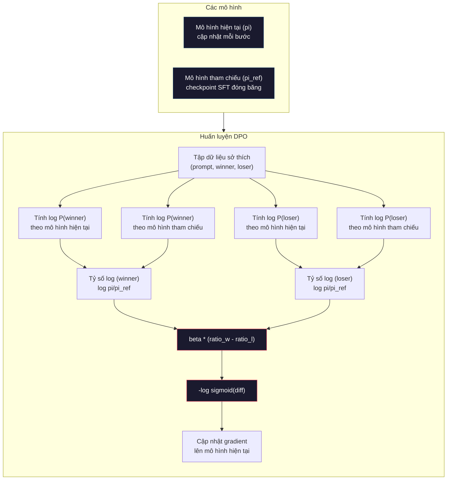

# DPO: Tối Ưu Hóa Sở Thích Trực Tiếp (DPO: Direct Preference Optimization)

> RLHF hoạt động hiệu quả. Nhưng nó cũng đòi hỏi việc huấn luyện ba mô hình (SFT, mô hình phần thưởng, chính sách), kiểm soát sự mất ổn định của PPO và tinh chỉnh mức phạt KL. DPO đặt ra câu hỏi: điều gì sẽ xảy ra nếu bạn có thể bỏ qua toàn bộ những bước phức tạp đó? Tối ưu hóa sở thích trực tiếp (Direct Preference Optimization - DPO) tối ưu hóa thẳng mô hình ngôn ngữ dựa trên các cặp dữ liệu sở thích. Không cần mô hình phần thưởng. Không cần PPO. Chỉ một vòng lặp huấn luyện duy nhất. Kết quả tương đương.

**Type:** Build
**Languages:** Python (with numpy)
**Prerequisites:** Phase 10, Lesson 07 (RLHF)
**Time:** ~90 phút

## Mục Tiêu Học Tập

- Cài đặt quy trình huấn luyện DPO giúp tối ưu hóa trực tiếp mô hình ngôn ngữ trên các cặp dữ liệu sở thích mà không cần một mô hình phần thưởng riêng biệt
- Suy dẫn hàm mất mát DPO và giải thích cách nó đại diện ẩn cho một mô hình phần thưởng thông qua log xác suất của chính sách
- So sánh DPO và RLHF về tính ổn định huấn luyện, chi phí tính toán và số lượng mô hình yêu cầu
- Tinh chỉnh tham số beta nhằm kiểm soát mức độ phân kỳ giữa chính sách được huấn luyện và mô hình tham chiếu

## Vấn Đề

Bạn đã xây dựng một quy trình RLHF trong Bài 07. Ba giai đoạn. Ba mô hình: mô hình SFT, mô hình phần thưởng và mô hình chính sách được tối ưu hóa bằng PPO. Chỉ riêng mô hình phần thưởng đã đòi hỏi hàng nghìn cặp dữ liệu sở thích của con người và một vòng lặp huấn luyện độc lập. PPO lại đòi hỏi sự tinh chỉnh tỉ mỉ về hệ số KL, tốc độ học, tỷ lệ cắt tỉa (clip ratio) và số lượng epoch.

Trong thực tế, quá trình huấn luyện PPO nổi tiếng là kém ổn định. Những thay đổi nhỏ về siêu tham số có thể khiến quá trình huấn luyện bị phân kỳ. Mô hình phần thưởng chỉ là một đại diện gần đúng chưa hoàn hảo cho sở thích con người, và mô hình chính sách sẽ luôn tìm cách khai thác những điểm yếu đó. Mức phạt KL có hỗ trợ nhưng cũng cần tinh chỉnh riêng — nếu quá thấp sẽ dẫn đến hiện tượng lách phần thưởng (reward hacking), còn nếu quá cao thì mô hình hầu như không học được gì mới.

Sự phức tạp này lý giải tại sao phần lớn các mô hình mã nguồn mở từng chật vật với RLHF trong suốt nhiều năm sau khi InstructGPT ra đời. Quy trình ba giai đoạn rất mong manh. Mỗi giai đoạn đều có các dạng lỗi riêng và các sai số sẽ tích lũy dồn dập.

Vào tháng 5 năm 2023, Rafael Rafailov, Archit Sharma và các cộng sự tại Đại học Stanford đã xuất bản bài báo "Direct Preference Optimization: Your Language Model is Secretly a Reward Model" (Tối ưu hóa sở thích trực tiếp: Mô hình ngôn ngữ của bạn thực chất bí mật là một mô hình phần thưởng). Điểm đột phá then chốt: bạn không cần một mô hình phần thưởng riêng biệt. Hàm phần thưởng tối ưu về mặt toán học đã được xác định sẵn bởi chính các xác suất token của mô hình ngôn ngữ. Bạn hoàn toàn có thể bỏ qua mô hình phần thưởng và tối ưu hóa mô hình ngôn ngữ trực tiếp trên các cặp sở thích.

DPO thu gọn RLHF thành một bước học có giám sát (supervised learning) duy nhất. Một mô hình. Một hàm mất mát. Một vòng lặp huấn luyện. Hoàn toàn không cần học tăng cường. Zephyr-7B, một trong những mô hình đầu tiên áp dụng DPO ở quy mô lớn, đã đạt kết quả ngang ngửa hoặc vượt qua các mô hình được huấn luyện bằng RLHF đầy đủ trên nhiều thang đo chuẩn. Meta đã sử dụng DPO như một phần trong quy trình căn chỉnh của Llama 3. Anthropic cũng đã viện dẫn các phương pháp dạng DPO trong các nghiên cứu căn chỉnh của họ.

## Khái Niệm

### Điểm Đột Phá Then Chốt

RLHF tối ưu hóa hàm mục tiêu sau:

```math
\text{maximize:} \quad \mathbb{E}[R(x, y)] - \beta \cdot \mathrm{KL}(\pi \,\|\, \pi_{\text{ref}})
```

trong đó $R$ là mô hình phần thưởng, $\pi$ là chính sách (policy), $\pi_{\text{ref}}$ là mô hình tham chiếu (reference model), và $\beta$ là hệ số KL.

Bài báo DPO đã chứng minh rằng hàm mục tiêu này có một nghiệm tối ưu dạng giải tích đóng (closed-form optimal solution). Đối với bất kỳ hàm phần thưởng $R$ nào, chính sách tối ưu là:

```math
\pi^*(y \mid x) = \pi_{\text{ref}}(y \mid x) \cdot \exp(R(x, y) / \beta) / Z(x)
```

trong đó $Z(x)$ là hằng số chuẩn hóa. Biến đổi lại:

```math
R(x, y) = \beta \log \frac{\pi^*(y \mid x)}{\pi_{\text{ref}}(y \mid x)} + \beta \log Z(x)
```

Đây chính là bước đột phá. Phần thưởng được biểu diễn hoàn toàn thông qua xác suất của mô hình chính sách và xác suất của mô hình tham chiếu. Bạn không cần phải huấn luyện một mô hình phần thưởng riêng biệt. Phần thưởng mang tính *ẩn* (implicit) ngay trong tỷ số xác suất.

Thay biểu thức này vào mô hình sở thích Bradley-Terry:

```math
\begin{aligned}
P(y_w > y_l \mid x) &= \mathop{\mathrm{sigmoid}}(R(x, y_w) - R(x, y_l)) \\
&= \mathop{\mathrm{sigmoid}}\left(\beta \left(\log \frac{\pi(y_w \mid x)}{\pi_{\text{ref}}(y_w \mid x)} - \log \frac{\pi(y_l \mid x)}{\pi_{\text{ref}}(y_l \mid x)}\right)\right)
\end{aligned}
```

Các số hạng $Z(x)$ triệt tiêu lẫn nhau vì cả hai câu trả lời đều cùng phụ thuộc vào chung một câu nhắc $x$. Những gì còn lại chỉ là một hàm thuần túy phụ thuộc vào log xác suất của mô hình chính sách và log xác suất của mô hình tham chiếu đối với phản hồi được chọn (preferred) và phản hồi bị loại (rejected).

### Hàm Mất Mát DPO (The DPO Loss)

```math
L_{\text{DPO}} = -\log \mathop{\mathrm{sigmoid}}\left(\beta \left(\log \frac{\pi(y_w \mid x)}{\pi_{\text{ref}}(y_w \mid x)} - \log \frac{\pi(y_l \mid x)}{\pi_{\text{ref}}(y_l \mid x)}\right)\right)
```

Hãy cùng bóc tách từng thành phần:

- **$y_w$** = phản hồi được chọn / chiến thắng (winning response)
- **$y_l$** = phản hồi bị loại / thua cuộc (losing response)
- **$x$** = câu nhắc (prompt)
- **$\pi$** = mô hình hiện tại (đang được huấn luyện)
- **$\pi_{\text{ref}}$** = mô hình tham chiếu (checkpoint SFT bị đóng băng)
- **$\beta$** = tham số nhiệt độ kiểm soát mức độ sai lệch so với tham chiếu (thường từ 0.1 đến 0.5)

Tỷ số `log pi(y|x) / pi_ref(y|x)` là tỷ số log xác suất. Khi tỷ số này dương, mô hình hiện tại gán xác suất cao hơn cho phản hồi $y$ so với mô hình tham chiếu. Khi âm, mô hình hiện tại gán xác suất thấp hơn.

Hàm mất mát DPO thúc đẩy mô hình tăng tỷ số log xác suất cho phản hồi được chọn và giảm tỷ số này đối với phản hồi bị loại. Tham số beta kiểm soát mức độ quyết liệt mà mô hình được phép sai lệch khỏi tham chiếu — beta nhỏ cho phép sai lệch lớn, trong khi beta lớn giữ mô hình gần sát với tham chiếu.



### Tại Sao DPO Lại Đơn Giản Hơn

| Khía cạnh | RLHF (PPO) | DPO |
|-----------|-----------|-----|
| Số mô hình cần huấn luyện | 3 (SFT + mô hình phần thưởng + chính sách) | 1 (chỉ mô hình chính sách) |
| Vòng lặp huấn luyện | 3 (SFT, huấn luyện RM, PPO) | 2 (SFT, DPO) |
| Siêu tham số | lr, hệ số KL, clip ratio, lr của RM, số epoch x3 | lr, beta, số epoch |
| Mô hình phần thưởng | Bắt buộc (huấn luyện độc lập) | Ẩn bên trong xác suất mô hình |
| Thuật toán RL | PPO (phức tạp, kém ổn định) | Học có giám sát (ổn định) |
| Bộ nhớ GPU | 3-4 mô hình trong bộ nhớ khi chạy PPO | 2 mô hình (hiện tại + tham chiếu) |
| Độ ổn định huấn luyện | Rất nhạy cảm với siêu tham số | Mạnh mẽ, tương tự như SFT |

DPO chỉ cần hai mô hình trong bộ nhớ trong suốt quá trình huấn luyện — mô hình hiện tại và mô hình tham chiếu bị đóng băng. RLHF cần ba hoặc bốn mô hình: chính sách, tham chiếu, mô hình phần thưởng và tùy chọn thêm baseline của hàm giá trị (value function). Đối với một mô hình 70B, mỗi bản sao chiếm 140GB ở định dạng FP16. Lợi ích tiết kiệm bộ nhớ nhờ loại bỏ mô hình phần thưởng là vô cùng to lớn.

### Khi Nào DPO Vượt Trội Hơn RLHF

**Tập dữ liệu quy mô nhỏ.** Với 5.000–20.000 cặp dữ liệu sở thích, DPO thường đạt kết quả tương đương hoặc vượt trội so với RLHF. Mô hình phần thưởng trong RLHF cần đủ dữ liệu để có thể tổng quát hóa — khi dữ liệu hạn chế, nó dễ bị quá khớp (overfitting) và sinh ra các tín hiệu phần thưởng thiếu tin cậy. DPO loại bỏ hoàn toàn vấn đề này vì không cần mô hình phần thưởng.

**Tài nguyên tính toán hạn chế.** DPO chỉ tốn khoảng 1/3 chi phí tính toán so với RLHF đầy đủ (một vòng lặp huấn luyện thay vì ba). Đối với các nhóm kỹ thuật không có sẵn các cụm GPU khổng lồ, đây là lựa chọn thực tiễn tối ưu.

**Lặp nhanh (Rapid iteration).** Bạn muốn thử nghiệm 10 tập dữ liệu sở thích khác nhau để xem tập nào tạo ra mô hình tốt nhất? DPO cho phép chạy mỗi thử nghiệm trong vài giờ. RLHF đòi hỏi phải huấn luyện lại mô hình phần thưởng cho từng tập dữ liệu đó.

### Khi Nào RLHF Vượt Trội Hơn DPO

**Huấn luyện quy mô cực lớn.** Ở quy mô của GPT-4 hoặc Claude, mô hình phần thưởng riêng biệt của RLHF có thể nắm bắt các tín hiệu sở thích tinh tế và đa diện hơn. Mô hình phần thưởng đóng vai trò như một hàm mất mát tự học, thích ứng được với các tiêu chuẩn chất lượng phức tạp.

**Tín hiệu phần thưởng đa mục tiêu.** Khi khái niệm "tốt hơn" bao gồm nhiều khía cạnh (hữu ích, vô hại, trung thực), một mô hình phần thưởng có thể học cách cân bằng giữa các mục tiêu này. DPO coi mỗi cặp dữ liệu sở thích như một tín hiệu nhị phân — cái này tốt hơn, cái kia kém hơn — mà không mô hình hóa lý do đằng sau.

**Căn chỉnh lặp trực tuyến (Iterative alignment).** Các quy trình RLHF có thể sinh phản hồi mới từ chính sách hiện tại, đưa cho con người đánh giá và cập nhật lại mô hình phần thưởng trong một vòng lặp trực tuyến (online loop). DPO truyền thống hoạt động trên một tập dữ liệu cặp sở thích cố định tĩnh. Constitutional AI (phương pháp của Anthropic) tận dụng rất sâu đặc tính lặp này của RLHF.

### Vượt Xa Khỏi DPO: KTO, ORPO, SimPO

Sự xuất hiện của DPO đã mở đường cho cả một họ các phương pháp căn chỉnh được tinh giản:

**KTO (Tối ưu hóa Kahneman-Tversky - Kahneman-Tversky Optimization, 2024):** Bạn thậm chí không cần các cặp so sánh. KTO hoạt động với phản hồi không ghép cặp (unpaired feedback) — chỉ cần gắn nhãn từng câu trả lời là "tốt" hoặc "xấu" mà không cần so sánh nó với phương án thay thế nào khác. Điều này đơn giản hóa triệt để khâu thu thập dữ liệu. Thay vì cho người đánh giá xem hai câu trả lời và hỏi "câu nào tốt hơn?", bạn chỉ đưa một câu và hỏi "câu này có tốt không?". Hàm mất mát áp dụng nguyên lý tâm lý học về sự sợ mất mát (loss aversion) từ lý thuyết triển vọng (prospect theory): phản hồi xấu bị phạt nặng hơn so với mức thưởng dành cho phản hồi tốt.

**ORPO (Tối ưu hóa sở thích tỷ số chênh - Odds Ratio Preference Optimization, 2024):** Kết hợp cả SFT và căn chỉnh vào một bước huấn luyện duy nhất. Thay vì thực hiện SFT trước rồi mới đến DPO, ORPO sửa đổi hàm mất mát SFT để tích hợp sẵn tín hiệu sở thích. Hàm mất mát gồm hai thành phần: mất mát dự đoán token tiếp theo chuẩn trên các câu trả lời được chọn, cộng với một số hạng tỷ số chênh (odds ratio) nhằm nới rộng khoảng cách giữa xác suất của câu trả lời được chọn và câu trả lời bị loại. Chỉ một vòng lặp huấn luyện duy nhất thay vì hai.

**SimPO (Tối ưu hóa sở thích đơn giản - Simple Preference Optimization, 2024):** Loại bỏ hoàn toàn mô hình tham chiếu. Thay vì tính toán tỷ số log xác suất so với một mô hình tham chiếu bị đóng băng, SimPO sử dụng log xác suất trung bình của câu trả lời (được chuẩn hóa theo độ dài) làm phần thưởng ẩn. Điều này giúp tiết kiệm bộ nhớ (không cần mô hình tham chiếu) và đơn giản hóa việc huấn luyện. Việc chuẩn hóa độ dài giúp ngăn mô hình thiên vị các câu trả lời ngắn.

| Phương pháp | Năm | Số mô hình trong RAM | Cần cặp dữ liệu? | Cần mô hình tham chiếu? | Số vòng lặp huấn luyện |
|-------------|-----|----------------------|------------------|-------------------------|------------------------|
| RLHF | 2022 | 3-4 | Có (cho RM) | Có | 3 |
| DPO | 2023 | 2 | Có | Có | 2 |
| KTO | 2024 | 2 | Không (không ghép cặp) | Có | 2 |
| ORPO | 2024 | 1 | Có | Không | 1 |
| SimPO | 2024 | 1 | Có | Không | 1 |

Xu hướng phát triển rất rõ ràng: mỗi phương pháp mới đều triệt tiêu thêm một lớp phức tạp. RLHF cần mô hình phần thưởng và PPO. DPO đã loại bỏ cả hai. KTO loại bỏ dữ liệu dạng cặp. ORPO loại bỏ giai đoạn SFT tách biệt. SimPO loại bỏ mô hình tham chiếu. Thuế căn chỉnh (alignment tax) — tức chi phí tính toán và độ phức tạp phát sinh để đưa một mô hình nền tảng thành một mô hình căn chỉnh an toàn — liên tục giảm mạnh.

### Triển Khai DPO Trong Thực Tế

**Zephyr-7B (HuggingFace, Tháng 10/2023):** Sử dụng Mistral 7B làm nền tảng, SFT trên UltraChat (200K ví dụ), sau đó áp dụng DPO trên UltraFeedback (60K cặp sở thích). Đạt điểm 6.47 trên MT-Bench — mô hình 7B đạt điểm cao nhất vào thời điểm đó. Để so sánh, Llama 2 Chat 70B đạt 6.86, nghĩa là Zephyr đạt hiệu năng tiệm cận trong vòng 6% so với một mô hình lớn gấp 10 lần chỉ bằng việc căn chỉnh qua DPO.

**Llama 3 (Meta, Tháng 4/2024):** Sử dụng DPO sau các giai đoạn RLHF ban đầu. Sự kết hợp này chỉ ra rằng DPO và RLHF có tính bổ trợ lẫn nhau — RLHF dùng để căn chỉnh trên diện rộng, còn DPO dùng để tinh chỉnh mục tiêu sắc bén hơn.

**Neural Magic / nm-chat (2024):** Áp dụng DPO cho nhiều mô hình mã nguồn mở, liên tục ghi nhận mức cải thiện 5–15% trên các bài kiểm tra đánh giá căn chỉnh so với các mốc cơ sở chỉ dùng SFT.

````figure dpo-loss
````

## Xây Dựng (Build It)

### Bước 1: Tập Dữ Liệu Sở Thích

Định dạng tương tự như RLHF — các bộ ba `(prompt, preferred, rejected)`. DPO tiêu thụ trực tiếp dữ liệu này mà không cần bước trung gian qua mô hình phần thưởng.

```python
import numpy as np
import sys
import os
sys.path.insert(0, os.path.join(os.path.dirname(__file__), "..", "..", "04-pre-training-mini-gpt", "code"))
from main import MiniGPT, LayerNorm, Embedding, TransformerBlock

PREFERENCE_DATA = [
    {
        "prompt": "What is the capital of France?",
        "preferred": "The capital of France is Paris.",
        "rejected": "France is a country in Europe. It has many cities. The capital is Paris. Paris is known for the Eiffel Tower.",
    },
    {
        "prompt": "Explain gravity in one sentence.",
        "preferred": "Gravity is the force that attracts objects with mass toward each other.",
        "rejected": "Gravity is something that makes things fall down when you drop them.",
    },
    {
        "prompt": "What is 15 times 7?",
        "preferred": "15 times 7 is 105.",
        "rejected": "Let me think about this. 15 times 7. Well, 10 times 7 is 70, and 5 times 7 is 35, so the answer might be around 105.",
    },
    {
        "prompt": "Name three programming languages.",
        "preferred": "Python, Rust, and TypeScript.",
        "rejected": "There are many programming languages. Some popular ones include various languages like Python and others.",
    },
    {
        "prompt": "What year did World War II end?",
        "preferred": "World War II ended in 1945.",
        "rejected": "World War II was a major global conflict. It involved many countries. The war ended in the mid-1940s, specifically in 1945.",
    },
    {
        "prompt": "Define machine learning.",
        "preferred": "Machine learning is a field where algorithms learn patterns from data to make predictions without being explicitly programmed.",
        "rejected": "Machine learning is a type of AI. AI stands for artificial intelligence. Machine learning uses data to learn.",
    },
]
```

### Bước 2: Log Xác Suất Của Chuỗi

Hàm mất mát DPO yêu cầu tính toán tổng log xác suất của một phản hồi với điều kiện cho trước là câu nhắc. Điều này đòi hỏi chạy mô hình trên toàn bộ chuỗi `(prompt + response)` và cộng dồn log xác suất của từng token thuộc phần phản hồi.

```python
def tokenize_sequence(text, vocab_size=256):
    return [min(t, vocab_size - 1) for t in list(text.encode("utf-8"))]


def compute_sequence_log_prob(model, prompt_tokens, response_tokens, max_seq_len=128):
    full_sequence = prompt_tokens + response_tokens
    if len(full_sequence) > max_seq_len:
        full_sequence = full_sequence[:max_seq_len]

    if len(full_sequence) < 2:
        return 0.0

    input_ids = np.array(full_sequence[:-1]).reshape(1, -1)
    target_ids = np.array(full_sequence[1:])

    logits = model.forward(input_ids)
    logits = logits[0]

    max_logits = logits.max(axis=-1, keepdims=True)
    log_probs = logits - max_logits - np.log(
        np.exp(logits - max_logits).sum(axis=-1, keepdims=True)
    )

    prompt_len = len(prompt_tokens)
    response_start = max(0, prompt_len - 1)
    response_end = len(target_ids)

    if response_start >= response_end:
        return 0.0

    response_log_probs = log_probs[response_start:response_end, :]
    response_targets = target_ids[response_start:response_end]

    total_log_prob = 0.0
    for i, target in enumerate(response_targets):
        total_log_prob += response_log_probs[i, target]

    return total_log_prob
```

Hàm này là trái tim vận hành của DPO. Với mỗi cặp sở thích, nó được gọi 4 lần: mô hình hiện tại trên phản hồi được chọn, mô hình hiện tại trên phản hồi bị loại, mô hình tham chiếu trên phản hồi được chọn, và mô hình tham chiếu trên phản hồi bị loại. Chỉ 4 lượt lan truyền xuôi (forward pass) cho mỗi mẫu huấn luyện, so với chuỗi thao tác phức tạp của RLHF gồm: sinh phản hồi + chấm điểm mô hình phần thưởng + ước lượng hàm giá trị + cập nhật PPO. Đơn giản hơn, nhanh hơn và ổn định hơn rất nhiều.

### Bước 3: Hàm Mất Mát DPO

Hiện thực hóa toàn bộ tinh hoa của bài báo khoa học vào một đoạn mã ngắn. Một hàm duy nhất. Không cần mô hình phần thưởng.

```python
def sigmoid(x):
    return np.where(
        x >= 0,
        1.0 / (1.0 + np.exp(-x)),
        np.exp(x) / (1.0 + np.exp(x))
    )


def dpo_loss(policy_logprob_preferred, policy_logprob_rejected,
             ref_logprob_preferred, ref_logprob_rejected, beta=0.1):
    preferred_ratio = policy_logprob_preferred - ref_logprob_preferred
    rejected_ratio = policy_logprob_rejected - ref_logprob_rejected

    logit = beta * (preferred_ratio - rejected_ratio)

    loss = -np.log(sigmoid(logit) + 1e-8)

    preferred_reward = beta * preferred_ratio
    rejected_reward = beta * rejected_ratio

    return loss, {
        "preferred_ratio": float(preferred_ratio),
        "rejected_ratio": float(rejected_ratio),
        "logit": float(logit),
        "implicit_preferred_reward": float(preferred_reward),
        "implicit_rejected_reward": float(rejected_reward),
        "reward_margin": float(preferred_reward - rejected_reward),
    }
```

Hai giá trị `preferred_ratio` và `rejected_ratio` chính là các tỷ số log xác suất suy dẫn từ lý thuyết DPO. Khi mô hình hiện tại gán xác suất cao hơn cho phản hồi được chọn (so với mô hình tham chiếu) và xác suất thấp hơn cho phản hồi bị loại, giá trị logit sẽ dương và hàm mất mát sẽ rất thấp. Tín hiệu huấn luyện thúc đẩy mô hình đi chính xác theo hướng này.

`implicit_preferred_reward` và `implicit_rejected_reward` là các giá trị phần thưởng mà hàm mất mát DPO gán một cách ngầm định. Bạn có thể trích xuất các giá trị này để xác nhận quá trình huấn luyện đang hoạt động hiệu quả — khoảng cách biên (margin) giữa phần thưởng được chọn và bị loại sẽ tăng dần qua các bước huấn luyện.

### Bước 4: Vòng Lặp Huấn Luyện DPO

Một vòng lặp huấn luyện có giám sát tiêu chuẩn. Không có PPO. Không có mô hình phần thưởng. Chỉ có các lượt lan truyền xuôi và cập nhật gradient.

```python
def copy_model_weights(source, target):
    target.embedding.token_embed = source.embedding.token_embed.copy()
    target.embedding.pos_embed = source.embedding.pos_embed.copy()
    target.ln_f.gamma = source.ln_f.gamma.copy()
    target.ln_f.beta = source.ln_f.beta.copy()
    for s_block, t_block in zip(source.blocks, target.blocks):
        t_block.attn.W_q = s_block.attn.W_q.copy()
        t_block.attn.W_k = s_block.attn.W_k.copy()
        t_block.attn.W_v = s_block.attn.W_v.copy()
        t_block.attn.W_out = s_block.attn.W_out.copy()
        t_block.ffn.W1 = s_block.ffn.W1.copy()
        t_block.ffn.W2 = s_block.ffn.W2.copy()
        t_block.ffn.b1 = s_block.ffn.b1.copy()
        t_block.ffn.b2 = s_block.ffn.b2.copy()
        t_block.ln1.gamma = s_block.ln1.gamma.copy()
        t_block.ln1.beta = s_block.ln1.beta.copy()
        t_block.ln2.gamma = s_block.ln2.gamma.copy()
        t_block.ln2.beta = s_block.ln2.beta.copy()


def dpo_train(policy_model, reference_model, preference_data,
               num_epochs=5, lr=5e-6, beta=0.1, max_seq_len=128):
    print(f"DPO Training: {len(preference_data)} pairs, {num_epochs} epochs, "
          f"lr={lr}, beta={beta}")
    print()

    losses = []
    margins = []

    for epoch in range(num_epochs):
        epoch_loss = 0.0
        epoch_margin = 0.0
        num_examples = 0

        indices = np.random.permutation(len(preference_data))

        for idx in indices:
            pair = preference_data[idx]

            prompt_tokens = tokenize_sequence(pair["prompt"])
            preferred_tokens = tokenize_sequence(pair["preferred"])
            rejected_tokens = tokenize_sequence(pair["rejected"])

            pi_logprob_w = compute_sequence_log_prob(
                policy_model, prompt_tokens, preferred_tokens, max_seq_len
            )
            pi_logprob_l = compute_sequence_log_prob(
                policy_model, prompt_tokens, rejected_tokens, max_seq_len
            )
            ref_logprob_w = compute_sequence_log_prob(
                reference_model, prompt_tokens, preferred_tokens, max_seq_len
            )
            ref_logprob_l = compute_sequence_log_prob(
                reference_model, prompt_tokens, rejected_tokens, max_seq_len
            )

            loss, metrics = dpo_loss(
                pi_logprob_w, pi_logprob_l,
                ref_logprob_w, ref_logprob_l, beta
            )

            update_direction = 1.0 if metrics["logit"] < 0 else -0.1
            for block in policy_model.blocks:
                block.ffn.W1 += lr * update_direction * np.random.randn(*block.ffn.W1.shape) * 0.01
                block.ffn.W2 += lr * update_direction * np.random.randn(*block.ffn.W2.shape) * 0.01

            epoch_loss += loss
            epoch_margin += metrics["reward_margin"]
            num_examples += 1
            losses.append(float(loss))
            margins.append(metrics["reward_margin"])

        avg_loss = epoch_loss / max(num_examples, 1)
        avg_margin = epoch_margin / max(num_examples, 1)

        print(f"  Epoch {epoch + 1}/{num_epochs} | Loss: {avg_loss:.4f} | "
              f"Avg Margin: {avg_margin:.4f}")

    return policy_model, losses, margins
```

Vòng lặp huấn luyện đơn giản đến kinh ngạc khi đặt cạnh RLHF. Đối với mỗi cặp sở thích: tính toán 4 log xác suất (hai mô hình, hai phản hồi), đưa vào hàm mất mát DPO, tính toán gradient và cập nhật chính sách. Không cần bước sinh mẫu token tự hồi quy. Không cần suy luận qua mô hình phần thưởng. Không cần ước lượng lợi thế. Không cần cắt tỉa xác suất.

### Bước 5: So Sánh DPO và RLHF

Đo lường biên chênh lệch phần thưởng ngầm định và độ dịch chuyển log xác suất để so sánh DPO với mô hình RLHF từ Bài 07.

```python
def evaluate_preference_accuracy(model, reference_model, preference_data, beta=0.1, max_seq_len=128):
    correct = 0
    total = 0

    for pair in preference_data:
        prompt_tokens = tokenize_sequence(pair["prompt"])
        preferred_tokens = tokenize_sequence(pair["preferred"])
        rejected_tokens = tokenize_sequence(pair["rejected"])

        pi_w = compute_sequence_log_prob(model, prompt_tokens, preferred_tokens, max_seq_len)
        pi_l = compute_sequence_log_prob(model, prompt_tokens, rejected_tokens, max_seq_len)
        ref_w = compute_sequence_log_prob(reference_model, prompt_tokens, preferred_tokens, max_seq_len)
        ref_l = compute_sequence_log_prob(reference_model, prompt_tokens, rejected_tokens, max_seq_len)

        preferred_reward = beta * (pi_w - ref_w)
        rejected_reward = beta * (pi_l - ref_l)

        if preferred_reward > rejected_reward:
            correct += 1
        total += 1

    return correct / max(total, 1)


def analyze_implicit_rewards(model, reference_model, preference_data, beta=0.1, max_seq_len=128):
    print("Implicit Reward Analysis:")
    print("-" * 65)
    print(f"  {'Prompt':<30} {'Pref Reward':>12} {'Rej Reward':>12} {'Margin':>10}")
    print("  " + "-" * 60)

    for pair in preference_data:
        prompt_tokens = tokenize_sequence(pair["prompt"])
        preferred_tokens = tokenize_sequence(pair["preferred"])
        rejected_tokens = tokenize_sequence(pair["rejected"])

        pi_w = compute_sequence_log_prob(model, prompt_tokens, preferred_tokens, max_seq_len)
        pi_l = compute_sequence_log_prob(model, prompt_tokens, rejected_tokens, max_seq_len)
        ref_w = compute_sequence_log_prob(reference_model, prompt_tokens, preferred_tokens, max_seq_len)
        ref_l = compute_sequence_log_prob(reference_model, prompt_tokens, rejected_tokens, max_seq_len)

        pref_reward = beta * (pi_w - ref_w)
        rej_reward = beta * (pi_l - ref_l)
        margin = pref_reward - rej_reward

        truncated = pair["prompt"][:28] + ".." if len(pair["prompt"]) > 30 else pair["prompt"]
        print(f"  {truncated:<30} {pref_reward:>12.4f} {rej_reward:>12.4f} {margin:>10.4f}")

    print()
```

### Bước 6: Phân Tích Độ Nhạy Với Tham Số Beta

Tham số beta trong DPO tương đương với hệ số phạt KL trong RLHF. Nó kiểm soát mức độ mà mô hình được phép sai lệch khỏi mô hình tham chiếu. Thử nghiệm này thể hiện rõ ảnh hưởng của nó.

```python
def beta_sensitivity_analysis(sft_model, preference_data, betas, max_seq_len=128):
    print("Beta Sensitivity Analysis")
    print("-" * 60)
    print(f"  {'Beta':>8} {'Final Loss':>12} {'Final Margin':>14} {'Accuracy':>10}")
    print("  " + "-" * 55)

    results = []

    for beta in betas:
        policy = MiniGPT(
            vocab_size=256, embed_dim=128, num_heads=4,
            num_layers=4, max_seq_len=max_seq_len, ff_dim=512
        )
        reference = MiniGPT(
            vocab_size=256, embed_dim=128, num_heads=4,
            num_layers=4, max_seq_len=max_seq_len, ff_dim=512
        )
        copy_model_weights(sft_model, policy)
        copy_model_weights(sft_model, reference)

        policy, losses, margins_list = dpo_train(
            policy, reference, preference_data,
            num_epochs=3, lr=5e-6, beta=beta, max_seq_len=max_seq_len
        )

        accuracy = evaluate_preference_accuracy(
            policy, reference, preference_data, beta, max_seq_len
        )

        final_loss = losses[-1] if losses else 0
        final_margin = margins_list[-1] if margins_list else 0

        print(f"  {beta:>8.3f} {final_loss:>12.4f} {final_margin:>14.4f} {accuracy:>10.1%}")
        results.append({
            "beta": beta,
            "final_loss": final_loss,
            "final_margin": final_margin,
            "accuracy": accuracy,
        })

        print()

    return results
```

Giá trị beta nhỏ (0.01) cho phép mô hình tự do đi lệch khỏi mô hình tham chiếu — mô hình học rất nhanh nhưng có nguy cơ rơi vào các giải pháp thoái hóa. Giá trị beta lớn (1.0) giữ mô hình luôn ở gần tham chiếu — học ổn định nhưng tốc độ rất chậm. Điểm cân bằng lý tưởng cho hầu hết ứng dụng thực tế nằm trong khoảng 0.1 đến 0.3.

## Sử Dụng (Use It)

### Thử Nghiệm Toàn Bộ Quy Trình DPO

```python
if __name__ == "__main__":
    np.random.seed(42)

    print("=" * 70)
    print("DPO: DIRECT PREFERENCE OPTIMIZATION")
    print("=" * 70)
    print()

    print("STEP 1: Initialize SFT Model (from Lesson 06)")
    print("-" * 50)
    sft_model = MiniGPT(
        vocab_size=256, embed_dim=128, num_heads=4,
        num_layers=4, max_seq_len=128, ff_dim=512
    )
    print(f"  Parameters: {sft_model.count_parameters():,}")
    print()

    print("STEP 2: DPO Training")
    print("-" * 50)

    policy_model = MiniGPT(
        vocab_size=256, embed_dim=128, num_heads=4,
        num_layers=4, max_seq_len=128, ff_dim=512
    )
    reference_model = MiniGPT(
        vocab_size=256, embed_dim=128, num_heads=4,
        num_layers=4, max_seq_len=128, ff_dim=512
    )
    copy_model_weights(sft_model, policy_model)
    copy_model_weights(sft_model, reference_model)

    policy_model, losses, margins = dpo_train(
        policy_model, reference_model, PREFERENCE_DATA,
        num_epochs=5, lr=5e-6, beta=0.1
    )
    print()

    print("=" * 70)
    print("STEP 3: Evaluate")
    print("=" * 70)
    print()

    pre_accuracy = evaluate_preference_accuracy(
        sft_model, reference_model, PREFERENCE_DATA, beta=0.1
    )
    post_accuracy = evaluate_preference_accuracy(
        policy_model, reference_model, PREFERENCE_DATA, beta=0.1
    )

    print(f"  Preference accuracy (pre-DPO):  {pre_accuracy:.1%}")
    print(f"  Preference accuracy (post-DPO): {post_accuracy:.1%}")
    print()

    analyze_implicit_rewards(policy_model, reference_model, PREFERENCE_DATA, beta=0.1)

    print("=" * 70)
    print("STEP 4: Training Dynamics")
    print("=" * 70)
    print()

    if losses:
        print("  Loss curve:")
        window = max(1, len(losses) // 5)
        for i in range(0, len(losses), window):
            chunk = losses[i:i + window]
            avg = sum(chunk) / len(chunk)
            print(f"    Steps {i:3d}-{i + len(chunk) - 1:3d}: loss = {avg:.4f}")
        print()

    if margins:
        print("  Reward margin curve:")
        window = max(1, len(margins) // 5)
        for i in range(0, len(margins), window):
            chunk = margins[i:i + window]
            avg = sum(chunk) / len(chunk)
            print(f"    Steps {i:3d}-{i + len(chunk) - 1:3d}: margin = {avg:.4f}")
        print()

    print("=" * 70)
    print("STEP 5: Beta Sensitivity")
    print("=" * 70)
    print()

    beta_results = beta_sensitivity_analysis(
        sft_model, PREFERENCE_DATA, betas=[0.01, 0.1, 0.3, 1.0]
    )

    print("=" * 70)
    print("DPO vs RLHF COMPARISON")
    print("=" * 70)
    print()
    print("  DPO advantages:")
    print("    - 1 training loop (vs 3 for RLHF)")
    print("    - 2 models in memory (vs 3-4 for RLHF)")
    print("    - Supervised learning (vs RL, more stable)")
    print("    - No reward model to train or maintain")
    print()
    print("  RLHF advantages:")
    print("    - Separate reward model captures complex preferences")
    print("    - Online learning: generate, rate, retrain")
    print("    - Better for multi-objective alignment")
    print("    - Proven at largest scales (GPT-4, Claude)")
    print()
    print("  Practical guidance:")
    print("    - Start with DPO. It's simpler and often sufficient.")
    print("    - Switch to RLHF if DPO plateaus on your eval metrics.")
    print("    - Many production systems use both: RLHF first, DPO to refine.")
```

## Đóng Gói (Ship It)

Bài học này tạo ra artifact `outputs/prompt-alignment-method-selector.md` — một bản thiết kế prompt chuyên biệt giúp bạn lựa chọn phương pháp căn chỉnh phù hợp (SFT, RLHF, DPO, KTO, ORPO, SimPO) cho bài toán của mình. Dựa trên mức độ sẵn có của dữ liệu, ngân sách tính toán và mục tiêu căn chỉnh, nó sẽ đề xuất phương pháp tối ưu kèm theo kế hoạch huấn luyện chi tiết.

## Bài Tập Thực Hành

1. Cài đặt KTO (Tối ưu hóa Kahneman-Tversky). KTO không cần dữ liệu dạng cặp — chỉ cần gắn nhãn từng phản hồi là "tốt" hoặc "xấu". Hàm mất mát cho phản hồi tốt là `-log(sigmoid(beta * log_ratio))` và cho phản hồi xấu là `-log(1 - sigmoid(beta * log_ratio))` kèm hệ số sợ mất mát (loss aversion multiplier, thường là 1.5x) nhân vào mất mát của phản hồi xấu. Huấn luyện trên cùng một tập dữ liệu (coi phản hồi preferred là "tốt" và rejected là "xấu" một cách độc lập) và so sánh độ chính xác với DPO.

2. Cài đặt DPO chuẩn hóa theo độ dài (length-normalized DPO). Thay vì dùng log xác suất thô, hãy chia cho số lượng token của phản hồi: `normalized_logprob = total_logprob / num_tokens`. Điều này giúp ngăn mô hình thiên vị các phản hồi ngắn (vốn có tổng log xác suất âm ít hơn). So sánh biên phần thưởng ngầm định khi có và không có chuẩn hóa độ dài.

3. Xây dựng hàm mất mát kết hợp kiểu ORPO. Bổ sung mất mát dự đoán token tiếp theo chuẩn trên phản hồi được chọn vào hàm mất mát DPO: `L = L_sft(preferred) + alpha * L_dpo`. Thử nghiệm các giá trị alpha là 0.1, 0.5 và 1.0. Hàm mất mát kết hợp này sẽ tạo ra một mô hình vừa tuân thủ chỉ dẫn (nhờ thành phần SFT) vừa ưu tiên phản hồi chất lượng hơn (nhờ thành phần DPO), loại bỏ hoàn toàn nhu cầu về một giai đoạn SFT riêng rẽ.

4. Cài đặt DPO lặp (Iterative DPO). Chạy DPO trong 3 epoch, sau đó sinh các phản hồi mới từ mô hình vừa huấn luyện, ghép chúng với các phản hồi preferred ban đầu để tạo thành các cặp sở thích mới, rồi chạy tiếp DPO. Thực hiện hai vòng "tự chơi" (self-play) như vậy. So sánh độ chính xác sở thích sau vòng 1 và vòng 2 để xem liệu quá trình tinh chỉnh lặp đi lặp lại có mang lại lợi ích hay không.

5. So sánh DPO với các mô hình tham chiếu khác nhau. Thay vì dùng checkpoint SFT làm tham chiếu, hãy thử: (a) mô hình nền tảng trước SFT (base model), (b) checkpoint từ epoch 1 của DPO, (c) trung bình trượt hàm mũ (EMA - exponential moving average) của các trọng số mô hình chính sách. Báo cáo mô hình tham chiếu nào mang lại độ chính xác sở thích cao nhất và đường cong huấn luyện ổn định nhất.

## Thuật Ngữ Then Chốt

| Thuật ngữ | Người ta thường nói | Bản chất thực sự |
|-----------|---------------------|-------------------|
| DPO | "RLHF không cần RL" | Direct Preference Optimization: thuật toán học có giám sát giúp tối ưu hóa trực tiếp mô hình ngôn ngữ trên các cặp dữ liệu sở thích, bỏ qua hoàn toàn mô hình phần thưởng và PPO |
| Phần thưởng ẩn (Implicit reward) | "Phần thưởng nằm ngay trong mô hình" | Hàm phần thưởng được suy dẫn trực tiếp từ tỷ số log xác suất giữa mô hình chính sách và mô hình tham chiếu — không cần mô hình phần thưởng độc lập |
| Beta (trong DPO) | "Nhiệt độ kiểm soát" | Tham số kiểm soát mức độ mà chính sách được phép chệch khỏi mô hình tham chiếu — beta nhỏ cho phép sai lệch lớn, beta lớn giữ mô hình bám sát tham chiếu |
| Tỷ số log xác suất (Log-probability ratio) | "Mức độ thay đổi của mô hình" | $\log \pi(y \mid x) - \log \pi_{\text{ref}}(y \mid x)$ — giá trị dương nghĩa là mô hình hiện tại gán xác suất cao hơn so với mô hình tham chiếu |
| Mô hình tham chiếu (Reference model) | "Checkpoint bị đóng băng" | Bản sao của mô hình SFT có trọng số cố định không đổi — đóng vai trò điểm neo để tính toán tỷ số xác suất |
| KTO | "DPO không cần ghép cặp" | Kahneman-Tversky Optimization: phương pháp hoạt động với các nhãn đơn lẻ "tốt" hoặc "xấu" thay vì đòi hỏi các cặp so sánh sở thích |
| ORPO | "Căn chỉnh một bước" | Odds Ratio Preference Optimization: kết hợp SFT và căn chỉnh sở thích vào một vòng lặp huấn luyện duy nhất bằng cách cộng thêm thành phần tỷ số chênh vào hàm mất mát SFT |
| SimPO | "Không cần mô hình tham chiếu" | Simple Preference Optimization: loại bỏ hoàn toàn mô hình tham chiếu bằng cách sử dụng log xác suất trung bình đã chuẩn hóa độ dài làm phần thưởng ẩn |
| Thuế căn chỉnh (Alignment tax) | "Cái giá để mô hình trở nên an toàn" | Chi phí tính toán, dữ liệu và độ phức tạp kỹ thuật bổ sung cần thiết để biến một mô hình nền tảng thành một mô hình căn chỉnh hoàn thiện — DPO giúp giảm thiểu đáng kể chi phí này |

## Đọc Thêm

- [Rafailov et al., 2023 -- "Direct Preference Optimization: Your Language Model is Secretly a Reward Model"](https://arxiv.org/abs/2305.18290) -- bài báo DPO nền tảng giúp đơn giản hóa quá trình căn chỉnh từ RLHF thành học có giám sát
- [Tunstall et al., 2023 -- "Zephyr: Direct Distillation of LM Alignment"](https://arxiv.org/abs/2310.16944) -- bài báo về Zephyr-7B, chứng minh DPO trên tập dữ liệu UltraFeedback đạt kết quả tương đương RLHF trên các bảng xếp hạng
- [Ethayarajh et al., 2024 -- "KTO: Model Alignment as Prospect Theoretic Optimization"](https://arxiv.org/abs/2402.01306) -- loại bỏ hoàn toàn nhu cầu về dữ liệu sở thích ghép cặp
- [Hong et al., 2024 -- "ORPO: Monolithic Preference Optimization without Reference Model"](https://arxiv.org/abs/2403.07691) -- tích hợp SFT và căn chỉnh trong một bước duy nhất
- [Meng et al., 2024 -- "SimPO: Simple Preference Optimization with a Reference-Free Reward"](https://arxiv.org/abs/2405.14734) -- triệt tiêu hoàn toàn sự phụ thuộc vào mô hình tham chiếu
- [Llama 3 Technical Report](https://arxiv.org/abs/2407.21783) -- báo cáo kỹ thuật Llama 3 mô tả quy trình căn chỉnh kết hợp linh hoạt cả RLHF và DPO
