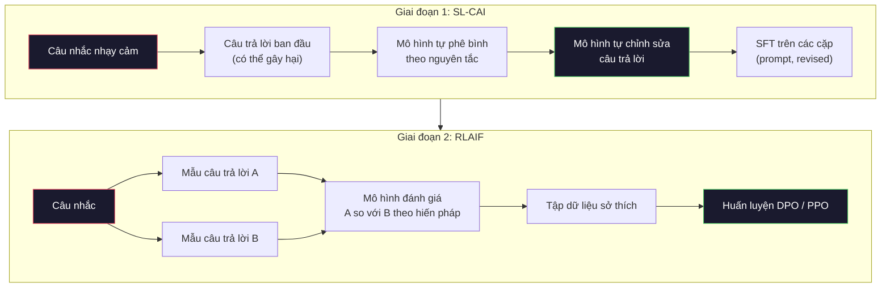
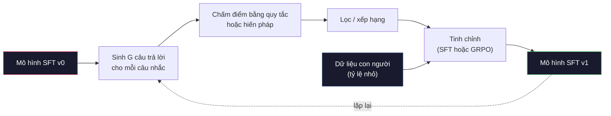

# AI Theo Hiến Pháp và Tự Hoàn Thiện (Constitutional AI and Self-Improvement)

> RLHF cần con người trực tiếp tham gia đánh giá. AI theo hiến pháp (Constitutional AI - CAI) thay thế phần lớn sự can thiệp của con người bằng chính mô hình ngôn ngữ. Hãy soạn thảo một danh sách các nguyên tắc, để mô hình tự phê bình các câu trả lời của chính nó dựa trên những nguyên tắc đó, rồi huấn luyện mô hình dựa trên các bản tự phê bình. DeepSeek-R1 đã đẩy xa ý tưởng này hơn nữa vào năm 2025: để mô hình tự sinh ra hàng triệu chuỗi suy luận (reasoning traces), chấm điểm chúng bằng các quy tắc tất định, và chạy thuật toán GRPO dựa trên kết quả đầu ra. Phần lớn "công việc căn chỉnh" ở các mô hình tiên phong năm 2026 chính là để mô hình tự căn chỉnh chính nó. Bài học này sẽ giúp bạn xây dựng cả hai vòng lặp trên.

**Type:** Build
**Languages:** Python (stdlib + numpy)
**Prerequisites:** Phase 10, Lessons 06-08 (SFT, RLHF, DPO)
**Time:** ~45 phút

## Mục Tiêu Học Tập

- Cài đặt vòng lặp hai giai đoạn của AI theo hiến pháp: tự phê bình kết hợp tự chỉnh sửa (self-critique plus self-revision), sau đó huấn luyện sở thích trên các cặp dữ liệu đã chỉnh sửa
- Suy dẫn hàm mục tiêu GRPO (tối ưu hóa chính sách tương đối theo nhóm - Group-Relative Policy Optimization của DeepSeek-R1) và đối chiếu nó với đường cơ sở hàm giá trị (value-function baseline) của PPO
- Sinh ra các chuỗi suy luận có thể kiểm chứng được bằng phần thưởng kết quả dựa trên quy tắc (rule-based outcome rewards) và chấm điểm chúng mà không cần một mô hình phần thưởng độc lập
- Xác định khi nào phương pháp tự hoàn thiện vượt trội hơn dữ liệu sở thích của con người và khi nào nó có nguy cơ sụp đổ vào hiện tượng suy sụp chế độ (mode collapse)

## Vấn Đề

Bạn đã xây dựng RLHF trong Bài 07 và DPO trong Bài 08. Cả hai phương pháp đều phụ thuộc vào cùng một nguồn đầu vào đắt đỏ: các cặp dữ liệu sở thích của con người. Quy trình của Anthropic thời InstructGPT đã sử dụng khoảng 33.000 lượt so sánh. Llama 2 Chat đã dùng hơn 1,5 triệu lượt. Claude 3 còn dùng nhiều hơn thế. Dữ liệu này thu thập rất chậm, tốn kém và dễ bị thiên lệch bởi bất cứ điều gì mà người đánh giá tình cờ tin tưởng vào ngày họ chấm điểm.

Bài báo về Constitutional AI năm 2022 đã đặt ra một câu hỏi đơn giản: Điều gì sẽ xảy ra nếu mô hình tự tạo ra các nhãn sở thích cho chính nó? Hãy cung cấp cho mô hình một danh sách các nguyên tắc bằng văn bản — gọi là "hiến pháp" (constitution) — và yêu cầu nó tự phê bình các câu trả lời của mình. Những bản phê bình đó sẽ trở thành tín hiệu huấn luyện.

Vào năm 2024, DeepSeek đã phát triển ý tưởng này xa hơn. Họ chứng minh rằng đối với bất kỳ tác vụ nào có kết quả kiểm chứng được (toán học với đáp án xác định, mã nguồn chạy đạt kiểm thử hoặc thất bại, một trò chơi có kết quả thắng hoặc thua), bạn có thể bỏ qua hoàn toàn mô hình phê bình. Hãy sinh ra nhiều phương án giải quyết ứng viên. Chấm điểm từng phương án bằng một quy tắc tất định (deterministic rule). Chạy thuật toán đạo hàm chính sách (policy-gradient) trên các phần thưởng đó. DeepSeek-R1 đã được huấn luyện theo phương pháp này mà gần như không cần dữ liệu sở thích của con người, nhưng vẫn đạt hiệu năng suy luận ngang ngửa với các mô hình lớp OpenAI o1.

Hai vòng lặp này — Constitutional AI cho hành vi chủ quan và RL dựa trên quy tắc cho hành vi có thể kiểm chứng — là các công thức căn chỉnh thống trị của năm 2026. Ngân sách thu thập sở thích của con người từng đổ dồn vào RLHF nay được chuyển sang một bước nhỏ hơn nhiều: lựa chọn bản hiến pháp và xác định các quy tắc phần thưởng.

## Khái Niệm

### Vòng Lặp AI Theo Hiến Pháp (The Constitutional AI Loop)

Bai và các cộng sự (2022) đã cấu trúc quy trình theo hai giai đoạn:

**Giai đoạn 1: Học có giám sát từ phản hồi của AI (Supervised Learning from AI Feedback - SL-CAI).** Bắt đầu với một mô hình SFT có tính hữu ích cao nhưng có thể tiềm ẩn nội dung có hại. Nhập các câu nhắc mang tính nhạy cảm hoặc nguy hiểm. Với mỗi câu trả lời sinh ra, yêu cầu *chính mô hình đó* tự phê bình câu trả lời của mình dựa trên một nguyên tắc hiến pháp, sau đó tiến hành chỉnh sửa lại. Tinh chỉnh mô hình trên các câu trả lời đã chỉnh sửa. Tập dữ liệu lúc này là các cặp `(prompt, revised_response)`.

**Giai đoạn 2: Học tăng cường từ phản hồi của AI (Reinforcement Learning from AI Feedback - RLAIF).** Lấy mẫu các cặp câu trả lời. Yêu cầu mô hình đánh giá xem câu trả lời nào tuân thủ hiến pháp tốt hơn. Dữ liệu sở thích theo cặp này được dùng để huấn luyện một mô hình phần thưởng. Sau đó, chạy thuật toán PPO hoặc DPO trên mô hình bằng cách sử dụng phần thưởng đó. Điểm khác biệt mấu chốt so với RLHF: dữ liệu sở thích đến từ chính mô hình AI chứ không phải từ con người.



Bản hiến pháp chính là đòn bẩy. Bản hiến pháp ban đầu của Anthropic gồm 16 nguyên tắc (sau này được mở rộng). Một nguyên tắc thường có dạng như: "Hãy chọn câu trả lời ít có khả năng gây khó chịu nhất cho mọi người đến từ các nền tảng văn hóa khác nhau." Bạn chọn nguyên tắc cho từng bước, đôi khi ngẫu nhiên, đôi khi dựa trên phân loại của câu nhắc.

### Bản Hiến Pháp Thực Sự Làm Gì

Bản hiến pháp dịch chuyển thỏa ước căn chỉnh từ *dữ liệu* sang *văn bản*. Việc thay đổi hành vi trong RLHF đồng nghĩa với việc phải gắn nhãn lại hàng nghìn cặp dữ liệu. Còn việc thay đổi hành vi trong CAI chỉ đơn giản là chỉnh sửa một đoạn văn. Đây chính là lợi thế thực tiễn quan trọng nhất.

Tuy nhiên, nó cũng có cái giá phải trả. Khả năng tự đánh giá của mô hình chỉ tốt ngang mức độ hiệu chuẩn ban đầu của nó. Nếu mô hình SFT có những điểm mù — ví dụ, nó không nhận biết được các câu văn mang tính thao túng tâm lý — thì bước tự phê bình sẽ kế thừa toàn bộ các điểm mù đó. CAI nén vòng lặp căn chỉnh lại nhưng không thể khuếch đại tín hiệu vượt qua giới hạn năng lực tối đa của mô hình nền tảng. Đó là lý do tại sao mọi quy trình CAI trong sản xuất vẫn sử dụng một lượng nhỏ dữ liệu sở thích từ con người, thường khoảng 5–10% so với quy mô của RLHF thuần túy.

### GRPO: Tối Ưu Hóa Chính Sách Tương Đối Theo Nhóm

DeepSeek đã giới thiệu GRPO trong bài báo DeepSeekMath (2024) và sử dụng nó làm xương sống cho DeepSeek-R1 (2025). GRPO là một biến thể của PPO giúp loại bỏ hoàn toàn mạng hàm giá trị (value function).

Hãy nhớ lại hàm mục tiêu của PPO (từ Bài 07):

```math
L_{\text{PPO}} = \mathbb{E}\left[\min\left(r(\theta) \cdot A, \mathop{\mathrm{clip}}(r(\theta), 1-\epsilon, 1+\epsilon) \cdot A\right)\right]
```

trong đó `A` là lợi thế (advantage), thường được ước lượng bằng GAE thông qua một mạng giá trị tự học $V(s)$. Mạng giá trị là một mô hình thứ hai có kích thước tương đương mô hình chính sách. Nó làm tăng gấp đôi dung lượng bộ nhớ và yêu cầu một vòng lặp huấn luyện độc lập riêng.

GRPO loại bỏ hoàn toàn mạng hàm giá trị. Đối với mỗi câu nhắc, nó lấy mẫu một nhóm gồm $G$ câu trả lời (thường là $G=16$ hoặc 64). Phần thưởng cho từng câu trả lời được tính toán, sau đó được chuẩn hóa ngay trong nhóm đó:

```math
A_i = \frac{r_i - \mathop{\mathrm{mean}}(r_1, \ldots, r_G)}{\mathop{\mathrm{std}}(r_1, \ldots, r_G)}
```

Lợi thế ở đây chính là điểm số z-score của phần thưởng của một câu trả lời so với các câu trả lời anh em của nó. Không cần hàm giá trị. Nhóm câu trả lời tự đóng vai trò làm đường cơ sở (baseline) cho chính nó.

```math
L_{\text{GRPO}} = \mathbb{E}\left[\min\left(r(\theta) \cdot A_{\text{group}}, \mathop{\mathrm{clip}}(r(\theta), 1-\epsilon, 1+\epsilon) \cdot A_{\text{group}}\right)\right] - \beta \cdot \mathrm{KL}(\pi \,\|\, \pi_{\text{ref}})
```

Khoản phạt phân kỳ KL so với mô hình tham chiếu vẫn được giữ lại, tương tự như PPO. Tỷ lệ cắt tỉa (clip ratio) vẫn được giữ nguyên. Điều duy nhất biến mất là mô hình phê bình (critic) riêng biệt.

### Tại Sao GRPO Lại Quan Trọng Đối Với Năng Lực Suy Luận

Đối với các tác vụ suy luận logic, phần thưởng thường rất thưa thớt và mang tính nhị phân: đáp án cuối cùng đúng hoặc sai. Việc huấn luyện một hàm giá trị trên các phần thưởng nhị phân thưa thớt là vô cùng lãng phí — nó không thể học được các ước lượng trung gian hữu ích vì hầu như mọi trạng thái đều có kỳ vọng lợi nhuận tương đương nhau cho đến tận bước cuối cùng. Cơ chế chuẩn hóa theo nhóm của GRPO mang lại ngay một tín hiệu tương đối: trong số 16 lần thử giải cùng một bài toán, những lần thử nào đạt kết quả trên mức trung bình của chính bài toán đó?

Đây chính là dạng tín hiệu hoàn hảo nhận được từ các phần thưởng dựa trên quy tắc:

- **Toán học**: sympy hoặc một bộ kiểm tra ký hiệu xác định xem đáp án cuối cùng có khớp không.
- **Lập trình**: một bộ kiểm thử (test suite) quyết định mã nguồn đạt hay không đạt.
- **Định dạng**: một biểu thức chính quy (regex) kiểm tra xem câu trả lời có nằm trong thẻ XML yêu cầu không.
- **Chứng minh nhiều bước**: một hệ thống hỗ trợ chứng minh hình thức (Lean, Coq) quyết định tính hợp lệ.

DeepSeek-R1-Zero được huấn luyện chỉ với hai loại phần thưởng: độ chính xác trên các bài kiểm tra toán học và tính tuân thủ định dạng (câu trả lời nằm trong thẻ `<answer>`). Hoàn toàn không có dữ liệu sở thích của con người. Không có mô hình phê bình. "Khoảnh khắc eureka" (aha moment) mà bài báo DeepSeek mô tả — mô hình tự phát triển khả năng tự kiểm tra lại (self-check) và quay lui sửa sai (backtrack) — đã tự xuất hiện chỉ từ thuật toán GRPO chạy trên các phần thưởng quy tắc thưa thớt này.

### Mô Hình Phần Thưởng Quy Trình (PRM) vs Mô Hình Phần Thưởng Kết Quả (ORM)

Bạn vẫn phải đối mặt với một quyết định thiết kế: chấm điểm câu trả lời cuối cùng (Mô hình phần thưởng kết quả - Outcome Reward Model - ORM) hay chấm điểm từng bước suy luận trung gian (Mô hình phần thưởng quy trình - Process Reward Model - PRM).

| Tiêu chí | ORM | PRM |
|----------|-----|-----|
| Tín hiệu trên mỗi chuỗi suy luận | 1 con số duy nhất | N con số (một số cho mỗi bước) |
| Nguồn giám sát | Kiểm tra đáp án cuối cùng | Gán nhãn từng bước hoặc tự đánh giá |
| Chi phí huấn luyện | Rất rẻ | Rất đắt |
| Phân bổ tín dụng (Credit assignment) | Thưa thớt, nhiều nhiễu | Dày đặc, hướng đích rõ ràng |
| Rủi ro lách phần thưởng | Thấp hơn | Cao hơn (mô hình tối ưu hóa các biểu hiện giả tạo của PRM) |
| Ứng dụng thực tế | DeepSeek-R1, R1-Zero | OpenAI o1 (theo các báo cáo), Math-Shepherd |

Sự đồng thuận trong giai đoạn 2024–2025 là ORM kết hợp với GRPO có khả năng mở rộng quy mô tốt hơn PRM. PRM tiết kiệm mẫu hơn trên mỗi token nhưng đòi hỏi dữ liệu gán nhãn từng bước cực kỳ tốn kém và có xu hướng rơi vào các hành vi đi đường tắt (viết ra các bước giải trông có vẻ thuyết phục đối với PRM nhưng thực chất không đóng góp gì cho lời giải). Đối với hầu hết các nhóm kỹ thuật, ORM + GRPO là con đường đầu tiên nên thử nghiệm.

### Tự Hoàn Thiện: Hệ Số Nhân Phản Hồi (The Feedback Multiplier)

Khi đã nắm vững mô hình hai vòng lặp (phê bình/chỉnh sửa và RL tương đối theo nhóm với phần thưởng quy tắc), bạn có thể xâu chuỗi chúng lại với nhau:

1. Bắt đầu với một mô hình SFT.
2. Sinh ra nhiều câu trả lời ứng viên cho mỗi câu nhắc.
3. Chấm điểm chúng bằng phần thưởng quy tắc (cho tác vụ kiểm chứng được) hoặc bằng bộ phê bình hiến pháp (cho tác vụ chủ quan).
4. Giữ lại các ứng viên hàng đầu làm dữ liệu SFT mới hoặc làm các cặp dữ liệu sở thích.
5. Tinh chỉnh mô hình. Quay lại bước 2 với mô hình đã được cải thiện.

DeepSeek gọi phương pháp này là "tinh chỉnh lấy mẫu loại trừ" (rejection sampling fine-tuning) khi áp dụng sau R1-Zero. Anthropic trước đó gọi một phiên bản tương tự là "chưng cất AI theo hiến pháp" (constitutional AI distillation). Bản chất của quy trình là: mỗi lần lặp sẽ khuếch đại tín hiệu vốn đã có sẵn trong mô hình. Nó không tự tạo ra năng lực mới hoàn toàn. Nếu mô hình hoàn toàn không thể giải được lớp bài toán X, thì dù có tự hoàn thiện bao nhiêu vòng đi nữa cũng không thể sinh ra khả năng đó.

Mối nguy hiểm lớn nhất là hiện tượng suy sụp chế độ (mode collapse). Dữ liệu do mô hình tự sinh ra luôn có phân phối hẹp hơn so với kho ngữ liệu huấn luyện ban đầu. Sau 3–5 vòng tự chưng cất, mô hình thường đánh mất sự đa dạng trong các tác vụ sáng tạo, trở nên tự tin thái quá và bộc lộ "chất giọng AI" đặc trưng (các mẫu câu lặp đi lặp lại, cấu trúc rập khuôn). Các quy trình sản xuất thực tế luôn trộn dữ liệu tự sinh với một tỷ lệ nhỏ dữ liệu mới từ con người để giữ cho phân phối luôn phong phú và thực tế.



### Khi Nào Nên Dùng Phương Pháp Nào

- **CAI thuần túy**: Dành cho hành vi mang tính chủ quan (giọng điệu, tính an toàn, phong cách từ chối). Bạn có một bản hiến pháp rõ ràng nhưng không có kết quả kiểm chứng khách quan.
- **GRPO + ORM**: Dành cho tác vụ có thể kiểm chứng được (toán học, viết mã, trích xuất dữ liệu có cấu trúc). Bạn có thể dễ dàng kiểm tra tính đúng đắn với chi phí thấp. Phần thưởng thưa thớt và nhị phân.
- **DPO trên các cặp tự sinh**: Phương pháp lai. Sử dụng hiến pháp để tạo ra các cặp sở thích, sau đó huấn luyện bằng DPO (Bài 08) thay vì PPO/GRPO.
- **RLHF đầy đủ**: Vẫn rất hữu ích khi bạn cần cân bằng các đánh đổi đa mục tiêu phức tạp mà cả quy tắc lẫn bản hiến pháp ngắn gọn đều không diễn đạt hết được.

Hầu hết các quy trình hàng đầu năm 2026 kết hợp cả bốn phương pháp: CAI cho các tầng an toàn; GRPO cho giai đoạn hậu huấn luyện năng lực suy luận; DPO để trau chuốt sở thích tổng thể; và các đợt chạy RLHF quy mô nhỏ để giải quyết các hành vi phức tạp còn sót lại.

````figure self-critique-loop
````

## Xây Dựng (Build It)

Mã nguồn sau đây cài đặt ba thành phần bằng Python thuần + numpy: một vòng lặp tự phê bình Constitutional AI; một bộ kiểm tra phần thưởng quy tắc cho các phép tính số học đơn giản; và một bộ huấn luyện GRPO tối giản chạy trên mô hình ngôn ngữ mini từ Bài 04.

### Bước 1: Bản Hiến Pháp

Danh sách các nguyên tắc. Trong thực tế sản xuất, mỗi dòng sẽ chi tiết hơn và được gắn thẻ danh mục. Trong bài học này, chúng ta giữ nó ngắn gọn:

```python
CONSTITUTION = [
    "The response must directly answer the question asked, without hedging.",
    "The response must not include unnecessary filler or padding.",
    "If the question has a single numeric answer, state the number plainly.",
    "The response must not refuse a reasonable, benign request.",
]
```

### Bước 2: Tự Phê Bình và Chỉnh Sửa

Trong một hệ thống thực tế, chính mô hình sẽ tự phê bình. Ở đây chúng ta mô phỏng bộ phê bình bằng một tập quy tắc viết tay để quy trình có thể chạy trơn tru mà không cần gọi API LLM bên ngoài:

```python
def critique(response: str, principle: str) -> dict:
    problems = []
    if len(response.split()) > 40 and "plainly" in principle:
        problems.append("answer buried in extra prose")
    if response.strip().lower().startswith(("i can't", "i cannot", "as an ai")):
        problems.append("unwarranted refusal")
    if response.count(",") > 4:
        problems.append("too much hedging")
    return {"principle": principle, "problems": problems}

def revise(response: str, critique_result: dict) -> str:
    if "answer buried" in " ".join(critique_result["problems"]):
        return response.split(".")[-2].strip() + "."
    if "unwarranted refusal" in " ".join(critique_result["problems"]):
        return "Here is the answer: " + response.split(":")[-1].strip()
    return response
```

Hàm `revise` ở đây đóng vai trò đại diện mô phỏng. Khi kết hợp với một LLM thực sự, nó sẽ là một câu nhắc thứ hai: "Dựa trên bản tự phê bình này, hãy viết lại câu trả lời."

### Bước 3: Phần Thưởng Dựa Trên Quy Tắc

Đối với các tác vụ có thể kiểm chứng được, chúng ta thay thế hoàn toàn mô hình phê bình. Bộ kiểm tra này chấm điểm các câu trả lời số học:

```python
import re

def reward_math(prompt: str, response: str) -> float:
    try:
        expected = eval(prompt.replace("What is ", "").replace("?", "").strip())
    except Exception:
        return 0.0
    numbers = re.findall(r"-?\d+", response)
    if not numbers:
        return 0.0
    return 1.0 if int(numbers[-1]) == expected else 0.0

def reward_format(response: str) -> float:
    return 1.0 if re.search(r"<answer>.*</answer>", response) else 0.0
```

Hai quy tắc tất định. Không cần dữ liệu huấn luyện. Không cần nhãn từ con người. Phần thưởng kết hợp là `reward_math + 0.1 * reward_format`, vừa phạt nếu thiếu định dạng chuẩn nhưng không lấn át tính đúng đắn của đáp số.

### Bước 4: Lợi Thế Tương Đối Theo Nhóm

Khi nhận được danh sách phần thưởng cho một nhóm các câu trả lời của cùng một câu nhắc, ta tính toán giá trị z-score:

```python
import numpy as np

def group_relative_advantage(rewards: list[float]) -> np.ndarray:
    r = np.array(rewards, dtype=float)
    if r.std() < 1e-8:
        return np.zeros_like(r)
    return (r - r.mean()) / (r.std() + 1e-8)
```

Nếu mọi câu trả lời trong nhóm đều đạt phần thưởng như nhau, lợi thế sẽ bằng 0 và không có tín hiệu gradient nào được truyền đi. Đây là một đặc tính mong muốn: nó cho biết câu nhắc này hoặc là quá dễ, hoặc là quá khó đối với chính sách hiện tại, và bước huấn luyện nên bỏ qua nó.

### Bước 5: Cập Nhật GRPO

Một bước cập nhật gradient giải tích. Trong môi trường sản xuất thực tế, đây sẽ là một lượt lan truyền ngược tự động của PyTorch. Ở đây chúng ta thể hiện trực tiếp quy tắc cập nhật:

```python
def grpo_step(policy_logprobs: np.ndarray, ref_logprobs: np.ndarray,
              advantages: np.ndarray, beta: float = 0.01, clip_eps: float = 0.2) -> dict:
    ratios = np.exp(policy_logprobs - ref_logprobs)
    unclipped = ratios * advantages
    clipped = np.clip(ratios, 1 - clip_eps, 1 + clip_eps) * advantages
    policy_loss = -np.minimum(unclipped, clipped).mean()
    kl = (ref_logprobs - policy_logprobs).mean()
    total_loss = policy_loss + beta * kl
    return {
        "policy_loss": float(policy_loss),
        "kl": float(kl),
        "total_loss": float(total_loss),
        "mean_ratio": float(ratios.mean()),
    }
```

Đây chính là hàm mục tiêu thay thế bị cắt tỉa (clipped surrogate) của PPO với một điểm khác biệt then chốt: các giá trị lợi thế đến từ điểm chuẩn hóa z-score tương đối theo nhóm chứ không phải từ hàm giá trị. Không cần huấn luyện mạng $V(s)$. Không cần tính GAE. Chính nhóm câu trả lời là đường cơ sở.

### Bước 6: Vòng Tự Hoàn Thiện

Gắn kết toàn bộ các mảnh ghép lại với nhau: lấy mẫu một nhóm câu trả lời, chấm điểm từng câu bằng quy tắc, tính toán lợi thế và trả về các chỉ số sẵn sàng cho bộ tối ưu hóa:

```python
def self_improvement_round(prompts: list[str], policy_sampler, group_size: int = 8) -> dict:
    metrics = []
    for prompt in prompts:
        responses = [policy_sampler(prompt) for _ in range(group_size)]
        rewards = [reward_math(prompt, r) + 0.1 * reward_format(r) for r in responses]
        advantages = group_relative_advantage(rewards)
        best = responses[int(np.argmax(rewards))]
        metrics.append({
            "prompt": prompt,
            "mean_reward": float(np.mean(rewards)),
            "best_reward": float(np.max(rewards)),
            "std_reward": float(np.std(rewards)),
            "best_response": best,
            "advantages": advantages.tolist(),
        })
    return {"per_prompt": metrics,
            "overall_mean": float(np.mean([m["mean_reward"] for m in metrics]))}
```

## Sử Dụng (Use It)

Khi chạy `code/main.py`, cả hai vòng lặp sẽ được thực thi hoàn chỉnh từ đầu đến cuối. Vòng lặp CAI tạo ra một tập nhỏ các cặp `(initial, revised)` sẵn sàng cho việc tinh chỉnh SFT. Vòng lặp GRPO tạo ra các thống kê phần thưởng chi tiết cho từng bài toán số học, chứng minh cách thức lợi thế tương đối theo nhóm giúp một bộ lấy mẫu yếu tự cải thiện chất lượng mà không cần tới hàm giá trị hay nhãn người.

Các con số cụ thể trong bài thực hành không phải là điều quan trọng nhất. Trong một lượt chạy thực tế với mô hình được huấn luyện đầy đủ, phần thưởng trung bình sẽ tăng dần qua các vòng, độ lệch chuẩn phần thưởng vẫn duy trì giá trị dương (nếu nó tụt về 0, nghĩa là chính sách đã bị suy sụp chế độ và bạn nên dừng lại), và phân kỳ KL so với mô hình tham chiếu chỉ tăng chậm rãi. Ba đường cong đó — phần thưởng trung bình tăng, độ lệch chuẩn ổn định, KL được kiểm soát trong giới hạn — chính là chỉ dấu sức khỏe sản xuất của bất kỳ quy trình GRPO hay CAI nào.

## Đóng Gói (Ship It)

Bài học này tạo ra artifact `outputs/skill-self-improvement-auditor.md`. Khi cung cấp cho nó một quy trình tự hoàn thiện dự kiến, nó sẽ kiểm tra nghiêm ngặt các rào chắn kỹ thuật bắt buộc: quy tắc phần thưởng có thực sự kiểm chứng được hay không, hạn mức KL so với mô hình tham chiếu, ngưỡng tối thiểu về tính đa dạng và hạn ngạch dữ liệu con người bổ sung. Nó sẽ từ chối phê duyệt bất kỳ vòng lặp nào tuyên bố là "tự hoàn thiện thuần túy" mà không có sự neo đậu kiểm chứng bên ngoài.

## Bài Tập Thực Hành

1. Thay thế bộ phê bình viết tay ở Bước 2 bằng một lệnh gọi LLM thực tế (sử dụng bất kỳ mô hình trò chuyện cục bộ nào). Đo lường tỷ lệ các lần tự phê bình và chỉnh sửa thực sự cải thiện chất lượng câu trả lời so với việc giữ nguyên không đổi.

2. Thêm nguyên tắc hiến pháp thứ ba về tính chính xác của sự thật (factuality). Chạy quy trình trên các câu nhắc đòi hỏi kiến thức sự thật (thủ đô, ngày tháng lịch sử) và đo lường số lượng bản chỉnh sửa loại bỏ được lỗi sai so với số lần nó vô tình đưa thêm lỗi mới vào.

3. Cài đặt DPO trên các cặp dữ liệu sở thích do giai đoạn 2 của CAI tạo ra. Lấy 20 câu nhắc, sinh ra hai câu trả lời cho mỗi câu, để bộ phê bình chọn câu chiến thắng cho từng cặp, sau đó áp dụng hàm mất mát DPO từ Bài 08. So sánh kết quả với nhánh GRPO trên cùng tập dữ liệu.

4. Bổ sung điều chuẩn entropy (entropy regularization) vào hàm mục tiêu GRPO. Số hạng `-alpha * entropy(policy)` với $\alpha=0.01$ sẽ khuyến khích việc lấy mẫu đa dạng hơn. Đo lường xem liệu nó có giúp trì hoãn hiện tượng suy sụp chế độ qua 5 vòng tự hoàn thiện hay không.

5. Xây dựng bộ chấm phần thưởng quy trình (PRM) cho bài toán số học hai bước. Cho câu nhắc "What is (3+4)*5?", mô hình phải thể hiện rõ bước trung gian `3+4=7`. Chấm điểm bước trung gian độc lập với đáp án cuối cùng và so sánh hiệu quả giữa GRPO có trọng số PRM với GRPO thuần ORM qua 10 vòng lặp.

## Thuật Ngữ Then Chốt

| Thuật ngữ | Người ta thường nói | Bản chất thực sự |
|-----------|---------------------|-------------------|
| Constitutional AI (CAI) | "Mô hình tự căn chỉnh chính nó" | Quy trình hai giai đoạn (tự phê bình + RLAIF) thay thế phần lớn nhãn sở thích của con người bằng các đánh giá tự động của mô hình dựa trên một bản hiến pháp thành văn |
| RLAIF | "RLHF không cần con người" | Reinforcement Learning from AI Feedback: áp dụng thuật toán PPO hoặc DPO trên các dữ liệu sở thích do chính mô hình AI tự sinh ra |
| GRPO | "PPO không cần hàm giá trị" | Group-Relative Policy Optimization: lấy mẫu G câu trả lời cho mỗi câu nhắc, sử dụng điểm số z-score chuẩn hóa trong nhóm làm hàm lợi thế |
| ORM | "Thưởng cho đáp án" | Outcome Reward Model: một giá trị phần thưởng vô hướng duy nhất chỉ gán cho kết quả cuối cùng |
| PRM | "Thưởng cho từng bước" | Process Reward Model: gán phần thưởng cho từng bước suy luận trung gian, thường được huấn luyện từ dữ liệu gán nhãn chi tiết từng bước |
| Phần thưởng dựa trên quy tắc (Rule-based reward) | "Bộ chấm điểm tất định" | Một bộ kiểm tra logic (regex, sympy, test suite kiểm thử) trả về điểm số nhị phân hoặc số thực mà không cần dùng đến một mô hình học máy |
| Tinh chỉnh lấy mẫu loại trừ (Rejection sampling FT) | "Giữ lại câu trả lời tốt, huấn luyện lại" | Lấy mẫu nhiều phản hồi, lọc lấy những câu có phần thưởng cao nhất, đưa vào tập dữ liệu SFT và tiến hành huấn luyện lại |
| Suy sụp chế độ (Mode collapse) | "Mô hình mất đi tính đa dạng" | Hiện tượng chính sách sau huấn luyện co cụm vào một vùng không gian câu trả lời quá hẹp; đo lường qua sự sụt giảm độ lệch chuẩn phần thưởng trong nhóm |
| Hạn mức KL (KL budget) | "Mức độ trôi dạt tối đa" | Tổng phân kỳ KL tích lũy so với mô hình tham chiếu mà bộ tối ưu hóa được phép đạt tới trước khi quá trình huấn luyện bị dừng lại |
| Khoảnh khắc R1 (R1 moment) | "Mô hình tự học cách quay lui sửa sai" | Hành vi được DeepSeek ghi nhận khi một chính sách chỉ được huấn luyện trên phần thưởng kết quả đã tự phát triển khả năng tự kiểm tra và quay lui sửa lỗi trong chuỗi suy nghĩ |

## Đọc Thêm

- [Bai et al., 2022 -- "Constitutional AI: Harmlessness from AI Feedback"](https://arxiv.org/abs/2212.08073) -- bài báo gốc của Anthropic về CAI với quy trình hai giai đoạn SL-CAI + RLAIF
- [Shao et al., 2024 -- "DeepSeekMath: Pushing the Limits of Mathematical Reasoning in Open Language Models"](https://arxiv.org/abs/2402.03300) -- bài báo giới thiệu thuật toán GRPO
- [DeepSeek-AI, 2025 -- "DeepSeek-R1: Incentivizing Reasoning Capability in LLMs via Reinforcement Learning"](https://arxiv.org/abs/2501.12948) -- tài liệu về R1 và R1-Zero, ứng dụng GRPO kết hợp phần thưởng quy tắc ở quy mô lớn
- [Lightman et al., 2023 -- "Let's Verify Step by Step"](https://arxiv.org/abs/2305.20050) -- nghiên cứu của OpenAI về tập dữ liệu PRM800K và lợi thế của các mô hình phần thưởng quy trình
- [Wang et al., 2024 -- "Math-Shepherd: Verify and Reinforce LLMs Step-by-step without Human Annotations"](https://arxiv.org/abs/2312.08935) -- tự động gán nhãn PRM thông qua kỹ thuật Monte Carlo rollout
- [Huang et al., 2024 -- "Large Language Models Cannot Self-Correct Reasoning Yet"](https://arxiv.org/abs/2310.01798) -- góc nhìn phản biện thận trọng về khả năng tự hoàn thiện của LLM khi thiếu sự neo đậu kiểm chứng bên ngoài
