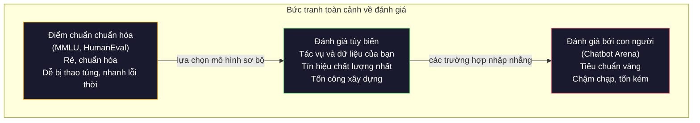
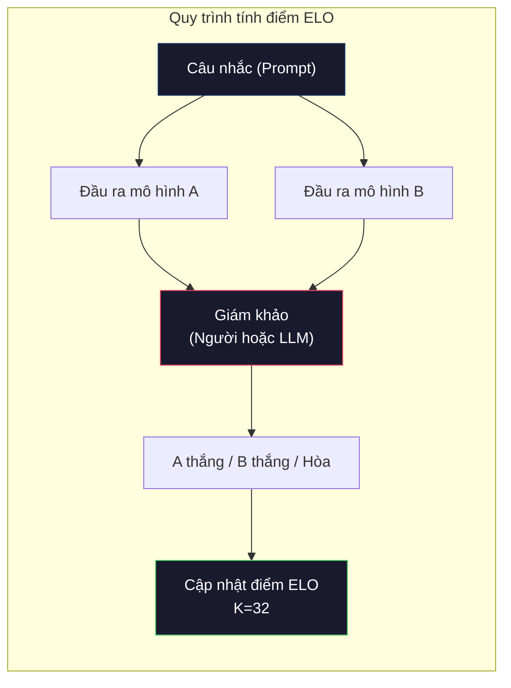

# Đánh Giá: Điểm Chuẩn, Evals, LM Harness (Evaluation: Benchmarks, Evals, LM Harness)

> Định luật Goodhart (Goodhart's Law): khi một thước đo trở thành một mục tiêu, nó sẽ không còn là một thước đo tốt nữa. Mọi phòng thí nghiệm tiên phong đều tìm cách thao túng điểm chuẩn (benchmarks). Điểm MMLU liên tục tăng cao trong khi các mô hình vẫn không thể đếm chính xác số lượng chữ cái R trong từ "strawberry". Bài đánh giá duy nhất thực sự quan trọng chính là bài đánh giá của RIÊNG BẠN — trên tác vụ của BẠN, với dữ liệu của BẠN.

**Type:** Build
**Languages:** Python
**Prerequisites:** Phase 10, Lessons 01-05 (LLMs from Scratch)
**Time:** ~90 phút

## Mục Tiêu Học Tập

- Xây dựng một hệ thống đánh giá (evaluation harness) tùy biến có khả năng chạy các bài kiểm tra trắc nghiệm và câu hỏi mở trên mô hình ngôn ngữ
- Giải thích lý do tại sao các bộ điểm chuẩn tiêu chuẩn (MMLU, HumanEval) bị bão hòa và không còn phân biệt được năng lực thực tế giữa các mô hình hàng đầu
- Cài đặt các bài đánh giá đặc thù cho từng tác vụ với các chỉ số chuẩn mực: khớp chính xác (exact match), F1, BLEU và chấm điểm bằng LLM làm giám khảo (LLM-as-judge)
- Thiết kế một bộ đánh giá tùy biến nhắm trúng trường hợp sử dụng cụ thể của bạn thay vì chỉ phụ thuộc vào các bảng xếp hạng công khai

## Vấn Đề

Bộ điểm chuẩn MMLU được công bố vào năm 2020 với 15.908 câu hỏi thuộc 57 lĩnh vực khác nhau. Chỉ trong vòng ba năm, các mô hình tiên phong đã đạt mức bão hòa trên bộ dữ liệu này: GPT-4 đạt 86,4%, Claude 3 Opus đạt 86,8%, Llama 3 405B đạt 88,6%. Bảng xếp hạng bị nén lại trong một dải chênh lệch chỉ vỏn vẹn 3 điểm phần trăm — nơi mà sự khác biệt chủ yếu đến từ nhiễu thống kê chứ không phản ánh khoảng cách năng lực thực chất.

Trong khi đó, chính những mô hình đó lại thất bại trước những nhiệm vụ mà một đứa trẻ 10 tuổi có thể xử lý dễ dàng mà không cần suy nghĩ. Claude 3.5 Sonnet, dù đạt 88,7% trên MMLU, ban đầu thậm chí không thể đếm đúng số chữ cái trong từ "strawberry" — một tác vụ không đòi hỏi bất kỳ kiến thức thế giới hay suy luận phức tạp nào, mà chỉ đơn thuần là việc duyệt từng ký tự. Bộ đánh giá HumanEval kiểm tra khả năng sinh mã nguồn với 164 bài toán: các mô hình đạt trên 90% điểm số nhưng vẫn tạo ra các đoạn mã bị lỗi nghiêm trọng khi gặp phải các trường hợp biên (edge cases) mà bất kỳ lập trình viên sơ cấp nào cũng sẽ phát hiện ra.

Khoảng cách giữa hiệu năng trên các bài kiểm tra chuẩn hóa và độ tin cậy trong môi trường thực tế chính là vấn đề trung tâm của lĩnh vực đánh giá LLM. Điểm chuẩn chỉ cho bạn biết mô hình thực hiện bài điểm chuẩn đó tốt đến mức nào. Chúng hầu như không nói lên điều gì về việc mô hình sẽ hoạt động ra sao trên tác vụ cụ thể của bạn, với dữ liệu chuyên biệt của bạn và dưới các dạng lỗi tiềm ẩn riêng của bạn. Nếu bạn đang xây dựng một chatbot hỗ trợ khách hàng, MMLU hoàn toàn vô nghĩa. Nếu bạn đang phát triển một trợ lý lập trình, HumanEval chỉ đánh giá được việc sinh hàm đơn lẻ — nó không thể hiện được khả năng gỡ lỗi, tái cấu trúc mã (refactoring) hay giải thích kiến trúc phần mềm xuyên suốt nhiều tệp tin.

Bạn cần các bài đánh giá tùy biến (custom evals). Không phải vì các điểm chuẩn công khai là vô dụng — chúng rất hữu ích cho bước sàng lọc mô hình sơ bộ — mà bởi vì bước đánh giá quyết định cuối cùng bắt buộc phải phản ánh chính xác các điều kiện triển khai thực tế của bạn.

## Khái Niệm

### Bức Tranh Toàn Cảnh Về Đánh Giá (The Eval Landscape)

Có ba nhóm phương pháp đánh giá chính, mỗi nhóm có mức chi phí và chất lượng tín hiệu khác nhau:

**Điểm chuẩn chuẩn hóa (Benchmarks)** là các bộ kiểm thử tiêu chuẩn hóa: MMLU, HumanEval, SWE-bench, MATH, ARC, HellaSwag. Bạn chạy mô hình qua bộ điểm chuẩn và nhận được một con số. Ưu điểm: mọi người đều dùng chung một bài kiểm tra, giúp dễ dàng so sánh giữa các mô hình. Nhược điểm: dữ liệu huấn luyện của các mô hình ngày càng bị nhiễm bẩn (contamination) bởi chính các bộ kiểm tra này. Các phòng thí nghiệm vô tình hoặc hữu ý huấn luyện mô hình trên dữ liệu chứa sẵn câu hỏi kiểm tra: điểm số tăng vọt nhưng năng lực thực sự thì không.

**Đánh giá tùy biến (Custom evals)** là các bộ kiểm thử do bạn tự xây dựng cho bài toán cụ thể của mình. Bạn tự định nghĩa dữ liệu đầu vào, kết quả đầu ra kỳ vọng và hàm chấm điểm. Một hệ thống tóm tắt tài liệu pháp lý phải được đánh giá trên các văn bản pháp luật thực tế. Một hệ thống sinh mã SQL phải được đánh giá trực tiếp trên lược đồ cơ sở dữ liệu của bạn. Những bộ kiểm thử này tốn công xây dựng nhưng là thước đo duy nhất dự đoán chính xác hiệu năng khi vận hành thực tế.

**Đánh giá bằng con người (Human evals)** sử dụng các chuyên viên đánh giá có trả phí để chấm điểm đầu ra của mô hình dựa trên các tiêu chí như tính hữu ích, tính chính xác, độ trôi chảy và mức độ an toàn. Đây là tiêu chuẩn vàng cho các tác vụ mở mà việc chấm điểm tự động không thể bao quát hết. Chatbot Arena đã thu thập hơn 2 triệu lượt bình chọn sở thích của con người trên hơn 100 mô hình khác nhau. Nhược điểm: chi phí cao ($0,10–$2,00 cho mỗi lượt đánh giá) và thời gian phản hồi chậm (từ vài giờ đến vài ngày).



### Tại Sao Các Bộ Điểm Chuẩn Bị Phá Vỡ

Có ba cơ chế chính khiến điểm số benchmark không còn phản ánh đúng năng lực thực tế:

**Nhiễm bẩn dữ liệu (Data contamination).** Các tập ngữ liệu huấn luyện thu thập dữ liệu khổng lồ từ Internet. Các câu hỏi benchmark cũng nằm trên Internet. Mô hình đã nhìn thấy câu trả lời ngay trong quá trình tiền huấn luyện. Đây không hẳn là hành vi gian lận có chủ đích — các phòng thí nghiệm không cố tình đưa dữ liệu điểm chuẩn vào, nhưng việc cào dữ liệu ở quy mô web khiến việc lọc sạch hoàn toàn là điều gần như bất khả thi.

**Học tủ để đối phó (Teaching to the test).** Các nhóm nghiên cứu tối ưu hóa tỷ lệ pha trộn dữ liệu huấn luyện để nhắm tới điểm số benchmark. Nếu 5% hỗn hợp huấn luyện là các câu hỏi trắc nghiệm dạng MMLU, mô hình sẽ học thuộc cấu trúc định dạng và phân phối đáp án. MMLU là trắc nghiệm 4 lựa chọn (A/B/C/D). Mô hình học được rằng đáp án phân bổ tương đối đồng đều trên A/B/C/D, giúp tăng xác suất đoán đúng ngay cả khi mô hình thực sự không biết câu trả lời.

**Hiện tượng bão hòa (Saturation).** Khi tất cả các mô hình hàng đầu đều đạt 85–90% trên một bài kiểm tra, bài kiểm tra đó không còn khả năng phân loại nữa. 10–15% số câu hỏi còn lại thường là những câu hỏi mơ hồ, bị gán nhãn sai, hoặc đòi hỏi kiến thức chuyên môn cực kỳ hẹp và lập dị. Việc tăng từ 87% lên 89% trên MMLU nhiều khả năng chỉ là do mô hình tình cờ ghi nhớ thêm hai câu hỏi kỳ quặc, chứ không đồng nghĩa với việc nó đã thông minh hơn.

### Độ Hỗn Loạn: Bài Kiểm Tra Sức Khỏe Nhanh (Perplexity)

Độ hỗn loạn (Perplexity - PPL) đo lường mức độ "bất ngờ" của mô hình trước một chuỗi các token. Về mặt toán học, nó là hàm mũ của giá trị log xác suất âm trung bình (negative log-likelihood):

```math
\text{PPL} = \exp\left(-\frac{1}{N} \sum_i \log P(\text{token}_i \mid \text{context})\right)
```

Độ hỗn loạn bằng 10 có nghĩa là, tính trung bình, mô hình phân vân không chắc chắn tương đương với việc tung một xúc xắc 10 mặt để chọn ngẫu nhiên giữa 10 token tại mỗi vị trí. Giá trị càng thấp càng tốt. GPT-2 đạt độ hỗn loạn khoảng ~30 trên WikiText-103; GPT-3 đạt khoảng ~20; Llama 3 8B đạt khoảng ~7.

Độ hỗn loạn rất hữu ích để so sánh các mô hình trên cùng một tập dữ liệu kiểm thử cố định, nhưng nó tồn tại những điểm mù lớn. Một mô hình có thể đạt PPL rất thấp chỉ nhờ việc dự đoán cực tốt các cấu trúc câu phổ biến, trong khi hoàn toàn thất bại ở những trường hợp hiếm gặp nhưng mang tính quyết định. Chỉ số này cũng không đo lường được khả năng tuân thủ chỉ dẫn, suy luận logic hay tính chính xác của sự thật. Hãy sử dụng nó như một bước kiểm tra sơ bộ ban đầu, không bao giờ dùng làm kết luận cuối cùng.

### LLM Làm Giám Khảo (LLM-as-Judge)

Sử dụng một mô hình ngôn ngữ mạnh để đánh giá kết quả đầu ra của một mô hình yếu hơn. Ý tưởng rất trực quan: yêu cầu GPT-4o hoặc Claude Sonnet chấm điểm câu trả lời trên thang điểm 1–5 về tính chính xác, tính hữu ích và độ an toàn. Chi phí chỉ khoảng $0,01 cho mỗi lượt đánh giá khi sử dụng GPT-4o-mini và có mức độ tương đồng đáng kinh ngạc với con người — đạt khoảng 80% độ đồng thuận trên hầu hết các tác vụ.

Câu lệnh chấm điểm (prompt rubric) quan trọng hơn bản thân mô hình giám khảo. Một câu lệnh mơ hồ ("Hãy chấm điểm câu trả lời này") sẽ tạo ra các điểm số đầy nhiễu loạn. Một câu lệnh có cấu trúc chặt chẽ kèm tiêu chí rõ ràng ("Cho 5 điểm nếu câu trả lời chính xác về mặt sự thật và có trích dẫn nguồn; cho 4 điểm nếu chính xác nhưng thiếu nguồn; cho 3 điểm nếu chỉ chính xác một phần...") sẽ mang lại kết quả chấm điểm nhất quán và có thể tái lập được.

Các dạng thiên lệch thường gặp: mô hình giám khảo thường mắc thiên lệch vị trí (position bias - thích câu trả lời đứng đầu trong so sánh cặp), thiên lệch độ dài (verbosity bias - thích câu trả lời dài dòng hơn), và thiên lệch tự vị (self-preference - GPT-4 có xu hướng chấm câu trả lời của chính GPT-4 cao hơn so với câu trả lời tương đương của Claude). Biện pháp giảm thiểu: xáo trộn ngẫu nhiên thứ tự trình bày, chuẩn hóa theo độ dài, và sử dụng một mô hình giám khảo khác họ với mô hình đang được đánh giá.

### Điểm Xếp Hạng ELO Từ Các So Sánh Cặp

Cách tiếp cận của Chatbot Arena: Hiển thị hai câu trả lời cho cùng một câu nhắc từ hai mô hình khác nhau. Một con người (hoặc LLM giám khảo) chọn câu tốt hơn. Từ hàng nghìn lượt so sánh đối đầu như vậy, hệ thống tính toán điểm xếp hạng ELO cho từng mô hình — tương tự như hệ thống xếp hạng đại kiện tướng trong cờ vua.

Ưu điểm của ELO: xếp hạng tương đối luôn đáng tin cậy hơn việc chấm điểm tuyệt đối, xử lý các trường hợp hòa rất tự nhiên, và hội tụ nhanh hơn với ít lượt so sánh hơn so với việc phải chấm điểm từng kết quả độc lập. Tính đến đầu năm 2026, bảng xếp hạng Chatbot Arena cho thấy GPT-4o, Claude 3.5 Sonnet và Gemini 1.5 Pro đều nằm sát nút nhau trong phạm vi chênh lệch 20 điểm ELO ở nhóm dẫn đầu.



### Các Khung Đánh Giá Phổ Biến (Eval Frameworks)

**lm-evaluation-harness** (EleutherAI): khung đánh giá mã nguồn mở tiêu chuẩn của cộng đồng. Hỗ trợ hơn 200 bộ điểm chuẩn khác nhau. Cho phép chạy bất kỳ mô hình nào từ Hugging Face qua MMLU, HellaSwag, ARC,... chỉ bằng một dòng lệnh. Đây là công cụ nền tảng vận hành Open LLM Leaderboard.

**RAGAS**: khung đánh giá chuyên dụng cho các hệ thống RAG (Retrieval-Augmented Generation). Đo lường tính trung thực (faithfulness - câu trả lời có bám sát ngữ cảnh truy xuất không?), tính liên quan (answer relevance - ngữ cảnh truy xuất có trả lời đúng câu hỏi không?), và độ chính xác của câu trả lời.

**promptfoo**: công cụ đánh giá dựa trên cấu hình (config-driven) dành cho kỹ thuật tạo câu nhắc (prompt engineering). Định nghĩa các trường hợp kiểm thử bằng tệp YAML, chạy thử nghiệm trên nhiều mô hình và nhận báo cáo đạt/không đạt. Rất hữu ích cho việc kiểm thử hồi quy (regression testing) các câu nhắc — đảm bảo việc sửa đổi câu nhắc không làm hỏng các trường hợp đã hoạt động trước đó.

### Xây Dựng Bài Đánh Giá Tùy Biến

Quy trình chuẩn mực để xây dựng bộ đánh giá thực chiến cho môi trường sản xuất:

1. **Xác định rõ tác vụ.** Mô hình cần phải làm chính xác điều gì? Hãy thật cụ thể. "Trả lời câu hỏi" là quá mơ hồ. "Từ một email khiếu nại của khách hàng, hãy trích xuất tên sản phẩm, danh mục sự cố và mức độ cảm xúc" là một tác vụ có thể đánh giá định lượng được.

2. **Tạo các trường hợp kiểm thử (test cases).** Tối thiểu 50 mẫu cho bản thử nghiệm sơ khai, và từ 200 mẫu trở lên cho môi trường sản xuất. Mỗi trường hợp là một cặp `(input, expected_output)`. Bắt buộc phải đưa vào các trường hợp biên: đầu vào rỗng, câu hỏi đối kháng, câu hỏi nhập nhằng và đầu vào bằng ngôn ngữ khác.

3. **Xác định phương pháp chấm điểm.** Sử dụng Khớp chính xác (Exact match) cho dữ liệu có cấu trúc. BLEU/ROUGE cho độ tương đồng văn bản. LLM-as-judge cho chất lượng câu trả lời mở. F1 cho các tác vụ trích xuất thông tin. Có thể kết hợp nhiều chỉ số kèm trọng số phù hợp.

4. **Tự động hóa hoàn toàn.** Mọi bài đánh giá phải chạy được chỉ bằng một dòng lệnh duy nhất, không có bất kỳ bước can thiệp thủ công nào. Lưu trữ kết quả ở định dạng có thể so sánh và đối chiếu theo thời gian.

5. **Theo dõi xu hướng qua thời gian.** Một điểm số đánh giá đứng riêng lẻ không mang nhiều ý nghĩa. Bạn cần đường xu hướng: Điểm số có cải thiện sau lần chỉnh sửa câu nhắc gần nhất không? Có bị thụt lùi (regression) khi đổi sang mô hình mới không? Hãy đánh số phiên bản cho bài đánh giá của bạn song hành cùng các phiên bản prompt và mô hình.

| Loại hình đánh giá | Chi phí mỗi lượt chấm | Độ tương đồng với con người | Phù hợp nhất cho |
|--------------------|-----------------------|------------------------------|------------------|
| Khớp chính xác (Exact match) | ~$0 | 100% (khi áp dụng được) | Dữ liệu cấu trúc, phân loại |
| BLEU / ROUGE | ~$0 | ~60% | Dịch thuật, tóm tắt văn bản |
| LLM làm giám khảo | ~$0,01 | ~80% | Sinh văn bản tự do, câu hỏi mở |
| Đánh giá bởi con người | $0,10–$2,00 | N/A (chính là chân lý nền tảng) | Tác vụ mơ hồ, rủi ro cao |

````figure perplexity-loss
````

## Xây Dựng (Build It)

### Bước 1: Khung Đánh Giá Tối Giản

Định nghĩa các lớp trừu tượng cốt lõi. Một trường hợp đánh giá (`EvalCase`) gồm văn bản đầu vào, kết quả kỳ vọng và từ điển siêu dữ liệu tùy chọn. Một bộ chấm điểm (`scorer`) nhận vào dự đoán và đáp án chuẩn rồi trả về điểm số từ 0 đến 1.

```python
import json
from collections import Counter

class EvalCase:
    def __init__(self, input_text, expected, metadata=None):
        self.input_text = input_text
        self.expected = expected
        self.metadata = metadata or {}

class EvalSuite:
    def __init__(self, name, cases, scorers):
        self.name = name
        self.cases = cases
        self.scorers = scorers

    def run(self, model_fn):
        results = []
        for case in self.cases:
            prediction = model_fn(case.input_text)
            scores = {}
            for scorer_name, scorer_fn in self.scorers.items():
                scores[scorer_name] = scorer_fn(prediction, case.expected)
            results.append({
                "input": case.input_text,
                "expected": case.expected,
                "prediction": prediction,
                "scores": scores,
            })
        return results
```

### Bước 2: Các Hàm Chấm Điểm

Xây dựng hàm khớp chính xác (exact match), F1 theo token và một bộ chấm điểm LLM-as-judge mô phỏng:

```python
def exact_match(prediction, expected):
    return 1.0 if prediction.strip().lower() == expected.strip().lower() else 0.0

def token_f1(prediction, expected):
    pred_tokens = set(prediction.lower().split())
    exp_tokens = set(expected.lower().split())
    if not pred_tokens or not exp_tokens:
        return 0.0
    common = pred_tokens & exp_tokens
    precision = len(common) / len(pred_tokens)
    recall = len(common) / len(exp_tokens)
    if precision + recall == 0:
        return 0.0
    return 2 * (precision * recall) / (precision + recall)

def llm_judge_simulated(prediction, expected):
    pred_words = set(prediction.lower().split())
    exp_words = set(expected.lower().split())
    if not exp_words:
        return 0.0
    overlap = len(pred_words & exp_words) / len(exp_words)
    length_penalty = min(1.0, len(prediction) / max(len(expected), 1))
    return round(overlap * 0.7 + length_penalty * 0.3, 3)
```

### Bước 3: Hệ Thống Xếp Hạng ELO

Cài đặt cơ chế so sánh cặp với cập nhật điểm ELO. Đây chính xác là hệ thống mà Chatbot Arena áp dụng để xếp hạng các mô hình:

```python
class ELOTracker:
    def __init__(self, k=32, initial_rating=1500):
        self.ratings = {}
        self.k = k
        self.initial_rating = initial_rating
        self.history = []

    def _ensure_player(self, name):
        if name not in self.ratings:
            self.ratings[name] = self.initial_rating

    def expected_score(self, rating_a, rating_b):
        return 1 / (1 + 10 ** ((rating_b - rating_a) / 400))

    def record_match(self, player_a, player_b, outcome):
        self._ensure_player(player_a)
        self._ensure_player(player_b)

        ea = self.expected_score(self.ratings[player_a], self.ratings[player_b])
        eb = 1 - ea

        if outcome == "a":
            sa, sb = 1.0, 0.0
        elif outcome == "b":
            sa, sb = 0.0, 1.0
        else:
            sa, sb = 0.5, 0.5

        self.ratings[player_a] += self.k * (sa - ea)
        self.ratings[player_b] += self.k * (sb - eb)

        self.history.append({
            "a": player_a, "b": player_b,
            "outcome": outcome,
            "rating_a": round(self.ratings[player_a], 1),
            "rating_b": round(self.ratings[player_b], 1),
        })

    def leaderboard(self):
        return sorted(self.ratings.items(), key=lambda x: -x[1])
```

### Bước 4: Tính Toán Độ Hỗn Loạn (Perplexity)

Tính toán perplexity dựa trên xác suất token. Trong thực tế, bạn sẽ lấy các giá trị này từ logits của mô hình:

```python
import numpy as np

def perplexity(log_probs):
    if not log_probs:
        return float("inf")
    avg_neg_log_prob = -np.mean(log_probs)
    return float(np.exp(avg_neg_log_prob))

def token_log_probs_simulated(text, model_quality=0.8):
    np.random.seed(hash(text) % 2**31)
    tokens = text.split()
    log_probs = []
    for i, token in enumerate(tokens):
        base_prob = model_quality
        if len(token) > 8:
            base_prob *= 0.6
        if i == 0:
            base_prob *= 0.7
        prob = np.clip(base_prob + np.random.normal(0, 0.1), 0.01, 0.99)
        log_probs.append(float(np.log(prob)))
    return log_probs
```

### Bước 5: Tổng Hợp Kết Quả Đánh Giá

Tính toán các chỉ số thống kê tổng hợp xuyên suốt một lượt đánh giá: giá trị trung bình (mean), trung vị (median), tỷ lệ vượt qua (pass rate) tại một ngưỡng định trước và phân tích theo từng chỉ số:

```python
def summarize_results(results, threshold=0.8):
    all_scores = {}
    for r in results:
        for metric, score in r["scores"].items():
            all_scores.setdefault(metric, []).append(score)

    summary = {}
    for metric, scores in all_scores.items():
        arr = np.array(scores)
        summary[metric] = {
            "mean": round(float(np.mean(arr)), 3),
            "median": round(float(np.median(arr)), 3),
            "std": round(float(np.std(arr)), 3),
            "min": round(float(np.min(arr)), 3),
            "max": round(float(np.max(arr)), 3),
            "pass_rate": round(float(np.mean(arr >= threshold)), 3),
            "n": len(scores),
        }
    return summary

def print_summary(summary, suite_name="Eval"):
    print(f"\n{'=' * 60}")
    print(f"  {suite_name} Summary")
    print(f"{'=' * 60}")
    for metric, stats in summary.items():
        print(f"\n  {metric}:")
        print(f"    Mean:      {stats['mean']:.3f}")
        print(f"    Median:    {stats['median']:.3f}")
        print(f"    Std:       {stats['std']:.3f}")
        print(f"    Range:     [{stats['min']:.3f}, {stats['max']:.3f}]")
        print(f"    Pass rate: {stats['pass_rate']:.1%} (threshold >= 0.8)")
        print(f"    N:         {stats['n']}")
```

### Bước 6: Chạy Toàn Bộ Quy Trình Đánh Giá

Kết nối toàn bộ các thành phần: xác định bài toán, tạo các trường hợp kiểm thử, mô phỏng hai mô hình, chạy đánh giá, tính điểm ELO từ so sánh cặp và hiển thị bảng xếp hạng:

```python
def demo_model_good(prompt):
    responses = {
        "What is the capital of France?": "Paris",
        "What is 2 + 2?": "4",
        "Who wrote Hamlet?": "William Shakespeare",
        "What language is PyTorch written in?": "Python and C++",
        "What is the boiling point of water?": "100 degrees Celsius",
    }
    return responses.get(prompt, "I don't know")

def demo_model_bad(prompt):
    responses = {
        "What is the capital of France?": "Paris is the capital city of France",
        "What is 2 + 2?": "The answer is four",
        "Who wrote Hamlet?": "Shakespeare",
        "What language is PyTorch written in?": "Python",
        "What is the boiling point of water?": "212 Fahrenheit",
    }
    return responses.get(prompt, "Unknown")

cases = [
    EvalCase("What is the capital of France?", "Paris"),
    EvalCase("What is 2 + 2?", "4"),
    EvalCase("Who wrote Hamlet?", "William Shakespeare"),
    EvalCase("What language is PyTorch written in?", "Python and C++"),
    EvalCase("What is the boiling point of water?", "100 degrees Celsius"),
]

suite = EvalSuite(
    name="General Knowledge",
    cases=cases,
    scorers={
        "exact_match": exact_match,
        "token_f1": token_f1,
        "llm_judge": llm_judge_simulated,
    },
)

results_good = suite.run(demo_model_good)
results_bad = suite.run(demo_model_bad)

print_summary(summarize_results(results_good), "Model A (concise)")
print_summary(summarize_results(results_bad), "Model B (verbose)")
```

Mô hình "tốt" đưa ra câu trả lời ngắn gọn, chuẩn xác. Mô hình "xấu" diễn đạt dài dòng, quanh co. Thước đo Khớp chính xác (Exact match) phạt rất nặng mô hình dài dòng. Trong khi đó, Token F1 và LLM-as-judge lại khoan dung hơn nhiều. Điều này chứng minh tại sao việc lựa chọn chỉ số đánh giá lại mang tính sống còn: cùng một mô hình có thể trông rất xuất sắc hoặc vô cùng tồi tệ tùy thuộc vào cách bạn chấm điểm nó.

### Bước 7: Giải Đấu Xếp Hạng ELO

Thực hiện các lượt so sánh đối đầu giữa các mô hình qua nhiều vòng:

```python
elo = ELOTracker(k=32)

for case in cases:
    pred_a = demo_model_good(case.input_text)
    pred_b = demo_model_bad(case.input_text)

    score_a = token_f1(pred_a, case.expected)
    score_b = token_f1(pred_b, case.expected)

    if score_a > score_b:
        outcome = "a"
    elif score_b > score_a:
        outcome = "b"
    else:
        outcome = "tie"

    elo.record_match("model_a_concise", "model_b_verbose", outcome)

print("\nELO Leaderboard:")
for name, rating in elo.leaderboard():
    print(f"  {name}: {rating:.0f}")
```

### Bước 8: So Sánh Độ Hỗn Loạn

So sánh độ hỗn loạn giữa các "mô hình" ở các mức chất lượng khác nhau:

```python
test_text = "The quick brown fox jumps over the lazy dog in the garden"

for quality, label in [(0.9, "Strong model"), (0.7, "Medium model"), (0.4, "Weak model")]:
    log_probs = token_log_probs_simulated(test_text, model_quality=quality)
    ppl = perplexity(log_probs)
    print(f"  {label} (quality={quality}): perplexity = {ppl:.2f}")
```

## Sử Dụng (Use It)

### lm-evaluation-harness (EleutherAI)

Công cụ chuẩn mực để chạy các bộ điểm chuẩn trên mọi mô hình:

```python
# pip install lm-eval
# Chạy từ dòng lệnh:
# lm_eval --model hf --model_args pretrained=meta-llama/Llama-3.1-8B --tasks mmlu --batch_size 8

# Sử dụng Python API:
# import lm_eval
# results = lm_eval.simple_evaluate(
#     model="hf",
#     model_args="pretrained=meta-llama/Llama-3.1-8B",
#     tasks=["mmlu", "hellaswag", "arc_easy"],
#     batch_size=8,
# )
# print(results["results"])
```

### promptfoo

Khung đánh giá theo cấu hình cho kỹ thuật tạo câu nhắc. Định nghĩa kiểm thử trong tệp YAML và chạy đối chiếu qua nhiều nhà cung cấp mô hình:

```yaml
# promptfoo.yaml
providers:
  - openai:gpt-4o-mini
  - anthropic:claude-3-haiku

prompts:
  - "Answer in one word: {{question}}"

tests:
  - vars:
      question: "What is the capital of France?"
    assert:
      - type: contains
        value: "Paris"
  - vars:
      question: "What is 2 + 2?"
    assert:
      - type: equals
        value: "4"
```

### RAGAS Cho Đánh Giá RAG

```python
# pip install ragas
# from ragas import evaluate
# from ragas.metrics import faithfulness, answer_relevancy, context_precision
#
# result = evaluate(
#     dataset,
#     metrics=[faithfulness, answer_relevancy, context_precision],
# )
# print(result)
```

RAGAS đo lường chính xác những gì mà các bài đánh giá chung chung bỏ lỡ: liệu câu trả lời của mô hình có thực sự bắt nguồn từ ngữ cảnh được truy xuất hay không, thay vì chỉ kiểm tra xem câu trả lời có "đúng" một cách chung chung hay không.

## Đóng Gói (Ship It)

Bài học này tạo ra hai artifact hữu ích:
- `outputs/prompt-eval-designer.md` — một prompt tái sử dụng giúp thiết kế các bộ đánh giá tùy biến cho bất kỳ tác vụ nào. Khi cung cấp mô tả bài toán, nó sẽ tự động tạo ra các trường hợp kiểm thử, hàm chấm điểm và đề xuất ngưỡng đạt/không đạt phù hợp.
- `outputs/skill-llm-evaluation.md` — một khung ra quyết định giúp bạn chọn chiến lược đánh giá tối ưu dựa trên loại hình tác vụ, ngân sách và yêu cầu về độ trễ.

## Bài Tập Thực Hành

1. Thêm một bộ chấm điểm "tính nhất quán" (consistency scorer) thực hiện việc đưa cùng một câu nhắc qua mô hình 5 lần và đo lường tần suất các câu trả lời trùng khớp nhau. Các câu trả lời bất nhất đối với cùng một đầu vào mang tính tất định sẽ làm lộ ra các câu nhắc mong manh hoặc mức nhiệt độ (temperature) đang được đặt quá cao.

2. Mở rộng hệ thống theo dõi ELO để hỗ trợ nhiều hàm giám khảo khác nhau (khớp chính xác, F1, LLM-as-judge) và gán trọng số cho từng hàm. So sánh xem bảng xếp hạng thay đổi ra sao khi bạn tăng mạnh trọng số của khớp chính xác so với khi tăng mạnh trọng số của F1.

3. Xây dựng một bộ đánh giá cho bài toán cụ thể: phân loại email vào 5 danh mục nghiệp vụ. Tạo 100 trường hợp kiểm thử với các ví dụ phong phú bao gồm các trường hợp biên (email có thể thuộc nhiều danh mục, email trống, email bằng tiếng nước ngoài). Đo lường hiệu năng của các "mô hình" khác nhau (dựa trên quy tắc, khớp từ khóa, LLM mô phỏng).

4. Cài đặt thuật toán phát hiện nhiễm bẩn dữ liệu (contamination detection): cho một tập câu hỏi đánh giá và một kho ngữ liệu huấn luyện, kiểm tra tỷ lệ phần trăm các câu hỏi kiểm thử (hoặc các câu diễn đạt tương đương) xuất hiện trong dữ liệu huấn luyện. Đây chính là phương pháp các nhà nghiên cứu dùng để kiểm toán tính hợp lệ của các bộ benchmark.

5. Xây dựng công cụ "so sánh mô hình" (model diff). Nhận vào kết quả đánh giá từ hai phiên bản mô hình, công cụ sẽ làm nổi bật các trường hợp kiểm thử nào được cải thiện, trường hợp nào bị thụt lùi (regression), và trường hợp nào giữ nguyên. Đây là công cụ tương đương với `git diff` trong đánh giá phần mềm — cực kỳ thiết yếu để hiểu rõ một thay đổi vừa thực hiện mang lại lợi ích hay gây hại.

## Thuật Ngữ Then Chốt

| Thuật ngữ | Người ta thường nói | Bản chất thực sự |
|-----------|---------------------|-------------------|
| MMLU | "Bộ điểm chuẩn tiêu chuẩn" | Massive Multitask Language Understanding: bộ 15.908 câu hỏi trắc nghiệm thuộc 57 chủ đề, đã bị bão hòa trên 88% từ năm 2025 |
| HumanEval | "Điểm chuẩn lập trình" | 164 bài toán hoàn thiện hàm Python từ OpenAI, chỉ kiểm tra khả năng sinh hàm đơn lẻ bị cô lập |
| SWE-bench | "Điểm chuẩn lập trình thực tế" | 2.294 vấn đề GitHub từ 12 kho mã nguồn Python lớn, đo lường khả năng sửa lỗi toàn diện từ đầu đến cuối bao gồm cả viết bài kiểm thử |
| Độ hỗn loạn (Perplexity) | "Mức độ bối rối của mô hình" | $\exp(-\mathop{\mathrm{avg}}(\log P(\text{token}_i \mid \text{context})))$ — giá trị càng thấp nghĩa là mô hình gán xác suất càng cao cho các token thực tế |
| Điểm xếp hạng ELO | "Bảng xếp hạng cờ vua cho mô hình" | Thước đo kỹ năng tương đối được tính toán từ các trận đối đầu thắng/thua, được Chatbot Arena sử dụng để xếp hạng hơn 100 mô hình |
| LLM làm giám khảo (LLM-as-judge) | "Dùng AI chấm điểm AI" | Sử dụng một mô hình mạnh để chấm điểm câu trả lời của mô hình yếu hơn dựa trên barem định sẵn, đạt độ đồng thuận ~80% với con người ở mức chi phí ~$0,01/lượt |
| Nhiễm bẩn dữ liệu (Data contamination) | "Mô hình đã học tủ đề thi" | Dữ liệu huấn luyện chứa sẵn câu hỏi của bộ điểm chuẩn, làm thổi phồng điểm số mà không nâng cao năng lực thực tế |
| Bộ đánh giá (Eval suite) | "Tập hợp các bài kiểm tra" | Một bộ sưu tập có phiên bản gồm các bộ ba `(input, expected_output, scorer)` dùng để đo lường định lượng một năng lực cụ thể |
| Tỷ lệ vượt qua (Pass rate) | "Phần trăm làm đúng" | Tỷ lệ các trường hợp kiểm thử đạt điểm trên một ngưỡng định trước — thực tế và hữu ích hơn điểm trung bình vì nó phản ánh độ tin cậy |
| Chatbot Arena | "Trang xếp hạng mô hình" | Nền tảng của LMSYS với hơn 2 triệu lượt bình chọn sở thích từ người dùng thực, tạo ra bảng xếp hạng LLM đáng tin cậy nhất hiện nay thông qua điểm ELO |

## Đọc Thêm

- [Hendrycks et al., 2021 -- "Measuring Massive Multitask Language Understanding"](https://arxiv.org/abs/2009.03300) -- bài báo MMLU gốc, vẫn là bộ điểm chuẩn được trích dẫn nhiều nhất dù đã bão hòa
- [Chen et al., 2021 -- "Evaluating Large Language Models Trained on Code"](https://arxiv.org/abs/2107.03374) -- bài báo HumanEval của OpenAI, thiết lập phương pháp luận đánh giá sinh mã nguồn
- [Zheng et al., 2023 -- "Judging LLM-as-a-Judge"](https://arxiv.org/abs/2306.05685) -- phân tích có hệ thống về việc dùng LLM để đánh giá LLM, chỉ ra các thiên lệch vị trí và thiên lệch độ dài
- [Arena (trước đây là LMSYS Chatbot Arena)](https://arena.ai/leaderboard) -- nền tảng so sánh mô hình từ cộng đồng với hơn 2 triệu lượt bình chọn, nguồn xếp hạng LLM thực tế đáng tin cậy nhất
