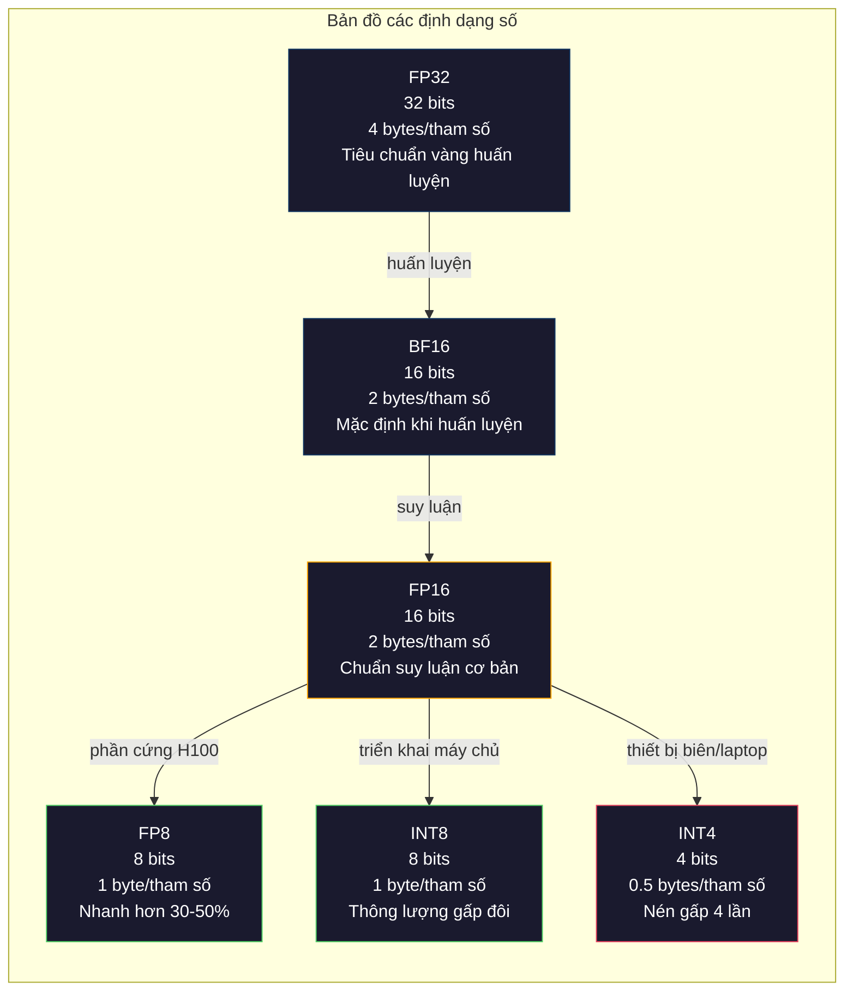
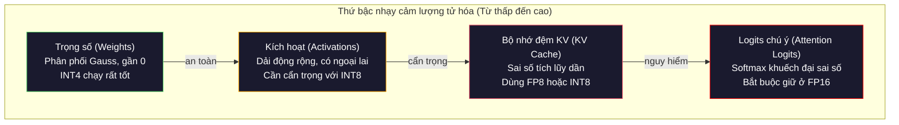
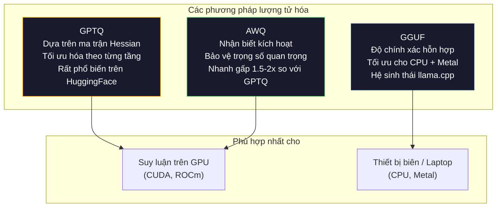

# Lượng Tử Hóa: Thu Gọn Mô Hình Vừa Vặn Bộ Nhớ (Quantization: Making Models Fit)

> Một mô hình 70B ở định dạng FP16 ngốn tới 140GB bộ nhớ. Cần tới hai GPU A100 chỉ để chứa trọng số. Lượng tử hóa (quantization) xuống FP8: chỉ cần một GPU 80GB duy nhất. Xuống INT4: chạy êm ru trên một chiếc MacBook.

**Type:** Build
**Languages:** Python (with numpy)
**Prerequisites:** Phase 10, Lessons 01-10 (LLMs from Scratch)
**Time:** ~120 phút

## Mục Tiêu Học Tập

- Cài đặt các phương pháp lượng tử hóa đối xứng (symmetric) và bất đối xứng (asymmetric) từ FP16 xuống INT8 và INT4, bao gồm cả kỹ thuật tính tỷ lệ theo từng tensor (per-tensor) và theo từng kênh (per-channel)
- Tính toán mức tiết kiệm bộ nhớ nhờ lượng tử hóa và xác định mức độ chính xác số học nào sẽ vừa vặn với dung lượng VRAM của GPU mục tiêu
- Phân biệt rõ ràng giữa lượng tử hóa sau huấn luyện (Post-Training Quantization - PTQ) và huấn luyện nhận biết lượng tử hóa (Quantization-Aware Training - QAT)
- Áp dụng GPTQ hoặc AWQ để lượng tử hóa một mô hình thực tế và đo lường sự đánh đổi giữa độ chính xác và dung lượng bộ nhớ trên tập điểm chuẩn

## Vấn Đề

Llama 3 70B có 70 tỷ tham số. Mỗi tham số là một số thực dấu phẩy động 16-bit. Điều đó tương đương 140 tỷ byte — tức 140GB. Một chiếc GPU A100 cao cấp chỉ có 80GB VRAM. Bạn thậm chí còn không thể tải được toàn bộ trọng số của mô hình vào bộ nhớ, chưa nói gì đến việc chạy suy luận (inference). Bạn sẽ cần tối thiểu hai GPU A100 với chi phí $2/giờ cho mỗi chiếc chỉ để phục vụ một mô hình duy nhất.

Tuy nhiên, việc dành 16 bit cho mỗi tham số là một sự lãng phí ghê gớm. Phần lớn trọng số trong mạng nơ-ron tập trung dày đặc quanh giá trị 0. Toàn bộ dải động rộng lớn của FP16 (từ 0,000000059 đến 65.504) gần như không bao giờ được chạm tới. Nếu bạn đo đạc phân phối trọng số thực tế trong Llama 3 70B, 95% giá trị nằm gọn trong khoảng từ -0,1 đến +0,1. Bạn đang đốt cháy 16 bit chỉ để biểu diễn các giá trị vốn dĩ hoàn toàn có thể nhét vừa trong 4 bit.

Lượng tử hóa thay thế các con số có độ chính xác cao bằng các con số có độ chính xác thấp hơn. Chuyển từ FP16 sang FP8 giúp cắt giảm một nửa bộ nhớ. Chuyển từ FP16 sang INT4 giúp giảm bộ nhớ xuống chỉ còn một phần tư. Mô hình 140GB cồng kềnh thu gọn lại chỉ còn 35GB — hoàn toàn có thể chạy mượt mà trên một GPU phổ thông của người dùng cuối. Đẩy mạnh hơn nữa xuống lượng tử hóa 2-bit (mức độ rất quyết liệt, mất mát nhiều thông tin nhưng vẫn dùng được cho một số tác vụ nhất định), mô hình khổng lồ đó có thể chạy được trên một chiếc laptop với 16GB RAM.

Cái giá phải trả chính là độ chính xác. Mỗi một bit bạn tước bỏ đều đồng nghĩa với việc thông tin bị phá hủy. Vấn đề cốt lõi là bạn đánh mất bao nhiêu độ chính xác và mất ở những vị trí nào. Một mô hình INT4 được lượng tử hóa khéo léo vẫn giữ được 95–99% chất lượng ban đầu trên hầu hết các bài kiểm tra điểm chuẩn. Trong khi đó, việc lượng tử hóa ngây thơ (naive) xuống INT4 có thể phá hủy hoàn toàn khả năng ngôn ngữ của mô hình. Sự khác biệt nằm ở kỹ thuật.

Các phiên bản lượng tử hóa cộng đồng của Llama 3 xuống INT4 bằng GPTQ chỉ ghi nhận mức tăng khoảng 1–2 điểm perplexity trên WikiText. Mistral đã phát hành các bản checkpoint FP8 của Mixtral 8x22B mà không hề ghi nhận bất kỳ sự sụt giảm chất lượng đo lường được nào trên MMLU. Định dạng GGUF chính là trái tim của llama.cpp, cho phép chạy các mô hình 70B trực tiếp trên các máy Mac chạy chip Apple Silicon. Lượng tử hóa không phải là một thủ thuật chắp vá tạm thời — nó là con đường triển khai tiêu chuẩn bắt buộc cho mọi mô hình có kích thước lớn hơn 7B.

## Khái Niệm

### Các Định Dạng Số: Mỗi Bit Làm Nhiệm Vụ Gì

Mỗi số thực dấu phẩy động gồm ba phần: bit dấu (sign), trường số mũ (exponent) và phần định trị (mantissa, hay còn gọi là significand). Bit dấu chiếm 1 bit. Trường số mũ quyết định dải giá trị (con số có thể lớn hay nhỏ tới mức nào). Phần định trị quyết định độ chính xác (bạn giữ lại được bao nhiêu chữ số thập phân sau dấu phẩy).

```text
FP32:  [1 bit dấu] [8 bit số mũ] [23 bit định trị] = 32 bits
FP16:  [1 bit dấu] [5 bit số mũ] [10 bit định trị] = 16 bits
BF16:  [1 bit dấu] [8 bit số mũ] [7  bit định trị] = 16 bits
FP8:   [1 bit dấu] [4 bit số mũ] [3  bit định trị] = 8  bits (E4M3)
FP8:   [1 bit dấu] [5 bit số mũ] [2  bit định trị] = 8  bits (E5M2)
INT8:  [1 bit dấu] [7 bit giá trị]                 = 8  bits (bước nhảy đều)
INT4:  [1 bit dấu] [3 bit giá trị]                 = 4  bits (16 mức tổng cộng)
```

**FP32** là độ chính xác đơn tiêu chuẩn. 23 bit định trị mang lại độ chính xác khoảng 7 chữ số thập phân. Dải giá trị: xấp xỉ từ $1,2 \times 10^{-38}$ đến $3,4 \times 10^{38}$. Trước đây, việc huấn luyện mô hình diễn ra hoàn toàn trên FP32. Ngày nay, nó vẫn được dùng cho các phép toán tích lũy (accumulation — cộng dồn các tổng trong phép nhân ma trận).

**FP16** giảm một nửa số bit. 10 bit định trị mang lại khoảng 3,3 chữ số thập phân. Trường số mũ thu hẹp xuống còn 5 bit, làm giảm đáng kể dải giá trị (giá trị tối đa ~65.504). Mức này hoàn toàn ổn với trọng số (vốn tập trung gần 0) nhưng rất nguy hiểm với các giá trị kích hoạt (activations) và gradient — vốn có thể tăng vọt đột ngột trong quá trình huấn luyện. Huấn luyện FP16 bắt buộc phải dùng kỹ thuật co dãn hàm mất mát (loss scaling) để chống tràn dưới (underflow).

**BF16** (Brain Float 16) giữ nguyên 8 bit số mũ như FP32 nhưng thu nhỏ phần định trị xuống 7 bit. Cùng dải giá trị với FP32, nhưng độ chính xác kém hơn FP16. Google đã thiết kế định dạng này chuyên biệt cho học sâu. Trực giác cốt lõi: đối với mạng nơ-ron, dải biểu diễn quan trọng hơn nhiều so với độ chính xác chi tiết. Một gradient ở mức $10^{-20}$ nếu dùng FP16 sẽ bị tràn dưới về 0, nhưng lại sống sót nguyên vẹn trong BF16. Một trọng số 0,07342 nếu bị làm tròn thành 0,0734 trong BF16 vẫn hoàn toàn đủ tốt để mô hình học. Mọi quy trình huấn luyện hiện đại ngày nay đều mặc định dùng BF16 hoặc kết hợp BF16/FP32.

**FP8** có hai biến thể phổ biến: E4M3 (4 bit số mũ, 3 bit định trị) dùng cho trọng số và kích hoạt trong lúc suy luận; E5M2 (5 bit số mũ, 2 bit định trị) dùng cho gradient trong quá trình huấn luyện — nơi dải giá trị đóng vai trò sống còn hơn độ mịn. Suy luận FP8 trên GPU Nvidia H100 tăng tốc độ từ 30–50% so với FP16 mà chất lượng suy giảm không đáng kể.

**INT8** là định dạng số nguyên. Không có số mũ, không có định trị. Chỉ đơn thuần là 256 mức giá trị cách đều nhau từ -128 đến 127. Bạn cần một hệ số tỷ lệ (scale factor) để ánh xạ các trọng số thực vào dải số nguyên này. Lợi thế: số học số nguyên chạy nhanh hơn và tiết kiệm điện năng hơn rất nhiều so với số dấu phẩy động. Phép nhân ma trận INT8 trên GPU A100 đạt hiệu năng 624 TOPS so với 312 TFLOPS của FP16.

**INT4** đẩy xa hơn nữa: chỉ có vỏn vẹn 16 mức giá trị khả dĩ. Hệ số tỷ lệ phải gánh vác phần lớn trọng trách. Chất lượng phụ thuộc hoàn toàn vào cách bạn chọn hệ số tỷ lệ và những trọng số nào được đưa vào lượng tử hóa. Các phương pháp INT4 tiên tiến hàng đầu hiện nay (GPTQ, AWQ) giữ lại được hơn 95% chất lượng gốc của mô hình.



### Cách Thức Vận Hành Của Lượng Tử Hóa

Thao tác cốt lõi rất đơn giản: Lấy một tensor chứa các giá trị dấu phẩy động, tìm một hệ số tỷ lệ, chia cho hệ số đó, làm tròn tới số nguyên gần nhất, và lưu trữ mảng số nguyên kèm theo hệ số tỷ lệ.

**Lượng tử hóa (Quantize):**
```text
scale = max(abs(tensor)) / max_int_value
quantized = round(tensor / scale)
```

**Khôi phục / Giải lượng tử hóa (Dequantize):**
```text
reconstructed = quantized * scale
```

Đối với INT8 với dải đối xứng (-127 đến 127):
```text
scale = max(abs(tensor)) / 127
quantized = clamp(round(tensor / scale), -128, 127)
```

Sai số ở đây chính là sai số làm tròn (rounding error). Mỗi giá trị có thể bị lệch tối đa một khoảng bằng `scale / 2`. Tổng sai số xuyên suốt một tầng phụ thuộc vào số lượng tham số và mức độ nhạy cảm của mô hình đối với các biến động trong các trọng số đó.

**Lượng tử hóa theo từng tensor so với theo từng kênh (Per-tensor vs Per-channel).** Lượng tử hóa theo tensor dùng chung một hệ số tỷ lệ duy nhất cho toàn bộ ma trận trọng số. Cách này rất gọn nhẹ nhưng mất mát nhiều thông tin: nếu một cột có các giá trị rất lớn trong khi một cột khác chỉ chứa các giá trị rất nhỏ, các giá trị nhỏ sẽ bị triệt tiêu gần hết độ chính xác. Lượng tử hóa theo kênh dùng một hệ số tỷ lệ riêng cho từng kênh đầu ra (từng hàng hoặc từng cột của ma trận trọng số). Chi phí quản lý tăng lên (bạn phải lưu trữ $N$ hệ số tỷ lệ thay vì 1), nhưng chất lượng mô hình được cải thiện vượt bậc. Mọi phương pháp lượng tử hóa dùng trong sản xuất đều áp dụng lượng tử hóa theo kênh hoặc ở cấp độ chia nhóm mịn hơn.

**Lượng tử hóa bất đối xứng (Asymmetric quantization)** bổ sung thêm một điểm dời không (zero-point offset): `quantized = round(tensor / scale) + zero_point`. Kỹ thuật này xử lý các phân phối không nằm đối xứng quanh trục 0. Điển hình như các kích hoạt sau hàm ReLU — chúng luôn luôn không âm. Lượng tử hóa đối xứng sẽ lãng phí hẳn một nửa dải biểu diễn số nguyên cho các giá trị âm không bao giờ xuất hiện. Lượng tử hóa bất đối xứng ánh xạ trọn vẹn dải thực tế `[min, max]` vào toàn bộ dải số nguyên khả dụng.

### Cấp Bậc Nhạy Cảm (Sensitivity Hierarchy)

Không phải thành phần nào trong mô hình cũng chịu đựng được lượng tử hóa như nhau. Có một thứ bậc rõ ràng về mức độ nhạy cảm:

**Trọng số (Bền bỉ nhất - Weights).** Các trọng số của mô hình biến đổi chậm rãi trong suốt quá trình huấn luyện và tuân theo phân phối xấp xỉ Gauss tập trung quanh 0. Chúng chịu lượng tử hóa rất tốt. Trọng số INT8 với hệ số tỷ lệ theo từng kênh mang lại kết quả gần như không mất mát chất lượng. Xuống INT4 đòi hỏi các thuật toán tinh vi hơn nhưng hoàn toàn khả thi.

**Kích hoạt (Nhạy cảm vừa phải - Activations).** Kích hoạt là các giá trị trung gian luân chuyển qua các tầng nơ-ron trong quá trình suy luận. Chúng có dải động rộng hơn nhiều so với trọng số và thường xuyên chứa các giá trị ngoại lai (outliers). Một đầu chú ý đơn lẻ có thể sinh ra các giá trị kích hoạt lớn gấp 100 lần so với giá trị trung bình. Những giá trị ngoại lai này mang tính quyết định đối với chất lượng mô hình. Việc lượng tử hóa thô bạo sẽ phá hủy thông tin của chúng. Giải pháp: giữ các kênh chứa giá trị ngoại lai ở độ chính xác cao hơn (như LLM.int8()), hoặc sử dụng hệ số tỷ lệ động theo từng token hoặc theo từng kênh.

**Bộ nhớ đệm KV (Rất nhạy cảm - KV Cache).** Bộ nhớ đệm Key-Value lưu trữ trạng thái chú ý của toàn bộ các token đứng trước. Khi độ dài ngữ cảnh tăng cao, KV cache sẽ chiếm phần lớn bộ nhớ VRAM. Với mô hình 70B ở ngữ cảnh 32K, chỉ riêng KV cache đã ngốn tới 40GB ở định dạng FP16. Lượng tử hóa KV cache xuống FP8 hoặc INT8 giúp tiết kiệm lượng lớn bộ nhớ, nhưng bất kỳ sai số nào phát sinh cũng sẽ bị tích lũy dồn dập qua tất cả các bước tính toán chú ý trong tương lai. Tác động suy giảm chất lượng tăng theo hàm chiều dài chuỗi.

**Logits của cơ chế chú ý (Nhạy cảm nhất - Attention Logits).** Hàm softmax trong cơ chế chú ý cực kỳ nhạy cảm với những biến động nhỏ ở đầu vào. Một sai số lượng tử hóa chỉ 0,01 ở giá trị logit trước softmax có thể làm thay đổi đáng kể phân phối chú ý của toàn bộ câu văn. Do đó, hầu hết các kỹ thuật lượng tử hóa đều giữ nguyên các phép tính chú ý ở độ chính xác cao hơn (FP16 hoặc BF16) ngay cả khi tất cả các thành phần khác đã được lượng tử hóa sâu.



### PTQ so với QAT

**Lượng tử hóa sau huấn luyện (Post-Training Quantization - PTQ)** áp dụng trên một mô hình đã huấn luyện hoàn chỉnh mà không cần huấn luyện lại. Bạn lấy trọng số FP16 sẵn có, tính toán các hệ số tỷ lệ, làm tròn sang số nguyên và triển khai. Quá trình này diễn ra cực nhanh (vài phút đến vài giờ) và chi phí rất thấp. Nó hoạt động tuyệt vời cho INT8 và FP8. Với INT4, PTQ ngây thơ thường thất bại nặng nề do sai số tích lũy. Các kỹ thuật PTQ nâng cao (GPTQ, AWQ) khắc phục điều này bằng cách sử dụng một tập dữ liệu hiệu chuẩn nhỏ để tối ưu hóa việc phân bổ sai số làm tròn.

**Huấn luyện nhận biết lượng tử hóa (Quantization-Aware Training - QAT)** chèn các phép toán lượng tử hóa giả định (fake quantization) trực tiếp vào lượt lan truyền xuôi trong quá trình huấn luyện. Mô hình tự học cách điều chỉnh trọng số sao cho sai số làm tròn đạt mức nhỏ nhất. Các gradient truyền ngược qua phép lượng tử hóa giả định bằng bộ ước lượng xuyên qua (Straight-Through Estimator - STE): coi như phép làm tròn có đạo hàm bằng 1. QAT tạo ra các mô hình INT4 và INT2 có chất lượng vượt trội hơn hẳn PTQ, nhưng đòi hỏi một lượt huấn luyện đầy đủ tốn kém. Google đã áp dụng QAT cho việc triển khai Gemini tối ưu, và Meta cũng dùng QAT cho một số phiên bản triển khai thực địa của Llama.

| Khía cạnh | PTQ | QAT |
|-----------|-----|-----|
| Chi phí | Vài phút đến vài giờ | Tương đương một đợt huấn luyện lớn |
| Chất lượng ở mức INT8 | Xuất sắc (suy hao < 0,1%) | Xuất sắc |
| Chất lượng ở mức INT4 | Tốt với GPTQ/AWQ (suy hao 1-3%) | Tốt hơn (suy hao < 1%) |
| Chất lượng ở mức INT2 | Rất kém | Có thể dùng được cho một số bài toán |
| Dữ liệu hiệu chuẩn | 128–1024 mẫu đại diện | Toàn bộ tập dữ liệu huấn luyện |
| Thời điểm nên dùng | Triển khai thực tế, lặp nhanh | Đòi hỏi chất lượng tối đa ở bit cực thấp |

### GPTQ, AWQ, GGUF

**GPTQ (GPT Quantization)** là phương pháp PTQ chạy một lần (one-shot). Nó lượng tử hóa trọng số theo từng tầng một, sử dụng một tập dữ liệu hiệu chuẩn nhỏ (thường chỉ 128 mẫu) để đo lường ma trận Hessian (thông tin đạo hàm bậc hai phản ánh mức độ nhạy cảm của đầu ra đối với từng trọng số cụ thể). Những trọng số mà ma trận Hessian chỉ ra là quan trọng sẽ được lượng tử hóa một cách thận trọng hơn. GPTQ là phương pháp đầu tiên đưa lượng tử hóa INT4 trở thành hiện thực khả thi cho các LLM. Tài khoản TheBloke trên Hugging Face đã phổ biến hóa GPTQ bằng cách phát hành hàng trăm mô hình lượng tử hóa sẵn.

**AWQ (Activation-Aware Weight Quantization)** xuất phát từ quan sát rằng một tỷ lệ rất nhỏ các trọng số (chỉ khoảng 1%) lại đóng vai trò tối quan trọng vì chúng nhân trực tiếp với các giá trị kích hoạt có biên độ khổng lồ. AWQ nhận diện những trọng số nổi bật (salient weights) này bằng dữ liệu hiệu chuẩn và phóng đại (scale up) chúng lên trước khi lượng tử hóa (sau đó thu nhỏ kích hoạt tương ứng lại). Kỹ thuật này giữ cho các trọng số quan trọng nằm trọn trong vùng biểu diễn chính xác của INT4. AWQ thường đạt chất lượng ngang ngửa hoặc nhỉnh hơn GPTQ trong khi thời gian thực hiện nhanh hơn từ 1,5–2 lần.

**GGUF (GPT-Generated Unified Format)** là định dạng tệp tin được phát triển cho hệ sinh thái llama.cpp. Nó hỗ trợ lượng tử hóa hỗn hợp (mixed quantization): các tầng khác nhau có thể sử dụng số bit khác nhau. Tầng đầu tiên và tầng cuối cùng (tầng nhúng và đầu ra từ vựng) thường được giữ ở độ chính xác cao hơn, trong khi các tầng giữa nhận mức INT4 hoặc INT3. Các tệp GGUF hoạt động hoàn toàn độc lập: chứa trọn gói trọng số, bộ tách từ (tokenizer) và siêu dữ liệu trong một tệp duy nhất. Định dạng này được tối ưu hóa cho suy luận trên CPU và Apple Silicon Metal. Biến thể `Q4_K_M` là định dạng phổ biến nhất của GGUF, cân bằng hoàn hảo giữa dung lượng và độ chính xác.



### Đo Lường Chất Lượng Mô Hình Sau Lượng Tử Hóa

Làm thế nào để biết mô hình sau khi lượng tử hóa còn giữ được độ chính xác?

**Độ hỗn loạn (Perplexity - PPL).** Thước đo phổ biến nhất. Giá trị càng thấp càng tốt. Tính toán perplexity trên một tập dữ liệu đối chứng (WikiText-2 là chuẩn phổ biến) cho cả mô hình gốc và mô hình lượng tử hóa. Độ chênh lệch (delta) phản ánh lượng thông tin đã bị mất: delta < 0,5 là xuất sắc; 0,5–1,0 là tốt; 1,0–2,0 là chấp nhận được cho hầu hết ứng dụng; và > 2,0 nghĩa là quy trình lượng tử hóa đã gặp sự cố.

**Điểm chuẩn đặc thù cho từng tác vụ.** Chạy mô hình trên MMLU, HumanEval, GSM8K hoặc bộ đánh giá tùy biến của bạn. So sánh trực tiếp với bản gốc. Quá trình lượng tử hóa ảnh hưởng không đồng đều lên các năng lực khác nhau: các tác vụ đòi hỏi tư duy toán học và viết mã thường nhạy cảm với việc suy giảm độ chính xác hơn nhiều so với việc trả lời kiến thức tổng quát.

**So sánh trực tiếp kết quả đầu ra.** Cho cả hai mô hình sinh câu trả lời trên cùng một tập câu nhắc và so sánh. Kỹ thuật LLM làm giám khảo (Bài 10) phát huy tác dụng rất tốt ở đây để tính tỷ lệ chiến thắng (win rate): tỷ lệ câu hỏi mà mô hình lượng tử hóa đạt chất lượng tương đương hoặc tốt hơn mô hình gốc là bao nhiêu?

**Độ trễ và thông lượng.** Lượng tử hóa sinh ra là để làm mô hình chạy nhanh hơn và rẻ hơn. Hãy đo đạc tốc độ sinh token trên giây, thời gian phản hồi token đầu tiên (TTFT) và lượng VRAM tiêu thụ. Một mô hình lượng tử hóa chạy chậm hơn bản gốc thì hoàn toàn vô giá trị.

| Mô hình | Định dạng | Dung lượng | Perplexity (WikiText-2) | MMLU | Tokens/giây (A100) |
|---------|-----------|------------|-------------------------|------|---------------------|
| Llama 3 70B | FP16 | 140GB | 3.12 | 79.5% | 38 |
| Llama 3 70B | FP8 | 70GB | 3.14 | 79.3% | 55 |
| Llama 3 70B | GPTQ INT4 | 35GB | 4.32 | 77.8% | 72 |
| Llama 3 70B | AWQ INT4 | 35GB | 4.18 | 78.1% | 75 |
| Llama 3 70B | GGUF Q4_K_M | 40GB | 4.25 | 77.9% | 28 (CPU) |

Quy luật chung: FP8 gần như miễn phí về mặt chất lượng. INT4 chỉ tốn khoảng 1–2 điểm MMLU nhưng tăng gấp đôi thông lượng và cắt giảm 75% bộ nhớ. Sự đánh đổi này là vô cùng xứng đáng cho hầu hết mọi kịch bản vận hành thực tế.

### Các Con Số Trong Thực Tế

- **FP16 sang FP8 trên H100:** tăng tốc 30–50% suy luận, suy hao chất lượng < 0,1%. Đây là lựa chọn hiển nhiên phải dùng cho mọi hạ tầng triển khai H100.
- **FP16 sang INT8 (LLM.int8()):** giảm 50% dung lượng bộ nhớ, suy hao chất lượng < 0,5%. Giữ lại các đặc trưng ngoại lai ở FP16 và lượng tử hóa phần còn lại sang INT8.
- **FP16 sang INT4 (GPTQ/AWQ):** giảm 75% dung lượng bộ nhớ, suy hao 1–3% chất lượng tùy mô hình. Cho phép đưa mô hình 70B vào vừa vặn một GPU 48GB.
- **FP16 sang INT4 (GGUF Q4_K_M):** giảm khoảng 3,5 lần bộ nhớ, suy hao 1–2%. Tối ưu cho CPU. Mô hình 70B ở chuẩn Q4_K_M chỉ tốn khoảng 40GB và chạy được ở tốc độ 10–15 tokens/giây trên chip Apple M3 Max với 64GB RAM.
- **FP16 sang INT2:** giảm 8 lần bộ nhớ, suy hao 5–15% chất lượng. Chỉ khả thi cho các bài toán hẹp có thể chấp nhận suy thoái chất lượng lớn. Hiện vẫn là ranh giới nghiên cứu, chưa sẵn sàng cho sản xuất đại trà.

````figure quantization
````

## Xây Dựng (Build It)

### Bước 1: Biểu Diễn Định Dạng Số Ở Mức Bit

Xây dựng bộ phân tích biểu diễn từng bit của từng định dạng để thấy rõ dấu, số mũ và định trị hoạt động ra sao:

```python
import numpy as np


def float_to_fp32_bits(value):
    bits = np.float32(value).view(np.uint32)
    sign = (bits >> 31) & 1
    exponent = (bits >> 23) & 0xFF
    mantissa = bits & 0x7FFFFF
    return {"sign": int(sign), "exponent": int(exponent), "mantissa": int(mantissa),
            "exponent_bits": format(int(exponent), '08b'),
            "mantissa_bits": format(int(mantissa), '023b'),
            "value": float(value),
            "actual_exponent": int(exponent) - 127}


def float_to_fp16_bits(value):
    fp16 = np.float16(value)
    bits = fp16.view(np.uint16)
    sign = (bits >> 15) & 1
    exponent = (bits >> 10) & 0x1F
    mantissa = bits & 0x3FF
    return {"sign": int(sign), "exponent": int(exponent), "mantissa": int(mantissa),
            "exponent_bits": format(int(exponent), '05b'),
            "mantissa_bits": format(int(mantissa), '010b'),
            "value": float(fp16),
            "actual_exponent": int(exponent) - 15}


def float_to_bf16_bits(value):
    fp32_bits = np.float32(value).view(np.uint32)
    bf16_bits = (fp32_bits >> 16).astype(np.uint16)
    sign = (bf16_bits >> 15) & 1
    exponent = (bf16_bits >> 7) & 0xFF
    mantissa = bf16_bits & 0x7F
    reconstructed = np.uint32(bf16_bits.astype(np.uint32) << 16).view(np.float32)
    return {"sign": int(sign), "exponent": int(exponent), "mantissa": int(mantissa),
            "exponent_bits": format(int(exponent), '08b'),
            "mantissa_bits": format(int(mantissa), '07b'),
            "value": float(reconstructed),
            "actual_exponent": int(exponent) - 127}


def simulate_fp8_e4m3(value):
    sign = 1 if value < 0 else 0
    abs_val = abs(value)
    max_val = 448.0
    abs_val = min(abs_val, max_val)
    if abs_val == 0:
        return {"sign": sign, "exponent": 0, "mantissa": 0, "value": 0.0,
                "exponent_bits": "0000", "mantissa_bits": "000"}
    exp = int(np.floor(np.log2(abs_val)))
    exp = max(-6, min(8, exp))
    mantissa_val = abs_val / (2.0 ** exp) - 1.0
    mantissa_quant = round(mantissa_val * 8) / 8
    mantissa_quant = max(0, min(0.875, mantissa_quant))
    reconstructed = (1.0 + mantissa_quant) * (2.0 ** exp)
    if sign:
        reconstructed = -reconstructed
    mantissa_int = int(round(mantissa_quant * 8))
    return {"sign": sign, "exponent": exp + 7, "mantissa": mantissa_int,
            "exponent_bits": format(exp + 7, '04b'),
            "mantissa_bits": format(mantissa_int, '03b'),
            "value": float(reconstructed),
            "actual_exponent": exp}


def display_format_comparison(value):
    fp32 = float_to_fp32_bits(value)
    fp16 = float_to_fp16_bits(value)
    bf16 = float_to_bf16_bits(value)
    fp8 = simulate_fp8_e4m3(value)

    print(f"\n  Value: {value}")
    print(f"  {'Format':<8} {'Stored Value':>14} {'Error':>12} {'Sign':>5} {'Exp Bits':>10} {'Man Bits':>25}")
    print(f"  {'-'*76}")
    print(f"  {'FP32':<8} {fp32['value']:>14.6f} {abs(fp32['value'] - value):>12.8f} {fp32['sign']:>5} {fp32['exponent_bits']:>10} {fp32['mantissa_bits']:>25}")
    print(f"  {'FP16':<8} {fp16['value']:>14.6f} {abs(fp16['value'] - value):>12.8f} {fp16['sign']:>5} {fp16['exponent_bits']:>10} {fp16['mantissa_bits']:>25}")
    print(f"  {'BF16':<8} {bf16['value']:>14.6f} {abs(bf16['value'] - value):>12.8f} {bf16['sign']:>5} {bf16['exponent_bits']:>10} {bf16['mantissa_bits']:>25}")
    print(f"  {'FP8e4m3':<8} {fp8['value']:>14.6f} {abs(fp8['value'] - value):>12.8f} {fp8['sign']:>5} {fp8['exponent_bits']:>10} {fp8['mantissa_bits']:>25}")
```

### Bước 2: Lượng Tử Hóa Đối Xứng (Theo Tensor và Theo Kênh)

Các phép toán lượng tử hóa nền tảng: lượng tử hóa theo tensor dùng một scale duy nhất cho cả ma trận; lượng tử hóa theo kênh dùng một scale riêng cho từng hàng hoặc cột:

```python
def quantize_symmetric(tensor, num_bits=8):
    qmin = -(2 ** (num_bits - 1))
    qmax = 2 ** (num_bits - 1) - 1
    abs_max = np.max(np.abs(tensor))
    if abs_max == 0:
        return np.zeros_like(tensor, dtype=np.int32), 1.0
    scale = abs_max / qmax
    quantized = np.clip(np.round(tensor / scale), qmin, qmax).astype(np.int32)
    return quantized, float(scale)


def dequantize_symmetric(quantized, scale):
    return quantized.astype(np.float64) * scale


def quantize_per_channel(tensor, num_bits=8, axis=0):
    qmin = -(2 ** (num_bits - 1))
    qmax = 2 ** (num_bits - 1) - 1

    if axis == 0:
        abs_max = np.max(np.abs(tensor), axis=1, keepdims=True)
    else:
        abs_max = np.max(np.abs(tensor), axis=0, keepdims=True)

    abs_max = np.where(abs_max == 0, 1.0, abs_max)
    scales = abs_max / qmax
    quantized = np.clip(np.round(tensor / scales), qmin, qmax).astype(np.int32)
    return quantized, scales.squeeze()


def dequantize_per_channel(quantized, scales, axis=0):
    if axis == 0:
        return quantized.astype(np.float64) * scales.reshape(-1, 1)
    else:
        return quantized.astype(np.float64) * scales.reshape(1, -1)


def quantize_asymmetric(tensor, num_bits=8):
    qmin = 0
    qmax = 2 ** num_bits - 1
    t_min = np.min(tensor)
    t_max = np.max(tensor)
    if t_max == t_min:
        return np.zeros_like(tensor, dtype=np.int32), 1.0, 0
    scale = (t_max - t_min) / (qmax - qmin)
    zero_point = int(np.round(qmin - t_min / scale))
    zero_point = max(qmin, min(qmax, zero_point))
    quantized = np.clip(np.round(tensor / scale + zero_point), qmin, qmax).astype(np.int32)
    return quantized, float(scale), int(zero_point)


def dequantize_asymmetric(quantized, scale, zero_point):
    return (quantized.astype(np.float64) - zero_point) * scale
```

### Bước 3: Đo Lường Chất Lượng Lượng Tử Hóa

Đo đạc chính xác mức độ sai số mà lượng tử hóa gây ra: sai số toàn phương trung bình (MSE), tỷ lệ tín hiệu trên nhiễu (SNR tính theo dB), và độ tương đồng cosine giữa tensor gốc và tensor sau khi tái tạo:

```python
def quantization_error(original, reconstructed):
    diff = original - reconstructed
    mse = float(np.mean(diff ** 2))
    rmse = float(np.sqrt(mse))
    max_error = float(np.max(np.abs(diff)))
    signal_power = float(np.mean(original ** 2))
    snr_db = 10 * np.log10(signal_power / max(mse, 1e-20))

    orig_flat = original.flatten()
    recon_flat = reconstructed.flatten()
    norm_orig = np.linalg.norm(orig_flat)
    norm_recon = np.linalg.norm(recon_flat)
    if norm_orig == 0 or norm_recon == 0:
        cosine_sim = 0.0
    else:
        cosine_sim = float(np.dot(orig_flat, recon_flat) / (norm_orig * norm_recon))

    return {"mse": mse, "rmse": rmse, "max_error": max_error,
            "snr_db": float(snr_db), "cosine_similarity": cosine_sim}


def compare_quantization_methods(tensor, num_bits=8):
    q_pt, s_pt = quantize_symmetric(tensor, num_bits)
    recon_pt = dequantize_symmetric(q_pt, s_pt)
    err_pt = quantization_error(tensor, recon_pt)

    q_pc, s_pc = quantize_per_channel(tensor, num_bits, axis=0)
    recon_pc = dequantize_per_channel(q_pc, s_pc, axis=0)
    err_pc = quantization_error(tensor, recon_pc)

    q_asym, s_asym, zp = quantize_asymmetric(tensor, num_bits)
    recon_asym = dequantize_asymmetric(q_asym, s_asym, zp)
    err_asym = quantization_error(tensor, recon_asym)

    print(f"\n  Quantization Comparison ({num_bits}-bit, tensor shape {tensor.shape}):")
    print(f"  {'Method':<20} {'MSE':>12} {'SNR (dB)':>10} {'Cosine Sim':>12} {'Max Error':>12}")
    print(f"  {'-'*68}")
    print(f"  {'Per-tensor sym':<20} {err_pt['mse']:>12.8f} {err_pt['snr_db']:>10.2f} {err_pt['cosine_similarity']:>12.8f} {err_pt['max_error']:>12.8f}")
    print(f"  {'Per-channel sym':<20} {err_pc['mse']:>12.8f} {err_pc['snr_db']:>10.2f} {err_pc['cosine_similarity']:>12.8f} {err_pc['max_error']:>12.8f}")
    print(f"  {'Asymmetric':<20} {err_asym['mse']:>12.8f} {err_asym['snr_db']:>10.2f} {err_asym['cosine_similarity']:>12.8f} {err_asym['max_error']:>12.8f}")

    return {"per_tensor": err_pt, "per_channel": err_pc, "asymmetric": err_asym}
```

### Bước 4: Quét Độ Rộng Bit (Bit-Width Sweep)

Lượng tử hóa cùng một tensor qua các độ rộng bit khác nhau (2, 3, 4, 8, 16 bit) để quan sát chính xác vị trí mà chất lượng bị "rơi tự do" (quality cliff):

```python
def bit_width_sweep(tensor):
    print(f"\n  Bit-Width Sweep (tensor shape {tensor.shape}):")
    print(f"  {'Bits':>6} {'Levels':>8} {'MSE':>14} {'SNR (dB)':>10} {'Cosine Sim':>12} {'Compression':>12}")
    print(f"  {'-'*64}")

    results = []
    for bits in [2, 3, 4, 8, 16]:
        q, s = quantize_per_channel(tensor, bits, axis=0)
        recon = dequantize_per_channel(q, s, axis=0)
        err = quantization_error(tensor, recon)
        levels = 2 ** bits
        compression = 32.0 / bits

        print(f"  {bits:>6} {levels:>8} {err['mse']:>14.8f} {err['snr_db']:>10.2f} {err['cosine_similarity']:>12.8f} {compression:>11.1f}x")
        results.append({"bits": bits, "levels": levels, "error": err, "compression": compression})

    return results
```

### Bước 5: Thử Nghiệm Độ Nhạy Của Từng Thành Phần

Mô phỏng lượng tử hóa trên từng thành phần riêng rẽ trong một tầng transformer để kiểm chứng thứ bậc nhạy cảm: Trọng số < Kích hoạt < KV cache < Chú ý:

```python
def simulate_transformer_layer(input_data, weights, kv_scale=1.0):
    hidden = input_data @ weights["qkv"]
    seq_len = hidden.shape[1]
    d_model = weights["qkv"].shape[1] // 3
    q, k, v = hidden[:, :, :d_model], hidden[:, :, d_model:2*d_model], hidden[:, :, 2*d_model:]

    attn_scores = (q @ k.transpose(0, 2, 1)) / np.sqrt(d_model) * kv_scale
    attn_max = np.max(attn_scores, axis=-1, keepdims=True)
    attn_exp = np.exp(attn_scores - attn_max)
    attn_weights = attn_exp / np.sum(attn_exp, axis=-1, keepdims=True)

    attn_output = attn_weights @ v
    output = attn_output @ weights["out"]
    return output, {"q": q, "k": k, "v": v, "attn_scores": attn_scores,
                    "attn_weights": attn_weights, "attn_output": attn_output}


def sensitivity_experiment(batch_size=2, seq_len=16, d_model=64, num_bits=8):
    np.random.seed(42)
    input_data = np.random.randn(batch_size, seq_len, d_model) * 0.1

    weights = {
        "qkv": np.random.randn(d_model, 3 * d_model) * (2.0 / d_model) ** 0.5,
        "out": np.random.randn(d_model, d_model) * (2.0 / d_model) ** 0.5,
    }

    baseline_output, baseline_internals = simulate_transformer_layer(input_data, weights)

    experiments = {}

    q_qkv, s_qkv = quantize_per_channel(weights["qkv"], num_bits, axis=0)
    q_out, s_out = quantize_per_channel(weights["out"], num_bits, axis=0)
    quantized_weights = {
        "qkv": dequantize_per_channel(q_qkv, s_qkv, axis=0),
        "out": dequantize_per_channel(q_out, s_out, axis=0),
    }
    weight_quant_output, _ = simulate_transformer_layer(input_data, quantized_weights)
    experiments["Weights only"] = quantization_error(baseline_output, weight_quant_output)

    _, fresh_internals = simulate_transformer_layer(input_data, weights)
    q_act, s_act = quantize_per_channel(
        fresh_internals["attn_output"].reshape(-1, d_model), num_bits, axis=0
    )
    quant_attn_out = dequantize_per_channel(q_act, s_act, axis=0).reshape(batch_size, seq_len, d_model)
    act_quant_output = quant_attn_out @ weights["out"]
    experiments["Activations only"] = quantization_error(baseline_output, act_quant_output)

    q_k, s_k = quantize_per_channel(fresh_internals["k"].reshape(-1, d_model), num_bits, axis=0)
    q_v, s_v = quantize_per_channel(fresh_internals["v"].reshape(-1, d_model), num_bits, axis=0)
    quant_k = dequantize_per_channel(q_k, s_k, axis=0).reshape(batch_size, seq_len, d_model)
    quant_v = dequantize_per_channel(q_v, s_v, axis=0).reshape(batch_size, seq_len, d_model)
    attn_scores_kv = (fresh_internals["q"] @ quant_k.transpose(0, 2, 1)) / np.sqrt(d_model)
    attn_max_kv = np.max(attn_scores_kv, axis=-1, keepdims=True)
    attn_exp_kv = np.exp(attn_scores_kv - attn_max_kv)
    attn_weights_kv = attn_exp_kv / np.sum(attn_exp_kv, axis=-1, keepdims=True)
    kv_quant_output = (attn_weights_kv @ quant_v) @ weights["out"]
    experiments["KV cache only"] = quantization_error(baseline_output, kv_quant_output)

    noise_scale = np.std(fresh_internals["attn_scores"]) * 0.05
    noisy_scores = fresh_internals["attn_scores"] + np.random.randn(*fresh_internals["attn_scores"].shape) * noise_scale
    noisy_max = np.max(noisy_scores, axis=-1, keepdims=True)
    noisy_exp = np.exp(noisy_scores - noisy_max)
    noisy_weights = noisy_exp / np.sum(noisy_exp, axis=-1, keepdims=True)
    attn_quant_output = (noisy_weights @ fresh_internals["v"]) @ weights["out"]
    experiments["Attention logits (5% noise)"] = quantization_error(baseline_output, attn_quant_output)

    print(f"\n  Sensitivity Experiment ({num_bits}-bit quantization):")
    print(f"  {'Component':<30} {'MSE':>14} {'SNR (dB)':>10} {'Cosine Sim':>12}")
    print(f"  {'-'*68}")
    for name, err in sorted(experiments.items(), key=lambda x: x[1]["mse"]):
        print(f"  {name:<30} {err['mse']:>14.8f} {err['snr_db']:>10.2f} {err['cosine_similarity']:>12.8f}")

    return experiments
```

### Bước 6: Mô Phỏng Thuật Toán GPTQ

GPTQ lượng tử hóa từng cột một, sử dụng ma trận Hessian để quyết định cách phân bổ và bù trừ sai số làm tròn sang các cột lân cận:

```python
def simulated_gptq(weight_matrix, calibration_inputs, num_bits=4):
    n_in, n_out = weight_matrix.shape
    qmin = -(2 ** (num_bits - 1))
    qmax = 2 ** (num_bits - 1) - 1

    H = np.zeros((n_in, n_in))
    for x in calibration_inputs:
        x = x.reshape(-1, 1) if x.ndim == 1 else x
        for row in range(x.shape[0]):
            xi = x[row].reshape(-1, 1)
            H += xi @ xi.T
    H /= len(calibration_inputs)
    H += np.eye(n_in) * 1e-4

    weight_importance = np.diag(H)

    quantized = np.zeros_like(weight_matrix, dtype=np.int32)
    scales = np.zeros(n_out)
    errors = np.zeros(n_out)

    W = weight_matrix.copy()

    for col in range(n_out):
        w_col = W[:, col]
        abs_max = np.max(np.abs(w_col))
        if abs_max == 0:
            scales[col] = 1.0
            continue
        scale = abs_max / qmax
        scales[col] = scale

        q_col = np.clip(np.round(w_col / scale), qmin, qmax).astype(np.int32)
        quantized[:, col] = q_col

        quant_error = w_col - q_col * scale
        errors[col] = np.sqrt(np.mean(quant_error ** 2))

        if col < n_out - 1:
            importance_weights = weight_importance / (np.max(weight_importance) + 1e-10)
            for next_col in range(col + 1, min(col + 4, n_out)):
                compensation = quant_error * importance_weights * 0.1
                W[:, next_col] += compensation

    return quantized, scales, {"column_errors": errors,
                                "mean_error": float(np.mean(errors)),
                                "max_error": float(np.max(errors))}


def dequantize_gptq(quantized, scales):
    result = np.zeros_like(quantized, dtype=np.float64)
    for col in range(quantized.shape[1]):
        result[:, col] = quantized[:, col] * scales[col]
    return result
```

### Bước 7: Mô Phỏng Thuật Toán AWQ

AWQ nhận diện các trọng số trọng yếu (salient weights — những trọng số nhân với các giá trị kích hoạt lớn) và bảo vệ chúng bằng cách co dãn trước khi thực hiện lượng tử hóa:

```python
def simulated_awq(weight_matrix, calibration_inputs, num_bits=4, salient_fraction=0.01):
    n_in, n_out = weight_matrix.shape
    qmin = -(2 ** (num_bits - 1))
    qmax = 2 ** (num_bits - 1) - 1

    activation_magnitudes = np.zeros(n_in)
    for x in calibration_inputs:
        if x.ndim == 1:
            activation_magnitudes += np.abs(x)
        else:
            activation_magnitudes += np.mean(np.abs(x), axis=0)
    activation_magnitudes /= len(calibration_inputs)

    n_salient = max(1, int(n_in * salient_fraction))
    salient_indices = np.argsort(activation_magnitudes)[-n_salient:]

    scale_factors = np.ones(n_in)
    for idx in salient_indices:
        col_max = np.max(np.abs(weight_matrix[idx, :]))
        if col_max > 0:
            scale_factors[idx] = min(4.0, 1.0 / (col_max + 1e-8) * np.mean(np.abs(weight_matrix)))

    scaled_weights = weight_matrix * scale_factors.reshape(-1, 1)

    quantized, scales = quantize_per_channel(scaled_weights, num_bits, axis=0)
    dequantized = dequantize_per_channel(quantized, scales, axis=0)

    result = dequantized / scale_factors.reshape(-1, 1)

    err = quantization_error(weight_matrix, result)

    return result, {"salient_indices": salient_indices,
                    "scale_factors": scale_factors[salient_indices],
                    "error": err,
                    "n_salient": n_salient}
```

### Bước 8: Toàn Bộ Quy Trình So Sánh

Liên kết toàn bộ các kỹ thuật lại: so sánh lượng tử hóa ngây thơ (naive), theo kênh, GPTQ và AWQ trên cùng một ma trận trọng số chứa các giá trị ngoại lai:

```python
def full_quantization_comparison(d_in=256, d_out=512, num_bits=4, n_calibration=32):
    np.random.seed(42)

    weight = np.random.randn(d_in, d_out) * 0.02
    outlier_rows = np.random.choice(d_in, size=5, replace=False)
    weight[outlier_rows] *= 10

    calibration = [np.random.randn(8, d_in) * 0.1 for _ in range(n_calibration)]

    q_naive, s_naive = quantize_symmetric(weight, num_bits)
    recon_naive = dequantize_symmetric(q_naive, s_naive)
    err_naive = quantization_error(weight, recon_naive)

    q_pc, s_pc = quantize_per_channel(weight, num_bits, axis=0)
    recon_pc = dequantize_per_channel(q_pc, s_pc, axis=0)
    err_pc = quantization_error(weight, recon_pc)

    q_gptq, s_gptq, gptq_info = simulated_gptq(weight, calibration, num_bits)
    recon_gptq = dequantize_gptq(q_gptq, s_gptq)
    err_gptq = quantization_error(weight, recon_gptq)

    recon_awq, awq_info = simulated_awq(weight, calibration, num_bits)
    err_awq = awq_info["error"]

    print(f"\n  Full Quantization Comparison ({num_bits}-bit, {d_in}x{d_out} matrix)")
    print(f"  Matrix has {len(outlier_rows)} outlier rows (10x scale)")
    print()
    print(f"  {'Method':<20} {'MSE':>14} {'SNR (dB)':>10} {'Cosine Sim':>12}")
    print(f"  {'-'*58}")
    print(f"  {'Naive per-tensor':<20} {err_naive['mse']:>14.8f} {err_naive['snr_db']:>10.2f} {err_naive['cosine_similarity']:>12.8f}")
    print(f"  {'Per-channel':<20} {err_pc['mse']:>14.8f} {err_pc['snr_db']:>10.2f} {err_pc['cosine_similarity']:>12.8f}")
    print(f"  {'Simulated GPTQ':<20} {err_gptq['mse']:>14.8f} {err_gptq['snr_db']:>10.2f} {err_gptq['cosine_similarity']:>12.8f}")
    print(f"  {'Simulated AWQ':<20} {err_awq['mse']:>14.8f} {err_awq['snr_db']:>10.2f} {err_awq['cosine_similarity']:>12.8f}")

    test_input = np.random.randn(4, d_in) * 0.1
    baseline = test_input @ weight
    output_naive = test_input @ recon_naive
    output_pc = test_input @ recon_pc
    output_gptq = test_input @ recon_gptq
    output_awq = test_input @ recon_awq

    print(f"\n  End-to-End Output Error (matmul with test input):")
    print(f"  {'Method':<20} {'Output MSE':>14} {'Output Cosine':>14}")
    print(f"  {'-'*50}")
    for name, output in [("Naive", output_naive), ("Per-channel", output_pc),
                          ("GPTQ", output_gptq), ("AWQ", output_awq)]:
        out_err = quantization_error(baseline, output)
        print(f"  {name:<20} {out_err['mse']:>14.8f} {out_err['cosine_similarity']:>14.8f}")

    return {"naive": err_naive, "per_channel": err_pc, "gptq": err_gptq, "awq": err_awq}


def memory_calculator(num_params_billions, bits_per_param):
    bytes_per_param = bits_per_param / 8
    total_bytes = num_params_billions * 1e9 * bytes_per_param
    total_gb = total_bytes / (1024 ** 3)
    return total_gb


def print_memory_table():
    print("\n  Memory Requirements by Model and Precision:")
    print(f"  {'Model':<15} {'FP32':>8} {'FP16':>8} {'FP8':>8} {'INT8':>8} {'INT4':>8} {'INT2':>8}")
    print(f"  {'-'*64}")
    for name, params in [("7B", 7), ("13B", 13), ("34B", 34), ("70B", 70), ("405B", 405)]:
        fp32 = memory_calculator(params, 32)
        fp16 = memory_calculator(params, 16)
        fp8 = memory_calculator(params, 8)
        int8 = memory_calculator(params, 8)
        int4 = memory_calculator(params, 4)
        int2 = memory_calculator(params, 2)
        print(f"  {name:<15} {fp32:>7.1f}G {fp16:>7.1f}G {fp8:>7.1f}G {int8:>7.1f}G {int4:>7.1f}G {int2:>7.1f}G")


if __name__ == "__main__":
    np.random.seed(42)

    print("=" * 70)
    print("QUANTIZATION: MAKING MODELS FIT")
    print("=" * 70)

    print("\nSTEP 1: Number Format Comparison")
    print("-" * 50)
    for val in [0.1, 3.14159, -0.00073, 42.5, 0.0000012]:
        display_format_comparison(val)

    print("\n\nSTEP 2: Memory Requirements")
    print("-" * 50)
    print_memory_table()

    print("\n\nSTEP 3: Quantization Methods Comparison")
    print("-" * 50)
    weight_matrix = np.random.randn(128, 256) * 0.02
    weight_matrix[0] *= 15
    weight_matrix[42] *= 8
    compare_quantization_methods(weight_matrix, num_bits=8)
    compare_quantization_methods(weight_matrix, num_bits=4)

    print("\n\nSTEP 4: Bit-Width Sweep")
    print("-" * 50)
    sweep_tensor = np.random.randn(64, 128) * 0.05
    bit_width_sweep(sweep_tensor)

    print("\n\nSTEP 5: Sensitivity Experiment")
    print("-" * 50)
    print("\n  INT8:")
    sensitivity_experiment(num_bits=8)
    print("\n  INT4:")
    sensitivity_experiment(num_bits=4)

    print("\n\nSTEP 6: GPTQ vs AWQ vs Naive (INT4)")
    print("-" * 50)
    full_quantization_comparison(d_in=256, d_out=512, num_bits=4)

    print("\n\nSTEP 7: Distribution Analysis")
    print("-" * 50)
    np.random.seed(0)
    simulated_weights = np.random.randn(1000) * 0.02
    abs_vals = np.abs(simulated_weights)
    pct_in_range = np.mean(abs_vals < 0.1) * 100
    print(f"\n  Simulated weight distribution (1000 params, std=0.02):")
    print(f"  Weights in [-0.1, 0.1]: {pct_in_range:.1f}%")
    print(f"  Weights in [-0.05, 0.05]: {np.mean(abs_vals < 0.05) * 100:.1f}%")
    print(f"  Weights in [-0.01, 0.01]: {np.mean(abs_vals < 0.01) * 100:.1f}%")
    print(f"  Max absolute value: {np.max(abs_vals):.6f}")
    print(f"  Mean absolute value: {np.mean(abs_vals):.6f}")

    histogram = np.histogram(simulated_weights, bins=20)
    print(f"\n  Weight histogram:")
    max_count = max(histogram[0])
    for i in range(len(histogram[0])):
        bar_len = int(histogram[0][i] / max_count * 40)
        lo = histogram[1][i]
        hi = histogram[1][i + 1]
        print(f"  [{lo:>7.4f}, {hi:>7.4f}] {'#' * bar_len} ({histogram[0][i]})")

    print("\n\n" + "=" * 70)
    print("DONE")
    print("=" * 70)
```

## Sử Dụng (Use It)

### Lượng Tử Hóa Bằng GPTQModel

```python
# pip install gptqmodel
# from gptqmodel import GPTQConfig, GPTQModel
#
# model_id = "meta-llama/Llama-3.1-8B"
# quant_config = GPTQConfig(bits=4, group_size=128)
#
# model = GPTQModel.load(model_id, quant_config)
# model.quantize(calibration_texts[:128], batch_size=1)
# model.save("llama-8b-gptq-int4")
```

### Lượng Tử Hóa Sang AWQ Bằng LLM Compressor

```python
# pip install llmcompressor
# from transformers import AutoModelForCausalLM, AutoTokenizer
# from llmcompressor import oneshot
# from llmcompressor.modifiers.quantization import QuantizationModifier
# from llmcompressor.modifiers.transform.awq import AWQModifier
#
# model_id = "meta-llama/Llama-3.1-8B"
# model = AutoModelForCausalLM.from_pretrained(model_id)
# tokenizer = AutoTokenizer.from_pretrained(model_id)
#
# recipe = [
#     AWQModifier(duo_scaling="both"),
#     QuantizationModifier(ignore=["lm_head"], scheme="W4A16_ASYM", targets=["Linear"]),
# ]
# oneshot(
#     model=model,
#     dataset="perfectblend",
#     splits="train[:512]",
#     recipe=recipe,
#     max_seq_length=512,
#     num_calibration_samples=256,
# )
# model.save_pretrained("llama-8b-awq-int4", save_compressed=True)
# tokenizer.save_pretrained("llama-8b-awq-int4")
```

Lưu ý: AutoGPTQ và AutoAWQ, hai thư viện ban đầu của các phương pháp này, hiện đã ngừng bảo trì (archived). GPTQModel và LLM Compressor chính là các công cụ kế thừa chính thức đang được tiếp tục duy trì.

### Chuyển Đổi Mô Hình Sang GGUF

```bash
# git clone https://github.com/ggml-org/llama.cpp
# cmake -S llama.cpp -B llama.cpp/build && cmake --build llama.cpp/build --config Release
# pip install -r llama.cpp/requirements.txt
# hf download meta-llama/Llama-3.1-8B --local-dir Llama-3.1-8B
# python llama.cpp/convert_hf_to_gguf.py Llama-3.1-8B --outtype f16 --outfile llama-8b-f16.gguf
# llama.cpp/build/bin/llama-quantize llama-8b-f16.gguf llama-8b-q4km.gguf Q4_K_M
# llama.cpp/build/bin/llama-server -m llama-8b-q4km.gguf -c 4096 -ngl 99
```

Tệp chuyển đổi không hỗ trợ đầu ra K-quant trực tiếp (`--outtype` chỉ chấp nhận `f32`, `f16`, `bf16`, `q8_0`, `tq1_0`, `tq2_0`, hoặc `auto`), do đó công cụ `llama-quantize` sẽ được dùng để tạo ra tệp đích chuẩn `Q4_K_M`.

### Phục Vụ Mô Hình Đã Lượng Tử Hóa (Serving)

```python
# pip install vllm
# vllm serve llama-8b-awq-int4 --max-model-len 8192
```

vLLM hỗ trợ tự nhiên các mô hình AWQ và GPTQ và tự động đọc cấu hình lượng tử hóa trực tiếp từ checkpoint, do đó bạn không cần truyền thêm cờ `--quantization`. Nó tự động xử lý việc giải lượng tử hóa trong các phép nhân ma trận và áp dụng paged attention cho KV cache. Đối với FP8 trên GPU H100, chỉ cần thêm cờ `--quantization fp8_per_tensor` để lượng tử hóa trọng số của checkpoint 16-bit ngay lúc tải mô hình.

## Đóng Gói (Ship It)

Bài học này tạo ra artifact `outputs/skill-quantization.md`, một khung hướng dẫn ra quyết định toàn diện để lựa chọn chiến lược lượng tử hóa phù hợp. Dựa trên kích thước mô hình, phần cứng đích và yêu cầu chất lượng, nó chỉ rõ định dạng, phương pháp và các bước thẩm định cần thực hiện. Nó bao gồm các công thức tính toán ngân sách bộ nhớ, khuyến nghị độ chính xác cho từng thành phần và các công thức triển khai chuẩn cho vLLM, llama.cpp và TensorRT-LLM.

## Bài Tập Thực Hành

1. Cài đặt lượng tử hóa theo nhóm (group quantization). Thay vì dùng một hệ số tỷ lệ cho cả kênh, hãy dùng một hệ số cho mỗi nhóm gồm 128 trọng số bên trong kênh đó. Đây chính là cách GPTQ và AWQ hoạt động trong thực tế. So sánh các kích thước nhóm 32, 64, 128 và 256 trên cùng một ma trận trọng số. Kích thước nhóm nhỏ hơn mang lại chất lượng tốt hơn nhưng tốn thêm dung lượng lưu trữ các hệ số tỷ lệ.

2. Xây dựng bộ lượng tử hóa độ chính xác hỗn hợp (mixed-precision quantizer). Lượng tử hóa tầng đầu tiên và tầng cuối cùng của một mạng nhiều tầng ở chuẩn INT8, trong khi lượng tử hóa các tầng giữa ở chuẩn INT4. So sánh chất lượng đầu ra tổng thể so với việc lượng tử hóa đồng nhất INT4 hoặc INT8. Đo lường mức tiết kiệm bộ nhớ so với cấu hình thuần INT8.

3. Cài đặt bộ ước lượng xuyên qua (STE) cho huấn luyện nhận biết lượng tử hóa (QAT). Chèn các phép toán lượng tử hóa/giải lượng tử hóa giả định vào lượt lan truyền xuôi của một mạng hai tầng đơn giản được huấn luyện trên tác vụ hồi quy. So sánh hàm mất mát cuối cùng giữa một mô hình được huấn luyện bình thường (sau đó áp dụng PTQ sang INT4) với một mô hình được huấn luyện bằng QAT ngay từ đầu.

4. Xây dựng bộ lượng tử hóa nhận biết ngoại lai lấy cảm hứng từ LLM.int8(). Phát hiện các kênh có độ lớn kích hoạt vượt quá 6 lần giá trị trung bình. Giữ nguyên các kênh ngoại lai đó ở FP16 và lượng tử hóa tất cả các kênh còn lại sang INT8. Đo lường chất lượng tổng thể trên tầng transformer từ Bước 5 với các ngưỡng ngoại lai khác nhau (3x, 6x, 10x).

5. Cài đặt bảng điều khiển đánh giá chất lượng lượng tử hóa (quantization quality dashboard). Cho một ma trận trọng số, tính toán và hiển thị: biểu đồ phân phối trọng số, phân phối sai số lượng tử hóa, hệ số tỷ lệ theo từng kênh, các kênh bị suy hao nặng nhất (sai số tái tạo cao nhất), và độ tương đồng cosine giữa đầu ra gốc và đầu ra sau lượng tử hóa trên 100 đầu vào ngẫu nhiên. Chỉ ra những kênh nào bắt buộc phải được giữ ở độ chính xác cao hơn.

## Thuật Ngữ Then Chốt

| Thuật ngữ | Người ta thường nói | Bản chất thực sự |
|-----------|---------------------|-------------------|
| FP16 | "Độ chính xác bán phần" | Số thực dấu phẩy động 16-bit gồm 5 bit số mũ và 10 bit định trị, giá trị cực đại 65.504, định dạng suy luận tiêu chuẩn |
| BF16 | "Brain float" | Số thực 16-bit gồm 8 bit số mũ (cùng dải giá trị với FP32) và 7 bit định trị, do Google thiết kế chuyên cho huấn luyện |
| FP8 | "Số thực 8-bit" | Gồm hai biến thể: E4M3 (suy luận, ưu tiên độ chính xác) và E5M2 (huấn luyện, ưu tiên dải động), hỗ trợ phần cứng gốc trên H100 |
| INT8 | "Số nguyên 8-bit" | 256 giá trị cách đều nhau từ -128 đến 127, cần hệ số tỷ lệ để ánh xạ từ số thực |
| INT4 | "Số nguyên 4-bit" | 16 mức giá trị tổng cộng, đòi hỏi các thuật toán tiên tiến (GPTQ, AWQ) để duy trì chất lượng |
| Lượng tử hóa theo kênh (Per-channel) | "Một hệ số tỷ lệ cho mỗi hàng" | Sử dụng hệ số tỷ lệ riêng biệt cho từng kênh đầu ra thay vì một hệ số duy nhất cho cả tensor, giảm đáng kể sai số |
| GPTQ | "Phương pháp ma trận Hessian" | Kỹ thuật lượng tử hóa sau huấn luyện sử dụng thông tin đạo hàm bậc hai để tối thiểu hóa sai số đầu ra theo từng tầng |
| AWQ | "Nhận biết kích hoạt" | Phóng đại các trọng số quan trọng (nhân với các kích hoạt lớn) trước khi lượng tử hóa để bảo vệ chúng |
| GGUF | "Định dạng của llama.cpp" | Tệp mô hình khép kín hỗ trợ các tầng có độ chính xác hỗn hợp, tối ưu cho CPU và chip Apple Silicon |
| PTQ | "Lượng tử hóa sau huấn luyện" | Chuyển đổi trọng số của mô hình đã huấn luyện sang độ chính xác thấp hơn mà không cần huấn luyện lại, nhanh nhưng khó nén cực hạn |
| QAT | "Lượng tử hóa trong lúc huấn luyện" | Chèn lượng tử hóa giả định vào lượt lan truyền xuôi để mô hình tự học cách thích nghi với sai số làm tròn, đạt chất lượng cao ở mức INT4/INT2 |
| Dữ liệu hiệu chuẩn (Calibration data) | "128 mẫu dữ liệu" | Một tập dữ liệu nhỏ đưa qua mô hình để đo đạc thống kê kích hoạt nhằm thiết lập các hệ số tỷ lệ tối ưu |
| Hệ số tỷ lệ (Scale factor) | "Hệ số nhân" | Con số chuyển đổi giữa dải giá trị số thực và số nguyên: `float_val = int_val * scale` |
| Độ lệch Perplexity (Perplexity delta) | "Mức độ suy giảm" | Độ chênh lệch perplexity giữa mô hình gốc và mô hình lượng tử hóa, < 0,5 là xuất sắc, > 2,0 là có vấn đề |

## Đọc Thêm

- [Frantar et al., 2022 -- "GPTQ: Accurate Post-Training Quantization for Generative Pre-trained Transformers"](https://arxiv.org/abs/2210.17323) -- bài báo đưa lượng tử hóa INT4 trở thành hiện thực khả thi cho LLM dựa trên tối ưu hóa làm tròn theo ma trận Hessian
- [Lin et al., 2023 -- "AWQ: Activation-aware Weight Quantization for LLM Compression and Acceleration"](https://arxiv.org/abs/2306.00978) -- bảo vệ các trọng số nổi bật bằng cách co dãn trước khi lượng tử hóa, đạt hiệu năng ngang ngửa hoặc vượt trội GPTQ
- [Dettmers et al., 2022 -- "LLM.int8(): 8-bit Matrix Multiplication for Transformers at Scale"](https://arxiv.org/abs/2208.07339) -- phép nhân ma trận INT8 độ chính xác hỗn hợp giữ các đặc trưng ngoại lai ở FP16
- [Xiao et al., 2023 -- "SmoothQuant: Accurate and Efficient Post-Training Quantization for Large Language Models"](https://arxiv.org/abs/2211.10438) -- chuyển dịch độ khó lượng tử hóa từ kích hoạt sang trọng số để triển khai W8A8 hiệu quả
- [Micikevicius et al., 2022 -- "FP8 Formats for Deep Learning"](https://arxiv.org/abs/2209.05433) -- bài báo của NVIDIA/ARM/Intel định nghĩa các định dạng E4M3 và E5M2 hiện được hỗ trợ trên phần cứng H100
